[EN](../en/cards.md) | [JA](../ja/cards.md) | [PT-BR](../pt-br/cards.md)

# Cards

Quest of D dispenses **physical deck cards** — each card is an in-game item
or a monster-summoning card. All **458 card faces** used by the game are
reproduced below — click any card to enlarge it.

*Name, effect and cost are printed on the card face itself; they are not
stored as text in the game data we have decoded so far.*

## Card gallery (458)

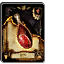 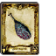 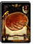 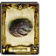 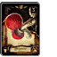 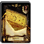 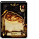 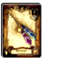 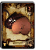 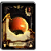 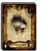 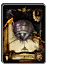
 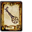 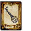 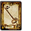 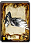 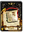 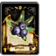 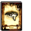 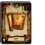 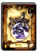 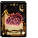 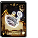
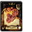 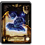 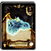 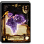 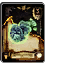 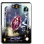 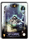 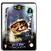 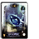 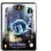 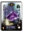 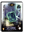
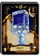 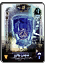 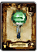 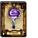 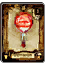  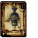 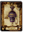 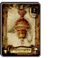 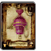 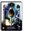 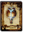
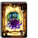 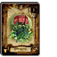 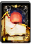 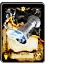        
           
           
           
           
           
           
           
           
           
           
           
           
           
           
           
           
           
           
           
           
           
           
           
           
           
           
           
           
           
           
           
           
           
 
