[EN](../en/items.md) | [JA](../ja/items.md) | [PT-BR](../pt-br/items.md)

# Items

Row icons: items verified against the game's own icon index (`icon.bin` / `spr_icon.xst`) show their **real extracted icon**; the rest show a **class sprite** from the same atlas — a family representative, not per-item art.

| icon | family | icon | family |
|---|---|---|---|
|  | `KA` one-hand axes |  | `KS` one-hand swords |
|  | `RA` two-hand axes | 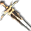 | `RS` two-hand swords |
| 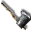 | `MA` clubs/maces |  | `NC` knuckles |
|  | `NI` daggers |  | `SP` spears |
|  | `ST` staves | 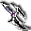 | `YU` bows |
| 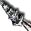 | `QI` arrows/quivers | | |

Items from the nine v4 `*2` tables. Click any icon to enlarge.

### v4 table totals

| table | records | jp resolved | method |
|---|---|---|---|
| `weapon2` | 358 | 358 | exact 358/358 from XBE entity table (`0x5F8C18` `+0x20..+0x24`) |
| `helm2` | 100 | 100 | exact 100/100 from XBE entity table (`0x5F8C18` `+0x20..+0x24`) |
| `boots2` | 76 | 70 | exact 70/76 from XBE entity table (6 unused slots `0xFFFF`) |
| `armor2` | 94 | 89 | exact 89/94 from XBE entity table (5 unused slots `0xFFFF`) |
| `shield2` | 48 | 48 | exact 48/48 from XBE entity table (`0x5F8C18` `+0x20..+0x24`) |
| `acces2` | 90 | 90 | exact 90/90 from XBE entity table (`0x5F8C18` `+0x20..+0x24`) |
| `food2` | 21 | 21 | exact 21/21 from XBE entity table (`0x5F8C18` `+0x20..+0x24`) |
| `potion2` | 38 | 28 | exact 28/38 from XBE entity table (10 unused slots `0xFFFF`) |
| `book2` | 410 | 321 | exact 321/410 from XBE entity table (89 unused/monster slots `0xFFFF`) |

### weapon2 — weapons (358)

The second block is the **weapon family code** — the same codes used by the
job-restricted skill prefixes. Family readings come from the resolved names
(hand axe / francisca for KA, short sword / rapier for KS, etc.):

| code | count | names show |
|---|---|---|
| `KS` | 57 | one-handed swords (ショートソード, レイピア, ロングソード…) |
| `ST` | 47 | staves & rods (クォータースタッフ, セプター, ヒールロッド…) |
| `KA` | 40 | one-handed axes (ハンドアックス, フランキスカ, ウォーアックス…) |
| `NI` | 35 | daggers (ダガー, ダーク, ソードブレイカー…) |
| `RA` | 35 | two-handed axes (ブロードアックス, グレートアックス, バルディッシュ…) |
| `SP` | 33 | spears (ショートスピア, パルチザン, トライデント…) |
| `RS` | 32 | two-handed swords (バスタードソード, クレイモア, トゥハンドソード…) |
| `MA` | 30 | clubs & maces (クラブ, メイス, モーニングスター…) |
| `NC` | 20 | knuckles / fist weapons (ウッドグローブ, トライネイル, アイアンスパイク…) |
| `YU` | 20 | bows (ウッドボウ, ロングボウ, グレートボウ…) |
| `QI` | 10 | arrows & quivers (アロー, ファイアーアロー…) |

`*_D4SUMMON` rows are the 「大魔の〜」 set; `*_EX` rows are upgraded variants
(ＥＸ names). `WEAPON2_QI10_SHINKI` resolves to `スパークアロー`.

#### `KA` (40)

| item | name | notes |
|---|---|---|
| 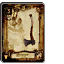 `WEAPON2_KA01_HANDAXE` | ハンドアックス | [No.021 · 0-2126 · C · FLv2] 片手斧／攻撃力：３０ 装備に必要なＳＴＲ：５ — 片手斧／一般的で簡素な斧 |
| 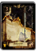 `WEAPON2_KA02_FRANCISCA` | フランキスカ | [No.263 · 0-2513 · UC · FLv2] 片手斧／攻撃力：５１ 装備に必要なＳＴＲ：１０ — 片手斧／地中海近くに住む勇猛 な民族が愛用していた斧 |
| 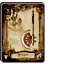 `WEAPON2_KA03_WARAXE` | ウォーアックス | [No.102 · 0-2128 · C · FLv2] 片手斧／攻撃力：３６ 装備に必要なＳＴＲ：１０ — 片手斧／工具としての斧から発 展して完成された戦闘用の斧 |
| 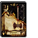 `WEAPON2_KA04_BATTLEAXE` | バトルアックス | [No.103 · 0-2129 · UC · FLv3] 片手斧／攻撃力：５７ 装備に必要なＳＴＲ：１５ — 片手斧／ウォーアックスをより 戦闘向けにしたもの |
| `WEAPON2_KA05_GOLDAXE` | ゴールドアックス | 片手斧／攻撃力：４０ 装備に必要なＳＴＲ：１５ — 片手斧／耐久性に優れた黄金で 作られたバトルアックス |
| 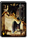 `WEAPON2_KA06_SHIELDAXE` | シールドアックス | [No.259 · 0-2507 · UC · FLv2] 片手斧／攻撃力：５２ 装備に必要なＳＴＲ：１０ — 片手斧／斧の柄の部分に鉄製の シールドを装着したもの |
| `WEAPON2_KA07_TRISTRAM` | ウェルテクス | 片手斧／攻撃力：３０ 装備に必要なＳＴＲ：なし — 片手斧／神王のみが所有するこ とを許された伝説の斧 |
|  `WEAPON2_KA08_WARAXE` | ★ウォーアックス | 片手斧／攻撃力：３８ 装備に必要なＳＴＲ：なし — 片手斧／工具としての斧から発 展して完成された戦闘用の斧 |
| 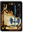 `WEAPON2_KA09_SILVERAXE` | シルバーアックス | [No.258 · 0-2506 · UC · FLv2] 片手斧／攻撃力：３０ 装備に必要なＳＴＲ：５ — 片手斧／純銀製で作りの見事な 美しいバトルアックス |
| 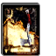 `WEAPON2_KA10_EGRET` | イーグレット | [No.369 · 0-2611 · UC · FLv2] 片手斧／攻撃力：４６ 装備に必要なＳＴＲ：１０ — 片手斧／相手に向かって投げる ことができる片手斧 |
| `WEAPON2_KA11_ORC` | 邪鬼の斧 | 片手斧／攻撃力：４２ 装備に必要なＳＴＲ：なし — 片手斧／オークが使用している 片手斧。合成不可 |
| `WEAPON2_KA12_ORC_F` | 邪鬼の炎斧 | 片手斧／攻撃力：２７ 装備に必要なＳＴＲ：なし — 片手斧／オークが使用している 炎属性の片手斧。合成不可 |
| `WEAPON2_KA13_ORC_I` | 邪鬼の氷斧 | 片手斧／攻撃力：２７ 装備に必要なＳＴＲ：なし — 片手斧／オークが使用している 氷属性の片手斧。合成不可 |
| `WEAPON2_KA14_ORC_T` | 邪鬼の雷斧 | 片手斧／攻撃力：２７ 装備に必要なＳＴＲ：なし — 片手斧／オークが使用している 雷属性の片手斧。合成不可 |
| `WEAPON2_KA15_MINOTAUR` | 牛人の斧 | 片手斧／攻撃力：５０ 装備に必要なＳＴＲ：なし — 片手斧／ミノタウロスが使用し ている片手斧。合成不可 |
| `WEAPON2_KA16_MINOTAUR_S` | 牛人兵の斧 | 片手斧／攻撃力：５５ 装備に必要なＳＴＲ：なし — 片手斧／ミノタウロスサージェ ントが持つ斧。合成不可 |
| `WEAPON2_KA17_ROBBER` | 山賊の斧 | 片手斧／攻撃力：４４ 装備に必要なＳＴＲ：なし — 片手斧／ロバーが使用している 片手斧。合成不可 |
| 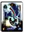 `WEAPON2_KA18_CRESCENT` | クレセントアックス | [No.449 · 1-0374 · R · FLv3] 片手斧／攻撃力：６７ 装備に必要なＳＴＲ：１５ — 片手斧／曲線美を描く三日月型 の刀身が人気を集めている斧 |
| 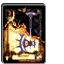 `WEAPON2_KA19_TAMECHAN2` | スパイクアックス | [No.372 · 0-2614 · UC · FLv3] 片手斧／攻撃力：６１ 装備に必要なＳＴＲ：１５ — 片手斧／先端に刃ではなく鋭利 な突起を付けた斧 |
| `WEAPON2_KA20_DEMONCHOPPER` | ブラックハチェット | 片手斧／攻撃力：４０ 装備に必要なＳＴＲ：１５ — 片手斧／闇の力を含んだ鉱石で 作られている黒き斧 |
| `WEAPON2_KA21_LILAC` | サイレントアックス | 片手斧／攻撃力：７０ 装備に必要なＳＴＲ：１５ — 片手斧／斬りつけた者の魔力を 封じることができる斧 |
| `WEAPON2_KA22_ARMOREDFROG` | 蛙の斧 | 片手斧／攻撃力：４０ 装備に必要なＳＴＲ：なし — 片手斧／アーマードフロッグが 使用している斧。合成不可 |
| `WEAPON2_KA23_GIANTSTONE` | 岩石巨人の斧 | 片手斧／攻撃力：５５ 装備に必要なＳＴＲ：なし — 片手斧／ストーンジャイアント が使用している斧。合成不可 |
| `WEAPON2_KA24_MUGGER` | 悪漢の斧 | 片手斧／攻撃力：４２ 装備に必要なＳＴＲ：なし — 片手斧／マガーが使用している 斧。合成不可 |
| `WEAPON2_KA25_HORIHORI` | トライブアックス | 片手斧／攻撃力：５５ 装備に必要なＳＴＲ：１０ — 片手斧／蛮族の戦士たちが愛用 している太陽の力を持った斧 |
| 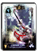 `WEAPON2_KA26_CRIMSON` | クリムゾンライン | [No.506 · 1-0494 · R · FLv4] 片手斧／攻撃力：６８ 装備に必要なＳＴＲ：１５ — 片手斧／使用者の血液と引き換 えに破壊の力を授けるという斧 |
| `WEAPON2_KA27_BATTLE` | ★バトルアックス | 片手斧／攻撃力：５０ 装備に必要なＳＴＲ：なし — 片手斧／ウォーアックスをより 戦闘向けにしたもの |
| `WEAPON2_KA28_SHIELD` | ★シールドアックス | 片手斧／攻撃力：４６ 装備に必要なＳＴＲ：なし — 片手斧／斧の柄の部分に鉄製の シールドを装着したもの |
| 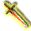 `WEAPON2_KA29_FRANCISCA` | ★フランキスカ | 片手斧／攻撃力：４６ 装備に必要なＳＴＲ：なし — 片手斧／地中海近くに住む勇猛 な民族が愛用していた斧 |
| `WEAPON2_KA30_HORIHORI` | ★トライブアックス | 片手斧／攻撃力：５０ 装備に必要なＳＴＲ：なし — 片手斧／蛮族の戦士たちが愛用 している太陽の力を持った斧 |
| `WEAPON2_KA31_MACHINE_GOLD` | 黄金機兵の斧 | 片手斧／攻撃力：５６ 装備に必要なＳＴＲ：なし — 片手斧／メタルナイトゴールド が使用している斧。合成不可 |
| `WEAPON2_KA32_HEVY_GUARD` | 重装兵の斧 | 片手斧／攻撃力：６０ 装備に必要なＳＴＲ：なし — 片手斧／ヘヴィガードが使用 している片手斧。合成不可 |
| `WEAPON2_KA33_D4SHINKI1` | ヘルクリムゾン | 片手斧／攻撃力：８５ 装備に必要なＳＴＲ：１５ — 片手斧／持ち主を喰らう斧が 地獄の業火に包まれた姿 |
| `WEAPON2_KA34_BARBARIAN` | バルバロスアックス | 片手斧／攻撃力：７２ 装備に必要なＳＴＲ：１５ — 片手斧／蛮族の勇者だけに与え られた戦闘用に特化した斧 |
| `WEAPON2_KA35_D4SHINKI2` | バロックアックス | 片手斧／攻撃力：７６ 装備に必要なＳＴＲ：１５ — 片手斧／色とりどりで不思議な 形をした斧 |
| `WEAPON2_KA36_SUNLIGHT` | サンライトアックス | 片手斧／攻撃力：７３ 装備に必要なＳＴＲ：１５ — 片手斧／対となる片割れが揃う と真の力が解放されるという斧 |
| `WEAPON2_KA37_MOONLIGHT` | ムーンライトアックス | 片手斧／攻撃力：７５ 装備に必要なＳＴＲ：１５ — 片手斧／対となる片割れが揃う と真の力が解放されるという斧 |
| `WEAPON2_KA38_GLADIATOR` | カタストロフィー | 片手斧／攻撃力：７９ 装備に必要なＳＴＲ：１５ — 片手斧／歴史を見守ってきたと いわれる破滅の斧 |
| `WEAPON2_KA39_D4SUMMON` | 大魔の斧 | 片手斧／攻撃力：８４ 召喚モンスター専用の武器 — 片手斧／魔界の名工が生み 出した、魔物のみが扱える斧 |
| `WEAPON2_KA40_TRISTRAM_EX` | ウェルテクスＥＸ | 片手斧／攻撃力：６０ 装備に必要なＳＴＲ：なし — 片手斧／神器ウェルテクスを 模して作られた片手斧 |

#### `KS` (57)

| item | name | notes |
|---|---|---|
| 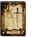 `WEAPON2_KS01_SHORTSWORD` | ショートソード | [No.018 · 0-2108 · C · FLv2] 片手剣／攻撃力：２４ 装備に必要なＳＴＲ：５ — 片手剣／新米冒険者向きの剣 |
| 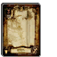 `WEAPON2_KS02_RAPIER` | レイピア | [No.494 · 0-2700 · C · FLv2] 片手剣／攻撃力：３３ 装備に必要なＳＴＲ：５ — 片手剣／軽装備の相手を斬り つけることに重きを置いた剣 |
| 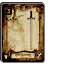 `WEAPON2_KS03_LONGSWORD` | ロングソード | [No.099 · 0-2110 · C · FLv2] 片手剣／攻撃力：３４ 装備に必要なＳＴＲ：５ — 片手剣／馬上から相手を突き刺 すのに適した長さを持つ |
| 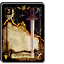 `WEAPON2_KS04_VIKINGSWORD` | ヴァイキングソード | [No.253 · 0-2501 · UC · FLv2] 片手剣／攻撃力：３０ 装備に必要なＳＴＲ：５ — 片手剣／海の民ヴァイキングが 用いた肉厚で幅広な鉄製の剣 |
| 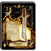 `WEAPON2_KS05_FALCHION` | ファルシオン | [No.250 · 0-2365 · UC · FLv3] 片手剣／攻撃力：５４ 装備に必要なＳＴＲ：１０ — 片手剣／砂漠の民が愛用してい る重量感ある片刃の曲刀 |
| 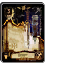 `WEAPON2_KS06_GLADIUS` | グラディウス | [No.019 · 0-2113 · UC · FLv2] 片手剣／攻撃力：４５ 装備に必要なＳＴＲ：１０ — 片手剣／闘技場で戦う剣闘士た ちも愛用する扱いやすい剣 |
| 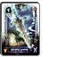 `WEAPON2_KS07_MITHRILBLADE` | ミスリルソード | [No.173 · 1-0248 · R · FLv4] 片手剣／攻撃力：６５ 装備に必要なＳＴＲ：１０ — 片手剣／魔力を持つ金属のミス リルを材料にした硬く軽い剣 |
| 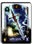 `WEAPON2_KS08_MAGICSWORD` | マジックソード | [No.375 · 1-0371 · R · FLv4] 片手剣／攻撃力：１２ 装備に必要なＳＴＲ：なし — 片手剣／魔術儀式用の祭具で魔 法の使用が可能になる |
| `WEAPON2_KS09_EXCALIBUR` | エクスカリバー | 片手剣／攻撃力：６８ 装備に必要なＳＴＲ：１５ — 片手剣／鋭さと強靱さを併せ持 った伝説の名剣 |
| 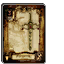 `WEAPON2_KS10_FAKESWORD` | フェイクソード | [No.495 · 0-2701 · C · FLv2] 片手剣／攻撃力：３５ 装備に必要なＳＴＲ：５ — 片手剣／剣全体に煌びやかな装 飾を施した鑑賞用の長剣 |
| `WEAPON2_KS11_BOLG` | アンサラー | 片手剣／攻撃力：３０ 装備に必要なＳＴＲ：なし — 片手剣／神王のみが所有するこ とを許された伝説の片手剣 |
| 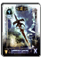 `WEAPON2_KS12_WHITESWORD` | デモンズソード | [No.501 · 1-0430 · R · FLv4] 片手剣／攻撃力：４０ 装備に必要なＳＴＲ：１０ — 片手剣／禍々しい黒き力を封じ 込められた長剣 |
| 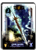 `WEAPON2_KS13_BLACKSWORD` | グレートソード | [No.448 · 1-0373 · R · FLv3] 片手剣／攻撃力：６５ 装備に必要なＳＴＲ：１５ — 片手剣／優れた者だけが携える 美麗な装飾と切れ味を誇る剣 |
| `WEAPON2_KS14_KNIGHTSWORD` | ナイトソード | 片手剣／攻撃力：６１ 装備に必要なＳＴＲ：１０ — 片手剣／真の騎士にのみ使用が 許される伝説の剣 |
|  `WEAPON2_KS15_LONGSWORD` | ★ロングソード | 片手剣／攻撃力：３２ 装備に必要なＳＴＲ：なし — 片手剣／馬上から相手を突き刺 すのに適した長さを持つ |
|  `WEAPON2_KS16_FALCHION` | ★ファルシオン | 片手剣／攻撃力：４９ 装備に必要なＳＴＲ：なし — 片手剣／砂漠の民が愛用してい る重量感ある片刃の曲刀 |
| 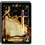 `WEAPON2_KS17_CULANNSWORD` | クランのショートソード | [0-2350 · UC · FLv1] 片手剣／攻撃力：３２ 装備に必要なＳＴＲ：なし — 片手剣／名工クランが鍛えた初 心者向けの片手剣 |
| 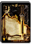 `WEAPON2_KS18_VIPERFUNG` | バイパーファング | [No.256 · 0-2504 · UC · FLv2] 片手剣／攻撃力：５０ 装備に必要なＳＴＲ：１０ — 片手剣／毒蛇の牙のような鋭い 切先をした片手剣 |
| 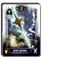 `WEAPON2_KS19_ROYAL` | ホーリーソード | [No.502 · 1-0431 · R · FLv4] 片手剣／攻撃力：３５ 装備に必要なＳＴＲ：５ — 片手剣／白き力に護られた長剣 で俊敏に振り回せる |
| `WEAPON2_KS20_SKELETON` | 骸骨の剣 | 片手剣／攻撃力：３３ 装備に必要なＳＴＲ：なし — 片手剣／スケルトンが使用して いる片手剣。合成不可 |
| `WEAPON2_KS21_SKELETON_F` | 骸骨の炎剣 | 片手剣／攻撃力：２３ 装備に必要なＳＴＲ：なし — 片手剣／スケルトンが使用して いる炎属性の片手剣。合成不可 |
| `WEAPON2_KS22_SKELETON_I` | 骸骨の氷剣 | 片手剣／攻撃力：２３ 装備に必要なＳＴＲ：なし — 片手剣／スケルトンが使用して いる氷属性の片手剣。合成不可 |
| `WEAPON2_KS23_SKELETON_T` | 骸骨の雷剣 | 片手剣／攻撃力：２３ 装備に必要なＳＴＲ：なし — 片手剣／スケルトンが使用して いる雷属性の片手剣。合成不可 |
| `WEAPON2_KS24_LIZARDMAN` | 蜥蜴の剣 | 片手剣／攻撃力：４０ 装備に必要なＳＴＲ：なし — 片手剣／リザードマンが使用し ている片手剣。合成不可 |
| `WEAPON2_KS25_LIZARDNAN_G` | 蜥蜴護衛兵の剣 | 片手剣／攻撃力：５５ 装備に必要なＳＴＲ：なし — 片手剣／ガーディアンリザード マンが持つ剣。合成不可 |
| `WEAPON2_KS26_GOBLIN_F` | 小鬼の剣 | 片手剣／攻撃力：２７ 装備に必要なＳＴＲ：なし — 片手剣／ゴブリンファイターが 使用している片手剣。合成不可 |
| `WEAPON2_KS27_GOBLIN_L` | 小鬼君主の剣 | 片手剣／攻撃力：４５ 装備に必要なＳＴＲ：なし — 片手剣／ゴブリンロードが使用 している片手剣。合成不可 |
| `WEAPON2_KS28_KOBOLD_W` | 犬頭鬼の剣 | 片手剣／攻撃力：３３ 装備に必要なＳＴＲ：なし — 片手剣／コボルドウォリアーが 使用している片手剣。合成不可 |
| `WEAPON2_KS29_SAPPHIRE` | サファイアエッジ | 片手剣／攻撃力：８３ 装備に必要なＳＴＲ：１０ — 片手剣／特別な力を持つ純粋な サファイアで作られた宝剣 |
| `WEAPON2_KS30_BLOODY` | ブラッディスパイン | 片手剣／攻撃力：５５ 装備に必要なＳＴＲ：１０ — 片手剣／吸血鬼の如き牙を持つ 歪な形状の剣 |
| `WEAPON2_KS31_SHAMSHIR` | シャムシール | 片手剣／攻撃力：５０ 装備に必要なＳＴＲ：５ — 片手剣／振り下ろすことで 威力を最大限に発揮する剣 |
| `WEAPON2_KS32_DIVIDER` | ディバイドソード | 片手剣／攻撃力：６７ 装備に必要なＳＴＲ：１０ — 片手剣／鉈を戦闘用に改良した 断ち切ることに優れた剣 |
| 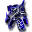 `WEAPON2_KS33_WING` | ウィングソード | 片手剣／攻撃力：５８ 装備に必要なＳＴＲ：５ — 片手剣／神速で飛ぶことのでき る鳥の羽で作られた剣 |
| `WEAPON2_KS34_GUARDIANFROG` | 蛙護衛兵の剣 | 片手剣／攻撃力：４２ 装備に必要なＳＴＲ：なし — 片手剣／ガーディアンフロッグ が使用している剣。合成不可 |
| `WEAPON2_KS35_ARMOREDFROGKING` | 蛙王の剣 | 片手剣／攻撃力：４７ 装備に必要なＳＴＲ：なし — 片手剣／アーマードフロッグ キングの剣。合成不可 |
| `WEAPON2_KS36_GIANTFIRE` | 炎巨人の剣 | 片手剣／攻撃力：４０ 装備に必要なＳＴＲ：なし — 片手剣／ファイアージャイアン トが使用している剣。合成不可 |
| `WEAPON2_KS37_GIANTICE` | 氷巨人の剣 | 片手剣／攻撃力：４０ 装備に必要なＳＴＲ：なし — 片手剣／アイスジャイアントが 使用している剣。合成不可 |
| `WEAPON2_KS38_SHINOBI` | 忍の刀 | 片手剣／攻撃力：４５ 装備に必要なＳＴＲ：なし — 片手剣／シノビが使用している 刀。合成不可 |
| 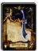 `WEAPON2_KS39_SEIRYUTOU` | 青龍刀 | [No.496 · 0-2702 · UC · FLv2] 片手剣／攻撃力：５２ 装備に必要なＳＴＲ：１０ — 片手剣／古来より伝わる幅広の 切っ先を持つ大振りの刀 |
| `WEAPON2_KS40_DRAGONSLAYER` | ドラゴンソード | 片手剣／攻撃力：６４ 装備に必要なＳＴＲ：１５ — 片手剣／ドラゴンのしなやかな 尻尾の皮膚で作られた剣 |
|  `WEAPON2_KS41_RAPIER` | ★レイピア | 片手剣／攻撃力：３１ 装備に必要なＳＴＲ：なし — 片手剣／軽装備の相手を斬り つけることに重きを置いた剣 |
| `WEAPON2_KS42` | ★ヴァイキングソード | 片手剣／攻撃力：２６ 装備に必要なＳＴＲ：なし — 片手剣／海の民ヴァイキングが 用いた肉厚で幅広な鉄製の剣 |
|  `WEAPON2_KS43_GLADIUS` | ★グラディウス | 片手剣／攻撃力：４０ 装備に必要なＳＴＲ：なし — 片手剣／闘技場で戦う剣闘士た ちも愛用する扱いやすい剣 |
| `WEAPON2_KS44_SHAMSHIR` | ★シャムシール | 片手剣／攻撃力：４５ 装備に必要なＳＴＲ：なし — 片手剣／振り下ろすことで 威力を最大限に発揮する剣 |
| `WEAPON2_KS45_SEIRYUTOU` | ★青龍刀 | 片手剣／攻撃力：４６ 装備に必要なＳＴＲ：なし — 片手剣／古来より伝わる幅広の 切っ先を持つ大振りの刀 |
| `WEAPON2_KS46_MACHINE` | 機兵の剣 | 片手剣／攻撃力：５８ 装備に必要なＳＴＲ：なし — 片手剣／メタルナイトが使用 している片手剣。合成不可 |
| `WEAPON2_KS47_MACHINE_DARK` | 暗黒機兵の剣 | 片手剣／攻撃力：４５ 装備に必要なＳＴＲ：なし — 片手剣／メタルナイトダークが 使用している片手剣。合成不可 |
| `WEAPON2_KS48_DUBIOUS` | 怪人の剣 | 片手剣／攻撃力：５０ 装備に必要なＳＴＲ：なし — 片手剣／デヴィアスが使用して いる片手剣。合成不可 |
| `WEAPON2_KS49_MASTERRAPIER` | マスターレイピア | 片手剣／攻撃力：５３ 装備に必要なＳＴＲ：５ — 片手剣／相手を斬りつけること よりも刺すことを重視した剣 |
| `WEAPON2_KS50_TRIBE` | トライブエッジ | 片手剣／攻撃力：５０ 装備に必要なＳＴＲ：１０ — 片手剣／大きく湾曲した刃が 特徴的な片手剣 |
| `WEAPON2_KS51_D4SHINKI2` | グラディエーター | 片手剣／攻撃力：７３ 装備に必要なＳＴＲ：１０ — 片手剣／罪人の怨念が 込められた剣 |
| `WEAPON2_KS52_BRINGER_R` | ライトブリンガー | 片手剣／攻撃力：７２ 装備に必要なＳＴＲ：１０ — 片手剣／絶大な力を恐れた神々 が二つに分断したといわれる剣 |
| `WEAPON2_KS53_BRINGER_L` | シャドウブリンガー | 片手剣／攻撃力：７４ 装備に必要なＳＴＲ：１０ — 片手剣／絶大な力を恐れた神々 が二つに分断したといわれる剣 |
| `WEAPON2_KS54_RAGNAROK` | アロンダイト | 片手剣／攻撃力：７７ 装備に必要なＳＴＲ：１０ — 片手剣／人々の運命を司ると いわれる幻の剣 |
| `WEAPON2_KS55_PIRATE` | 海賊の剣 | 片手剣／攻撃力：４８ 装備に必要なＳＴＲ：なし — 片手剣／ショーティーが使用 している剣。合成不可 |
| `WEAPON2_KS56_D4SUMMON` | 大魔の剣 | 片手剣／攻撃力：８２ 召喚モンスター専用の武器 — 片手剣／魔界の名工が生み 出した、魔物のみが扱える剣 |
| `WEAPON2_KS57_BOLG_EX` | アンサラーＥＸ | 片手剣／攻撃力：５８ 装備に必要なＳＴＲ：なし — 片手剣／神器アンサラーを 模して作られた剣 |

#### `MA` (30)

| item | name | notes |
|---|---|---|
| 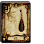 `WEAPON2_MA01_CLUB` | クラブ | [No.025 · 0-2141 · C · FLv2] 棍棒／攻撃力：２１ 装備に必要なＳＴＲ：５ — 棍棒／簡単で最も原始的な鈍器 |
| 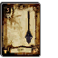 `WEAPON2_MA02_MACE` | メイス | [No.104 · 0-2142 · C · FLv2] 棍棒／攻撃力：３４ 装備に必要なＳＴＲ：５ — 棍棒／殴打することに特化した 鉄製の鈍器 |
| 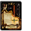 `WEAPON2_MA03_WARHAMMER` | ウォーハンマー | [No.249 · 0-2364 · UC · FLv3] 棍棒／攻撃力：５１ 装備に必要なＳＴＲ：１０ — 棍棒／金槌を武器へと改良した 戦槌 |
| 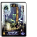 `WEAPON2_MA04_MORNINGSTAR` | モーニングスター | [No.503 · 1-0437 · R · FLv3] 棍棒／攻撃力：６４ 装備に必要なＳＴＲ：１０ — 棍棒／たくさんの棘が突き出た 鉄球が特徴的なメイス |
| 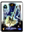 `WEAPON2_MA05_MITHRILHAMMER` | ミスリルハンマー | [No.454 · 1-0420 · R · FLv4] 棍棒／攻撃力：６３ 装備に必要なＳＴＲ：１０ — 棍棒／魔力を持つ金属のミスリ ルを材料にしたハンマー |
| `WEAPON2_MA06_FAYHAMMER` | ペルグランデ | 棍棒／攻撃力：３０ 装備に必要なＳＴＲ：なし — 棍棒／一振りで世界を変えると される絶大な威力を持つ槌 |
| `WEAPON2_MA07_MJOLLNIR` | ノームハンマー | 棍棒／攻撃力：６９ 装備に必要なＳＴＲ：５ — 棍棒／地の精霊ノームが作り 出したといわれる棍棒 |
|  `WEAPON2_MA08_MACE` | ★メイス | 棍棒／攻撃力：３４ 装備に必要なＳＴＲ：なし — 棍棒／殴打することに特化した 鉄製の鈍器 |
| 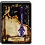 `WEAPON2_MA09_HOLYMACE` | ホーリーメイス | [No.262 · 0-2510 · UC · FLv3] 棍棒／攻撃力：３４ 装備に必要なＳＴＲ：５ — 棍棒／聖なる力で覆われている 鉄製の鈍器 |
| 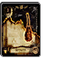 `WEAPON2_MA10_OAKCLUB` | 樫のクラブ | [0-2351 · UC · FLv1] 棍棒／攻撃力：３０ 装備に必要なＳＴＲ：なし — 棍棒／小振りで女性でも扱える 強度の高い鈍器 |
| 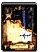 `WEAPON2_MA11_WARHAMMER_EX` | ブライトハンマー | [No.368 · 0-2610 · UC · FLv2] 棍棒／攻撃力：４３ 装備に必要なＳＴＲ：５ — 棍棒／叩くだけでなく、刺す ことも可能なハンマー |
| `WEAPON2_MA12_GOBLIN_H` | 小鬼の棍棒 | 棍棒／攻撃力：４４ 装備に必要なＳＴＲ：なし — 棍棒／ホブゴブリンが使用して いる棍棒。合成不可 |
| `WEAPON2_MA13_KOBOLD` | 犬頭鬼の棍棒 | 棍棒／攻撃力：３０ 装備に必要なＳＴＲ：なし — 棍棒／コボルドが使用している 棍棒。合成不可 |
| `WEAPON2_MA14_TROLL` | 巨人の棍棒 | 棍棒／攻撃力：５０ 装備に必要なＳＴＲ：なし — 棍棒／トロルが使用している棍 棒。合成不可 |
| 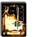 `WEAPON2_MA15_TAMECHAN1` | スクエアメイス | [No.444 · 0-2615 · UC · FLv3] 棍棒／攻撃力：５７ 装備に必要なＳＴＲ：１０ — 棍棒／四角く重い槌が振り下ろ すスピードを高めてくれる棍棒 |
| `WEAPON2_MA16_STRIKE` | スマッシュハンマー | 棍棒／攻撃力：６１ 装備に必要なＳＴＲ：１０ — 棍棒／見た目の美しさと高い 威力を兼ね備えた白金製の棍棒 |
| `WEAPON2_MA17_TIREI` | クェイクハンマー | 棍棒／攻撃力：８１ 装備に必要なＳＴＲ：１０ — 棍棒／大地の力を吸収し大地を 共鳴させることができる棍棒 |
| `WEAPON2_MA18_HORIHORI` | ジャッジハンマー | 棍棒／攻撃力：４９ 装備に必要なＳＴＲ：１０ — 棍棒／悪しき心を持つ者に神罰 を下すという裁きの棍棒 |
| `WEAPON2_MA19_SHIMENKI` | 鬼面の大槌 | 棍棒／攻撃力：６３ 装備に必要なＳＴＲ：１０ — 棍棒／鬼の角のような鋭い突起 がついた不気味な大槌 |
| 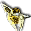 `WEAPON2_MA20_WARHAMMER` | ★ウォーハンマー | 棍棒／攻撃力：４５ 装備に必要なＳＴＲ：なし — 棍棒／金槌を武器へと改良した 戦槌 |
| `WEAPON2_MA21_SHINKI` | ストリクトメイス | 棍棒／攻撃力：６６ 装備に必要なＳＴＲ：５ — 棍棒／厳格な司教のみが 扱うことを許された棍棒 |
|  `WEAPON2_MA22_WARHAMMER_EX` | ★ブライトハンマー | 棍棒／攻撃力：３８ 装備に必要なＳＴＲ：なし — 棍棒／叩くだけでなく、刺す ことも可能なハンマー |
| `WEAPON2_MA23_HORIHORI` | ★ジャッジハンマー | 棍棒／攻撃力：４４ 装備に必要なＳＴＲ：なし — 棍棒／悪しき心を持つ者に神罰 を下すという裁きの棍棒 |
| `WEAPON2_MA24_JADE` | 翡翠の大槌 | 棍棒／攻撃力：５５ 装備に必要なＳＴＲ：１０ — 棍棒／高僧の法力を注入した 翡翠から作られた棍棒 |
| `WEAPON2_MA25_D4SHINKI1` | レオパルドハンマー | 棍棒／攻撃力：７５ 装備に必要なＳＴＲ：１０ — 棍棒／豹の毛並みを模した 紋様が彫られた鎚 |
| `WEAPON2_MA26_D4SHINKI2` | タイニーワンド | 棍棒／攻撃力：４３ 装備に必要なＳＴＲ：なし — 棍棒／棍棒でありながら片手で 扱う杖のような珍しい武器 |
| `WEAPON2_MA27_D4SHINKI3` | ブリガンティア | 棍棒／攻撃力：７３ 装備に必要なＳＴＲ：１０ — 棍棒／女神ブリガンティアの 名を冠するメイス |
| `WEAPON2_MA28_PIKOHAMMER` | 錘 | 棍棒／攻撃力：６０ 装備に必要なＳＴＲ：なし — 棍棒／舞踊でも使用される 鑑賞性の高い武器 |
| `WEAPON2_MA29_D4SUMMON` | 大魔の棍棒 | 棍棒／攻撃力：８１ 召喚モンスター専用の武器 — 棍棒／魔界の名工が生み出した 魔物のみが扱える棍棒 |
| `WEAPON2_MA30_FAYHAMMER_EX` | ペルグランデＥＸ | 棍棒／攻撃力：５６ 装備に必要なＳＴＲ：なし — 棍棒／神器ペルグランデを 模して作られた槌 |

#### `NC` (20)

| item | name | notes |
|---|---|---|
|  `WEAPON2_NC01_WAKKY` | ウッドグローブ | ナックル／攻撃力：３０ 装備に必要なＳＴＲ：なし — ナックル／初心者が愛用してい る木製のナックル |
| `WEAPON2_NC02_TAMECHAN` | トライネイル | ナックル／攻撃力：５１ 装備に必要なＳＴＲ：なし — ナックル／敵を貫き、切り裂く 鋭利な爪がついたナックル |
| 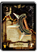 `WEAPON2_NC03_MASSU` | アイアンスパイク | [No.367 · 0-2605 · UC · FLv2] ナックル／攻撃力：４２ 装備に必要なＳＴＲ：なし — ナックル／３本の棘がついた 鋼鉄のナックル |
| `WEAPON2_NC04_WAKKY2` | クランチフィスト | ナックル／攻撃力：６７ 装備に必要なＳＴＲ：なし — ナックル／獰猛な獣の牙で作ら れたグローブ |
| 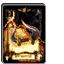 `WEAPON2_NC05_THRUST` | スラストナックル | [No.446 · 0-2617 · UC · FLv2] ナックル／攻撃力：５４ 装備に必要なＳＴＲ：なし — ナックル／硬く折れないという 獣の角で作られたグローブ |
| 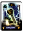 `WEAPON2_NC06_BLADE` | ブレイドナックル | [No.451 · 1-0378 · R · FLv3] ナックル／攻撃力：５８ 装備に必要なＳＴＲ：なし — ナックル／鋼鉄の短刀をつけて 極限まで威力を高めたグローブ |
| 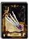 `WEAPON2_NC07_TETSUTUME` | アサシンネイル | [No.497 · 0-2705 · UC · FLv2] ナックル／攻撃力：４５ 装備に必要なＳＴＲ：なし — ナックル／４本の長い鉤爪を 有した独特な形状のグローブ |
| `WEAPON2_NC08_SHINKI` | ピアスグローブ | ナックル／攻撃力：６４ 装備に必要なＳＴＲ：なし — ナックル／軽い金属で作られた 殺傷力の高いグローブ |
|  `WEAPON2_NC09_WAKKY` | ★ウッドグローブ | ナックル／攻撃力：２８ 装備に必要なＳＴＲ：なし — ナックル／初心者が愛用してい る木製のナックル |
|  `WEAPON2_NC10_MASSU` | ★アイアンスパイク | ナックル／攻撃力：３７ 装備に必要なＳＴＲ：なし — ナックル／３本の棘がついた 鋼鉄のナックル |
| 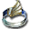 `WEAPON2_NC11_FLAME` | フレイムナックル | ナックル／攻撃力：４０ 装備に必要なＳＴＲ：なし — ナックル／全てを焼き尽くす ほどの業火を纏うグローブ |
| `WEAPON2_NC12_TAMECHAN` | ★トライネイル | ナックル／攻撃力：４６ 装備に必要なＳＴＲ：なし — ナックル／敵を貫き、切り裂く 鋭利な爪がついたナックル |
| `WEAPON2_NC13_BEAST` | 猛獣の爪 | ナックル／攻撃力：６０ 装備に必要なＳＴＲ：なし — ナックル／フィモールが使用し ているナックル。合成不可 |
| `WEAPON2_NC14_KAISER` | カイザーナックル | ナックル／攻撃力：８０ 装備に必要なＳＴＲ：なし — ナックル／己の気をオーラ状に 具現化して攻撃する事ができる |
| `WEAPON2_NC15_MONK` | 拳聖の手甲 | ナックル／攻撃力：６３ 装備に必要なＳＴＲ：なし — ナックル／数珠を模した宝玉が 特徴の格闘武器 |
| `WEAPON2_NC16_D4SHINKI` | ベインナックル | ナックル／攻撃力：６８ 装備に必要なＳＴＲ：なし — ナックル／邪神と契約を交わし 授かったと伝わる異形の武器 |
| 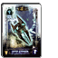 `WEAPON2_NC17_SONIC` | ソニックナックル | [No.504 · 1-0491 · R · FLv4] ナックル／攻撃力：６０ 装備に必要なＳＴＲ：なし — ナックル／特殊な魔法力を込め た金属で作られたグローブ |
| `WEAPON2_NC18_GODHAND` | ゴッドハンド | ナックル／攻撃力：７２ 装備に必要なＳＴＲ：なし — ナックル／大地も震える神の 名を持つ究極の拳 |
| `WEAPON2_NC19_GHOUL` | 食屍鬼の手甲 | ナックル／攻撃力：４８ 装備に必要なＳＴＲ：なし — ナックル／テラーが使用して いるナックル。合成不可 |
| `WEAPON2_NC20_D4SUMMON` | 大魔の爪 | ナックル／攻撃力：８２ 召喚モンスター専用の武器 — ナックル／魔界の名工が生み 出した、魔物のみが扱える爪 |

#### `NI` (35)

| item | name | notes |
|---|---|---|
| 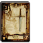 `WEAPON2_NI01_DAGGER` | ダガー | [No.026 · 0-2147 · C · FLv2] ナイフ／攻撃力：１８ 装備に必要なＳＴＲ：なし — ナイフ／小型の簡素なナイフ |
| 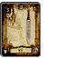 `WEAPON2_NI02_DIRK` | ダーク | [No.105 · 0-2148 · C · FLv2] ナイフ／攻撃力：２５ 装備に必要なＳＴＲ：なし — ナイフ／高地に住む勇猛な部族 が愛用するナイフ |
| 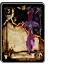 `WEAPON2_NI03_POISONDAGGER` | ポイズンダガー | [No.106 · 0-2149 · UC · FLv2] ナイフ／攻撃力：３３ 装備に必要なＳＴＲ：なし — ナイフ／刃に毒を仕込ませてい る暗殺用ナイフ |
|  `WEAPON2_NI04_SWORDBRAKER` | ソードブレイカー | [No.264 · 0-2514 · UC · FLv2] ナイフ／攻撃力：３６ 装備に必要なＳＴＲ：なし — ナイフ／剣を受け止め破壊する ために作られた短剣 |
|  `WEAPON2_NI05_KOTETSU` | 古鉄 | [No.499 · 1-0436 · R · FLv3] ナイフ／攻撃力：５４ 装備に必要なＳＴＲ：なし — ナイフ／東洋の刀匠が生み出し た名作と名高い小刀 |
| `WEAPON2_NI06_GALESDAGGER` | グラキエース | ナイフ／攻撃力：３０ 装備に必要なＳＴＲ：なし — ナイフ／長期の斬り合いを想定 して作られた短剣 |
|  `WEAPON2_NI07_DIRK` | ★ダーク | ナイフ／攻撃力：２４ 装備に必要なＳＴＲ：なし — ナイフ／高地に住む勇猛な部族 が愛用するナイフ |
|  `WEAPON2_NI08_ROUND` | ラウンドナイフ | [No.254 · 0-2502 · UC · FLv2] ナイフ／攻撃力：１４ 装備に必要なＳＴＲ：なし — ナイフ／殺傷能力は低いが 強烈な一撃が出やすいナイフ |
|  `WEAPON2_NI09_STUNDAGGER` | スタンダガー | [No.255 · 0-2503 · UC · FLv2] ナイフ／攻撃力：３０ 装備に必要なＳＴＲ：なし — ナイフ／刃に神経毒を仕込んだ 特殊なナイフ |
| `WEAPON2_NI10_GOBLIN_C` | 小鬼の包丁 | ナイフ／攻撃力：２５ 装備に必要なＳＴＲ：なし — ナイフ／ゴブリンコックが使用 している包丁。合成不可 |
| `WEAPON2_NI11_THIEF` | 盗賊のダガー | ナイフ／攻撃力：３３ 装備に必要なＳＴＲ：なし — ナイフ／シーフが使用している ダガー。合成不可 |
| `WEAPON2_NI12_ASSASSIN` | 暗殺者のダガー | ナイフ／攻撃力：４５ 装備に必要なＳＴＲ：なし — ナイフ／アサシンが使用してい るダガー。合成不可 |
|  `WEAPON2_NI13_KERIS` | クリス | [No.371 · 0-2613 · UC · FLv2] ナイフ／攻撃力：４７ 装備に必要なＳＴＲ：なし — ナイフ／特徴的な刀身を持つ お守りとして扱われていた短剣 |
|  `WEAPON2_NI14_TAMECHAN2` | ロットナイフ | [No.445 · 0-2616 · UC · FLv2] ナイフ／攻撃力：４２ 装備に必要なＳＴＲ：なし — ナイフ／あらゆる毒素を帯びた 恐るべき能力を持つナイフ |
| `WEAPON2_NI15_BURGLAR` | 夜盗のナイフ | ナイフ／攻撃力：３０ 装備に必要なＳＴＲ：なし — ナイフ／バーグラーが使用して いるナイフ。合成不可 |
| `WEAPON2_NI16_CROSS` | グレアナイフ | ナイフ／攻撃力：５１ 装備に必要なＳＴＲ：なし — ナイフ／太陽の光を象った 大きめの刃を持つナイフ |
| `WEAPON2_NI17_SHINKI` | フィートナイフ | ナイフ／攻撃力：５８ 装備に必要なＳＴＲ：なし — ナイフ／軽量化のために刃の 中心をくり抜いてあるナイフ |
|  `WEAPON2_NI18_POISONDAGGER` | ★ポイズンダガー | ナイフ／攻撃力：２９ 装備に必要なＳＴＲ：なし — ナイフ／刃に毒を仕込ませてい る暗殺用ナイフ |
|  `WEAPON2_NI19_ROUND` | ★ラウンドナイフ | ナイフ／攻撃力：１１ 装備に必要なＳＴＲ：なし — ナイフ／殺傷能力は低いが 強烈な一撃が出やすいナイフ |
| `WEAPON2_NI20_SHINKI` | デヴァステイター | ナイフ／攻撃力：７６ 装備に必要なＳＴＲ：なし — ナイフ／武器自体に盗みの能力 が備わっている希少なナイフ |
| `WEAPON2_NI21_SAIJYOUI` | ツインエッジ | ナイフ／攻撃力：６４ 装備に必要なＳＴＲ：なし — ナイフ／柄の両端に鋭い刃を 持たせた扱いの難しいナイフ |
| `WEAPON2_NI22_TAMECHAN2` | ★ロットナイフ | ナイフ／攻撃力：３７ 装備に必要なＳＴＲ：なし — ナイフ／あらゆる毒素を帯びた 恐るべき能力を持つナイフ |
| `WEAPON2_NI23_SHINKI` | サイ | ナイフ／攻撃力：６２ 装備に必要なＳＴＲ：なし — ナイフ／武道具として古くから 存在する鉄芯で作られた武器 |
|  `WEAPON2_NI24_STUNDAGGER` | ★スタンダガー | ナイフ／攻撃力：２６ 装備に必要なＳＴＲ：なし — ナイフ／刃に神経毒を仕込んだ 特殊なナイフ |
|  `WEAPON2_NI25_MOULIN` | ムーラン | [No.500 · 1-0493 · R · FLv4] ナイフ／攻撃力：６３ 装備に必要なＳＴＲ：なし — ナイフ／暗殺者に古くから伝わ る風車に似た形状の短剣 |
| `WEAPON2_NI26_KUKRI` | ククリ | ナイフ／攻撃力：６１ 装備に必要なＳＴＲ：なし — ナイフ／生活の知恵から生まれ た機能性の高い短剣 |
| `WEAPON2_NI27_SILENT` | サイレントナイフ | ナイフ／攻撃力：４６ 装備に必要なＳＴＲ：なし — ナイフ／刃に沈黙効果のある薬 を塗りこんだ暗殺用ナイフ |
| `WEAPON2_NI28_PANIC` | パニックナイフ | ナイフ／攻撃力：４３ 装備に必要なＳＴＲ：なし — ナイフ／刃に混乱効果のある薬 を塗りこんだ暗殺用ナイフ |
| `WEAPON2_NI29_D4SHINKI1` | ルーンナイフ | ナイフ／攻撃力：６７ 装備に必要なＳＴＲ：なし — ナイフ／鮮やかな橙色の刀身が 美しい短剣 |
| `WEAPON2_NI30_D4SHINKI2` | ツヴァイダガー | ナイフ／攻撃力：２４ 装備に必要なＳＴＲ：なし — ナイフ／美しい宝珠の装飾を 施した鑑賞性の高いナイフ |
| `WEAPON2_NI31_D4SHINKI3` | インフィニティー | ナイフ／攻撃力：７１ 装備に必要なＳＴＲ：なし — ナイフ／無限の可能性を秘めて いると伝わる伝説の短剣 |
| `WEAPON2_NI32_PIRATE` | 海賊の短剣 | ナイフ／攻撃力：４５ 装備に必要なＳＴＲ：なし — ナイフ／ランキーが使用して いるナイフ。合成不可 |
| `WEAPON2_NI33_D4SUMMON` | 大魔の短剣 | ナイフ／攻撃力：７６ 召喚モンスター専用の武器 — ナイフ／魔界の名工が生み 出した、魔物のみが扱える短剣 |
| `WEAPON2_NI34_CATHAND` | キャットスティンガー | ナイフ／攻撃力：５３ 装備に必要なＳＴＲ：なし — ナイフ／猫の振る舞いをヒント に作製されたナイフ |
| `WEAPON2_NI35_GALESDAGGER_EX` | グラキエースＥＸ | ナイフ／攻撃力：５２ 装備に必要なＳＴＲ：なし — ナイフ／神器グラキエースを 模して作られた短剣 |

#### `QI` (10)

| item | name | notes |
|---|---|---|
|  `WEAPON2_QI01_ARROW` | アロー | [No.028 · 0-2161 · C · FLv1] 矢筒／攻撃力：５～ 装備に必要なＳＴＲ：なし — 矢筒／安物で威力は望めないが 取り回しのよい矢 |
|  `WEAPON2_QI02_FIREARROW` | ファイアーアロー | [No.029 · 0-2162 · UC · FLv1] 矢筒／攻撃力：４～ 装備に必要なＳＴＲ：なし — 矢筒／矢先が炎に包まれている 魔法の矢 |
|  `WEAPON2_QI03_COLDARROW` | コールドアロー | [No.030 · 0-2163 · UC · FLv1] 矢筒／攻撃力：４～ 装備に必要なＳＴＲ：なし — 矢筒／矢先に冷気を封じ込めた 魔法の矢 |
|  `WEAPON2_QI04_SPARKARROW` | サンダーアロー | [No.031 · 0-2164 · UC · FLv1] 矢筒／攻撃力：４～ 装備に必要なＳＴＲ：なし — 矢筒／矢先に雷の力を封じ込め た魔法の矢 |
|  `WEAPON2_QI05_MITHRILARROW` | ダークアロー | [No.267 · 0-2517 · UC · FLv1] 矢筒／攻撃力：４～ 装備に必要なＳＴＲ：なし — 矢筒／闇の力により風切り音を 立てずに相手へ突き刺さる矢 |
|  `WEAPON2_QI06_HOLYARROW` | ホーリーアロー | [No.268/156 · 0-2518 · UC · FLv1] 矢筒／攻撃力：４～ 装備に必要なＳＴＲ：なし — 矢筒／聖なる力を矢先に封じ込 めた矢 |
| `WEAPON2_QI07_TAIYOUNOYA` | 太陽の矢 | 矢筒／攻撃力：６０～ 装備に必要なＳＴＲ：なし — 矢筒／太陽の如き熱さと輝かし さを併せ持った矢 |
| `WEAPON2_QI08_SILVERARROW` | 銀の矢 | 矢筒／攻撃力：１００ 装備に必要なＳＴＲ：なし — 矢筒／銀を嫌うモンスターには 強力な武器となる矢 |
| `WEAPON2_QI09_SHINKI` | ベアリアスアロー | 矢筒／攻撃力：８～ 装備に必要なＳＴＲ：なし — 矢筒／様々な種類の毒が鏃に 塗ってある猛毒の矢 |
| `WEAPON2_QI10_SHINKI` | スパークアロー | 矢筒／攻撃力：６～ 装備に必要なＳＴＲ：なし — 矢筒／標的に刺さると爆発する 鏃に火薬の込められた矢 |

#### `RA` (35)

| item | name | notes |
|---|---|---|
|  `WEAPON2_RA01_BROADAXE` | ブロードアックス | [No.022 · 0-2132 · C · FLv2] 両手斧／攻撃力：３１ 装備に必要なＳＴＲ：１０ — 両手斧／新米戦士向きの両手斧 |
|  `WEAPON2_RA02_GREATAXE` | グレートアックス | [No.174 · 0-2133 · UC · FLv3] 両手斧／攻撃力：５４ 装備に必要なＳＴＲ：１０ — 両手斧／両刃に改良して破壊力 殺傷能力を向上させた大斧 |
|  `WEAPON2_RA03_BERDYSH` | バルディッシュ | [0-2704 · UC · FLv3] 両手斧／攻撃力：６０ 装備に必要なＳＴＲ：１５ — 両手斧／槍のように突き刺すこ ともできる長尺の斧 |
|  `WEAPON2_RA04_MITHRILAXE` | ミスリルアックス | [No.377 · 1-0416 · R · FLv4] 両手斧／攻撃力：７０ 装備に必要なＳＴＲ：１０ — 両手斧／魔力を持つ金属のミス リルを材料にした軽量の斧 |
| `WEAPON2_RA05_DWARVENWARAXE` | ドワーブンアックス | 両手斧／攻撃力：６２ 装備に必要なＳＴＲ：１５ — 両手斧／ドワーフ族の戦士のみ に与えられる戦斧 |
| `WEAPON2_RA06_SICKLEAXE` | イビルシックル | 両手斧／攻撃力：６３ 装備に必要なＳＴＲ：１５ — 両手斧／巨大な鎌を思わせる刃 渡りの長い斧 |
|  `WEAPON2_RA07_BROADAXE` | ★ブロードアックス | 両手斧／攻撃力：３１ 装備に必要なＳＴＲ：なし — 両手斧／新米戦士などが扱う両 手で扱う斧 |
|  `WEAPON2_RA08_DIVINEAXE` | ディバインアックス | [No.374 · 1-0370 · R · FLv3] 両手斧／攻撃力：４７ 装備に必要なＳＴＲ：１５ — 両手斧／女神像に加護の力が 宿っている両手斧 |
|  `WEAPON2_RA09_STEELAXE` | スチールアックス | [No.260 · 0-2508 · UC · FLv2] 両手斧／攻撃力：３３ 装備に必要なＳＴＲ：なし — 両手斧／刃先は巨大だが軽量で 非力な者でも扱える両手斧 |
|  `WEAPON2_RA10_GREAT_EX1` | ブーストアックス | [No.261 · 0-2509 · UC · FLv2] 両手斧／攻撃力：４８ 装備に必要なＳＴＲ：５ — 両手斧／軽量に作られた、素早 い動きにも対応できる両手斧 |
| `WEAPON2_RA11_SKELETON_D` | 骸骨の斧 | 両手斧／攻撃力：４０ 装備に必要なＳＴＲ：なし — 両手斧／ドワーブンスケルトン が持つ斧。合成不可 |
| `WEAPON2_RA12_SKELETON_DF` | 骸骨の炎斧 | 両手斧／攻撃力：３０ 装備に必要なＳＴＲ：なし — 両手斧／ドワーブンスケルトン が持つ炎属性の斧。合成不可 |
| `WEAPON2_RA13_SKELETON_DI` | 骸骨の氷斧 | 両手斧／攻撃力：３０ 装備に必要なＳＴＲ：なし — 両手斧／ドワーブンスケルトン が持つ氷属性の斧。合成不可 |
| `WEAPON2_RA14_SKELETON_DT` | 骸骨の雷斧 | 両手斧／攻撃力：３０ 装備に必要なＳＴＲ：なし — 両手斧／ドワーブンスケルトン が持つ雷属性の斧。合成不可 |
| `WEAPON2_RA15_GNOLL` | 犬頭鬼の斧 | 両手斧／攻撃力：３８ 装備に必要なＳＴＲ：なし — 両手斧／ノールが使用している 両手斧。合成不可 |
| `WEAPON2_RA16_ORC_C` | 邪鬼首領の斧 | 両手斧／攻撃力：５２ 装備に必要なＳＴＲ：なし — 両手斧／オークチーフが使用し ている両手斧。合成不可 |
| `WEAPON2_RA17_ORC_CF` | 邪鬼首領の炎斧 | 両手斧／攻撃力：４０ 装備に必要なＳＴＲ：なし — 両手斧／オークチーフが使用し ている炎属性の斧。合成不可 |
| `WEAPON2_RA18_ORC_CI` | 邪鬼首領の氷斧 | 両手斧／攻撃力：４０ 装備に必要なＳＴＲ：なし — 両手斧／オークチーフが使用し ている氷属性の斧。合成不可 |
| `WEAPON2_RA19_ORC_CT` | 邪鬼首領の雷斧 | 両手斧／攻撃力：４０ 装備に必要なＳＴＲ：なし — 両手斧／オークチーフが使用し ている雷属性の斧。合成不可 |
| `WEAPON2_RA20_MINOTAUR_B` | 牛人の両手斧 | 両手斧／攻撃力：５５ 装備に必要なＳＴＲ：なし — 両手斧／ミノタウロスバトラー が持つ両手斧。合成不可 |
| `WEAPON2_RA21_MAGICIAN_D` | 黒魔術師の鎌 | 両手斧／攻撃力：４０ 装備に必要なＳＴＲ：なし — 両手斧／ダークマジシャンが 使用している大鎌。合成不可 |
|  `WEAPON2_RA22_RUIN` | ルーインアックス | [No.450 · 1-0375 · R · FLv3] 両手斧／攻撃力：７２ 装備に必要なＳＴＲ：２０ — 両手斧／光を闇に変えるほどの 禍々しき力を持つ暗黒の斧 |
| `WEAPON2_RA23_MINOTAURCOMMANDER` | 牛人司令官の斧 | 両手斧／攻撃力：６３ 装備に必要なＳＴＲ：なし — 両手斧／ミノタウロスコマンダ ーが使用している斧。合成不可 |
| `WEAPON2_RA24_BATTLEHOE` | バトルピック | 両手斧／攻撃力：６４ 装備に必要なＳＴＲ：１５ — 両手斧／機能性の高い農具の 鍬を参考にして作られた斧 |
| `WEAPON2_RA25_MARTIANDAWN` | インペリアルアックス | 両手斧／攻撃力：７４ 装備に必要なＳＴＲ：２０ — 両手斧／大地の守り神がこの 世にもたらしたといわれる斧 |
|  `WEAPON2_RA26_BERDYSH` | ★バルディッシュ | 両手斧／攻撃力：５３ 装備に必要なＳＴＲ：なし — 両手斧／槍のように突き刺すこ ともできる長尺の斧 |
| `WEAPON2_RA27_SAIJYOUI` | グランドアックス | 両手斧／攻撃力：７５ 装備に必要なＳＴＲ：１５ — 両手斧／身の丈を超える ほどの大きさを誇る大斧 |
|  `WEAPON2_RA28_GREATAXE` | ★グレートアックス | 両手斧／攻撃力：４８ 装備に必要なＳＴＲ：なし — 両手斧／両刃に改良して破壊力 殺傷能力を向上させた大斧 |
| `WEAPON2_RA29_D4SHINKI1` | ブルートマホーク | 両手斧／攻撃力：７９ 装備に必要なＳＴＲ：１５ — 両手斧／見る者を魅了する美し い青い刃が特徴的な大斧 |
| `WEAPON2_RA30_D4SHINKI2` | アポカリプス | 両手斧／攻撃力：９０ 装備に必要なＳＴＲ：２０ — 両手斧／黙示録の名を冠する 究極の両手斧 |
| `WEAPON2_RA31_GIGANT` | ギガントアックス | 両手斧／攻撃力：８８ 装備に必要なＳＴＲ：２０ — 両手斧／非常に重く、使い手を 選ぶ巨大な斧 |
| `WEAPON2_RA32_EXECUTIONER` | ウィンドアックス | 両手斧／攻撃力：７８ 装備に必要なＳＴＲ：１５ — 両手斧／蒼い双刃が美しい風を イメージした斧 |
| `WEAPON2_RA33_APOCALYPSE` | ディストピア | 両手斧／攻撃力：８４ 装備に必要なＳＴＲ：２０ — 両手斧／非常に強力な負の オーラを纏った魔斧 |
| `WEAPON2_RA34_GIANT` | 一つ目巨人の斧 | 両手斧／攻撃力：７０ 装備に必要なＳＴＲ：なし — 両手斧／サイクロプスが使用 している斧。合成不可 |
| `WEAPON2_RA35_D4SUMMON` | 大魔の大斧 | 両手斧／攻撃力：８９ 召喚モンスター専用の武器 — 両手斧／魔界の名工が生み 出した、魔物のみが扱える大斧 |

#### `RS` (31)

| item | name | notes |
|---|---|---|
|  `WEAPON2_RS01_BASTARDSWORD` | バスタードソード | [No.020 · 0-2120 · C · FLv2] 両手剣／攻撃力：３０ 装備に必要なＳＴＲ：１０ — 両手剣／新米戦士向きの大剣 |
|  `WEAPON2_RS02_CLAYMORE` | クレイモア | 両手剣／攻撃力：５９ 装備に必要なＳＴＲ：１５ — 両手剣／高地に住む非常に勇猛 な部族が愛用していた大剣 |
|  `WEAPON2_RS03_ZWEIHANDER` | トゥハンドソード | [No.100 · 0-2122 · UC · FLv2] 両手剣／攻撃力：４８ 装備に必要なＳＴＲ：１０ — 両手剣／身の丈を越えるほどの 長さを持つ大剣 |
| `WEAPON2_RS04_STEAM` | スチームソード | 両手剣／攻撃力：６３～ 装備に必要なＳＴＲ：１０ — 両手剣／刀身から蒸気を吹き出 す巨大な剣 |
|  `WEAPON2_RS05_EXECUTIONERSSWORD` | 断罪の剣 | [No.498 · 1-0434 · R · FLv3] 両手剣／攻撃力：５３ 装備に必要なＳＴＲ：１０ — 両手剣／死刑執行人が罪人の首 を切り落とす際に使った刀剣 |
|  `WEAPON2_RS06_DRAGONKILLER` | ドラゴンキラー | [No.101 · 1-0250 · R · FLv4] 両手剣／攻撃力：６９ 装備に必要なＳＴＲ：２０ — 両手剣／ドラゴンの硬い皮膚を 切り裂くために作られた剣 |
| `WEAPON2_RS07_MURASAME` | 砕魔刀 | 両手剣／攻撃力：６９ 装備に必要なＳＴＲ：１５ — 両手剣／東の国から伝わった刀 身に水気を帯びた宝刀 |
| `WEAPON2_RS08_PALAMEDES` | クラウ・ソナス | 両手剣／攻撃力：３０ 装備に必要なＳＴＲ：なし — 両手剣／神王のみが所有するこ とを許された伝説の大剣 |
|  `WEAPON2_RS09_FLAMESWORD` | フレイムソード | [No.554 · 1-0435 · R · FLv3] 両手剣／攻撃力：４１ 装備に必要なＳＴＲ：１５ — 両手剣／斬りつけられた者を業 火で焼き尽くす刀剣 |
|  `WEAPON2_RS10_ZWEIHANDER` | ★トゥハンドソード | 両手剣／攻撃力：４２ 装備に必要なＳＴＲ：なし — 両手剣／身の丈を越えるほどの 長さを持つ大剣 |
|  `WEAPON2_RS11_SQUARETHRUST` | スクエアスラッシャー | [No.257 · 0-2505 · UC · FLv2] 両手剣／攻撃力：４５ 装備に必要なＳＴＲ：１０ — 両手剣／敵を突き刺して投げる ことができる優れた両手剣 |
| `WEAPON2_RS12_SKELETON_K` | 骸骨騎士の剣 | 両手剣／攻撃力：５０ 装備に必要なＳＴＲ：なし — 両手剣／スケルトンナイトが使 用している両手剣。合成不可 |
| `WEAPON2_RS13_SKELETON_KF` | 骸骨騎士の炎剣 | 両手剣／攻撃力：３５ 装備に必要なＳＴＲ：なし — 両手剣／スケルトンナイトが持 つ、炎属性の剣。合成不可 |
| `WEAPON2_RS14_SKELETON_KI` | 骸骨騎士の氷剣 | 両手剣／攻撃力：３５ 装備に必要なＳＴＲ：なし — 両手剣／スケルトンナイトが持 つ氷属性の剣。合成不可 |
| `WEAPON2_RS15_SKELETON_KT` | 骸骨騎士の雷剣 | 両手剣／攻撃力：３５ 装備に必要なＳＴＲ：なし — 両手剣／スケルトンナイトが持 つ雷属性の両手剣。合成不可 |
| `WEAPON2_RS16_TAMECHAN1` | ジェミニブレード | 両手剣／攻撃力：６５ 装備に必要なＳＴＲ：１５ — 両手剣／Ａ＋Ｇで光と闇の属性 を剣に宿すことができる大剣 |
| `WEAPON2_RS17_CRYSTALEDGE` | リフレクトソード | 両手剣／攻撃力：７６ 装備に必要なＳＴＲ：１５ — 両手剣／魔力を跳ね返す力を 持つ美しい長剣 |
| `WEAPON2_RS18_SHINKI1` | ガーディアンブレード | 両手剣／攻撃力：７３ 装備に必要なＳＴＲ：１５ — 両手剣／幅広で強固な刃が 盾の役目も果たす大剣 |
|  `WEAPON2_RS19_CLAYMORE` | ★クレイモア | 両手剣／攻撃力：５４ 装備に必要なＳＴＲ：なし — 両手剣／高地に住む非常に勇猛 な部族が愛用していた大剣 |
| `WEAPON2_RS20_SHINKI` | 魔道の剣 | 両手剣／攻撃力：４０ 装備に必要なＳＴＲ：なし — 両手剣／使う者の心が反映する という魔道の力を持つ剣 |
|  `WEAPON2_RS22_SAIJYOUI` | アルティマソード | [No.505 · 1-0492 · R · FLv4] 両手剣／攻撃力：７２ 装備に必要なＳＴＲ：１５ — 両手剣／他に類を見ない破壊力 を持つ究極という名の大剣 |
|  `WEAPON2_RS23_SQUARETHRUST` | ★スクエアスラッシャー | 両手剣／攻撃力：４０ 装備に必要なＳＴＲ：なし — 両手剣／敵を突き刺して投げる ことができる優れた両手剣 |
|  `WEAPON2_RS24_ICEBRAND` | アイスブランド | [No.556 · 1-0432 · R · FLv3] 両手剣／攻撃力：４１ 装備に必要なＳＴＲ：１５ — 両手剣／灼熱の地においても 溶けない氷塊で作られた大剣 |
|  `WEAPON2_RS25_THUNDERBLADE` | サンダーブレード | [No.555 · 1-0433 · R · FLv3] 両手剣／攻撃力：４１ 装備に必要なＳＴＲ：１５ — 両手剣／稲妻の力を宿した 見た目にも珍しい剣 |
| `WEAPON2_RS26_CALIBURN` | カリバーン | 両手剣／攻撃力：７７ 装備に必要なＳＴＲ：１５ — 両手剣／二対の紅い刀身が王を 見定めるといわれる選定の剣 |
| `WEAPON2_RS27_MURAKUMO` | 天叢雲剣 | 両手剣／攻撃力：７８ 装備に必要なＳＴＲ：１０ — 両手剣／東方の国で八頭の龍を 討伐した際に出てきたという剣 |
| `WEAPON2_RS28_AVALON` | レオンハート | 両手剣／攻撃力：８２ 装備に必要なＳＴＲ：１０ — 両手剣／生命の源である大地の 力を授けられたという大剣 |
| `WEAPON2_RS29_SKELETON` | 骸骨貴族の剣 | 両手剣／攻撃力：６５ 装備に必要なＳＴＲ：なし — 両手剣／デュラハンが使用して いる剣。合成不可 |
| `WEAPON2_RS30_D4SUMMON` | 大魔の大剣 | 両手剣／攻撃力：８７ 召喚モンスター専用の武器 — 両手剣／魔界の名工が生み 出した、魔物のみが扱える大剣 |
| `WEAPON2_RS31_SLAP` | ハリセンブレード | 両手剣／攻撃力：６５ 装備に必要なＳＴＲ：なし — 両手剣／祭りや祝い事で用いた とされる剣状の道具 |
| `WEAPON2_RS32_PALAMEDES_EX` | クラウ・ソナスＥＸ | 両手剣／攻撃力：６２ 装備に必要なＳＴＲ：なし — 両手剣／神器クラウ・ソナスを 模して作られた剣 |

#### `SP` (33)

| item | name | notes |
|---|---|---|
|  `WEAPON2_SP01_SHORTSPEAR` | ショートスピア | [No.023 · 0-2136 · C · FLv2] 槍／攻撃力：２４ 装備に必要なＳＴＲ：５ — 槍／戦闘訓練用の簡素な槍 |
|  `WEAPON2_SP02_AWLPIKE` | オウルパイク | [No.370 · 0-2612 · UC · FLv2] 槍／攻撃力：５０ 装備に必要なＳＴＲ：５ — 槍／敵に向かって投げ飛ばす ことができる軽量の槍 |
|  `WEAPON2_SP03_PARTIZAN` | パルチザン | [No.024 · 0-2138 · UC · FLv2] 槍／攻撃力：３６ 装備に必要なＳＴＲ：５ — 槍／矛先を鍛え上げ、殺傷能力 を向上させた槍 |
|  `WEAPON2_SP04_TRIDENT` | トライデント | [No.214 · 0-2139 · UC · FLv3] 槍／攻撃力：４６ 装備に必要なＳＴＲ：５ — 槍／海の神のシンボルとも言え る武器。雷撃を秘めている |
|  `WEAPON2_SP05_MITHRILSPEAR` | ミスリルスピア | [No.453 · 1-0419 · R · FLv4] 槍／攻撃力：６７ 装備に必要なＳＴＲ：１０ — 槍／魔力を持つ金属のミスリル を材料にした鋭利で軽量な槍 |
|  `WEAPON2_SP06_ICELANCE` | アイススピア | [No.215 · 1-0257 · R · FLv3] 槍／攻撃力：１２ 装備に必要なＳＴＲ：１０ — 槍／氷の力を詰め込んで穂先を 創り上げたという槍 |
| `WEAPON2_SP07_HOLYLANCE` | ガイ・ボルガ | 槍／攻撃力：３０ 装備に必要なＳＴＲ：なし — 槍／英雄クーフーリンが師匠の スカアハから授かった魔槍 |
|  `WEAPON2_SP08_PARTIZAN` | ★パルチザン | 槍／攻撃力：３１ 装備に必要なＳＴＲ：なし — 槍／矛先を鍛え上げ、殺傷能力 を向上させた槍 |
|  `WEAPON2_SP09_FRAME` | フレイムスピア | [No.323 · 1-0344 · R · FLv3] 槍／攻撃力：１２ 装備に必要なＳＴＲ：１０ — 槍／熱き炎の魔力を穂先に封じ 込めた魔槍 |
|  `WEAPON2_SP10_THUNDER` | サンダースピア | [No.324 · 1-0345 · R · FLv3] 槍／攻撃力：１２ 装備に必要なＳＴＲ：１０ — 槍／雷の破壊力を穂先に備えた 扱う者を選ばない魔槍 |
| `WEAPON2_SP11_LIZARDMAN_L` | 蜥蜴槍兵の槍 | 槍／攻撃力：４２ 装備に必要なＳＴＲ：なし — 槍／リザードマンランサーが使 用している槍。合成不可 |
| `WEAPON2_SP12_LIZARDMAN_R` | 王族蜥蜴の槍 | 槍／攻撃力：６０ 装備に必要なＳＴＲ：なし — 槍／ロイヤルリザードマンが使 用している槍。合成不可 |
| `WEAPON2_SP13_KOBOLD_L` | 犬頭鬼の槍 | 槍／攻撃力：４５ 装備に必要なＳＴＲ：なし — 槍／コボルドリーダーが使用し ている槍。合成不可 |
| `WEAPON2_SP14_SALAMANDER` | 火蜥蜴の槍 | 槍／攻撃力：３０ 装備に必要なＳＴＲ：なし — 槍／サラマンダーが使用してい る槍。合成不可 |
| `WEAPON2_SP15_SALAMANDER_F` | 氷蜥蜴の槍 | 槍／攻撃力：３０ 装備に必要なＳＴＲ：なし — 槍／フロストサラマンダーが使 用している槍。合成不可 |
| `WEAPON2_SP16_SALAMANDER_H` | 雷蜥蜴の槍 | 槍／攻撃力：３０ 装備に必要なＳＴＲ：なし — 槍／ハイサラマンダーが使用し ている槍。合成不可 |
| `WEAPON2_SP17_SPLITLANCE` | スプリットランス | 槍／攻撃力：６９ 装備に必要なＳＴＲ：１０ — 槍／突いた時に威力を発揮する ２本の鋭い矛先を備えた槍 |
|  `WEAPON2_SP18_MUSSU` | グレイブ | [No.447 · 1-0376 · R · FLv3] 槍／攻撃力：６７ 装備に必要なＳＴＲ：１０ — 槍／独特な形状の大振りな刃が 取り付けられた扱いやすい槍 |
| `WEAPON2_SP19_RUSHING` | ラッシングスピア | 槍／攻撃力：６１ 装備に必要なＳＴＲ：１０ — 槍／奥深くまで突き刺さるよう 極限まで研ぎ澄ました槍 |
| `WEAPON2_SP20_SHINKI1` | ニードルランス | 槍／攻撃力：７３ 装備に必要なＳＴＲ：１０ — 槍／善なる神を打ち倒したと 伝えられる黒き魔槍 |
|  `WEAPON2_SP21_AWLPIKE` | ★オウルパイク | 槍／攻撃力：４４ 装備に必要なＳＴＲ：なし — 槍／敵に向かって投げ飛ばす ことができる軽量の槍 |
|  `WEAPON2_SP22_TRIDENT` | ★トライデント | 槍／攻撃力：４１ 装備に必要なＳＴＲ：なし — 槍／海の神のシンボルとも言え る武器。雷撃を秘めている |
| `WEAPON2_SP23_BRIONAC` | ブリューナク | 槍／攻撃力：７５ 装備に必要なＳＴＲ：１０ — 槍／Ａ＋Ｇで聖なる光の矢を 放つ至高の槍 |
|  `WEAPON2_SP24_FRAME` | ★フレイムスピア | 槍／攻撃力：１０ 装備に必要なＳＴＲ：なし — 槍／熱き炎の魔力を穂先に封じ 込めた魔槍 |
|  `WEAPON2_SP25_ICELANCE` | ★アイススピア | 槍／攻撃力：１０ 装備に必要なＳＴＲ：なし — 槍／氷の力を詰め込んで穂先を 創り上げたという槍 |
|  `WEAPON2_SP26_THUNDER` | ★サンダースピア | 槍／攻撃力：１０ 装備に必要なＳＴＲ：なし — 槍／雷の破壊力を穂先に備えた 扱う者を選ばない魔槍 |
| `WEAPON2_SP27_PARALYZER` | パラライザー | 槍／攻撃力：４８ 装備に必要なＳＴＲ：５ — 槍／魔力が込められた槍 Ａ＋Ｇで属性を付加する |
| `WEAPON2_SP28_SNAKEHALBERD` | 軍神の蛇矛 | 槍／攻撃力：７４ 装備に必要なＳＴＲ：５ — 槍／蛇のようにうねった穂先の 形状が特徴的な東洋の槍 |
| `WEAPON2_SP29_D4SHINKI` | ノーザンハルバード | 槍／攻撃力：７５ 装備に必要なＳＴＲ：１０ — 槍／北方の寒冷地より伝わる 巨大な刃をもった槍 |
| `WEAPON2_SP30_DYSTOPIA` | 虚空閃 | 槍／攻撃力：８０ 装備に必要なＳＴＲ：１０ — 槍／虚空ですらも閃くと伝わる 古の魔槍 |
| `WEAPON2_SP31_FISHMAN` | 魚人の槍 | 槍／攻撃力：５０ 装備に必要なＳＴＲ：なし — 槍／ギルマンが使用している槍 合成不可 |
| `WEAPON2_SP32_D4SUMMON` | 大魔の槍 | 槍／攻撃力：８５ 召喚モンスター専用の武器 — 槍／魔界の名工が生み出した 魔物のみが扱える槍 |
| `WEAPON2_SP33_HOLYLANCE_EX` | ガイ・ボルガＥＸ | 槍／攻撃力：６１ 装備に必要なＳＴＲ：なし — 槍／神器ガイ・ボルガを 模して作られた槍 |

#### `ST` (47)

| item | name | notes |
|---|---|---|
|  `WEAPON2_ST01_QUARTERSTAFF` | クォータースタッフ | [No.165 · 0-2152 · C · FLv2] 杖／攻撃力：２０ 装備に必要なＳＴＲ：なし — 杖／魔法使い向きの簡素な杖 |
|  `WEAPON2_ST02_SCEPTER` | セプター | [No.166 · 0-2153 · C · FLv2] 杖／攻撃力：２５ 装備に必要なＳＴＲ：なし — 杖／装飾を施した木製の王笏 |
|  `WEAPON2_ST03_WIZARDSSTAFF` | ウィザードスタッフ | [No.207 · 0-2154 · UC · FLv2] 杖／攻撃力：３３ 装備に必要なＳＴＲ：なし — 杖／高名な魔術師も愛用してい る魔力が向上する杖 |
| `WEAPON2_ST04_HEALROD` | ヒールロッド | 杖／攻撃力：５０ 装備に必要なＳＴＲ：なし — 杖／生命を司る大樹の枝で 作られた不思議な杖 |
|  `WEAPON2_ST05_MAGICALSTAFF` | クリスタルワンド | [No.373 · 0-2618 · UC · FLv2] 杖／攻撃力：３５ 装備に必要なＳＴＲ：なし — 杖／先端に冠した宝玉の力で所 有者の魔力を向上させる |
|  `WEAPON2_ST06_POWERSTAFF` | パワースタッフ | 杖／攻撃力：５７ 装備に必要なＳＴＲ：５ — 杖／杖に込めた魔法の力を物理 的な攻撃力へと転換させる |
| `WEAPON2_ST07_MYRDDINSTAFF` | ユーデクス | 杖／攻撃力：３０ 装備に必要なＳＴＲ：なし — 杖／魔族間のみに伝えられる究 極の杖 |
|  `WEAPON2_ST08_WIZARDSSTAFF` | ★ウィザードスタッフ | 杖／攻撃力：２８ 装備に必要なＳＴＲ：なし — 杖／高名な魔術師も愛用してい る魔力が向上する杖 |
|  `WEAPON2_ST09_MANASTAFF` | マナスタッフ | 杖／攻撃力：４５ 装備に必要なＳＴＲ：なし — 杖／物理攻撃に優れている強度 の高い杖 |
|  `WEAPON2_ST10_MAGESTAFF` | メイジスタッフ | [0-2352 · UC · FLv1] 杖／攻撃力：２６ 装備に必要なＳＴＲ：なし — 杖／軽量で美麗な細工が施され ている杖 |
|  `WEAPON2_ST11_WIZARD_EX1` | フレイムスタッフ | [No.320 · 0-2571 · UC · FLv2] 杖／攻撃力：８ 装備に必要なＳＴＲ：なし — 杖／杖の先から炎を飛ばす ことができる魔力の杖 |
|  `WEAPON2_ST12_WIZARD_EX2` | アイススタッフ | [No.321 · 0-2572 · UC · FLv2] 杖／攻撃力：８ 装備に必要なＳＴＲ：なし — 杖／杖の先から冷気を放つ ことができる魔力の杖 |
|  `WEAPON2_ST13_WIZARD_EX3` | サンダースタッフ | [No.322 · 0-2573 · UC · FLv2] 杖／攻撃力：８ 装備に必要なＳＴＲ：なし — 杖／杖の先から雷を放つ ことができる魔力の杖 |
| `WEAPON2_ST14_SKELETON_M` | 骸骨の杖 | 杖／攻撃力：２５ 装備に必要なＳＴＲ：なし — 杖／スケルトンメイジが使用し ている杖。合成不可 |
| `WEAPON2_ST15_SKELETON_MF` | 骸骨の炎杖 | 杖／攻撃力：１５ 装備に必要なＳＴＲ：なし — 杖／スケルトンメイジが使用し ている炎属性の杖。合成不可 |
| `WEAPON2_ST16_SKELETON_MI` | 骸骨の氷杖 | 杖／攻撃力：１５ 装備に必要なＳＴＲ：なし — 杖／スケルトンメイジが使用し ている氷属性の杖。合成不可 |
| `WEAPON2_ST17_SKELETON_MT` | 骸骨の雷杖 | 杖／攻撃力：１５ 装備に必要なＳＴＲ：なし — 杖／スケルトンメイジが使用し ている雷属性の杖。合成不可 |
| `WEAPON2_ST18_ORC_M` | 邪鬼の杖 | 杖／攻撃力：３８ 装備に必要なＳＴＲ：なし — 杖／オークメイジが使用してい る杖。合成不可 |
| `WEAPON2_ST19_ORC_MF` | 邪鬼の炎杖 | 杖／攻撃力：２３ 装備に必要なＳＴＲ：なし — 杖／オークメイジが使用してい る炎属性の杖。合成不可 |
| `WEAPON2_ST20_ORC_MI` | 邪鬼の氷杖 | 杖／攻撃力：２３ 装備に必要なＳＴＲ：なし — 杖／オークメイジが使用してい る氷属性の杖。合成不可 |
| `WEAPON2_ST21_ORC_MT` | 邪鬼の雷杖 | 杖／攻撃力：２３ 装備に必要なＳＴＲ：なし — 杖／オークメイジが使用してい る雷属性の杖。合成不可 |
| `WEAPON2_ST22_MAGICIAN` | 魔術師の杖 | 杖／攻撃力：２８ 装備に必要なＳＴＲ：なし — 杖／マジシャンが使用している 杖。合成不可 |
|  `WEAPON2_ST23_TAMECHAN1` | カースロッド | [No.452 · 1-0377 · R · FLv3] 杖／攻撃力：３９ 装備に必要なＳＴＲ：なし — 杖／不気味な装飾を施された 強力な魔力を秘めた呪いの杖 |
|  `WEAPON2_ST24_MANA` | マナロッド | 杖／攻撃力：３７ 装備に必要なＳＴＲ：なし — 杖／精霊の力が宿っている という特別な杖 |
| `WEAPON2_ST25_NECROMANCER` | 死霊術士の杖 | 杖／攻撃力：３３ 装備に必要なＳＴＲ：なし — 杖／ネクロマンサーが使用して いる杖。合成不可 |
| `WEAPON2_ST26_SORCERESS` | 魔女の杖 | 杖／攻撃力：２８ 装備に必要なＳＴＲ：なし — 杖／ソーサレスが使用している 杖。合成不可 |
| `WEAPON2_ST27_CONJURER` | 奇術師の杖 | 杖／攻撃力：３０ 装備に必要なＳＴＲ：なし — 杖／カンジャラーが使用して いる杖。合成不可 |
| `WEAPON2_ST28_JEM` | ジェムスタッフ | 杖／攻撃力：３８ 装備に必要なＳＴＲ：なし — 杖／使用者の魔力の強さをきら めく光で表す不思議な杖 |
| `WEAPON2_ST29_SHINKI` | セイクリッドワンド | 杖／攻撃力：４３ 装備に必要なＳＴＲ：なし — 杖／純白の樹木で作られた 豊かな自然の力を持つ杖 |
|  `WEAPON2_ST30_MAGICALSTAFF` | ★クリスタルワンド | 杖／攻撃力：３０ 装備に必要なＳＴＲ：なし — 杖／先端に冠した宝玉の力で所 有者の魔力を向上させる |
| `WEAPON2_ST31_SHINKI` | マギスタッフ | 杖／攻撃力：８ 装備に必要なＳＴＲ：なし — 杖／炎、氷、雷の相反する３つ の属性を持つ珍しい杖 |
|  `WEAPON2_ST32_SHINKI` | アストラルワンド | [No.464 · 1-0379 · R · FLv4] 杖／攻撃力：５５ 装備に必要なＳＴＲ：なし — 杖／白き力と黒き力の双方を 極めた神が使っていた杖 |
| `WEAPON2_ST33_SAIJYOUI` | エクリプスロッド | 杖／攻撃力：５４ 装備に必要なＳＴＲ：なし — 杖／闇の力を吸収して黒き輝き を増すという禍々しき杖 |
| `WEAPON2_ST34_JEM` | ★ジェムスタッフ | 杖／攻撃力：３３ 装備に必要なＳＴＲ：なし — 杖／使用者の魔力の強さをきら めく光で表す不思議な杖 |
|  `WEAPON2_ST35_WIZARD_EX1` | ★フレイムスタッフ | 杖／攻撃力：８ 装備に必要なＳＴＲ：なし — 杖／杖の先から炎を飛ばす ことができる魔力の杖 |
|  `WEAPON2_ST36_WIZARD_EX2` | ★アイススタッフ | 杖／攻撃力：８ 装備に必要なＳＴＲ：なし — 杖／杖の先から冷気を放つ ことができる魔力の杖 |
|  `WEAPON2_ST37_WIZARD_EX3` | ★サンダースタッフ | 杖／攻撃力：８ 装備に必要なＳＴＲ：なし — 杖／杖の先から雷を放つ ことができる魔力の杖 |
| `WEAPON2_ST38_DRUID_ARCH` | 大神官の杖 | 杖／攻撃力：２５ 装備に必要なＳＴＲ：なし — 杖／アークドルイドが使用 している杖。合成不可 |
| `WEAPON2_ST39_PRISMATIC` | プリズマティックワンド | 杖／攻撃力：４１ 装備に必要なＳＴＲ：なし — 杖／攻撃がヒットするたびに ＭＰを吸収する杖 |
| `WEAPON2_ST40_NECRO` | イビルロッド | 杖／攻撃力：３８ 装備に必要なＳＴＲ：なし — 杖／力なき冒険者の力を吸い 取ってしまう呪われたロッド |
| `WEAPON2_ST41_D4SHINKI1` | マイティスタッフ | 杖／攻撃力：７０ 装備に必要なＳＴＲ：なし — 杖／打撃による攻撃に特化して 作られた棍棒のような杖 |
| `WEAPON2_ST42_ZOMBI` | 死霊の杖 | 杖／攻撃力：４５ 装備に必要なＳＴＲ：なし — 杖／リッチが使用している 杖。合成不可 |
| `WEAPON2_ST43_D4SHINKI2` | ラケシスの杖 | 杖／攻撃力：６１ 装備に必要なＳＴＲ：なし — 杖／運命を司る女神がその手に 携えていたと伝わる神杖 |
| `WEAPON2_ST44_D4SUMMON` | 大魔の杖 | 杖／攻撃力：７５ 召喚モンスター専用の武器 — 杖／魔界の名工が生み出した 魔物のみが扱える杖 |
| `WEAPON2_ST45_MAGICBROOM` | マジカルブルーム | 杖／攻撃力：５０ 装備に必要なＳＴＲ：なし — 杖／魔法使いの魔力錬成には 欠かせないホウキ型の武器 |
| `WEAPON2_ST46_MYRDDINSTAFF_EX` | ユーデクスＥＸ | 杖／攻撃力：５４ 装備に必要なＳＴＲ：なし — 杖／神器ユーデクスを模して 作られた杖 |
| `WEAPON2_ST47_LAMIA` | 蛇女の杖 | 杖／攻撃力：４５ 装備に必要なＳＴＲ：なし — 杖／ラミアが使用している杖。 合成不可 |

#### `YU` (20)

| item | name | notes |
|---|---|---|
|  `WEAPON2_YU01_WOODBOW` | ウッドボウ | [No.027 · 0-2157 · C · FLv2] 弓／攻撃力：３ 装備に必要なＳＴＲ：なし — 弓／木材で作った簡素な弓 |
|  `WEAPON2_YU02_BATTLEBOW` | バトルボウ | 弓／攻撃力：６ 装備に必要なＳＴＲ：なし — 弓／複数の材質を組み合わせて 弾力を向上させた弓 |
|  `WEAPON2_YU03_LONGBOW` | ロングボウ | [No.266 · 0-2516 · UC · FLv2] 弓／攻撃力：１２ 装備に必要なＳＴＲ：なし — 弓／戦闘用に強化された長い弓 |
|  `WEAPON2_YU04_GREATBOW` | グレートボウ | [No.107 · 0-2160 · UC · FLv2] 弓／攻撃力：１７ 装備に必要なＳＴＲ：なし — 弓／狙撃の名手が好んで扱う戦 闘用に特化された弓 |
|  `WEAPON2_YU05_YUMI` | 紅桜 | [No.376 · 1-0372 · R · FLv3] 弓／攻撃力：２５ 装備に必要なＳＴＲ：なし — 弓／武士の活躍していた時代に 使われていた和弓 |
|  `WEAPON2_YU06_MITHRILBOW` | ミスリルボウ | [No.378 · 1-0421 · R · FLv4] 弓／攻撃力：３０ 装備に必要なＳＴＲ：なし — 弓／魔力を持つ金属のミスリル を材料にした軽量で高精度な弓 |
| `WEAPON2_YU07_TSUKINOYUMI` | 月の弓 | 弓／攻撃力：５ 装備に必要なＳＴＲ：なし — 弓／下弦の月をイメージして作 られたとされる不思議な弓 |
|  `WEAPON2_YU08_LONGBOW` | ★ロングボウ | 弓／攻撃力：１１ 装備に必要なＳＴＲ：なし — 弓／戦闘用に強化された長い弓 |
|  `WEAPON2_YU09_IRONBOW` | アイアンボウ | [No.265 · 0-2515 · UC · FLv2] 弓／攻撃力：９ 装備に必要なＳＴＲ：なし — 弓／鋼鉄で作られた破壊力のあ る重い弓 |
| `WEAPON2_YU10` | 狩人の弓 | 弓／攻撃力：２２ 装備に必要なＳＴＲ：なし — 弓／イビルハンターが使用して いる弓。合成不可 |
|  `WEAPON2_YU11_BATTLEBOW` | ★バトルボウ | 弓／攻撃力：５ 装備に必要なＳＴＲ：なし — 弓／複数の材質を組み合わせて 弾力を向上させた弓 |
|  `WEAPON2_YU12_GREATBOW` | ★グレートボウ | 弓／攻撃力：１６ 装備に必要なＳＴＲ：なし — 弓／狙撃の名手が好んで扱う戦 闘用に特化された弓 |
| `WEAPON2_YU13_SHINKI` | エルブンボウ | 弓／攻撃力：２８ 装備に必要なＳＴＲ：なし — 弓／エルフが射ると特別な能力 が発揮されるという不思議な弓 |
| `WEAPON2_YU14_IRONBOW` | ★アイアンボウ | 弓／攻撃力：８ 装備に必要なＳＴＲ：なし — 弓／鋼鉄で作られた破壊力のあ る重い弓 |
| `WEAPON2_YU15_LUGH` | ルーの弓 | 弓／攻撃力：４７ 装備に必要なＳＴＲ：なし — 弓／エレメントを矢の如く形成 して放つことができる神の弓 |
| `WEAPON2_YU16_RANGER` | ハンターズボウ | 弓／攻撃力：３２ 装備に必要なＳＴＲ：なし — 弓／狩猟用ではなく完全な戦闘 用として練磨された弓 |
| `WEAPON2_YU17_D4SHINKI1` | アサシンボウ | 弓／攻撃力：３４ 装備に必要なＳＴＲ：なし — 弓／魔族の翼を切り取り作られ た負のオーラを放つ弓 |
| `WEAPON2_YU18_D4SHINKI2` | ディメンションボウ | 弓／攻撃力：２９ 装備に必要なＳＴＲ：なし — 弓／次元の彼方から現れたと 伝わる謎の弓 |
| `WEAPON2_YU19_D4SHINKI3` | タスラム | 弓／攻撃力：３８ 装備に必要なＳＴＲ：なし — 弓／神々の手により創造された と伝わる長弓 |
| `WEAPON2_YU20_D4SUMMON` | 大魔の弓 | 弓／攻撃力：４３ 召喚モンスター専用の武器 — 弓／魔界の名工が生み出した 魔物のみが扱える弓 |

### armor2 — armor — body armor & robes (94)

`AM*` metal armors, `RO*` robes/tunics

| item | name | notes |
|---|---|---|
|  `ARMOR2_AM01_LEATHER` | レザーアーマー | [No.274 · 0-2524 · UC · FLv2] 鎧／防御力：１３ 装備に必要なＳＴＲ：５ — 鎧／なめした皮で作られている 軽量な鎧 |
|  `ARMOR2_AM02_JACKET` | レザージャケット | [No.273 · 0-2523 · C · FLv1] 鎧／防御力：６ 装備に必要なＳＴＲ：なし — 鎧／なめした皮で作られた軽く て動きやすい上着 |
|  `ARMOR2_AM03_CHAINMAIL` | チェインメイル | [No.033 · 0-2170 · C · FLv2] 鎧／防御力：１９ 装備に必要なＳＴＲ：１０ — 鎧／鎖を編みこんで作られた鎧 |
|  `ARMOR2_AM04_SCALE` | スケイルメイル | [No.272 · 0-2522 · UC · FLv2] 鎧／防御力：２０ 装備に必要なＳＴＲ：１０ — 鎧／小さな金属片を魚の鱗のよ うに並べて作った鎧 |
|  `ARMOR2_AM05_LAMELLAR` | ラメラアーマー | [No.108 · 0-2171 · C · FLv2] 鎧／防御力：２１ 装備に必要なＳＴＲ：１０ — 鎧／分厚い鉄の板で作られた鎧 は肉体を確実に守ってくれる |
|  `ARMOR2_AM06_IRON` | アイアンアーマー | [No.109 · 0-2172 · UC · FLv2] 鎧／防御力：２６ 装備に必要なＳＴＲ：１０ — 鎧／鉄板で覆われた強固な鎧 防御力は高いがやや重い |
|  `ARMOR2_AM07_PLATE` | プレートメイル | [No.327 · 0-2574 · UC · FLv3] 鎧／防御力：２６ 装備に必要なＳＴＲ：１０ — 鎧／大きめの金属の板をつなぎ 合わせて作った鎧 |
| `ARMOR2_AM08_KNIGHT` | ナイトプレート | 鎧／防御力：２４ 装備に必要なＳＴＲ：１０ — 鎧／騎士の称号を持つ者のみが 着用を許された鎧 |
|  `ARMOR2_AM09_FLAME` | フレイムアーマー | 鎧／防御力：２２ 装備に必要なＳＴＲ：５ — 鎧／火炎の力を宿し、優れた防 御力を発揮する深紅の鎧 |
|  `ARMOR2_AM10_ICE` | アイスアーマー | 鎧／防御力：１４ 装備に必要なＳＴＲ：５ — 鎧／氷の力を宿し、優れた防御 力を発揮する紺碧の鎧 |
| `ARMOR2_AM11_SPARK` | スパークアーマー | 鎧／防御力：１８ 装備に必要なＳＴＲ：５ — 鎧／雷の力を宿して雷神を思わ せる外観を持つ黄金色の鎧 |
|  `ARMOR2_AM12_MAGIC` | マジックアーマー | [No.393 · 1-0380 · R · FLv4] 鎧／防御力：１８ 装備に必要なＳＴＲ：なし — 鎧／封じこめられた魔力でダメ ージを軽減する魔法の鎧 |
| `ARMOR2_AM13_CURE` | キュアアーマー | 鎧／防御力：２７ 装備に必要なＳＴＲ：１０ — 鎧／救護の役目を果たす者が 戦場に着ていく鎧 |
|  `ARMOR2_AM14_BRIGANDINE` | ブリガンダイン | 鎧／防御力：３０ 装備に必要なＳＴＲ：１０ — 鎧／分厚い鉄板を貼り合わせた 防御面に特化した鎧 |
|  `ARMOR2_AM15_MITHRIL` | ミスリルアーマー | [No.218 · 1-0278 · R · FLv4] 鎧／防御力：３３ 装備に必要なＳＴＲ：１０ — 鎧／魔力を持った金属のミスリ ルで作られた銀色の鎧 |
|  `ARMOR2_AM16_DRAGON` | ドラゴンアーマー | [No.216 · 1-0265 · R · FLv3] 鎧／防御力：３１ 装備に必要なＳＴＲ：１５ — 鎧／ドラゴンの皮膚で作られた 鋼鉄のごとき硬さを誇る鎧 |
|  `ARMOR2_AM17_LEATHER` | レザークロス | [No.275 · 0-2525 · UC · FLv2] 鎧／防御力：１２ 装備に必要なＳＴＲ：５ — 鎧／硬めの皮で作られた 防御力に優れた皮鎧 |
|  `ARMOR2_AM18_CUCHULAIN` | ソリッドアーマー | [No.557 · 1-0439 · R · FLv4] 鎧／防御力：２３ 装備に必要なＳＴＲ：１０ — 鎧／鋼鉄を重ね合わせて作り 上げた防御力の高い鎧 |
|  `ARMOR2_AM19_SPIKE` | スパイククロス | [No.507 · 0-2706 · UC · FLv2] 鎧／防御力：１６ 装備に必要なＳＴＲ：１０ — 鎧／右肩にスパイクのついた 鉄製の鎧 |
| `ARMOR2_AM20_WHITE` | ホーリーメイル | 鎧／防御力：２１ 装備に必要なＳＴＲ：５ — 鎧／白き力によって防御力を高 められた鎧 |
| `ARMOR2_AM21_PIRATE` | パイレーツプレート | 鎧／防御力：２８ 装備に必要なＳＴＲ：５ — 鎧／海賊たちが好んで使用する 錆びない防具 |
| `ARMOR2_AM22_BLACK` | デモンズアーマー | 鎧／防御力：３０ 装備に必要なＳＴＲ：１０ — 鎧／黒き力を封じ込めて妖しい 輝きを発する鎧 |
|  `ARMOR2_AM23_CROTH` | クロスアーマー | [No.035 · 0-2177 · C · FLv2] 鎧／防御力：９ 装備に必要なＳＴＲ：なし — 鎧／分厚い布で作られているぶ ん装飾などの加工がしやすい |
|  `ARMOR2_AM24_DEFAULT` | ファイタークロス | [No.032 · 0-2169 · C · FLv2] 鎧／防御力：８ 装備に必要なＳＴＲ：１０ — 鎧／動きやすさ重視の軽量防具 |
| `ARMOR2_AM25_FIGHTER` |  |  |
|  `ARMOR2_AM26_LEATHER` | ★レザーアーマー | 鎧／防御力：１４ 装備に必要なＳＴＲ：５ — 鎧／なめした皮で作られている 軽量な鎧 |
| `ARMOR2_AM27_JACKET` | ★レザージャケット | 鎧／防御力：５ 装備に必要なＳＴＲ：なし — 鎧／なめした皮で作られた軽く て動きやすい上着 |
|  `ARMOR2_AM28_CHAINMAIL` | ★チェインメイル | 鎧／防御力：１８ 装備に必要なＳＴＲ：なし — 鎧／鎖を編みこんで作られた鎧 |
|  `ARMOR2_AM29_IRON` | ★アイアンアーマー | 鎧／防御力：２５ 装備に必要なＳＴＲ：なし — 鎧／鉄板で覆われた強固な鎧 防御力は高いがやや重い |
|  `ARMOR2_AM30_CROTH` | ★クロスアーマー | 鎧／防御力：８ 装備に必要なＳＴＲ：なし — 鎧／分厚い布で作られているぶ ん装飾などの加工がしやすい |
|  `ARMOR2_AM31_COPPERCLOTH` | カッパークロス | [0-2353 · UC · FLv2] 鎧／防御力：１４ 装備に必要なＳＴＲ：なし — 鎧／防御力は低いが動きやすい 銅製の訓練用鎧 |
| `ARMOR2_AM32_DAIYOROI` | 緋染の鎧 | 鎧／防御力：２４ 装備に必要なＳＴＲ：１５ — 鎧／戦乱時代の東洋で使用され ていた鎧 |
|  `ARMOR2_AM33_CHAINMALE_EX` | クリムゾンチェイン | [No.379 · 0-2619 · C · FLv1] 鎧／防御力：１９ 装備に必要なＳＴＲ：１０ — 鎧／太目の鎖が編みこまれた 強度の高い鎧 |
|  `ARMOR2_AM34_CLOTH_EX` | レイクロス | [No.381 · 0-2620 · C · FLv1] 衣服／防御力：１０ 装備に必要なＳＴＲ：なし — 衣服／雷に対する耐性が高い 法力を秘めた法衣 |
| `ARMOR2_AM35_DWARVEN` | ドワーブンアーマー | デフォルト説明文１ — デフォルト説明文２ |
|  `ARMOR2_AM36_REFLECT` | リフレクトアーマー | 鎧／防御力：１ 装備に必要なＳＴＲ：なし — 鎧／鏡のように磨き上げられた 魔法を寄せ付けない鎧 |
|  `ARMOR2_AM37_SCALE` | ★スケイルメイル | 鎧／防御力：２０ 装備に必要なＳＴＲ：なし — 鎧／小さな金属片を魚の鱗のよ うに並べて作った鎧 |
| `ARMOR2_AM38_BONE` | リブアーマー | 鎧／防御力：２５ 装備に必要なＳＴＲ：５ — 鎧／動物の肋骨で作られた 古くから伝わる頑丈な鎧 |
| `ARMOR2_AM39_SHINKI` | ジェネラルアーマー | 鎧／防御力：３２ 装備に必要なＳＴＲ：１０ — 鎧／功績をあげた騎士に与えら れる、真紅のマントを纏いし鎧 |
| `ARMOR2_AM40_SOURAN` | 蒼藍の鎧 | 鎧／防御力：２６ 装備に必要なＳＴＲ：１０ — 鎧／東方の大覇王が戦陣に立つ 際、身につけていた甲冑 |
| `ARMOR2_AM41_RUFFIAN` | ラフィアンコート | 鎧／防御力：２１ 装備に必要なＳＴＲ：５ — 鎧／森の中での戦闘を想定して 作製された軽装の鎧 |
| `ARMOR2_AM42_D4SHINKI1` | アリサノスアーマー | 鎧／防御力：３０ 装備に必要なＳＴＲ：１５ — 鎧／王国に忠誠を誓った騎士 のみ着用を許された伝説の鎧 |
| `ARMOR2_AM43_D4SHINKI2` | ブラッディクロス | 鎧／防御力：１８ 装備に必要なＳＴＲ：５ — 鎧／敵の返り血を吸い続け、 それ自体が悪魔化した鎧 |
| `ARMOR2_AM44_BARBAROS` | バルバロスアーマー | 鎧／防御力：２７ 装備に必要なＳＴＲ：１０ — 鎧／高位の蛮族のみ着用する事 ができると伝わる鎧 |
| `ARMOR2_AM45_HUNTER` | ハンターズクロス | 衣服／防御力：１７ 装備に必要なＳＴＲ：５ — 衣服／一人前と認められた狩人 にのみ授けられる戦装束 |
| `ARMOR2_AM46_D4SUMMON` | 大魔の鎧 | 鎧／防御力：３２ 召喚モンスター専用の防具 — 鎧／魔界の名工が生み出した 魔物のみが扱える鎧 |
| `ARMOR2_AM47_LORD` | ロードオブローズ | 鎧／防御力：３０ 装備に必要なＳＴＲ：なし — 鎧／栄えある名誉を勝ち取った 者だけが着る事を許された服 |
| `ARMOR2_AM48_D4SHINKI3` | アルカナローブ | 衣服／防御力：１９ 装備に必要なＳＴＲ：なし — 衣服／聖と闇の相反する理を 同時に有する奇跡のローブ |
| `ARMOR2_AM49_DRAGON_EX` | ドラゴニックアーマー | 鎧／防御力：３１ 装備に必要なＳＴＲ：１５ — 鎧／ドラゴンの意思が宿り、 人間離れした力を発揮する鎧 |
| `ARMOR2_AM50_SHADOWROBE_EX` | マーブルローブ | 衣服／防御力：１２ 装備に必要なＳＴＲ：なし — 衣服／貴族の出で立ちを思わ せる派手な色合いのローブ |
| `ARMOR2_AM51_KINGROBE_EX` | エンペラーローブ | 衣服／防御力：１３ 装備に必要なＳＴＲ：５ — 衣服／圧倒的な存在感が伝説と して語り継がれているローブ |
| `ARMOR2_AM52_NINJYA_EX` | 風魔装束 | 衣服／防御力：１５ 装備に必要なＳＴＲ：５ — 衣服／東洋の島国に存在する 風魔一族が着用していた装束 |
| `ARMOR2_RO01_ROBE` |  |  |
| `ARMOR2_RO02_TUNIC` |  |  |
|  `ARMOR2_RO03_MAGEROBE` | メイジローブ | [No.110 · 0-2180 · C · FLv2] 衣服／防御力：４ 装備に必要なＳＴＲ：なし — 衣服／魔法使いがよく着ている 魔法のローブ |
|  `ARMOR2_RO04_HOODROBE` | フードローブ | [No.111 · 0-2181 · UC · FLv2] 衣服／防御力：５ 装備に必要なＳＴＲ：なし — 衣服／外観から鎧と見誤ってし まう一風変わったローブ |
| `ARMOR2_RO05_SIRCOAT` |  |  |
|  `ARMOR2_RO06_CHASUBLE` | カズラ | [No.329 · 0-2576 · UC · FLv2] 衣服／防御力：１７ 装備に必要なＳＴＲ：なし — 衣服／儀式を行う司祭が纏う衣 で高級な素材で作られている |
|  `ARMOR2_RO07_DALMATICA` | ダルマティカ | [No.034 · 0-2176 · C · FLv2] 衣服／防御力：８ 装備に必要なＳＴＲ：５ — 衣服／聖職者が儀式の時に着用 する聖なる力を秘めた法衣 |
|  `ARMOR2_RO08_SHADOWROBE` | シャドウローブ | [No.384 · 0-2575 · UC · FLv2] 衣服／防御力：１１ 装備に必要なＳＴＲ：なし — 衣服／闇の力によって強化され た魔法のローブ |
|  `ARMOR2_RO09_KINGROBE` | キングローブ | [No.248 · 1-0329 · R · FLv3] 衣服／防御力：１１ 装備に必要なＳＴＲ：５ — 衣服／着た者は王者になるとい う言い伝えがあるローブ |
|  `ARMOR2_RO10_PROTECTROBE` | プロテクトローブ | 衣服／防御力：１７ 装備に必要なＳＴＲ：５ — 衣服／肩当てや胸当てなどのパ ーツを装備した強化型ローブ |
|  `ARMOR2_RO11_WIZARDROBE` | ウィザードローブ | [No.217 · 1-0271 · R · FLv3] 衣服／防御力：８ 装備に必要なＳＴＲ：なし — 衣服／強力な魔力により高い防 御力を発揮する魔法のローブ |
|  `ARMOR2_RO12_BURGLARJACKET` | バーグラージャケット | [No.508 · 1-0438 · R · FLv3] 衣服／防御力：１８ 装備に必要なＳＴＲ：５ — 衣服／動物の毛皮が大胆にあし らわれた野性的なジャケット |
| `ARMOR2_RO13_SOULROBE` | ソウルローブ | 衣服／防御力：１３ 装備に必要なＳＴＲ：なし — 衣服／獣の毛をあしらった 魂を映し出すローブ |
|  `ARMOR2_RO14_MAGEROBE` | ★メイジローブ | 衣服／防御力：３ 装備に必要なＳＴＲ：なし — 衣服／魔法使いがよく着ている 魔法のローブ |
|  `ARMOR2_RO15_HOODROBE` | ★フードローブ | 衣服／防御力：５ 装備に必要なＳＴＲ：なし — 衣服／外観から鎧と見誤ってし まう一風変わったローブ |
|  `ARMOR2_RO16_DALMATICA` | ★ダルマティカ | 衣服／防御力：６ 装備に必要なＳＴＲ：なし — 衣服／聖職者が儀式の時に着用 する聖なる力を秘めた法衣 |
|  `ARMOR2_RO17_WARLOCKROBE` | ウォーロックローブ | [No.041 · 0-2354 · UC · FLv2] 衣服／防御力：４ 装備に必要なＳＴＲ：なし — 衣服／見習いの魔法使いが着用 する魔法のローブ |
|  `ARMOR2_RO18_DEGRATICA` | ディグラティカ | [0-2355 · UC · FLv2] 衣服／防御力：７ 装備に必要なＳＴＲ：なし — 衣服／未熟な僧侶用に作られた 作業着と兼用の法衣 |
|  `ARMOR2_RO19_MUSSU1` | リンガーローブ | [No.559 · 1-0441 · R · FLv4] 衣服／防御力：１９ 装備に必要なＳＴＲ：なし — 衣服／多量の純金で装飾を施し てある価値の高いローブ |
| `ARMOR2_RO20_WAKKY1` | カオスローブ | 衣服／防御力：１６ 装備に必要なＳＴＲ：なし — 衣服／世界を混沌に陥れるだけ の力を得られるローブ |
|  `ARMOR2_RO21_TAMECHAN1` | モンクフロック | [No.380 · 0-2637 · UC · FLv2] 衣服／防御力：１１ 装備に必要なＳＴＲ：５ — 衣服／体術を扱う僧たちが着用 する動きやすく改良された衣服 |
| `ARMOR2_RO22_WAKKY2` | セイントローブ | 衣服／防御力：６ 装備に必要なＳＴＲ：なし — 衣服／天使の羽が邪悪な力を 跳ね除けてくれる神聖なローブ |
|  `ARMOR2_RO23_SHAMANQUILT` | シャーマンキルト | [No.558 · 1-0440 · R · FLv4] 衣服／防御力：９ 装備に必要なＳＴＲ：なし — 衣服／魔力を向上させるという 刺青が特徴的な風変わりな衣装 |
|  `ARMOR2_RO24_HOOD_EX` | エンハンスローブ | [No.455 · 0-2621 · UC · FLv2] 衣服／防御力：９ 装備に必要なＳＴＲ：５ — 衣服／聖職者が好んで着用 する、精神力が高まるローブ |
| `ARMOR2_RO25_ELVEN` |  |  |
|  `ARMOR2_RO26_CHASUBLE` | ★カズラ | 衣服／防御力：１７ 装備に必要なＳＴＲ：なし — 衣服／儀式を行う司祭が纏う衣 で高級な素材で作られている |
|  `ARMOR2_RO27_SHADOWROBE` | ★シャドウローブ | 衣服／防御力：１０ 装備に必要なＳＴＲ：なし — 衣服／闇の力によって強化され た魔法のローブ |
| `ARMOR2_RO28_SHINKI` | セイクリッドローブ | 衣服／防御力：７ 装備に必要なＳＴＲ：なし — 衣服／自然界を統治する神木の 繊維で織られたローブ |
|  `ARMOR2_RO29_SHINKI` | アストラルローブ | [No.465 · 1-0388 · R · FLv4] 衣服／防御力：１３ 装備に必要なＳＴＲ：なし — 衣服／白き力と黒き力の双方を 極めた神が着ていたローブ |
|  `ARMOR2_RO30_PLATE` | ★プレートメイル | 鎧／防御力：２４ 装備に必要なＳＴＲ：１０ — 鎧／大きめの金属の板をつなぎ 合わせて作った鎧 |
|  `ARMOR2_RO31_SHINKI` | バンデットメイル | [No.560 · 1-0442 · R · FLv4] 鎧／防御力：１９ 装備に必要なＳＴＲ：５ — 鎧／主に山賊の着る、動き やすさと保温性に優れた鎧 |
| `ARMOR2_RO32_SHINKI` | 忍者装束 | 衣服／防御力：１４ 装備に必要なＳＴＲ：５ — 衣服／忍者が隠密行動をとる際 に着るという動きやすい服 |
|  `ARMOR2_RO33_LEATHER` | ★レザークロス | 鎧／防御力：１１ 装備に必要なＳＴＲ：５ — 鎧／硬めの皮で作られた 防御力に優れた皮鎧 |
| `ARMOR2_RO34_SHINKI` | アビスローブ | 衣服／防御力：１４ 装備に必要なＳＴＲ：なし — 衣服／高い魔力を持つ者だけに 引き継がれる賢者のローブ |
| `ARMOR2_RO35_SHINKI` | ルミナスローブ | 衣服／防御力：１６ 装備に必要なＳＴＲ：５ — 衣服／功績を認められた僧侶が 授かる聖者のローブ |
| `ARMOR2_RO36_SHINKI` | ノートリアスジャケット | 衣服／防御力：２３ 装備に必要なＳＴＲ：５ — 衣服／気性の激しい海賊たちの 着る、袖や襟に刃を備えた服 |
| `ARMOR2_RO37_ROZETTA` | ロゼッタローブ | 衣服／防御力：１５ 装備に必要なＳＴＲ：なし — 衣服／見る者を魅了して止まな い、美麗な羽をあしらった礼服 |
| `ARMOR2_RO38_MISTICAL` | オラクルローブ | 衣服／防御力：８ 装備に必要なＳＴＲ：５ — 衣服／神々の魔法力を注いだ絹 で織られた神聖なローブ |
| `ARMOR2_RO39_DEMONIC` | デモニックローブ | 衣服／防御力：１９ 装備に必要なＳＴＲ：なし — 衣服／魔道を極めた魔法使い だけが着用を許された服 |
| `ARMOR2_RO40_HERMIT` | グレイスローブ | 衣服／防御力：１８ 装備に必要なＳＴＲ：５ — 衣服／貴金属を散りばめ派手に 仕立てた権力者用の長衣 |
| `ARMOR2_RO41_NECRO` | イビルローブ | 衣服／防御力：１１ 装備に必要なＳＴＲ：なし — 衣服／力なき冒険者の力を吸い 取ってしまう呪われたローブ |
| `ARMOR2_RO42_KENSEI` | 拳聖の僧服 | 衣服／防御力：１５ 装備に必要なＳＴＲ：５ — 衣服／東方に伝わる特殊な布を 使用して織られた貴重な服 |

### helm2 — helms (100)

hats, helms, crowns, masks, glasses

| item | name | notes |
|---|---|---|
| `HELM2_HM00_D4SHINKI4` | アルカナベール | 帽子／防御力：７ 装備に必要なＳＴＲ：なし — 帽子／聖と闇の相反する理を 同時に有する奇跡のベール |
|  `HELM2_HM01_HALF` | ハーフヘルム | [No.039 · 0-2201 · C · FLv2] 兜／防御力：５ 装備に必要なＳＴＲ：１０ — 兜／薄い金属の板を組み合わせ て作った簡易型ヘルメット |
|  `HELM2_HM02_IRON` | アイアンヘルム | [No.040 · 0-2202 · UC · FLv2] 兜／防御力：９ 装備に必要なＳＴＲ：１０ — 兜／分厚い鉄の板で頭部を包み 込んだ本格的なヘルメット |
|  `HELM2_HM03_VIKING` | ヴァイキングヘルム | [No.270 · 0-2520 · UC · FLv2] 兜／防御力：７ 装備に必要なＳＴＲ：１０ — 兜／海の民ヴァイキングが使用 していたというヘルメット |
|  `HELM2_HM04_BARREL` | バレルヘルム | [No.386 · 0-2623 · UC · FLv2] 兜／防御力：７ 装備に必要なＳＴＲ：１０ — 兜／頭も顔もすっぽりと覆い隠 してしまうヘルメット |
|  `HELM2_HM05_GREAT` | グレートヘルム | [No.177 · 1-0283 · R · FLv3] 兜／防御力：１０ 装備に必要なＳＴＲ：１５ — 兜／天をつくような巨大な角の 飾りが施されたヘルメット |
|  `HELM2_HM06_MITHRIL` | ミスリルヘルム | [No.220 · 1-0284 · R · FLv4] 兜／防御力：１５ 装備に必要なＳＴＲ：５ — 兜／鋼より硬く鉄より軽いミス リルで作られたヘルメット |
|  `HELM2_HM07_MAGIC` | マジックヘルム | [No.330 · 1-0348 · R · FLv4] 兜／防御力：７ 装備に必要なＳＴＲ：なし — 兜／ダメージを軽減する魔力が 封じ込められた兜 |
| `HELM2_HM08_KNIGHT` | ナイトヘルム | 兜／防御力：１０ 装備に必要なＳＴＲ：１０ — 兜／馬上で戦う騎士のために 作られた兜 |
|  `HELM2_HM09_BANDANNA` | バンダナ | [No.510 · 0-2707 · UC · FLv2] 帽子／防御力：１ 装備に必要なＳＴＲ：なし — 帽子／頭を覆う大きめの布で防 御力はほぼないに等しい |
|  `HELM2_HM10_LEATHERHAT` | レザーキャップ | [No.269 · 0-2519 · C · FLv1] 帽子／防御力：２ 装備に必要なＳＴＲ：なし — 帽子／なめした皮で作られた頭 部全体をすっぽりと覆う帽子 |
|  `HELM2_HM11_WINGHAT` | ウィングヘルム | [No.509 · 0-2708 · UC · FLv2] 兜／防御力：４ 装備に必要なＳＴＲ：なし — 兜／鳥の羽根飾りがついた おしゃれな兜 |
|  `HELM2_HM12_KETTLEHAT` | ケトルハット | [No.113 · 0-2209 · C · FLv2] 帽子／防御力：３ 装備に必要なＳＴＲ：なし — 帽子／外見がやかん（ケトル） に似ている帽子 |
|  `HELM2_HM13_MAGICIANHAT` | マジシャンハット | [No.115 · 0-2215 · C · FLv2] 帽子／防御力：２ 装備に必要なＳＴＲ：なし — 帽子／幅の広いつばがついた魔 法使いの定番アイテム |
|  `HELM2_HM14_MITLA` | ミトラ | [No.178 · 0-2210 · C · FLv2] 帽子／防御力：２ 装備に必要なＳＴＲ：５ — 帽子／聖なる儀式の時に司教が 身につける宝冠 |
|  `HELM2_HM15_WARLOCKCAP` | ウォーロックキャップ | [No.041 · 0-2211 · UC · FLv2] 帽子／防御力：３ 装備に必要なＳＴＲ：なし — 帽子／魔法使いたちが好んでか ぶる布製の帽子 |
|  `HELM2_HM16_SORCERERCAP` | ソーサラーキャップ | [No.114 · 0-2212 · UC · FLv2] 帽子／防御力：５ 装備に必要なＳＴＲ：なし — 帽子／帽子というより冠といっ た印象を受ける帽子 |
|  `HELM2_HM17_CLERICCAP` | クレリックキャップ | [No.042 · 0-2213 · UC · FLv2] 帽子／防御力：４ 装備に必要なＳＴＲ：５ — 帽子／女性の僧侶たちに人気の あるキャップ |
|  `HELM2_HM18_BISHOPCAP` | ビショップキャップ | [No.389 · 0-2627 · UC · FLv2] 帽子／防御力：６ 装備に必要なＳＴＲ：５ — 帽子／僧侶や司教が儀式の時に かぶる帽子 |
| `HELM2_HM19_CROTHCAP` | クロスキャップ | 帽子／防御力：４ 装備に必要なＳＴＲ：なし — 帽子／頭から後頭部にかけてす っぽりと覆う皮製の帽子 |
| `HELM2_HM20_PIRATESHAT` | パイレーツハット | 帽子／防御力：５ 装備に必要なＳＴＲ：なし — 帽子／海賊（パイレーツ）達が 着用している逆三角形の帽子 |
|  `HELM2_HM21_TIARA` | ティアラ | [No.179 · 1-0288 · R · FLv3] 帽子／防御力：１ 装備に必要なＳＴＲ：なし — 帽子／美しい宝石が あしらわれた美しい髪飾り |
|  `HELM2_HM22_CIRCLET` | サークレット | [No.326 · 1-0347 · R · FLv3] 帽子／防御力：１ 装備に必要なＳＴＲ：なし — 帽子／大きな宝石を 大胆にあしらった頭飾り |
| `HELM2_HM23_WHITE` | ホーリーヘルム | 兜／防御力：８ 装備に必要なＳＴＲ：５ — 兜／白き力によって格段に防御 力を高められた兜 |
| `HELM2_HM24_BLACK` | デモンズヘルム | 兜／防御力：１０ 装備に必要なＳＴＲ：１０ — 兜／黒き力を封じ込めて防御力 をアップした兜 |
|  `HELM2_HM25_WIZARDHAT` | ウィザードハット | [No.325 · 1-0346 · R · FLv3] 帽子／防御力：３ 装備に必要なＳＴＲ：なし — 帽子／高名な魔術師が魔法の力 を封じ込めたとんがり帽子 |
| `HELM2_HM26_PROTECTHAT` | プロテクトハット | 帽子／防御力：５ 装備に必要なＳＴＲ：５ — 帽子／金属板で形成された高さ のある円筒型の帽子 |
| `HELM2_HM27_SPIKECAP` | スパイクキャップ | 帽子／防御力：７ 装備に必要なＳＴＲ：５ — 帽子／先端のとがった突起物が いくつもついた帽子 |
|  `HELM2_HM28_KINGCROWN` | キングクラウン | [No.180 · 1-0294 · R · FLv3] 帽子／防御力：４ 装備に必要なＳＴＲ：５ — 帽子／高名な王が凱旋時に着用 した式典用の兜 |
|  `HELM2_HM29_SNAKEHEAD` | スネークヘッド | [No.456 · 0-2624 · UC · FLv2] 帽子／防御力：５ 装備に必要なＳＴＲ：なし — 帽子／大蛇の尻尾の部分を切り 落として帽子に加工したもの |
|  `HELM2_HM30_IRON` | ★アイアンヘルム | 兜／防御力：８ 装備に必要なＳＴＲ：なし — 兜／分厚い鉄の板で頭部を包み 込んだ本格的なヘルメット |
| `HELM2_HM31_LEATHERHAT` | ★レザーキャップ | 帽子／防御力：１ 装備に必要なＳＴＲ：なし — 帽子／なめした皮で作られた頭 部全体をすっぽりと覆う帽子 |
|  `HELM2_HM32_MAGICIANHAT` | ★マジシャンハット | 帽子／防御力：１ 装備に必要なＳＴＲ：なし — 帽子／幅の広いつばがついた魔 法使いの定番アイテム |
|  `HELM2_HM33_CLERICCAP` | ★クレリックキャップ | 帽子／防御力：３ 装備に必要なＳＴＲ：なし — 帽子／女性の僧侶たちに人気の あるキャップ |
|  `HELM2_HM34_SCALE` | スケイルヘルム | [No.271 · 0-2521 · UC · FLv2] 帽子／防御力：５ 装備に必要なＳＴＲ：なし — 帽子／小さな金属片を魚の鱗の ように並べて作った兜 |
|  `HELM2_HM35_RUSTYHAT` | ラスティハット | [0-2357 · UC · FLv1] 帽子／防御力：４ 装備に必要なＳＴＲ：なし — 帽子／使い古された年代物の戦 闘用帽子 |
|  `HELM2_HM36_WARLOCKCAP_EX` | チャームキャップ | [No.387 · 0-2625 · UC · FLv2] 帽子／防御力：４ 装備に必要なＳＴＲ：なし — 帽子／保護の魔力により強度が 増した可愛らしい帽子 |
|  `HELM2_HM37_CLERICCAP_EX` | インディゴバニット | [No.388 · 0-2626 · UC · FLv2] 帽子／防御力：５ 装備に必要なＳＴＲ：５ — 帽子／己の精神力を注ぎ込む ことにより強化される帽子 |
|  `HELM2_HM38_HANNYA` | 白鬼の兜 | [No.459 · 1-0381 · R · FLv4] 兜／防御力：５ 装備に必要なＳＴＲ：５ — 兜／鬼神の如き強さと智慧を 象徴して作られた兜 |
|  `HELM2_HM39_DIVINECIRCLET` | ディバインサークレット | [No.460 · 1-0382 · R · FLv4] 帽子／防御力：１ 装備に必要なＳＴＲ：なし — 帽子／邪悪な魂を浄化する崇高 な女神が彫られた聖なる頭飾り |
|  `HELM2_HM40_QUEENTIARA` | クイーンティアラ | [No.461 · 1-0383 · R · FLv4] 帽子／防御力：１ 装備に必要なＳＴＲ：なし — 帽子／シンプルな装飾だが 強大な魔力を秘めた髪飾り |
|  `HELM2_HM41_UNICORNHEAD` | ユニコーンヘッド | [No.383 · 0-2630 · UC · FLv2] 帽子／防御力：１ 装備に必要なＳＴＲ：なし — 帽子／一角獣をモチーフに 作られた角のついた髪飾り |
| `HELM2_HM42_CUREHELM` | キュアヘルム | 兜／防御力：５ 装備に必要なＳＴＲ：５ — 兜／額に守護の石のついた 救護兵が戦場で被る兜 |
|  `HELM2_HM43_SHADOWHAT` | シャドウハット | [No.384 · 0-2631 · UC · FLv2] 帽子／防御力：５ 装備に必要なＳＴＲ：なし — 帽子／闇の力によって強化され た魔力をもたらす帽子 |
|  `HELM2_HM44_NISOUZUKIN` | フライアベール | [No.385 · 0-2632 · UC · FLv2] 帽子／防御力：７ 装備に必要なＳＴＲ：なし — 帽子／額に守護の石を付け頭部 の守りを高めた修道士の帽子 |
| `HELM2_HM45_CROWN` | ゴールドクラウン | 帽子／防御力：１ 装備に必要なＳＴＲ：なし — 帽子／純金と宝石で作り上げた 女性僧侶に人気の髪飾り |
| `HELM2_HM46_EARRING1` | ウェイバーピアス | 装飾品／防御力：１ 装備に必要なＳＴＲ：なし — 装飾品／ひらひらと舞い飛ぶ蝶 をイメージして作られたピアス |
|  `HELM2_HM47_GLASS` | メガネ | [No.511 · 0-2710 · UC · FLv2] 装飾品／防御力：１ 装備に必要なＳＴＲ：なし — 装飾品／特殊なレンズを使い 不思議な力が宿ったメガネ |
|  `HELM2_HM48_GOBLINMASK` | ゴブリンマスク | [1-0360 · UC · FLv2] 仮面／防御力：１ 装備に必要なＳＴＲ：なし — 仮面／魔除けのお守りと信じら れている木製の仮面 |
| `HELM2_HM49_EARRING2` | チャームピアス | 装飾品／防御力：１ 装備に必要なＳＴＲ：なし — 装飾品／人の心を惹き付ける音 を出す不思議なリングのピアス |
| `HELM2_HM50_CLOWNMASK` | ファントムマスク | 仮面／防御力：１ 装備に必要なＳＴＲ：なし — 仮面／演劇などでよく使われて いる不思議な顔のお面 |
| `HELM2_HM51_BARANCHE` | バランチェ | 仮面／防御力：１ 装備に必要なＳＴＲ：なし — 仮面／鋼鉄製で非常に頑丈な 顔の下部を保護するマスク |
|  `HELM2_HM52_EVILEYE` | イービルアイ | [No.512 · 0-2711 · UC · FLv2] 仮面／防御力：１ 装備に必要なＳＴＲ：なし — 仮面／悪魔の目と呼ばれている 恐ろしい能力を持つマスク |
| `HELM2_HM53_VEIL` | ワイアベール | 仮面／防御力：１ 装備に必要なＳＴＲ：なし — 仮面／特殊な繊維を束ねたナイ フをも通さない強靭なベール |
| `HELM2_HM54_EYECAP` | ブラインドマスク | 仮面／防御力：１ 装備に必要なＳＴＲ：なし — 仮面／視界を奪うように目を隠 す無数の穴が開けられたマスク |
|  `HELM2_HM55_VALKYRIE` | ヴァルキリエ | [No.513 · 1-0445 · R · FLv3] 帽子／防御力：１ 装備に必要なＳＴＲ：なし — 帽子／死と戦の女神がつけて いたとされる装飾品 |
| `HELM2_HM56_IRONMASK` | アイアンマスク | [No.265 · 0-2709 · UC · FLv2] 仮面／防御力：２ 装備に必要なＳＴＲ：なし — 仮面／鋼鉄で作られた 顔の前面を覆う強固な仮面 |
| `HELM2_HM57_SKULLFACE` | スカルフェイス | 仮面／防御力：１ 装備に必要なＳＴＲ：なし — 仮面／呪いの儀式などで使われ る不気味なドクロのお面 |
|  `HELM2_HM58_BARRETTE` | ファルコンバレッタ | [No.514 · 1-0444 · R · FLv3] 帽子／防御力：１ 装備に必要なＳＴＲ：なし — 帽子／速さの象徴である隼を モチーフに作られた頭飾り |
| `HELM2_HM59_PIERCE` | リングピアス | 装飾品／防御力：１ 装備に必要なＳＴＲ：なし — 装飾品／着用者に安らぎを与え ると言われているピアス |
|  `HELM2_HM60_MASQUERADE` | マスカレイドマスク | [0-2712 · UC · FLv2] 仮面／防御力：１ 装備に必要なＳＴＲ：なし — 仮面／ミステリアスな雰囲気の 一般的な仮装用マスク |
| `HELM2_HM61_MONOCLE` | モノクル | 装飾品／防御力：１ 装備に必要なＳＴＲ：なし — 装飾品／宝石を磨き上げたレン ズの高級感溢れる片眼鏡 |
| `HELM2_HM62_SPIDERFRAME` | スパイダーフレーム | 仮面／防御力：１ 装備に必要なＳＴＲ：なし — 仮面／蜘蛛の足に似せた形状の お守りの意味合いを持つマスク |
| `HELM2_HM63_WARRIORFRAME` | ウォーリアーフレーム | 仮面／防御力：１ 装備に必要なＳＴＲ：なし — 仮面／三日月型の飾りがついた 蛮族の戦士たち愛用のマスク |
|  `HELM2_HM64_SCALE` | ★スケイルヘルム | 帽子／防御力：５ 装備に必要なＳＴＲ：なし — 帽子／小さな金属片を魚の鱗の ように並べて作った兜 |
|  `HELM2_HM65_WARLOCKCAP` | ★ウォーロックキャップ | 帽子／防御力：２ 装備に必要なＳＴＲ：なし — 帽子／魔法使いたちが好んでか ぶる布製の帽子 |
|  `HELM2_HM66_SORCERERCAP` | ★ソーサラーキャップ | 帽子／防御力：４ 装備に必要なＳＴＲ：なし — 帽子／帽子というより冠といっ た印象を受ける帽子 |
|  `HELM2_HM67_MITLA` | ★ミトラ | 帽子／防御力：２ 装備に必要なＳＴＲ：なし — 帽子／聖なる儀式の時に司教が 身につける宝冠 |
| `HELM2_HM68_BONE` | スカルヘルム | 兜／防御力：８ 装備に必要なＳＴＲ：５ — 兜／鋭い角や赤い羽根が特徴的 な、動物の頭骨で作られた兜 |
|  `HELM2_HM69_DRAGON` | ドラゴンヘルム | 兜／防御力：１４ 装備に必要なＳＴＲ：１０ — 兜／ドラゴンの頭蓋骨に皮膚を 重ね合わせた強固な兜 |
| `HELM2_HM70_SHINKI` | セイクリッドハット | 帽子／防御力：３ 装備に必要なＳＴＲ：なし — 帽子／自然の持つ豊かな力で 保護された汚れなき帽子 |
| `HELM2_HM71_SHINKI` | アビスハット | 帽子／防御力：６ 装備に必要なＳＴＲ：なし — 帽子／高い魔力と共に賢者とし ての知恵も手に入る帽子 |
|  `HELM2_HM72_SHINKI` | アストラルハット | [No.467 · 1-0390 · R · FLv4] 帽子／防御力：５ 装備に必要なＳＴＲ：なし — 帽子／白き力と黒き力の双方を 極めた神が被っていた帽子 |
| `HELM2_HM73_BANDANNA` | ★バンダナ | 帽子／防御力：１ 装備に必要なＳＴＲ：なし — 帽子／頭を覆う大きめの布で防 御力はほぼないに等しい |
| `HELM2_HM74_SHINKI` | 忍者頭巾 | 帽子／防御力：７ 装備に必要なＳＴＲ：５ — 帽子／忍者が隠密行動をとる際 に被る顔全体を覆い隠す頭巾 |
|  `HELM2_HM75_BARREL` | ★バレルヘルム | 兜／防御力：６ 装備に必要なＳＴＲ：なし — 兜／頭も顔もすっぽりと覆い隠 してしまうヘルメット |
| `HELM2_HM76_SHINKI` | ジェネラルヘルム | 兜／防御力：１２ 装備に必要なＳＴＲ：１０ — 兜／功績をあげた騎士に与えら れる、顔全体を覆う鋼の兜 |
| `HELM2_HM77_SHINKI` | ルミナスキャップ | 帽子／防御力：６ 装備に必要なＳＴＲ：５ — 帽子／上級神官が神聖な儀式の 正装として被る帽子 |
| `HELM2_HM78_SHINKI` | ノートリアスハット | 帽子／防御力：５ 装備に必要なＳＴＲ：５ — 帽子／気性の荒い海の男たちが 被る機能性を重視した帽子 |
|  `HELM2_HM79_SNAKEHEAD` | ★スネークヘッド | 帽子／防御力：４ 装備に必要なＳＴＲ：なし — 帽子／大蛇の尻尾の部分を切り 落として帽子に加工したもの |
| `HELM2_HM80_SOURAN` | 蒼藍の兜 | 兜／防御力：８ 装備に必要なＳＴＲ：１０ — 兜／東方の大覇王が戦陣に立つ 際、身につけていた兜 |
| `HELM2_HM81_ROZETTA` | ロゼッタハット | 帽子／防御力：４ 装備に必要なＳＴＲ：なし — 帽子／見る者を魅了して止まな い、美しい装飾を施した帽子 |
| `HELM2_HM82_MISTICAL` | オラクルクラウン | 帽子／防御力：１ 装備に必要なＳＴＲ：５ — 帽子／枯れる事の無い神界の 樹木の葉で作られた冠 |
| `HELM2_HM83_RAFFIAN` | ラフィアンターバン | 帽子／防御力：６ 装備に必要なＳＴＲ：５ — 帽子／賊の長たる者だけが身に 着ける事を許された帽子 |
| `HELM2_HM84_D4SHINKI2` | アリサノスヘルム | 兜／防御力：１０ 装備に必要なＳＴＲ：１５ — 兜／王国に忠誠を誓った騎士 のみ着用を許された伝説の兜 |
| `HELM2_HM85_DEMONIC` | デモニックヘルム | 兜／防御力：８ 装備に必要なＳＴＲ：なし — 兜／魔道を極めた魔法使いだけ が着用を許された兜 |
| `HELM2_HM86_HERMIT` | グレイスクラウン | 帽子／防御力：６ 装備に必要なＳＴＲ：５ — 帽子／貴金属を散りばめ派手に 仕立てた権力者用の頭飾り |
| `HELM2_HM87_D4SHINKI3` | ブラッディハット | 帽子／防御力：８ 装備に必要なＳＴＲ：５ — 帽子／敵の返り血を吸い続け、 それ自体が悪魔化した兜 |
| `HELM2_HM88_PRINCESS` | プリンセスティアラ | 帽子／防御力：１ 装備に必要なＳＴＲ：なし — 帽子／エルフ族に伝わる貴重な 宝石をちりばめた髪飾り |
| `HELM2_HM89_ROYAL` | ロイヤルクラウン | 帽子／防御力：１ 装備に必要なＳＴＲ：なし — 帽子／魔を追い払い神の祝福を 持つとされる冠 |
| `HELM2_HM90_D4SHINKI1` | ラムナミスバレッタ | 帽子／防御力：１ 装備に必要なＳＴＲ：５ — 帽子／伝説の神獣「ラムナミス 」の角をあしらった髪飾り |
| `HELM2_HM91_ALTORISER` | アルトライザー | 帽子／防御力：１ 装備に必要なＳＴＲ：５ — 帽子／地上に舞い降りた天使の 羽を用いた珠玉の装飾品 |
| `HELM2_HM92_BARBAROS` | バルバロスヘルム | 兜／防御力：１３ 装備に必要なＳＴＲ：１０ — 兜／高位の蛮族のみ着用する事 ができると伝わる兜 |
| `HELM2_HM93_KENSEI` | 拳聖頭巾 | 帽子／防御力：６ 装備に必要なＳＴＲ：５ — 帽子／東方に伝わる特殊な布を 使用して織られた貴重な頭巾 |
| `HELM2_HM94_EVIL` | イビルハット | 帽子／防御力：５ 装備に必要なＳＴＲ：なし — 帽子／力なき冒険者の力を吸い 取ってしまう呪われた帽子 |
| `HELM2_HM95_HUNTER` | ハンターズベレー | 帽子／防御力：５ 装備に必要なＳＴＲ：５ — 帽子／一人前と認められた狩人 にのみ授けられるベレー帽 |
| `HELM2_HM96_DRAGON_EX` | ドラゴニックヘルム | 兜／防御力：１４ 装備に必要なＳＴＲ：１５ — 兜／高名な名工がドラゴンの力 を渇望して作製した兜 |
| `HELM2_HM97_SHADOWHAT_EX` | マーブルマスク | 仮面／防御力：１ 装備に必要なＳＴＲ：なし — 仮面／貴族の出で立ちを思わ せる派手な色合いのマスク |
| `HELM2_HM98_KINGCROWN_EX` | エンペラークラウン | 帽子／防御力：５ 装備に必要なＳＴＲ：５ — 帽子／頂点に立つ者だけが手に することができる冠 |
| `HELM2_HM99_NINJYA_EX` | 風魔頭巾 | 帽子／防御力：５ 装備に必要なＳＴＲ：５ — 帽子／東洋の島国に存在する 風魔一族が着用していた頭巾 |

### boots2 — boots (76)

boots, shoes, greaves

| item | name | notes |
|---|---|---|
|  `BOOTS2_BT01_LONG` | ロングブーツ | [No.281 · 0-2531 · UC · FLv2] 具足／防御力：４ 装備に必要なＳＴＲ：なし — 具足／ひざ上までを保護する皮 製の長いブーツ |
|  `BOOTS2_BT02_LEATHER` | レザーブーツ | [No.282 · 0-2532 · C · FLv2] 具足／防御力：２ 装備に必要なＳＴＲ：なし — 具足／軽さと動きやすさを追求 した皮製のブーツ |
|  `BOOTS2_BT03_WING` | ウィングブーツ | 具足／防御力：２ 装備に必要なＳＴＲ：なし — 具足／翼をかたどった飾りの ついたブーツ |
|  `BOOTS2_BT04_PLATE` | アイアンブーツ | [No.043 · 0-2221 · UC · FLv2] 具足／防御力：７ 装備に必要なＳＴＲ：１０ — 具足／鉄の板を加工して作った 金属製のブーツ |
| `BOOTS2_BT05_KNIGHT` | ナイトブーツ | 具足／防御力：８ 装備に必要なＳＴＲ：１０ — 具足／馬上で戦う騎士のために 作られたブーツ |
|  `BOOTS2_BT06_MITHRIL` | ミスリルブーツ | [No.221 · 1-0296 · R · FLv4] 具足／防御力：１４ 装備に必要なＳＴＲ：５ — 具足／鉄より軽く鋼より硬い金 属ミスリルで作られたブーツ |
|  `BOOTS2_BT07_MAGICIANSHOES` | マジシャンシューズ | [No.117 · 1-0297 · C · FLv2] 具足／防御力：３ 装備に必要なＳＴＲ：なし — 具足／秘められた魔力で力を発 揮する皮と布で作られた靴 |
|  `BOOTS2_BT08_MAGIC` | マジックブーツ | [No.331 · 1-0349 · R · FLv4] 具足／防御力：７ 装備に必要なＳＴＲ：なし — 具足／ダメージを軽減する魔力 が封じ込められたブーツ |
| `BOOTS2_BT09_WHITE` | ホーリーブーツ | 具足／防御力：７ 装備に必要なＳＴＲ：５ — 具足／白き力によって運動能力 を高められたブーツ |
| `BOOTS2_BT10_BLACK` | デモンズブーツ | 具足／防御力：９ 装備に必要なＳＴＲ：１０ — 具足／黒き力によって能力を高 められたブーツ |
|  `BOOTS2_BT11_PRIEST` | プリーストブーツ | [No.118 · 0-2225 · C · FLv2] 具足／防御力：３ 装備に必要なＳＴＲ：５ — 具足／聖なる祈りで清められた 布製の靴 |
|  `BOOTS2_BT12_WARRIOR` | ラスティブーツ | [No.116 · 0-2220 · C · FLv2] 具足／防御力：５ 装備に必要なＳＴＲ：１０ — 具足／右足側が鉄製、左足側が 皮でできているシューズ |
| `BOOTS2_BT13_CLERIC` |  |  |
| `BOOTS2_BT14_THIEF` |  |  |
| `BOOTS2_BT15_MAGE` |  |  |
|  `BOOTS2_BT16_ROGUE` | ローグブーツ | [No.515 · 0-2713 · C · FLv2] 具足／防御力：４ 装備に必要なＳＴＲ：なし — 具足／シーフブーツを軽くして 機能性を高めた盗賊用ブーツ |
| `BOOTS2_BT17_SPEED` | スピードブーツ | 具足／防御力：２ 装備に必要なＳＴＲ：なし — 具足／履く者の移動力を向上 させる特殊なブーツ |
| `BOOTS2_BT18_WARM` | ワームブーツ | 具足／防御力：５ 装備に必要なＳＴＲ：なし — 具足／動物の皮で作られた保温 性にも優れたブーツ |
| `BOOTS2_BT19_SPIKE` | スパイクブーツ | 具足／防御力：５ 装備に必要なＳＴＲ：５ — 具足／スパイクのついた鉄板で 作られた頑丈なブーツ |
|  `BOOTS2_BT20_GATHER` | ギャザーブーツ | 具足／防御力：６ 装備に必要なＳＴＲ：なし — 具足／僧侶達が履いている皮製 のブーツ |
|  `BOOTS2_BT21_CROTH` | クロスブーツ | [No.279 · 0-2529 · UC · FLv2] 具足／防御力：４ 装備に必要なＳＴＲ：なし — 具足／皮製のブーツの上にオー バーブーツを装備したもの |
|  `BOOTS2_BT22_KING` | キングブーツ | [No.181 · 1-0299 · R · FLv3] 具足／防御力：６ 装備に必要なＳＴＲ：５ — 具足／布と皮で作られた僧侶の ための高級なブーツ |
|  `BOOTS2_BT23_SOUL` | ウィザードブーツ | [No.222 · 1-0300 · R · FLv3] 具足／防御力：４ 装備に必要なＳＴＲ：なし — 具足／妖しい光を放つクリスタ ルをあしらった皮製のブーツ |
| `BOOTS2_BT24_FIGHTER` |  |  |
|  `BOOTS2_BT25_LEATHER` | ★レザーブーツ | 具足／防御力：１ 装備に必要なＳＴＲ：なし — 具足／軽さと動きやすさを追求 した皮製のブーツ |
|  `BOOTS2_BT26_PLATE` | ★アイアンブーツ | 具足／防御力：７ 装備に必要なＳＴＲ：なし — 具足／鉄の板を加工して作った 金属製のブーツ |
|  `BOOTS2_BT27_MAGICIANSHOES` | ★マジシャンシューズ | 具足／防御力：２ 装備に必要なＳＴＲ：なし — 具足／秘められた魔力で力を発 揮する皮と布で作られた靴 |
|  `BOOTS2_BT28_PRIEST` | ★プリーストブーツ | 具足／防御力：２ 装備に必要なＳＴＲ：なし — 具足／聖なる祈りで清められた 布製の靴 |
|  `BOOTS2_BT29_SCALE` | スケイルブーツ | [No.278 · 0-2528 · UC · FLv2] 具足／防御力：５ 装備に必要なＳＴＲ：なし — 具足／小さな金属片を魚の鱗の ように並べて作ったブーツ |
|  `BOOTS2_BT30_MANA` | マナブーツ | [No.280 · 0-2530 · UC · FLv2] 具足／防御力：３ 装備に必要なＳＴＲ：なし — 具足／魔法力で保護された長丈 の疲れにくいブーツ |
|  `BOOTS2_BT31_CROWNSHOES` | クラウンシューズ | [0-2358 · UC · FLv1] 具足／防御力：３ 装備に必要なＳＴＲ：なし — 具足／道化師や見習い魔法使い が好んで履く派手な靴 |
|  `BOOTS2_BT32_PRIEST_EX` | オリエントブーツ | [No.390 · 0-2628 · UC · FLv2] 具足／防御力：４ 装備に必要なＳＴＲ：５ — 具足／遥か東方より伝わって きたといわれる神秘的な靴 |
|  `BOOTS2_BT33_SOUL_EX` | ノーブルブーツ | [No.391 · 0-2629 · UC · FLv2] 具足／防御力：５ 装備に必要なＳＴＲ：なし — 具足／高貴な者たちが好んで 履くという上質の靴 |
|  `BOOTS2_BT34_DAIGUSOKU` | 黒紋の脛当 | [No.462 · 1-0384 · R · FLv4] 具足／防御力：６ 装備に必要なＳＴＲ：１０ — 具足／戦乱時代の東洋で使用 されていた由緒正しき脛当 |
| `BOOTS2_BT35_CURE` | キュアブーツ | 具足／防御力：６ 装備に必要なＳＴＲ：５ — 具足／抜群の履き心地で疲れる ことがないという靴 |
|  `BOOTS2_BT36_PROTECT` | プロテクトブーツ | [No.463 · 1-0385 · R · FLv4] 具足／防御力：６ 装備に必要なＳＴＲ：５ — 具足／金属のプレートを重ね 合わせて保護力を強化した靴 |
|  `BOOTS2_BT37_BISHOP` | モンクブーツ | [No.392 · 0-2633 · UC · FLv2] 具足／防御力：２ 装備に必要なＳＴＲ：５ — 具足／体術を扱う僧たちが着用 する見事な装飾がされたブーツ |
|  `BOOTS2_BT38_SHADOW` | シャドウブーツ | [No.457 · 0-2634 · UC · FLv2] 具足／防御力：５ 装備に必要なＳＴＲ：なし — 具足／闇の力で強化された 履き心地の良いブーツ |
|  `BOOTS2_BT39_MAGE` | バインドブーツ | [No.458 · 0-2635 · UC · FLv2] 具足／防御力：２ 装備に必要なＳＴＲ：なし — 具足／魔力を秘めた紐で縛り 上げて履くブーツ |
| `BOOTS2_BT40_DWARVEN` |  |  |
| `BOOTS2_BT41_ELVEN` |  |  |
| `BOOTS2_BT42_SLASH` | スラッシュブーツ | 具足／防御力：６ 装備に必要なＳＴＲ：５ — 具足／つま先に刃を付けた軽く て柔軟な金属製のブーツ |
| `BOOTS2_BT43_SOARGREAVE` | ソアグリーヴ | 具足／防御力：５ 装備に必要なＳＴＲ：５ — 具足／大空に舞い上がれるほど の軽さを得られるブーツ |
|  `BOOTS2_BT44_CROTH` | ★クロスブーツ | 具足／防御力：３ 装備に必要なＳＴＲ：なし — 具足／皮製のブーツの上にオー バーブーツを装備したもの |
|  `BOOTS2_BT45_SCALE` | ★スケイルブーツ | 具足／防御力：４ 装備に必要なＳＴＲ：なし — 具足／小さな金属片を魚の鱗の ように並べて作ったブーツ |
|  `BOOTS2_BT46_MANA` | ★マナブーツ | 具足／防御力：２ 装備に必要なＳＴＲ：なし — 具足／魔法力で保護された長丈 の疲れにくいブーツ |
| `BOOTS2_BT47_BONE` | シャンクブーツ | 具足／防御力：５ 装備に必要なＳＴＲ：５ — 具足／足を使った攻撃も有効に なる、鋭い突起がついた靴 |
|  `BOOTS2_BT48_DRAGON` | ドラゴンブーツ | 具足／防御力：１０ 装備に必要なＳＴＲ：１０ — 具足／柔軟性の高いドラゴンの 皮膚を縫い合わせて作った靴 |
| `BOOTS2_BT49_SHINKI` | セイクリッドブーツ | 具足／防御力：２ 装備に必要なＳＴＲ：なし — 具足／天然の樹木の繊維から 作られた履き心地の良い靴 |
|  `BOOTS2_BT50_SHINKI` | アストラルブーツ | [No.466 · 1-0389 · R · FLv4] 具足／防御力：６ 装備に必要なＳＴＲ：なし — 具足／白き力と黒き力の双方を 極めた神が履いていた靴 |
| `BOOTS2_BT51_SHINKI` | フォールドブーツ | 具足／防御力：４ 装備に必要なＳＴＲ：なし — 具足／高い魔力を含んだ鉱石で 補強をした布製のブーツ |
| `BOOTS2_BT52_SHINKI` | 忍者脛当 | 具足／防御力：５ 装備に必要なＳＴＲ：５ — 具足／忍者が隠密行動をとる際 に着けていた機動力の高い脛当 |
| `BOOTS2_BT53_SHINKI` | ジェネラルブーツ | 具足／防御力：９ 装備に必要なＳＴＲ：１０ — 具足／功績を認められた騎士に 与えられる豪華な装飾のブーツ |
| `BOOTS2_BT54_SHINKI` | アビスブーツ | 具足／防御力：４ 装備に必要なＳＴＲ：なし — 具足／大地の力を吸収して魔力 に変えるという賢者の靴 |
| `BOOTS2_BT55_SHINKI` | ルミナスブーツ | 具足／防御力：５ 装備に必要なＳＴＲ：５ — 具足／聖者のために作られた 清き光で保護されている靴 |
| `BOOTS2_BT56_SHINKI` | ノートリアスブーツ | 具足／防御力：５ 装備に必要なＳＴＲ：５ — 具足／海の男たちが履いている 防水加工が施された靴 |
|  `BOOTS2_BT57_WARRIOR` | ★ラスティブーツ | 具足／防御力：４ 装備に必要なＳＴＲ：なし — 具足／右足側が鉄製、左足側が 皮でできているシューズ |
| `BOOTS2_BT58_ROGUE` | ★ローグブーツ | 具足／防御力：４ 装備に必要なＳＴＲ：なし — 具足／シーフブーツを軽くして 機能性を高めた盗賊用ブーツ |
| `BOOTS2_BT59_SPEED` | ★スピードブーツ | 具足／防御力：１ 装備に必要なＳＴＲ：なし — 具足／履く者の移動力を向上 させる特殊なブーツ |
| `BOOTS2_BT60_SOURAN` | 蒼藍の脛当 | 具足／防御力：７ 装備に必要なＳＴＲ：１０ — 具足／東方の大覇王が戦陣に 立つ際、身につけていた具足 |
| `BOOTS2_BT61_ROZETTA` | ロゼッタブーツ | 具足／防御力：４ 装備に必要なＳＴＲ：なし — 具足／見る者を魅了して止まな い、美しい装飾を施した靴 |
| `BOOTS2_BT62_MISTICAL` | オラクルブーツ | 具足／防御力：２ 装備に必要なＳＴＲ：５ — 具足／神に仕える者が履いて いたとされる靴 |
| `BOOTS2_BT63_RAFFIAN` | ラフィアンシューズ | 具足／防御力：４ 装備に必要なＳＴＲ：５ — 具足／沢のかかった球状の装飾 が煌びやかな靴 |
| `BOOTS2_BT64_D4SHINKI1` | アリサノスブーツ | 具足／防御力：８ 装備に必要なＳＴＲ：１０ — 具足／王国に忠誠を誓った騎士 のみ着用を許された伝説の具足 |
| `BOOTS2_BT65_DEMONIC` | デモニックブーツ | 具足／防御力：５ 装備に必要なＳＴＲ：なし — 具足／魔道を極めた魔法使い だけが着用を許された具足 |
| `BOOTS2_BT66_HERMIT` | グレイスブーツ | 具足／防御力：５ 装備に必要なＳＴＲ：５ — 具足／貴金属を散りばめ派手に 仕立てた権力者用の具足 |
| `BOOTS2_BT67_D4SHINKI2` | ブラッディブーツ | 具足／防御力：７ 装備に必要なＳＴＲ：５ — 具足／敵の返り血を吸い続け、 それ自体が悪魔化した具足 |
| `BOOTS2_BT68_BARBAROS` | バルバロスブーツ | 具足／防御力：７ 装備に必要なＳＴＲ：１０ — 具足／高位の蛮族のみ着用する 事ができると伝わる具足 |
| `BOOTS2_BT69_KENSEI` | 拳聖の脛当 | 具足／防御力：５ 装備に必要なＳＴＲ：５ — 具足／東方に伝わる特殊な布を 使用して織られた貴重な具足 |
| `BOOTS2_BT70_EVIL` | イビルブーツ | 具足／防御力：５ 装備に必要なＳＴＲ：なし — 具足／力なき冒険者の力を吸い 取ってしまう呪われたブーツ |
| `BOOTS2_BT71_HUNTER` | ハンターズブーツ | 具足／防御力：４ 装備に必要なＳＴＲ：５ — 具足／一人前と認められた狩人 にのみ授けられるブーツ |
| `BOOTS2_BT72_D4SHINKI3` | アルカナブーツ | 具足／防御力：７ 装備に必要なＳＴＲ：なし — 具足／聖と闇の相反する理を 同時に有する奇跡のブーツ |
| `BOOTS2_BT73_DRAGON_EX` | ドラゴニックブーツ | 具足／防御力：１０ 装備に必要なＳＴＲ：１０ — 具足／ドラゴンの鋭敏さを体現 すべく作製されたブーツ |
| `BOOTS2_BT74_SHADOW_EX` | マーブルブーツ | 具足／防御力：５ 装備に必要なＳＴＲ：なし — 具足／貴族の出で立ちを思わ せる派手な色合いのブーツ |
| `BOOTS2_BT75_KING_EX` | エンペラーブーツ | 具足／防御力：６ 装備に必要なＳＴＲ：５ — 具足／高貴な貴族が好んで履い ていたと言われるブーツ |
| `BOOTS2_BT76_NINJYA_EX` | 風魔脛当 | 具足／防御力：５ 装備に必要なＳＴＲ：５ — 具足／東洋の島国に存在する 風魔一族が着用していた脛当 |

### shield2 — shields (48)

bucklers, round/kite/tower shields

| item | name | notes |
|---|---|---|
|  `SHIELD2_SH01_WOOD` | ウッドシールド | [No.036 · 0-2187 · C · FLv2] 盾／防御力：１ 装備に必要なＳＴＲ：なし — 盾／外周が強化された木製の盾 |
|  `SHIELD2_SH02_BUCKLER` | バックラー | [No.037 · 0-2188 · C · FLv1] 盾／防御力：２ 装備に必要なＳＴＲ：なし — 盾／新米冒険者向きの簡素な盾 |
|  `SHIELD2_SH03_ROUND` | ラウンドシールド | [No.038 · 0-2189 · C · FLv1] 盾／防御力：３ 装備に必要なＳＴＲ：なし — 盾／相手の攻撃を受け流すのに 適した金属製の盾 |
|  `SHIELD2_SH04_LARGE` | ラージシールド | [No.112 · 0-2190 · UC · FLv2] 盾／防御力：５ 装備に必要なＳＴＲ：なし — 盾／高さが１メートルを超える 大きな盾 |
| `SHIELD2_SH05_KITE` | カイトシールド | 盾／防御力：４ 装備に必要なＳＴＲ：１０ — 盾／凧（カイト）のようなひし 形の盾 |
| `SHIELD2_SH06_KNIGHT` | ナイトシールド | 盾／防御力：６ 装備に必要なＳＴＲ：１０ — 盾／騎士たちが携えている金属 製で大型の盾 |
|  `SHIELD2_SH07_WING` | ウィングシールド | [No.276 · 0-2526 · UC · FLv2] 盾／防御力：１ 装備に必要なＳＴＲ：なし — 盾／立派な鳥のレリーフがつい た金属製の盾 |
|  `SHIELD2_SH08_TOWER` | タワーシールド | [No.382 · 0-2622 · UC · FLv2] 盾／防御力：６ 装備に必要なＳＴＲ：１０ — 盾／丈が高く、防御面積が広い 重量のある大盾 |
| `SHIELD2_SH09_SPIKE` | スパイクシールド | 盾／防御力：５ 装備に必要なＳＴＲ：１０ — 盾／金属製の突起（スパイク） がついた盾 |
|  `SHIELD2_SH10_FLAME` | フレイムシールド | 盾／防御力：３ 装備に必要なＳＴＲ：５ — 盾／火炎の力を宿し、表面に 炎を纏わせている盾 |
|  `SHIELD2_SH11_ICE` | アイスシールド | [No.175 · 0-2197 · UC · FLv2] 盾／防御力：１ 装備に必要なＳＴＲ：５ — 盾／氷の結晶をかたどった奇抜 なデザインが特徴の盾 |
|  `SHIELD2_SH12_THUNDER` | サンダーシールド | 盾／防御力：２ 装備に必要なＳＴＲ：５ — 盾／雷の力を宿し、表面に 稲妻を走らせている盾 |
|  `SHIELD2_SH13_MAGIC` | マジックシールド | [No.516 · 1-0443 · R · FLv4] 盾／防御力：５ 装備に必要なＳＴＲ：なし — 盾／魔力が封じ込められた魔法 の盾 |
|  `SHIELD2_SH14_DRAGON` | ドラゴンシールド | [No.219 · 1-0280 · R · FLv3] 盾／防御力：８ 装備に必要なＳＴＲ：１０ — 盾／ドラゴンの皮膚を基礎に牙 や金属で装飾を施した盾 |
|  `SHIELD2_SH15_MITHRIL` | ミスリルシールド | [No.176 · 1-0281 · R · FLv4] 盾／防御力：７ 装備に必要なＳＴＲ：５ — 盾／鋼よりも硬い鉱物ミスリル で作られた軽量の盾 |
|  `SHIELD2_SH16_REFLECT` | リフレクトシールド | 盾／防御力：１ 装備に必要なＳＴＲ：なし — 盾／魔法の力により盾で受けと めた衝撃を相手にはね返す盾 |
| `SHIELD2_SH17_WHITE` | ホーリーシールド | 盾／防御力：５ 装備に必要なＳＴＲ：５ — 盾／白き力によって防御力が高 められている木彫りの盾 |
| `SHIELD2_SH18_BLACK` | デモンズシールド | 盾／防御力：６ 装備に必要なＳＴＲ：１０ — 盾／不気味な怪物の骨をかたど ったレリーフが飾られた盾 |
|  `SHIELD2_SH19_ROUND` | ★ラウンドシールド | 盾／防御力：２ 装備に必要なＳＴＲ：なし — 盾／相手の攻撃を受け流すのに 適した金属製の盾 |
|  `SHIELD2_SH20_LARGE` | ★ラージシールド | 盾／防御力：４ 装備に必要なＳＴＲ：なし — 盾／高さが１メートルを超える 大きな盾 |
|  `SHIELD2_SH21_LEATHER` | レザーシールド | 盾／防御力：１ 装備に必要なＳＴＲ：なし — 盾／機動力を高めるために軽量 に作られた盾 |
|  `SHIELD2_SH22_PALISADE` | パリセイドシールド | [No.277 · 0-2527 · UC · FLv2] 盾／防御力：４ 装備に必要なＳＴＲ：なし — 盾／鋼を柵状に束ねて作られた 強度の高い盾 |
|  `SHIELD2_SH23_CHARCOAL` | チャコールシールド | [0-2356 · UC · FLv2] 盾／防御力：２ 装備に必要なＳＴＲ：なし — 盾／消し炭を利用して作られた 小型の盾 |
| `SHIELD2_SH24_SKELETON` | 骸骨の盾 | 盾／防御力：５ 装備に必要なＳＴＲ：なし — 盾／スケルトンが使用している 盾。合成不可 |
| `SHIELD2_SH25_LIZARDMAN` | 蜥蜴の盾 | 盾／防御力：７ 装備に必要なＳＴＲ：なし — 盾／リザードマンが使用して いる盾。合成不可 |
| `SHIELD2_SH26_LIZARDNAN_G` | 蜥蜴護衛兵の盾 | 盾／防御力：１２ 装備に必要なＳＴＲ：なし — 盾／ガーディアンリザードマン が使用している盾。合成不可 |
| `SHIELD2_SH27_GOBLIN_F` | 小鬼の盾 | 盾／防御力：４ 装備に必要なＳＴＲ：なし — 盾／ゴブリンファイターが使用 している盾。合成不可 |
| `SHIELD2_SH28_KOBOLD_W` | 犬頭鬼の盾 | 盾／防御力：６ 装備に必要なＳＴＲ：なし — 盾／コボルドウォリアーが使用 している盾。合成不可 |
| `SHIELD2_SH29_ORC` | 邪鬼の盾 | 盾／防御力：８ 装備に必要なＳＴＲ：なし — 盾／オークが使用している盾 合成不可 |
|  `SHIELD2_SH30_WING` | ★ウィングシールド | 盾／防御力：１ 装備に必要なＳＴＲ：なし — 盾／立派な鳥のレリーフがつい た金属製の盾 |
|  `SHIELD2_SH31_TOWER` | ★タワーシールド | 盾／防御力：５ 装備に必要なＳＴＲ：なし — 盾／丈が高く、防御面積が広い 重量のある大盾 |
| `SHIELD2_SH32_PALISADE` | ★パリセイドシールド | 盾／防御力：３ 装備に必要なＳＴＲ：なし — 盾／鋼を柵状に束ねて作られた 強度の高い盾 |
| `SHIELD2_SH33_SHINKI` | ジェネラルシールド | 盾／防御力：７ 装備に必要なＳＴＲ：１０ — 盾／多大な戦果をあげた騎士に のみ与えられる盾 |
| `SHIELD2_SH34_SHINKI` | ルミナスシールド | 盾／防御力：６ 装備に必要なＳＴＲ：５ — 盾／太陽の装飾が聖なる光を 発するという清き盾 |
| `SHIELD2_SH35_SHINKI` | ノートリアスシールド | 盾／防御力：５ 装備に必要なＳＴＲ：５ — 盾／海賊が戦闘の際に使って いる刃のついた攻撃的な盾 |
|  `SHIELD2_SH36_LARGE` | ★ラージシールド | 盾／防御力：５ 装備に必要なＳＴＲ：なし — 盾／高さが１メートルを超える 大きな盾 |
| `SHIELD2_SH37_KITE` | ★カイトシールド | 盾／防御力：３ 装備に必要なＳＴＲ：なし — 盾／凧（カイト）のようなひし 形の盾 |
| `SHIELD2_SH38_MACHINE` | 機兵の盾 | 盾／防御力：１０ 装備に必要なＳＴＲ：なし — 盾／メタルナイトが使用して いる盾。合成不可 |
| `SHIELD2_SH39_MACHINE_GOLD` | 黄金機兵の盾 | 盾／防御力：１４ 装備に必要なＳＴＲ：なし — 盾／メタルナイトゴールドが 使用している盾。合成不可 |
| `SHIELD2_SH40_MACHINE_DARK` | 暗黒機兵の盾 | 盾／防御力：１４ 装備に必要なＳＴＲ：なし — 盾／メタルナイトダークが使用 している盾。合成不可 |
| `SHIELD2_SH41_SOURAN` | 蒼藍の盾 | 盾／防御力：６ 装備に必要なＳＴＲ：１０ — 盾／東方の大覇王が戦陣に立つ 際、身につけていた盾 |
| `SHIELD2_SH42_MISTICAL` | オラクルシールド | 盾／防御力：３ 装備に必要なＳＴＲ：５ — 盾／部族の神聖な儀式でも使用 される太陽をモチーフにした盾 |
| `SHIELD2_SH43_RAFFIAN` | ラフィアンシールド | 盾／防御力：３ 装備に必要なＳＴＲ：５ — 盾／山賊が愛用する三日月状に 形成した盾 |
| `SHIELD2_SH44_D4SHINKI1` | アリサノスシールド | 盾／防御力：８ 装備に必要なＳＴＲ：１０ — 盾／王国に忠誠を誓った騎士 のみ着用を許された伝説の盾 |
| `SHIELD2_SH45_HERMIT` | グレイスシールド | 盾／防御力：６ 装備に必要なＳＴＲ：５ — 盾／貴金属を散りばめ派手に 仕立てた権力者用の盾 |
| `SHIELD2_SH46_D4SHINKI2` | ブラッディシールド | 盾／防御力：４ 装備に必要なＳＴＲ：５ — 盾／敵の返り血を吸い続け、 それ自体が悪魔化した盾 |
| `SHIELD2_SH47_BARBAROS` | バルバロスシールド | 盾／防御力：７ 装備に必要なＳＴＲ：１０ — 盾／高位の蛮族のみ着用する事 ができると言われる盾 |
| `SHIELD2_SH50_D4SUMMON` | 大魔の盾 | 盾／防御力：１０ 召喚モンスター専用の防具 — 盾／魔界の名工が生み出した 魔物のみが扱える盾 |

### acces2 — accessories (90)

amulets, rings, charms + the Sega-hardware easter-egg set
Includes the Sega console easter-egg accessories (`SC3000`, `SG1000`, `MARK3`, `MASTERSYSTEM`, `MEGADRIVE`, `MEGAJET`, `GENESIS_CDX`, `GAMEGEAR`, `SEGASATURN`, `DREAMCAST`, `DREAMCAST_R7`).

| item | name | notes |
|---|---|---|
|  `ACCES2_AL01_FIREAMULET` | ファイアーアミュレット | [No.044 · 0-2232 · UC · FLv1] アミュレット／防御力：１ 装備に必要なＳＴＲ：なし — アミュレット／火炎の力を封じ 込めた首飾り |
|  `ACCES2_AL02_ICEAMULET` | アイスアミュレット | [No.182 · 0-2233 · UC · FLv1] アミュレット／防御力：１ 装備に必要なＳＴＲ：なし — アミュレット／氷の力を封じ込 めた首飾り |
|  `ACCES2_AL03_THUNDERAMULET` | サンダーアミュレット | [No.183 · 0-2234 · UC · FLv1] アミュレット／防御力：１ 装備に必要なＳＴＲ：なし — アミュレット／雷の力を封じ込 めた金色に光り輝く首飾り |
|  `ACCES2_AL04_HOLYAMULET` | ホーリーアミュレット | [No.252 · 1-0331 · UC · FLv1] アミュレット／防御力：１ 装備に必要なＳＴＲ：なし — アミュレット／聖なる力を封じ 込めたメダリオン付き首飾り |
|  `ACCES2_AL05_DARKAMULET` | ダークアミュレット | [No.251 · 1-0330 · UC · FLv1] アミュレット／防御力：１ 装備に必要なＳＴＲ：なし — アミュレット／闇の力が封じ込 められた首飾り |
| `ACCES2_AL06_GREATAMULET` | グレートアミュレット | アミュレット／防御力：１ 装備に必要なＳＴＲ：なし — アミュレット／存在を知る者も 少ない世にも珍しい首飾り |
| `ACCES2_AL07_HOLYCHARM` | 破邪の護符 | アミュレット／防御力：１ 装備に必要なＳＴＲ：なし — アミュレット／邪悪な者を追い 払う力がこめられたお札 |
| `ACCES2_AL08_GOODCHARM` | 光の護符 | アミュレット／防御力：１ 装備に必要なＳＴＲ：なし — アミュレット／光の魔力を封じ 込めた魔法のお札 |
| `ACCES2_AL09_EVILCHARM` | 風の護符 | アミュレット／防御力：１ 装備に必要なＳＴＲ：なし — アミュレット／風の魔力を封じ 込めた魔法のお札 |
| `ACCES2_AL10_WATERCHARM` | 水の護符 | アミュレット／防御力：１ 装備に必要なＳＴＲ：なし — アミュレット／水の魔力を封じ 込めた魔法のお札 |
| `ACCES2_AL11_FIRECHARM` | 炎の護符 | アミュレット／防御力：１ 装備に必要なＳＴＲ：なし — アミュレット／炎の魔力を封じ 込めた魔法のお札 |
| `ACCES2_AL12_EARTHCHARM` | 地の護符 | アミュレット／防御力：１ 装備に必要なＳＴＲ：なし — アミュレット／大地の力を封じ 込めた魔法のお札 |
| `ACCES2_AL13_OCEANCHARM` | 海の護符 | アミュレット／防御力：１ 装備に必要なＳＴＲ：なし — アミュレット／海の力を封じ込 めた魔法のお札 |
| `ACCES2_AL14_LAWCHARM` | 法の護符 | アミュレット／防御力：１ 装備に必要なＳＴＲ：なし — アミュレット／秩序をもらたす 法の力がこめられたお札 |
|  `ACCES2_AL15_HOLYAMULET` | ★ホーリーアミュレット | アミュレット／防御力：１ 装備に必要なＳＴＲ：なし — アミュレット／聖なる力を封じ 込めたメダリオン付き首飾り |
|  `ACCES2_AL16_DARKAMULET` | ★ダークアミュレット | アミュレット／防御力：１ 装備に必要なＳＴＲ：なし — アミュレット／闇の力が封じ込 められた首飾り |
| `ACCES2_AL17_GREATAMULET` | ★グレートアミュレット | アミュレット／防御力：１ 装備に必要なＳＴＲ：なし — アミュレット／存在を知る者も 少ない世にも珍しい首飾り |
| `ACCES2_AL18_SILVERAMULET` | 銀のネックレス | アミュレット／防御力：１ 装備に必要なＳＴＲ：なし — アミュレット／純銀を細工して 作られたネックレス |
| `ACCES2_AL19_OMAMORI` | 朱鳥のお守り | アミュレット／防御力：１ 装備に必要なＳＴＲ：なし — アミュレット／朱鳥の羽で作ら れた東洋の島国のお守り |
| `ACCES2_AL20_WISEAMULET` | リリーフアミュレット | アミュレット／防御力：１ 装備に必要なＳＴＲ：なし — アミュレット／魔法詠唱時の 消費精神力が抑えられる首飾り |
| `ACCES2_AL21_WISDOMAMULET` | ワイズアミュレット | アミュレット／防御力：１ 装備に必要なＳＴＲ：なし — アミュレット／魔法詠唱時の 消費魔力が抑えられる首飾り |
| `ACCES2_AL22_ETHERAMULET` | エーテルアミュレット | アミュレット／防御力：１ 装備に必要なＳＴＲ：なし — アミュレット／身につけた者を 癒す効果があるという首飾り |
| `ACCES2_AL23_DIANAAMULET` | ディアナアミュレット | アミュレット／防御力：１ 装備に必要なＳＴＲ：なし — アミュレット／混乱、眠り、 盲目、毒を防ぐ首飾り |
| `ACCES2_AL24_SOLAMULET` | ソルアミュレット | アミュレット／防御力：１ 装備に必要なＳＴＲ：なし — アミュレット／沈黙、石化、 気絶を防ぐ首飾り |
| `ACCES2_AL25_DAMULET` | 魔道の首飾り | アミュレット／防御力：１ 装備に必要なＳＴＲ：なし — アミュレット／この世界を支配 する「魔道」の力を持つ首飾り |
|  `ACCES2_AL26_FIREAMULET` | ★Ｆアミュレット | アミュレット／防御力：１ 装備に必要なＳＴＲ：なし — アミュレット／火炎の力を封じ 込めた首飾り |
|  `ACCES2_AL27_ICEAMULET` | ★アイスアミュレット | アミュレット／防御力：１ 装備に必要なＳＴＲ：なし — アミュレット／氷の力を封じ込 めた首飾り |
|  `ACCES2_AL28_THUNDERAMULET` | ★サンダーアミュレット | アミュレット／防御力：１ 装備に必要なＳＴＲ：なし — アミュレット／雷の力を封じ込 めた金色に光り輝く首飾り |
| `ACCES2_AL29_SC3000` | ＳＣ－３０００ | ＳＥＧＡハード／防御力：１ 装備に必要なＳＴＲ：なし — １９８３年７月発売 ＳＣはセガコンピューターの略 |
| `ACCES2_AL30_SG1000` | ＳＧ－１０００ | ＳＥＧＡハード／防御力：１ 装備に必要なＳＴＲ：なし — １９８３年７月発売 ＳＧはセガゲームの略 |
| `ACCES2_AL31_SG1000_2` | ＳＧ－１０００Ⅱ | ＳＥＧＡハード／防御力：１ 装備に必要なＳＴＲ：なし — １９８４年７月発売 別売のキーボードが装着可能 |
| `ACCES2_AL32_MARK3` | ＳＥＧＡ ＭＡＲＫⅢ | ＳＥＧＡハード／防御力：１ 装備に必要なＳＴＲ：なし — １９８５年１０月発売 下位互換性を持つ機能強化機 |
| `ACCES2_AL33_MASTERSYSTEM` | マスターシステム | ＳＥＧＡハード／防御力：１ 装備に必要なＳＴＲ：なし — １９８７年１１月発売 ＦＭ音源ユニット内蔵マークⅢ |
| `ACCES2_AL34_MEGADRIVE` | メガドライブ | ＳＥＧＡハード／防御力：１ 装備に必要なＳＴＲ：なし — １９８８年１０月発売 黒地に黄金の１６ＢＩＴ |
| `ACCES2_AL35_MEGADRIVE_SET` | メガドライブセット | ＳＥＧＡハード／防御力：１ 装備に必要なＳＴＲ：なし — １９９４年１２月発売 メガドラ３種の神器セット |
| `ACCES2_AL36_MEGAJET` | メガジェット | ＳＥＧＡハード／防御力：１ 装備に必要なＳＴＲ：なし — １９９４年３月発売 ＳＥＧＡコンパクト機のはしり |
| `ACCES2_AL37_GENESIS_CDX` | ＧＥＮＥＳＩＳ ＣＤＸ | ＳＥＧＡハード／防御力：１ 装備に必要なＳＴＲ：なし — １９９４年４月発売 メガドラ系ハードのプレミア機 |
| `ACCES2_AL38_GAMEGEAR` | ゲームギア | ＳＥＧＡハード／防御力：１ 装備に必要なＳＴＲ：なし — １９９０年１０月発売 ３．２型カラー液晶搭載機 |
| `ACCES2_AL39_SEGASATURN` | セガサターン | ＳＥＧＡハード／防御力：１ 装備に必要なＳＴＲ：なし — １９９４年１１月発売 自称６４ｂｉｔ級 |
| `ACCES2_AL40_SEGASATURN_W` | セガサターン 白 | ＳＥＧＡハード／防御力：１ 装備に必要なＳＴＲ：なし — １９９６年３月発売 イメージカラーを変えた廉価版 |
| `ACCES2_AL41_DREAMCAST` | ドリームキャスト | ＳＥＧＡハード／防御力：１ 装備に必要なＳＴＲ：なし — １９９８年１１月発売 ＧＤ－ＲＯＭ、モデム標準搭載 |
| `ACCES2_AL42_DREAMCAST_R7` | ドリームキャストＲ７ | ＳＥＧＡハード／防御力：１ 装備に必要なＳＴＲ：なし — ２００１年９月発売 Ｒ７はレギュレーション７の意 |
| `ACCES2_AL43_D4SHINKI1` | ブラッドアミュレット | アミュレット／防御力：１ 装備に必要なＳＴＲ：なし — アミュレット／状態異常の効果 を高める首飾り |
| `ACCES2_AL44_WILLAMULET` | ソウルアミュレット | アミュレット／防御力：１ 装備に必要なＳＴＲ：なし — アミュレット／ＭＰの回復速度 を早める首飾り |
| `ACCES2_AL45_GLOWAMULET` | グロウアミュレット | アミュレット／防御力：１ 装備に必要なＳＴＲ：なし — アミュレット／経験値の獲得量 が増加する首飾り |
| `ACCES2_AL46_D4SHINKI2` | ジュピターアミュレット | アミュレット／防御力：１ 装備に必要なＳＴＲ：なし — アミュレット／出血、足痛の 状態異常を防ぐ首飾り |
| `ACCES2_AL47_D4SHINKI3` | Ｄ４新規アミュレット２ | アミュレット／防御力：１ 装備に必要なＳＴＲ：なし — アミュレット／火炎の力を封じ 込めた首飾り |
|  `ACCES2_RI01_SPELLRING` | マインドリング | [No.247 · 0-2363 · UC · FLv2] 指輪／防御力：１ 装備に必要なＳＴＲ：なし — 指輪／精神力が生み出す清い力 が聖なる魔力を高めてくれる |
|  `ACCES2_RI02_TOUGHNESSRING` | タフネスリング | [No.223 · 0-2236 · UC · FLv2] 指輪／防御力：１ 装備に必要なＳＴＲ：なし — 指輪／体力を引き出す魔法のシ ンボルが刻み込まれている |
|  `ACCES2_RI03_POWERRING` | パワーリング | [No.045 · 0-2237 · UC · FLv2] 指輪／防御力：１ 装備に必要なＳＴＲ：なし — 指輪／宝石に込められた魔力に より全身の筋力が増大する |
|  `ACCES2_RI04_SPEEDRING` | スピードリング | [No.224 · 0-2238 · UC · FLv2] 指輪／防御力：１ 装備に必要なＳＴＲ：なし — 指輪／所有者の動きを俊敏にす る魔力が封じ込められている |
|  `ACCES2_RI05_MAGICIANRING` | マジックリング | [No.184 · 0-2239 · UC · FLv2] 指輪／防御力：１ 装備に必要なＳＴＲ：なし — 指輪／魔法の威力を増大させる 力が秘められている |
|  `ACCES2_RI06_SIGHTRING` | ゲイルリング | [No.246 · 0-2362 · UC · FLv2] 指輪／防御力：１ 装備に必要なＳＴＲ：なし — 指輪／魔力を持った文字の力で 装備者の敏捷性を高めてくれる |
| `ACCES2_RI07_HAPPYRING` | ギネヴィアの指輪 | 指輪／防御力：１ 装備に必要なＳＴＲ：なし — デフォルト説明文２ |
| `ACCES2_RI08_DICTATOR` | 支配者の指輪 | 指輪／防御力：１ 装備に必要なＳＴＲ：なし — デフォルト説明文２ |
| `ACCES2_RI09_GREATRING` | グレートリング | 指輪／防御力：１ 装備に必要なＳＴＲ：なし — 指輪／青い宝石に３本のワンド のレリーフが刻まれた指輪 |
|  `ACCES2_RI10_LUCKRING` | ラックリング | 指輪／防御力：１ 装備に必要なＳＴＲ：なし — 指輪／強運を呼び込む双蛇のイ メージで作られた幸運の指輪 |
| `ACCES2_RI11` | バロルの邪眼 | 指輪／防御力：１ 装備に必要なＳＴＲ：なし — 指輪／目玉の形をした不気味な リング |
| `ACCES2_RI12` | 妖精王の紅玉 | 妖精王が身につけていたという 紅き宝玉をはめ込んだ首飾り — 妖精王が身につけていたという 紅き宝玉をはめ込んだ首飾り |
| `ACCES2_RI13` | 宝珠 | 所有者が欲するものを瞬時に出 現させると言われる伝説の玉 — 所有者が欲するものを瞬時に出 現させると言われる伝説の玉 |
|  `ACCES2_RI14_SPELLRING` | ★マインドリング | 指輪／防御力：１ 装備に必要なＳＴＲ：なし — 指輪／精神力が生み出す清い力 が聖なる魔力を高めてくれる |
|  `ACCES2_RI15_TOUGHNESSRING` | ★タフネスリング | 指輪／防御力：１ 装備に必要なＳＴＲ：なし — 指輪／体力を引き出す魔法のシ ンボルが刻み込まれている |
|  `ACCES2_RI16_POWERRING` | ★パワーリング | 指輪／防御力：１ 装備に必要なＳＴＲ：なし — 指輪／宝石に込められた魔力に より全身の筋力が増大する |
|  `ACCES2_RI17_SPEEDRING` | ★スピードリング | 指輪／防御力：１ 装備に必要なＳＴＲ：なし — 指輪／所有者の動きを俊敏にす る魔力が封じ込められている |
|  `ACCES2_RI18_MAGICIANRING` | ★マジックリング | 指輪／防御力：１ 装備に必要なＳＴＲ：なし — 指輪／魔法の威力を増大させる 力が秘められている |
|  `ACCES2_RI19_SIGHTRING` | ★ゲイルリング | 指輪／防御力：１ 装備に必要なＳＴＲ：なし — 指輪／魔力を持った文字の力で 装備者の敏捷性を高めてくれる |
| `ACCES2_RI20_GREATRING` | ★グレートリング | 指輪／防御力：１ 装備に必要なＳＴＲ：なし — 指輪／青い宝石に３本のワンド のレリーフが刻まれた指輪 |
|  `ACCES2_RI21_LUCKRING` | ★ラックリング | 指輪／防御力：１ 装備に必要なＳＴＲ：なし — 指輪／強運を呼び込む双蛇のイ メージで作られた幸運の指輪 |
| `ACCES2_RI22_HAPPYRING` | ★プロテクトリング | 指輪／防御力：１ 装備に必要なＳＴＲ：なし — 指輪／あらゆる障害から身を守 ってくれるという指輪 |
| `ACCES2_RI23_KNIGHT` | ナイトリング | 指輪／防御力：１ 装備に必要なＳＴＲ：なし — 指輪／功績を認められた騎士だ けがはめることを許される指輪 |
| `ACCES2_RI24_PROTECT` | プロテクトリング | 指輪／防御力：５ 装備に必要なＳＴＲ：なし — 指輪／どんな攻撃にも屈しない 体を授けてくれる魔法の指輪 |
| `ACCES2_RI25_DWARVEN` | ドワーブンリング | 指輪／防御力：１ 装備に必要なＳＴＲ：なし — 指輪／身につけた者の力強さと 強靭さを高める魔法の指輪 |
| `ACCES2_RI26_CRONUS` | クロノスリング | 指輪／防御力：１ 装備に必要なＳＴＲ：なし — 指輪／身につけた者の精神力と 知力を高める魔法の指輪 |
| `ACCES2_RI27_ELVISH` | エルビッシュリング | 指輪／防御力：１ 装備に必要なＳＴＲ：なし — 指輪／身につけた者の器用さと 俊敏性を高める魔法の指輪 |
|  `ACCES2_RI28_TECH` | テックリング | [No.517 · 1-0489 · R · FLv3] 指輪／防御力：１ 装備に必要なＳＴＲ：なし — 指輪／戦闘技術が向上し攻撃時 の隙がなくなるという指輪 |
| `ACCES2_RI29_SENCE` | センスリング | 指輪／防御力：１ 装備に必要なＳＴＲ：なし — 指輪／魔法詠唱の速度が 上昇する不思議な指輪 |
| `ACCES2_RI30_RISE` | ライズリング | 指輪／防御力：１ 装備に必要なＳＴＲ：なし — 指輪／攻撃の速度が上昇する 不思議な指輪 |
|  `ACCES2_RI31_LIBERAL` | リベラルリング | [No.518 · 1-0490 · R · FLv3] 指輪／防御力：１ 装備に必要なＳＴＲ：なし — 指輪／一振りで複数の敵を攻撃 できるようになる不思議な指輪 |
| `ACCES2_RI32_DEMONS` | デモンズリング | 指輪／防御力：１ 装備に必要なＳＴＲ：なし — 指輪／闇を好む魔物が彫られた 不気味な指輪 |
| `ACCES2_RI33_DWARVEN` | ★ドワーブンリング | 指輪／防御力：１ 装備に必要なＳＴＲ：なし — 指輪／身につけた者の力強さと 強靭さを高める魔法の指輪 |
| `ACCES2_RI34_CRONUS` | ★クロノスリング | 指輪／防御力：１ 装備に必要なＳＴＲ：なし — 指輪／身につけた者の精神力と 知力を高める魔法の指輪 |
| `ACCES2_RI35_ELVISH` | ★エルビッシュリング | 指輪／防御力：１ 装備に必要なＳＴＲ：なし — 指輪／身につけた者の器用さと 俊敏性を高める魔法の指輪 |
| `ACCES2_RI36_FORCERING` | フォースリング | 指輪／防御力：１ 装備に必要なＳＴＲ：なし — 指輪／装備した者の潜在能力を 高め、力がみなぎる指輪 |
| `ACCES2_RI37_VITALRING` | バイタルリング | 指輪／防御力：１ 装備に必要なＳＴＲ：なし — 指輪／装備した者の潜在能力を 高め、強靭さを得る指輪 |
| `ACCES2_RI38_SPIRITRING` | スピリットリング | 指輪／防御力：１ 装備に必要なＳＴＲ：なし — 指輪／装備した者の潜在能力を 高め、知力が増す指輪 |
| `ACCES2_RI39_MISTICALRING` | ウィルリング | 指輪／防御力：１ 装備に必要なＳＴＲ：なし — 指輪／装備した者の潜在能力を 高め、精神力が増す指輪 |
| `ACCES2_RI40_MOMENTRING` | モーメントリング | 指輪／防御力：１ 装備に必要なＳＴＲ：なし — 指輪／装備した者の潜在能力を 高め、俊敏さが増す指輪 |
| `ACCES2_RI41_WINDRING` | ウィンドリング | 指輪／防御力：１ 装備に必要なＳＴＲ：なし — 指輪／装備した者の潜在能力を 高め、素早さが増す指輪 |
| `ACCES2_RI42_FORTUNERING` | フォーチュンリング | 指輪／防御力：１ 装備に必要なＳＴＲ：なし — 指輪／装備した者の潜在能力を 高め、幸運を得る指輪 |
| `ACCES2_RI43_MASTERRING` | マスターリング | 指輪／防御力：１ 装備に必要なＳＴＲ：なし — 指輪／装備した者の意識を高め 内なる潜在能力を引き出す指輪 |

### potion2 — potions (38)

healing/cure/buff potions & throwable stat vials

| item | name | notes |
|---|---|---|
| `POTION2_001` |  |  |
|  `POTION2_PO01_HEAL1` | ポーション | [No.047 · 0-2066 · UC · FLv3] 薬／ＨＰ回復：小 合成できない — 薬／消耗した体力を回復させる ことができる青い薬 |
|  `POTION2_PO02_HEAL2` | ハイポーション | [No.048 · 1-0232 · R · FLv4] 薬／ＨＰ回復：大 合成できない — 薬／ポーションの効き目を大幅 に向上させた薬 |
| `POTION2_PO03_HEAL3` |  |  |
| `POTION2_PO04_ELIXIR` | エリクシャー | ダミー文章 １ＳＴ未使用 デバック報告希望 — 薬／飲んだ者の体力を限界ま で回復してくれる究極の薬 |
|  `POTION2_PO05_POISON1` | 毒薬 | [No.187 · 0-2067 · C · FLv1] 薬／ドラッグ＆ドロップで使用 状態を毒にする — 薬／毒液が入ったフラスコ |
|  `POTION2_PO06_SLEEP1` | 眠り薬 | [No.188 · 0-2068 · C · FLv1] 薬／ドラッグ＆ドロップで使用 状態を眠りにする — 薬／紫色の睡眠導入剤が入っ たフラスコ |
|  `POTION2_PO07_SILENCE1` | 沈黙薬 | [No.189 · 0-2069 · C · FLv1] 薬／ドラッグ＆ドロップで使用 状態を魔法封じにする — 薬／魔法封じの成分を含む液 体が入ったフラスコ |
|  `POTION2_PO08_PANIC1` | 混乱薬 | [No.190 · 0-2070 · C · FLv1] 薬／ドラッグ＆ドロップで使用 状態を混乱にする — 薬／赤い色の幻覚剤が入った フラスコ |
|  `POTION2_PO09_C_POISON` | 解毒薬 | [No.191 · 0-2071 · C · FLv1] 薬／ユーズボタンなどで使用 毒状態を回復する — 薬／体内の毒素を中和するた めの薬が入った瓶 |
|  `POTION2_PO10_C_SLEEP` | 目覚まし薬 | [No.121 · 0-2072 · C · FLv1] 薬／ユーズボタンなどで使用 眠り状態を回復する — 薬／魔法や薬の力で眠ってし まった者を目覚めさせる薬 |
|  `POTION2_PO11_C_SILENT` | 封印解除薬 | [No.192 · 0-2073 · C · FLv1] 薬／ユーズボタンなどで使用 魔法封じ状態を回復する — 薬／魔法封じ薬の霧に包まれ て魔法が使えない時に使う薬 |
|  `POTION2_PO12_C_PANIC` | きつけ薬 | [No.122 · 0-2074 · C · FLv1] 薬／ユーズボタンなどで使用 混乱状態を回復する — 薬／幻覚を見せられて混乱し た者の正気を取り戻す薬 |
|  `POTION2_PO13_C_ALL` | 万能薬 | [No.487 · 1-0408 · R · FLv2] 薬／ユーズボタンなどで使用 すべての状態を回復する — 薬／ありとあらゆる悪い状態 を一瞬で回復させる万能薬 |
| `POTION2_PO14_REGENE` | リジェネポーション | デフォルト説明文１ — デフォルト説明文２ |
| `POTION2_PO15_C_ROCK` |  |  |
|  `POTION2_PO16_INVISIBLE1` | 透明薬 | [No.340 · 0-2579 · C · FLv1] 薬／ユーズボタンなどで使用 一定時間透明になれる — 薬／自らの体が透明になり 敵から気づかれなくなる薬 |
|  `POTION2_PO17_BLUSTER` | 特攻草 | [No.488 · 0-2681 · C · FLv1] 草／ユーズボタンなどで使用 体当たりで敵を跳ね飛ばせる — 草／食べると一時的に力が増し 敵を跳ね飛ばせるようになる草 |
|  `POTION2_PO18_STRIKE` | 打撃草 | [No.341 · 0-2580 · C · FLv1] 草／ユーズボタンなどで使用 一撃の物理攻撃力が上がる — 草／食べると一度だけ物理攻撃 力が大きくなる草 |
| `POTION2_PO19_HEAL_MP` | 林檎 | 食料／ＭＰ回復：中 合成できない — 食料／聖なる魔法の力が込めら れた不思議な果物 |
| `POTION2_PO20_HOLYWATER` | 聖水 | 薬／ドラッグ＆ドロップで使用 合成できない — 薬／神々の聖なる祈りの力が 封じ込められた水 |
| `POTION2_PO22_BLOW_AGAINST` | 風見の羽根 | 道具／ユーズボタンなどで使用 風の影響を無効化する — 道具／神鳥の翼からこぼれ落ち た、風を支配する力を持った羽 |
| `POTION2_PO23` |  |  |
| `POTION2_PO24` |  |  |
| `POTION2_PO25` |  |  |
| `POTION2_PO26` |  |  |
| `POTION2_PO27` |  |  |
| `POTION2_PO28` |  |  |
| `POTION2_PO29` |  |  |
| `POTION2_PO30_STRUP1` | 攻撃力向上薬 | コウゲキリョクアガル — マゼルナキケン |
| `POTION2_PO31_STRDW1` | 攻撃力減少薬 | 薬／ドラッグ＆ドロップで使用 敵の攻撃力を下げる — 薬／攻撃力を減少させる薬が 入った薬瓶 |
| `POTION2_PO32_VITUP1` | 防御力向上薬 | ボウギョリョクアガル — マゼルナキケン |
| `POTION2_PO33_VITDW1` | 防御力減少薬 | 薬／ドラッグ＆ドロップで使用 敵の防御力を下げる — 薬／防御力を減少させる薬が 入った薬瓶 |
| `POTION2_PO34_AGIUP1` | 移動力向上薬 | スピードアガル — マゼルナキケン |
| `POTION2_PO35_AGIDW1` | 移動力減少薬 | 薬／ドラッグ＆ドロップで使用 敵の移動力を下げる — 薬／移動力を減少させる薬が 入った薬瓶 |
| `POTION2_PO36_C_SLOW` | キュアスロウ | 薬／ユーズボタンなどで使用 足痛状態を回復する — 薬／足の痛みを和らげる薬 |
| `POTION2_PO37_C_BLIND` | キュアブラインド | 薬／ユーズボタンなどで使用 盲目状態を回復する — 薬／目から失われた光を取り 戻すことができる回復薬 |
| `POTION2_PO38_C_BLEED` | キュアブリード | 薬／ユーズボタンなどで使用 出血状態を回復する — 薬／傷口を即座に塞ぎ、出血を 止める薬 |

### food2 — food (21)

food items

| item | name | notes |
|---|---|---|
|  `FOOD2_FD01_MEAT` | 肉 | [No.046 · 0-2059 · UC · FLv4] 食料／エナジー回復：中 合成できない — 食料／食せば、エナジーが回復 するダンジョン探索の必需品 |
| `FOOD2_FD02_BIGMEAT` | 大きい肉 | 食料／エナジー回復：２０ 合成できない — 食料／大きな骨付き肉 味はともかく満腹感は大きい |
| `FOOD2_FD04_PUTREFY` | くさった肉 | 食料／エナジー回復：小 合成できない — 食料／青く変色して腐臭をプン プン漂わせている肉 |
|  `FOOD2_FD05_BREAD` | パン | [No.185 · 0-2061 · UC · FLv3] 食料／エナジー回復：小 合成できない — 食料／日持ちを考えて多少乾燥 させて硬くしたパン |
| `FOOD2_FD06_BIGBREAD` | 大きいパン | 食料／エナジー回復：１０ 合成できない — 食料／食料／かなり大きめのパン 味はともかく満足感は大きい |
| `FOOD2_FD08_ADDLEBREAD` | くさったパン | 食料／エナジー回復：小 合成できない — 食料／うっかり湿らせて表面に カビが生えてしまったパン |
|  `FOOD2_FD09_MUSH` | きのこ | [No.119 · 0-2063 · UC · FLv2] 食料／エナジー回復：小 合成できない — 食料／ダンジョン中でも見かけ る毒々しい色のきのこ |
|  `FOOD2_FD10_CHEESE` | チーズ | [No.186 · 0-2064 · UC · FLv3] 食料／エナジー回復：小 合成できない — 食料／牛や山羊の乳を加工して 作った栄養満点のチーズ |
|  `FOOD2_FD11_CHIKEN` | 鶏肉 | [No.120 · 0-2065 · UC · FLv4] 食料／エナジー回復：中 合成できない — 食料／卵を産まなくなった鶏の 肉を食用に加工した肉 |
| `FOOD2_FD12_DRAGONMEAT` | ドラゴン肉 | ダミー文章 １ＳＴ未使用 デバック報告希望 — 食料／ドラゴンの肉を保存加工 した貴重な肉 |
| `FOOD2_FD13_MONSTER_MEAL` | モンスターフード | 道具／召喚モンスターに対して 使用するとレベルが上がる — 道具／召喚モンスターのレベル を上げることができる食べ物 |
|  `FOOD2_FD14_FIREWORKS` | 花火 | [No.436 · 0-2684 · C · FLv1] 道具／使用すると頭上に 花火が打ち上がる — 道具／祝い事の時などに打ち 上げる綺麗な花火 |
|  `FOOD2_FD15_CHOCOLATE` | チョコレート | [1-0356 · UC · FLv3] 食料／エナジー回復：小 合成できない — 食料／食べると幸せな気持ちに なる甘いお菓子 |
|  `FOOD2_FD16_PERSIMMON` | 柿 | [1-0357 · UC · FLv3] 食料／ＭＰ回復：中 合成できない — 食料／聖なる魔法の力が込めら れた不思議な果物 |
| `FOOD2_FD17_MONSTER_MEAL_L` | 生命の葉 | 道具／育成中の召喚獣に対して 使用すると経験値が上がる — 道具／生命力の経験値を上げる ことができる不思議な葉 |
| `FOOD2_FD18_MONSTER_MEAL_S` | 力の実 | 道具／育成中の召喚獣に対して 使用すると経験値が上がる — 道具／攻撃力の経験値を上げる ことができる不思議な木の実 |
| `FOOD2_FD19_MONSTER_MEAL_I` | 魔力の果実 | 道具／育成中の召喚獣に対して 使用すると経験値が上がる — 道具／知力の経験値を上げる ことができる不思議な果実 |
| `FOOD2_FD20_MONSTER_MEAL_V` | 守りのハーブ | 道具／育成中の召喚獣に対して 使用すると経験値が上がる — 道具／防御力の経験値を上げる ことができる不思議なハーブ |
|  `FOOD2_FD21_D4FIREWORKS01` | 花火（華） | 道具／使用すると頭上に 花火が打ち上がる — 道具／上空に美しい華を描く 打ち上げ花火 |
|  `FOOD2_FD22_D4FIREWORKS02` | 蛙花火 | [1-0483 · UC · FLv1] 道具／使用すると頭上に 花火が打ち上がる — 道具／アーマードフロッグ愛好 家の花火職人が作った花火 |
|  `FOOD2_FD23_D4FIREWORKS03` | 花火（飛星） | [1-0484 · UC · FLv1] 道具／使用すると頭上に 花火が打ち上がる — 道具／アルスター王国の繁栄を 願って作られた花火 |

### book2 — books, scrolls, materials, money (410)

`book2` mixes several families: `GG` dungeon gadgets/keys, `GO` gold coins, `JW` jewels & ores, `MS` materials/status items, `MT` craft materials, `SC` scroll spells and `SK` skill/spell books. `SK` numbers share the `SKILL_SK*` space (260 book SK records vs 208 skills). Bare `BOOK2_SK{nnn}` IDs (~71) mostly carry no embedded type token; most stay unnamed, and names marked *(tentative)* in this section are positional/best-guess.

#### `BOOK2_GG*` — 13 records — gadgets & keys

| item | name | notes |
|---|---|---|
| `BOOK2_GG04_FEATHER` | 帰還の翼 | 道具／ダンジョンから帰還する ことができる魔法の羽根 — 道具／使用することでダンジョ ン内から脱出できる |
| `BOOK2_GG05_BLACKSMITH` | クランへの修理依頼書 | 修理アイテム／劣化している 武器・防具と合成する — 修理アイテム／名工クランの力 で劣化したアイテムを修理する |
| `BOOK2_GG06_LEVELUP` | 成長の実 | 道具／食べると１段階成長する 不思議な木の実 — 道具／使用するとレベルが１段 階上昇する |
|  `BOOK2_GG07_OCARINA` | オカリナ | [No.435 · 0-2683 · C · FLv1] 道具／モンスターの心を奪う 怪しい音色を奏でるオカリナ — 道具／使用すると、敵を一時 味方にすることができる |
| `BOOK2_GG08_ALSTER` | アルスターの紋章 | キーアイテム／アルスター王国 に古くから存在する紋章 — キーアイテム／国宝なので返却 する必要があるアイテム |
|  `BOOK2_GG15_MAP` | 地図 | [No.339 · 0-2578 · C · FLv1] 道具／ダンジョンの形状が 記されている地図 — 道具／使用すると、自分がいる フロアの全ＭＡＰが表示される |
|  `BOOK2_GG16_COMPASS` | 水晶 | [No.434 · 0-2682 · C · FLv1] 道具／ダンジョンにある宝箱や 敵の居場所を見通せる水晶 — 道具／使用するとフロアの宝箱 と敵の位置が表示される |
| `BOOK2_GG17_STONE_COVER` | タリスマン | 道具／床に設置してある罠を 封じることができるお札 — 道具／使用すると、目の前の 床に設置された罠を封印できる |
| `BOOK2_GG21_SMALLCOIN1` | カッパークレスト | クレスト／銅で作られたアルス ター王国のクレスト — クレスト／希少価値の高いアイ テムと交換できる |
| `BOOK2_GG22_SMALLCOIN2` | シルバークレスト | クレスト／銀で作られたアルス ター王国のクレスト — クレスト／希少価値の高いアイ テムと交換できる |
| `BOOK2_GG23_SMALLCOIN3` | ゴールドクレスト | クレスト／金で作られたアルス ター王国のクレスト — クレスト／希少価値の高いアイ テムと交換できる |
| `BOOK2_GG24_SMALLCOIN4` | プラチナクレスト | クレスト／白金で作られたアル スター王国のクレスト — クレスト／希少価値の高いアイ テムと交換できる |
| `BOOK2_GG25_KEY_GREEN` | 転生の鍵 | 鍵／開かない扉を開けるために 必要な緑の鍵 — 鍵／新生の丘の扉を開くための 特殊な鍵 |

#### `BOOK2_GO*` — 3 records — gold

| item | name | notes |
|---|---|---|
| `BOOK2_GO09_COPPER` | スモールバッグ | お金／中にお金が詰まっている 小さい袋 — お金／売却すると幾らかのお金 が手に入る |
| `BOOK2_GO10_SILVER` | バッグ | お金／中にお金が詰まっている 袋 — お金／売却すると幾らかのお金 が手に入る |
| `BOOK2_GO11_GOLD` | ラージバッグ | お金／中にお金が詰まっている 大きな袋 — お金／売却すると幾らかのお金 が手に入る |

#### `BOOK2_JW*` — 21 records — jewels & ores

| item | name | notes |
|---|---|---|
|  `BOOK2_JW01_RUBY_ORE` | ルビーの原石 | [No.123 · 0-2094 · UC · FLv2] 宝石／所持するだけで効果発揮 ｅ－アイテムは合成できない — 宝石／所持しているとＳＴＲが 少しだけ上昇する |
|  `BOOK2_JW02_DIAMOND_ORE` | ダイヤモンドの原石 | [No.193 · 0-2095 · UC · FLv2] 宝石／所持するだけで効果発揮 ｅ－アイテムは合成できない — 宝石／所持しているとＶＩＴが 少しだけ上昇する |
|  `BOOK2_JW03_TOPAZ_ORE` | トパーズの原石 | [No.225 · 0-2096 · UC · FLv2] 宝石／所持するだけで効果発揮 ｅ－アイテムは合成できない — 宝石／所持しているとＡＧＩが 少しだけ上昇する |
|  `BOOK2_JW04_SAPPHIA_ORE` | サファイアの原石 | [No.226 · 0-2097 · UC · FLv2] 宝石／所持するだけで効果発揮 ｅ－アイテムは合成できない — 宝石／所持しているとＤＥＸが 少しだけ上昇する |
|  `BOOK2_JW05_AQUAMARINE_ORE` | アクアマリンの原石 | [No.124 · 0-2098 · UC · FLv2] 宝石／所持するだけで効果発揮 ｅ－アイテムは合成できない — 宝石／所持しているとＩＮＴが 少しだけ上昇する |
|  `BOOK2_JW06_AMETHYST_ORE` | アメジストの原石 | [No.125 · 0-2099 · UC · FLv2] 宝石／所持するだけで効果発揮 ｅ－アイテムは合成できない — 宝石／所持しているとＭＩＮが 少しだけ上昇する |
|  `BOOK2_JW07_EMERALD_ORE` | エメラルドの原石 | [No.227 · 0-2100 · UC · FLv2] 宝石／所持するだけで効果発揮 ｅ－アイテムは合成できない — 宝石／所持しているとＬＵＣが 少しだけ上昇する |
|  `BOOK2_JW08_RUBY` | ルビーの宝石 | [No.589 · 1-0446 · R · FLv3] 宝石／所持するだけで効果発揮 ｅ－アイテムは合成できない — 宝石／所持しているとＳＴＲが 上昇する |
|  `BOOK2_JW09_DIAMOND` | ダイヤモンドの宝石 | [No.595 · 1-0452 · R · FLv3] 宝石／所持するだけで効果発揮 ｅ－アイテムは合成できない — 宝石／所持しているとＶＩＴが 上昇する |
|  `BOOK2_JW10_TOPAZ` | トパーズの宝石 | [No.593 · 1-0450 · R · FLv3] 宝石／所持するだけで効果発揮 ｅ－アイテムは合成できない — 宝石／所持しているとＡＧＩが 上昇する |
|  `BOOK2_JW11_SAPPHIA` | サファイアの宝石 | [No.592 · 1-0449 · R · FLv3] 宝石／所持するだけで効果発揮 ｅ－アイテムは合成できない — 宝石／所持しているとＤＥＸが 上昇する |
|  `BOOK2_JW12_AQUAMARINE` | アクアマリンの宝石 | [No.590 · 1-0447 · R · FLv3] 宝石／所持するだけで効果発揮 ｅ－アイテムは合成できない — 宝石／所持しているとＩＮＴが 上昇する |
|  `BOOK2_JW13_AMETHYST` | アメジストの宝石 | [No.591 · 1-0448 · R · FLv3] 宝石／所持するだけで効果発揮 ｅ－アイテムは合成できない — 宝石／所持しているとＭＩＮが 上昇する |
|  `BOOK2_JW14_EMERALD` | エメラルドの宝石 | [No.594 · 1-0451 · R · FLv3] 宝石／所持するだけで効果発揮 ｅ－アイテムは合成できない — 宝石／所持しているとＬＵＣが 上昇する |
| `BOOK2_JW15_RUBY_GORGEOUS` | ルビーの塊鉱 | 宝石／所持するだけで効果発揮 ｅ－アイテムは合成できない — 宝石／所持しているとＳＴＲが 大きく上昇する |
| `BOOK2_JW16_DIAMOND_GORGEOUS` | ダイヤモンドの塊鉱 | 宝石／所持するだけで効果発揮 ｅ－アイテムは合成できない — 宝石／所持しているとＶＩＴが 大きく上昇する |
| `BOOK2_JW17_TOPAZ_GORGEOUS` | トパーズの塊鉱 | 宝石／所持するだけで効果発揮 ｅ－アイテムは合成できない — 宝石／所持しているとＡＧＩが 大きく上昇する |
| `BOOK2_JW18_SAPPHIA_GORGEOUS` | サファイアの塊鉱 | 宝石／所持するだけで効果発揮 ｅ－アイテムは合成できない — 宝石／所持しているとＤＥＸが 大きく上昇する |
| `BOOK2_JW19_AQUAMARINE_GORGEOUS` | アクアマリンの塊鉱 | 宝石／所持するだけで効果発揮 ｅ－アイテムは合成できない — 宝石／所持しているとＩＮＴが 大きく上昇する |
| `BOOK2_JW20_AMETHYST_GORGEOUS` | アメジストの塊鉱 | 宝石／所持するだけで効果発揮 ｅ－アイテムは合成できない — 宝石／所持しているとＭＩＮが 大きく上昇する |
| `BOOK2_JW21_EMERALD_GORGEOUS` | エメラルドの塊鉱 | 宝石／所持するだけで効果発揮 ｅ－アイテムは合成できない — 宝石／所持しているとＬＵＣが 大きく上昇する |

#### `BOOK2_MS*` — 24 records — materials & status items

| item | name | notes |
|---|---|---|
| `BOOK2_MS01_MATERIAL` | マテリアルストーン | 魔石／カスタムアイテムと組み 合わせる事で効果を発揮 — 魔石／カスタムアイテムに 物理の力を与える魔石 |
| `BOOK2_MS02_FIRE` | ファイアーストーン | 魔石／カスタムアイテムと組み 合わせる事で効果を発揮 — 魔石／カスタムアイテムに 炎の力を与える魔石 |
|  `BOOK2_MS03_ICE` | アイスストーン | 魔石／カスタムアイテムと組み 合わせる事で効果を発揮 — 魔石／カスタムアイテムに 氷の力を与える魔石 |
|  `BOOK2_MS04_THUNDER` | サンダーストーン | 魔石／カスタムアイテムと組み 合わせる事で効果を発揮 — 魔石／カスタムアイテムに 雷の力を与える魔石 |
| `BOOK2_MS05_HOLY` | ホーリーストーン | 魔石／カスタムアイテムと組み 合わせる事で効果を発揮 — 魔石／カスタムアイテムに 光の力を与える魔石 |
| `BOOK2_MS06_DARK` | ダークストーン | 魔石／カスタムアイテムと組み 合わせる事で効果を発揮 — 魔石／カスタムアイテムに 闇の力を与える魔石 |
| `BOOK2_MS07_POWER` | パワーストーン | 魔石／カスタムアイテムと組み 合わせる事で効果を発揮 — 魔石／カスタムアイテムの ＳＴＲを上昇する魔石 |
| `BOOK2_MS08_TOUGHNESS` | タフネスストーン | 魔石／カスタムアイテムと組み 合わせる事で効果を発揮 — 魔石／カスタムアイテムの ＶＩＴを上昇する魔石 |
| `BOOK2_MS09_SPEED` | スピードストーン | 魔石／カスタムアイテムと組み 合わせる事で効果を発揮 — 魔石／カスタムアイテムの ＤＥＸを上昇する魔石 |
| `BOOK2_MS10_GALE` | ゲイルストーン | 魔石／カスタムアイテムと組み 合わせる事で効果を発揮 — 魔石／カスタムアイテムの ＡＧＩを上昇する魔石 |
|  `BOOK2_MS11_MAGIC` | マジックストーン | 魔石／カスタムアイテムと組み 合わせる事で効果を発揮 — 魔石／カスタムアイテムの ＩＮＴを上昇する魔石 |
| `BOOK2_MS12_MIND` | マインドストーン | 魔石／カスタムアイテムと組み 合わせる事で効果を発揮 — 魔石／カスタムアイテムの ＭＩＮを上昇する魔石 |
| `BOOK2_MS13_LUCK` | ラックストーン | 魔石／カスタムアイテムと組み 合わせる事で効果を発揮 — 魔石／カスタムアイテムの ＬＵＣを上昇する魔石 |
| `BOOK2_MS14_POISON` | ポイズンストーン | 魔石／カスタムアイテムと組み 合わせる事で効果を発揮 — 魔石／武器に毒効果、防具に 毒予防を付加する魔石 |
| `BOOK2_MS15_BREAK` | ブレイクストーン | 魔石／カスタムアイテムと組み 合わせる事で効果を発揮 — 魔石／武器に石化効果、防具に 石化予防を付加する魔石 |
| `BOOK2_MS16_SILENCE` | サイレンスストーン | 魔石／カスタムアイテムと組み 合わせる事で効果を発揮 — 魔石／武器に沈黙効果、防具に 沈黙予防を付加する魔石 |
| `BOOK2_MS17_PANIC` | スリープストーン | 魔石／カスタムアイテムと組み 合わせる事で効果を発揮 — 魔石／武器に眠り効果、防具に 眠り予防を付加する魔石 |
| `BOOK2_MS18_BLEED` | ブリードストーン | 魔石／カスタムアイテムと組み 合わせる事で効果を発揮 — 魔石／武器に出血効果、防具に 出血予防を付加する魔石 |
| `BOOK2_MS19_RISE` | ライズストーン | 魔石／カスタムアイテムと組み 合わせる事で効果を発揮 — 魔石／所持しているとＳＴＲが 少しだけ上昇する |
| `BOOK2_MS20_SENCE` | センスストーン | 魔石／カスタムアイテムと組み 合わせる事で効果を発揮 — 魔石／所持しているとＳＴＲが 少しだけ上昇する |
|  `BOOK2_MS21_SOUL` | ソウルストーン | 魔石／カスタムアイテムと組み 合わせる事で効果を発揮 — 魔石／カスタムアイテムに装着 すると、ＭＰの回復速度が上昇 |
| `BOOK2_MS22_ETHER` | エーテルストーン | 魔石／カスタムアイテムと組み 合わせる事で効果を発揮 — 魔石／カスタムアイテムに装着 するとＨＰ自動回復効果が付加 |
| `BOOK2_MS23_BLIND` | ブラインドストーン | 魔石／カスタムアイテムと組み 合わせる事で効果を発揮 — 魔石／武器に盲目効果、防具に 盲目予防を付加する魔石 |
| `BOOK2_MS24_SLOW` | スロウストーン | 魔石／カスタムアイテムと組み 合わせる事で効果を発揮 — 魔石／武器に足痛効果、防具に 足痛予防を付加する魔石 |

#### `BOOK2_MT*` — 55 records — craft materials

| item | name | notes |
|---|---|---|
| `BOOK2_MT01_WHITE` | 白紙のスクロール | 素材／錬成に使用できる特殊な アイテム — 素材／主に属性エレメントとの 錬成が可能 |
| `BOOK2_MT02_MGC_POWDER` | 魔力の粉 | 素材／錬成に使用できる特殊な アイテム — 素材／主に鉄との錬成が可能 |
| `BOOK2_MT03_MGC_STONE` | 魔錬石 | 素材／錬成に使用できる特殊な アイテム — 素材／主に武器防具との錬成 が可能 |
| `BOOK2_MT04_ELEM_FIRE` | ファイアーエレメント | 素材／錬成に使用できる特殊な アイテム — 素材／主に白紙のスクロール との錬成が可能 |
| `BOOK2_MT05_ELEM_ICE` | アイスエレメント | 素材／錬成に使用できる特殊な アイテム — 素材／主に白紙のスクロール との錬成が可能 |
| `BOOK2_MT06_ELEM_THUNDER` | サンダーエレメント | 素材／錬成に使用できる特殊な アイテム — 素材／主に白紙のスクロール との錬成が可能 |
| `BOOK2_MT07_ELEM_HOLY` | 仮素材1 | 素材／錬成に使用できる特殊な アイテム — 素材１ |
| `BOOK2_MT08_ELEM_DARK` | 仮素材2 | 素材／錬成に使用できる特殊な アイテム — 素材１ |
| `BOOK2_MT09_ORB_FIRE` | ファイアーオーブ | 素材／錬成に使用できる特殊な アイテム — 素材／主に白紙のスクロール との錬成が可能 |
| `BOOK2_MT10_ORB_ICE` | アイスオーブ | 素材／錬成に使用できる特殊な アイテム — 素材／主に白紙のスクロール との錬成が可能 |
| `BOOK2_MT11_ORB_THUNDER` | サンダーオーブ | 素材／錬成に使用できる特殊な アイテム — 素材／主に白紙のスクロール との錬成が可能 |
| `BOOK2_MT12_ORB_HOLY` | ホーリーオーブ | 素材／錬成に使用できる特殊な アイテム — 素材／主にホーリーオーブ との錬成が可能 |
| `BOOK2_MT13_ORB_DARK` | ダークオーブ | 素材／錬成に使用できる特殊な アイテム — 素材／主にダークオーブ との錬成が可能 |
| `BOOK2_MT14_IRON_RAW` | 砂鉄 | 素材／錬成に使用できる特殊な アイテム — 素材／主に砂鉄との錬成が可能 |
|  `BOOK2_MT15_IRON` | 鉄 | 素材／錬成に使用できる特殊な アイテム — 素材／主に武器との錬成が可能 |
| `BOOK2_MT16_IRON_INGOT` | アイアンインゴット | 素材／錬成に使用できる特殊な アイテム — 素材／主に武器防具との錬成 が可能 |
| `BOOK2_MT17_IRON_G` | 仮素材3 | 素材／錬成に使用できる特殊な アイテム — 素材１ |
| `BOOK2_MT18_LEATHER_BEAST` | 獣の皮 | 素材／錬成に使用できる特殊な アイテム — 素材／主に獣の皮との錬成 が可能 |
| `BOOK2_MT19_LEATHER_TANNED` | なめした皮 | 素材／錬成に使用できる特殊な アイテム — 素材／主に皮素材アイテムとの 錬成が可能 |
| `BOOK2_MT20_POLISHER` | 研磨布 | 素材／錬成に使用できる特殊な アイテム — 素材／主に宝石の原石との錬成 が可能 |
| `BOOK2_MT21_LEATHER_G` | 育成の種 | 素材／錬成に使用できる特殊な アイテム — 素材／主に砂鉄との錬成が可能 |
| `BOOK2_MT22_COTTON_RAW` | 木綿 | 素材／錬成に使用できる特殊な アイテム — 素材／主に木綿との錬成が可能 |
| `BOOK2_MT23_COTTON_CLOTH` | コットンの生地 | 素材／錬成に使用できる特殊な アイテム — 素材／主に防具との錬成が可能 |
| `BOOK2_MT24_COTTON_STRING` | 綿糸 | 素材／錬成に使用できる特殊な アイテム — 素材／主に綿糸との錬成が可能 |
| `BOOK2_MT25_COTTON_G` | 仮素材5 | 素材／錬成に使用できる特殊な アイテム — 素材１ |
| `BOOK2_MT26_TIMBER_TWIG` | 小枝 | 素材／錬成に使用できる特殊な アイテム — 素材／主に魔力の粉との錬成 が可能 |
| `BOOK2_MT27_TIMBER` | 木材 | 素材／錬成に使用できる特殊な アイテム — 素材／主に砂鉄との錬成が可能 |
| `BOOK2_MT28_TIMBER_BOARD` | ヒヒイロカネ | 素材／錬成に使用できる特殊な アイテム — 素材／究極の武器防具を作る ために必要な素材 |
| `BOOK2_MT29_TIMBER_G` | アボイタカラ | 素材／錬成に使用できる特殊な アイテム — 素材／究極の武器防具を作る ために必要な素材 |
| `BOOK2_MT30_ORICHALCON` | オリハルコン | 素材／錬成に使用できる特殊な アイテム — 素材／強力な武器を作るために 必要な素材 |
| `BOOK2_MT31_ADAMANTITE` | アダマンタイト | 素材／錬成に使用できる特殊な アイテム — 素材／強力な防具を作るために 必要な素材 |
| `BOOK2_MT32_MGC_DRAGON` | 魔竜の宝玉 | 素材／錬成に使用できる特殊な アイテム — 素材／魔力を秘めた武器防具を 作るために必要な素材 |
| `BOOK2_MT33_CRYSTAL_FIRE` | ファイアークリスタル | 素材／錬成に使用できる特殊な アイテム — 素材／主に白紙のスクロール との錬成が可能 |
| `BOOK2_MT34_CRYSTAL_ICE` | アイスクリスタル | 素材／錬成に使用できる特殊な アイテム — 素材／主に白紙のスクロール との錬成が可能 |
| `BOOK2_MT35_CRYSTAL_THUNDER` | サンダークリスタル | 素材／錬成に使用できる特殊な アイテム — 素材／主に白紙のスクロール との錬成が可能 |
| `BOOK2_MT36_CRYSTAL_HOLY` | ホーリークリスタル | 素材／錬成に使用できる特殊な アイテム — 素材／主に防具との錬成が可能 |
| `BOOK2_MT37_CRYSTAL_DARK` | ダーククリスタル | 素材／錬成に使用できる特殊な アイテム — 素材／主に防具との錬成が可能 |
| `BOOK2_MT38_RING_PLANE` | プレーンリング | 素材／錬成に使用できる特殊な アイテム — 素材／主に宝石の原石との錬成 が可能 |
| `BOOK2_MT39_JEWEL_FIRE` | フレイムジュエル | 素材／錬成に使用できる特殊な アイテム — 素材／主にジュエル同士での 錬成が可能 |
| `BOOK2_MT40_JEWEL_ICE` | フロストジュエル | 素材／錬成に使用できる特殊な アイテム — 素材／主にジュエル同士での 錬成が可能 |
| `BOOK2_MT41_JEWEL_THUNDER` | ライトニングジュエル | 素材／錬成に使用できる特殊な アイテム — 素材／主にジュエル同士での 錬成が可能 |
|  `BOOK2_MT42_WING` | 飛翔の翼 | 素材／錬成に使用できる特殊な アイテム — 素材／風の武器防具を作るため に必要な素材 |
| `BOOK2_MT43_MGC_ROCK` | 幻魔石 | 素材／錬成に使用できる特殊な アイテム — 素材／主にクリスタルとの 錬成が可能 |
| `BOOK2_MT44` |  |  |
| `BOOK2_MT45` |  |  |
| `BOOK2_MT46_D4SOZAI1` | プレーンアミュレット | 素材／錬成に使用できる特殊な アイテム — 素材／アミュレットを作るため に必要な素材 |
| `BOOK2_MT47_D4SOZAI2` | ホーリージュエル | 素材／錬成に使用できる特殊な アイテム — 素材／主に武器や防具との 錬成が可能 |
| `BOOK2_MT48_D4SOZAI3` | ダークジュエル | 素材／錬成に使用できる特殊な アイテム — 素材／主に武器や防具との 錬成が可能 |
| `BOOK2_MT49_D4SOZAI4` | アレキサンドライト | 素材／錬成に使用できる特殊な アイテム — 素材／強力な武器防具を作る ために必要な素材 |
| `BOOK2_MT50_D4SOZAI5` | カーバンクル | 素材／錬成に使用できる特殊な アイテム — 素材／強い魔力を秘めた武器 防具を作るために必要な素材 |
| `BOOK2_MT51_D4SOZAI6` | アルスマグナ | 素材／錬成に使用できる特殊な アイテム — 素材／強力な武器防具を作る ために必要な素材 |
| `BOOK2_MT52_D4SOZAI7` | 賢者の石 | 素材／錬成に使用できる特殊な アイテム — 素材／素材の持つ力を最大限に 発揮させることができる輝石 |
| `BOOK2_MT53_D4SOZAI8` | リアファイル | 素材／錬成に使用できる特殊な アイテム — 素材／伝説の武器を作るために 必要な素材 |
| `BOOK2_MT54_D4SOZAI9` | サングリアル | 素材／錬成に使用できる特殊な アイテム — 素材／究極の防具を作るために 必要な素材 |
| `BOOK2_MT55_D4SOZAI10` | 新規素材１０ | 素材／錬成に使用できる特殊な アイテム — 素材／主に属性エレメントとの 錬成が可能 |

#### `BOOK2_SC*` — 34 records — scrolls

| item | name | notes |
|---|---|---|
|  `BOOK2_SC01_FIRE1` | ファイアーボール | [No.049/143 · 0-2077 · C · FLv1] 巻物／直進する炎の魔法ＬＶ１ ファイアーボールを放てる — 巻物／ファイアーボールが封じ 込められている巻物 |
|  `BOOK2_SC02_FIRE2` | フレアバースト | [No.050/144 · 0-2078 · UC · FLv1] 巻物／直進する炎の魔法ＬＶ２ フレアバーストを放てる — 巻物／フレアバーストが封じ 込められている巻物 |
|  `BOOK2_SC03_FIRE3` | ハードインフェルノ | [No.051/238 · 1-0235 · R · FLv2] 巻物／直進する炎の魔法ＬＶ３ ハードインフェルノを放てる — 巻物／ハードインフェルノが封 じ込められている巻物 |
| `BOOK2_SC04_BLAST` |  |  |
|  `BOOK2_SC10_ICE1` | アイスブラスト | [No.052/146 · 0-2080 · C · FLv1] 巻物／直進する冷気魔法ＬＶ１ アイスブラストを放てる — 巻物／アイスブラストが封じ 込められている巻物 |
|  `BOOK2_SC11_ICE2` | フロストバイト | [No.053/147 · 0-2081 · UC · FLv1] 巻物／直進する冷気魔法ＬＶ２ フロストバイトを放てる — 巻物／フロストバイトが封じ 込められている巻物 |
|  `BOOK2_SC12_ICE3` | ブリザード | [No.054/198 · 1-0236 · R · FLv2] 巻物／直進する冷気魔法ＬＶ３ ブリザードを放てる — 巻物／ブリザードが封じ 込められている巻物 |
|  `BOOK2_SC16_THUNDER1` | サンダーボール | [No.055/149 · 0-2082 · C · FLv1] 巻物／直進する雷撃魔法ＬＶ１ サンダーボールを放てる — 巻物／サンダーボールが封じ 込められている巻物 |
|  `BOOK2_SC17_THUNDER2` | ライトニングボルト | [No.056/150 · 0-2083 · UC · FLv1] 巻物／直進する雷撃魔法ＬＶ２ ライトニングボルトを放てる — 巻物／ライトニングボルトが封 じ込められている巻物 |
|  `BOOK2_SC18_THUNDER3` | サンダーストーム | [No.057/240 · 1-0237 · R · FLv2] 巻物／直進する雷撃魔法ＬＶ３ サンダーストームを放てる — 巻物／サンダーストームが封じ 込められている巻物 |
|  `BOOK2_SC22_HEAL1` | マイナーヒール | [No.058 · 0-2084 · C · FLv2] 巻物／マイナーヒールを放つ ロックオンしないと自分が回復 — 巻物／マイナーヒールが封じ込 められている巻物 |
|  `BOOK2_SC23_HEAL2` | ヒール | [No.059 · 0-2085 · UC · FLv3] 巻物／ヒールを放つ ロックオンしないと自分が回復 — 巻物／ヒールが封じ込められて いる巻物 |
|  `BOOK2_SC24_HEAL3` | スーパーヒール | [No.060 · 1-0238 · R · FLv4] 巻物／スーパーヒールを放つ ロックオンしないと自分が回復 — 巻物／スーパーヒールが封じ込 められている巻物 |
| `BOOK2_SC28_ABSORB1` | ドレイン | ダミー文章 １ＳＴ未使用 デバック報告希望 — ＨＰ吸収１を発動させる巻物 |
| `BOOK2_SC29_ABSORB2` | ソウルスティール | ダミー文章 １ＳＴ未使用 デバック報告希望 — ＨＰ吸収２を発動させる巻物 |
| `BOOK2_SC30_ABSORB3` | ライフバキューム（仮） | ダミー文章 １ＳＴ未使用 デバック報告希望 — 攻撃力：大 |
| `BOOK2_SC34_ULTIMET` | ドレインタッチ | ダミー文章 １ＳＴ未使用 デバック報告希望 — 攻撃力：大 |
| `BOOK2_SC35_LVLDOWN` | レベルダウン | 巻物／高レベルモンスターの レベルを下げる魔法を放てる — 巻物／レベルダウンが封じ 込められている巻物 |
| `BOOK2_SC36_POISON1` |  |  |
| `BOOK2_SC37_SLEEP1` |  |  |
| `BOOK2_SC38_SILENCE1` |  |  |
| `BOOK2_SC39_PANIC1` |  |  |
|  `BOOK2_SC41_C_POISON` | キュアポイズン | [No.061/090 · 0-2089 · C · FLv1] 薬／ユーズボタンなどで使用 毒状態を回復する波動を放つ — 薬／毒回復を発動させる粉薬 近くの味方も回復する |
|  `BOOK2_SC42_C_SLEEP` | アレイズ | [No.062/091 · 0-2090 · C · FLv1] 薬／ユーズボタンなどで使用 眠り状態を回復する波動を放つ — 薬／眠り回復を発動させる粉薬 近くの味方も回復する |
|  `BOOK2_SC43_C_SILENCE` | アンチサイレンス | [No.063/162 · 0-2091 · C · FLv1] 薬／ユーズボタンなどで使用 魔法封じを回復する波動を放つ — 薬／魔法封じ回復を発動させる 粉薬。近くの味方も回復する |
|  `BOOK2_SC44_C_PANIC` | キュアコンフューズ | [No.064/092 · 0-2092 · C · FLv1] 薬／ユーズボタンなどで使用 混乱状態を回復する波動を放つ — 薬／混乱回復を発動させる粉薬 近くの味方も回復する |
| `BOOK2_SC45_C_ALL` | キュア オール | ダミー文章 １ＳＴ未使用 デバック報告希望 — ダミー文章 １ＳＴ未使用 デバック報告希望 |
| `BOOK2_SC46_DEFUP1` |  |  |
| `BOOK2_SC47_STRUP1` |  |  |
| `BOOK2_SC48_HITUP1` |  |  |
| `BOOK2_SC49_DEFDW1` |  |  |
| `BOOK2_SC50_STRDW1` |  |  |
| `BOOK2_SC51_HITDW1` |  |  |
| `BOOK2_SC52_SPDDW1` |  |  |

#### `BOOK2_SK*` — 260 records — skill & spell books

| item | name | notes |
|---|---|---|
|  `BOOK2_SK051_FIRE01` | ファイアーボール | [No.049/143 · 0-2291 · C · FLv1] スキル／炎：直進ＬＶ１ ユーズボタンなどで発動 — スキル／直線的に飛ぶ炎の魔法 を放つ。ダメージ小 |
|  `BOOK2_SK052_FIRE02` | フレアバースト | [No.050/144 · 0-2292 · UC · FLv2] スキル／炎：直進ＬＶ２ ユーズボタンなどで発動 — スキル／直線的に飛ぶ炎の魔法 を放つ。ダメージ中 |
|  `BOOK2_SK053_FIRE03` | ハードインフェルノ | [No.051/238 · 1-0320 · R · FLv3] スキル／炎：直進ＬＶ３ ユーズボタンなどで発動 — スキル／直線的に飛ぶ炎の魔法 を放つ。ダメージ大 |
|  `BOOK2_SK054_FIRE04` | コンバージファイアー | [No.304 · 0-2554 · C · FLv2] スキル／炎：直進ＬＶ１ ユーズボタンなどで発動 — スキル／多段ヒットする炎の魔 法を放つ。ダメージ小 |
|  `BOOK2_SK055_FIRE05` | コンバージフレイム | [No.399 · 0-2643 · UC · FLv2] スキル／炎：直進ＬＶ２ ユーズボタンなどで発動 — スキル／多段ヒットする炎の魔 法を放つ。ダメージ中 |
|  `BOOK2_SK056_FIRE06` | コンバージインフェルノ | [No.470 · 1-0395 · R · FLv3] スキル／炎：直進ＬＶ３ ユーズボタンなどで発動 — スキル／多段ヒットする炎の魔 法を放つ。ダメージ大 |
|  `BOOK2_SK057_FIRE07` | ファイアースピリット | [No.083 · 0-2258 · C · FLv2] スキル／炎：誘導貫通ＬＶ１ ユーズボタンなどで発動 — スキル／誘導し、多段ヒットす る炎の魔法を放つ。ダメージ小 |
|  `BOOK2_SK058_FIRE08` | フレイムスピリット | [No.145 · 0-2293 · UC · FLv3] スキル／炎：誘導貫通ＬＶ２ ユーズボタンなどで発動 — スキル／誘導し、多段ヒットす る炎の魔法を放つ。ダメージ中 |
|  `BOOK2_SK059_FIRE09` | サラマンダースピリット | [No.239 · 1-0321 · R · FLv3] スキル／炎：誘導貫通ＬＶ３ ユーズボタンなどで発動 — スキル／誘導し、多段ヒットす る炎の魔法を放つ。ダメージ大 |
|  `BOOK2_SK060_FIRE10` | エクスプロージョン | [No.082 · 0-2257 · C · FLv2] スキル／炎：範囲ＬＶ１ ユーズボタンなどで発動 — スキル／自分を中心に炎の波動 を放つ。ダメージ小 |
|  `BOOK2_SK061_FIRE11` | フレイムインフェルノ | [No.350 · 0-2589 · UC · FLv2] スキル／炎：範囲ＬＶ２ ユーズボタンなどで発動 — スキル／自分を中心に炎の波動 を放つ。ダメージ中 |
|  `BOOK2_SK062_FIRE12` | ボルケーノ | [No.398 · 1-0394 · R · FLv3] スキル／炎：範囲ＬＶ３ ユーズボタンなどで発動 — スキル／自分を中心に炎の波動 を放つ。ダメージ大 |
|  `BOOK2_SK063_ICE01` | アイスブラスト | [No.052/146 · 0-2294 · C · FLv1] スキル／氷：直進ＬＶ１ ユーズボタンなどで発動 — スキル／直線的に飛ぶ氷の魔法 を放つ。ダメージ小 |
|  `BOOK2_SK064_ICE02` | フロストバイト | [No.053/147 · 0-2295 · UC · FLv2] スキル／氷：直進ＬＶ２ ユーズボタンなどで発動 — スキル／直線的に飛ぶ氷の魔法 を放つ。ダメージ中 |
|  `BOOK2_SK065_ICE03` | ブリザード | [No.054/198 · 1-0322 · R · FLv3] スキル／氷：直進ＬＶ３ ユーズボタンなどで発動 — スキル／直線的に飛ぶ氷の魔法 を放つ。ダメージ大 |
|  `BOOK2_SK066_ICE04` | アイススラッシュ | [No.400 · 0-2644 · C · FLv1] スキル／氷：直進貫通ＬＶ１ ユーズボタンなどで発動 — スキル／貫通する氷の魔法を放 つ。ダメージ小 |
|  `BOOK2_SK067_ICE05` | フロストスラッシュ | [No.483 · 0-2645 · UC · FLv2] スキル／氷：直進貫通ＬＶ２ ユーズボタンなどで発動 — スキル／貫通する氷の魔法を放 つ。ダメージ中 |
|  `BOOK2_SK068_ICE06` | ブリザードスラッシュ | [No.468 · 1-0396 · R · FLv3] スキル／氷：直進貫通ＬＶ３ ユーズボタンなどで発動 — スキル／貫通する氷の魔法を放 つ。ダメージ大 |
|  `BOOK2_SK069_ICE07` | アイスウインド | [No.084 · 0-2259 · C · FLv2] スキル／氷：範囲ＬＶ１ ユーズボタンなどで発動 — スキル／自分を中心に氷の波動 を放つ。ダメージ小 |
|  `BOOK2_SK070_ICE08` | アイスストーム | [No.148 · 0-2296 · UC · FLv2] スキル／氷：範囲ＬＶ２ ユーズボタンなどで発動 — スキル／自分を中心に氷の波動 を放つ。ダメージ中 |
|  `BOOK2_SK071_ICE09` | アイスブリザード | [No.305 · 0-2555 · R · FLv3] スキル／氷：範囲ＬＶ３ ユーズボタンなどで発動 — スキル／自分を中心に氷の波動 を放つ。ダメージ大 |
|  `BOOK2_SK072_ICE10` | Ｓストームインパクト | [No.085 · 0-2260 · C · FLv2] スキル／氷：着弾範囲ＬＶ１ ユーズボタンなどで発動 — スキル／着弾地点で炸裂する氷 の魔法を放つ。ダメージ小 |
|  `BOOK2_SK073_ICE11` | フリーズインパクト | [No.356 · 0-2595 · UC · FLv2] スキル／氷：着弾範囲ＬＶ２ ユーズボタンなどで発動 — スキル／着弾地点で炸裂する氷 の魔法を放つ。ダメージ中 |
|  `BOOK2_SK074_ICE12` | ブリザードインパクト | [No.401 · 1-0397 · R · FLv3] スキル／氷：着弾範囲ＬＶ３ ユーズボタンなどで発動 — スキル／着弾地点で炸裂する氷 の魔法を放つ。ダメージ大 |
|  `BOOK2_SK075_THUNDER01` | サンダーボール | [No.055/149 · 0-2297 · C · FLv1] スキル／雷：直進ＬＶ１ ユーズボタンなどで発動 — スキル／直線的に飛ぶ雷の魔法 を放つ。ダメージ小 |
|  `BOOK2_SK076_THUNDER02` | ライトニングボルト | [No.056/150 · 0-2298 · UC · FLv2] スキル／雷：直進ＬＶ２ ユーズボタンなどで発動 — スキル／直線的に飛ぶ雷の魔法 を放つ。ダメージ中 |
|  `BOOK2_SK077_THUNDER03` | サンダーストーム | [No.057/240 · 1-0323 · R · FLv3] スキル／雷：直進ＬＶ３ ユーズボタンなどで発動 — スキル／直線的に飛ぶ雷の魔法 を放つ。ダメージ大 |
|  `BOOK2_SK078_THUNDER04` | ライトニングチェイン | [No.086 · 0-2261 · C · FLv2] スキル／雷：誘導貫通ＬＶ１ ユーズボタンなどで発動 — スキル／誘導し、多段ヒットす る雷の魔法を放つ。ダメージ小 |
|  `BOOK2_SK079_THUNDER05` | サンダーチェイン | [No.241 · 0-2299 · UC · FLv3] スキル／雷：誘導貫通ＬＶ２ ユーズボタンなどで発動 — スキル／誘導し、多段ヒットす る雷の魔法を放つ。ダメージ中 |
|  `BOOK2_SK080_THUNDER06` | Ｔサンダーチェイン | [No.242 · 1-0324 · R · FLv3] スキル／雷：誘導貫通ＬＶ３ ユーズボタンなどで発動 — スキル／誘導し、多段ヒットす る雷の魔法を放つ。ダメージ大 |
|  `BOOK2_SK081_THUNDER07` | ライトニングストーム | [No.087 · 0-2262 · C · FLv2] スキル／雷：着弾範囲ＬＶ１ ユーズボタンなどで発動 — スキル／着弾地点で炸裂する雷 の魔法を放つ。ダメージ小 |
|  `BOOK2_SK082_THUNDER08` | ライトニングトルネード | [No.306 · 0-2556 · UC · FLv2] スキル／雷：着弾範囲ＬＶ２ ユーズボタンなどで発動 — スキル／着弾地点で炸裂する雷 の魔法を放つ。ダメージ中 |
|  `BOOK2_SK083_THUNDER09` | ライトニングテンペスト | [No.479 · 1-0393 · R · FLv3] スキル／雷：着弾範囲ＬＶ３ ユーズボタンなどで発動 — スキル／着弾地点で炸裂する雷 の魔法を放つ。ダメージ大 |
|  `BOOK2_SK084_THUNDER10` | 雷神の鉄槌 | [No.397 · 0-2642 · UC · FLv2] スキル／雷：誘導 ユーズボタンなどで発動 — スキル／詠唱中にロックオンし た敵に、雷を落とす |
|  `BOOK2_SK085_THUNDER11` | 雷帝の鉄槌Ⅱ | デフォルト説明文１ — デフォルト説明文２ |
|  `BOOK2_SK086_THUNDER12` | 雷帝の鉄槌Ⅲ | デフォルト説明文１ — デフォルト説明文２ |
|  `BOOK2_SK087_POISON01` | ポイズン | [No.151 · 0-2300 · UC · FLv1] スキル／闇：毒 ユーズボタンなどで発動 — スキル／ヒットした敵を毒状態 にさせる |
|  `BOOK2_SK088_SLEEP01` | スリープ | [No.199 · 0-2301 · UC · FLv1] スキル／闇：眠り ユーズボタンなどで発動 — スキル／ヒットした敵を眠り状 態にさせる |
|  `BOOK2_SK089_PANIC01` | コンフューズ | [No.152 · 0-2302 · UC · FLv1] スキル／闇：混乱 ユーズボタンなどで発動 — スキル／ヒットした敵を混乱状 態にさせる |
|  `BOOK2_SK090_STONE01` | ストーン | [No.355 · 0-2594 · C · FLv2] スキル／闇：石化 ユーズボタンなどで発動 — スキル／ヒットした敵を石化状 態にさせる |
|  `BOOK2_SK091_POISON02` | アシッドレイン | [No.349 · 0-2588 · C · FLv1] スキル／闇：毒 ユーズボタンなどで発動 — スキル／自分を中心に、広い範 囲に毒の雨を降らせる |
|  `BOOK2_SK092_STUN01` | ショックウェーブ | [No.405 · 0-2649 · C · FLv1] スキル／光：気絶 ユーズボタンなどで発動 — スキル／自分を中心に、気絶効 果のある波動を放つ |
|  `BOOK2_SK093` | 旧ロードオブファランクス | デフォルト説明文１ — デフォルト説明文２ |
|  `BOOK2_SK094_HOLY01` | ホーリーアロー | [No.268/156 · 0-2309 · C · FLv1] スキル／光：直進ＬＶ１ ユーズボタンなどで発動 — スキル／直線的に飛ぶ光の魔法 を放つ。ダメージ小 |
|  `BOOK2_SK095_HOLY02` | ホーリーライトニング | [No.157 · 0-2310 · UC · FLv2] スキル／光：直進ＬＶ２ ユーズボタンなどで発動 — スキル／直線的に飛ぶ光の魔法 を放つ。ダメージ中 |
|  `BOOK2_SK096_HOLY03` | ホーリーボルト | [No.203 · 1-0325 · R · FLv3] スキル／光：直進ＬＶ３ ユーズボタンなどで発動 — スキル／直線的に飛ぶ光の魔法 を放つ。ダメージ大 |
|  `BOOK2_SK097_HEAL01` | マイナーヒーリング | [No.158 · 0-2311 · C · FLv2] スキル／光：誘導回復ＬＶ１ ユーズボタンなどで発動 — スキル／ヒットした味方のＨＰ を回復する。回復量小 |
|  `BOOK2_SK098_HEAL02` | ヒーリング | [No.159 · 0-2312 · UC · FLv3] スキル／光：誘導回復ＬＶ２ ユーズボタンなどで発動 — スキル／ヒットした味方のＨＰ を回復する。回復量中 |
|  `BOOK2_SK099_HEAL03` | スーパーヒーリング | [No.314 · 1-0341 · R · FLv4] スキル／光：誘導回復ＬＶ３ ユーズボタンなどで発動 — スキル／ヒットした味方のＨＰ を回復する。回復量大 |
|  `BOOK2_SK100_HEAL04` | マイナーヒールノヴァ | [No.160 · 0-2313 · C · FLv2] スキル／光：範囲回復ＬＶ１ ユーズボタンなどで発動 — スキル／自分を中心に広がる回 復魔法を放つ。回復量小 |
|  `BOOK2_SK101_HEAL05` | ヒールノヴァ | [No.204 · 0-2314 · UC · FLv3] スキル／光：範囲回復ＬＶ２ ユーズボタンなどで発動 — スキル／自分を中心に広がる回 復魔法を放つ。回復量中 |
|  `BOOK2_SK102_HEAL06` | スーパーヒールノヴァ | スキル／光：範囲回復ＬＶ３ ユーズボタンなどで発動 — スキル／波動に触れた味方をす べて回復する魔法 |
|  `BOOK2_SK103_HEAL07` | Ｍヒールインパクト | [No.161 · 0-2315 · C · FLv2] スキル／光：着弾回復ＬＶ１ ユーズボタンなどで発動 — スキル／ヒットした地点で広が る回復魔法を放つ。回復量小 |
|  `BOOK2_SK104_HEAL08` | ヒールインパクト | [No.205 · 0-2316 · UC · FLv3] スキル／光：着弾回復ＬＶ２ ユーズボタンなどで発動 — スキル／ヒットした地点で広が る回復魔法を放つ。回復量中 |
|  `BOOK2_SK105_HEAL09` | Ｓヒールインパクト | [No.316 · 1-0342 · R · FLv4] スキル／光：着弾回復ＬＶ３ ユーズボタンなどで発動 — スキル／ヒットした地点で広が る回復魔法を放つ。回復量大 |
|  `BOOK2_SK106_SILENT01` | サイレンス | [No.206 · 1-0326 · R · FLv2] スキル／光：魔法封じ ユーズボタンなどで発動 — スキル／ヒットした敵を魔法封 じ状態にさせる |
|  `BOOK2_SK107_C_POISON01` | キュアポイズン | [No.061/090 · 0-2265 · C · FLv1] スキル／光：毒回復 ユーズボタンなどで発動 — スキル／ヒットした味方の毒状 態を回復する |
|  `BOOK2_SK108_C_SLEEP01` | アレイズ | [No.062/091 · 0-2266 · C · FLv1] スキル／光：眠り回復 ユーズボタンなどで発動 — スキル／ヒットした味方の眠り 状態を回復する |
|  `BOOK2_SK109_C_SILENT01` | アンチサイレンス | [No.063/162 · 0-2317 · C · FLv1] スキル／光：魔法封じ回復 ユーズボタンなどで発動 — スキル／ヒットした味方の魔法 封じ状態を回復する |
|  `BOOK2_SK110_C_PANIC01` | キュアコンフューズ | [No.064/092 · 0-2267 · C · FLv1] スキル／光：混乱回復 ユーズボタンなどで発動 — スキル／ヒットした味方の混乱 状態を回復する |
|  `BOOK2_SK111_C_ALL01` | キュアオール | [No.243 · 1-0327 · R · FLv2] スキル／光：全状態異常回復 ユーズボタンなどで発動 — スキル／ヒットした味方の全状 態異常を回復する |
|  `BOOK2_SK112_STRUP01` | ソングオブパワー | [No.163 · 0-2318 · C · FLv1] スキル／光：攻撃力上昇ＬＶ１ ユーズボタンなどで発動 — スキル／ヒットした味方の攻撃 力を上昇させる。上昇値小 |
|  `BOOK2_SK113_STRUP02` | ソングオブバトル | [No.351 · 0-2590 · UC · FLv2] スキル／光：攻撃力上昇ＬＶ２ ユーズボタンなどで発動 — スキル／ヒットした味方の攻撃 力を上昇させる。上昇値中 |
|  `BOOK2_SK114_STRUP03` | ソングオブウォー | スキル／光：攻撃力上昇ＬＶ３ ユーズボタンなどで発動 — スキル／ヒットした味方の攻撃 力を上昇させる。上昇値大 |
|  `BOOK2_SK115_DEFUP01` | シールド | [No.164 · 0-2319 · C · FLv1] スキル／光：防御力上昇ＬＶ１ ユーズボタンなどで発動 — スキル／ヒットした味方の防御 力を上昇させる。上昇値小 |
|  `BOOK2_SK116_DEFUP02` | プロテクション | [No.315 · 0-2565 · UC · FLv2] スキル／光：防御力上昇ＬＶ２ ユーズボタンなどで発動 — スキル／ヒットした味方の防御 力を上昇させる。上昇値中 |
|  `BOOK2_SK117_DEFUP03` | ディバイン | スキル／光：防御力上昇ＬＶ３ ユーズボタンなどで発動 — スキル／ヒットした味方の攻撃 力を上昇させる。上昇値大 |
|  `BOOK2_SK118_STRDW01` | パワーダウン | [No.312 · 0-2562 · C · FLv2] スキル／光：攻撃力減少 ユーズボタンなどで発動 — スキル／ヒットした敵の攻撃力 を減少させる |
|  `BOOK2_SK119_STRDW02` | エネバート | スキル／光：攻撃力減少 ユーズボタンなどで発動 — スキル／ヒットした敵の攻撃力 を減少させる |
|  `BOOK2_SK120_STRDW03` | ロストパワー | スキル／光：攻撃力減少 ユーズボタンなどで発動 — スキル／ヒットした敵の攻撃力 を減少させる |
|  `BOOK2_SK121_DEFDW01` | ウィークネス | [No.313 · 0-2563 · C · FLv2] スキル／光：防御力減少 ユーズボタンなどで発動 — スキル／ヒットした敵の防御力 を減少させる |
|  `BOOK2_SK122` | 旧エンフィーブル | デフォルト説明文１ — デフォルト説明文２ |
|  `BOOK2_SK123_DEFDW03` | ウィーケニング | スキル／光：防御力減少 ユーズボタンなどで発動 — スキル／ヒットした敵の防御力 を減少させる |
|  `BOOK2_SK124_BODY01` | ヒートボディ | [No.302 · 0-2552 · C · FLv1] スキル／技：状態変化 ユーズボタンなどで発動 — スキル／触れた敵を吹き飛ばす オーラをまとう |
|  `BOOK2_SK125_BODY02` | パーマネンス | [No.347 · 0-2586 · UC · FLv3] スキル／技：防御力上昇 ユーズボタンなどで発動 — スキル／自分の防御力を一時的 に上昇させる |
|  `BOOK2_SK128_BOMB` | ボム | [No.295 · 0-2545 · C · FLv2] スキル／技：爆弾攻撃 ユーズボタンなどで発動 — スキル／一定時間が経過すると 爆発する爆弾を放つ |
|  `BOOK2_SK129_BOMB_STUN` | スタンボム | [No.343 · 0-2582 · UC · FLv2] スキル／技：爆弾攻撃 ユーズボタンなどで発動 — スキル／ヒットした敵を気絶さ せる効果のある爆弾を放つ |
|  `BOOK2_SK130_BOMB_POISON` | ポイズンボム | スキル／技：爆弾攻撃 ユーズボタンなどで発動 — スキル／ヒットした敵を毒状態 にさせる効果のある爆弾を放つ |
|  `BOOK2_SK131_MINE01` | マイン | [No.344 · 0-2583 · UC · FLv2] スキル／技：罠 ユーズボタンなどで発動 — スキル／敵が通過すると爆発す る地雷を設置する |
|  `BOOK2_SK132_MINE02` | アンブッシュ | スキル／技：攻撃力上昇 ユーズボタンなどで発動 — スキル／技：攻撃力上昇 ユーズボタンなどで発動 |
|  `BOOK2_SK133_MINE03` | サイレントキル | スキル／技：攻撃力上昇 ユーズボタンなどで発動 — スキル／技：攻撃力上昇 ユーズボタンなどで発動 |
|  `BOOK2_SK134_INVISIBLE` | インビジブル | [No.296 · 0-2546 · UC · FLv3] スキル／技：状態変化 ユーズボタンなどで発動 — スキル／自分の体が透明になり 敵から気づかれなくなる |
|  `BOOK2_SK135_STONE_COVER` | プレディクト | [No.481 · 0-2657 · C · FLv1] スキル／技：探知 ユーズボタンなどで発動 — スキル／目の前の床に設置され た罠を封印する |
|  `BOOK2_SK136_IMPASSE` | ディティクト | [No.346 · 0-2585 · C · FLv2] スキル／技：探知 ユーズボタンなどで発動 — スキル／現在のフロアにある宝 箱と敵の位置を見通す |
|  `BOOK2_SK137_QUAKE1` | グランドシェイカー | [No.303 · 0-2553 · C · FLv1] スキル／闇：地震ＬＶ１ ユーズボタンなどで発動 — スキル／地震を起こし、周囲の 敵をダウンさせる |
|  `BOOK2_SK138_QUAKE2` | アースクェイク | [No.402 · 0-2646 · UC · FLv2] スキル／闇：地震ＬＶ２ ユーズボタンなどで発動 — スキル／地震を起こし、周囲の 敵をダウンさせる |
|  `BOOK2_SK139_QUAKE3` | レイジングガイア | [No.469 · 1-0398 · R · FLv3] スキル／闇：地震ＬＶ３ ユーズボタンなどで発動 — スキル／地震を起こし、周囲の 敵をダウンさせる |
|  `BOOK2_SK140_FIREWALL1` | ファイアーウォール | [No.348 · 0-2587 · C · FLv1] スキル／炎：炎の壁 ユーズボタンなどで発動 — スキル／目の前に炎の壁を作り 出し、敵のゆくてをさえぎる |
| `BOOK2_SK141_FIREWALL2` | ファイアーウォール２ |  |
| `BOOK2_SK142_FIREWALL3` | ファイアーウォール３ |  |
|  `BOOK2_SK143_NOATTACK` | ソリチュード | [No.476 · 0-2653 · C · FLv1] スキル／光：攻撃封じ ユーズボタンなどで発動 — スキル／ヒットした敵を一時的 に攻撃不能にさせる |
|  `BOOK2_SK144_LVLDOWN` | レベルダウン | [No.407 · 0-2652 · C · FLv1] スキル／光：退化 ユーズボタンなどで発動 — スキル／ヒットした敵のレベル を下げる |
| `BOOK2_SK145_VITUP01` |  |  |
|  `BOOK2_SK146_DEXUP01` | クイックネス | [No.406 · 0-2650 · UC · FLv2] スキル／光：攻撃速度上昇 ユーズボタンなどで発動 — スキル／ヒットした味方の攻撃 速度を一時的に上昇させる |
|  `BOOK2_SK147_AGIUP01` | スウィットネス | [No.475 · 0-2651 · UC · FLv2] スキル／光：移動速度上昇 ユーズボタンなどで発動 — スキル／ヒットした味方の移動 速度を一時的に上昇させる |
|  `BOOK2_SK148_INTUP01` | オーラ | [No.307 · 0-2557 · UC · FLv2] スキル／技：知力上昇 ユーズボタンなどで発動 — スキル／自分の知力を一時的に 上昇させる |
|  `BOOK2_SK149_MNDUP01` | グレイス | [No.354 · 0-2593 · UC · FLv2] スキル／技：精神力上昇 ユーズボタンなどで発動 — スキル／自分の精神力を一時的 に上昇させる |
|  `BOOK2_SK150_LUCUP01` | ラック | [No.359 · 1-0361 · UC · FLv2] スキル／技：運気上昇 ユーズボタンなどで発動 — スキル／自分の運気を一時的に 上昇させる |
|  `BOOK2_SK211_SPEEDUP` | スピードアップ | [No.135 · 1-0315 · R · FLv3] スキル／技：攻撃速度上昇 ユーズボタンなどで発動 — スキル／自分の攻撃速度を一時 的に上昇させる |
|  `BOOK2_SK212_ATKUP01` | コンセントレーション | [No.081 · 0-2256 · UC · FLv3] スキル／技：攻撃力上昇 ユーズボタンなどで発動 — スキル／自分の攻撃力を一時的 に上昇させる |
|  `BOOK2_SK317_GRAPPLE` | グラップル | [No.519 · 0-2719 · C · FLv1] スキル／技：体術 ユーズボタンなどで発動 — スキル／あらゆる敵を吹き飛ば す強力な蹴りを放つ |
|  `BOOK2_SK322_MANADRAIN` | マナドレイン | [No.523 · 0-2723 · UC · FLv2] スキル／闇：吸収 ユーズボタンなどで発動 — スキル／ヒットした敵からＭＰ を吸収する |
|  `BOOK2_SK323_ENFEEBLE` | エンフィーブル | [No.575 · 0-2724 · C · FLv2] スキル／闇：防御力減少 ユーズボタンなどで発動 — スキル／自分を中心に、魔法防 御力減少効果のある波動を放つ |
|  `BOOK2_SK324` | 旧エンハンスマジック | デフォルト説明文１ — デフォルト説明文２ |
|  `BOOK2_SK329_HEAL06` | スーパーヒールノヴァ | [No.525 · 1-0463 · R · FLv4] スキル／光：範囲回復ＬＶ３ ユーズボタンなどで発動 — スキル／自分を中心に広がる回 復魔法を放つ。回復量大 |
|  `BOOK2_SK330_RAPID` | ラピッドムーブ | [No.535 · 1-0468 · R · FLv3] スキル／技：アクション ユーズボタンなどで発動 — スキル／攻撃後に使用すること で、隙を軽減できる |
|  `BOOK2_SK331_HOLY06` | セイクレッドクラスター | [No.582 · 1-0464 · R · FLv3] スキル／光：範囲ＬＶ３ ユーズボタンなどで発動 — スキル／自分を中心に光の波動 を放つ。ダメージ大 |
|  `BOOK2_SK332_HOLY05` | セイクレッドサークル | [No.526 · 0-2729 · UC · FLv2] スキル／光：範囲ＬＶ２ ユーズボタンなどで発動 — スキル／自分を中心に光の波動 を放つ。ダメージ中 |
|  `BOOK2_SK333_DULLNESS` | ダルネス | [No.580 · 0-2731 · C · FLv2] スキル／光：移動力減少 ユーズボタンなどで発動 — スキル／ヒットした敵の移動速 度を減少させる |
|  `BOOK2_SK335_SNARE` | シャドウスネア | [No.571 · 1-0481 · R · FLv4] スキル／技：飛び道具 ユーズボタンなどで発動 — スキル／クナイを投げつけ、ヒ ットした敵を行動不能にする |
|  `BOOK2_SK336` | 旧サイレントフラッシュ | デフォルト説明文１ — デフォルト説明文２ |
|  `BOOK2_SK340_ARMS` | アームズ | [No.530 · 1-0466 · R · FLv3] スキル／技：爆弾攻撃 ユーズボタンなどで発動 — スキル／一定時間が経過すると 爆発する爆弾を放つ |
|  `BOOK2_SK351_DEMONIC` | デモニックレイド | [No.567 · 1-0474 · R · FLv4] スキル／闇：前方範囲 ユーズボタンなどで発動 — スキル／射程の短い５発の魔法 を同時に放つ |
|  `BOOK2_SK352_GRAVITY` | グラビティフィールド | [No.540 · 0-2746 · UC · FLv3] スキル／闇：直進停滞 ユーズボタンなどで発動 — スキル／ヒット時に、敵の動き を遅くする重力波が広がる |
|  `BOOK2_SK353_VENOM` | ベノム | [No.541 · 0-2747 · C · FLv2] スキル／闇：低速誘導 ユーズボタンなどで発動 — スキル／ゆっくりと敵を追尾す る毒の魔法を放つ |
|  `BOOK2_SK354_DARKFLARE` | ダークフレア | [No.566 · 1-0475 · R · FLv4] スキル／闇：範囲 ユーズボタンなどで発動 — スキル／自分を中心に、闇の波 動を放出する |
|  `BOOK2_SK355_JAVELIN` | アイスジャベリン | [No.542 · 1-0476 · R · FLv4] スキル／冷気：前方直線 ユーズボタンなどで発動 — スキル／目の前に冷気の槍を作 り出し、敵にダメージを与える |
|  `BOOK2_SK359_HOLYSTREAM` | ホーリーストリーム | [No.544 · 0-2748 · C · FLv2] スキル／光：前方直線 ユーズボタンなどで発動 — スキル／前方に向かって衝撃波 を放ち、敵をダウンさせる |
|  `BOOK2_SK360_DESIRE` | ソングオブデザイア | [No.545 · 0-2749 · UC · FLv3] スキル／技：必殺攻撃 ユーズボタンなどで発動 — スキル／次に繰り出す攻撃のダ メージを大幅に上昇させる |
|  `BOOK2_SK362_FANG` | タイガーファング | [No.584 · 0-2738 · UC · FLv3] スキル／技：罠 ユーズボタンなどで発動 — スキル／敵が通過すると作動す る罠を設置する |
|  `BOOK2_SK363_BLASTARROW` | ブラストアロー | [No.546 · 0-2750 · C · FLv2] スキル／技：攻撃強化 ユーズボタンなどで発動 — スキル／弓矢による攻撃に爆発 の効果を付与する |
|  `BOOK2_SK367_POISON_EN` | エンチャントポイズン | [No.528 · 0-2736 · C · FLv1] スキル／技：攻撃強化 ユーズボタンなどで発動 — スキル／武器による攻撃に毒の 効果を付与する |
|  `BOOK2_SK388_BODY01_EX` | ヒートボディＥＸ | スキル／技：状態変化 ユーズボタンなどで発動 — スキル／触れた敵を吹き飛ばす オーラをまとう |
|  `BOOK2_SK389_ATKUP01_EX` | コンセントレーションＥＸ | スキル／技：攻撃力上昇 ユーズボタンなどで発動 — スキル／自分の攻撃力を一時的 に上昇させる |
|  `BOOK2_SK390_SPEEDUP_EX` | スピードアップＥＸ | スキル／技：攻撃速度上昇 ユーズボタンなどで発動 — スキル／自分の攻撃速度を一時 的に上昇させる |
|  `BOOK2_SK391` | 旧クロノストライフＥＸ | デフォルト説明文１ — デフォルト説明文２ |
|  `BOOK2_SK392_FIRE04_EX` | コンバージファイアーＥＸ | スキル／炎：直進ＬＶ１ ユーズボタンなどで発動 — スキル／多段ヒットする炎の魔 法を放つ。ダメージ小 |
|  `BOOK2_SK393_FIRE11_EX` | フレイムインフェルノＥＸ | スキル／炎：範囲ＬＶ２ ユーズボタンなどで発動 — スキル／自分を中心に炎の波動 を放つ。ダメージ中 |
|  `BOOK2_SK394_FIRE03_EX` | ハードインフェルノＥＸ | スキル／炎：直進ＬＶ３ ユーズボタンなどで発動 — スキル／直線的に飛ぶ炎の魔法 を放つ。ダメージ大 |
|  `BOOK2_SK395_FIRE09_EX` | サラマンダースピリットＥＸ | スキル／炎：誘導貫通ＬＶ３ ユーズボタンなどで発動 — スキル／誘導し、多段ヒットす る炎の魔法を放つ。ダメージ大 |
|  `BOOK2_SK396_ICE04_EX` | アイススラッシュＥＸ | スキル／氷：直進貫通ＬＶ１ ユーズボタンなどで発動 — スキル／貫通する氷の魔法を放 つ。ダメージ小 |
|  `BOOK2_SK397_ICE11_EX` | フリーズインパクトＥＸ | スキル／氷：着弾範囲ＬＶ２ ユーズボタンなどで発動 — スキル／着弾地点で炸裂する氷 の魔法を放つ。ダメージ中 |
|  `BOOK2_SK398_ICE03_EX` | ブリザードＥＸ | スキル／氷：直進ＬＶ３ ユーズボタンなどで発動 — スキル／直線的に飛ぶ氷の魔法 を放つ。ダメージ大 |
|  `BOOK2_SK399_ICE09_EX` | アイスブリザードＥＸ | スキル／氷：範囲ＬＶ３ ユーズボタンなどで発動 — スキル／自分を中心に氷の波動 を放つ。ダメージ大 |
|  `BOOK2_SK401_TORNADO01` | ホーリーウィンド | [No.311 · 0-2561 · C · FLv1] スキル／光：低速誘導ＬＶ１ ユーズボタンなどで発動 — スキル／ゆっくりと敵を追尾す る光の魔法を放つ。ダメージ小 |
|  `BOOK2_SK402_TORNADO02` | ホーリートルネード | [No.409 · 0-2655 · UC · FLv2] スキル／光：低速誘導ＬＶ２ ユーズボタンなどで発動 — スキル／ゆっくりと敵を追尾す る光の魔法を放つ。ダメージ中 |
|  `BOOK2_SK403_TORNADO03` | ホーリーストーム | [No.478 · 1-0401 · R · FLv3] スキル／光：低速誘導ＬＶ３ ユーズボタンなどで発動 — スキル／ゆっくりと敵を追尾す る光の魔法を放つ。ダメージ大 |
|  `BOOK2_SK404_HOLY04` | セイクレッドフォース | [No.357 · 0-2596 · C · FLv2] スキル／光：範囲ＬＶ１ ユーズボタンなどで発動 — スキル／自分を中心に光の波動 を放つ。ダメージ小 |
| `BOOK2_SK405_HOLY05` | ホーリー範囲魔法攻撃Ⅱ |  |
| `BOOK2_SK406_HOLY06` | ホーリー範囲魔法攻撃Ⅲ |  |
|  `BOOK2_SK407_SAINT01` | セイントライト | [No.358 · 0-2597 · C · FLv2] スキル／光：直進ＬＶ１ ユーズボタンなどで発動 — スキル／不死族・魔族にのみ有 効な魔法。ダメージ小 |
|  `BOOK2_SK408_SAINT02` | セイントブレス | [No.408 · 0-2654 · UC · FLv2] スキル／光：直進ＬＶ２ ユーズボタンなどで発動 — スキル／不死族・魔族にのみ有 効な魔法。ダメージ中 |
|  `BOOK2_SK409_SAINT03` | セイントティアー | [No.477 · 1-0400 · R · FLv3] スキル／光：直進ＬＶ３ ユーズボタンなどで発動 — スキル／不死族・魔族にのみ有 効な魔法。ダメージ大 |
| `BOOK2_SK410` |  |  |
| `BOOK2_SK411` |  |  |
| `BOOK2_SK412` |  |  |
| `BOOK2_SK413` |  |  |
| `BOOK2_SK414` |  |  |
| `BOOK2_SK415` |  |  |
| `BOOK2_SK416` |  |  |
| `BOOK2_SK417` |  |  |
| `BOOK2_SK418` |  |  |
| `BOOK2_SK419` |  |  |
|  `BOOK2_SK420_SHIELDBASH` | シールドバッシュ | [No.480 · 0-2639 · C · FLv3] スキル／技：盾専用 ユーズボタンなどで発動 — スキル／装備している盾で敵を 吹き飛ばし、気絶させる |
| `BOOK2_SK421` |  |  |
| `BOOK2_SK422` |  |  |
| `BOOK2_SK423` |  |  |
| `BOOK2_SK424` |  |  |
| `BOOK2_SK425` |  |  |
| `BOOK2_SK426` |  |  |
| `BOOK2_SK427` |  |  |
| `BOOK2_SK428` |  |  |
| `BOOK2_SK429` |  |  |
| `BOOK2_SK430` |  |  |
| `BOOK2_SK431` |  |  |
| `BOOK2_SK432` |  |  |
| `BOOK2_SK433` |  |  |
| `BOOK2_SK434` |  |  |
| `BOOK2_SK435` |  |  |
| `BOOK2_SK436` |  |  |
| `BOOK2_SK437` |  |  |
| `BOOK2_SK438` |  |  |
| `BOOK2_SK439` |  |  |
| `BOOK2_SK440` |  |  |
| `BOOK2_SK441` |  |  |
| `BOOK2_SK442` |  |  |
| `BOOK2_SK443` |  |  |
| `BOOK2_SK444` |  |  |
| `BOOK2_SK445` |  |  |
| `BOOK2_SK446` |  |  |
| `BOOK2_SK447` |  |  |
| `BOOK2_SK448` |  |  |
| `BOOK2_SK449` |  |  |
| `BOOK2_SK450` |  |  |
|  `BOOK2_SK451_REGIST_FIRE` | レジストファイアー | [No.317 · 0-2567 · C · FLv1] スキル／技：魔法防御力上昇 ユーズボタンなどで発動 — スキル／ヒットした味方の炎防 御力を一時的に上昇させる |
|  `BOOK2_SK452_REGIST_ICE` | レジストアイス | [No.318 · 0-2568 · C · FLv1] スキル／技：魔法防御力上昇 ユーズボタンなどで発動 — スキル／ヒットした味方の氷防 御力を一時的に上昇させる |
|  `BOOK2_SK453_REGIST_THUNDER` | レジストサンダー | [No.319 · 0-2569 · C · FLv1] スキル／技：魔法防御力上昇 ユーズボタンなどで発動 — スキル／ヒットした味方の雷防 御力を一時的に上昇させる |
|  `BOOK2_SK454_REGIST_HOLY` | レジストホーリー | [No.352 · 0-2591 · C · FLv1] スキル／技：魔法防御力上昇 ユーズボタンなどで発動 — スキル／ヒットした味方の光防 御力を一時的に上昇させる |
|  `BOOK2_SK455_REGIST_DARK` | レジストダーク | [No.353 · 0-2592 · C · FLv1] スキル／技：魔法防御力上昇 ユーズボタンなどで発動 — スキル／ヒットした味方の闇防 御力を一時的に上昇させる |
|  `BOOK2_SK456` | 旧クロノストライフ | デフォルト説明文１ — デフォルト説明文２ |
|  `BOOK2_SK457_MPRATIO` | ソウルリザレクション | [No.404 · 0-2648 · UC · FLv2] スキル／技：回復強化 ユーズボタンなどで発動 — スキル／ＭＰの回復速度を一時 的に上昇させる |
|  `BOOK2_SK458_PROVOKE1` | ルアー | [1-0414 · UC · FLv1] スキル／技：挑発 ユーズボタンなどで発動 — スキル／一定範囲内にいる敵の 注意を引く |
|  `BOOK2_SK459_PROVOKE2` | プロボーク | [1-0415 · UC · FLv1] スキル／技：挑発 ユーズボタンなどで発動 — スキル／一定範囲内にいる敵の 注意を引く |
| `BOOK2_SK460` |  |  |
| `BOOK2_SK461` |  |  |
| `BOOK2_SK462` |  |  |
| `BOOK2_SK463` |  |  |
| `BOOK2_SK464` |  |  |
| `BOOK2_SK465` |  |  |
| `BOOK2_SK466` |  |  |
| `BOOK2_SK467` |  |  |
| `BOOK2_SK468` |  |  |
| `BOOK2_SK469` |  |  |
|  `BOOK2_SK470_MAGE01` | ラストメモリー | [No.427 · 1-0405 · R · FLv4] スキル／魔：着弾範囲 ユーズボタンなどで発動 — スキル／残ＭＰを全て消費し、 強力な魔法を放つ |
|  `BOOK2_SK471_MAGE02` | アブソリュートゼロ | [No.426 · 0-2676 · UC · FLv3] スキル／氷：直進範囲 ユーズボタンなどで発動 — スキル／強力な冷気の風を起こ し、あらゆる敵を凍結させる |
|  `BOOK2_SK472_MAGE03` | ジェノサイドペイン | [No.425 · 0-2675 · C · FLv2] スキル／闇：直進 ユーズボタンなどで発動 — スキル／直線的に飛ぶ闇の魔法 を放つ |
| `BOOK2_SK473` |  |  |
| `BOOK2_SK474` |  |  |
| `BOOK2_SK475` |  |  |
| `BOOK2_SK476` |  |  |
| `BOOK2_SK477` |  |  |
| `BOOK2_SK478` |  |  |
| `BOOK2_SK479` |  |  |
|  `BOOK2_SK480_BISHOP01` | エレメンタルフォース | [No.430 · 1-0406 · R · FLv4] スキル／光：能力上昇 ユーズボタンなどで発動 — スキル／ヒットした味方のあら ゆる能力を一時的に上昇させる |
|  `BOOK2_SK481_BISHOP02` | ビクトリーサージ | [No.428 · 0-2677 · C · FLv2] スキル／光：攻撃力上昇 ユーズボタンなどで発動 — スキル／自分を中心に、攻撃力 上昇効果のある波動を放つ |
|  `BOOK2_SK482_BISHOP03` | Ｄプロテクション | [No.429 · 0-2678 · UC · FLv3] スキル／光：状態異常予防 ユーズボタンなどで発動 — スキル／ヒットした味方に状態 異常の予防効果を付与する |
| `BOOK2_SK483` |  |  |
| `BOOK2_SK484` |  |  |
| `BOOK2_SK485` |  |  |
| `BOOK2_SK486` |  |  |
| `BOOK2_SK487` |  |  |
| `BOOK2_SK488` |  |  |
| `BOOK2_SK489` |  |  |
|  `BOOK2_SK490_BANDIT01` | ゴールドツイスター | [No.432 · 0-2680 · UC · FLv3] スキル／技：飛び道具 ユーズボタンなどで発動 — スキル／ゴールドを投げつけ、 敵にダメージを与える |
| `BOOK2_SK491` |  |  |
| `BOOK2_SK492` |  |  |
| `BOOK2_SK493` |  |  |
| `BOOK2_SK494` |  |  |
| `BOOK2_SK495` |  |  |
| `BOOK2_SK496` |  |  |
| `BOOK2_SK497` |  |  |
| `BOOK2_SK498` |  |  |
| `BOOK2_SK499` |  |  |
| `BOOK2_SK500` |  |  |
|  `BOOK2_SK501_THUNDER04_EX` | ライトニングチェインＥＸ | スキル／雷：誘導貫通ＬＶ１ ユーズボタンなどで発動 — スキル／誘導し、多段ヒットす る雷の魔法を放つ。ダメージ小 |
|  `BOOK2_SK502_THUNDER10_EX` | 雷神の鉄槌ＥＸ | スキル／雷：誘導 ユーズボタンなどで発動 — スキル／詠唱中にロックオンし た敵に、雷を落とす |
|  `BOOK2_SK503_THUNDER03_EX` | サンダーストームＥＸ | スキル／雷：直進ＬＶ３ ユーズボタンなどで発動 — スキル／直線的に飛ぶ雷の魔法 を放つ。ダメージ大 |
|  `BOOK2_SK504_THUNDER09_EX` | ライトニングテンペストＥＸ | スキル／雷：着弾範囲ＬＶ３ ユーズボタンなどで発動 — スキル／着弾地点で炸裂する雷 の魔法を放つ。ダメージ大 |
|  `BOOK2_SK505_POISON02_EX` | アシッドレインＥＸ | スキル／闇：毒 ユーズボタンなどで発動 — スキル／自分を中心に、広い範 囲に毒の雨を降らせる |
|  `BOOK2_SK506_MPRATIO_EX` | ソウルリザレクションＥＸ | スキル／技：回復強化 ユーズボタンなどで発動 — スキル／ＭＰの回復速度を一時 的に上昇させる |
|  `BOOK2_SK507_QUAKE2_EX` | アースクェイクＥＸ | スキル／闇：地震ＬＶ２ ユーズボタンなどで発動 — スキル／地震を起こし、周囲の 敵をダウンさせる |
|  `BOOK2_SK513_STUN01_EX` | ショックウェーブＥＸ | スキル／光：気絶 ユーズボタンなどで発動 — スキル／自分を中心に、気絶効 果のある波動を放つ |
|  `BOOK2_SK514_HOLY02_EX` | ホーリーライトニングＥＸ | スキル／光：直進ＬＶ２ ユーズボタンなどで発動 — スキル／直線的に飛ぶ光の魔法 を放つ。ダメージ中 |
|  `BOOK2_SK515_TORNADO03_EX` | ホーリーストームＥＸ | スキル／光：低速誘導ＬＶ３ ユーズボタンなどで発動 — スキル／ゆっくりと敵を追尾す る光の魔法を放つ。ダメージ大 |
|  `BOOK2_SK517_HEAL07_EX` | ＭヒールインパクトＥＸ | スキル／光：着弾回復ＬＶ１ ユーズボタンなどで発動 — スキル／ヒットした地点で広が る回復魔法を放つ。回復量小 |
|  `BOOK2_SK518_HEAL02_EX` | ヒーリングＥＸ | スキル／光：誘導回復ＬＶ２ ユーズボタンなどで発動 — スキル／ヒットした味方のＨＰ を回復する。回復量中 |
|  `BOOK2_SK519_HEAL05_EX` | ヒールノヴァＥＸ | スキル／光：範囲回復ＬＶ２ ユーズボタンなどで発動 — スキル／自分を中心に広がる回 復魔法を放つ。回復量中 |
|  `BOOK2_SK520_HEAL03_EX` | スーパーヒーリングＥＸ | スキル／光：誘導回復ＬＶ３ ユーズボタンなどで発動 — スキル／ヒットした味方のＨＰ を回復する。回復量大 |
|  `BOOK2_SK521_DEXUP01_EX` | クイックネスＥＸ | スキル／光：攻撃速度上昇 ユーズボタンなどで発動 — スキル／ヒットした味方の攻撃 速度を一時的に上昇させる |
|  `BOOK2_SK522_AGIUP01_EX` | スウィットネスＥＸ | スキル／光：移動速度上昇 ユーズボタンなどで発動 — スキル／ヒットした味方の移動 速度を一時的に上昇させる |
|  `BOOK2_SK523_STRUP02_EX` | ソングオブバトルＥＸ | スキル／光：攻撃力上昇ＬＶ２ ユーズボタンなどで発動 — スキル／ヒットした味方の攻撃 力を上昇させる。上昇値中 |
|  `BOOK2_SK524` | 旧ロードオブファランクスＥＸ | デフォルト説明文１ — デフォルト説明文２ |
|  `BOOK2_SK533_MINE01_EX` | マインＥＸ | スキル／技：罠 ユーズボタンなどで発動 — スキル／敵が通過すると爆発す る地雷を設置する |
|  `BOOK2_SK534_BOMB_STUN_EX` | スタンボムＥＸ | スキル／技：爆弾攻撃 ユーズボタンなどで発動 — スキル／ヒットした敵を気絶さ せる効果のある爆弾を放つ |
|  `BOOK2_SK535_FANG_EX` | タイガーファングＥＸ | スキル／技：罠 ユーズボタンなどで発動 — スキル／敵が通過すると作動す る罠を設置する |
|  `BOOK2_SK537_IMPASSE_EX` | ディティクトＥＸ | スキル／技：探知 ユーズボタンなどで発動 — スキル／現在のフロアにある宝 箱と敵の位置を見通す |
|  `BOOK2_SK538_STONE_COVER_EX` | プレディクトＥＸ | スキル／技：探知 ユーズボタンなどで発動 — スキル／目の前の床に設置され た罠を封印する |
|  `BOOK2_SK539_INVISIBLE_EX` | インビジブルＥＸ | スキル／技：状態変化 ユーズボタンなどで発動 — スキル／自分の体が透明になり 敵から気づかれなくなる |
|  `BOOK2_SK540_LUCUP01_EX` | ラックＥＸ | スキル／技：運気上昇 ユーズボタンなどで発動 — スキル／自分の運気を一時的に 上昇させる |
|  `BOOK2_SK543_POISON_EN_EX` | エンチャントポイズンＥＸ | スキル／技：攻撃強化 ユーズボタンなどで発動 — スキル／武器による攻撃に毒の 効果を付与する |

### Legacy v1.x tables (summary)

| table | records | prefix mix (top) |
|---|---|---|
| `weapon` | 76 | ? ×76 |
| `armor` | 29 | ? ×29 |
| `helm` | 24 | ? ×24 |
| `boots` | 18 | ? ×18 |
| `shield` | 15 | ? ×15 |
| `acces` | 21 | ? ×21 |
| `potion` | 16 | ? ×16 |
| `food` | 8 | ? ×8 |
| `book` | 39 | ? ×39 |

Other small tables in the dump: `versus` (3), `offline` (7), `o41` (7), `t` (24), `36` (11), `law` (4), `hield` (5) — VS-mode, offline-quest, object/trap and unknown-role records.
