[EN](../en/skills.md) | [JA](../ja/skills.md) | [PT-BR](../pt-br/skills.md)

<link rel="stylesheet" href="../assets/lb.css">

# Skills

**208 skill records** in the `skill` table. ID grammar:
`SKILL_SK{nnn}_{CLASS}_{TYPE}{NN}[_EX]` — `_EX` marks the upgraded variant
(31 EX records). `COMB` = combo/chain skill, `SPEC` = special skill,
`MEGACRUSH` = party super, `ESCAPE` = escape, `BARRIER01-06` = barrier line.
`SK246` and `SK999` carry no class/type tokens.

### Classes

| class | skills |
|---|---|
| `FIGHTER` | 73 |
| `THIEF` | 41 |
| `PRIEST` | 22 |
| `WIZARD` | 14 |
| `NC` | 10 |
| `BARRIER` | 6 |
| `MA` | 6 |
| `SP` | 6 |
| `KS` | 5 |
| `RA` | 5 |
| `KA` | 4 |
| `ST` | 4 |
| `RS` | 3 |
| `NI` | 3 |
| `YZ` | 2 |
| `—` | 2 |
| `ALL` | 2 |

| type | count |
|---|---|
| `COMB` | 179 |
| `SPEC` | 13 |
| `MEGACRUSH` | 7 |
| `other` | 6 |
| `—` | 2 |
| `ESCAPE` | 1 |

Class tokens double as job/weapon classes: `FIGHTER`, `THIEF`, `WIZARD`,
`PRIEST` are the four card jobs; `KA/KS/MA/NC/NI/RA/RS/SP/ST/YZ` are the
weapon-family skill lines; `BARRIER` is the barrier/buff line and `ALL`
marks party-wide skills.

### All skills

####  `FIGHTER` (73)

| internal id | SK# | type | EX | jp (inferred) |
|---|---|---|---|---|
| `SKILL_SK163_FIGHTER_COMB01` | 163 | `COMB` |  | ＶラッシュⅠ |
| `SKILL_SK164_FIGHTER_COMB01` | 164 | `COMB` |  | ＶラッシュⅡ |
| `SKILL_SK165_FIGHTER_COMB01` | 165 | `COMB` |  | ＶラッシュⅢ |
| `SKILL_SK166_FIGHTER_COMB02` | 166 | `COMB` |  | スパイラルアサルトⅠ |
| `SKILL_SK167_FIGHTER_COMB02` | 167 | `COMB` |  | スパイラルアサルトⅡ |
| `SKILL_SK168_FIGHTER_COMB02` | 168 | `COMB` |  | スパイラルアサルトⅢ |
| `SKILL_SK169_FIGHTER_COMB03` | 169 | `COMB` |  | ダブルドラゴン |
| `SKILL_SK170_FIGHTER_COMB04` | 170 | `COMB` |  | ハンドレッドソードⅠ |
| `SKILL_SK171_FIGHTER_COMB04` | 171 | `COMB` |  | ハンドレッドソードⅡ |
| `SKILL_SK172_FIGHTER_COMB05` | 172 | `COMB` |  | バーバリアンラッシュⅠ |
| `SKILL_SK173_FIGHTER_COMB05` | 173 | `COMB` |  | バーバリアンラッシュⅡ |
| `SKILL_SK174_FIGHTER_COMB05` | 174 | `COMB` |  | バーバリアンラッシュⅢ |
| `SKILL_SK175_FIGHTER_COMB06` | 175 | `COMB` |  | バーサーカーラッシュⅠ |
| `SKILL_SK176_FIGHTER_COMB06` | 176 | `COMB` |  | バーサーカーラッシュⅡ |
| `SKILL_SK177_FIGHTER_COMB06` | 177 | `COMB` |  | バーサーカーラッシュⅢ |
| `SKILL_SK178_FIGHTER_COMB07` | 178 | `COMB` |  | ブレイドトルネードⅠ |
| `SKILL_SK179_FIGHTER_COMB07` | 179 | `COMB` |  | ブレイドトルネードⅡ |
| `SKILL_SK180_FIGHTER_COMB07` | 180 | `COMB` |  | ブレイドトルネードⅢ |
| `SKILL_SK181_FIGHTER_COMB08` | 181 | `COMB` |  | ライトニングランサー |
| `SKILL_SK182_FIGHTER_COMB08` | 182 | `COMB` |  | ホースライダースラスト |
| `SKILL_SK183_FIGHTER_COMB09` | 183 | `COMB` |  | ＨスラッシュⅠ |
| `SKILL_SK184_FIGHTER_COMB09` | 184 | `COMB` |  | ＨスラッシュⅡ |
| `SKILL_SK185_FIGHTER_COMB10` | 185 | `COMB` |  | ピアシングオールⅠ |
| `SKILL_SK186_FIGHTER_COMB10` | 186 | `COMB` |  | ピアシングオールⅡ |
| `SKILL_SK187_FIGHTER_COMB11` | 187 | `COMB` |  | ピアシングオールⅢ |
| `SKILL_SK188_FIGHTER_COMB11` | 188 | `COMB` |  | ミラージュインパクトⅠ |
| `SKILL_SK189_FIGHTER_COMB11` | 189 | `COMB` |  | ミラージュインパクトⅡ |
| `SKILL_SK190_FIGHTER_COMB12` | 190 | `COMB` |  | ミラージュインパクトⅢ |
| `SKILL_SK191_FIGHTER_COMB12` | 191 | `COMB` |  | ハードスラッシュ |
| `SKILL_SK192_FIGHTER_COMB12` | 192 | `COMB` |  | グランドブレイカー |
| `SKILL_SK193_FIGHTER_COMB13` | 193 | `COMB` |  | アーマーブレイカーⅠ |
| `SKILL_SK194_FIGHTER_COMB13` | 194 | `COMB` |  | アーマーブレイカーⅡ |
| `SKILL_SK195_FIGHTER_COMB13` | 195 | `COMB` |  | アーマーブレイカーⅢ |
| `SKILL_SK196_FIGHTER_COMB14` | 196 | `COMB` |  | デッドエンド |
| `SKILL_SK197_FIGHTER_COMB15` | 197 | `COMB` |  | プロテクトアロー |
| `SKILL_SK198_FIGHTER_COMB16` | 198 | `COMB` |  | リフレクトアロー |
| `SKILL_SK199_FIGHTER_COMB16` | 199 | `COMB` |  | プロテクトマジック |
| `SKILL_SK200_FIGHTER_COMB16` | 200 | `COMB` |  | リフレクトマジック |
| `SKILL_SK201_FIGHTER_COMB17` | 201 | `COMB` |  | 絶対障壁１ |
| `SKILL_SK202_FIGHTER_COMB17` | 202 | `COMB` |  | 絶対障壁＞反射１ |
| `SKILL_SK203_FIGHTER_COMB17` | 203 | `COMB` |  | ライジングスラッシュⅠ |
| `SKILL_SK204_FIGHTER_COMB18` | 204 | `COMB` |  | ライジングスラッシュⅡ |
| `SKILL_SK281_FIGHTER_COMB21` | 281 | `COMB` |  | ワイルドスマッシュⅡ |
| `SKILL_SK282_FIGHTER_COMB21` | 282 | `COMB` |  | ファントムインパルス |
| `SKILL_SK284_FIGHTER_COMB22` | 284 | `COMB` |  | ウィンドブレイク |
| `SKILL_SK285_FIGHTER_COMB23` | 285 | `COMB` |  | ロックブレイカー |
| `SKILL_SK299_FIGHTER_COMB19` | 299 | `COMB` |  | ビートダウン |
| `SKILL_SK300_FIGHTER_COMB20` | 300 | `COMB` |  | Ｂスラッシュ |
| `SKILL_SK318_FIGHTER_COMB24` | 318 | `COMB` |  | カラミティエッジⅠ |
| `SKILL_SK319_FIGHTER_COMB25` | 319 | `COMB` |  | カラミティエッジⅡ |
| `SKILL_SK320_FIGHTER_COMB25` | 320 | `COMB` |  | ストームチェイサー |
| `SKILL_SK321_FIGHTER_SPEC01` | 321 | `SPEC` |  | エンハンスマジック |
| `SKILL_SK341_FIGHTER_COMB28` | 341 | `COMB` |  | レイズラッシュⅠ |
| `SKILL_SK342_FIGHTER_COMB29` | 342 | `COMB` |  | レイズラッシュⅡ |
| `SKILL_SK343_FIGHTER_COMB29` | 343 | `COMB` |  | ファルコンブロウ |
| `SKILL_SK345_FIGHTER_COMB32` | 345 | `COMB` |  | クレセントインパクト |
| `SKILL_SK346_FIGHTER_COMB32` | 346 | `COMB` |  | ヴァリアントブレイブ |
| `SKILL_SK347_FIGHTER_COMB30` | 347 | `COMB` |  | メテオストライク |
| `SKILL_SK348_FIGHTER_COMB30` | 348 | `COMB` |  | オーガデストラクション |
| `SKILL_SK349_FIGHTER_COMB31` | 349 | `COMB` |  | アトミックスマッシュ |
| `SKILL_SK350_FIGHTER_COMB27` | 350 | `COMB` |  | ヘブンズドーン |
| `SKILL_SK365_FIGHTER_COMB26` | 365 | `COMB` |  | ハンターズアイ |
| `SKILL_SK376_FIGHTER_COMB01_EX` | 376 | `COMB` | EX | ＶラッシュＥＸ |
| `SKILL_SK378_FIGHTER_COMB15_EX` | 378 | `COMB` | EX | グランドブレイカーＥＸ |
| `SKILL_SK379_FIGHTER_COMB04_EX` | 379 | `COMB` | EX | ハンドレットソードＥＸ |
| `SKILL_SK380_FIGHTER_COMB06_EX` | 380 | `COMB` | EX | バーサーカーラッシュＥＸ |
| `SKILL_SK381_FIGHTER_COMB19_EX` | 381 | `COMB` | EX | ロックブレイカーＥＸ |
| `SKILL_SK383_FIGHTER_COMB18_EX` | 383 | `COMB` | EX | デッドエンドＥＸ |
| `SKILL_SK384_FIGHTER_COMB11_EX` | 384 | `COMB` | EX | ピアシングオールＥＸ |
| `SKILL_SK386_FIGHTER_COMB08_EX` | 386 | `COMB` | EX | ホースライダースラストＥＸ |
| `SKILL_SK387_FIGHTER_COMB09_EX` | 387 | `COMB` | EX | ＨスラッシュＥＸ |
| `SKILL_SK391_FIGHTER_SPEC02_EX` | 391 | `SPEC` | EX | クロノストライフＥＸ |
| `SKILL_SK456_FIGHTER_SPEC02` | 456 | `SPEC` |  | クロノストライフ |

####  `THIEF` (41)

| internal id | SK# | type | EX | jp (inferred) |
|---|---|---|---|---|
| `SKILL_SK248_THIEF_COMB04` | 248 | `COMB` |  | ＫスラッシュⅡ |
| `SKILL_SK249_THIEF_COMB05` | 249 | `COMB` |  | ＫスラッシュⅢ |
| `SKILL_SK250_THIEF_COMB06` | 250 | `COMB` |  | 回避行動１＋攻撃(仮)Ⅰ |
| `SKILL_SK251_THIEF_COMB06` | 251 | `COMB` |  | 回避行動１＋攻撃(仮)１ |
| `SKILL_SK252_THIEF_COMB06` | 252 | `COMB` |  | 回避行動１＋攻撃(仮)Ⅱ |
| `SKILL_SK253_THIEF_COMB07` | 253 | `COMB` |  | 回避行動１＋攻撃(仮)２ |
| `SKILL_SK254_THIEF_COMB07` | 254 | `COMB` |  | 回避行動２＋攻撃(仮)Ⅰ |
| `SKILL_SK255_THIEF_COMB07` | 255 | `COMB` |  | 回避行動２＋攻撃(仮)１ |
| `SKILL_SK256_THIEF_COMB08` | 256 | `COMB` |  | 回避行動２＋攻撃(仮)Ⅱ |
| `SKILL_SK257_THIEF_COMB08` | 257 | `COMB` |  | 回避行動２＋攻撃(仮)２ |
| `SKILL_SK258_THIEF_COMB09` | 258 | `COMB` |  | 回避行動３＋攻撃(仮)Ⅰ |
| `SKILL_SK259_THIEF_COMB09` | 259 | `COMB` |  | 回避行動３＋攻撃(仮)１ |
| `SKILL_SK260_THIEF_COMB10` | 260 | `COMB` |  | 回避行動３＋攻撃(仮)Ⅱ |
| `SKILL_SK261_THIEF_COMB10` | 261 | `COMB` |  | 回避行動３＋攻撃(仮)２ |
| `SKILL_SK262_THIEF_COMB11` | 262 | `COMB` |  | ヘビースタッブ |
| `SKILL_SK263_THIEF_COMB12` | 263 | `COMB` |  | シャドウキル |
| `SKILL_SK264_THIEF_COMB13` | 264 | `COMB` |  | エクステンシブショット |
| `SKILL_SK265_THIEF_COMB14` | 265 | `COMB` |  | ブラッディレイン |
| `SKILL_SK266_THIEF_MEGACRUSH` | 266 | `MEGACRUSH` |  | イマジナリーアロー |
| `SKILL_SK267_THIEF_COMB16` | 267 | `COMB` |  | 連続貫通攻撃２(仮) |
| `SKILL_SK268_THIEF_COMB17` | 268 | `COMB` |  | チャージショット |
| `SKILL_SK269_THIEF_COMB18` | 269 | `COMB` |  | メテオストーム |
| `SKILL_SK336_THIEF_SPEC03` | 336 | `SPEC` |  | デッドリーロンドⅠ |
| `SKILL_SK337_THIEF_COMB19` | 337 | `COMB` |  | デッドリーロンドⅡ |
| `SKILL_SK338_THIEF_COMB19` | 338 | `COMB` |  | デッドリーロンドⅢ |
| `SKILL_SK339_THIEF_COMB19` | 339 | `COMB` |  | ツインスティング |
| `SKILL_SK358_THIEF_COMB22` | 358 | `COMB` |  | ジャッジメントブロウ |
| `SKILL_SK364_THIEF_COMB21` | 364 | `COMB` |  | ヘルディバイド |
| `SKILL_SK366_THIEF_SPEC02` | 366 | `SPEC` |  | ヴァイパーバイト |
| `SKILL_SK368_THIEF_SPEC01` | 368 | `SPEC` |  | ソニッククレイドル |
| `SKILL_SK371_THIEF_COMB23` | 371 | `COMB` |  | リストレインショット |
| `SKILL_SK372_THIEF_COMB20` | 372 | `COMB` |  | アドバンスドシフト |
| `SKILL_SK525_THIEF_COMB06_EX` | 525 | `COMB` | EX | ＬスラッシュＥＸ |
| `SKILL_SK527_THIEF_COMB07_EX` | 527 | `COMB` | EX | ＫスラッシュＥＸ |
| `SKILL_SK528_THIEF_COMB11_EX` | 528 | `COMB` | EX | ヘビースタッブＥＸ |
| `SKILL_SK529_THIEF_COMB18_EX` | 529 | `COMB` | EX | チャージショットＥＸ |
| `SKILL_SK530_THIEF_COMB20_EX` | 530 | `COMB` | EX | リストレインショットＥＸ |
| `SKILL_SK531_THIEF_COMB14_EX` | 531 | `COMB` | EX | エクステンシブショットＥＸ |
| `SKILL_SK532_THIEF_COMB23_EX` | 532 | `COMB` | EX | ライトニングブラストＥＸ |
| `SKILL_SK536_THIEF_MEGACRUSH_EX` | 536 | `MEGACRUSH` | EX | ブラッディレインＥＸ |
| `SKILL_SK542_THIEF_SPEC03_EX` | 542 | `SPEC` | EX | サイレントフラッシュＥＸ |

####  `WIZARD` (14)

| internal id | SK# | type | EX | jp (inferred) |
|---|---|---|---|---|
| `SKILL_SK151_WIZARD_COMB01` | 151 | `COMB` |  | ＳＦラッシュⅠ |
| `SKILL_SK152_WIZARD_COMB01` | 152 | `COMB` |  | ＳＦラッシュⅡ |
| `SKILL_SK153_WIZARD_COMB01` | 153 | `COMB` |  | ＳＦラッシュⅢ |
| `SKILL_SK154_WIZARD_COMB02` | 154 | `COMB` |  | オールレンジアタックⅠ |
| `SKILL_SK155_WIZARD_COMB02` | 155 | `COMB` |  | オールレンジアタックⅡ |
| `SKILL_SK270_WIZARD_MEGACRUSH` | 270 | `MEGACRUSH` |  | エターナルサンライズ |
| `SKILL_SK283_WIZARD_COMB03` | 283 | `COMB` |  | ソニックブラスト |
| `SKILL_SK324_WIZARD_SPEC02` | 324 | `SPEC` |  | ウィルオブユニバースⅠ |
| `SKILL_SK325_WIZARD_COMB04` | 325 | `COMB` |  | ウィルオブユニバースⅡ |
| `SKILL_SK326_WIZARD_COMB04` | 326 | `COMB` |  | ウィルオブユニバースⅢ |
| `SKILL_SK327_WIZARD_COMB04` | 327 | `COMB` |  | ドラゴンスマッシュ |
| `SKILL_SK370_WIZARD_SPEC01` | 370 | `SPEC` |  | ライトニングブラスト |
| `SKILL_SK508_WIZARD_MEGACRUSH_EX` | 508 | `MEGACRUSH` | EX | メテオストームＥＸ |
| `SKILL_SK541_WIZARD_SPEC02_EX` | 541 | `SPEC` | EX | エンハンスマジックＥＸ |

####  `PRIEST` (22)

| internal id | SK# | type | EX | jp (inferred) |
|---|---|---|---|---|
| `SKILL_SK093_PRIEST_SPEC02` | 093 | `SPEC` |  | ロードオブファランクス |
| `SKILL_SK156_PRIEST_COMB01` | 156 | `COMB` |  | 粛正Ⅰ |
| `SKILL_SK157_PRIEST_COMB01` | 157 | `COMB` |  | 粛正Ⅱ |
| `SKILL_SK158_PRIEST_COMB01` | 158 | `COMB` |  | 粛正Ⅲ |
| `SKILL_SK159_PRIEST_COMB02` | 159 | `COMB` |  | 神罰Ⅰ |
| `SKILL_SK160_PRIEST_COMB02` | 160 | `COMB` |  | 神罰Ⅱ |
| `SKILL_SK161_PRIEST_COMB02` | 161 | `COMB` |  | 神罰Ⅲ |
| `SKILL_SK162_PRIEST_COMB03` | 162 | `COMB` |  | スパイトブレイカー |
| `SKILL_SK271_PRIEST_MEGACRUSH` | 271 | `MEGACRUSH` |  | ヘブンズゲート |
| `SKILL_SK275_PRIEST_COMB04` | 275 | `COMB` |  | 神の鉄槌Ⅱ |
| `SKILL_SK276_PRIEST_COMB04` | 276 | `COMB` |  | 神の鉄槌Ⅲ |
| `SKILL_SK277_PRIEST_COMB04` | 277 | `COMB` |  | ヴァルキリーストライク |
| `SKILL_SK334_PRIEST_COMB05` | 334 | `COMB` |  | サイレントフラッシュ |
| `SKILL_SK356_PRIEST_COMB06` | 356 | `COMB` |  | ホーリーガイザー |
| `SKILL_SK357_PRIEST_COMB07` | 357 | `COMB` |  | デュアルスタッブ |
| `SKILL_SK361_PRIEST_COMB08` | 361 | `COMB` |  | シャイニングアロー |
| `SKILL_SK375_PRIEST_SPEC01` | 375 | `SPEC` |  | シンセリティー |
| `SKILL_SK509_PRIEST_COMB01_EX` | 509 | `COMB` | EX | 粛正ＥＸ |
| `SKILL_SK510_PRIEST_COMB03_EX` | 510 | `COMB` | EX | スパイトブレイカーＥＸ |
| `SKILL_SK511_PRIEST_COMB02_EX` | 511 | `COMB` | EX | 神罰ＥＸ |
| `SKILL_SK516_PRIEST_MEGACRUSH_EX` | 516 | `MEGACRUSH` | EX | エターナルサンライズＥＸ |
| `SKILL_SK524_PRIEST_SPEC02_EX` | 524 | `SPEC` | EX | ロードオブファランクスＥＸ |

####  `KA` (4)

| internal id | SK# | type | EX | jp (inferred) |
|---|---|---|---|---|
| `SKILL_SK216_KA_COMB01` | 216 | `COMB` |  | スピアージャブⅠ |
| `SKILL_SK217_KA_COMB01` | 217 | `COMB` |  | スピアージャブⅡ |
| `SKILL_SK218_KA_COMB01` | 218 | `COMB` |  | スピアージャブⅢ |
| `SKILL_SK219_KA_COMB02` | 219 | `COMB` |  | クラウドブレイカー |

####  `KS` (5)

| internal id | SK# | type | EX | jp (inferred) |
|---|---|---|---|---|
| `SKILL_SK213_KS_COMB01` | 213 | `COMB` |  | ロッククラッシャーⅡ |
| `SKILL_SK214_KS_COMB01` | 214 | `COMB` |  | ロッククラッシャーⅢ |
| `SKILL_SK215_KS_COMB02` | 215 | `COMB` |  | ハードブレイカー |
| `SKILL_SK278_KS_COMB03` | 278 | `COMB` |  | バニシングブロー |
| `SKILL_SK377_KS_COMB02_EX` | 377 | `COMB` | EX | スレッシャーテイルＥＸ |

####  `MA` (6)

| internal id | SK# | type | EX | jp (inferred) |
|---|---|---|---|---|
| `SKILL_SK220_MA_COMB01` | 220 | `COMB` |  | ＷオブチャリオットⅠ |
| `SKILL_SK221_MA_COMB01` | 221 | `COMB` |  | ＷオブチャリオットⅡ |
| `SKILL_SK222_MA_COMB01` | 222 | `COMB` |  | ＷオブチャリオットⅢ |
| `SKILL_SK223_MA_COMB02` | 223 | `COMB` |  | バスタースラッシュⅠ |
| `SKILL_SK279_MA_COMB03` | 279 | `COMB` |  | ブレイジングブラスト |
| `SKILL_SK512_MA_COMB02_EX` | 512 | `COMB` | EX | ハードブレイカーＥＸ |

####  `NC` (10)

| internal id | SK# | type | EX | jp (inferred) |
|---|---|---|---|---|
| `SKILL_SK239_NC_COMB01` | 239 | `COMB` |  | ナイフ用連係２(仮)３ |
| `SKILL_SK240_NC_COMB01` | 240 | `COMB` |  | トルネードパンチ |
| `SKILL_SK241_NC_COMB01` | 241 | `COMB` |  | 裡門頂肘 |
| `SKILL_SK242_NC_COMB02` | 242 | `COMB` |  | ハンドレッドダガー |
| `SKILL_SK243_NC_COMB02` | 243 | `COMB` |  | バックロール |
| `SKILL_SK244_NC_COMB02` | 244 | `COMB` |  | ＬスラッシュⅠ |
| `SKILL_SK245_NC_COMB03` | 245 | `COMB` |  | ＬスラッシュⅡ |
| `SKILL_SK247_NC_COMB05` | 247 | `COMB` |  | ＫスラッシュⅠ |
| `SKILL_SK328_NC_COMB07` | 328 | `COMB` |  | ブレインシェイカー |
| `SKILL_SK344_NC_COMB06` | 344 | `COMB` |  | ムーンスラッシュ |

####  `NI` (3)

| internal id | SK# | type | EX | jp (inferred) |
|---|---|---|---|---|
| `SKILL_SK273_NI_COMB01` | 273 | `COMB` |  | Ｓリッパー |
| `SKILL_SK274_NI_COMB02` | 274 | `COMB` |  | 神の鉄槌Ⅰ |
| `SKILL_SK526_NI_COMB01_EX` | 526 | `COMB` | EX | ブロードビートＥＸ |

####  `RA` (5)

| internal id | SK# | type | EX | jp (inferred) |
|---|---|---|---|---|
| `SKILL_SK234_RA_COMB01` | 234 | `COMB` |  | ナックル用連係２(仮)Ⅰ |
| `SKILL_SK235_RA_COMB01` | 235 | `COMB` |  | ナイフ用連係２(仮)１ |
| `SKILL_SK236_RA_COMB01` | 236 | `COMB` |  | ナックル用連係２(仮)Ⅱ |
| `SKILL_SK237_RA_COMB02` | 237 | `COMB` |  | ナイフ用連係２(仮)２ |
| `SKILL_SK382_RA_COMB01_EX` | 382 | `COMB` | EX | トルネードスパイクＥＸ |

####  `RS` (3)

| internal id | SK# | type | EX | jp (inferred) |
|---|---|---|---|---|
| `SKILL_SK231_RS_COMB01` | 231 | `COMB` |  | ダンスオブザドラゴンⅠ |
| `SKILL_SK232_RS_COMB01` | 232 | `COMB` |  | ダンスオブザドラゴンⅡ |
| `SKILL_SK233_RS_COMB02` | 233 | `COMB` |  | ダンスオブザドラゴンⅢ |

####  `SP` (6)

| internal id | SK# | type | EX | jp (inferred) |
|---|---|---|---|---|
| `SKILL_SK224_SP_COMB01` | 224 | `COMB` |  | バスタースラッシュⅡ |
| `SKILL_SK225_SP_COMB01` | 225 | `COMB` |  | バイオレントスラッシュ |
| `SKILL_SK226_SP_COMB01` | 226 | `COMB` |  | トルネードスパイクⅠ |
| `SKILL_SK227_SP_COMB02` | 227 | `COMB` |  | トルネードスパイクⅡ |
| `SKILL_SK280_SP_COMB03` | 280 | `COMB` |  | ワイルドスマッシュⅠ |
| `SKILL_SK385_SP_COMB02_EX` | 385 | `COMB` | EX | クラウドブレイカーＥＸ |

####  `ST` (4)

| internal id | SK# | type | EX | jp (inferred) |
|---|---|---|---|---|
| `SKILL_SK228_ST_COMB01` | 228 | `COMB` |  | トルネードスパイクⅢ |
| `SKILL_SK229_ST_COMB01` | 229 | `COMB` |  | ビーストアタック |
| `SKILL_SK230_ST_COMB01` | 230 | `COMB` |  | ダブルショット |
| `SKILL_SK272_ST_COMB02` | 272 | `COMB` |  | ブロードビート |

####  `YZ` (2)

| internal id | SK# | type | EX | jp (inferred) |
|---|---|---|---|---|
| `SKILL_SK238_YZ_COMB01` | 238 | `COMB` |  | ナックル用連係２(仮)Ⅲ |
| `SKILL_SK369_YZ_COMB02` | 369 | `COMB` |  | ワールウィンド |

####  `BARRIER` (6)

| internal id | SK# | type | EX | jp (inferred) |
|---|---|---|---|---|
| `SKILL_SK205_BARRIER01` | 205 | `01` |  | スレッシャーテイル |
| `SKILL_SK206_BARRIER02` | 206 | `02` |  | オーガラッシュⅠ |
| `SKILL_SK207_BARRIER03` | 207 | `03` |  | オーガラッシュⅡ |
| `SKILL_SK208_BARRIER04` | 208 | `04` |  | オーガラッシュⅢ |
| `SKILL_SK209_BARRIER05` | 209 | `05` |  | ブロウダウン |
| `SKILL_SK210_BARRIER06` | 210 | `06` |  | ロッククラッシャーⅠ |

#### 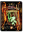 `ALL` (2)

| internal id | SK# | type | EX | jp (inferred) |
|---|---|---|---|---|
| `SKILL_SK373_ALL_ESCAPE` | 373 | `ESCAPE` |  |  |
| `SKILL_SK374_ALL_MEGACRUSH` | 374 | `MEGACRUSH` |  | ラディカルバースト |

#### `—` (2)

| internal id | SK# | type | EX | jp (inferred) |
|---|---|---|---|---|
| `SKILL_SK246` | 246 | `` |  | ＬスラッシュⅢ |
| `SKILL_SK999` | 999 | `` |  |  |

## Skill icons (336)

Skill-emblem sprites extracted from `spr_skill.xst` (64×64 each).

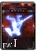  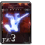  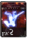  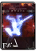 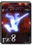 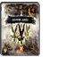   
           
       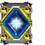    
  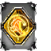    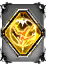    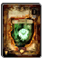 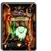
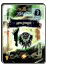 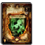  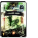 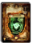 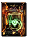 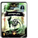 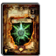 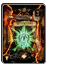 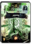 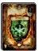 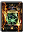
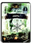 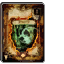 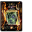 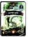  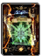  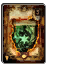 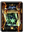 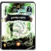 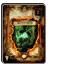 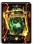
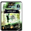 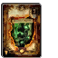 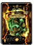 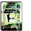 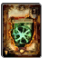 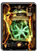 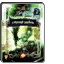 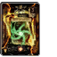 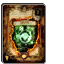 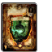 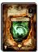 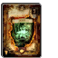
 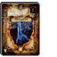 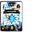 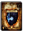 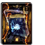 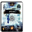      
           
           
           
           
           
           
           
           
           
           
           
           
           
           
           
           
           
           
           
           
