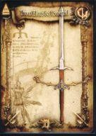
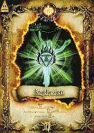
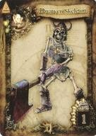

  

    

      
SEGA AM2 · QUEST OF D Ver.4.0 (2007) — GRIMÓRIO & ARQUIVO TÉCNICO

      <h1>Quest of D 4.0 — Catálogo</h1>
      
Referência completa com todos os 1005 itens jogáveis, 628 cartas físicas D-Force (301 com scan em alta resolução), 177 habilidades e IDs internos exatos. Também disponível em <a href="ja/">日本語 (Japonês)</a>.

      

        <strong>1005</strong> itens
        <strong>628</strong> cartas
        <strong>301</strong> cartas HD
        <strong>177</strong> habilidades
      

      

        <a class="btn-primary" href="pt-br/cards.html">Explorar Cartas D-Force →</a>
        <a class="btn-secondary" href="pt-br/items.html">Abrir Catálogo de Itens</a>
      

    

    

      

      

      

    

  

<a class="home-card" data-spotlight href="pt-br/items.html">
  01 · EQUIPAMENTOS & CONSUMÍVEIS
  
<h2>Itens</h2>1005

  
Armas, armaduras, escudos, elmos, botas, acessórios, poções, comidas, livros de magia, pergaminhos e materiais com ícones originais, atributos e IDs exatos.

  Explorar itens →
</a>
<a class="home-card" data-spotlight href="pt-br/cards.html">
  02 · DECK FÍSICO DO ARCADE
  
<h2>Cartas D-Force</h2>628

  
Todas as cartas colecionáveis físicas do arcade com arte oficial (301 em tamanho ampliado), número da coleção, código de barras, raridade, FLv, efeitos e IDs exatos.

  Inspecionar cartas →
</a>
<a class="home-card" data-spotlight href="pt-br/skills.html">
  03 · TÉCNICAS & MAGIAS EX
  
<h2>Habilidades</h2>177

  
Combos, especiais, barreiras e variantes evoluídas (EX) por classe e família de arma, com comandos de ativação e IDs exatos.

  Ver habilidades →
</a>

