[EN](../en/cards.md) | [JA](../ja/cards.md) | [PT-BR](../pt-br/cards.md)

# Dフォースカード

Quest of D 4.0 は **628枚の物理Dフォースカード**（XBE エンティティテーブル `0x5F8C18` のバーコード定義 650件中、実使用可能 628件）を排出・認識します。カード表面のグラフィックは **483枚のアイテム・召喚カードテクスチャ**（`spr_card.xst`）および **336枚のスキル・魔導書テクスチャ**（`spr_skill.xst`）で構成されています。

各カードレコードには **バーコード（`series-number`）**、**レアリティ（`C` / `UC` / `R`）**、**Dフォースレベル（`FLv 1–4`）**、**スプライトID（`+0x18`）**、および `text.bin` 内の **カード名（`+0x20`）**・**性能／装備条件（`+0x22`）**・**説明文（`+0x24`）** が格納されており、[2ch Quest of D まとめWiki](https://www.wikihouse.com/questofd/index.php?D%A5%D5%A5%A9%A1%BC%A5%B9%A5%AB%A1%BC%A5%C9%B0%EC%CD%F7) のコレクター番号（`No.`）と照合した全一覧を以下に掲載します。画像をクリックすると拡大表示します。

## Dフォースカード一覧 (628)
### 武器 (`WEAPON2`) (97)

| カード / No. | バーコード | レア · FLv | 内部ID | 名前 | 性能・説明 |
|---|---|---|---|---|---|
| 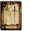 **018** | `0-2108` | `C` · `FLv2` | `WEAPON2_KS01_SHORTSWORD` | ショートソード | 片手剣／攻撃力：２４ 装備に必要なＳＴＲ：５ — 片手剣／新米冒険者向きの剣 |
| 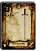 **099** | `0-2110` | `C` · `FLv2` | `WEAPON2_KS03_LONGSWORD` | ロングソード | 片手剣／攻撃力：３４ 装備に必要なＳＴＲ：５ — 片手剣／馬上から相手を突き刺 すのに適した長さを持つ |
| 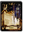 **019** | `0-2113` | `UC` · `FLv2` | `WEAPON2_KS06_GLADIUS` | グラディウス | 片手剣／攻撃力：４５ 装備に必要なＳＴＲ：１０ — 片手剣／闘技場で戦う剣闘士た ちも愛用する扱いやすい剣 |
| 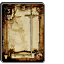 **020** | `0-2120` | `C` · `FLv2` | `WEAPON2_RS01_BASTARDSWORD` | バスタードソード | 両手剣／攻撃力：３０ 装備に必要なＳＴＲ：１０ — 両手剣／新米戦士向きの大剣 |
| 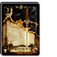 **100** | `0-2122` | `UC` · `FLv2` | `WEAPON2_RS03_ZWEIHANDER` | トゥハンドソード | 両手剣／攻撃力：４８ 装備に必要なＳＴＲ：１０ — 両手剣／身の丈を越えるほどの 長さを持つ大剣 |
| 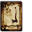 **021** | `0-2126` | `C` · `FLv2` | `WEAPON2_KA01_HANDAXE` | ハンドアックス | 片手斧／攻撃力：３０ 装備に必要なＳＴＲ：５ — 片手斧／一般的で簡素な斧 |
| 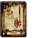 **102** | `0-2128` | `C` · `FLv2` | `WEAPON2_KA03_WARAXE` | ウォーアックス | 片手斧／攻撃力：３６ 装備に必要なＳＴＲ：１０ — 片手斧／工具としての斧から発 展して完成された戦闘用の斧 |
| 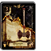 **103** | `0-2129` | `UC` · `FLv3` | `WEAPON2_KA04_BATTLEAXE` | バトルアックス | 片手斧／攻撃力：５７ 装備に必要なＳＴＲ：１５ — 片手斧／ウォーアックスをより 戦闘向けにしたもの |
| 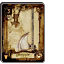 **022** | `0-2132` | `C` · `FLv2` | `WEAPON2_RA01_BROADAXE` | ブロードアックス | 両手斧／攻撃力：３１ 装備に必要なＳＴＲ：１０ — 両手斧／新米戦士向きの両手斧 |
| 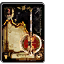 **174** | `0-2133` | `UC` · `FLv3` | `WEAPON2_RA02_GREATAXE` | グレートアックス | 両手斧／攻撃力：５４ 装備に必要なＳＴＲ：１０ — 両手斧／両刃に改良して破壊力 殺傷能力を向上させた大斧 |
| 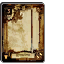 **023** | `0-2136` | `C` · `FLv2` | `WEAPON2_SP01_SHORTSPEAR` | ショートスピア | 槍／攻撃力：２４ 装備に必要なＳＴＲ：５ — 槍／戦闘訓練用の簡素な槍 |
| 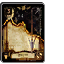 **024** | `0-2138` | `UC` · `FLv2` | `WEAPON2_SP03_PARTIZAN` | パルチザン | 槍／攻撃力：３６ 装備に必要なＳＴＲ：５ — 槍／矛先を鍛え上げ、殺傷能力 を向上させた槍 |
| 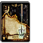 **214** | `0-2139` | `UC` · `FLv3` | `WEAPON2_SP04_TRIDENT` | トライデント | 槍／攻撃力：４６ 装備に必要なＳＴＲ：５ — 槍／海の神のシンボルとも言え る武器。雷撃を秘めている |
| 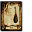 **025** | `0-2141` | `C` · `FLv2` | `WEAPON2_MA01_CLUB` | クラブ | 棍棒／攻撃力：２１ 装備に必要なＳＴＲ：５ — 棍棒／簡単で最も原始的な鈍器 |
| 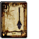 **104** | `0-2142` | `C` · `FLv2` | `WEAPON2_MA02_MACE` | メイス | 棍棒／攻撃力：３４ 装備に必要なＳＴＲ：５ — 棍棒／殴打することに特化した 鉄製の鈍器 |
| 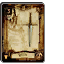 **026** | `0-2147` | `C` · `FLv2` | `WEAPON2_NI01_DAGGER` | ダガー | ナイフ／攻撃力：１８ 装備に必要なＳＴＲ：なし — ナイフ／小型の簡素なナイフ |
| 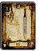 **105** | `0-2148` | `C` · `FLv2` | `WEAPON2_NI02_DIRK` | ダーク | ナイフ／攻撃力：２５ 装備に必要なＳＴＲ：なし — ナイフ／高地に住む勇猛な部族 が愛用するナイフ |
| 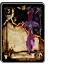 **106** | `0-2149` | `UC` · `FLv2` | `WEAPON2_NI03_POISONDAGGER` | ポイズンダガー | ナイフ／攻撃力：３３ 装備に必要なＳＴＲ：なし — ナイフ／刃に毒を仕込ませてい る暗殺用ナイフ |
| 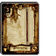 **165** | `0-2152` | `C` · `FLv2` | `WEAPON2_ST01_QUARTERSTAFF` | クォータースタッフ | 杖／攻撃力：２０ 装備に必要なＳＴＲ：なし — 杖／魔法使い向きの簡素な杖 |
| 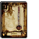 **166** | `0-2153` | `C` · `FLv2` | `WEAPON2_ST02_SCEPTER` | セプター | 杖／攻撃力：２５ 装備に必要なＳＴＲ：なし — 杖／装飾を施した木製の王笏 |
|  **207** | `0-2154` | `UC` · `FLv2` | `WEAPON2_ST03_WIZARDSSTAFF` | ウィザードスタッフ | 杖／攻撃力：３３ 装備に必要なＳＴＲ：なし — 杖／高名な魔術師も愛用してい る魔力が向上する杖 |
| 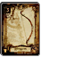 **027** | `0-2157` | `C` · `FLv2` | `WEAPON2_YU01_WOODBOW` | ウッドボウ | 弓／攻撃力：３ 装備に必要なＳＴＲ：なし — 弓／木材で作った簡素な弓 |
|  **107** | `0-2160` | `UC` · `FLv2` | `WEAPON2_YU04_GREATBOW` | グレートボウ | 弓／攻撃力：１７ 装備に必要なＳＴＲ：なし — 弓／狙撃の名手が好んで扱う戦 闘用に特化された弓 |
|  **028** | `0-2161` | `C` · `FLv1` | `WEAPON2_QI01_ARROW` | アロー | 矢筒／攻撃力：５～ 装備に必要なＳＴＲ：なし — 矢筒／安物で威力は望めないが 取り回しのよい矢 |
| 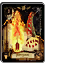 **029** | `0-2162` | `UC` · `FLv1` | `WEAPON2_QI02_FIREARROW` | ファイアーアロー | 矢筒／攻撃力：４～ 装備に必要なＳＴＲ：なし — 矢筒／矢先が炎に包まれている 魔法の矢 |
| 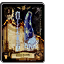 **030** | `0-2163` | `UC` · `FLv1` | `WEAPON2_QI03_COLDARROW` | コールドアロー | 矢筒／攻撃力：４～ 装備に必要なＳＴＲ：なし — 矢筒／矢先に冷気を封じ込めた 魔法の矢 |
|  **031** | `0-2164` | `UC` · `FLv1` | `WEAPON2_QI04_SPARKARROW` | サンダーアロー | 矢筒／攻撃力：４～ 装備に必要なＳＴＲ：なし — 矢筒／矢先に雷の力を封じ込め た魔法の矢 |
|  **—** | `0-2350` | `UC` · `FLv1` | `WEAPON2_KS17_CULANNSWORD` | クランのショートソード | 片手剣／攻撃力：３２ 装備に必要なＳＴＲ：なし — 片手剣／名工クランが鍛えた初 心者向けの片手剣 |
|  **—** | `0-2351` | `UC` · `FLv1` | `WEAPON2_MA10_OAKCLUB` | 樫のクラブ | 棍棒／攻撃力：３０ 装備に必要なＳＴＲ：なし — 棍棒／小振りで女性でも扱える 強度の高い鈍器 |
|  **—** | `0-2352` | `UC` · `FLv1` | `WEAPON2_ST10_MAGESTAFF` | メイジスタッフ | 杖／攻撃力：２６ 装備に必要なＳＴＲ：なし — 杖／軽量で美麗な細工が施され ている杖 |
|  **249** | `0-2364` | `UC` · `FLv3` | `WEAPON2_MA03_WARHAMMER` | ウォーハンマー | 棍棒／攻撃力：５１ 装備に必要なＳＴＲ：１０ — 棍棒／金槌を武器へと改良した 戦槌 |
|  **250** | `0-2365` | `UC` · `FLv3` | `WEAPON2_KS05_FALCHION` | ファルシオン | 片手剣／攻撃力：５４ 装備に必要なＳＴＲ：１０ — 片手剣／砂漠の民が愛用してい る重量感ある片刃の曲刀 |
|  **253** | `0-2501` | `UC` · `FLv2` | `WEAPON2_KS04_VIKINGSWORD` | ヴァイキングソード | 片手剣／攻撃力：３０ 装備に必要なＳＴＲ：５ — 片手剣／海の民ヴァイキングが 用いた肉厚で幅広な鉄製の剣 |
|  **254** | `0-2502` | `UC` · `FLv2` | `WEAPON2_NI08_ROUND` | ラウンドナイフ | ナイフ／攻撃力：１４ 装備に必要なＳＴＲ：なし — ナイフ／殺傷能力は低いが 強烈な一撃が出やすいナイフ |
| 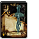 **255** | `0-2503` | `UC` · `FLv2` | `WEAPON2_NI09_STUNDAGGER` | スタンダガー | ナイフ／攻撃力：３０ 装備に必要なＳＴＲ：なし — ナイフ／刃に神経毒を仕込んだ 特殊なナイフ |
|  **256** | `0-2504` | `UC` · `FLv2` | `WEAPON2_KS18_VIPERFUNG` | バイパーファング | 片手剣／攻撃力：５０ 装備に必要なＳＴＲ：１０ — 片手剣／毒蛇の牙のような鋭い 切先をした片手剣 |
| 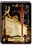 **257** | `0-2505` | `UC` · `FLv2` | `WEAPON2_RS11_SQUARETHRUST` | スクエアスラッシャー | 両手剣／攻撃力：４５ 装備に必要なＳＴＲ：１０ — 両手剣／敵を突き刺して投げる ことができる優れた両手剣 |
|  **258** | `0-2506` | `UC` · `FLv2` | `WEAPON2_KA09_SILVERAXE` | シルバーアックス | 片手斧／攻撃力：３０ 装備に必要なＳＴＲ：５ — 片手斧／純銀製で作りの見事な 美しいバトルアックス |
| 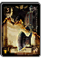 **259** | `0-2507` | `UC` · `FLv2` | `WEAPON2_KA06_SHIELDAXE` | シールドアックス | 片手斧／攻撃力：５２ 装備に必要なＳＴＲ：１０ — 片手斧／斧の柄の部分に鉄製の シールドを装着したもの |
| 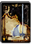 **260** | `0-2508` | `UC` · `FLv2` | `WEAPON2_RA09_STEELAXE` | スチールアックス | 両手斧／攻撃力：３３ 装備に必要なＳＴＲ：なし — 両手斧／刃先は巨大だが軽量で 非力な者でも扱える両手斧 |
| 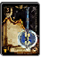 **261** | `0-2509` | `UC` · `FLv2` | `WEAPON2_RA10_GREAT_EX1` | ブーストアックス | 両手斧／攻撃力：４８ 装備に必要なＳＴＲ：５ — 両手斧／軽量に作られた、素早 い動きにも対応できる両手斧 |
|  **262** | `0-2510` | `UC` · `FLv3` | `WEAPON2_MA09_HOLYMACE` | ホーリーメイス | 棍棒／攻撃力：３４ 装備に必要なＳＴＲ：５ — 棍棒／聖なる力で覆われている 鉄製の鈍器 |
| 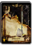 **263** | `0-2513` | `UC` · `FLv2` | `WEAPON2_KA02_FRANCISCA` | フランキスカ | 片手斧／攻撃力：５１ 装備に必要なＳＴＲ：１０ — 片手斧／地中海近くに住む勇猛 な民族が愛用していた斧 |
| 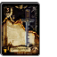 **264** | `0-2514` | `UC` · `FLv2` | `WEAPON2_NI04_SWORDBRAKER` | ソードブレイカー | ナイフ／攻撃力：３６ 装備に必要なＳＴＲ：なし — ナイフ／剣を受け止め破壊する ために作られた短剣 |
| 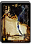 **265** | `0-2515` | `UC` · `FLv2` | `WEAPON2_YU09_IRONBOW` | アイアンボウ | 弓／攻撃力：９ 装備に必要なＳＴＲ：なし — 弓／鋼鉄で作られた破壊力のあ る重い弓 |
|  **266** | `0-2516` | `UC` · `FLv2` | `WEAPON2_YU03_LONGBOW` | ロングボウ | 弓／攻撃力：１２ 装備に必要なＳＴＲ：なし — 弓／戦闘用に強化された長い弓 |
| 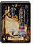 **267** | `0-2517` | `UC` · `FLv1` | `WEAPON2_QI05_MITHRILARROW` | ダークアロー | 矢筒／攻撃力：４～ 装備に必要なＳＴＲ：なし — 矢筒／闇の力により風切り音を 立てずに相手へ突き刺さる矢 |
| 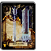 **268/156** | `0-2518` | `UC` · `FLv1` | `WEAPON2_QI06_HOLYARROW` | ホーリーアロー | 矢筒／攻撃力：４～ 装備に必要なＳＴＲ：なし — 矢筒／聖なる力を矢先に封じ込 めた矢 |
|  **320** | `0-2571` | `UC` · `FLv2` | `WEAPON2_ST11_WIZARD_EX1` | フレイムスタッフ | 杖／攻撃力：８ 装備に必要なＳＴＲ：なし — 杖／杖の先から炎を飛ばす ことができる魔力の杖 |
| 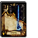 **321** | `0-2572` | `UC` · `FLv2` | `WEAPON2_ST12_WIZARD_EX2` | アイススタッフ | 杖／攻撃力：８ 装備に必要なＳＴＲ：なし — 杖／杖の先から冷気を放つ ことができる魔力の杖 |
|  **322** | `0-2573` | `UC` · `FLv2` | `WEAPON2_ST13_WIZARD_EX3` | サンダースタッフ | 杖／攻撃力：８ 装備に必要なＳＴＲ：なし — 杖／杖の先から雷を放つ ことができる魔力の杖 |
|  **367** | `0-2605` | `UC` · `FLv2` | `WEAPON2_NC03_MASSU` | アイアンスパイク | ナックル／攻撃力：４２ 装備に必要なＳＴＲ：なし — ナックル／３本の棘がついた 鋼鉄のナックル |
|  **368** | `0-2610` | `UC` · `FLv2` | `WEAPON2_MA11_WARHAMMER_EX` | ブライトハンマー | 棍棒／攻撃力：４３ 装備に必要なＳＴＲ：５ — 棍棒／叩くだけでなく、刺す ことも可能なハンマー |
|  **369** | `0-2611` | `UC` · `FLv2` | `WEAPON2_KA10_EGRET` | イーグレット | 片手斧／攻撃力：４６ 装備に必要なＳＴＲ：１０ — 片手斧／相手に向かって投げる ことができる片手斧 |
|  **370** | `0-2612` | `UC` · `FLv2` | `WEAPON2_SP02_AWLPIKE` | オウルパイク | 槍／攻撃力：５０ 装備に必要なＳＴＲ：５ — 槍／敵に向かって投げ飛ばす ことができる軽量の槍 |
|  **371** | `0-2613` | `UC` · `FLv2` | `WEAPON2_NI13_KERIS` | クリス | ナイフ／攻撃力：４７ 装備に必要なＳＴＲ：なし — ナイフ／特徴的な刀身を持つ お守りとして扱われていた短剣 |
|  **372** | `0-2614` | `UC` · `FLv3` | `WEAPON2_KA19_TAMECHAN2` | スパイクアックス | 片手斧／攻撃力：６１ 装備に必要なＳＴＲ：１５ — 片手斧／先端に刃ではなく鋭利 な突起を付けた斧 |
| 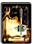 **444** | `0-2615` | `UC` · `FLv3` | `WEAPON2_MA15_TAMECHAN1` | スクエアメイス | 棍棒／攻撃力：５７ 装備に必要なＳＴＲ：１０ — 棍棒／四角く重い槌が振り下ろ すスピードを高めてくれる棍棒 |
| 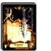 **445** | `0-2616` | `UC` · `FLv2` | `WEAPON2_NI14_TAMECHAN2` | ロットナイフ | ナイフ／攻撃力：４２ 装備に必要なＳＴＲ：なし — ナイフ／あらゆる毒素を帯びた 恐るべき能力を持つナイフ |
| 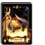 **446** | `0-2617` | `UC` · `FLv2` | `WEAPON2_NC05_THRUST` | スラストナックル | ナックル／攻撃力：５４ 装備に必要なＳＴＲ：なし — ナックル／硬く折れないという 獣の角で作られたグローブ |
|  **373** | `0-2618` | `UC` · `FLv2` | `WEAPON2_ST05_MAGICALSTAFF` | クリスタルワンド | 杖／攻撃力：３５ 装備に必要なＳＴＲ：なし — 杖／先端に冠した宝玉の力で所 有者の魔力を向上させる |
|  **494** | `0-2700` | `C` · `FLv2` | `WEAPON2_KS02_RAPIER` | レイピア | 片手剣／攻撃力：３３ 装備に必要なＳＴＲ：５ — 片手剣／軽装備の相手を斬り つけることに重きを置いた剣 |
|  **495** | `0-2701` | `C` · `FLv2` | `WEAPON2_KS10_FAKESWORD` | フェイクソード | 片手剣／攻撃力：３５ 装備に必要なＳＴＲ：５ — 片手剣／剣全体に煌びやかな装 飾を施した鑑賞用の長剣 |
| 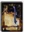 **496** | `0-2702` | `UC` · `FLv2` | `WEAPON2_KS39_SEIRYUTOU` | 青龍刀 | 片手剣／攻撃力：５２ 装備に必要なＳＴＲ：１０ — 片手剣／古来より伝わる幅広の 切っ先を持つ大振りの刀 |
|  **—** | `0-2704` | `UC` · `FLv3` | `WEAPON2_RA03_BERDYSH` | バルディッシュ | 両手斧／攻撃力：６０ 装備に必要なＳＴＲ：１５ — 両手斧／槍のように突き刺すこ ともできる長尺の斧 |
| 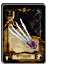 **497** | `0-2705` | `UC` · `FLv2` | `WEAPON2_NC07_TETSUTUME` | アサシンネイル | ナックル／攻撃力：４５ 装備に必要なＳＴＲ：なし — ナックル／４本の長い鉤爪を 有した独特な形状のグローブ |
|  **173** | `1-0248` | `R` · `FLv4` | `WEAPON2_KS07_MITHRILBLADE` | ミスリルソード | 片手剣／攻撃力：６５ 装備に必要なＳＴＲ：１０ — 片手剣／魔力を持つ金属のミス リルを材料にした硬く軽い剣 |
|  **101** | `1-0250` | `R` · `FLv4` | `WEAPON2_RS06_DRAGONKILLER` | ドラゴンキラー | 両手剣／攻撃力：６９ 装備に必要なＳＴＲ：２０ — 両手剣／ドラゴンの硬い皮膚を 切り裂くために作られた剣 |
| 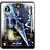 **215** | `1-0257` | `R` · `FLv3` | `WEAPON2_SP06_ICELANCE` | アイススピア | 槍／攻撃力：１２ 装備に必要なＳＴＲ：１０ — 槍／氷の力を詰め込んで穂先を 創り上げたという槍 |
| 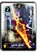 **323** | `1-0344` | `R` · `FLv3` | `WEAPON2_SP09_FRAME` | フレイムスピア | 槍／攻撃力：１２ 装備に必要なＳＴＲ：１０ — 槍／熱き炎の魔力を穂先に封じ 込めた魔槍 |
|  **324** | `1-0345` | `R` · `FLv3` | `WEAPON2_SP10_THUNDER` | サンダースピア | 槍／攻撃力：１２ 装備に必要なＳＴＲ：１０ — 槍／雷の破壊力を穂先に備えた 扱う者を選ばない魔槍 |
|  **374** | `1-0370` | `R` · `FLv3` | `WEAPON2_RA08_DIVINEAXE` | ディバインアックス | 両手斧／攻撃力：４７ 装備に必要なＳＴＲ：１５ — 両手斧／女神像に加護の力が 宿っている両手斧 |
|  **375** | `1-0371` | `R` · `FLv4` | `WEAPON2_KS08_MAGICSWORD` | マジックソード | 片手剣／攻撃力：１２ 装備に必要なＳＴＲ：なし — 片手剣／魔術儀式用の祭具で魔 法の使用が可能になる |
|  **376** | `1-0372` | `R` · `FLv3` | `WEAPON2_YU05_YUMI` | 紅桜 | 弓／攻撃力：２５ 装備に必要なＳＴＲ：なし — 弓／武士の活躍していた時代に 使われていた和弓 |
|  **448** | `1-0373` | `R` · `FLv3` | `WEAPON2_KS13_BLACKSWORD` | グレートソード | 片手剣／攻撃力：６５ 装備に必要なＳＴＲ：１５ — 片手剣／優れた者だけが携える 美麗な装飾と切れ味を誇る剣 |
|  **449** | `1-0374` | `R` · `FLv3` | `WEAPON2_KA18_CRESCENT` | クレセントアックス | 片手斧／攻撃力：６７ 装備に必要なＳＴＲ：１５ — 片手斧／曲線美を描く三日月型 の刀身が人気を集めている斧 |
|  **450** | `1-0375` | `R` · `FLv3` | `WEAPON2_RA22_RUIN` | ルーインアックス | 両手斧／攻撃力：７２ 装備に必要なＳＴＲ：２０ — 両手斧／光を闇に変えるほどの 禍々しき力を持つ暗黒の斧 |
|  **447** | `1-0376` | `R` · `FLv3` | `WEAPON2_SP18_MUSSU` | グレイブ | 槍／攻撃力：６７ 装備に必要なＳＴＲ：１０ — 槍／独特な形状の大振りな刃が 取り付けられた扱いやすい槍 |
|  **452** | `1-0377` | `R` · `FLv3` | `WEAPON2_ST23_TAMECHAN1` | カースロッド | 杖／攻撃力：３９ 装備に必要なＳＴＲ：なし — 杖／不気味な装飾を施された 強力な魔力を秘めた呪いの杖 |
|  **451** | `1-0378` | `R` · `FLv3` | `WEAPON2_NC06_BLADE` | ブレイドナックル | ナックル／攻撃力：５８ 装備に必要なＳＴＲ：なし — ナックル／鋼鉄の短刀をつけて 極限まで威力を高めたグローブ |
|  **464** | `1-0379` | `R` · `FLv4` | `WEAPON2_ST32_SHINKI` | アストラルワンド | 杖／攻撃力：５５ 装備に必要なＳＴＲ：なし — 杖／白き力と黒き力の双方を 極めた神が使っていた杖 |
|  **377** | `1-0416` | `R` · `FLv4` | `WEAPON2_RA04_MITHRILAXE` | ミスリルアックス | 両手斧／攻撃力：７０ 装備に必要なＳＴＲ：１０ — 両手斧／魔力を持つ金属のミス リルを材料にした軽量の斧 |
|  **453** | `1-0419` | `R` · `FLv4` | `WEAPON2_SP05_MITHRILSPEAR` | ミスリルスピア | 槍／攻撃力：６７ 装備に必要なＳＴＲ：１０ — 槍／魔力を持つ金属のミスリル を材料にした鋭利で軽量な槍 |
|  **454** | `1-0420` | `R` · `FLv4` | `WEAPON2_MA05_MITHRILHAMMER` | ミスリルハンマー | 棍棒／攻撃力：６３ 装備に必要なＳＴＲ：１０ — 棍棒／魔力を持つ金属のミスリ ルを材料にしたハンマー |
|  **378** | `1-0421` | `R` · `FLv4` | `WEAPON2_YU06_MITHRILBOW` | ミスリルボウ | 弓／攻撃力：３０ 装備に必要なＳＴＲ：なし — 弓／魔力を持つ金属のミスリル を材料にした軽量で高精度な弓 |
|  **501** | `1-0430` | `R` · `FLv4` | `WEAPON2_KS12_WHITESWORD` | デモンズソード | 片手剣／攻撃力：４０ 装備に必要なＳＴＲ：１０ — 片手剣／禍々しい黒き力を封じ 込められた長剣 |
|  **502** | `1-0431` | `R` · `FLv4` | `WEAPON2_KS19_ROYAL` | ホーリーソード | 片手剣／攻撃力：３５ 装備に必要なＳＴＲ：５ — 片手剣／白き力に護られた長剣 で俊敏に振り回せる |
|  **556** | `1-0432` | `R` · `FLv3` | `WEAPON2_RS24_ICEBRAND` | アイスブランド | 両手剣／攻撃力：４１ 装備に必要なＳＴＲ：１５ — 両手剣／灼熱の地においても 溶けない氷塊で作られた大剣 |
|  **555** | `1-0433` | `R` · `FLv3` | `WEAPON2_RS25_THUNDERBLADE` | サンダーブレード | 両手剣／攻撃力：４１ 装備に必要なＳＴＲ：１５ — 両手剣／稲妻の力を宿した 見た目にも珍しい剣 |
|  **498** | `1-0434` | `R` · `FLv3` | `WEAPON2_RS05_EXECUTIONERSSWORD` | 断罪の剣 | 両手剣／攻撃力：５３ 装備に必要なＳＴＲ：１０ — 両手剣／死刑執行人が罪人の首 を切り落とす際に使った刀剣 |
|  **554** | `1-0435` | `R` · `FLv3` | `WEAPON2_RS09_FLAMESWORD` | フレイムソード | 両手剣／攻撃力：４１ 装備に必要なＳＴＲ：１５ — 両手剣／斬りつけられた者を業 火で焼き尽くす刀剣 |
|  **499** | `1-0436` | `R` · `FLv3` | `WEAPON2_NI05_KOTETSU` | 古鉄 | ナイフ／攻撃力：５４ 装備に必要なＳＴＲ：なし — ナイフ／東洋の刀匠が生み出し た名作と名高い小刀 |
|  **503** | `1-0437` | `R` · `FLv3` | `WEAPON2_MA04_MORNINGSTAR` | モーニングスター | 棍棒／攻撃力：６４ 装備に必要なＳＴＲ：１０ — 棍棒／たくさんの棘が突き出た 鉄球が特徴的なメイス |
|  **504** | `1-0491` | `R` · `FLv4` | `WEAPON2_NC17_SONIC` | ソニックナックル | ナックル／攻撃力：６０ 装備に必要なＳＴＲ：なし — ナックル／特殊な魔法力を込め た金属で作られたグローブ |
|  **505** | `1-0492` | `R` · `FLv4` | `WEAPON2_RS22_SAIJYOUI` | アルティマソード | 両手剣／攻撃力：７２ 装備に必要なＳＴＲ：１５ — 両手剣／他に類を見ない破壊力 を持つ究極という名の大剣 |
|  **500** | `1-0493` | `R` · `FLv4` | `WEAPON2_NI25_MOULIN` | ムーラン | ナイフ／攻撃力：６３ 装備に必要なＳＴＲ：なし — ナイフ／暗殺者に古くから伝わ る風車に似た形状の短剣 |
|  **506** | `1-0494` | `R` · `FLv4` | `WEAPON2_KA26_CRIMSON` | クリムゾンライン | 片手斧／攻撃力：６８ 装備に必要なＳＴＲ：１５ — 片手斧／使用者の血液と引き換 えに破壊の力を授けるという斧 |

### 鎧・ローブ (`ARMOR2`) (34)

| カード / No. | バーコード | レア · FLv | 内部ID | 名前 | 性能・説明 |
|---|---|---|---|---|---|
| 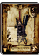 **032** | `0-2169` | `C` · `FLv2` | `ARMOR2_AM24_DEFAULT` | ファイタークロス | 鎧／防御力：８ 装備に必要なＳＴＲ：１０ — 鎧／動きやすさ重視の軽量防具 |
| 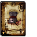 **033** | `0-2170` | `C` · `FLv2` | `ARMOR2_AM03_CHAINMAIL` | チェインメイル | 鎧／防御力：１９ 装備に必要なＳＴＲ：１０ — 鎧／鎖を編みこんで作られた鎧 |
| 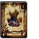 **108** | `0-2171` | `C` · `FLv2` | `ARMOR2_AM05_LAMELLAR` | ラメラアーマー | 鎧／防御力：２１ 装備に必要なＳＴＲ：１０ — 鎧／分厚い鉄の板で作られた鎧 は肉体を確実に守ってくれる |
| 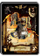 **109** | `0-2172` | `UC` · `FLv2` | `ARMOR2_AM06_IRON` | アイアンアーマー | 鎧／防御力：２６ 装備に必要なＳＴＲ：１０ — 鎧／鉄板で覆われた強固な鎧 防御力は高いがやや重い |
| 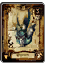 **034** | `0-2176` | `C` · `FLv2` | `ARMOR2_RO07_DALMATICA` | ダルマティカ | 衣服／防御力：８ 装備に必要なＳＴＲ：５ — 衣服／聖職者が儀式の時に着用 する聖なる力を秘めた法衣 |
| 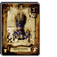 **035** | `0-2177` | `C` · `FLv2` | `ARMOR2_AM23_CROTH` | クロスアーマー | 鎧／防御力：９ 装備に必要なＳＴＲ：なし — 鎧／分厚い布で作られているぶ ん装飾などの加工がしやすい |
| 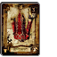 **110** | `0-2180` | `C` · `FLv2` | `ARMOR2_RO03_MAGEROBE` | メイジローブ | 衣服／防御力：４ 装備に必要なＳＴＲ：なし — 衣服／魔法使いがよく着ている 魔法のローブ |
| 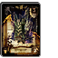 **111** | `0-2181` | `UC` · `FLv2` | `ARMOR2_RO04_HOODROBE` | フードローブ | 衣服／防御力：５ 装備に必要なＳＴＲ：なし — 衣服／外観から鎧と見誤ってし まう一風変わったローブ |
|  **—** | `0-2353` | `UC` · `FLv2` | `ARMOR2_AM31_COPPERCLOTH` | カッパークロス | 鎧／防御力：１４ 装備に必要なＳＴＲ：なし — 鎧／防御力は低いが動きやすい 銅製の訓練用鎧 |
|  **041** | `0-2354` | `UC` · `FLv2` | `ARMOR2_RO17_WARLOCKROBE` | ウォーロックローブ | 衣服／防御力：４ 装備に必要なＳＴＲ：なし — 衣服／見習いの魔法使いが着用 する魔法のローブ |
|  **—** | `0-2355` | `UC` · `FLv2` | `ARMOR2_RO18_DEGRATICA` | ディグラティカ | 衣服／防御力：７ 装備に必要なＳＴＲ：なし — 衣服／未熟な僧侶用に作られた 作業着と兼用の法衣 |
| 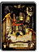 **272** | `0-2522` | `UC` · `FLv2` | `ARMOR2_AM04_SCALE` | スケイルメイル | 鎧／防御力：２０ 装備に必要なＳＴＲ：１０ — 鎧／小さな金属片を魚の鱗のよ うに並べて作った鎧 |
|  **273** | `0-2523` | `C` · `FLv1` | `ARMOR2_AM02_JACKET` | レザージャケット | 鎧／防御力：６ 装備に必要なＳＴＲ：なし — 鎧／なめした皮で作られた軽く て動きやすい上着 |
|  **274** | `0-2524` | `UC` · `FLv2` | `ARMOR2_AM01_LEATHER` | レザーアーマー | 鎧／防御力：１３ 装備に必要なＳＴＲ：５ — 鎧／なめした皮で作られている 軽量な鎧 |
|  **275** | `0-2525` | `UC` · `FLv2` | `ARMOR2_AM17_LEATHER` | レザークロス | 鎧／防御力：１２ 装備に必要なＳＴＲ：５ — 鎧／硬めの皮で作られた 防御力に優れた皮鎧 |
|  **327** | `0-2574` | `UC` · `FLv3` | `ARMOR2_AM07_PLATE` | プレートメイル | 鎧／防御力：２６ 装備に必要なＳＴＲ：１０ — 鎧／大きめの金属の板をつなぎ 合わせて作った鎧 |
|  **384** | `0-2575` | `UC` · `FLv2` | `ARMOR2_RO08_SHADOWROBE` | シャドウローブ | 衣服／防御力：１１ 装備に必要なＳＴＲ：なし — 衣服／闇の力によって強化され た魔法のローブ |
|  **329** | `0-2576` | `UC` · `FLv2` | `ARMOR2_RO06_CHASUBLE` | カズラ | 衣服／防御力：１７ 装備に必要なＳＴＲ：なし — 衣服／儀式を行う司祭が纏う衣 で高級な素材で作られている |
|  **379** | `0-2619` | `C` · `FLv1` | `ARMOR2_AM33_CHAINMALE_EX` | クリムゾンチェイン | 鎧／防御力：１９ 装備に必要なＳＴＲ：１０ — 鎧／太目の鎖が編みこまれた 強度の高い鎧 |
|  **381** | `0-2620` | `C` · `FLv1` | `ARMOR2_AM34_CLOTH_EX` | レイクロス | 衣服／防御力：１０ 装備に必要なＳＴＲ：なし — 衣服／雷に対する耐性が高い 法力を秘めた法衣 |
|  **455** | `0-2621` | `UC` · `FLv2` | `ARMOR2_RO24_HOOD_EX` | エンハンスローブ | 衣服／防御力：９ 装備に必要なＳＴＲ：５ — 衣服／聖職者が好んで着用 する、精神力が高まるローブ |
|  **380** | `0-2637` | `UC` · `FLv2` | `ARMOR2_RO21_TAMECHAN1` | モンクフロック | 衣服／防御力：１１ 装備に必要なＳＴＲ：５ — 衣服／体術を扱う僧たちが着用 する動きやすく改良された衣服 |
|  **507** | `0-2706` | `UC` · `FLv2` | `ARMOR2_AM19_SPIKE` | スパイククロス | 鎧／防御力：１６ 装備に必要なＳＴＲ：１０ — 鎧／右肩にスパイクのついた 鉄製の鎧 |
|  **216** | `1-0265` | `R` · `FLv3` | `ARMOR2_AM16_DRAGON` | ドラゴンアーマー | 鎧／防御力：３１ 装備に必要なＳＴＲ：１５ — 鎧／ドラゴンの皮膚で作られた 鋼鉄のごとき硬さを誇る鎧 |
|  **217** | `1-0271` | `R` · `FLv3` | `ARMOR2_RO11_WIZARDROBE` | ウィザードローブ | 衣服／防御力：８ 装備に必要なＳＴＲ：なし — 衣服／強力な魔力により高い防 御力を発揮する魔法のローブ |
|  **218** | `1-0278` | `R` · `FLv4` | `ARMOR2_AM15_MITHRIL` | ミスリルアーマー | 鎧／防御力：３３ 装備に必要なＳＴＲ：１０ — 鎧／魔力を持った金属のミスリ ルで作られた銀色の鎧 |
|  **248** | `1-0329` | `R` · `FLv3` | `ARMOR2_RO09_KINGROBE` | キングローブ | 衣服／防御力：１１ 装備に必要なＳＴＲ：５ — 衣服／着た者は王者になるとい う言い伝えがあるローブ |
|  **393** | `1-0380` | `R` · `FLv4` | `ARMOR2_AM12_MAGIC` | マジックアーマー | 鎧／防御力：１８ 装備に必要なＳＴＲ：なし — 鎧／封じこめられた魔力でダメ ージを軽減する魔法の鎧 |
|  **465** | `1-0388` | `R` · `FLv4` | `ARMOR2_RO29_SHINKI` | アストラルローブ | 衣服／防御力：１３ 装備に必要なＳＴＲ：なし — 衣服／白き力と黒き力の双方を 極めた神が着ていたローブ |
|  **508** | `1-0438` | `R` · `FLv3` | `ARMOR2_RO12_BURGLARJACKET` | バーグラージャケット | 衣服／防御力：１８ 装備に必要なＳＴＲ：５ — 衣服／動物の毛皮が大胆にあし らわれた野性的なジャケット |
|  **557** | `1-0439` | `R` · `FLv4` | `ARMOR2_AM18_CUCHULAIN` | ソリッドアーマー | 鎧／防御力：２３ 装備に必要なＳＴＲ：１０ — 鎧／鋼鉄を重ね合わせて作り 上げた防御力の高い鎧 |
|  **558** | `1-0440` | `R` · `FLv4` | `ARMOR2_RO23_SHAMANQUILT` | シャーマンキルト | 衣服／防御力：９ 装備に必要なＳＴＲ：なし — 衣服／魔力を向上させるという 刺青が特徴的な風変わりな衣装 |
|  **559** | `1-0441` | `R` · `FLv4` | `ARMOR2_RO19_MUSSU1` | リンガーローブ | 衣服／防御力：１９ 装備に必要なＳＴＲ：なし — 衣服／多量の純金で装飾を施し てある価値の高いローブ |
|  **560** | `1-0442` | `R` · `FLv4` | `ARMOR2_RO31_SHINKI` | バンデットメイル | 鎧／防御力：１９ 装備に必要なＳＴＲ：５ — 鎧／主に山賊の着る、動き やすさと保温性に優れた鎧 |

### 頭装備 (`HELM2`) (40)

| カード / No. | バーコード | レア · FLv | 内部ID | 名前 | 性能・説明 |
|---|---|---|---|---|---|
|  **039** | `0-2201` | `C` · `FLv2` | `HELM2_HM01_HALF` | ハーフヘルム | 兜／防御力：５ 装備に必要なＳＴＲ：１０ — 兜／薄い金属の板を組み合わせ て作った簡易型ヘルメット |
|  **040** | `0-2202` | `UC` · `FLv2` | `HELM2_HM02_IRON` | アイアンヘルム | 兜／防御力：９ 装備に必要なＳＴＲ：１０ — 兜／分厚い鉄の板で頭部を包み 込んだ本格的なヘルメット |
|  **113** | `0-2209` | `C` · `FLv2` | `HELM2_HM12_KETTLEHAT` | ケトルハット | 帽子／防御力：３ 装備に必要なＳＴＲ：なし — 帽子／外見がやかん（ケトル） に似ている帽子 |
|  **178** | `0-2210` | `C` · `FLv2` | `HELM2_HM14_MITLA` | ミトラ | 帽子／防御力：２ 装備に必要なＳＴＲ：５ — 帽子／聖なる儀式の時に司教が 身につける宝冠 |
|  **041** | `0-2211` | `UC` · `FLv2` | `HELM2_HM15_WARLOCKCAP` | ウォーロックキャップ | 帽子／防御力：３ 装備に必要なＳＴＲ：なし — 帽子／魔法使いたちが好んでか ぶる布製の帽子 |
|  **114** | `0-2212` | `UC` · `FLv2` | `HELM2_HM16_SORCERERCAP` | ソーサラーキャップ | 帽子／防御力：５ 装備に必要なＳＴＲ：なし — 帽子／帽子というより冠といっ た印象を受ける帽子 |
|  **042** | `0-2213` | `UC` · `FLv2` | `HELM2_HM17_CLERICCAP` | クレリックキャップ | 帽子／防御力：４ 装備に必要なＳＴＲ：５ — 帽子／女性の僧侶たちに人気の あるキャップ |
|  **115** | `0-2215` | `C` · `FLv2` | `HELM2_HM13_MAGICIANHAT` | マジシャンハット | 帽子／防御力：２ 装備に必要なＳＴＲ：なし — 帽子／幅の広いつばがついた魔 法使いの定番アイテム |
|  **—** | `0-2357` | `UC` · `FLv1` | `HELM2_HM35_RUSTYHAT` | ラスティハット | 帽子／防御力：４ 装備に必要なＳＴＲ：なし — 帽子／使い古された年代物の戦 闘用帽子 |
|  **269** | `0-2519` | `C` · `FLv1` | `HELM2_HM10_LEATHERHAT` | レザーキャップ | 帽子／防御力：２ 装備に必要なＳＴＲ：なし — 帽子／なめした皮で作られた頭 部全体をすっぽりと覆う帽子 |
|  **270** | `0-2520` | `UC` · `FLv2` | `HELM2_HM03_VIKING` | ヴァイキングヘルム | 兜／防御力：７ 装備に必要なＳＴＲ：１０ — 兜／海の民ヴァイキングが使用 していたというヘルメット |
|  **271** | `0-2521` | `UC` · `FLv2` | `HELM2_HM34_SCALE` | スケイルヘルム | 帽子／防御力：５ 装備に必要なＳＴＲ：なし — 帽子／小さな金属片を魚の鱗の ように並べて作った兜 |
|  **386** | `0-2623` | `UC` · `FLv2` | `HELM2_HM04_BARREL` | バレルヘルム | 兜／防御力：７ 装備に必要なＳＴＲ：１０ — 兜／頭も顔もすっぽりと覆い隠 してしまうヘルメット |
|  **456** | `0-2624` | `UC` · `FLv2` | `HELM2_HM29_SNAKEHEAD` | スネークヘッド | 帽子／防御力：５ 装備に必要なＳＴＲ：なし — 帽子／大蛇の尻尾の部分を切り 落として帽子に加工したもの |
|  **387** | `0-2625` | `UC` · `FLv2` | `HELM2_HM36_WARLOCKCAP_EX` | チャームキャップ | 帽子／防御力：４ 装備に必要なＳＴＲ：なし — 帽子／保護の魔力により強度が 増した可愛らしい帽子 |
|  **388** | `0-2626` | `UC` · `FLv2` | `HELM2_HM37_CLERICCAP_EX` | インディゴバニット | 帽子／防御力：５ 装備に必要なＳＴＲ：５ — 帽子／己の精神力を注ぎ込む ことにより強化される帽子 |
|  **389** | `0-2627` | `UC` · `FLv2` | `HELM2_HM18_BISHOPCAP` | ビショップキャップ | 帽子／防御力：６ 装備に必要なＳＴＲ：５ — 帽子／僧侶や司教が儀式の時に かぶる帽子 |
|  **383** | `0-2630` | `UC` · `FLv2` | `HELM2_HM41_UNICORNHEAD` | ユニコーンヘッド | 帽子／防御力：１ 装備に必要なＳＴＲ：なし — 帽子／一角獣をモチーフに 作られた角のついた髪飾り |
|  **384** | `0-2631` | `UC` · `FLv2` | `HELM2_HM43_SHADOWHAT` | シャドウハット | 帽子／防御力：５ 装備に必要なＳＴＲ：なし — 帽子／闇の力によって強化され た魔力をもたらす帽子 |
|  **385** | `0-2632` | `UC` · `FLv2` | `HELM2_HM44_NISOUZUKIN` | フライアベール | 帽子／防御力：７ 装備に必要なＳＴＲ：なし — 帽子／額に守護の石を付け頭部 の守りを高めた修道士の帽子 |
|  **510** | `0-2707` | `UC` · `FLv2` | `HELM2_HM09_BANDANNA` | バンダナ | 帽子／防御力：１ 装備に必要なＳＴＲ：なし — 帽子／頭を覆う大きめの布で防 御力はほぼないに等しい |
|  **509** | `0-2708` | `UC` · `FLv2` | `HELM2_HM11_WINGHAT` | ウィングヘルム | 兜／防御力：４ 装備に必要なＳＴＲ：なし — 兜／鳥の羽根飾りがついた おしゃれな兜 |
|  **265** | `0-2709` | `UC` · `FLv2` | `HELM2_HM56_IRONMASK` | アイアンマスク | 仮面／防御力：２ 装備に必要なＳＴＲ：なし — 仮面／鋼鉄で作られた 顔の前面を覆う強固な仮面 |
|  **511** | `0-2710` | `UC` · `FLv2` | `HELM2_HM47_GLASS` | メガネ | 装飾品／防御力：１ 装備に必要なＳＴＲ：なし — 装飾品／特殊なレンズを使い 不思議な力が宿ったメガネ |
|  **512** | `0-2711` | `UC` · `FLv2` | `HELM2_HM52_EVILEYE` | イービルアイ | 仮面／防御力：１ 装備に必要なＳＴＲ：なし — 仮面／悪魔の目と呼ばれている 恐ろしい能力を持つマスク |
|  **—** | `0-2712` | `UC` · `FLv2` | `HELM2_HM60_MASQUERADE` | マスカレイドマスク | 仮面／防御力：１ 装備に必要なＳＴＲ：なし — 仮面／ミステリアスな雰囲気の 一般的な仮装用マスク |
|  **177** | `1-0283` | `R` · `FLv3` | `HELM2_HM05_GREAT` | グレートヘルム | 兜／防御力：１０ 装備に必要なＳＴＲ：１５ — 兜／天をつくような巨大な角の 飾りが施されたヘルメット |
|  **220** | `1-0284` | `R` · `FLv4` | `HELM2_HM06_MITHRIL` | ミスリルヘルム | 兜／防御力：１５ 装備に必要なＳＴＲ：５ — 兜／鋼より硬く鉄より軽いミス リルで作られたヘルメット |
|  **179** | `1-0288` | `R` · `FLv3` | `HELM2_HM21_TIARA` | ティアラ | 帽子／防御力：１ 装備に必要なＳＴＲ：なし — 帽子／美しい宝石が あしらわれた美しい髪飾り |
|  **180** | `1-0294` | `R` · `FLv3` | `HELM2_HM28_KINGCROWN` | キングクラウン | 帽子／防御力：４ 装備に必要なＳＴＲ：５ — 帽子／高名な王が凱旋時に着用 した式典用の兜 |
|  **325** | `1-0346` | `R` · `FLv3` | `HELM2_HM25_WIZARDHAT` | ウィザードハット | 帽子／防御力：３ 装備に必要なＳＴＲ：なし — 帽子／高名な魔術師が魔法の力 を封じ込めたとんがり帽子 |
|  **326** | `1-0347` | `R` · `FLv3` | `HELM2_HM22_CIRCLET` | サークレット | 帽子／防御力：１ 装備に必要なＳＴＲ：なし — 帽子／大きな宝石を 大胆にあしらった頭飾り |
|  **330** | `1-0348` | `R` · `FLv4` | `HELM2_HM07_MAGIC` | マジックヘルム | 兜／防御力：７ 装備に必要なＳＴＲ：なし — 兜／ダメージを軽減する魔力が 封じ込められた兜 |
|  **—** | `1-0360` | `UC` · `FLv2` | `HELM2_HM48_GOBLINMASK` | ゴブリンマスク | 仮面／防御力：１ 装備に必要なＳＴＲ：なし — 仮面／魔除けのお守りと信じら れている木製の仮面 |
|  **459** | `1-0381` | `R` · `FLv4` | `HELM2_HM38_HANNYA` | 白鬼の兜 | 兜／防御力：５ 装備に必要なＳＴＲ：５ — 兜／鬼神の如き強さと智慧を 象徴して作られた兜 |
|  **460** | `1-0382` | `R` · `FLv4` | `HELM2_HM39_DIVINECIRCLET` | ディバインサークレット | 帽子／防御力：１ 装備に必要なＳＴＲ：なし — 帽子／邪悪な魂を浄化する崇高 な女神が彫られた聖なる頭飾り |
|  **461** | `1-0383` | `R` · `FLv4` | `HELM2_HM40_QUEENTIARA` | クイーンティアラ | 帽子／防御力：１ 装備に必要なＳＴＲ：なし — 帽子／シンプルな装飾だが 強大な魔力を秘めた髪飾り |
|  **467** | `1-0390` | `R` · `FLv4` | `HELM2_HM72_SHINKI` | アストラルハット | 帽子／防御力：５ 装備に必要なＳＴＲ：なし — 帽子／白き力と黒き力の双方を 極めた神が被っていた帽子 |
|  **514** | `1-0444` | `R` · `FLv3` | `HELM2_HM58_BARRETTE` | ファルコンバレッタ | 帽子／防御力：１ 装備に必要なＳＴＲ：なし — 帽子／速さの象徴である隼を モチーフに作られた頭飾り |
|  **513** | `1-0445` | `R` · `FLv3` | `HELM2_HM55_VALKYRIE` | ヴァルキリエ | 帽子／防御力：１ 装備に必要なＳＴＲ：なし — 帽子／死と戦の女神がつけて いたとされる装飾品 |

### 足装備 (`BOOTS2`) (23)

| カード / No. | バーコード | レア · FLv | 内部ID | 名前 | 性能・説明 |
|---|---|---|---|---|---|
|  **116** | `0-2220` | `C` · `FLv2` | `BOOTS2_BT12_WARRIOR` | ラスティブーツ | 具足／防御力：５ 装備に必要なＳＴＲ：１０ — 具足／右足側が鉄製、左足側が 皮でできているシューズ |
|  **043** | `0-2221` | `UC` · `FLv2` | `BOOTS2_BT04_PLATE` | アイアンブーツ | 具足／防御力：７ 装備に必要なＳＴＲ：１０ — 具足／鉄の板を加工して作った 金属製のブーツ |
|  **118** | `0-2225` | `C` · `FLv2` | `BOOTS2_BT11_PRIEST` | プリーストブーツ | 具足／防御力：３ 装備に必要なＳＴＲ：５ — 具足／聖なる祈りで清められた 布製の靴 |
|  **—** | `0-2358` | `UC` · `FLv1` | `BOOTS2_BT31_CROWNSHOES` | クラウンシューズ | 具足／防御力：３ 装備に必要なＳＴＲ：なし — 具足／道化師や見習い魔法使い が好んで履く派手な靴 |
|  **278** | `0-2528` | `UC` · `FLv2` | `BOOTS2_BT29_SCALE` | スケイルブーツ | 具足／防御力：５ 装備に必要なＳＴＲ：なし — 具足／小さな金属片を魚の鱗の ように並べて作ったブーツ |
|  **279** | `0-2529` | `UC` · `FLv2` | `BOOTS2_BT21_CROTH` | クロスブーツ | 具足／防御力：４ 装備に必要なＳＴＲ：なし — 具足／皮製のブーツの上にオー バーブーツを装備したもの |
|  **280** | `0-2530` | `UC` · `FLv2` | `BOOTS2_BT30_MANA` | マナブーツ | 具足／防御力：３ 装備に必要なＳＴＲ：なし — 具足／魔法力で保護された長丈 の疲れにくいブーツ |
|  **281** | `0-2531` | `UC` · `FLv2` | `BOOTS2_BT01_LONG` | ロングブーツ | 具足／防御力：４ 装備に必要なＳＴＲ：なし — 具足／ひざ上までを保護する皮 製の長いブーツ |
|  **282** | `0-2532` | `C` · `FLv2` | `BOOTS2_BT02_LEATHER` | レザーブーツ | 具足／防御力：２ 装備に必要なＳＴＲ：なし — 具足／軽さと動きやすさを追求 した皮製のブーツ |
|  **390** | `0-2628` | `UC` · `FLv2` | `BOOTS2_BT32_PRIEST_EX` | オリエントブーツ | 具足／防御力：４ 装備に必要なＳＴＲ：５ — 具足／遥か東方より伝わって きたといわれる神秘的な靴 |
|  **391** | `0-2629` | `UC` · `FLv2` | `BOOTS2_BT33_SOUL_EX` | ノーブルブーツ | 具足／防御力：５ 装備に必要なＳＴＲ：なし — 具足／高貴な者たちが好んで 履くという上質の靴 |
|  **392** | `0-2633` | `UC` · `FLv2` | `BOOTS2_BT37_BISHOP` | モンクブーツ | 具足／防御力：２ 装備に必要なＳＴＲ：５ — 具足／体術を扱う僧たちが着用 する見事な装飾がされたブーツ |
|  **457** | `0-2634` | `UC` · `FLv2` | `BOOTS2_BT38_SHADOW` | シャドウブーツ | 具足／防御力：５ 装備に必要なＳＴＲ：なし — 具足／闇の力で強化された 履き心地の良いブーツ |
|  **458** | `0-2635` | `UC` · `FLv2` | `BOOTS2_BT39_MAGE` | バインドブーツ | 具足／防御力：２ 装備に必要なＳＴＲ：なし — 具足／魔力を秘めた紐で縛り 上げて履くブーツ |
|  **515** | `0-2713` | `C` · `FLv2` | `BOOTS2_BT16_ROGUE` | ローグブーツ | 具足／防御力：４ 装備に必要なＳＴＲ：なし — 具足／シーフブーツを軽くして 機能性を高めた盗賊用ブーツ |
|  **221** | `1-0296` | `R` · `FLv4` | `BOOTS2_BT06_MITHRIL` | ミスリルブーツ | 具足／防御力：１４ 装備に必要なＳＴＲ：５ — 具足／鉄より軽く鋼より硬い金 属ミスリルで作られたブーツ |
|  **117** | `1-0297` | `C` · `FLv2` | `BOOTS2_BT07_MAGICIANSHOES` | マジシャンシューズ | 具足／防御力：３ 装備に必要なＳＴＲ：なし — 具足／秘められた魔力で力を発 揮する皮と布で作られた靴 |
|  **181** | `1-0299` | `R` · `FLv3` | `BOOTS2_BT22_KING` | キングブーツ | 具足／防御力：６ 装備に必要なＳＴＲ：５ — 具足／布と皮で作られた僧侶の ための高級なブーツ |
|  **222** | `1-0300` | `R` · `FLv3` | `BOOTS2_BT23_SOUL` | ウィザードブーツ | 具足／防御力：４ 装備に必要なＳＴＲ：なし — 具足／妖しい光を放つクリスタ ルをあしらった皮製のブーツ |
|  **331** | `1-0349` | `R` · `FLv4` | `BOOTS2_BT08_MAGIC` | マジックブーツ | 具足／防御力：７ 装備に必要なＳＴＲ：なし — 具足／ダメージを軽減する魔力 が封じ込められたブーツ |
|  **462** | `1-0384` | `R` · `FLv4` | `BOOTS2_BT34_DAIGUSOKU` | 黒紋の脛当 | 具足／防御力：６ 装備に必要なＳＴＲ：１０ — 具足／戦乱時代の東洋で使用 されていた由緒正しき脛当 |
|  **463** | `1-0385` | `R` · `FLv4` | `BOOTS2_BT36_PROTECT` | プロテクトブーツ | 具足／防御力：６ 装備に必要なＳＴＲ：５ — 具足／金属のプレートを重ね 合わせて保護力を強化した靴 |
|  **466** | `1-0389` | `R` · `FLv4` | `BOOTS2_BT50_SHINKI` | アストラルブーツ | 具足／防御力：６ 装備に必要なＳＴＲ：なし — 具足／白き力と黒き力の双方を 極めた神が履いていた靴 |

### 盾 (`SHIELD2`) (12)

| カード / No. | バーコード | レア · FLv | 内部ID | 名前 | 性能・説明 |
|---|---|---|---|---|---|
|  **036** | `0-2187` | `C` · `FLv2` | `SHIELD2_SH01_WOOD` | ウッドシールド | 盾／防御力：１ 装備に必要なＳＴＲ：なし — 盾／外周が強化された木製の盾 |
|  **037** | `0-2188` | `C` · `FLv1` | `SHIELD2_SH02_BUCKLER` | バックラー | 盾／防御力：２ 装備に必要なＳＴＲ：なし — 盾／新米冒険者向きの簡素な盾 |
|  **038** | `0-2189` | `C` · `FLv1` | `SHIELD2_SH03_ROUND` | ラウンドシールド | 盾／防御力：３ 装備に必要なＳＴＲ：なし — 盾／相手の攻撃を受け流すのに 適した金属製の盾 |
|  **112** | `0-2190` | `UC` · `FLv2` | `SHIELD2_SH04_LARGE` | ラージシールド | 盾／防御力：５ 装備に必要なＳＴＲ：なし — 盾／高さが１メートルを超える 大きな盾 |
|  **175** | `0-2197` | `UC` · `FLv2` | `SHIELD2_SH11_ICE` | アイスシールド | 盾／防御力：１ 装備に必要なＳＴＲ：５ — 盾／氷の結晶をかたどった奇抜 なデザインが特徴の盾 |
|  **—** | `0-2356` | `UC` · `FLv2` | `SHIELD2_SH23_CHARCOAL` | チャコールシールド | 盾／防御力：２ 装備に必要なＳＴＲ：なし — 盾／消し炭を利用して作られた 小型の盾 |
|  **276** | `0-2526` | `UC` · `FLv2` | `SHIELD2_SH07_WING` | ウィングシールド | 盾／防御力：１ 装備に必要なＳＴＲ：なし — 盾／立派な鳥のレリーフがつい た金属製の盾 |
|  **277** | `0-2527` | `UC` · `FLv2` | `SHIELD2_SH22_PALISADE` | パリセイドシールド | 盾／防御力：４ 装備に必要なＳＴＲ：なし — 盾／鋼を柵状に束ねて作られた 強度の高い盾 |
|  **382** | `0-2622` | `UC` · `FLv2` | `SHIELD2_SH08_TOWER` | タワーシールド | 盾／防御力：６ 装備に必要なＳＴＲ：１０ — 盾／丈が高く、防御面積が広い 重量のある大盾 |
|  **219** | `1-0280` | `R` · `FLv3` | `SHIELD2_SH14_DRAGON` | ドラゴンシールド | 盾／防御力：８ 装備に必要なＳＴＲ：１０ — 盾／ドラゴンの皮膚を基礎に牙 や金属で装飾を施した盾 |
|  **176** | `1-0281` | `R` · `FLv4` | `SHIELD2_SH15_MITHRIL` | ミスリルシールド | 盾／防御力：７ 装備に必要なＳＴＲ：５ — 盾／鋼よりも硬い鉱物ミスリル で作られた軽量の盾 |
|  **516** | `1-0443` | `R` · `FLv4` | `SHIELD2_SH13_MAGIC` | マジックシールド | 盾／防御力：５ 装備に必要なＳＴＲ：なし — 盾／魔力が封じ込められた魔法 の盾 |

### アクセサリー (`ACCES2`) (13)

| カード / No. | バーコード | レア · FLv | 内部ID | 名前 | 性能・説明 |
|---|---|---|---|---|---|
|  **044** | `0-2232` | `UC` · `FLv1` | `ACCES2_AL01_FIREAMULET` | ファイアーアミュレット | アミュレット／防御力：１ 装備に必要なＳＴＲ：なし — アミュレット／火炎の力を封じ 込めた首飾り |
|  **182** | `0-2233` | `UC` · `FLv1` | `ACCES2_AL02_ICEAMULET` | アイスアミュレット | アミュレット／防御力：１ 装備に必要なＳＴＲ：なし — アミュレット／氷の力を封じ込 めた首飾り |
|  **183** | `0-2234` | `UC` · `FLv1` | `ACCES2_AL03_THUNDERAMULET` | サンダーアミュレット | アミュレット／防御力：１ 装備に必要なＳＴＲ：なし — アミュレット／雷の力を封じ込 めた金色に光り輝く首飾り |
|  **223** | `0-2236` | `UC` · `FLv2` | `ACCES2_RI02_TOUGHNESSRING` | タフネスリング | 指輪／防御力：１ 装備に必要なＳＴＲ：なし — 指輪／体力を引き出す魔法のシ ンボルが刻み込まれている |
|  **045** | `0-2237` | `UC` · `FLv2` | `ACCES2_RI03_POWERRING` | パワーリング | 指輪／防御力：１ 装備に必要なＳＴＲ：なし — 指輪／宝石に込められた魔力に より全身の筋力が増大する |
|  **224** | `0-2238` | `UC` · `FLv2` | `ACCES2_RI04_SPEEDRING` | スピードリング | 指輪／防御力：１ 装備に必要なＳＴＲ：なし — 指輪／所有者の動きを俊敏にす る魔力が封じ込められている |
|  **184** | `0-2239` | `UC` · `FLv2` | `ACCES2_RI05_MAGICIANRING` | マジックリング | 指輪／防御力：１ 装備に必要なＳＴＲ：なし — 指輪／魔法の威力を増大させる 力が秘められている |
|  **246** | `0-2362` | `UC` · `FLv2` | `ACCES2_RI06_SIGHTRING` | ゲイルリング | 指輪／防御力：１ 装備に必要なＳＴＲ：なし — 指輪／魔力を持った文字の力で 装備者の敏捷性を高めてくれる |
|  **247** | `0-2363` | `UC` · `FLv2` | `ACCES2_RI01_SPELLRING` | マインドリング | 指輪／防御力：１ 装備に必要なＳＴＲ：なし — 指輪／精神力が生み出す清い力 が聖なる魔力を高めてくれる |
|  **251** | `1-0330` | `UC` · `FLv1` | `ACCES2_AL05_DARKAMULET` | ダークアミュレット | アミュレット／防御力：１ 装備に必要なＳＴＲ：なし — アミュレット／闇の力が封じ込 められた首飾り |
|  **252** | `1-0331` | `UC` · `FLv1` | `ACCES2_AL04_HOLYAMULET` | ホーリーアミュレット | アミュレット／防御力：１ 装備に必要なＳＴＲ：なし — アミュレット／聖なる力を封じ 込めたメダリオン付き首飾り |
|  **517** | `1-0489` | `R` · `FLv3` | `ACCES2_RI28_TECH` | テックリング | 指輪／防御力：１ 装備に必要なＳＴＲ：なし — 指輪／戦闘技術が向上し攻撃時 の隙がなくなるという指輪 |
|  **518** | `1-0490` | `R` · `FLv3` | `ACCES2_RI31_LIBERAL` | リベラルリング | 指輪／防御力：１ 装備に必要なＳＴＲ：なし — 指輪／一振りで複数の敵を攻撃 できるようになる不思議な指輪 |

### 薬 (`POTION2`) (14)

| カード / No. | バーコード | レア · FLv | 内部ID | 名前 | 性能・説明 |
|---|---|---|---|---|---|
|  **047** | `0-2066` | `UC` · `FLv3` | `POTION2_PO01_HEAL1` | ポーション | 薬／ＨＰ回復：小 合成できない — 薬／消耗した体力を回復させる ことができる青い薬 |
|  **187** | `0-2067` | `C` · `FLv1` | `POTION2_PO05_POISON1` | 毒薬 | 薬／ドラッグ＆ドロップで使用 状態を毒にする — 薬／毒液が入ったフラスコ |
|  **188** | `0-2068` | `C` · `FLv1` | `POTION2_PO06_SLEEP1` | 眠り薬 | 薬／ドラッグ＆ドロップで使用 状態を眠りにする — 薬／紫色の睡眠導入剤が入っ たフラスコ |
|  **189** | `0-2069` | `C` · `FLv1` | `POTION2_PO07_SILENCE1` | 沈黙薬 | 薬／ドラッグ＆ドロップで使用 状態を魔法封じにする — 薬／魔法封じの成分を含む液 体が入ったフラスコ |
|  **190** | `0-2070` | `C` · `FLv1` | `POTION2_PO08_PANIC1` | 混乱薬 | 薬／ドラッグ＆ドロップで使用 状態を混乱にする — 薬／赤い色の幻覚剤が入った フラスコ |
|  **191** | `0-2071` | `C` · `FLv1` | `POTION2_PO09_C_POISON` | 解毒薬 | 薬／ユーズボタンなどで使用 毒状態を回復する — 薬／体内の毒素を中和するた めの薬が入った瓶 |
|  **121** | `0-2072` | `C` · `FLv1` | `POTION2_PO10_C_SLEEP` | 目覚まし薬 | 薬／ユーズボタンなどで使用 眠り状態を回復する — 薬／魔法や薬の力で眠ってし まった者を目覚めさせる薬 |
|  **192** | `0-2073` | `C` · `FLv1` | `POTION2_PO11_C_SILENT` | 封印解除薬 | 薬／ユーズボタンなどで使用 魔法封じ状態を回復する — 薬／魔法封じ薬の霧に包まれ て魔法が使えない時に使う薬 |
|  **122** | `0-2074` | `C` · `FLv1` | `POTION2_PO12_C_PANIC` | きつけ薬 | 薬／ユーズボタンなどで使用 混乱状態を回復する — 薬／幻覚を見せられて混乱し た者の正気を取り戻す薬 |
|  **340** | `0-2579` | `C` · `FLv1` | `POTION2_PO16_INVISIBLE1` | 透明薬 | 薬／ユーズボタンなどで使用 一定時間透明になれる — 薬／自らの体が透明になり 敵から気づかれなくなる薬 |
|  **341** | `0-2580` | `C` · `FLv1` | `POTION2_PO18_STRIKE` | 打撃草 | 草／ユーズボタンなどで使用 一撃の物理攻撃力が上がる — 草／食べると一度だけ物理攻撃 力が大きくなる草 |
|  **488** | `0-2681` | `C` · `FLv1` | `POTION2_PO17_BLUSTER` | 特攻草 | 草／ユーズボタンなどで使用 体当たりで敵を跳ね飛ばせる — 草／食べると一時的に力が増し 敵を跳ね飛ばせるようになる草 |
|  **048** | `1-0232` | `R` · `FLv4` | `POTION2_PO02_HEAL2` | ハイポーション | 薬／ＨＰ回復：大 合成できない — 薬／ポーションの効き目を大幅 に向上させた薬 |
|  **487** | `1-0408` | `R` · `FLv2` | `POTION2_PO13_C_ALL` | 万能薬 | 薬／ユーズボタンなどで使用 すべての状態を回復する — 薬／ありとあらゆる悪い状態 を一瞬で回復させる万能薬 |

### 食料 (`FOOD2`) (10)

| カード / No. | バーコード | レア · FLv | 内部ID | 名前 | 性能・説明 |
|---|---|---|---|---|---|
|  **046** | `0-2059` | `UC` · `FLv4` | `FOOD2_FD01_MEAT` | 肉 | 食料／エナジー回復：中 合成できない — 食料／食せば、エナジーが回復 するダンジョン探索の必需品 |
|  **185** | `0-2061` | `UC` · `FLv3` | `FOOD2_FD05_BREAD` | パン | 食料／エナジー回復：小 合成できない — 食料／日持ちを考えて多少乾燥 させて硬くしたパン |
|  **119** | `0-2063` | `UC` · `FLv2` | `FOOD2_FD09_MUSH` | きのこ | 食料／エナジー回復：小 合成できない — 食料／ダンジョン中でも見かけ る毒々しい色のきのこ |
|  **186** | `0-2064` | `UC` · `FLv3` | `FOOD2_FD10_CHEESE` | チーズ | 食料／エナジー回復：小 合成できない — 食料／牛や山羊の乳を加工して 作った栄養満点のチーズ |
|  **120** | `0-2065` | `UC` · `FLv4` | `FOOD2_FD11_CHIKEN` | 鶏肉 | 食料／エナジー回復：中 合成できない — 食料／卵を産まなくなった鶏の 肉を食用に加工した肉 |
|  **436** | `0-2684` | `C` · `FLv1` | `FOOD2_FD14_FIREWORKS` | 花火 | 道具／使用すると頭上に 花火が打ち上がる — 道具／祝い事の時などに打ち 上げる綺麗な花火 |
|  **—** | `1-0356` | `UC` · `FLv3` | `FOOD2_FD15_CHOCOLATE` | チョコレート | 食料／エナジー回復：小 合成できない — 食料／食べると幸せな気持ちに なる甘いお菓子 |
|  **—** | `1-0357` | `UC` · `FLv3` | `FOOD2_FD16_PERSIMMON` | 柿 | 食料／ＭＰ回復：中 合成できない — 食料／聖なる魔法の力が込めら れた不思議な果物 |
|  **—** | `1-0483` | `UC` · `FLv1` | `FOOD2_FD22_D4FIREWORKS02` | 蛙花火 | 道具／使用すると頭上に 花火が打ち上がる — 道具／アーマードフロッグ愛好 家の花火職人が作った花火 |
|  **—** | `1-0484` | `UC` · `FLv1` | `FOOD2_FD23_D4FIREWORKS03` | 花火（飛星） | 道具／使用すると頭上に 花火が打ち上がる — 道具／アルスター王国の繁栄を 願って作られた花火 |

### 魔導書・秘伝書 (`BOOK2`) (160)

| カード / No. | バーコード | レア · FLv | 内部ID | 名前 | 性能・説明 |
|---|---|---|---|---|---|
|  **049/143** | `0-2077` | `C` · `FLv1` | `BOOK2_SC01_FIRE1` | ファイアーボール | 巻物／直進する炎の魔法ＬＶ１ ファイアーボールを放てる — 巻物／ファイアーボールが封じ 込められている巻物 |
|  **050/144** | `0-2078` | `UC` · `FLv1` | `BOOK2_SC02_FIRE2` | フレアバースト | 巻物／直進する炎の魔法ＬＶ２ フレアバーストを放てる — 巻物／フレアバーストが封じ 込められている巻物 |
|  **052/146** | `0-2080` | `C` · `FLv1` | `BOOK2_SC10_ICE1` | アイスブラスト | 巻物／直進する冷気魔法ＬＶ１ アイスブラストを放てる — 巻物／アイスブラストが封じ 込められている巻物 |
|  **053/147** | `0-2081` | `UC` · `FLv1` | `BOOK2_SC11_ICE2` | フロストバイト | 巻物／直進する冷気魔法ＬＶ２ フロストバイトを放てる — 巻物／フロストバイトが封じ 込められている巻物 |
|  **055/149** | `0-2082` | `C` · `FLv1` | `BOOK2_SC16_THUNDER1` | サンダーボール | 巻物／直進する雷撃魔法ＬＶ１ サンダーボールを放てる — 巻物／サンダーボールが封じ 込められている巻物 |
|  **056/150** | `0-2083` | `UC` · `FLv1` | `BOOK2_SC17_THUNDER2` | ライトニングボルト | 巻物／直進する雷撃魔法ＬＶ２ ライトニングボルトを放てる — 巻物／ライトニングボルトが封 じ込められている巻物 |
|  **058** | `0-2084` | `C` · `FLv2` | `BOOK2_SC22_HEAL1` | マイナーヒール | 巻物／マイナーヒールを放つ ロックオンしないと自分が回復 — 巻物／マイナーヒールが封じ込 められている巻物 |
|  **059** | `0-2085` | `UC` · `FLv3` | `BOOK2_SC23_HEAL2` | ヒール | 巻物／ヒールを放つ ロックオンしないと自分が回復 — 巻物／ヒールが封じ込められて いる巻物 |
|  **061/090** | `0-2089` | `C` · `FLv1` | `BOOK2_SC41_C_POISON` | キュアポイズン | 薬／ユーズボタンなどで使用 毒状態を回復する波動を放つ — 薬／毒回復を発動させる粉薬 近くの味方も回復する |
|  **062/091** | `0-2090` | `C` · `FLv1` | `BOOK2_SC42_C_SLEEP` | アレイズ | 薬／ユーズボタンなどで使用 眠り状態を回復する波動を放つ — 薬／眠り回復を発動させる粉薬 近くの味方も回復する |
|  **063/162** | `0-2091` | `C` · `FLv1` | `BOOK2_SC43_C_SILENCE` | アンチサイレンス | 薬／ユーズボタンなどで使用 魔法封じを回復する波動を放つ — 薬／魔法封じ回復を発動させる 粉薬。近くの味方も回復する |
|  **064/092** | `0-2092` | `C` · `FLv1` | `BOOK2_SC44_C_PANIC` | キュアコンフューズ | 薬／ユーズボタンなどで使用 混乱状態を回復する波動を放つ — 薬／混乱回復を発動させる粉薬 近くの味方も回復する |
|  **123** | `0-2094` | `UC` · `FLv2` | `BOOK2_JW01_RUBY_ORE` | ルビーの原石 | 宝石／所持するだけで効果発揮 ｅ－アイテムは合成できない — 宝石／所持しているとＳＴＲが 少しだけ上昇する |
|  **193** | `0-2095` | `UC` · `FLv2` | `BOOK2_JW02_DIAMOND_ORE` | ダイヤモンドの原石 | 宝石／所持するだけで効果発揮 ｅ－アイテムは合成できない — 宝石／所持しているとＶＩＴが 少しだけ上昇する |
|  **225** | `0-2096` | `UC` · `FLv2` | `BOOK2_JW03_TOPAZ_ORE` | トパーズの原石 | 宝石／所持するだけで効果発揮 ｅ－アイテムは合成できない — 宝石／所持しているとＡＧＩが 少しだけ上昇する |
|  **226** | `0-2097` | `UC` · `FLv2` | `BOOK2_JW04_SAPPHIA_ORE` | サファイアの原石 | 宝石／所持するだけで効果発揮 ｅ－アイテムは合成できない — 宝石／所持しているとＤＥＸが 少しだけ上昇する |
|  **124** | `0-2098` | `UC` · `FLv2` | `BOOK2_JW05_AQUAMARINE_ORE` | アクアマリンの原石 | 宝石／所持するだけで効果発揮 ｅ－アイテムは合成できない — 宝石／所持しているとＩＮＴが 少しだけ上昇する |
|  **125** | `0-2099` | `UC` · `FLv2` | `BOOK2_JW06_AMETHYST_ORE` | アメジストの原石 | 宝石／所持するだけで効果発揮 ｅ－アイテムは合成できない — 宝石／所持しているとＭＩＮが 少しだけ上昇する |
|  **227** | `0-2100` | `UC` · `FLv2` | `BOOK2_JW07_EMERALD_ORE` | エメラルドの原石 | 宝石／所持するだけで効果発揮 ｅ－アイテムは合成できない — 宝石／所持しているとＬＵＣが 少しだけ上昇する |
|  **081** | `0-2256` | `UC` · `FLv3` | `BOOK2_SK212_ATKUP01` | コンセントレーション | スキル／技：攻撃力上昇 ユーズボタンなどで発動 — スキル／自分の攻撃力を一時的 に上昇させる |
|  **082** | `0-2257` | `C` · `FLv2` | `BOOK2_SK060_FIRE10` | エクスプロージョン | スキル／炎：範囲ＬＶ１ ユーズボタンなどで発動 — スキル／自分を中心に炎の波動 を放つ。ダメージ小 |
|  **083** | `0-2258` | `C` · `FLv2` | `BOOK2_SK057_FIRE07` | ファイアースピリット | スキル／炎：誘導貫通ＬＶ１ ユーズボタンなどで発動 — スキル／誘導し、多段ヒットす る炎の魔法を放つ。ダメージ小 |
|  **084** | `0-2259` | `C` · `FLv2` | `BOOK2_SK069_ICE07` | アイスウインド | スキル／氷：範囲ＬＶ１ ユーズボタンなどで発動 — スキル／自分を中心に氷の波動 を放つ。ダメージ小 |
|  **085** | `0-2260` | `C` · `FLv2` | `BOOK2_SK072_ICE10` | Ｓストームインパクト | スキル／氷：着弾範囲ＬＶ１ ユーズボタンなどで発動 — スキル／着弾地点で炸裂する氷 の魔法を放つ。ダメージ小 |
|  **086** | `0-2261` | `C` · `FLv2` | `BOOK2_SK078_THUNDER04` | ライトニングチェイン | スキル／雷：誘導貫通ＬＶ１ ユーズボタンなどで発動 — スキル／誘導し、多段ヒットす る雷の魔法を放つ。ダメージ小 |
|  **087** | `0-2262` | `C` · `FLv2` | `BOOK2_SK081_THUNDER07` | ライトニングストーム | スキル／雷：着弾範囲ＬＶ１ ユーズボタンなどで発動 — スキル／着弾地点で炸裂する雷 の魔法を放つ。ダメージ小 |
|  **061/090** | `0-2265` | `C` · `FLv1` | `BOOK2_SK107_C_POISON01` | キュアポイズン | スキル／光：毒回復 ユーズボタンなどで発動 — スキル／ヒットした味方の毒状 態を回復する |
|  **062/091** | `0-2266` | `C` · `FLv1` | `BOOK2_SK108_C_SLEEP01` | アレイズ | スキル／光：眠り回復 ユーズボタンなどで発動 — スキル／ヒットした味方の眠り 状態を回復する |
|  **064/092** | `0-2267` | `C` · `FLv1` | `BOOK2_SK110_C_PANIC01` | キュアコンフューズ | スキル／光：混乱回復 ユーズボタンなどで発動 — スキル／ヒットした味方の混乱 状態を回復する |
|  **049/143** | `0-2291` | `C` · `FLv1` | `BOOK2_SK051_FIRE01` | ファイアーボール | スキル／炎：直進ＬＶ１ ユーズボタンなどで発動 — スキル／直線的に飛ぶ炎の魔法 を放つ。ダメージ小 |
|  **050/144** | `0-2292` | `UC` · `FLv2` | `BOOK2_SK052_FIRE02` | フレアバースト | スキル／炎：直進ＬＶ２ ユーズボタンなどで発動 — スキル／直線的に飛ぶ炎の魔法 を放つ。ダメージ中 |
|  **145** | `0-2293` | `UC` · `FLv3` | `BOOK2_SK058_FIRE08` | フレイムスピリット | スキル／炎：誘導貫通ＬＶ２ ユーズボタンなどで発動 — スキル／誘導し、多段ヒットす る炎の魔法を放つ。ダメージ中 |
|  **052/146** | `0-2294` | `C` · `FLv1` | `BOOK2_SK063_ICE01` | アイスブラスト | スキル／氷：直進ＬＶ１ ユーズボタンなどで発動 — スキル／直線的に飛ぶ氷の魔法 を放つ。ダメージ小 |
|  **053/147** | `0-2295` | `UC` · `FLv2` | `BOOK2_SK064_ICE02` | フロストバイト | スキル／氷：直進ＬＶ２ ユーズボタンなどで発動 — スキル／直線的に飛ぶ氷の魔法 を放つ。ダメージ中 |
|  **148** | `0-2296` | `UC` · `FLv2` | `BOOK2_SK070_ICE08` | アイスストーム | スキル／氷：範囲ＬＶ２ ユーズボタンなどで発動 — スキル／自分を中心に氷の波動 を放つ。ダメージ中 |
|  **055/149** | `0-2297` | `C` · `FLv1` | `BOOK2_SK075_THUNDER01` | サンダーボール | スキル／雷：直進ＬＶ１ ユーズボタンなどで発動 — スキル／直線的に飛ぶ雷の魔法 を放つ。ダメージ小 |
|  **056/150** | `0-2298` | `UC` · `FLv2` | `BOOK2_SK076_THUNDER02` | ライトニングボルト | スキル／雷：直進ＬＶ２ ユーズボタンなどで発動 — スキル／直線的に飛ぶ雷の魔法 を放つ。ダメージ中 |
|  **241** | `0-2299` | `UC` · `FLv3` | `BOOK2_SK079_THUNDER05` | サンダーチェイン | スキル／雷：誘導貫通ＬＶ２ ユーズボタンなどで発動 — スキル／誘導し、多段ヒットす る雷の魔法を放つ。ダメージ中 |
|  **151** | `0-2300` | `UC` · `FLv1` | `BOOK2_SK087_POISON01` | ポイズン | スキル／闇：毒 ユーズボタンなどで発動 — スキル／ヒットした敵を毒状態 にさせる |
|  **199** | `0-2301` | `UC` · `FLv1` | `BOOK2_SK088_SLEEP01` | スリープ | スキル／闇：眠り ユーズボタンなどで発動 — スキル／ヒットした敵を眠り状 態にさせる |
|  **152** | `0-2302` | `UC` · `FLv1` | `BOOK2_SK089_PANIC01` | コンフューズ | スキル／闇：混乱 ユーズボタンなどで発動 — スキル／ヒットした敵を混乱状 態にさせる |
|  **268/156** | `0-2309` | `C` · `FLv1` | `BOOK2_SK094_HOLY01` | ホーリーアロー | スキル／光：直進ＬＶ１ ユーズボタンなどで発動 — スキル／直線的に飛ぶ光の魔法 を放つ。ダメージ小 |
|  **157** | `0-2310` | `UC` · `FLv2` | `BOOK2_SK095_HOLY02` | ホーリーライトニング | スキル／光：直進ＬＶ２ ユーズボタンなどで発動 — スキル／直線的に飛ぶ光の魔法 を放つ。ダメージ中 |
|  **158** | `0-2311` | `C` · `FLv2` | `BOOK2_SK097_HEAL01` | マイナーヒーリング | スキル／光：誘導回復ＬＶ１ ユーズボタンなどで発動 — スキル／ヒットした味方のＨＰ を回復する。回復量小 |
|  **159** | `0-2312` | `UC` · `FLv3` | `BOOK2_SK098_HEAL02` | ヒーリング | スキル／光：誘導回復ＬＶ２ ユーズボタンなどで発動 — スキル／ヒットした味方のＨＰ を回復する。回復量中 |
|  **160** | `0-2313` | `C` · `FLv2` | `BOOK2_SK100_HEAL04` | マイナーヒールノヴァ | スキル／光：範囲回復ＬＶ１ ユーズボタンなどで発動 — スキル／自分を中心に広がる回 復魔法を放つ。回復量小 |
|  **204** | `0-2314` | `UC` · `FLv3` | `BOOK2_SK101_HEAL05` | ヒールノヴァ | スキル／光：範囲回復ＬＶ２ ユーズボタンなどで発動 — スキル／自分を中心に広がる回 復魔法を放つ。回復量中 |
|  **161** | `0-2315` | `C` · `FLv2` | `BOOK2_SK103_HEAL07` | Ｍヒールインパクト | スキル／光：着弾回復ＬＶ１ ユーズボタンなどで発動 — スキル／ヒットした地点で広が る回復魔法を放つ。回復量小 |
|  **205** | `0-2316` | `UC` · `FLv3` | `BOOK2_SK104_HEAL08` | ヒールインパクト | スキル／光：着弾回復ＬＶ２ ユーズボタンなどで発動 — スキル／ヒットした地点で広が る回復魔法を放つ。回復量中 |
|  **063/162** | `0-2317` | `C` · `FLv1` | `BOOK2_SK109_C_SILENT01` | アンチサイレンス | スキル／光：魔法封じ回復 ユーズボタンなどで発動 — スキル／ヒットした味方の魔法 封じ状態を回復する |
|  **163** | `0-2318` | `C` · `FLv1` | `BOOK2_SK112_STRUP01` | ソングオブパワー | スキル／光：攻撃力上昇ＬＶ１ ユーズボタンなどで発動 — スキル／ヒットした味方の攻撃 力を上昇させる。上昇値小 |
|  **164** | `0-2319` | `C` · `FLv1` | `BOOK2_SK115_DEFUP01` | シールド | スキル／光：防御力上昇ＬＶ１ ユーズボタンなどで発動 — スキル／ヒットした味方の防御 力を上昇させる。上昇値小 |
|  **295** | `0-2545` | `C` · `FLv2` | `BOOK2_SK128_BOMB` | ボム | スキル／技：爆弾攻撃 ユーズボタンなどで発動 — スキル／一定時間が経過すると 爆発する爆弾を放つ |
|  **296** | `0-2546` | `UC` · `FLv3` | `BOOK2_SK134_INVISIBLE` | インビジブル | スキル／技：状態変化 ユーズボタンなどで発動 — スキル／自分の体が透明になり 敵から気づかれなくなる |
|  **302** | `0-2552` | `C` · `FLv1` | `BOOK2_SK124_BODY01` | ヒートボディ | スキル／技：状態変化 ユーズボタンなどで発動 — スキル／触れた敵を吹き飛ばす オーラをまとう |
|  **303** | `0-2553` | `C` · `FLv1` | `BOOK2_SK137_QUAKE1` | グランドシェイカー | スキル／闇：地震ＬＶ１ ユーズボタンなどで発動 — スキル／地震を起こし、周囲の 敵をダウンさせる |
|  **304** | `0-2554` | `C` · `FLv2` | `BOOK2_SK054_FIRE04` | コンバージファイアー | スキル／炎：直進ＬＶ１ ユーズボタンなどで発動 — スキル／多段ヒットする炎の魔 法を放つ。ダメージ小 |
|  **305** | `0-2555` | `R` · `FLv3` | `BOOK2_SK071_ICE09` | アイスブリザード | スキル／氷：範囲ＬＶ３ ユーズボタンなどで発動 — スキル／自分を中心に氷の波動 を放つ。ダメージ大 |
|  **306** | `0-2556` | `UC` · `FLv2` | `BOOK2_SK082_THUNDER08` | ライトニングトルネード | スキル／雷：着弾範囲ＬＶ２ ユーズボタンなどで発動 — スキル／着弾地点で炸裂する雷 の魔法を放つ。ダメージ中 |
|  **307** | `0-2557` | `UC` · `FLv2` | `BOOK2_SK148_INTUP01` | オーラ | スキル／技：知力上昇 ユーズボタンなどで発動 — スキル／自分の知力を一時的に 上昇させる |
|  **311** | `0-2561` | `C` · `FLv1` | `BOOK2_SK401_TORNADO01` | ホーリーウィンド | スキル／光：低速誘導ＬＶ１ ユーズボタンなどで発動 — スキル／ゆっくりと敵を追尾す る光の魔法を放つ。ダメージ小 |
|  **312** | `0-2562` | `C` · `FLv2` | `BOOK2_SK118_STRDW01` | パワーダウン | スキル／光：攻撃力減少 ユーズボタンなどで発動 — スキル／ヒットした敵の攻撃力 を減少させる |
|  **313** | `0-2563` | `C` · `FLv2` | `BOOK2_SK121_DEFDW01` | ウィークネス | スキル／光：防御力減少 ユーズボタンなどで発動 — スキル／ヒットした敵の防御力 を減少させる |
|  **315** | `0-2565` | `UC` · `FLv2` | `BOOK2_SK116_DEFUP02` | プロテクション | スキル／光：防御力上昇ＬＶ２ ユーズボタンなどで発動 — スキル／ヒットした味方の防御 力を上昇させる。上昇値中 |
|  **317** | `0-2567` | `C` · `FLv1` | `BOOK2_SK451_REGIST_FIRE` | レジストファイアー | スキル／技：魔法防御力上昇 ユーズボタンなどで発動 — スキル／ヒットした味方の炎防 御力を一時的に上昇させる |
|  **318** | `0-2568` | `C` · `FLv1` | `BOOK2_SK452_REGIST_ICE` | レジストアイス | スキル／技：魔法防御力上昇 ユーズボタンなどで発動 — スキル／ヒットした味方の氷防 御力を一時的に上昇させる |
|  **319** | `0-2569` | `C` · `FLv1` | `BOOK2_SK453_REGIST_THUNDER` | レジストサンダー | スキル／技：魔法防御力上昇 ユーズボタンなどで発動 — スキル／ヒットした味方の雷防 御力を一時的に上昇させる |
|  **339** | `0-2578` | `C` · `FLv1` | `BOOK2_GG15_MAP` | 地図 | 道具／ダンジョンの形状が 記されている地図 — 道具／使用すると、自分がいる フロアの全ＭＡＰが表示される |
|  **343** | `0-2582` | `UC` · `FLv2` | `BOOK2_SK129_BOMB_STUN` | スタンボム | スキル／技：爆弾攻撃 ユーズボタンなどで発動 — スキル／ヒットした敵を気絶さ せる効果のある爆弾を放つ |
|  **344** | `0-2583` | `UC` · `FLv2` | `BOOK2_SK131_MINE01` | マイン | スキル／技：罠 ユーズボタンなどで発動 — スキル／敵が通過すると爆発す る地雷を設置する |
|  **346** | `0-2585` | `C` · `FLv2` | `BOOK2_SK136_IMPASSE` | ディティクト | スキル／技：探知 ユーズボタンなどで発動 — スキル／現在のフロアにある宝 箱と敵の位置を見通す |
|  **347** | `0-2586` | `UC` · `FLv3` | `BOOK2_SK125_BODY02` | パーマネンス | スキル／技：防御力上昇 ユーズボタンなどで発動 — スキル／自分の防御力を一時的 に上昇させる |
|  **348** | `0-2587` | `C` · `FLv1` | `BOOK2_SK140_FIREWALL1` | ファイアーウォール | スキル／炎：炎の壁 ユーズボタンなどで発動 — スキル／目の前に炎の壁を作り 出し、敵のゆくてをさえぎる |
|  **349** | `0-2588` | `C` · `FLv1` | `BOOK2_SK091_POISON02` | アシッドレイン | スキル／闇：毒 ユーズボタンなどで発動 — スキル／自分を中心に、広い範 囲に毒の雨を降らせる |
|  **350** | `0-2589` | `UC` · `FLv2` | `BOOK2_SK061_FIRE11` | フレイムインフェルノ | スキル／炎：範囲ＬＶ２ ユーズボタンなどで発動 — スキル／自分を中心に炎の波動 を放つ。ダメージ中 |
|  **351** | `0-2590` | `UC` · `FLv2` | `BOOK2_SK113_STRUP02` | ソングオブバトル | スキル／光：攻撃力上昇ＬＶ２ ユーズボタンなどで発動 — スキル／ヒットした味方の攻撃 力を上昇させる。上昇値中 |
|  **352** | `0-2591` | `C` · `FLv1` | `BOOK2_SK454_REGIST_HOLY` | レジストホーリー | スキル／技：魔法防御力上昇 ユーズボタンなどで発動 — スキル／ヒットした味方の光防 御力を一時的に上昇させる |
|  **353** | `0-2592` | `C` · `FLv1` | `BOOK2_SK455_REGIST_DARK` | レジストダーク | スキル／技：魔法防御力上昇 ユーズボタンなどで発動 — スキル／ヒットした味方の闇防 御力を一時的に上昇させる |
|  **354** | `0-2593` | `UC` · `FLv2` | `BOOK2_SK149_MNDUP01` | グレイス | スキル／技：精神力上昇 ユーズボタンなどで発動 — スキル／自分の精神力を一時的 に上昇させる |
|  **355** | `0-2594` | `C` · `FLv2` | `BOOK2_SK090_STONE01` | ストーン | スキル／闇：石化 ユーズボタンなどで発動 — スキル／ヒットした敵を石化状 態にさせる |
|  **356** | `0-2595` | `UC` · `FLv2` | `BOOK2_SK073_ICE11` | フリーズインパクト | スキル／氷：着弾範囲ＬＶ２ ユーズボタンなどで発動 — スキル／着弾地点で炸裂する氷 の魔法を放つ。ダメージ中 |
|  **357** | `0-2596` | `C` · `FLv2` | `BOOK2_SK404_HOLY04` | セイクレッドフォース | スキル／光：範囲ＬＶ１ ユーズボタンなどで発動 — スキル／自分を中心に光の波動 を放つ。ダメージ小 |
|  **358** | `0-2597` | `C` · `FLv2` | `BOOK2_SK407_SAINT01` | セイントライト | スキル／光：直進ＬＶ１ ユーズボタンなどで発動 — スキル／不死族・魔族にのみ有 効な魔法。ダメージ小 |
|  **480** | `0-2639` | `C` · `FLv3` | `BOOK2_SK420_SHIELDBASH` | シールドバッシュ | スキル／技：盾専用 ユーズボタンなどで発動 — スキル／装備している盾で敵を 吹き飛ばし、気絶させる |
|  **397** | `0-2642` | `UC` · `FLv2` | `BOOK2_SK084_THUNDER10` | 雷神の鉄槌 | スキル／雷：誘導 ユーズボタンなどで発動 — スキル／詠唱中にロックオンし た敵に、雷を落とす |
|  **399** | `0-2643` | `UC` · `FLv2` | `BOOK2_SK055_FIRE05` | コンバージフレイム | スキル／炎：直進ＬＶ２ ユーズボタンなどで発動 — スキル／多段ヒットする炎の魔 法を放つ。ダメージ中 |
|  **400** | `0-2644` | `C` · `FLv1` | `BOOK2_SK066_ICE04` | アイススラッシュ | スキル／氷：直進貫通ＬＶ１ ユーズボタンなどで発動 — スキル／貫通する氷の魔法を放 つ。ダメージ小 |
|  **483** | `0-2645` | `UC` · `FLv2` | `BOOK2_SK067_ICE05` | フロストスラッシュ | スキル／氷：直進貫通ＬＶ２ ユーズボタンなどで発動 — スキル／貫通する氷の魔法を放 つ。ダメージ中 |
|  **402** | `0-2646` | `UC` · `FLv2` | `BOOK2_SK138_QUAKE2` | アースクェイク | スキル／闇：地震ＬＶ２ ユーズボタンなどで発動 — スキル／地震を起こし、周囲の 敵をダウンさせる |
|  **404** | `0-2648` | `UC` · `FLv2` | `BOOK2_SK457_MPRATIO` | ソウルリザレクション | スキル／技：回復強化 ユーズボタンなどで発動 — スキル／ＭＰの回復速度を一時 的に上昇させる |
|  **405** | `0-2649` | `C` · `FLv1` | `BOOK2_SK092_STUN01` | ショックウェーブ | スキル／光：気絶 ユーズボタンなどで発動 — スキル／自分を中心に、気絶効 果のある波動を放つ |
|  **406** | `0-2650` | `UC` · `FLv2` | `BOOK2_SK146_DEXUP01` | クイックネス | スキル／光：攻撃速度上昇 ユーズボタンなどで発動 — スキル／ヒットした味方の攻撃 速度を一時的に上昇させる |
|  **475** | `0-2651` | `UC` · `FLv2` | `BOOK2_SK147_AGIUP01` | スウィットネス | スキル／光：移動速度上昇 ユーズボタンなどで発動 — スキル／ヒットした味方の移動 速度を一時的に上昇させる |
|  **407** | `0-2652` | `C` · `FLv1` | `BOOK2_SK144_LVLDOWN` | レベルダウン | スキル／光：退化 ユーズボタンなどで発動 — スキル／ヒットした敵のレベル を下げる |
|  **476** | `0-2653` | `C` · `FLv1` | `BOOK2_SK143_NOATTACK` | ソリチュード | スキル／光：攻撃封じ ユーズボタンなどで発動 — スキル／ヒットした敵を一時的 に攻撃不能にさせる |
|  **408** | `0-2654` | `UC` · `FLv2` | `BOOK2_SK408_SAINT02` | セイントブレス | スキル／光：直進ＬＶ２ ユーズボタンなどで発動 — スキル／不死族・魔族にのみ有 効な魔法。ダメージ中 |
|  **409** | `0-2655` | `UC` · `FLv2` | `BOOK2_SK402_TORNADO02` | ホーリートルネード | スキル／光：低速誘導ＬＶ２ ユーズボタンなどで発動 — スキル／ゆっくりと敵を追尾す る光の魔法を放つ。ダメージ中 |
|  **481** | `0-2657` | `C` · `FLv1` | `BOOK2_SK135_STONE_COVER` | プレディクト | スキル／技：探知 ユーズボタンなどで発動 — スキル／目の前の床に設置され た罠を封印する |
|  **425** | `0-2675` | `C` · `FLv2` | `BOOK2_SK472_MAGE03` | ジェノサイドペイン | スキル／闇：直進 ユーズボタンなどで発動 — スキル／直線的に飛ぶ闇の魔法 を放つ |
|  **426** | `0-2676` | `UC` · `FLv3` | `BOOK2_SK471_MAGE02` | アブソリュートゼロ | スキル／氷：直進範囲 ユーズボタンなどで発動 — スキル／強力な冷気の風を起こ し、あらゆる敵を凍結させる |
|  **428** | `0-2677` | `C` · `FLv2` | `BOOK2_SK481_BISHOP02` | ビクトリーサージ | スキル／光：攻撃力上昇 ユーズボタンなどで発動 — スキル／自分を中心に、攻撃力 上昇効果のある波動を放つ |
|  **429** | `0-2678` | `UC` · `FLv3` | `BOOK2_SK482_BISHOP03` | Ｄプロテクション | スキル／光：状態異常予防 ユーズボタンなどで発動 — スキル／ヒットした味方に状態 異常の予防効果を付与する |
|  **432** | `0-2680` | `UC` · `FLv3` | `BOOK2_SK490_BANDIT01` | ゴールドツイスター | スキル／技：飛び道具 ユーズボタンなどで発動 — スキル／ゴールドを投げつけ、 敵にダメージを与える |
|  **434** | `0-2682` | `C` · `FLv1` | `BOOK2_GG16_COMPASS` | 水晶 | 道具／ダンジョンにある宝箱や 敵の居場所を見通せる水晶 — 道具／使用するとフロアの宝箱 と敵の位置が表示される |
|  **435** | `0-2683` | `C` · `FLv1` | `BOOK2_GG07_OCARINA` | オカリナ | 道具／モンスターの心を奪う 怪しい音色を奏でるオカリナ — 道具／使用すると、敵を一時 味方にすることができる |
|  **519** | `0-2719` | `C` · `FLv1` | `BOOK2_SK317_GRAPPLE` | グラップル | スキル／技：体術 ユーズボタンなどで発動 — スキル／あらゆる敵を吹き飛ば す強力な蹴りを放つ |
|  **523** | `0-2723` | `UC` · `FLv2` | `BOOK2_SK322_MANADRAIN` | マナドレイン | スキル／闇：吸収 ユーズボタンなどで発動 — スキル／ヒットした敵からＭＰ を吸収する |
|  **575** | `0-2724` | `C` · `FLv2` | `BOOK2_SK323_ENFEEBLE` | エンフィーブル | スキル／闇：防御力減少 ユーズボタンなどで発動 — スキル／自分を中心に、魔法防 御力減少効果のある波動を放つ |
|  **526** | `0-2729` | `UC` · `FLv2` | `BOOK2_SK332_HOLY05` | セイクレッドサークル | スキル／光：範囲ＬＶ２ ユーズボタンなどで発動 — スキル／自分を中心に光の波動 を放つ。ダメージ中 |
|  **580** | `0-2731` | `C` · `FLv2` | `BOOK2_SK333_DULLNESS` | ダルネス | スキル／光：移動力減少 ユーズボタンなどで発動 — スキル／ヒットした敵の移動速 度を減少させる |
|  **528** | `0-2736` | `C` · `FLv1` | `BOOK2_SK367_POISON_EN` | エンチャントポイズン | スキル／技：攻撃強化 ユーズボタンなどで発動 — スキル／武器による攻撃に毒の 効果を付与する |
|  **584** | `0-2738` | `UC` · `FLv3` | `BOOK2_SK362_FANG` | タイガーファング | スキル／技：罠 ユーズボタンなどで発動 — スキル／敵が通過すると作動す る罠を設置する |
|  **540** | `0-2746` | `UC` · `FLv3` | `BOOK2_SK352_GRAVITY` | グラビティフィールド | スキル／闇：直進停滞 ユーズボタンなどで発動 — スキル／ヒット時に、敵の動き を遅くする重力波が広がる |
|  **541** | `0-2747` | `C` · `FLv2` | `BOOK2_SK353_VENOM` | ベノム | スキル／闇：低速誘導 ユーズボタンなどで発動 — スキル／ゆっくりと敵を追尾す る毒の魔法を放つ |
|  **544** | `0-2748` | `C` · `FLv2` | `BOOK2_SK359_HOLYSTREAM` | ホーリーストリーム | スキル／光：前方直線 ユーズボタンなどで発動 — スキル／前方に向かって衝撃波 を放ち、敵をダウンさせる |
|  **545** | `0-2749` | `UC` · `FLv3` | `BOOK2_SK360_DESIRE` | ソングオブデザイア | スキル／技：必殺攻撃 ユーズボタンなどで発動 — スキル／次に繰り出す攻撃のダ メージを大幅に上昇させる |
|  **546** | `0-2750` | `C` · `FLv2` | `BOOK2_SK363_BLASTARROW` | ブラストアロー | スキル／技：攻撃強化 ユーズボタンなどで発動 — スキル／弓矢による攻撃に爆発 の効果を付与する |
|  **051/238** | `1-0235` | `R` · `FLv2` | `BOOK2_SC03_FIRE3` | ハードインフェルノ | 巻物／直進する炎の魔法ＬＶ３ ハードインフェルノを放てる — 巻物／ハードインフェルノが封 じ込められている巻物 |
|  **054/198** | `1-0236` | `R` · `FLv2` | `BOOK2_SC12_ICE3` | ブリザード | 巻物／直進する冷気魔法ＬＶ３ ブリザードを放てる — 巻物／ブリザードが封じ 込められている巻物 |
|  **057/240** | `1-0237` | `R` · `FLv2` | `BOOK2_SC18_THUNDER3` | サンダーストーム | 巻物／直進する雷撃魔法ＬＶ３ サンダーストームを放てる — 巻物／サンダーストームが封じ 込められている巻物 |
|  **060** | `1-0238` | `R` · `FLv4` | `BOOK2_SC24_HEAL3` | スーパーヒール | 巻物／スーパーヒールを放つ ロックオンしないと自分が回復 — 巻物／スーパーヒールが封じ込 められている巻物 |
|  **135** | `1-0315` | `R` · `FLv3` | `BOOK2_SK211_SPEEDUP` | スピードアップ | スキル／技：攻撃速度上昇 ユーズボタンなどで発動 — スキル／自分の攻撃速度を一時 的に上昇させる |
|  **051/238** | `1-0320` | `R` · `FLv3` | `BOOK2_SK053_FIRE03` | ハードインフェルノ | スキル／炎：直進ＬＶ３ ユーズボタンなどで発動 — スキル／直線的に飛ぶ炎の魔法 を放つ。ダメージ大 |
|  **239** | `1-0321` | `R` · `FLv3` | `BOOK2_SK059_FIRE09` | サラマンダースピリット | スキル／炎：誘導貫通ＬＶ３ ユーズボタンなどで発動 — スキル／誘導し、多段ヒットす る炎の魔法を放つ。ダメージ大 |
|  **054/198** | `1-0322` | `R` · `FLv3` | `BOOK2_SK065_ICE03` | ブリザード | スキル／氷：直進ＬＶ３ ユーズボタンなどで発動 — スキル／直線的に飛ぶ氷の魔法 を放つ。ダメージ大 |
|  **057/240** | `1-0323` | `R` · `FLv3` | `BOOK2_SK077_THUNDER03` | サンダーストーム | スキル／雷：直進ＬＶ３ ユーズボタンなどで発動 — スキル／直線的に飛ぶ雷の魔法 を放つ。ダメージ大 |
|  **242** | `1-0324` | `R` · `FLv3` | `BOOK2_SK080_THUNDER06` | Ｔサンダーチェイン | スキル／雷：誘導貫通ＬＶ３ ユーズボタンなどで発動 — スキル／誘導し、多段ヒットす る雷の魔法を放つ。ダメージ大 |
|  **203** | `1-0325` | `R` · `FLv3` | `BOOK2_SK096_HOLY03` | ホーリーボルト | スキル／光：直進ＬＶ３ ユーズボタンなどで発動 — スキル／直線的に飛ぶ光の魔法 を放つ。ダメージ大 |
|  **206** | `1-0326` | `R` · `FLv2` | `BOOK2_SK106_SILENT01` | サイレンス | スキル／光：魔法封じ ユーズボタンなどで発動 — スキル／ヒットした敵を魔法封 じ状態にさせる |
|  **243** | `1-0327` | `R` · `FLv2` | `BOOK2_SK111_C_ALL01` | キュアオール | スキル／光：全状態異常回復 ユーズボタンなどで発動 — スキル／ヒットした味方の全状 態異常を回復する |
|  **314** | `1-0341` | `R` · `FLv4` | `BOOK2_SK099_HEAL03` | スーパーヒーリング | スキル／光：誘導回復ＬＶ３ ユーズボタンなどで発動 — スキル／ヒットした味方のＨＰ を回復する。回復量大 |
|  **316** | `1-0342` | `R` · `FLv4` | `BOOK2_SK105_HEAL09` | Ｓヒールインパクト | スキル／光：着弾回復ＬＶ３ ユーズボタンなどで発動 — スキル／ヒットした地点で広が る回復魔法を放つ。回復量大 |
|  **359** | `1-0361` | `UC` · `FLv2` | `BOOK2_SK150_LUCUP01` | ラック | スキル／技：運気上昇 ユーズボタンなどで発動 — スキル／自分の運気を一時的に 上昇させる |
|  **479** | `1-0393` | `R` · `FLv3` | `BOOK2_SK083_THUNDER09` | ライトニングテンペスト | スキル／雷：着弾範囲ＬＶ３ ユーズボタンなどで発動 — スキル／着弾地点で炸裂する雷 の魔法を放つ。ダメージ大 |
|  **398** | `1-0394` | `R` · `FLv3` | `BOOK2_SK062_FIRE12` | ボルケーノ | スキル／炎：範囲ＬＶ３ ユーズボタンなどで発動 — スキル／自分を中心に炎の波動 を放つ。ダメージ大 |
|  **470** | `1-0395` | `R` · `FLv3` | `BOOK2_SK056_FIRE06` | コンバージインフェルノ | スキル／炎：直進ＬＶ３ ユーズボタンなどで発動 — スキル／多段ヒットする炎の魔 法を放つ。ダメージ大 |
|  **468** | `1-0396` | `R` · `FLv3` | `BOOK2_SK068_ICE06` | ブリザードスラッシュ | スキル／氷：直進貫通ＬＶ３ ユーズボタンなどで発動 — スキル／貫通する氷の魔法を放 つ。ダメージ大 |
|  **401** | `1-0397` | `R` · `FLv3` | `BOOK2_SK074_ICE12` | ブリザードインパクト | スキル／氷：着弾範囲ＬＶ３ ユーズボタンなどで発動 — スキル／着弾地点で炸裂する氷 の魔法を放つ。ダメージ大 |
|  **469** | `1-0398` | `R` · `FLv3` | `BOOK2_SK139_QUAKE3` | レイジングガイア | スキル／闇：地震ＬＶ３ ユーズボタンなどで発動 — スキル／地震を起こし、周囲の 敵をダウンさせる |
|  **477** | `1-0400` | `R` · `FLv3` | `BOOK2_SK409_SAINT03` | セイントティアー | スキル／光：直進ＬＶ３ ユーズボタンなどで発動 — スキル／不死族・魔族にのみ有 効な魔法。ダメージ大 |
|  **478** | `1-0401` | `R` · `FLv3` | `BOOK2_SK403_TORNADO03` | ホーリーストーム | スキル／光：低速誘導ＬＶ３ ユーズボタンなどで発動 — スキル／ゆっくりと敵を追尾す る光の魔法を放つ。ダメージ大 |
|  **427** | `1-0405` | `R` · `FLv4` | `BOOK2_SK470_MAGE01` | ラストメモリー | スキル／魔：着弾範囲 ユーズボタンなどで発動 — スキル／残ＭＰを全て消費し、 強力な魔法を放つ |
|  **430** | `1-0406` | `R` · `FLv4` | `BOOK2_SK480_BISHOP01` | エレメンタルフォース | スキル／光：能力上昇 ユーズボタンなどで発動 — スキル／ヒットした味方のあら ゆる能力を一時的に上昇させる |
|  **—** | `1-0414` | `UC` · `FLv1` | `BOOK2_SK458_PROVOKE1` | ルアー | スキル／技：挑発 ユーズボタンなどで発動 — スキル／一定範囲内にいる敵の 注意を引く |
|  **—** | `1-0415` | `UC` · `FLv1` | `BOOK2_SK459_PROVOKE2` | プロボーク | スキル／技：挑発 ユーズボタンなどで発動 — スキル／一定範囲内にいる敵の 注意を引く |
|  **589** | `1-0446` | `R` · `FLv3` | `BOOK2_JW08_RUBY` | ルビーの宝石 | 宝石／所持するだけで効果発揮 ｅ－アイテムは合成できない — 宝石／所持しているとＳＴＲが 上昇する |
|  **590** | `1-0447` | `R` · `FLv3` | `BOOK2_JW12_AQUAMARINE` | アクアマリンの宝石 | 宝石／所持するだけで効果発揮 ｅ－アイテムは合成できない — 宝石／所持しているとＩＮＴが 上昇する |
|  **591** | `1-0448` | `R` · `FLv3` | `BOOK2_JW13_AMETHYST` | アメジストの宝石 | 宝石／所持するだけで効果発揮 ｅ－アイテムは合成できない — 宝石／所持しているとＭＩＮが 上昇する |
|  **592** | `1-0449` | `R` · `FLv3` | `BOOK2_JW11_SAPPHIA` | サファイアの宝石 | 宝石／所持するだけで効果発揮 ｅ－アイテムは合成できない — 宝石／所持しているとＤＥＸが 上昇する |
|  **593** | `1-0450` | `R` · `FLv3` | `BOOK2_JW10_TOPAZ` | トパーズの宝石 | 宝石／所持するだけで効果発揮 ｅ－アイテムは合成できない — 宝石／所持しているとＡＧＩが 上昇する |
|  **594** | `1-0451` | `R` · `FLv3` | `BOOK2_JW14_EMERALD` | エメラルドの宝石 | 宝石／所持するだけで効果発揮 ｅ－アイテムは合成できない — 宝石／所持しているとＬＵＣが 上昇する |
|  **595** | `1-0452` | `R` · `FLv3` | `BOOK2_JW09_DIAMOND` | ダイヤモンドの宝石 | 宝石／所持するだけで効果発揮 ｅ－アイテムは合成できない — 宝石／所持しているとＶＩＴが 上昇する |
|  **525** | `1-0463` | `R` · `FLv4` | `BOOK2_SK329_HEAL06` | スーパーヒールノヴァ | スキル／光：範囲回復ＬＶ３ ユーズボタンなどで発動 — スキル／自分を中心に広がる回 復魔法を放つ。回復量大 |
|  **582** | `1-0464` | `R` · `FLv3` | `BOOK2_SK331_HOLY06` | セイクレッドクラスター | スキル／光：範囲ＬＶ３ ユーズボタンなどで発動 — スキル／自分を中心に光の波動 を放つ。ダメージ大 |
|  **530** | `1-0466` | `R` · `FLv3` | `BOOK2_SK340_ARMS` | アームズ | スキル／技：爆弾攻撃 ユーズボタンなどで発動 — スキル／一定時間が経過すると 爆発する爆弾を放つ |
|  **535** | `1-0468` | `R` · `FLv3` | `BOOK2_SK330_RAPID` | ラピッドムーブ | スキル／技：アクション ユーズボタンなどで発動 — スキル／攻撃後に使用すること で、隙を軽減できる |
|  **567** | `1-0474` | `R` · `FLv4` | `BOOK2_SK351_DEMONIC` | デモニックレイド | スキル／闇：前方範囲 ユーズボタンなどで発動 — スキル／射程の短い５発の魔法 を同時に放つ |
|  **566** | `1-0475` | `R` · `FLv4` | `BOOK2_SK354_DARKFLARE` | ダークフレア | スキル／闇：範囲 ユーズボタンなどで発動 — スキル／自分を中心に、闇の波 動を放出する |
|  **542** | `1-0476` | `R` · `FLv4` | `BOOK2_SK355_JAVELIN` | アイスジャベリン | スキル／冷気：前方直線 ユーズボタンなどで発動 — スキル／目の前に冷気の槍を作 り出し、敵にダメージを与える |
|  **571** | `1-0481` | `R` · `FLv4` | `BOOK2_SK335_SNARE` | シャドウスネア | スキル／技：飛び道具 ユーズボタンなどで発動 — スキル／クナイを投げつけ、ヒ ットした敵を行動不能にする |

### スキル (`SKILL`) (146)

| カード / No. | バーコード | レア · FLv | 内部ID | 名前 | 性能・説明 |
|---|---|---|---|---|---|
|  **065** | `0-2241` | `UC` · `FLv3` | `SKILL_SK213_KS_COMB01` | ライジングスラッシュⅠ | スキル／技：片手剣専用 カード選択後ＡＡで発動 — スキル／素早い２段攻撃。戦士 のみ２段目をためることが可能 |
|  **066** | `0-2242` | `UC` · `FLv3` | `SKILL_SK214_KS_COMB01` | ライジングスラッシュⅡ | スキル／技：片手剣専用 カード選択後ＡＡで発動 — スキル／素早い２段攻撃。戦士 のみ２段目をためることが可能 |
|  **065/126/067/136/233/537/140/291/412** | `0-2243` | `UC` · `FLv3` | `SKILL_SK163_FIGHTER_COMB01` | ＶラッシュⅠ | スキル／技：片手剣専用 カード選択後ＡＡＡで発動 — スキル／素早い連係攻撃を繰り 出す。３段目で敵を吹き飛ばす |
|  **066/127/068/137/234/538/141/292/413** | `0-2244` | `UC` · `FLv3` | `SKILL_SK164_FIGHTER_COMB01` | ＶラッシュⅡ | スキル／技：片手剣専用 カード選択後ＡＡＡで発動 — スキル／素早い連係攻撃を繰り 出す。３段目で敵を吹き飛ばす |
|  **128/069/138/235/142/293/414** | `0-2245` | `UC` · `FLv3` | `SKILL_SK165_FIGHTER_COMB01` | ＶラッシュⅢ | スキル／技：片手剣専用 カード選択後ＡＡＡで発動 — スキル／素早い連係攻撃を繰り 出す。３段目で敵を吹き飛ばす |
|  **070** | `0-2246` | `UC` · `FLv3` | `SKILL_SK215_KS_COMB02` | スレッシャーテイル | スキル／技：片手剣専用 カード選択後Ａ＋Ｇで発動 — スキル／広い範囲の敵に対応で きる素早い一撃 |
|  **071** | `0-2247` | `UC` · `FLv3` | `SKILL_SK223_MA_COMB02` | ハードブレイカー | スキル／技：棍棒専用 カード選択後Ａ＋Ｇで発動 — スキル／力を溜め、敵の頭上に 強烈な一撃を打ち下ろす |
|  **072** | `0-2250` | `UC` · `FLv3` | `SKILL_SK227_SP_COMB02` | クラウドブレイカー | スキル／技：槍専用 カード選択後Ａ＋Ｇで発動 — スキル／リーチが長く、攻撃速 度にも優れた打ち上げ攻撃 |
|  **075** | `0-2251` | `UC` · `FLv3` | `SKILL_SK234_RA_COMB01` | トルネードスパイクⅠ | スキル／技：両手斧専用 カード選択後ＡＡＡで発動 — スキル／攻撃範囲の広い３段攻 撃。戦士のみ攻撃方法が変化 |
|  **076** | `0-2252` | `UC` · `FLv3` | `SKILL_SK235_RA_COMB01` | トルネードスパイクⅡ | スキル／技：両手斧専用 カード選択後ＡＡＡで発動 — スキル／攻撃範囲の広い３段攻 撃。戦士のみ攻撃方法が変化 |
|  **077** | `0-2253` | `UC` · `FLv3` | `SKILL_SK236_RA_COMB01` | トルネードスパイクⅢ | スキル／技：両手斧専用 カード選択後ＡＡＡで発動 — スキル／攻撃範囲の広い３段攻 撃。戦士のみ攻撃方法が変化 |
|  **088** | `0-2263` | `C` · `FLv2` | `SKILL_SK205_BARRIER01` | プロテクトアロー | スキル／光：物理障壁 ユーズボタンなどで発動 — スキル／自分の目の前に、矢を 遮断する光の壁を作り出す |
|  **089** | `0-2264` | `UC` · `FLv2` | `SKILL_SK207_BARRIER03` | プロテクトマジック | スキル／光：魔法障壁 ユーズボタンなどで発動 — スキル／自分の目の前に、魔法 を遮断する光の壁を作り出す |
|  **126** | `0-2268` | `UC` · `FLv3` | `SKILL_SK216_KA_COMB01` | オーガラッシュⅠ | スキル／技：片手斧専用 カード選択後ＡＡＡで発動 — スキル／素早い連係攻撃を繰り 出す。３段目でダウンを奪う |
|  **127** | `0-2269` | `UC` · `FLv3` | `SKILL_SK217_KA_COMB01` | オーガラッシュⅡ | スキル／技：片手斧専用 カード選択後ＡＡＡで発動 — スキル／素早い連係攻撃を繰り 出す。３段目でダウンを奪う |
|  **128** | `0-2270` | `UC` · `FLv3` | `SKILL_SK218_KA_COMB01` | オーガラッシュⅢ | スキル／技：片手斧専用 カード選択後ＡＡＡで発動 — スキル／素早い連係攻撃を繰り 出す。３段目でダウンを奪う |
|  **129** | `0-2271` | `UC` · `FLv3` | `SKILL_SK220_MA_COMB01` | ロッククラッシャーⅠ | スキル／技：棍棒専用 カード選択後ＡＡＡＡで発動 — スキル／流れるような４段の連 係攻撃を繰り出す |
|  **130** | `0-2272` | `UC` · `FLv3` | `SKILL_SK221_MA_COMB01` | ロッククラッシャーⅡ | スキル／技：棍棒専用 カード選択後ＡＡＡＡで発動 — スキル／流れるような４段の連 係攻撃を繰り出す |
|  **131** | `0-2273` | `UC` · `FLv3` | `SKILL_SK222_MA_COMB01` | ロッククラッシャーⅢ | スキル／技：棍棒専用 カード選択後ＡＡＡＡで発動 — スキル／流れるような４段の連 係攻撃を繰り出す |
|  **132** | `0-2274` | `UC` · `FLv3` | `SKILL_SK224_SP_COMB01` | スピアージャブⅠ | スキル／技：槍専用 カード選択後ＡＡＡで発動 — スキル／素早い突きを連続で繰 り出す３段の連係攻撃 |
|  **133** | `0-2275` | `UC` · `FLv3` | `SKILL_SK225_SP_COMB01` | スピアージャブⅡ | スキル／技：槍専用 カード選択後ＡＡＡで発動 — スキル／素早い突きを連続で繰 り出す３段の連係攻撃 |
|  **134** | `0-2276` | `UC` · `FLv3` | `SKILL_SK226_SP_COMB01` | スピアージャブⅢ | スキル／技：槍専用 カード選択後ＡＡＡで発動 — スキル／素早い突きを連続で繰 り出す３段の連係攻撃 |
|  **136** | `0-2277` | `UC` · `FLv3` | `SKILL_SK172_FIGHTER_COMB05` | バーバリアンラッシュⅠ | スキル／技：片手斧専用 カード選択後ＡＡＡで発動 — スキル／スピードは遅いが、３ 段目は高い威力を誇る |
|  **137** | `0-2278` | `UC` · `FLv3` | `SKILL_SK173_FIGHTER_COMB05` | バーバリアンラッシュⅡ | スキル／技：片手斧専用 カード選択後ＡＡＡで発動 — スキル／スピードは遅いが、３ 段目は高い威力を誇る |
|  **138** | `0-2279` | `UC` · `FLv3` | `SKILL_SK174_FIGHTER_COMB05` | バーバリアンラッシュⅢ | スキル／技：片手斧専用 カード選択後ＡＡＡで発動 — スキル／スピードは遅いが、３ 段目は高い威力を誇る |
|  **233** | `0-2280` | `UC` · `FLv3` | `SKILL_SK175_FIGHTER_COMB06` | バーサーカーラッシュⅠ | スキル／技：片手斧専用 カード選択後ＡＡＡで発動 — スキル／素早い連係攻撃を繰り 出す。３段目で敵を浮かせる |
|  **234** | `0-2281` | `UC` · `FLv3` | `SKILL_SK176_FIGHTER_COMB06` | バーサーカーラッシュⅡ | スキル／技：片手斧専用 カード選択後ＡＡＡで発動 — スキル／素早い連係攻撃を繰り 出す。３段目で敵を浮かせる |
|  **235** | `0-2282` | `UC` · `FLv3` | `SKILL_SK177_FIGHTER_COMB06` | バーサーカーラッシュⅢ | スキル／技：片手斧専用 カード選択後ＡＡＡで発動 — スキル／素早い連係攻撃を繰り 出す。３段目で敵を浮かせる |
|  **139** | `0-2283` | `C` · `FLv3` | `SKILL_SK196_FIGHTER_COMB14` | ハードスラッシュ | スキル／技：両手剣専用 カード選択後Ａ＋Ｇで発動 — スキル／強力な横斬り攻撃。溜 めることで威力がアップする |
|  **194** | `0-2284` | `UC` · `FLv3` | `SKILL_SK197_FIGHTER_COMB15` | グランドブレイカー | スキル／技：両手剣専用 カード選択後Ａ＋Ｇで発動 — スキル／強力な縦斬り攻撃。溜 めることで威力がアップする |
|  **065/126/067/136/233/537/140/291/412** | `0-2288` | `UC` · `FLv3` | `SKILL_SK151_WIZARD_COMB01` | ＳＦラッシュⅠ | スキル／技：杖専用 カード選択後ＡＡＡで発動 — スキル／素早い連係攻撃を繰り 出す。３段目は攻撃範囲が広い |
|  **066/127/068/137/234/538/141/292/413** | `0-2289` | `UC` · `FLv3` | `SKILL_SK152_WIZARD_COMB01` | ＳＦラッシュⅡ | スキル／技：杖専用 カード選択後ＡＡＡで発動 — スキル／素早い連係攻撃を繰り 出す。３段目は攻撃範囲が広い |
|  **128/069/138/235/142/293/414** | `0-2290` | `UC` · `FLv3` | `SKILL_SK153_WIZARD_COMB01` | ＳＦラッシュⅢ | スキル／技：杖専用 カード選択後ＡＡＡで発動 — スキル／素早い連係攻撃を繰り 出す。３段目は攻撃範囲が広い |
|  **153** | `0-2303` | `UC` · `FLv3` | `SKILL_SK156_PRIEST_COMB01` | 粛正Ⅰ | スキル／技：棍棒専用 カード選択後ＡＡＡで発動 — スキル／素早い連係攻撃を繰り 出す。３段目には気絶効果あり |
|  **154** | `0-2304` | `UC` · `FLv3` | `SKILL_SK157_PRIEST_COMB01` | 粛正Ⅱ | スキル／技：棍棒専用 カード選択後ＡＡＡで発動 — スキル／素早い連係攻撃を繰り 出す。３段目には気絶効果あり |
|  **155** | `0-2305` | `UC` · `FLv3` | `SKILL_SK158_PRIEST_COMB01` | 粛正Ⅲ | スキル／技：棍棒専用 カード選択後ＡＡＡで発動 — スキル／素早い連係攻撃を繰り 出す。３段目には気絶効果あり |
|  **200** | `0-2306` | `UC` · `FLv3` | `SKILL_SK159_PRIEST_COMB02` | 神罰Ⅰ | スキル／技：棍棒専用 カード選択後ＡＡＡで発動 — スキル／素早い連係攻撃を繰り 出す。３段目で敵を浮かせる |
|  **201** | `0-2307` | `UC` · `FLv3` | `SKILL_SK160_PRIEST_COMB02` | 神罰Ⅱ | スキル／技：棍棒専用 カード選択後ＡＡＡで発動 — スキル／素早い連係攻撃を繰り 出す。３段目で敵を浮かせる |
|  **202** | `0-2308` | `UC` · `FLv3` | `SKILL_SK161_PRIEST_COMB02` | 神罰Ⅲ | スキル／技：棍棒専用 カード選択後ＡＡＡで発動 — スキル／素早い連係攻撃を繰り 出す。３段目で敵を浮かせる |
|  **244** | `0-2320` | `UC` · `FLv2` | `SKILL_SK206_BARRIER02` | リフレクトアロー | スキル／光：物理反射障壁 ユーズボタンなどで発動 — スキル／自分の目の前に、矢を 反射する光の壁を作り出す |
|  **195** | `0-2359` | `UC` · `FLv3` | `SKILL_SK198_FIGHTER_COMB16` | アーマーブレイカーⅠ | スキル／技：両手斧専用 カード選択後ＡＡＡで発動 — スキル／流れるような連係から ５段目の広範囲攻撃へとつなぐ |
|  **196** | `0-2360` | `UC` · `FLv3` | `SKILL_SK199_FIGHTER_COMB16` | アーマーブレイカーⅡ | スキル／技：両手斧専用 カード選択後ＡＡＡで発動 — スキル／流れるような連係から ５段目の広範囲攻撃へとつなぐ |
|  **197** | `0-2361` | `UC` · `FLv3` | `SKILL_SK200_FIGHTER_COMB16` | アーマーブレイカーⅢ | スキル／技：両手斧専用 カード選択後ＡＡＡで発動 — スキル／流れるような連係から ５段目の広範囲攻撃へとつなぐ |
|  **065/291/412** | `0-2541` | `UC` · `FLv3` | `SKILL_SK250_THIEF_COMB06` | ＬスラッシュⅠ | スキル／技：ナイフ専用 カード選択後ＡＡＡで発動 — スキル／素早い連係攻撃を繰り 出す。３段目でダウンを奪う |
|  **066/292/413** | `0-2542` | `UC` · `FLv3` | `SKILL_SK251_THIEF_COMB06` | ＬスラッシュⅡ | スキル／技：ナイフ専用 カード選択後ＡＡＡで発動 — スキル／素早い連係攻撃を繰り 出す。３段目でダウンを奪う |
|  **293/414** | `0-2543` | `UC` · `FLv3` | `SKILL_SK252_THIEF_COMB06` | ＬスラッシュⅢ | スキル／技：ナイフ専用 カード選択後ＡＡＡで発動 — スキル／素早い連係攻撃を繰り 出す。３段目でダウンを奪う |
|  **294** | `0-2544` | `UC` · `FLv3` | `SKILL_SK262_THIEF_COMB11` | ヘビースタッブ | スキル／技：ナイフ専用 カード選択後Ａ＋Ｇで発動 — スキル／力を溜め、敵の急所に 強烈な突きを叩き込む |
|  **297** | `0-2547` | `UC` · `FLv3` | `SKILL_SK281_FIGHTER_COMB21` | ワイルドスマッシュⅠ | スキル／技：片手剣専用 カード選択後Ａ＋Ｇで発動 — スキル／高威力の突きから蹴り へとつなぎ、敵を吹き飛ばす |
|  **298** | `0-2548` | `UC` · `FLv3` | `SKILL_SK282_FIGHTER_COMB21` | ワイルドスマッシュⅡ | スキル／技：片手剣専用 カード選択後Ａ＋Ｇで発動 — スキル／高威力の突きから蹴り へとつなぎ、敵を吹き飛ばす |
|  **299** | `0-2549` | `UC` · `FLv3` | `SKILL_SK187_FIGHTER_COMB11` | ピアシングオールⅠ | スキル／技：槍専用 カード選択後ＡＡＡで発動 — スキル／なぎ払いから２連の突 きへとつなぐ３段攻撃 |
|  **300/301** | `0-2550` | `UC` · `FLv3` | `SKILL_SK188_FIGHTER_COMB11` | ピアシングオールⅡ | スキル／技：槍専用 カード選択後ＡＡＡで発動 — スキル／なぎ払いから２連の突 きへとつなぐ３段攻撃 |
|  **299** | `0-2551` | `UC` · `FLv3` | `SKILL_SK189_FIGHTER_COMB11` | ピアシングオールⅢ | スキル／技：槍専用 カード選択後ＡＡＡで発動 — スキル／なぎ払いから２連の突 きへとつなぐ３段攻撃 |
|  **308** | `0-2558` | `UC` · `FLv3` | `SKILL_SK275_PRIEST_COMB04` | 神の鉄槌Ⅰ | スキル／技：棍棒専用 カード選択後ＡＡＡで発動 — スキル／棍棒による攻撃から浴 びせ蹴りへとつなぐ４段攻撃 |
|  **309** | `0-2559` | `UC` · `FLv3` | `SKILL_SK276_PRIEST_COMB04` | 神の鉄槌Ⅱ | スキル／技：棍棒専用 カード選択後ＡＡＡで発動 — スキル／棍棒による攻撃から浴 びせ蹴りへとつなぐ４段攻撃 |
|  **310** | `0-2560` | `UC` · `FLv3` | `SKILL_SK277_PRIEST_COMB04` | 神の鉄槌Ⅲ | スキル／技：棍棒専用 カード選択後ＡＡＡで発動 — スキル／棍棒による攻撃から浴 びせ蹴りへとつなぐ４段攻撃 |
|  **342** | `0-2581` | `C` · `FLv2` | `SKILL_SK269_THIEF_COMB18` | チャージショット | スキル／技：弓矢専用 カード選択後Ａ＋Ｇで発動 — スキル／力を溜め、敵の急所を 狙って高威力の矢を発射する |
|  **345** | `0-2584` | `C` · `FLv2` | `SKILL_SK249_THIEF_COMB05` | バックロール | スキル／技：回避行動 ユーズボタンなどで発動 — スキル／身をひるがえし、敵の 攻撃を避けることができる |
|  **360** | `0-2598` | `UC` · `FLv3` | `SKILL_SK239_NC_COMB01` | ダンスオブザドラゴンⅠ | スキル／技：ナックル専用 カード選択後ＡＡＡＡで発動 — スキル／素早い４段攻撃を繰り 出す。４段目で敵を浮かせる |
|  **361** | `0-2599` | `UC` · `FLv3` | `SKILL_SK240_NC_COMB01` | ダンスオブザドラゴンⅡ | スキル／技：ナックル専用 カード選択後ＡＡＡＡで発動 — スキル／素早い４段攻撃を繰り 出す。４段目で敵を浮かせる |
|  **362** | `0-2600` | `UC` · `FLv3` | `SKILL_SK241_NC_COMB01` | ダンスオブザドラゴンⅢ | スキル／技：ナックル専用 カード選択後ＡＡＡＡで発動 — スキル／素早い４段攻撃を繰り 出す。４段目で敵を浮かせる |
|  **363** | `0-2601` | `UC` · `FLv3` | `SKILL_SK190_FIGHTER_COMB12` | ミラージュインパクトⅠ | スキル／技：両手剣専用 カード選択後ＡＡＡで発動 — スキル／威力の高い４段の連係 攻撃を繰り出す |
|  **364** | `0-2602` | `UC` · `FLv3` | `SKILL_SK191_FIGHTER_COMB12` | ミラージュインパクトⅡ | スキル／技：両手剣専用 カード選択後ＡＡＡで発動 — スキル／威力の高い４段の連係 攻撃を繰り出す |
|  **365** | `0-2603` | `UC` · `FLv3` | `SKILL_SK192_FIGHTER_COMB12` | ミラージュインパクトⅢ | スキル／技：両手剣専用 カード選択後ＡＡＡで発動 — スキル／威力の高い４段の連係 攻撃を繰り出す |
|  **366** | `0-2604` | `UC` · `FLv3` | `SKILL_SK299_FIGHTER_COMB19` | ロックブレイカー | スキル／技：片手斧専用 カード選択後Ａ＋Ｇで発動 — スキル／体を１回転させ、攻撃 範囲の広い強力な一撃を放つ |
|  **396** | `0-2640` | `UC` · `FLv3` | `SKILL_SK300_FIGHTER_COMB20` | ビートダウン | スキル／技：両手斧専用 カード選択後Ａ＋Ｇで発動 — スキル／広い範囲の敵に対応で きる２段攻撃 |
|  **482** | `0-2641` | `UC` · `FLv3` | `SKILL_SK284_FIGHTER_COMB22` | ソニックブラスト | スキル／技：両手剣専用 カード選択後Ａ＋Ｇで発動 — スキル／攻撃速度が非常に速く 回転力に優れた一撃 |
|  **403** | `0-2647` | `UC` · `FLv3` | `SKILL_SK283_WIZARD_COMB03` | ファントムインパルス | スキル／技：杖専用 カード選択後Ａ＋Ｇで発動 — スキル／広い範囲の敵に対応で きる素早い一撃 |
|  **410** | `0-2656` | `UC` · `FLv3` | `SKILL_SK162_PRIEST_COMB03` | スパイトブレイカー | スキル／技：棍棒専用 カード選択後Ａ＋Ｇで発動 — スキル／攻撃速度が非常に速く 回転力に優れた一撃 |
|  **411** | `0-2658` | `UC` · `FLv2` | `SKILL_SK265_THIEF_COMB14` | エクステンシブショット | スキル／技：弓矢専用 カード選択後Ａ＋Ｇで発動 — スキル／３本の矢を同時に射出 する。広範囲に攻撃可能 |
|  **065/291/412** | `0-2659` | `UC` · `FLv3` | `SKILL_SK253_THIEF_COMB07` | ＫスラッシュⅠ | スキル／技：ナイフ専用 カード選択後ＡＡＡで発動 — スキル／２段の突き攻撃から攻 撃範囲の広い横斬りへとつなぐ |
|  **066/292/413** | `0-2660` | `UC` · `FLv3` | `SKILL_SK254_THIEF_COMB07` | ＫスラッシュⅡ | スキル／技：ナイフ専用 カード選択後ＡＡＡで発動 — スキル／２段の突き攻撃から攻 撃範囲の広い横斬りへとつなぐ |
|  **293/414** | `0-2661` | `UC` · `FLv3` | `SKILL_SK255_THIEF_COMB07` | ＫスラッシュⅢ | スキル／技：ナイフ専用 カード選択後ＡＡＡで発動 — スキル／２段の突き攻撃から攻 撃範囲の広い横斬りへとつなぐ |
|  **471** | `0-2662` | `C` · `FLv3` | `SKILL_SK274_NI_COMB02` | Ｓリッパー | スキル／技：ナイフ専用 カード選択後ダッシュＡで発動 — スキル／素早く敵に接近し、敵 を打ち上げる |
|  **472** | `0-2663` | `C` · `FLv3` | `SKILL_SK280_SP_COMB03` | ブレイジングブラスト | スキル／技：槍専用 カード選択後ダッシュＡで発動 — スキル／素早く敵に接近し、広 範囲の横斬りでダウンを奪う |
|  **473** | `0-2664` | `C` · `FLv3` | `SKILL_SK219_KA_COMB02` | ブロウダウン | スキル／技：片手斧専用 カード選択後ダッシュＡで発動 — スキル／素早く敵に接近し、斧 を振り下ろしてダウンを奪う |
|  **474** | `0-2665` | `C` · `FLv3` | `SKILL_SK237_RA_COMB02` | ビーストアタック | スキル／技：両手斧専用 カード選択後ダッシュＡで発動 — スキル／素早く敵に接近し、斧 の柄で敵を吹き飛ばす |
|  **415** | `0-2666` | `C` · `FLv3` | `SKILL_SK278_KS_COMB03` | ヴァルキリーストライク | スキル／技：片手剣専用 カード選択後ダッシュＡで発動 — スキル／素早く敵に接近し、高 く打ち上げる攻撃 |
|  **416** | `0-2667` | `C` · `FLv3` | `SKILL_SK233_RS_COMB02` | バイオレントスラッシュ | スキル／技：両手剣専用 カード選択後ダッシュＡで発動 — スキル／素早く敵に接近し、広 範囲の横斬りでダウンを奪う |
|  **417** | `0-2668` | `C` · `FLv3` | `SKILL_SK279_MA_COMB03` | バニシングブロー | スキル／技：棍棒専用 カード選択後ダッシュＡで発動 — スキル／素早く敵に接近し、広 範囲の横斬りでダウンを奪う |
|  **418** | `0-2669` | `C` · `FLv3` | `SKILL_SK272_ST_COMB02` | ヘブンズゲート | スキル／技：杖専用 カード選択後ダッシュＡで発動 — スキル／素早く敵に接近し、敵 を打ち上げる |
|  **419** | `0-2670` | `UC` · `FLv3` | `SKILL_SK273_NI_COMB01` | ブロードビート | スキル／技：ナイフ専用 カード選択後Ａ＋Ｇで発動 — スキル／広い範囲の敵に対応で きる素早い一撃 |
|  **420** | `0-2671` | `C` · `FLv3` | `SKILL_SK285_FIGHTER_COMB23` | ウィンドブレイク | スキル／技：両手剣専用 カード選択後Ａ＋Ｇで発動 — スキル／なぎ払い攻撃で、敵を 吹き飛ばす突風を発生させる |
|  **421** | `0-2672` | `UC` · `FLv3` | `SKILL_SK166_FIGHTER_COMB02` | スパイラルアサルトⅠ | スキル／技：二刀流専用 カード選択後ＡＡＡＡで発動 — スキル／両手の武器を使用して 強力な多段攻撃を繰り出す |
|  **422** | `0-2673` | `UC` · `FLv3` | `SKILL_SK167_FIGHTER_COMB02` | スパイラルアサルトⅡ | スキル／技：二刀流専用 カード選択後ＡＡＡＡで発動 — スキル／両手の武器を使用して 強力な多段攻撃を繰り出す |
|  **423** | `0-2674` | `UC` · `FLv3` | `SKILL_SK168_FIGHTER_COMB02` | スパイラルアサルトⅢ | スキル／技：二刀流専用 カード選択後ＡＡＡＡで発動 — スキル／両手の武器を使用して 強力な多段攻撃を繰り出す |
|  **431** | `0-2679` | `C` · `FLv3` | `SKILL_SK267_THIEF_COMB16` | イマジナリーアロー | スキル／技：弓矢専用 ユーズボタンなどで発動 — スキル／一時的に、矢を消費せ ずに射出できるようになる |
|  **416/520/139** | `0-2720` | `C` · `FLv3` | `SKILL_SK318_FIGHTER_COMB24` | Ｂスラッシュ | スキル／技：片手剣専用 カード選択後Ａ＋Ｇで発動 — スキル／素早く敵を斬り付け、 出血状態にさせる |
|  **572** | `0-2721` | `C` · `FLv3` | `SKILL_SK365_FIGHTER_COMB26` | ヘルディバイド | スキル／技：片手斧専用 カード選択後Ａ＋Ｇで発動 — スキル／素早く敵を斬り付け、 出血状態にさせる |
|  **574** | `0-2722` | `UC` · `FLv2` | `SKILL_SK321_FIGHTER_SPEC01` | ストームチェイサー | スキル／技：能力変化 ウィンドウで選択すると発動 — スキル／全能力を低下させ、移 動速度を最大限に高める |
|  **577** | `0-2725` | `UC` · `FLv3` | `SKILL_SK325_WIZARD_COMB04` | ウィルオブユニバースⅠ | スキル／技：杖専用 カード選択後ＡＡＡで発動 — スキル／杖による連続攻撃から 魔法へとつなぐ |
|  **578** | `0-2726` | `UC` · `FLv3` | `SKILL_SK326_WIZARD_COMB04` | ウィルオブユニバースⅡ | スキル／技：杖専用 カード選択後ＡＡＡで発動 — スキル／杖による連続攻撃から 魔法へとつなぐ |
|  **579** | `0-2727` | `UC` · `FLv3` | `SKILL_SK327_WIZARD_COMB04` | ウィルオブユニバースⅢ | スキル／技：杖専用 カード選択後ＡＡＡで発動 — スキル／杖による連続攻撃から 魔法へとつなぐ |
|  **524** | `0-2728` | `UC` · `FLv2` | `SKILL_SK370_WIZARD_SPEC01` | ワールウィンド | スキル／技：能力変化 ウィンドウで選択すると発動 — スキル／知力を低下させ、腕力 を最大限に高める |
|  **527** | `0-2730` | `C` · `FLv3` | `SKILL_SK334_PRIEST_COMB05` | ブレインシェイカー | スキル／技：棍棒専用 カード選択後Ａ＋Ｇで発動 — スキル／素早く敵を殴り付け、 気絶状態にさせる |
|  **581** | `0-2732` | `UC` · `FLv2` | `SKILL_SK375_PRIEST_SPEC01` | シンセリティー | スキル／技：能力変化 ウィンドウで選択すると発動 — スキル／防御力を低下させ、精 神力を最大限に高める |
|  **585** | `0-2733` | `UC` · `FLv3` | `SKILL_SK337_THIEF_COMB19` | デッドリーロンドⅠ | スキル／技：ナイフ専用 カード選択後ＡＡＡで発動 — スキル／短剣による連続攻撃か ら爆弾へとつなぐ |
|  **586** | `0-2734` | `UC` · `FLv3` | `SKILL_SK338_THIEF_COMB19` | デッドリーロンドⅡ | スキル／技：ナイフ専用 カード選択後ＡＡＡで発動 — スキル／短剣による連続攻撃か ら爆弾へとつなぐ |
|  **587** | `0-2735` | `UC` · `FLv3` | `SKILL_SK339_THIEF_COMB19` | デッドリーロンドⅢ | スキル／技：ナイフ専用 カード選択後ＡＡＡで発動 — スキル／短剣による連続攻撃か ら爆弾へとつなぐ |
|  **529** | `0-2737` | `UC` · `FLv3` | `SKILL_SK368_THIEF_SPEC01` | ヴァイパーバイト | スキル／技：能力変化 ウィンドウで選択すると発動 — スキル／毒状態の相手にのみ、 致命的な一撃を与える |
|  **532** | `0-2739` | `C` · `FLv3` | `SKILL_SK372_THIEF_COMB20` | リストレインショット | スキル／技：弓矢専用 カード選択後Ａで発動 — スキル／敵をダウンさせる効果 のある弓矢攻撃 |
|  **533** | `0-2740` | `UC` · `FLv3` | `SKILL_SK344_NC_COMB06` | ファルコンブロウ | スキル／技：ナックル専用 カード選択後Ａ＋Ｇで発動 — スキル／攻撃速度が非常に速く 回転力に優れた一撃 |
|  **534** | `0-2741` | `C` · `FLv3` | `SKILL_SK328_NC_COMB07` | ドラゴンスマッシュ | スキル／技：ナックル専用 カード選択後ダッシュＡで発動 — スキル／素早く敵に接近し、敵 を打ち上げる |
|  **588** | `0-2742` | `C` · `FLv3` | `SKILL_SK369_YZ_COMB02` | ソニッククレイドル | スキル／技：弓矢専用 カード選択後ダッシュＡ — スキル／装備した弓で敵を殴り ダウンを奪う |
|  **536** | `0-2743` | `C` · `FLv3` | `SKILL_SK341_FIGHTER_COMB28` | ツインスティング | スキル／技：二刀流専用 カード選択後ダッシュＡで発動 — スキル／素早く敵に接近し、強 力な突きで敵を吹き飛ばす |
|  **537** | `0-2744` | `UC` · `FLv3` | `SKILL_SK342_FIGHTER_COMB29` | レイズラッシュⅠ | スキル／技：二刀流専用 カード選択後ＡＡで発動 — スキル／両手の武器を使用して 強力な連係攻撃を繰り出す |
|  **538** | `0-2745` | `UC` · `FLv3` | `SKILL_SK343_FIGHTER_COMB29` | レイズラッシュⅡ | スキル／技：二刀流専用 カード選択後ＡＡで発動 — スキル／両手の武器を使用して 強力な連係攻撃を繰り出す |
|  **548** | `0-2751` | `UC` · `FLv3` | `SKILL_SK366_THIEF_SPEC02` | ハンターズアイ | スキル／技：攻撃強化 ウィンドウで選択すると発動 — スキル／弓矢の飛距離を犠牲に し、威力を最大限に高める |
|  **073** | `1-0307` | `R` · `FLv3` | `SKILL_SK181_FIGHTER_COMB08` | ライトニングランサー | スキル／技：槍専用 カード選択後Ａ＋ＧＡで発動 — スキル／１発目がヒットした瞬 間にＡを入力すると蹴りが発動 |
|  **074** | `1-0308` | `R` · `FLv3` | `SKILL_SK182_FIGHTER_COMB08` | ホースライダースラスト | スキル／技：槍専用 カード選択後Ａ＋ＧＡで発動 — スキル／１発目がヒットした瞬 間にＡを入力すると蹴りが発動 |
|  **078** | `1-0309` | `R` · `FLv3` | `SKILL_SK204_FIGHTER_COMB18` | デッドエンド | スキル／技：両手斧専用 カード選択後Ａ＋Ｇで発動 — スキル／大きく振りかぶり、範 囲の広い強烈な一撃を繰り出す |
|  **079** | `1-0310` | `R` · `FLv3` | `SKILL_SK231_RS_COMB01` | バスタースラッシュⅠ | スキル／技：両手剣専用 カード選択後ＡＡで発動 — スキル／素早い２段攻撃。戦士 のみＡＡＡで３段目を出せる |
|  **080** | `1-0311` | `R` · `FLv3` | `SKILL_SK232_RS_COMB01` | バスタースラッシュⅡ | スキル／技：両手剣専用 カード選択後ＡＡで発動 — スキル／素早い２段攻撃。戦士 のみＡＡＡで３段目を出せる |
|  **228** | `1-0312` | `UC` · `FLv3` | `SKILL_SK228_ST_COMB01` | ＷオブチャリオットⅠ | スキル／技：杖専用 カード選択後ＡＡＡＡで発動 — スキル／前進しながら素早い４ 段の連係攻撃を繰り出す |
|  **229** | `1-0313` | `UC` · `FLv3` | `SKILL_SK229_ST_COMB01` | ＷオブチャリオットⅡ | スキル／技：杖専用 カード選択後ＡＡＡＡで発動 — スキル／前進しながら素早い４ 段の連係攻撃を繰り出す |
|  **230** | `1-0314` | `UC` · `FLv3` | `SKILL_SK230_ST_COMB01` | ＷオブチャリオットⅢ | スキル／技：杖専用 カード選択後ＡＡＡＡで発動 — スキル／前進しながら素早い４ 段の連係攻撃を繰り出す |
|  **231** | `1-0316` | `R` · `FLv3` | `SKILL_SK170_FIGHTER_COMB04` | ハンドレッドソードⅠ | スキル／技：片手剣専用 カード選択後Ａ＋Ｇ＋Ｖで発動 — スキル／剣による多段攻撃で大 ダメージを与える必殺の奥義 |
|  **232** | `1-0317` | `R` · `FLv3` | `SKILL_SK171_FIGHTER_COMB04` | ハンドレッドソードⅡ | スキル／技：片手剣専用 カード選択後Ａ＋Ｇ＋Ｖで発動 — スキル／剣による多段攻撃で大 ダメージを与える必殺の奥義 |
|  **079/236** | `1-0318` | `R` · `FLv3` | `SKILL_SK183_FIGHTER_COMB09` | ＨスラッシュⅠ | スキル／技：槍専用 カード選択後Ａ＋Ｇ＋Ｖで発動 — スキル／槍による多段攻撃で大 ダメージを与える必殺の奥義 |
|  **080/237** | `1-0319` | `R` · `FLv3` | `SKILL_SK184_FIGHTER_COMB09` | ＨスラッシュⅡ | スキル／技：槍専用 カード選択後Ａ＋Ｇ＋Ｖで発動 — スキル／槍による多段攻撃で大 ダメージを与える必殺の奥義 |
|  **245** | `1-0328` | `R` · `FLv2` | `SKILL_SK208_BARRIER04` | リフレクトマジック | スキル／光：魔法反射障壁 ユーズボタンなどで発動 — スキル／自分の目の前に、魔法 を反射する光の壁を作り出す |
|  **075** | `1-0358` | `UC` · `FLv3` | `SKILL_SK245_NC_COMB03` | トルネードパンチ | スキル／技：ナックル専用 カード選択後Ａ＋Ｇで発動 — スキル／拳による強烈な一撃。 溜めることで威力がアップする |
|  **—** | `1-0359` | `UC` · `FLv3` | `SKILL_SK247_NC_COMB05` | 裡門頂肘 | スキル／技：ナックル専用 カード選択後ダッシュＡ — スキル／素早く敵に接近し、強 烈な肘を敵の急所に叩き込む |
|  **394** | `1-0391` | `R` · `FLv3` | `SKILL_SK456_FIGHTER_SPEC02` | クロノストライフ | スキル／技：攻撃強化 ウィンドウで選択すると発動 — スキル／攻撃時にＭＰを消費し 攻撃力を高める |
|  **395** | `1-0392` | `R` · `FLv3` | `SKILL_SK093_PRIEST_SPEC02` | ロードオブファランクス | スキル／技：特殊防御 ウィンドウで選択すると発動 — スキル／受けたダメージをＭＰ で吸収するシールドをまとう |
|  **484** | `1-0399` | `R` · `FLv3` | `SKILL_SK270_WIZARD_MEGACRUSH` | メテオストーム | スキル／魔：全方位 カード選択後Ａ＋Ｇ＋Ｖで発動 — スキル／多数の隕石を降らせ、 大ダメージを与える必殺の奥義 |
|  **485** | `1-0402` | `R` · `FLv3` | `SKILL_SK271_PRIEST_MEGACRUSH` | エターナルサンライズ | スキル／光：全方位 カード選択後Ａ＋Ｇ＋Ｖで発動 — スキル／聖なる波動で大ダメー ジを与える必殺の奥義 |
|  **486** | `1-0403` | `R` · `FLv3` | `SKILL_SK266_THIEF_MEGACRUSH` | ブラッディレイン | スキル／技：全方位 カード選択後Ａ＋Ｇ＋Ｖで発動 — スキル／複数の爆弾を投げ、大 ダメージを与える必殺の奥義 |
|  **424** | `1-0404` | `R` · `FLv4` | `SKILL_SK169_FIGHTER_COMB03` | ダブルドラゴン | スキル／技：二刀流専用 カード選択後Ａ＋Ｇで発動 — スキル／広い範囲の敵に対応で きる優秀な攻撃 |
|  **521** | `1-0459` | `R` · `FLv3` | `SKILL_SK319_FIGHTER_COMB25` | カラミティエッジⅠ | スキル／技：両手剣専用 カード選択後ＡＡで発動 — スキル／広範囲に攻撃できる強 力な２段攻撃を繰り出す |
|  **522** | `1-0460` | `R` · `FLv3` | `SKILL_SK320_FIGHTER_COMB25` | カラミティエッジⅡ | スキル／技：両手剣専用 カード選択後ＡＡで発動 — スキル／広範囲に攻撃できる強 力な２段攻撃を繰り出す |
|  **573** | `1-0461` | `R` · `FLv3` | `SKILL_SK350_FIGHTER_COMB27` | アトミックスマッシュ | スキル／技：片手斧専用 カード選択後Ａ＋Ｇで発動 — スキル／強力な縦斬り攻撃。溜 めることで威力がアップする |
|  **576** | `1-0462` | `R` · `FLv3` | `SKILL_SK324_WIZARD_SPEC02` | エンハンスマジック | スキル／技：攻撃強化 ウィンドウで選択すると発動 — スキル／魔法攻撃時にＭＰを消 費し、攻撃力を高める |
|  **583** | `1-0465` | `R` · `FLv3` | `SKILL_SK336_THIEF_SPEC03` | サイレントフラッシュ | スキル／技：攻撃強化 ウィンドウで選択すると発動 — スキル／クリティカルヒット時 にＭＰを消費し攻撃力を高める |
|  **531** | `1-0467` | `R` · `FLv3` | `SKILL_SK371_THIEF_COMB23` | ライトニングブラスト | スキル／技：弓矢専用 カード選択後Ａ＋Ｇで発動 — スキル／天空に向かって矢を放 ち、落雷でダメージを与える |
|  **562** | `1-0469` | `R` · `FLv4` | `SKILL_SK347_FIGHTER_COMB30` | ヴァリアントブレイブ | スキル／技：二刀流専用 カード選択後Ａ＋ＧＡで発動 — スキル／敵を高く打ち上げ、強 力な叩き付け攻撃へとつなぐ |
|  **563** | `1-0470` | `R` · `FLv4` | `SKILL_SK348_FIGHTER_COMB30` | メテオストライク | スキル／技：二刀流専用 カード選択後Ａ＋ＧＡで発動 — スキル／敵を高く打ち上げ、強 力な叩き付け攻撃へとつなぐ |
|  **539** | `1-0471` | `R` · `FLv4` | `SKILL_SK349_FIGHTER_COMB31` | オーガデストラクション | スキル／技：両手斧専用 カード選択後Ａ＋Ｇで発動 — スキル／敵の頭上に力強く斧を 振り下ろし、出血させる |
|  **564** | `1-0472` | `R` · `FLv4` | `SKILL_SK345_FIGHTER_COMB32` | ムーンスラッシュ | スキル／技：槍専用 カード選択後Ａ＋ＧＡで発動 — スキル／攻撃範囲の広いなぎ払 いから叩き付け攻撃へとつなぐ |
|  **565** | `1-0473` | `R` · `FLv4` | `SKILL_SK346_FIGHTER_COMB32` | クレセントインパクト | スキル／技：槍専用 カード選択後Ａ＋ＧＡで発動 — スキル／攻撃範囲の広いなぎ払 いから叩き付け攻撃へとつなぐ |
|  **543** | `1-0477` | `R` · `FLv4` | `SKILL_SK356_PRIEST_COMB06` | ヘブンズドーン | スキル／技：杖専用 カード選択後Ａ＋Ｇで発動 — スキル／小さく跳び上がり、範 囲の広い強烈な一撃を繰り出す |
|  **568** | `1-0478` | `R` · `FLv4` | `SKILL_SK357_PRIEST_COMB07` | ホーリーガイザー | スキル／技：ナックル専用 カード選択後Ａ＋Ｇで発動 — スキル／拳を地面に向かって振 り下ろし、衝撃波を出す |
|  **569** | `1-0479` | `R` · `FLv4` | `SKILL_SK361_PRIEST_COMB08` | ジャッジメントブロウ | スキル／技：棍棒専用 カード選択後Ａ＋Ｇで発動 — スキル／棍棒を素早く叩き付け 広範囲の敵にダメージを与える |
|  **547** | `1-0480` | `R` · `FLv4` | `SKILL_SK364_THIEF_COMB21` | シャイニングアロー | スキル／技：弓矢専用 カード選択後Ａ＋Ｇで発動 — スキル／発動中にロックオン した敵全てに矢を放つ |
|  **570** | `1-0482` | `R` · `FLv4` | `SKILL_SK358_THIEF_COMB22` | デュアルスタッブ | スキル／技：ナイフ専用 カード選択後Ａ＋Ｇで発動 — スキル／装備した短剣で、素早 い連続突きを繰り出す |
|  **—** | `1-0487` | `UC` · `FLv1` | `SKILL_SK373_ALL_ESCAPE` | アドバンスドシフト | スキル／技：回避 カード選択後Ａ＋Ｖで発動 — スキル／側転で素早く移動し、 敵の攻撃を回避する |
|  **—** | `1-0488` | `UC` · `FLv1` | `SKILL_SK374_ALL_MEGACRUSH` | ラディカルバースト | スキル／技：全方位 カード選択後Ａ＋Ｇ＋Ｖで発動 — スキル／生命力を放出してダメ ージを与える必殺の奥義 |

### モンスター召喚 (`SUMMON`) (79)

| カード / No. | バーコード | レア · FLv | 内部ID | 名前 | 性能・説明 |
|---|---|---|---|---|---|
|  **337** | `0-0012` | `R` · `FLv3` | `SUMMON_MN168_DYH_NO60_1` | ジャンプー | ジャンプーを 召喚するためのカード — 召喚を解除する場合は 再度同じ召喚カードを使用する |
|  **336** | `0-0218` | `R` · `FLv3` | `SUMMON_MN169_DYH_NO61_1` | バルキリークララ | バルキリークララを 召喚するためのカード — 召喚を解除する場合は 再度同じ召喚カードを使用する |
|  **001** | `0-2002` | `C` · `FLv1` | `SUMMON_MN002_DYH_NO02` | スケルトン | スケルトンを 召喚するためのカード — 召喚を解除する場合は 再度同じ召喚カードを使用する |
|  **002** | `0-2003` | `C` · `FLv1` | `SUMMON_MN003_DYH_NO03` | スケルトンメイジ | スケルトンメイジを 召喚するためのカード — 召喚を解除する場合は 再度同じ召喚カードを使用する |
|  **003** | `0-2004` | `C` · `FLv1` | `SUMMON_MN004_DYH_NO04` | スケルトンアーチャー | スケルトンアーチャーを 召喚するためのカード — 召喚を解除する場合は 再度同じ召喚カードを使用する |
|  **093** | `0-2005` | `C` · `FLv1` | `SUMMON_MN006_DYH_NO06` | ゾンビ | ゾンビを 召喚するためのカード — 召喚を解除する場合は 再度同じ召喚カードを使用する |
|  **004** | `0-2008` | `C` · `FLv1` | `SUMMON_MN017_DYH_AN01` | リザードマン | リザードマンを 召喚するためのカード — 召喚を解除する場合は 再度同じ召喚カードを使用する |
|  **005** | `0-2009` | `UC` · `FLv2` | `SUMMON_MN018_DYH_AN02` | リザードマンレンジャー | リザードマンレンジャーを 召喚するためのカード — 召喚を解除する場合は 再度同じ召喚カードを使用する |
|  **168** | `0-2010` | `UC` · `FLv2` | `SUMMON_MN019_DYH_AN03` | リザードマンランサー | リザードマンランサーを 召喚するためのカード — 召喚を解除する場合は 再度同じ召喚カードを使用する |
|  **007** | `0-2012` | `C` · `FLv1` | `SUMMON_MN023_DYH_NO18` | ゴブリンアーチャー | ゴブリンアーチャーを 召喚するためのカード — 召喚を解除する場合は 再度同じ召喚カードを使用する |
|  **008** | `0-2013` | `C` · `FLv1` | `SUMMON_MN024_DYH_NO19` | ゴブリンファイター | ゴブリンファイターを 召喚するためのカード — 召喚を解除する場合は 再度同じ召喚カードを使用する |
|  **208** | `0-2014` | `UC` · `FLv2` | `SUMMON_MN025_DYH_NO21` | ホブゴブリン | ホブゴブリンを 召喚するためのカード — 召喚を解除する場合は 再度同じ召喚カードを使用する |
|  **009** | `0-2015` | `C` · `FLv1` | `SUMMON_MN027_DYH_AN06` | コボルド | コボルドを 召喚するためのカード — 召喚を解除する場合は 再度同じ召喚カードを使用する |
|  **010** | `0-2016` | `C` · `FLv1` | `SUMMON_MN028_DYH_AN08` | コボルドウォリアー | コボルドウォリアーを 召喚するためのカード — 召喚を解除する場合は 再度同じ召喚カードを使用する |
|  **209** | `0-2018` | `UC` · `FLv2` | `SUMMON_MN030_DYH_AN09` | ノール | ノールを 召喚するためのカード — 召喚を解除する場合は 再度同じ召喚カードを使用する |
|  **169** | `0-2019` | `C` · `FLv1` | `SUMMON_MN032_DYH_NO23` | オーク | オークを 召喚するためのカード — 召喚を解除する場合は 再度同じ召喚カードを使用する |
|  **210** | `0-2020` | `UC` · `FLv2` | `SUMMON_MN033_DYH_NO24` | オークメイジ | オークメイジを 召喚するためのカード — 召喚を解除する場合は 再度同じ召喚カードを使用する |
|  **011** | `0-2021` | `UC` · `FLv2` | `SUMMON_MN035_DYH_AN16` | ミノタウロス | ミノタウロスを 召喚するためのカード — 召喚を解除する場合は 再度同じ召喚カードを使用する |
|  **012** | `0-2023` | `UC` · `FLv1` | `SUMMON_MN039_DYF_FI01` | Ｇスコーピオン | ジャイアントスコーピオンを 召喚するためのカード — 召喚を解除する場合は 再度同じ召喚カードを使用する |
|  **013** | `0-2024` | `UC` · `FLv2` | `SUMMON_MN040_DYF_FI02` | ヒュージスコーピオン | ヒュージスコーピオンを 召喚するためのカード — 召喚を解除する場合は 再度同じ召喚カードを使用する |
|  **094** | `0-2025` | `C` · `FLv1` | `SUMMON_MN045_DYB_NO01` | バット | バットを 召喚するためのカード — 召喚を解除する場合は 再度同じ召喚カードを使用する |
|  **095** | `0-2026` | `C` · `FLv1` | `SUMMON_MN046_DYB_NO02` | ジャイアントバット | ジャイアントバットを 召喚するためのカード — 召喚を解除する場合は 再度同じ召喚カードを使用する |
|  **211** | `0-2027` | `UC` · `FLv2` | `SUMMON_MN047_DYB_NO03` | バンパイアバット | バンパイアバットを 召喚するためのカード — 召喚を解除する場合は 再度同じ召喚カードを使用する |
|  **096** | `0-2028` | `C` · `FLv1` | `SUMMON_MN048_DYS_NO01` | スネーク | スネークを 召喚するためのカード — 召喚を解除する場合は 再度同じ召喚カードを使用する |
|  **097** | `0-2029` | `C` · `FLv1` | `SUMMON_MN049_DYS_NO02` | バイパー | バイパーを 召喚するためのカード — 召喚を解除する場合は 再度同じ召喚カードを使用する |
|  **170** | `0-2030` | `C` · `FLv1` | `SUMMON_MN050_DYS_NO03` | コブラ | コブラを 召喚するためのカード — 召喚を解除する場合は 再度同じ召喚カードを使用する |
|  **014** | `0-2033` | `C` · `FLv1` | `SUMMON_MN053_DYF_NO01` | ダイアーウルフ | ダイアーウルフを 召喚するためのカード — 召喚を解除する場合は 再度同じ召喚カードを使用する |
|  **015** | `0-2036` | `UC` · `FLv2` | `SUMMON_MN060_DYH_WI01` | レッサーデーモン | レッサーデーモンを 召喚するためのカード — 召喚を解除する場合は 再度同じ召喚カードを使用する |
|  **172** | `0-2037` | `C` · `FLv1` | `SUMMON_MN063_DYH_WI04` | インプ | インプを 召喚するためのカード — 召喚を解除する場合は 再度同じ召喚カードを使用する |
|  **016** | `0-2039` | `UC` · `FLv2` | `SUMMON_MN065_DYH_WI06` | ガーゴイル | ガーゴイルを 召喚するためのカード — 召喚を解除する場合は 再度同じ召喚カードを使用する |
|  **017** | `0-2040` | `C` · `FLv1` | `SUMMON_MN068_DYH_NO30` | クレイゴーレム | クレイゴーレムを 召喚するためのカード — 召喚を解除する場合は 再度同じ召喚カードを使用する |
|  **213** | `0-2046` | `C` · `FLv1` | `SUMMON_MN081_DYF_NO03` | ワイルドブル | ワイルドブルを 召喚するためのカード — 召喚を解除する場合は 再度同じ召喚カードを使用する |
|  **167** | `0-2050` | `C` · `FLv1` | `SUMMON_MN094_DYO_ST01` | シュリーカー | シュリーカーを 召喚するためのカード — 召喚を解除する場合は 再度同じ召喚カードを使用する |
|  **098** | `0-2051` | `UC` · `FLv1` | `SUMMON_MN095_DYO_ST02` | ファンガス | ファンガスを 召喚するためのカード — 召喚を解除する場合は 再度同じ召喚カードを使用する |
|  **283** | `0-2533` | `UC` · `FLv2` | `SUMMON_MN009_DYH_NO09` | グール | グールを 召喚するためのカード — 召喚を解除する場合は 再度同じ召喚カードを使用する |
|  **284** | `0-2534` | `C` · `FLv1` | `SUMMON_MN012_DYH_NO12` | ゴースト | ゴーストを 召喚するためのカード — 召喚を解除する場合は 再度同じ召喚カードを使用する |
|  **285** | `0-2535` | `UC` · `FLv2` | `SUMMON_MN036_DYH_AN15` | ミノタウロスバトラー | ミノタウロスバトラーを 召喚するためのカード — 召喚を解除する場合は 再度同じ召喚カードを使用する |
|  **286** | `0-2536` | `R` · `FLv3` | `SUMMON_MN034_DYH_NO25` | オークチーフ | オークチーフを 召喚するためのカード — 召喚を解除する場合は 再度同じ召喚カードを使用する |
|  **288** | `0-2538` | `UC` · `FLv2` | `SUMMON_MN092_DYO_PL02` | リグナスファイター | リグナスファイターを 召喚するためのカード — 召喚を解除する場合は 再度同じ召喚カードを使用する |
|  **289** | `0-2539` | `C` · `FLv1` | `SUMMON_MN093_DYO_PL03` | リビングソーン | リビングソーンを 召喚するためのカード — 召喚を解除する場合は 再度同じ召喚カードを使用する |
|  **290** | `0-2540` | `UC` · `FLv2` | `SUMMON_MN055_DYB_NO04` | コカトリス | コカトリスを 召喚するためのカード — 召喚を解除する場合は 再度同じ召喚カードを使用する |
|  **333** | `0-2577` | `R` · `FLv2` | `SUMMON_MN091_DYO_PL01` | トレント | トレントを 召喚するためのカード — 召喚を解除する場合は 再度同じ召喚カードを使用する |
|  **439** | `0-2685` | `UC` · `FLv2` | `SUMMON_MN156_DYH_AN19` | スパンキー | スパンキーを 召喚するためのカード — 召喚を解除する場合は 再度同じ召喚カードを使用する |
|  **491** | `0-2686` | `UC` · `FLv2` | `SUMMON_MN119_DYH_NO51` | ガーディアンフロッグ | ガーディアンフロッグを 召喚するためのカード — 召喚を解除する場合は 再度同じ召喚カードを使用する |
|  **490** | `0-2687` | `C` · `FLv1` | `SUMMON_MN057_DYB_NO06` | エディブルコック | エディブルコックを 召喚するためのカード — 召喚を解除する場合は 再度同じ召喚カードを使用する |
|  **492** | `0-2688` | `C` · `FLv1` | `SUMMON_MN022_DYH_NO17` | ゴブリンコック | ゴブリンコックを 召喚するためのカード — 召喚を解除する場合は 再度同じ召喚カードを使用する |
|  **440** | `0-2689` | `UC` · `FLv2` | `SUMMON_MN155_DYF_NO09` | ガイトラッシュ | ガイトラッシュを 召喚するためのカード — 召喚を解除する場合は 再度同じ召喚カードを使用する |
|  **441** | `0-2690` | `C` · `FLv2` | `SUMMON_MN097_DYH_NO45` | トロル | トロルを 召喚するためのカード — 召喚を解除する場合は 再度同じ召喚カードを使用する |
|  **443** | `0-2691` | `C` · `FLv1` | `SUMMON_MN118_DYH_NO50` | アーマードフロッグ | アーマードフロッグを 召喚するためのカード — 召喚を解除する場合は 再度同じ召喚カードを使用する |
|  **—** | `0-2715` | `UC` · `FLv2` | `SUMMON_MN163_DYF_NO10` | ボーゲスト | ボーゲストを 召喚するためのカード — 召喚を解除する場合は 再度同じ召喚カードを使用する |
|  **549** | `0-2716` | `C` · `FLv1` | `SUMMON_MN001_DYH_NO01` | ドワーブンスケルトン | ドワーブンスケルトンを 召喚するためのカード — 召喚を解除する場合は 再度同じ召喚カードを使用する |
|  **551** | `0-2717` | `UC` · `FLv2` | `SUMMON_MN221_DYH_NO79` | ラミア | ラミアを 召喚するためのカード — 召喚を解除する場合は 再度同じ召喚カードを使用する |
|  **553** | `0-2718` | `UC` · `FLv2` | `SUMMON_MN225_DYH_NO86` | ギルマン | ギルマンを 召喚するためのカード — 召喚を解除する場合は 再度同じ召喚カードを使用する |
|  **338** | `1-0045` | `R` · `FLv3` | `SUMMON_MN171_DYH_WI10_1` | ディアボルガ | ディアボルガを 召喚するためのカード — 召喚を解除する場合は 再度同じ召喚カードを使用する |
|  **335** | `1-0051` | `R` · `FLv3` | `SUMMON_MN170_DYH_NO62_1` | バルキリー燕 | バルキリー燕を 召喚するためのカード — 召喚を解除する場合は 再度同じ召喚カードを使用する |
|  **006** | `1-0203` | `R` · `FLv3` | `SUMMON_MN020_DYH_AN04` | Ｇリザードマン | ガーディアンリザードマンを 召喚するためのカード — 召喚を解除する場合は 再度同じ召喚カードを使用する |
|  **171** | `1-0214` | `R` · `FLv3` | `SUMMON_MN054_DYF_NO02` | ヘルハウンド | ヘルハウンドを 召喚するためのカード — 召喚を解除する場合は 再度同じ召喚カードを使用する |
|  **212** | `1-0218` | `R` · `FLv3` | `SUMMON_MN061_DYH_WI02` | デーモン | デーモンを 召喚するためのカード — 召喚を解除する場合は 再度同じ召喚カードを使用する |
|  **287** | `1-0340` | `R` · `FLv3` | `SUMMON_MN042_DYH_AN11` | サラマンダー | サラマンダーを 召喚するためのカード — 召喚を解除する場合は 再度同じ召喚カードを使用する |
|  **332** | `1-0350` | `R` · `FLv3` | `SUMMON_MN043_DYH_AN12` | フロストサラマンダー | フロストサラマンダーを 召喚するためのカード — 召喚を解除する場合は 再度同じ召喚カードを使用する |
|  **334** | `1-0351` | `R` · `FLv3` | `SUMMON_MN013_DYH_NO13` | ファントム | ファントムを 召喚するためのカード — 召喚を解除する場合は 再度同じ召喚カードを使用する |
|  **335** | `1-0352` | `R` · `FLv3` | `SUMMON_MN170_DYH_NO62_2` | バルキリー燕 | バルキリー燕を 召喚するためのカード — 召喚を解除する場合は 再度同じ召喚カードを使用する |
|  **336** | `1-0353` | `R` · `FLv3` | `SUMMON_MN169_DYH_NO61_2` | バルキリークララ | バルキリークララを 召喚するためのカード — 召喚を解除する場合は 再度同じ召喚カードを使用する |
|  **337** | `1-0354` | `R` · `FLv3` | `SUMMON_MN168_DYH_NO60_2` | ジャンプー | ジャンプーを 召喚するためのカード — 召喚を解除する場合は 再度同じ召喚カードを使用する |
|  **338** | `1-0355` | `R` · `FLv3` | `SUMMON_MN171_DYH_WI10_2` | ディアボルガ | ディアボルガを 召喚するためのカード — 召喚を解除する場合は 再度同じ召喚カードを使用する |
|  **433** | `1-0407` | `R` · `FLv4` | `SUMMON_MN205_SELF` | ミスティカルビジョン | スキル／技：幻影召喚 ユーズボタンなどで発動 — スキル／無敵の幻影を召喚し、 攻撃することができる |
|  **437** | `1-0409` | `R` · `FLv4` | `SUMMON_MN021_DYH_AN05` | ロイヤルリザードマン | ロイヤルリザードマンを 召喚するためのカード — 召喚を解除する場合は 再度同じ召喚カードを使用する |
|  **438** | `1-0410` | `R` · `FLv3` | `SUMMON_MN026_DYH_NO22` | ゴブリンロード | ゴブリンロードを 召喚するためのカード — 召喚を解除する場合は 再度同じ召喚カードを使用する |
|  **489** | `1-0411` | `R` · `FLv4` | `SUMMON_MN044_DYH_AN13` | ハイサラマンダー | ハイサラマンダーを 召喚するためのカード — 召喚を解除する場合は 再度同じ召喚カードを使用する |
|  **442** | `1-0412` | `R` · `FLv3` | `SUMMON_MN005_DYH_NO05` | スケルトンナイト | スケルトンナイトを 召喚するためのカード — 召喚を解除する場合は 再度同じ召喚カードを使用する |
|  **493** | `1-0413` | `R` · `FLv3` | `SUMMON_MN067_DYH_WI08` | クリムゾンガーゴイル | クリムゾンガーゴイルを 召喚するためのカード — 召喚を解除する場合は 再度同じ召喚カードを使用する |
|  **599** | `1-0453` | `R` · `FLv3` | `SUMMON_MN235_DYF_WI10_2` | 鉄の竜 | 鉄の竜を 召喚するためのカード — 召喚を解除する場合は 再度同じ召喚カードを使用する |
|  **600** | `1-0454` | `R` · `FLv3` | `SUMMON_MN234_DYH_WI13_2` | セラフィー・ルカ | セラフィー・ルカを 召喚するためのカード — 召喚を解除する場合は 再度同じ召喚カードを使用する |
|  **550** | `1-0455` | `R` · `FLv3` | `SUMMON_MN218_DYH_NO76` | リッチ | リッチを 召喚するためのカード — 召喚を解除する場合は 再度同じ召喚カードを使用する |
|  **597** | `1-0456` | `R` · `FLv4` | `SUMMON_MN219_DYH_NO77` | デュラハン | デュラハンを 召喚するためのカード — 召喚を解除する場合は 再度同じ召喚カードを使用する |
|  **598** | `1-0457` | `R` · `FLv4` | `SUMMON_MN220_DYH_NO78` | サイクロプス | サイクロプスを 召喚するためのカード — 召喚を解除する場合は 再度同じ召喚カードを使用する |
|  **552** | `1-0458` | `R` · `FLv3` | `SUMMON_MN222_DYH_NO80` | テラー | テラーを 召喚するためのカード — 召喚を解除する場合は 再度同じ召喚カードを使用する |
|  **—** | `1-0485` | `UC` · `FLv3` | `SUMMON_MN233_DYH_NO87_2` | ふぅ | ふぅを 召喚するためのカード — 召喚を解除する場合は 再度同じ召喚カードを使用する |
|  **—** | `1-0486` | `UC` · `FLv3` | `SUMMON_MN232_DYH_NO88_2` | カメポポン | カメポポンを 召喚するためのカード — 召喚を解除する場合は 再度同じ召喚カードを使用する |

## カードスプライトアトラス (`spr_card.xst` — 全483枚)

`spr_card.xst` から抽出した全 **483枚** のカード面テクスチャ（`0..432` DXT3、`433..482` DXT1）。

           
           
           
           
           
           
           
           
           
           
           
           
           
           
           
           
           
           
           
           
           
           
           
           
           
           
           
           
           
           
           
           
           
           
           
           
           
           
           
           
  
