

  <h1>Dフォースカード 628</h1>
  
Quest of D 4.0 の全 628 枚の使用可能Dフォースカードを収録（実物高画質スキャン 301 枚）。カードをクリックして上部のデッキ（最大35枚・カード別の合成上限対応）に追加し、PC用デッキとして保存できます。

  

    <input id="wiki-search" class="wiki-search" type="search" placeholder="カード名・No. (例: 021)・コード (例: 0-2126)・ID・効果で検索... ( / キー)">
    628件中 628件表示
    <button type="button" id="wiki-clear" class="clear-btn">リセット</button>
  

  
カテゴリ:<button type="button" class="pill active" data-filter="cat" data-val="ALL">すべて (628)</button><button type="button" class="pill" data-filter="cat" data-val="WEAPON">武器 (97)</button><button type="button" class="pill" data-filter="cat" data-val="DEFENSE">防具（鎧・盾・兜・ブーツ） (109)</button><button type="button" class="pill" data-filter="cat" data-val="ACCES">アクセサリー (13)</button><button type="button" class="pill" data-filter="cat" data-val="CONSUMABLE">消耗品（ポーション・食料） (24)</button><button type="button" class="pill" data-filter="cat" data-val="BOOK">魔法書・巻物 (160)</button><button type="button" class="pill" data-filter="cat" data-val="SKILL">スキル (146)</button><button type="button" class="pill" data-filter="cat" data-val="SUMMON">召喚モンスター (79)</button>

  
レアリティ:<button type="button" class="pill active" data-filter="rarity" data-val="ALL">すべて</button><button type="button" class="pill" data-filter="rarity" data-val="C">C (コモン)</button><button type="button" class="pill" data-filter="rarity" data-val="UC">UC (アンコモン)</button><button type="button" class="pill" data-filter="rarity" data-val="R">R (レア)</button>

  
FLv / 画像:<button type="button" class="pill active" data-filter="flag" data-val="ALL">すべて</button><button type="button" class="pill" data-filter="flag" data-val="FLV1">FLv 1</button><button type="button" class="pill" data-filter="flag" data-val="FLV2">FLv 2</button><button type="button" class="pill" data-filter="flag" data-val="FLV3">FLv 3</button><button type="button" class="pill" data-filter="flag" data-val="FLV4">FLv 4</button><button type="button" class="pill pill-hd" data-filter="flag" data-val="HD">高画質スキャン (301)</button>

条件に一致するカードが見つかりませんでした。

<h2 class="cat-title">武器 (97)</h2>

<table class="wiki-table wiki-table-cards"><thead><tr><th>カード</th><th>No. / コード</th><th>レア度</th><th>名称</th><th>ID</th><th>効果・説明</th></tr></thead><tbody>
<tr data-id="WEAPON2_KS01_SHORTSWORD" data-cat="WEAPON" data-rarity="C" data-flag="FLV2,HD" data-search="018 0-2108 ショートソード weapon2_ks01_shortsword 片手剣／攻撃力：２４ · 装備に必要なｓｔｒ：５ 片手剣／新米冒険者向きの剣"><td class="col-img">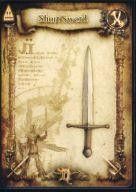</td><td class="col-no">
No. 018

<code>0-2108</code>
</td><td class="col-rarity">CFLv 2高画質 最大11枚 (+10)</td><td class="col-name">
ショートソード
</td><td class="col-id"><code>WEAPON2_KS01_SHORTSWORD</code><button type="button" class="copy-id" data-copy="WEAPON2_KS01_SHORTSWORD" title="ID WEAPON2_KS01_SHORTSWORD をコピー" aria-label="ID WEAPON2_KS01_SHORTSWORD をコピー">⧉</button></td><td class="col-info">
片手剣／攻撃力：２４ · 装備に必要なＳＴＲ：５

片手剣／新米冒険者向きの剣
</td></tr>
<tr data-id="WEAPON2_KS06_GLADIUS" data-cat="WEAPON" data-rarity="UC" data-flag="FLV2,HD" data-search="019 0-2113 グラディウス weapon2_ks06_gladius 片手剣／攻撃力：４５ · 装備に必要なｓｔｒ：１０ 片手剣／闘技場で戦う剣闘士たちも愛用する扱いやすい剣"><td class="col-img">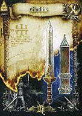</td><td class="col-no">
No. 019

<code>0-2113</code>
</td><td class="col-rarity">UCFLv 2高画質 最大6枚 (+5)</td><td class="col-name">
グラディウス
</td><td class="col-id"><code>WEAPON2_KS06_GLADIUS</code><button type="button" class="copy-id" data-copy="WEAPON2_KS06_GLADIUS" title="ID WEAPON2_KS06_GLADIUS をコピー" aria-label="ID WEAPON2_KS06_GLADIUS をコピー">⧉</button></td><td class="col-info">
片手剣／攻撃力：４５ · 装備に必要なＳＴＲ：１０

片手剣／闘技場で戦う剣闘士たちも愛用する扱いやすい剣
</td></tr>
<tr data-id="WEAPON2_RS01_BASTARDSWORD" data-cat="WEAPON" data-rarity="C" data-flag="FLV2,HD" data-search="020 0-2120 バスタードソード weapon2_rs01_bastardsword 両手剣／攻撃力：３０ · 装備に必要なｓｔｒ：１０ 両手剣／新米戦士向きの大剣"><td class="col-img">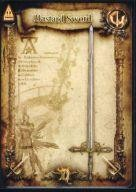</td><td class="col-no">
No. 020

<code>0-2120</code>
</td><td class="col-rarity">CFLv 2高画質 最大11枚 (+10)</td><td class="col-name">
バスタードソード
</td><td class="col-id"><code>WEAPON2_RS01_BASTARDSWORD</code><button type="button" class="copy-id" data-copy="WEAPON2_RS01_BASTARDSWORD" title="ID WEAPON2_RS01_BASTARDSWORD をコピー" aria-label="ID WEAPON2_RS01_BASTARDSWORD をコピー">⧉</button></td><td class="col-info">
両手剣／攻撃力：３０ · 装備に必要なＳＴＲ：１０

両手剣／新米戦士向きの大剣
</td></tr>
<tr data-id="WEAPON2_KA01_HANDAXE" data-cat="WEAPON" data-rarity="C" data-flag="FLV2,HD" data-search="021 0-2126 ハンドアックス weapon2_ka01_handaxe 片手斧／攻撃力：３０ · 装備に必要なｓｔｒ：５ 片手斧／一般的で簡素な斧"><td class="col-img">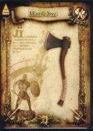</td><td class="col-no">
No. 021

<code>0-2126</code>
</td><td class="col-rarity">CFLv 2高画質 最大11枚 (+10)</td><td class="col-name">
ハンドアックス
</td><td class="col-id"><code>WEAPON2_KA01_HANDAXE</code><button type="button" class="copy-id" data-copy="WEAPON2_KA01_HANDAXE" title="ID WEAPON2_KA01_HANDAXE をコピー" aria-label="ID WEAPON2_KA01_HANDAXE をコピー">⧉</button></td><td class="col-info">
片手斧／攻撃力：３０ · 装備に必要なＳＴＲ：５

片手斧／一般的で簡素な斧
</td></tr>
<tr data-id="WEAPON2_RA01_BROADAXE" data-cat="WEAPON" data-rarity="C" data-flag="FLV2,HD" data-search="022 0-2132 ブロードアックス weapon2_ra01_broadaxe 両手斧／攻撃力：３１ · 装備に必要なｓｔｒ：１０ 両手斧／新米戦士向きの両手斧"><td class="col-img">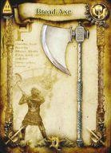</td><td class="col-no">
No. 022

<code>0-2132</code>
</td><td class="col-rarity">CFLv 2高画質 最大11枚 (+10)</td><td class="col-name">
ブロードアックス
</td><td class="col-id"><code>WEAPON2_RA01_BROADAXE</code><button type="button" class="copy-id" data-copy="WEAPON2_RA01_BROADAXE" title="ID WEAPON2_RA01_BROADAXE をコピー" aria-label="ID WEAPON2_RA01_BROADAXE をコピー">⧉</button></td><td class="col-info">
両手斧／攻撃力：３１ · 装備に必要なＳＴＲ：１０

両手斧／新米戦士向きの両手斧
</td></tr>
<tr data-id="WEAPON2_SP01_SHORTSPEAR" data-cat="WEAPON" data-rarity="C" data-flag="FLV2,HD" data-search="023 0-2136 ショートスピア weapon2_sp01_shortspear 槍／攻撃力：２４ · 装備に必要なｓｔｒ：５ 槍／戦闘訓練用の簡素な槍"><td class="col-img">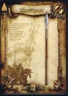</td><td class="col-no">
No. 023

<code>0-2136</code>
</td><td class="col-rarity">CFLv 2高画質 最大11枚 (+10)</td><td class="col-name">
ショートスピア
</td><td class="col-id"><code>WEAPON2_SP01_SHORTSPEAR</code><button type="button" class="copy-id" data-copy="WEAPON2_SP01_SHORTSPEAR" title="ID WEAPON2_SP01_SHORTSPEAR をコピー" aria-label="ID WEAPON2_SP01_SHORTSPEAR をコピー">⧉</button></td><td class="col-info">
槍／攻撃力：２４ · 装備に必要なＳＴＲ：５

槍／戦闘訓練用の簡素な槍
</td></tr>
<tr data-id="WEAPON2_SP03_PARTIZAN" data-cat="WEAPON" data-rarity="UC" data-flag="FLV2,HD" data-search="024 0-2138 パルチザン weapon2_sp03_partizan 槍／攻撃力：３６ · 装備に必要なｓｔｒ：５ 槍／矛先を鍛え上げ、殺傷能力を向上させた槍"><td class="col-img">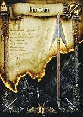</td><td class="col-no">
No. 024

<code>0-2138</code>
</td><td class="col-rarity">UCFLv 2高画質 最大6枚 (+5)</td><td class="col-name">
パルチザン
</td><td class="col-id"><code>WEAPON2_SP03_PARTIZAN</code><button type="button" class="copy-id" data-copy="WEAPON2_SP03_PARTIZAN" title="ID WEAPON2_SP03_PARTIZAN をコピー" aria-label="ID WEAPON2_SP03_PARTIZAN をコピー">⧉</button></td><td class="col-info">
槍／攻撃力：３６ · 装備に必要なＳＴＲ：５

槍／矛先を鍛え上げ、殺傷能力を向上させた槍
</td></tr>
<tr data-id="WEAPON2_MA01_CLUB" data-cat="WEAPON" data-rarity="C" data-flag="FLV2,HD" data-search="025 0-2141 クラブ weapon2_ma01_club 棍棒／攻撃力：２１ · 装備に必要なｓｔｒ：５ 棍棒／簡単で最も原始的な鈍器"><td class="col-img">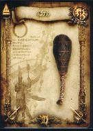</td><td class="col-no">
No. 025

<code>0-2141</code>
</td><td class="col-rarity">CFLv 2高画質 最大11枚 (+10)</td><td class="col-name">
クラブ
</td><td class="col-id"><code>WEAPON2_MA01_CLUB</code><button type="button" class="copy-id" data-copy="WEAPON2_MA01_CLUB" title="ID WEAPON2_MA01_CLUB をコピー" aria-label="ID WEAPON2_MA01_CLUB をコピー">⧉</button></td><td class="col-info">
棍棒／攻撃力：２１ · 装備に必要なＳＴＲ：５

棍棒／簡単で最も原始的な鈍器
</td></tr>
<tr data-id="WEAPON2_NI01_DAGGER" data-cat="WEAPON" data-rarity="C" data-flag="FLV2,HD" data-search="026 0-2147 ダガー weapon2_ni01_dagger ナイフ／攻撃力：１８ · 装備に必要なｓｔｒ：なし ナイフ／小型の簡素なナイフ"><td class="col-img">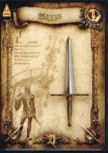</td><td class="col-no">
No. 026

<code>0-2147</code>
</td><td class="col-rarity">CFLv 2高画質 最大11枚 (+10)</td><td class="col-name">
ダガー
</td><td class="col-id"><code>WEAPON2_NI01_DAGGER</code><button type="button" class="copy-id" data-copy="WEAPON2_NI01_DAGGER" title="ID WEAPON2_NI01_DAGGER をコピー" aria-label="ID WEAPON2_NI01_DAGGER をコピー">⧉</button></td><td class="col-info">
ナイフ／攻撃力：１８ · 装備に必要なＳＴＲ：なし

ナイフ／小型の簡素なナイフ
</td></tr>
<tr data-id="WEAPON2_YU01_WOODBOW" data-cat="WEAPON" data-rarity="C" data-flag="FLV2,HD" data-search="027 0-2157 ウッドボウ weapon2_yu01_woodbow 弓／攻撃力：３ · 装備に必要なｓｔｒ：なし 弓／木材で作った簡素な弓"><td class="col-img">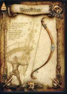</td><td class="col-no">
No. 027

<code>0-2157</code>
</td><td class="col-rarity">CFLv 2高画質 最大11枚 (+10)</td><td class="col-name">
ウッドボウ
</td><td class="col-id"><code>WEAPON2_YU01_WOODBOW</code><button type="button" class="copy-id" data-copy="WEAPON2_YU01_WOODBOW" title="ID WEAPON2_YU01_WOODBOW をコピー" aria-label="ID WEAPON2_YU01_WOODBOW をコピー">⧉</button></td><td class="col-info">
弓／攻撃力：３ · 装備に必要なＳＴＲ：なし

弓／木材で作った簡素な弓
</td></tr>
<tr data-id="WEAPON2_QI01_ARROW" data-cat="WEAPON" data-rarity="C" data-flag="FLV1,HD" data-search="028 0-2161 アロー weapon2_qi01_arrow 矢筒／攻撃力：５～ · 装備に必要なｓｔｒ：なし 矢筒／安物で威力は望めないが取り回しのよい矢"><td class="col-img">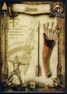</td><td class="col-no">
No. 028

<code>0-2161</code>
</td><td class="col-rarity">CFLv 1高画質 最大3枚 (99回分)</td><td class="col-name">
アロー
</td><td class="col-id"><code>WEAPON2_QI01_ARROW</code><button type="button" class="copy-id" data-copy="WEAPON2_QI01_ARROW" title="ID WEAPON2_QI01_ARROW をコピー" aria-label="ID WEAPON2_QI01_ARROW をコピー">⧉</button></td><td class="col-info">
矢筒／攻撃力：５～ · 装備に必要なＳＴＲ：なし

矢筒／安物で威力は望めないが取り回しのよい矢
</td></tr>
<tr data-id="WEAPON2_QI02_FIREARROW" data-cat="WEAPON" data-rarity="UC" data-flag="FLV1,HD" data-search="029 0-2162 ファイアーアロー weapon2_qi02_firearrow 矢筒／攻撃力：４～ · 装備に必要なｓｔｒ：なし 矢筒／矢先が炎に包まれている魔法の矢"><td class="col-img">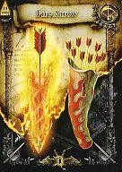</td><td class="col-no">
No. 029

<code>0-2162</code>
</td><td class="col-rarity">UCFLv 1高画質 最大3枚 (99回分)</td><td class="col-name">
ファイアーアロー
</td><td class="col-id"><code>WEAPON2_QI02_FIREARROW</code><button type="button" class="copy-id" data-copy="WEAPON2_QI02_FIREARROW" title="ID WEAPON2_QI02_FIREARROW をコピー" aria-label="ID WEAPON2_QI02_FIREARROW をコピー">⧉</button></td><td class="col-info">
矢筒／攻撃力：４～ · 装備に必要なＳＴＲ：なし

矢筒／矢先が炎に包まれている魔法の矢
</td></tr>
<tr data-id="WEAPON2_QI03_COLDARROW" data-cat="WEAPON" data-rarity="UC" data-flag="FLV1,HD" data-search="030 0-2163 コールドアロー weapon2_qi03_coldarrow 矢筒／攻撃力：４～ · 装備に必要なｓｔｒ：なし 矢筒／矢先に冷気を封じ込めた魔法の矢"><td class="col-img">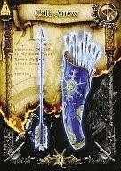</td><td class="col-no">
No. 030

<code>0-2163</code>
</td><td class="col-rarity">UCFLv 1高画質 最大3枚 (99回分)</td><td class="col-name">
コールドアロー
</td><td class="col-id"><code>WEAPON2_QI03_COLDARROW</code><button type="button" class="copy-id" data-copy="WEAPON2_QI03_COLDARROW" title="ID WEAPON2_QI03_COLDARROW をコピー" aria-label="ID WEAPON2_QI03_COLDARROW をコピー">⧉</button></td><td class="col-info">
矢筒／攻撃力：４～ · 装備に必要なＳＴＲ：なし

矢筒／矢先に冷気を封じ込めた魔法の矢
</td></tr>
<tr data-id="WEAPON2_QI04_SPARKARROW" data-cat="WEAPON" data-rarity="UC" data-flag="FLV1" data-search="031 0-2164 サンダーアロー weapon2_qi04_sparkarrow 矢筒／攻撃力：４～ · 装備に必要なｓｔｒ：なし 矢筒／矢先に雷の力を封じ込めた魔法の矢"><td class="col-img">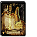</td><td class="col-no">
No. 031

<code>0-2164</code>
</td><td class="col-rarity">UCFLv 1 最大3枚 (99回分)</td><td class="col-name">
サンダーアロー
</td><td class="col-id"><code>WEAPON2_QI04_SPARKARROW</code><button type="button" class="copy-id" data-copy="WEAPON2_QI04_SPARKARROW" title="ID WEAPON2_QI04_SPARKARROW をコピー" aria-label="ID WEAPON2_QI04_SPARKARROW をコピー">⧉</button></td><td class="col-info">
矢筒／攻撃力：４～ · 装備に必要なＳＴＲ：なし

矢筒／矢先に雷の力を封じ込めた魔法の矢
</td></tr>
<tr data-id="WEAPON2_KS03_LONGSWORD" data-cat="WEAPON" data-rarity="C" data-flag="FLV2,HD" data-search="099 0-2110 ロングソード weapon2_ks03_longsword 片手剣／攻撃力：３４ · 装備に必要なｓｔｒ：５ 片手剣／馬上から相手を突き刺すのに適した長さを持つ"><td class="col-img">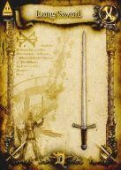</td><td class="col-no">
No. 099

<code>0-2110</code>
</td><td class="col-rarity">CFLv 2高画質 最大11枚 (+10)</td><td class="col-name">
ロングソード
</td><td class="col-id"><code>WEAPON2_KS03_LONGSWORD</code><button type="button" class="copy-id" data-copy="WEAPON2_KS03_LONGSWORD" title="ID WEAPON2_KS03_LONGSWORD をコピー" aria-label="ID WEAPON2_KS03_LONGSWORD をコピー">⧉</button></td><td class="col-info">
片手剣／攻撃力：３４ · 装備に必要なＳＴＲ：５

片手剣／馬上から相手を突き刺すのに適した長さを持つ
</td></tr>
<tr data-id="WEAPON2_RS03_ZWEIHANDER" data-cat="WEAPON" data-rarity="UC" data-flag="FLV2,HD" data-search="100 0-2122 トゥハンドソード weapon2_rs03_zweihander 両手剣／攻撃力：４８ · 装備に必要なｓｔｒ：１０ 両手剣／身の丈を越えるほどの長さを持つ大剣"><td class="col-img"></td><td class="col-no">
No. 100

<code>0-2122</code>
</td><td class="col-rarity">UCFLv 2高画質 最大6枚 (+5)</td><td class="col-name">
トゥハンドソード
</td><td class="col-id"><code>WEAPON2_RS03_ZWEIHANDER</code><button type="button" class="copy-id" data-copy="WEAPON2_RS03_ZWEIHANDER" title="ID WEAPON2_RS03_ZWEIHANDER をコピー" aria-label="ID WEAPON2_RS03_ZWEIHANDER をコピー">⧉</button></td><td class="col-info">
両手剣／攻撃力：４８ · 装備に必要なＳＴＲ：１０

両手剣／身の丈を越えるほどの長さを持つ大剣
</td></tr>
<tr data-id="WEAPON2_RS06_DRAGONKILLER" data-cat="WEAPON" data-rarity="R" data-flag="FLV4" data-search="101 1-250 ドラゴンキラー weapon2_rs06_dragonkiller 両手剣／攻撃力：６９ · 装備に必要なｓｔｒ：２０ 両手剣／ドラゴンの硬い皮膚を切り裂くために作られた剣"><td class="col-img">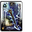</td><td class="col-no">
No. 101

<code>1-250</code>
</td><td class="col-rarity">RFLv 4 最大4枚 (+3)</td><td class="col-name">
ドラゴンキラー
</td><td class="col-id"><code>WEAPON2_RS06_DRAGONKILLER</code><button type="button" class="copy-id" data-copy="WEAPON2_RS06_DRAGONKILLER" title="ID WEAPON2_RS06_DRAGONKILLER をコピー" aria-label="ID WEAPON2_RS06_DRAGONKILLER をコピー">⧉</button></td><td class="col-info">
両手剣／攻撃力：６９ · 装備に必要なＳＴＲ：２０

両手剣／ドラゴンの硬い皮膚を切り裂くために作られた剣
</td></tr>
<tr data-id="WEAPON2_KA03_WARAXE" data-cat="WEAPON" data-rarity="C" data-flag="FLV2,HD" data-search="102 0-2128 ウォーアックス weapon2_ka03_waraxe 片手斧／攻撃力：３６ · 装備に必要なｓｔｒ：１０ 片手斧／工具としての斧から発展して完成された戦闘用の斧"><td class="col-img">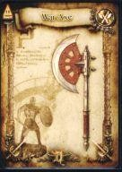</td><td class="col-no">
No. 102

<code>0-2128</code>
</td><td class="col-rarity">CFLv 2高画質 最大11枚 (+10)</td><td class="col-name">
ウォーアックス
</td><td class="col-id"><code>WEAPON2_KA03_WARAXE</code><button type="button" class="copy-id" data-copy="WEAPON2_KA03_WARAXE" title="ID WEAPON2_KA03_WARAXE をコピー" aria-label="ID WEAPON2_KA03_WARAXE をコピー">⧉</button></td><td class="col-info">
片手斧／攻撃力：３６ · 装備に必要なＳＴＲ：１０

片手斧／工具としての斧から発展して完成された戦闘用の斧
</td></tr>
<tr data-id="WEAPON2_KA04_BATTLEAXE" data-cat="WEAPON" data-rarity="UC" data-flag="FLV3,HD" data-search="103 0-2129 バトルアックス weapon2_ka04_battleaxe 片手斧／攻撃力：５７ · 装備に必要なｓｔｒ：１５ 片手斧／ウォーアックスをより戦闘向けにしたもの"><td class="col-img">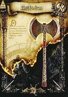</td><td class="col-no">
No. 103

<code>0-2129</code>
</td><td class="col-rarity">UCFLv 3高画質 最大6枚 (+5)</td><td class="col-name">
バトルアックス
</td><td class="col-id"><code>WEAPON2_KA04_BATTLEAXE</code><button type="button" class="copy-id" data-copy="WEAPON2_KA04_BATTLEAXE" title="ID WEAPON2_KA04_BATTLEAXE をコピー" aria-label="ID WEAPON2_KA04_BATTLEAXE をコピー">⧉</button></td><td class="col-info">
片手斧／攻撃力：５７ · 装備に必要なＳＴＲ：１５

片手斧／ウォーアックスをより戦闘向けにしたもの
</td></tr>
<tr data-id="WEAPON2_MA02_MACE" data-cat="WEAPON" data-rarity="C" data-flag="FLV2,HD" data-search="104 0-2142 メイス weapon2_ma02_mace 棍棒／攻撃力：３４ · 装備に必要なｓｔｒ：５ 棍棒／殴打することに特化した鉄製の鈍器"><td class="col-img">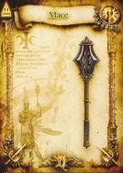</td><td class="col-no">
No. 104

<code>0-2142</code>
</td><td class="col-rarity">CFLv 2高画質 最大11枚 (+10)</td><td class="col-name">
メイス
</td><td class="col-id"><code>WEAPON2_MA02_MACE</code><button type="button" class="copy-id" data-copy="WEAPON2_MA02_MACE" title="ID WEAPON2_MA02_MACE をコピー" aria-label="ID WEAPON2_MA02_MACE をコピー">⧉</button></td><td class="col-info">
棍棒／攻撃力：３４ · 装備に必要なＳＴＲ：５

棍棒／殴打することに特化した鉄製の鈍器
</td></tr>
<tr data-id="WEAPON2_NI02_DIRK" data-cat="WEAPON" data-rarity="C" data-flag="FLV2,HD" data-search="105 0-2148 ダーク weapon2_ni02_dirk ナイフ／攻撃力：２５ · 装備に必要なｓｔｒ：なし ナイフ／高地に住む勇猛な部族が愛用するナイフ"><td class="col-img">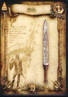</td><td class="col-no">
No. 105

<code>0-2148</code>
</td><td class="col-rarity">CFLv 2高画質 最大11枚 (+10)</td><td class="col-name">
ダーク
</td><td class="col-id"><code>WEAPON2_NI02_DIRK</code><button type="button" class="copy-id" data-copy="WEAPON2_NI02_DIRK" title="ID WEAPON2_NI02_DIRK をコピー" aria-label="ID WEAPON2_NI02_DIRK をコピー">⧉</button></td><td class="col-info">
ナイフ／攻撃力：２５ · 装備に必要なＳＴＲ：なし

ナイフ／高地に住む勇猛な部族が愛用するナイフ
</td></tr>
<tr data-id="WEAPON2_NI03_POISONDAGGER" data-cat="WEAPON" data-rarity="UC" data-flag="FLV2,HD" data-search="106 0-2149 ポイズンダガー weapon2_ni03_poisondagger ナイフ／攻撃力：３３ · 装備に必要なｓｔｒ：なし ナイフ／刃に毒を仕込ませている暗殺用ナイフ"><td class="col-img">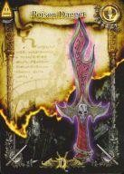</td><td class="col-no">
No. 106

<code>0-2149</code>
</td><td class="col-rarity">UCFLv 2高画質 最大6枚 (+5)</td><td class="col-name">
ポイズンダガー
</td><td class="col-id"><code>WEAPON2_NI03_POISONDAGGER</code><button type="button" class="copy-id" data-copy="WEAPON2_NI03_POISONDAGGER" title="ID WEAPON2_NI03_POISONDAGGER をコピー" aria-label="ID WEAPON2_NI03_POISONDAGGER をコピー">⧉</button></td><td class="col-info">
ナイフ／攻撃力：３３ · 装備に必要なＳＴＲ：なし

ナイフ／刃に毒を仕込ませている暗殺用ナイフ
</td></tr>
<tr data-id="WEAPON2_YU04_GREATBOW" data-cat="WEAPON" data-rarity="UC" data-flag="FLV2" data-search="107 0-2160 グレートボウ weapon2_yu04_greatbow 弓／攻撃力：１７ · 装備に必要なｓｔｒ：なし 弓／狙撃の名手が好んで扱う戦闘用に特化された弓"><td class="col-img">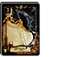</td><td class="col-no">
No. 107

<code>0-2160</code>
</td><td class="col-rarity">UCFLv 2 最大6枚 (+5)</td><td class="col-name">
グレートボウ
</td><td class="col-id"><code>WEAPON2_YU04_GREATBOW</code><button type="button" class="copy-id" data-copy="WEAPON2_YU04_GREATBOW" title="ID WEAPON2_YU04_GREATBOW をコピー" aria-label="ID WEAPON2_YU04_GREATBOW をコピー">⧉</button></td><td class="col-info">
弓／攻撃力：１７ · 装備に必要なＳＴＲ：なし

弓／狙撃の名手が好んで扱う戦闘用に特化された弓
</td></tr>
<tr data-id="WEAPON2_ST01_QUARTERSTAFF" data-cat="WEAPON" data-rarity="C" data-flag="FLV2,HD" data-search="165 0-2152 クォータースタッフ weapon2_st01_quarterstaff 杖／攻撃力：２０ · 装備に必要なｓｔｒ：なし 杖／魔法使い向きの簡素な杖"><td class="col-img">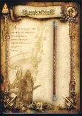</td><td class="col-no">
No. 165

<code>0-2152</code>
</td><td class="col-rarity">CFLv 2高画質 最大11枚 (+10)</td><td class="col-name">
クォータースタッフ
</td><td class="col-id"><code>WEAPON2_ST01_QUARTERSTAFF</code><button type="button" class="copy-id" data-copy="WEAPON2_ST01_QUARTERSTAFF" title="ID WEAPON2_ST01_QUARTERSTAFF をコピー" aria-label="ID WEAPON2_ST01_QUARTERSTAFF をコピー">⧉</button></td><td class="col-info">
杖／攻撃力：２０ · 装備に必要なＳＴＲ：なし

杖／魔法使い向きの簡素な杖
</td></tr>
<tr data-id="WEAPON2_ST02_SCEPTER" data-cat="WEAPON" data-rarity="C" data-flag="FLV2,HD" data-search="166 0-2153 セプター weapon2_st02_scepter 杖／攻撃力：２５ · 装備に必要なｓｔｒ：なし 杖／装飾を施した木製の王笏"><td class="col-img">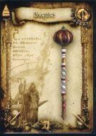</td><td class="col-no">
No. 166

<code>0-2153</code>
</td><td class="col-rarity">CFLv 2高画質 最大11枚 (+10)</td><td class="col-name">
セプター
</td><td class="col-id"><code>WEAPON2_ST02_SCEPTER</code><button type="button" class="copy-id" data-copy="WEAPON2_ST02_SCEPTER" title="ID WEAPON2_ST02_SCEPTER をコピー" aria-label="ID WEAPON2_ST02_SCEPTER をコピー">⧉</button></td><td class="col-info">
杖／攻撃力：２５ · 装備に必要なＳＴＲ：なし

杖／装飾を施した木製の王笏
</td></tr>
<tr data-id="WEAPON2_KS07_MITHRILBLADE" data-cat="WEAPON" data-rarity="R" data-flag="FLV4" data-search="173 1-248 ミスリルソード weapon2_ks07_mithrilblade 片手剣／攻撃力：６５ · 装備に必要なｓｔｒ：１０ 片手剣／魔力を持つ金属のミスリルを材料にした硬く軽い剣"><td class="col-img">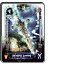</td><td class="col-no">
No. 173

<code>1-248</code>
</td><td class="col-rarity">RFLv 4 最大4枚 (+3)</td><td class="col-name">
ミスリルソード
</td><td class="col-id"><code>WEAPON2_KS07_MITHRILBLADE</code><button type="button" class="copy-id" data-copy="WEAPON2_KS07_MITHRILBLADE" title="ID WEAPON2_KS07_MITHRILBLADE をコピー" aria-label="ID WEAPON2_KS07_MITHRILBLADE をコピー">⧉</button></td><td class="col-info">
片手剣／攻撃力：６５ · 装備に必要なＳＴＲ：１０

片手剣／魔力を持つ金属のミスリルを材料にした硬く軽い剣
</td></tr>
<tr data-id="WEAPON2_RA02_GREATAXE" data-cat="WEAPON" data-rarity="UC" data-flag="FLV3,HD" data-search="174 0-2133 グレートアックス weapon2_ra02_greataxe 両手斧／攻撃力：５４ · 装備に必要なｓｔｒ：１０ 両手斧／両刃に改良して破壊力殺傷能力を向上させた大斧"><td class="col-img">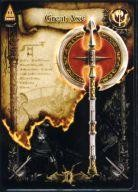</td><td class="col-no">
No. 174

<code>0-2133</code>
</td><td class="col-rarity">UCFLv 3高画質 最大6枚 (+5)</td><td class="col-name">
グレートアックス
</td><td class="col-id"><code>WEAPON2_RA02_GREATAXE</code><button type="button" class="copy-id" data-copy="WEAPON2_RA02_GREATAXE" title="ID WEAPON2_RA02_GREATAXE をコピー" aria-label="ID WEAPON2_RA02_GREATAXE をコピー">⧉</button></td><td class="col-info">
両手斧／攻撃力：５４ · 装備に必要なＳＴＲ：１０

両手斧／両刃に改良して破壊力殺傷能力を向上させた大斧
</td></tr>
<tr data-id="WEAPON2_ST03_WIZARDSSTAFF" data-cat="WEAPON" data-rarity="UC" data-flag="FLV2" data-search="207 0-2154 ウィザードスタッフ weapon2_st03_wizardsstaff 杖／攻撃力：３３ · 装備に必要なｓｔｒ：なし 杖／高名な魔術師も愛用している魔力が向上する杖"><td class="col-img">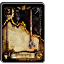</td><td class="col-no">
No. 207

<code>0-2154</code>
</td><td class="col-rarity">UCFLv 2 最大6枚 (+5)</td><td class="col-name">
ウィザードスタッフ
</td><td class="col-id"><code>WEAPON2_ST03_WIZARDSSTAFF</code><button type="button" class="copy-id" data-copy="WEAPON2_ST03_WIZARDSSTAFF" title="ID WEAPON2_ST03_WIZARDSSTAFF をコピー" aria-label="ID WEAPON2_ST03_WIZARDSSTAFF をコピー">⧉</button></td><td class="col-info">
杖／攻撃力：３３ · 装備に必要なＳＴＲ：なし

杖／高名な魔術師も愛用している魔力が向上する杖
</td></tr>
<tr data-id="WEAPON2_SP04_TRIDENT" data-cat="WEAPON" data-rarity="UC" data-flag="FLV3,HD" data-search="214 0-2139 トライデント weapon2_sp04_trident 槍／攻撃力：４６ · 装備に必要なｓｔｒ：５ 槍／海の神のシンボルとも言える武器。雷撃を秘めている"><td class="col-img">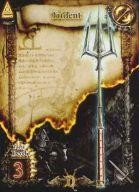</td><td class="col-no">
No. 214

<code>0-2139</code>
</td><td class="col-rarity">UCFLv 3高画質 最大6枚 (+5)</td><td class="col-name">
トライデント
</td><td class="col-id"><code>WEAPON2_SP04_TRIDENT</code><button type="button" class="copy-id" data-copy="WEAPON2_SP04_TRIDENT" title="ID WEAPON2_SP04_TRIDENT をコピー" aria-label="ID WEAPON2_SP04_TRIDENT をコピー">⧉</button></td><td class="col-info">
槍／攻撃力：４６ · 装備に必要なＳＴＲ：５

槍／海の神のシンボルとも言える武器。雷撃を秘めている
</td></tr>
<tr data-id="WEAPON2_SP06_ICELANCE" data-cat="WEAPON" data-rarity="R" data-flag="FLV3,HD" data-search="215 1-257 アイススピア weapon2_sp06_icelance 槍／攻撃力：１２ · 装備に必要なｓｔｒ：１０ 槍／氷の力を詰め込んで穂先を創り上げたという槍"><td class="col-img">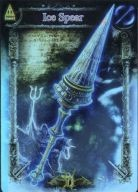</td><td class="col-no">
No. 215

<code>1-257</code>
</td><td class="col-rarity">RFLv 3高画質 最大4枚 (+3)</td><td class="col-name">
アイススピア
</td><td class="col-id"><code>WEAPON2_SP06_ICELANCE</code><button type="button" class="copy-id" data-copy="WEAPON2_SP06_ICELANCE" title="ID WEAPON2_SP06_ICELANCE をコピー" aria-label="ID WEAPON2_SP06_ICELANCE をコピー">⧉</button></td><td class="col-info">
槍／攻撃力：１２ · 装備に必要なＳＴＲ：１０

槍／氷の力を詰め込んで穂先を創り上げたという槍
</td></tr>
<tr data-id="WEAPON2_MA03_WARHAMMER" data-cat="WEAPON" data-rarity="UC" data-flag="FLV3" data-search="249 0-2364 ウォーハンマー weapon2_ma03_warhammer 棍棒／攻撃力：５１ · 装備に必要なｓｔｒ：１０ 棍棒／金槌を武器へと改良した戦槌"><td class="col-img">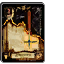</td><td class="col-no">
No. 249

<code>0-2364</code>
</td><td class="col-rarity">UCFLv 3 最大6枚 (+5)</td><td class="col-name">
ウォーハンマー
</td><td class="col-id"><code>WEAPON2_MA03_WARHAMMER</code><button type="button" class="copy-id" data-copy="WEAPON2_MA03_WARHAMMER" title="ID WEAPON2_MA03_WARHAMMER をコピー" aria-label="ID WEAPON2_MA03_WARHAMMER をコピー">⧉</button></td><td class="col-info">
棍棒／攻撃力：５１ · 装備に必要なＳＴＲ：１０

棍棒／金槌を武器へと改良した戦槌
</td></tr>
<tr data-id="WEAPON2_KS05_FALCHION" data-cat="WEAPON" data-rarity="UC" data-flag="FLV3" data-search="250 0-2365 ファルシオン weapon2_ks05_falchion 片手剣／攻撃力：５４ · 装備に必要なｓｔｒ：１０ 片手剣／砂漠の民が愛用している重量感ある片刃の曲刀"><td class="col-img">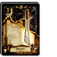</td><td class="col-no">
No. 250

<code>0-2365</code>
</td><td class="col-rarity">UCFLv 3 最大6枚 (+5)</td><td class="col-name">
ファルシオン
</td><td class="col-id"><code>WEAPON2_KS05_FALCHION</code><button type="button" class="copy-id" data-copy="WEAPON2_KS05_FALCHION" title="ID WEAPON2_KS05_FALCHION をコピー" aria-label="ID WEAPON2_KS05_FALCHION をコピー">⧉</button></td><td class="col-info">
片手剣／攻撃力：５４ · 装備に必要なＳＴＲ：１０

片手剣／砂漠の民が愛用している重量感ある片刃の曲刀
</td></tr>
<tr data-id="WEAPON2_KS04_VIKINGSWORD" data-cat="WEAPON" data-rarity="UC" data-flag="FLV2" data-search="253 0-2501 ヴァイキングソード weapon2_ks04_vikingsword 片手剣／攻撃力：３０ · 装備に必要なｓｔｒ：５ 片手剣／海の民ヴァイキングが用いた肉厚で幅広な鉄製の剣"><td class="col-img">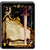</td><td class="col-no">
No. 253

<code>0-2501</code>
</td><td class="col-rarity">UCFLv 2 最大6枚 (+5)</td><td class="col-name">
ヴァイキングソード
</td><td class="col-id"><code>WEAPON2_KS04_VIKINGSWORD</code><button type="button" class="copy-id" data-copy="WEAPON2_KS04_VIKINGSWORD" title="ID WEAPON2_KS04_VIKINGSWORD をコピー" aria-label="ID WEAPON2_KS04_VIKINGSWORD をコピー">⧉</button></td><td class="col-info">
片手剣／攻撃力：３０ · 装備に必要なＳＴＲ：５

片手剣／海の民ヴァイキングが用いた肉厚で幅広な鉄製の剣
</td></tr>
<tr data-id="WEAPON2_NI08_ROUND" data-cat="WEAPON" data-rarity="UC" data-flag="FLV2" data-search="254 0-2502 ラウンドナイフ weapon2_ni08_round ナイフ／攻撃力：１４ · 装備に必要なｓｔｒ：なし ナイフ／殺傷能力は低いが強烈な一撃が出やすいナイフ"><td class="col-img">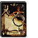</td><td class="col-no">
No. 254

<code>0-2502</code>
</td><td class="col-rarity">UCFLv 2 最大6枚 (+5)</td><td class="col-name">
ラウンドナイフ
</td><td class="col-id"><code>WEAPON2_NI08_ROUND</code><button type="button" class="copy-id" data-copy="WEAPON2_NI08_ROUND" title="ID WEAPON2_NI08_ROUND をコピー" aria-label="ID WEAPON2_NI08_ROUND をコピー">⧉</button></td><td class="col-info">
ナイフ／攻撃力：１４ · 装備に必要なＳＴＲ：なし

ナイフ／殺傷能力は低いが強烈な一撃が出やすいナイフ
</td></tr>
<tr data-id="WEAPON2_NI09_STUNDAGGER" data-cat="WEAPON" data-rarity="UC" data-flag="FLV2,HD" data-search="255 0-2503 スタンダガー weapon2_ni09_stundagger ナイフ／攻撃力：３０ · 装備に必要なｓｔｒ：なし ナイフ／刃に神経毒を仕込んだ特殊なナイフ"><td class="col-img">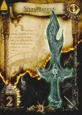</td><td class="col-no">
No. 255

<code>0-2503</code>
</td><td class="col-rarity">UCFLv 2高画質 最大6枚 (+5)</td><td class="col-name">
スタンダガー
</td><td class="col-id"><code>WEAPON2_NI09_STUNDAGGER</code><button type="button" class="copy-id" data-copy="WEAPON2_NI09_STUNDAGGER" title="ID WEAPON2_NI09_STUNDAGGER をコピー" aria-label="ID WEAPON2_NI09_STUNDAGGER をコピー">⧉</button></td><td class="col-info">
ナイフ／攻撃力：３０ · 装備に必要なＳＴＲ：なし

ナイフ／刃に神経毒を仕込んだ特殊なナイフ
</td></tr>
<tr data-id="WEAPON2_KS18_VIPERFUNG" data-cat="WEAPON" data-rarity="UC" data-flag="FLV2" data-search="256 0-2504 バイパーファング weapon2_ks18_viperfung 片手剣／攻撃力：５０ · 装備に必要なｓｔｒ：１０ 片手剣／毒蛇の牙のような鋭い切先をした片手剣"><td class="col-img">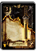</td><td class="col-no">
No. 256

<code>0-2504</code>
</td><td class="col-rarity">UCFLv 2 最大6枚 (+5)</td><td class="col-name">
バイパーファング
</td><td class="col-id"><code>WEAPON2_KS18_VIPERFUNG</code><button type="button" class="copy-id" data-copy="WEAPON2_KS18_VIPERFUNG" title="ID WEAPON2_KS18_VIPERFUNG をコピー" aria-label="ID WEAPON2_KS18_VIPERFUNG をコピー">⧉</button></td><td class="col-info">
片手剣／攻撃力：５０ · 装備に必要なＳＴＲ：１０

片手剣／毒蛇の牙のような鋭い切先をした片手剣
</td></tr>
<tr data-id="WEAPON2_RS11_SQUARETHRUST" data-cat="WEAPON" data-rarity="UC" data-flag="FLV2,HD" data-search="257 0-2505 スクエアスラッシャー weapon2_rs11_squarethrust 両手剣／攻撃力：４５ · 装備に必要なｓｔｒ：１０ 両手剣／敵を突き刺して投げることができる優れた両手剣"><td class="col-img">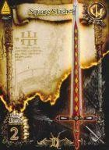</td><td class="col-no">
No. 257

<code>0-2505</code>
</td><td class="col-rarity">UCFLv 2高画質 最大6枚 (+5)</td><td class="col-name">
スクエアスラッシャー
</td><td class="col-id"><code>WEAPON2_RS11_SQUARETHRUST</code><button type="button" class="copy-id" data-copy="WEAPON2_RS11_SQUARETHRUST" title="ID WEAPON2_RS11_SQUARETHRUST をコピー" aria-label="ID WEAPON2_RS11_SQUARETHRUST をコピー">⧉</button></td><td class="col-info">
両手剣／攻撃力：４５ · 装備に必要なＳＴＲ：１０

両手剣／敵を突き刺して投げることができる優れた両手剣
</td></tr>
<tr data-id="WEAPON2_KA09_SILVERAXE" data-cat="WEAPON" data-rarity="UC" data-flag="FLV2" data-search="258 0-2506 シルバーアックス weapon2_ka09_silveraxe 片手斧／攻撃力：３０ · 装備に必要なｓｔｒ：５ 片手斧／純銀製で作りの見事な美しいバトルアックス"><td class="col-img">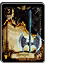</td><td class="col-no">
No. 258

<code>0-2506</code>
</td><td class="col-rarity">UCFLv 2 最大6枚 (+5)</td><td class="col-name">
シルバーアックス
</td><td class="col-id"><code>WEAPON2_KA09_SILVERAXE</code><button type="button" class="copy-id" data-copy="WEAPON2_KA09_SILVERAXE" title="ID WEAPON2_KA09_SILVERAXE をコピー" aria-label="ID WEAPON2_KA09_SILVERAXE をコピー">⧉</button></td><td class="col-info">
片手斧／攻撃力：３０ · 装備に必要なＳＴＲ：５

片手斧／純銀製で作りの見事な美しいバトルアックス
</td></tr>
<tr data-id="WEAPON2_KA06_SHIELDAXE" data-cat="WEAPON" data-rarity="UC" data-flag="FLV2,HD" data-search="259 0-2507 シールドアックス weapon2_ka06_shieldaxe 片手斧／攻撃力：５２ · 装備に必要なｓｔｒ：１０ 片手斧／斧の柄の部分に鉄製のシールドを装着したもの"><td class="col-img">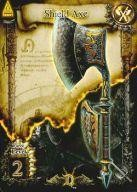</td><td class="col-no">
No. 259

<code>0-2507</code>
</td><td class="col-rarity">UCFLv 2高画質 最大6枚 (+5)</td><td class="col-name">
シールドアックス
</td><td class="col-id"><code>WEAPON2_KA06_SHIELDAXE</code><button type="button" class="copy-id" data-copy="WEAPON2_KA06_SHIELDAXE" title="ID WEAPON2_KA06_SHIELDAXE をコピー" aria-label="ID WEAPON2_KA06_SHIELDAXE をコピー">⧉</button></td><td class="col-info">
片手斧／攻撃力：５２ · 装備に必要なＳＴＲ：１０

片手斧／斧の柄の部分に鉄製のシールドを装着したもの
</td></tr>
<tr data-id="WEAPON2_RA09_STEELAXE" data-cat="WEAPON" data-rarity="UC" data-flag="FLV2,HD" data-search="260 0-2508 スチールアックス weapon2_ra09_steelaxe 両手斧／攻撃力：３３ · 装備に必要なｓｔｒ：なし 両手斧／刃先は巨大だが軽量で非力な者でも扱える両手斧"><td class="col-img">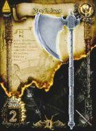</td><td class="col-no">
No. 260

<code>0-2508</code>
</td><td class="col-rarity">UCFLv 2高画質 最大6枚 (+5)</td><td class="col-name">
スチールアックス
</td><td class="col-id"><code>WEAPON2_RA09_STEELAXE</code><button type="button" class="copy-id" data-copy="WEAPON2_RA09_STEELAXE" title="ID WEAPON2_RA09_STEELAXE をコピー" aria-label="ID WEAPON2_RA09_STEELAXE をコピー">⧉</button></td><td class="col-info">
両手斧／攻撃力：３３ · 装備に必要なＳＴＲ：なし

両手斧／刃先は巨大だが軽量で非力な者でも扱える両手斧
</td></tr>
<tr data-id="WEAPON2_RA10_GREAT_EX1" data-cat="WEAPON" data-rarity="UC" data-flag="FLV2,HD" data-search="261 0-2509 ブーストアックス weapon2_ra10_great_ex1 両手斧／攻撃力：４８ · 装備に必要なｓｔｒ：５ 両手斧／軽量に作られた、素早い動きにも対応できる両手斧"><td class="col-img">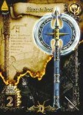</td><td class="col-no">
No. 261

<code>0-2509</code>
</td><td class="col-rarity">UCFLv 2高画質 最大6枚 (+5)</td><td class="col-name">
ブーストアックス
</td><td class="col-id"><code>WEAPON2_RA10_GREAT_EX1</code><button type="button" class="copy-id" data-copy="WEAPON2_RA10_GREAT_EX1" title="ID WEAPON2_RA10_GREAT_EX1 をコピー" aria-label="ID WEAPON2_RA10_GREAT_EX1 をコピー">⧉</button></td><td class="col-info">
両手斧／攻撃力：４８ · 装備に必要なＳＴＲ：５

両手斧／軽量に作られた、素早い動きにも対応できる両手斧
</td></tr>
<tr data-id="WEAPON2_MA09_HOLYMACE" data-cat="WEAPON" data-rarity="UC" data-flag="FLV3" data-search="262 0-2510 ホーリーメイス weapon2_ma09_holymace 棍棒／攻撃力：３４ · 装備に必要なｓｔｒ：５ 棍棒／聖なる力で覆われている鉄製の鈍器"><td class="col-img">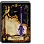</td><td class="col-no">
No. 262

<code>0-2510</code>
</td><td class="col-rarity">UCFLv 3 最大6枚 (+5)</td><td class="col-name">
ホーリーメイス
</td><td class="col-id"><code>WEAPON2_MA09_HOLYMACE</code><button type="button" class="copy-id" data-copy="WEAPON2_MA09_HOLYMACE" title="ID WEAPON2_MA09_HOLYMACE をコピー" aria-label="ID WEAPON2_MA09_HOLYMACE をコピー">⧉</button></td><td class="col-info">
棍棒／攻撃力：３４ · 装備に必要なＳＴＲ：５

棍棒／聖なる力で覆われている鉄製の鈍器
</td></tr>
<tr data-id="WEAPON2_KA02_FRANCISCA" data-cat="WEAPON" data-rarity="UC" data-flag="FLV2,HD" data-search="263 0-2513 フランキスカ weapon2_ka02_francisca 片手斧／攻撃力：５１ · 装備に必要なｓｔｒ：１０ 片手斧／地中海近くに住む勇猛な民族が愛用していた斧"><td class="col-img">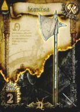</td><td class="col-no">
No. 263

<code>0-2513</code>
</td><td class="col-rarity">UCFLv 2高画質 最大6枚 (+5)</td><td class="col-name">
フランキスカ
</td><td class="col-id"><code>WEAPON2_KA02_FRANCISCA</code><button type="button" class="copy-id" data-copy="WEAPON2_KA02_FRANCISCA" title="ID WEAPON2_KA02_FRANCISCA をコピー" aria-label="ID WEAPON2_KA02_FRANCISCA をコピー">⧉</button></td><td class="col-info">
片手斧／攻撃力：５１ · 装備に必要なＳＴＲ：１０

片手斧／地中海近くに住む勇猛な民族が愛用していた斧
</td></tr>
<tr data-id="WEAPON2_NI04_SWORDBRAKER" data-cat="WEAPON" data-rarity="UC" data-flag="FLV2,HD" data-search="264 0-2514 ソードブレイカー weapon2_ni04_swordbraker ナイフ／攻撃力：３６ · 装備に必要なｓｔｒ：なし ナイフ／剣を受け止め破壊するために作られた短剣"><td class="col-img">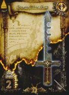</td><td class="col-no">
No. 264

<code>0-2514</code>
</td><td class="col-rarity">UCFLv 2高画質 最大6枚 (+5)</td><td class="col-name">
ソードブレイカー
</td><td class="col-id"><code>WEAPON2_NI04_SWORDBRAKER</code><button type="button" class="copy-id" data-copy="WEAPON2_NI04_SWORDBRAKER" title="ID WEAPON2_NI04_SWORDBRAKER をコピー" aria-label="ID WEAPON2_NI04_SWORDBRAKER をコピー">⧉</button></td><td class="col-info">
ナイフ／攻撃力：３６ · 装備に必要なＳＴＲ：なし

ナイフ／剣を受け止め破壊するために作られた短剣
</td></tr>
<tr data-id="WEAPON2_YU09_IRONBOW" data-cat="WEAPON" data-rarity="UC" data-flag="FLV2,HD" data-search="265 0-2515 アイアンボウ weapon2_yu09_ironbow 弓／攻撃力：９ · 装備に必要なｓｔｒ：なし 弓／鋼鉄で作られた破壊力のある重い弓"><td class="col-img">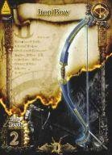</td><td class="col-no">
No. 265

<code>0-2515</code>
</td><td class="col-rarity">UCFLv 2高画質 最大6枚 (+5)</td><td class="col-name">
アイアンボウ
</td><td class="col-id"><code>WEAPON2_YU09_IRONBOW</code><button type="button" class="copy-id" data-copy="WEAPON2_YU09_IRONBOW" title="ID WEAPON2_YU09_IRONBOW をコピー" aria-label="ID WEAPON2_YU09_IRONBOW をコピー">⧉</button></td><td class="col-info">
弓／攻撃力：９ · 装備に必要なＳＴＲ：なし

弓／鋼鉄で作られた破壊力のある重い弓
</td></tr>
<tr data-id="WEAPON2_YU03_LONGBOW" data-cat="WEAPON" data-rarity="UC" data-flag="FLV2" data-search="266 0-2516 ロングボウ weapon2_yu03_longbow 弓／攻撃力：１２ · 装備に必要なｓｔｒ：なし 弓／戦闘用に強化された長い弓"><td class="col-img">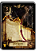</td><td class="col-no">
No. 266

<code>0-2516</code>
</td><td class="col-rarity">UCFLv 2 最大6枚 (+5)</td><td class="col-name">
ロングボウ
</td><td class="col-id"><code>WEAPON2_YU03_LONGBOW</code><button type="button" class="copy-id" data-copy="WEAPON2_YU03_LONGBOW" title="ID WEAPON2_YU03_LONGBOW をコピー" aria-label="ID WEAPON2_YU03_LONGBOW をコピー">⧉</button></td><td class="col-info">
弓／攻撃力：１２ · 装備に必要なＳＴＲ：なし

弓／戦闘用に強化された長い弓
</td></tr>
<tr data-id="WEAPON2_QI05_MITHRILARROW" data-cat="WEAPON" data-rarity="UC" data-flag="FLV1,HD" data-search="267 0-2517 ダークアロー weapon2_qi05_mithrilarrow 矢筒／攻撃力：４～ · 装備に必要なｓｔｒ：なし 矢筒／闇の力により風切り音を立てずに相手へ突き刺さる矢"><td class="col-img">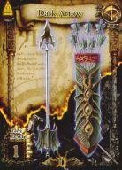</td><td class="col-no">
No. 267

<code>0-2517</code>
</td><td class="col-rarity">UCFLv 1高画質 最大3枚 (99回分)</td><td class="col-name">
ダークアロー
</td><td class="col-id"><code>WEAPON2_QI05_MITHRILARROW</code><button type="button" class="copy-id" data-copy="WEAPON2_QI05_MITHRILARROW" title="ID WEAPON2_QI05_MITHRILARROW をコピー" aria-label="ID WEAPON2_QI05_MITHRILARROW をコピー">⧉</button></td><td class="col-info">
矢筒／攻撃力：４～ · 装備に必要なＳＴＲ：なし

矢筒／闇の力により風切り音を立てずに相手へ突き刺さる矢
</td></tr>
<tr data-id="WEAPON2_ST11_WIZARD_EX1" data-cat="WEAPON" data-rarity="UC" data-flag="FLV2" data-search="320 0-2571 フレイムスタッフ weapon2_st11_wizard_ex1 杖／攻撃力：８ · 装備に必要なｓｔｒ：なし 杖／杖の先から炎を飛ばすことができる魔力の杖"><td class="col-img">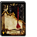</td><td class="col-no">
No. 320

<code>0-2571</code>
</td><td class="col-rarity">UCFLv 2 最大6枚 (+5)</td><td class="col-name">
フレイムスタッフ
</td><td class="col-id"><code>WEAPON2_ST11_WIZARD_EX1</code><button type="button" class="copy-id" data-copy="WEAPON2_ST11_WIZARD_EX1" title="ID WEAPON2_ST11_WIZARD_EX1 をコピー" aria-label="ID WEAPON2_ST11_WIZARD_EX1 をコピー">⧉</button></td><td class="col-info">
杖／攻撃力：８ · 装備に必要なＳＴＲ：なし

杖／杖の先から炎を飛ばすことができる魔力の杖
</td></tr>
<tr data-id="WEAPON2_ST12_WIZARD_EX2" data-cat="WEAPON" data-rarity="UC" data-flag="FLV2,HD" data-search="321 0-2572 アイススタッフ weapon2_st12_wizard_ex2 杖／攻撃力：８ · 装備に必要なｓｔｒ：なし 杖／杖の先から冷気を放つことができる魔力の杖"><td class="col-img">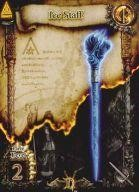</td><td class="col-no">
No. 321

<code>0-2572</code>
</td><td class="col-rarity">UCFLv 2高画質 最大6枚 (+5)</td><td class="col-name">
アイススタッフ
</td><td class="col-id"><code>WEAPON2_ST12_WIZARD_EX2</code><button type="button" class="copy-id" data-copy="WEAPON2_ST12_WIZARD_EX2" title="ID WEAPON2_ST12_WIZARD_EX2 をコピー" aria-label="ID WEAPON2_ST12_WIZARD_EX2 をコピー">⧉</button></td><td class="col-info">
杖／攻撃力：８ · 装備に必要なＳＴＲ：なし

杖／杖の先から冷気を放つことができる魔力の杖
</td></tr>
<tr data-id="WEAPON2_ST13_WIZARD_EX3" data-cat="WEAPON" data-rarity="UC" data-flag="FLV2" data-search="322 0-2573 サンダースタッフ weapon2_st13_wizard_ex3 杖／攻撃力：８ · 装備に必要なｓｔｒ：なし 杖／杖の先から雷を放つことができる魔力の杖"><td class="col-img">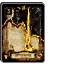</td><td class="col-no">
No. 322

<code>0-2573</code>
</td><td class="col-rarity">UCFLv 2 最大6枚 (+5)</td><td class="col-name">
サンダースタッフ
</td><td class="col-id"><code>WEAPON2_ST13_WIZARD_EX3</code><button type="button" class="copy-id" data-copy="WEAPON2_ST13_WIZARD_EX3" title="ID WEAPON2_ST13_WIZARD_EX3 をコピー" aria-label="ID WEAPON2_ST13_WIZARD_EX3 をコピー">⧉</button></td><td class="col-info">
杖／攻撃力：８ · 装備に必要なＳＴＲ：なし

杖／杖の先から雷を放つことができる魔力の杖
</td></tr>
<tr data-id="WEAPON2_SP09_FRAME" data-cat="WEAPON" data-rarity="R" data-flag="FLV3,HD" data-search="323 1-344 フレイムスピア weapon2_sp09_frame 槍／攻撃力：１２ · 装備に必要なｓｔｒ：１０ 槍／熱き炎の魔力を穂先に封じ込めた魔槍"><td class="col-img">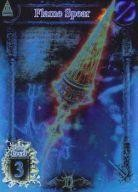</td><td class="col-no">
No. 323

<code>1-344</code>
</td><td class="col-rarity">RFLv 3高画質 最大4枚 (+3)</td><td class="col-name">
フレイムスピア
</td><td class="col-id"><code>WEAPON2_SP09_FRAME</code><button type="button" class="copy-id" data-copy="WEAPON2_SP09_FRAME" title="ID WEAPON2_SP09_FRAME をコピー" aria-label="ID WEAPON2_SP09_FRAME をコピー">⧉</button></td><td class="col-info">
槍／攻撃力：１２ · 装備に必要なＳＴＲ：１０

槍／熱き炎の魔力を穂先に封じ込めた魔槍
</td></tr>
<tr data-id="WEAPON2_SP10_THUNDER" data-cat="WEAPON" data-rarity="R" data-flag="FLV3" data-search="324 1-345 サンダースピア weapon2_sp10_thunder 槍／攻撃力：１２ · 装備に必要なｓｔｒ：１０ 槍／雷の破壊力を穂先に備えた扱う者を選ばない魔槍"><td class="col-img"></td><td class="col-no">
No. 324

<code>1-345</code>
</td><td class="col-rarity">RFLv 3 最大4枚 (+3)</td><td class="col-name">
サンダースピア
</td><td class="col-id"><code>WEAPON2_SP10_THUNDER</code><button type="button" class="copy-id" data-copy="WEAPON2_SP10_THUNDER" title="ID WEAPON2_SP10_THUNDER をコピー" aria-label="ID WEAPON2_SP10_THUNDER をコピー">⧉</button></td><td class="col-info">
槍／攻撃力：１２ · 装備に必要なＳＴＲ：１０

槍／雷の破壊力を穂先に備えた扱う者を選ばない魔槍
</td></tr>
<tr data-id="WEAPON2_NC03_MASSU" data-cat="WEAPON" data-rarity="UC" data-flag="FLV2" data-search="367 0-2605 アイアンスパイク weapon2_nc03_massu ナックル／攻撃力：４２ · 装備に必要なｓｔｒ：なし ナックル／３本の棘がついた鋼鉄のナックル"><td class="col-img"></td><td class="col-no">
No. 367

<code>0-2605</code>
</td><td class="col-rarity">UCFLv 2 最大6枚 (+5)</td><td class="col-name">
アイアンスパイク
</td><td class="col-id"><code>WEAPON2_NC03_MASSU</code><button type="button" class="copy-id" data-copy="WEAPON2_NC03_MASSU" title="ID WEAPON2_NC03_MASSU をコピー" aria-label="ID WEAPON2_NC03_MASSU をコピー">⧉</button></td><td class="col-info">
ナックル／攻撃力：４２ · 装備に必要なＳＴＲ：なし

ナックル／３本の棘がついた鋼鉄のナックル
</td></tr>
<tr data-id="WEAPON2_MA11_WARHAMMER_EX" data-cat="WEAPON" data-rarity="UC" data-flag="FLV2" data-search="368 0-2610 ブライトハンマー weapon2_ma11_warhammer_ex 棍棒／攻撃力：４３ · 装備に必要なｓｔｒ：５ 棍棒／叩くだけでなく、刺すことも可能なハンマー"><td class="col-img"></td><td class="col-no">
No. 368

<code>0-2610</code>
</td><td class="col-rarity">UCFLv 2 最大6枚 (+5)</td><td class="col-name">
ブライトハンマー
</td><td class="col-id"><code>WEAPON2_MA11_WARHAMMER_EX</code><button type="button" class="copy-id" data-copy="WEAPON2_MA11_WARHAMMER_EX" title="ID WEAPON2_MA11_WARHAMMER_EX をコピー" aria-label="ID WEAPON2_MA11_WARHAMMER_EX をコピー">⧉</button></td><td class="col-info">
棍棒／攻撃力：４３ · 装備に必要なＳＴＲ：５

棍棒／叩くだけでなく、刺すことも可能なハンマー
</td></tr>
<tr data-id="WEAPON2_KA10_EGRET" data-cat="WEAPON" data-rarity="UC" data-flag="FLV2" data-search="369 0-2611 イーグレット weapon2_ka10_egret 片手斧／攻撃力：４６ · 装備に必要なｓｔｒ：１０ 片手斧／相手に向かって投げることができる片手斧"><td class="col-img"></td><td class="col-no">
No. 369

<code>0-2611</code>
</td><td class="col-rarity">UCFLv 2 最大6枚 (+5)</td><td class="col-name">
イーグレット
</td><td class="col-id"><code>WEAPON2_KA10_EGRET</code><button type="button" class="copy-id" data-copy="WEAPON2_KA10_EGRET" title="ID WEAPON2_KA10_EGRET をコピー" aria-label="ID WEAPON2_KA10_EGRET をコピー">⧉</button></td><td class="col-info">
片手斧／攻撃力：４６ · 装備に必要なＳＴＲ：１０

片手斧／相手に向かって投げることができる片手斧
</td></tr>
<tr data-id="WEAPON2_SP02_AWLPIKE" data-cat="WEAPON" data-rarity="UC" data-flag="FLV2" data-search="370 0-2612 オウルパイク weapon2_sp02_awlpike 槍／攻撃力：５０ · 装備に必要なｓｔｒ：５ 槍／敵に向かって投げ飛ばすことができる軽量の槍"><td class="col-img"></td><td class="col-no">
No. 370

<code>0-2612</code>
</td><td class="col-rarity">UCFLv 2 最大6枚 (+5)</td><td class="col-name">
オウルパイク
</td><td class="col-id"><code>WEAPON2_SP02_AWLPIKE</code><button type="button" class="copy-id" data-copy="WEAPON2_SP02_AWLPIKE" title="ID WEAPON2_SP02_AWLPIKE をコピー" aria-label="ID WEAPON2_SP02_AWLPIKE をコピー">⧉</button></td><td class="col-info">
槍／攻撃力：５０ · 装備に必要なＳＴＲ：５

槍／敵に向かって投げ飛ばすことができる軽量の槍
</td></tr>
<tr data-id="WEAPON2_NI13_KERIS" data-cat="WEAPON" data-rarity="UC" data-flag="FLV2" data-search="371 0-2613 クリス weapon2_ni13_keris ナイフ／攻撃力：４７ · 装備に必要なｓｔｒ：なし ナイフ／特徴的な刀身を持つお守りとして扱われていた短剣"><td class="col-img"></td><td class="col-no">
No. 371

<code>0-2613</code>
</td><td class="col-rarity">UCFLv 2 最大6枚 (+5)</td><td class="col-name">
クリス
</td><td class="col-id"><code>WEAPON2_NI13_KERIS</code><button type="button" class="copy-id" data-copy="WEAPON2_NI13_KERIS" title="ID WEAPON2_NI13_KERIS をコピー" aria-label="ID WEAPON2_NI13_KERIS をコピー">⧉</button></td><td class="col-info">
ナイフ／攻撃力：４７ · 装備に必要なＳＴＲ：なし

ナイフ／特徴的な刀身を持つお守りとして扱われていた短剣
</td></tr>
<tr data-id="WEAPON2_KA19_TAMECHAN2" data-cat="WEAPON" data-rarity="UC" data-flag="FLV3" data-search="372 0-2614 スパイクアックス weapon2_ka19_tamechan2 片手斧／攻撃力：６１ · 装備に必要なｓｔｒ：１５ 片手斧／先端に刃ではなく鋭利な突起を付けた斧"><td class="col-img"></td><td class="col-no">
No. 372

<code>0-2614</code>
</td><td class="col-rarity">UCFLv 3 最大6枚 (+5)</td><td class="col-name">
スパイクアックス
</td><td class="col-id"><code>WEAPON2_KA19_TAMECHAN2</code><button type="button" class="copy-id" data-copy="WEAPON2_KA19_TAMECHAN2" title="ID WEAPON2_KA19_TAMECHAN2 をコピー" aria-label="ID WEAPON2_KA19_TAMECHAN2 をコピー">⧉</button></td><td class="col-info">
片手斧／攻撃力：６１ · 装備に必要なＳＴＲ：１５

片手斧／先端に刃ではなく鋭利な突起を付けた斧
</td></tr>
<tr data-id="WEAPON2_ST05_MAGICALSTAFF" data-cat="WEAPON" data-rarity="UC" data-flag="FLV2" data-search="373 0-2618 クリスタルワンド weapon2_st05_magicalstaff 杖／攻撃力：３５ · 装備に必要なｓｔｒ：なし 杖／先端に冠した宝玉の力で所有者の魔力を向上させる"><td class="col-img"></td><td class="col-no">
No. 373

<code>0-2618</code>
</td><td class="col-rarity">UCFLv 2 最大6枚 (+5)</td><td class="col-name">
クリスタルワンド
</td><td class="col-id"><code>WEAPON2_ST05_MAGICALSTAFF</code><button type="button" class="copy-id" data-copy="WEAPON2_ST05_MAGICALSTAFF" title="ID WEAPON2_ST05_MAGICALSTAFF をコピー" aria-label="ID WEAPON2_ST05_MAGICALSTAFF をコピー">⧉</button></td><td class="col-info">
杖／攻撃力：３５ · 装備に必要なＳＴＲ：なし

杖／先端に冠した宝玉の力で所有者の魔力を向上させる
</td></tr>
<tr data-id="WEAPON2_RA08_DIVINEAXE" data-cat="WEAPON" data-rarity="R" data-flag="FLV3" data-search="374 1-370 ディバインアックス weapon2_ra08_divineaxe 両手斧／攻撃力：４７ · 装備に必要なｓｔｒ：１５ 両手斧／女神像に加護の力が宿っている両手斧"><td class="col-img"></td><td class="col-no">
No. 374

<code>1-370</code>
</td><td class="col-rarity">RFLv 3 最大4枚 (+3)</td><td class="col-name">
ディバインアックス
</td><td class="col-id"><code>WEAPON2_RA08_DIVINEAXE</code><button type="button" class="copy-id" data-copy="WEAPON2_RA08_DIVINEAXE" title="ID WEAPON2_RA08_DIVINEAXE をコピー" aria-label="ID WEAPON2_RA08_DIVINEAXE をコピー">⧉</button></td><td class="col-info">
両手斧／攻撃力：４７ · 装備に必要なＳＴＲ：１５

両手斧／女神像に加護の力が宿っている両手斧
</td></tr>
<tr data-id="WEAPON2_KS08_MAGICSWORD" data-cat="WEAPON" data-rarity="R" data-flag="FLV4" data-search="375 1-371 マジックソード weapon2_ks08_magicsword 片手剣／攻撃力：１２ · 装備に必要なｓｔｒ：なし 片手剣／魔術儀式用の祭具で魔法の使用が可能になる"><td class="col-img"></td><td class="col-no">
No. 375

<code>1-371</code>
</td><td class="col-rarity">RFLv 4 最大4枚 (+3)</td><td class="col-name">
マジックソード
</td><td class="col-id"><code>WEAPON2_KS08_MAGICSWORD</code><button type="button" class="copy-id" data-copy="WEAPON2_KS08_MAGICSWORD" title="ID WEAPON2_KS08_MAGICSWORD をコピー" aria-label="ID WEAPON2_KS08_MAGICSWORD をコピー">⧉</button></td><td class="col-info">
片手剣／攻撃力：１２ · 装備に必要なＳＴＲ：なし

片手剣／魔術儀式用の祭具で魔法の使用が可能になる
</td></tr>
<tr data-id="WEAPON2_YU05_YUMI" data-cat="WEAPON" data-rarity="R" data-flag="FLV3" data-search="376 1-372 紅桜 weapon2_yu05_yumi 弓／攻撃力：２５ · 装備に必要なｓｔｒ：なし 弓／武士の活躍していた時代に使われていた和弓"><td class="col-img"></td><td class="col-no">
No. 376

<code>1-372</code>
</td><td class="col-rarity">RFLv 3 最大4枚 (+3)</td><td class="col-name">
紅桜
</td><td class="col-id"><code>WEAPON2_YU05_YUMI</code><button type="button" class="copy-id" data-copy="WEAPON2_YU05_YUMI" title="ID WEAPON2_YU05_YUMI をコピー" aria-label="ID WEAPON2_YU05_YUMI をコピー">⧉</button></td><td class="col-info">
弓／攻撃力：２５ · 装備に必要なＳＴＲ：なし

弓／武士の活躍していた時代に使われていた和弓
</td></tr>
<tr data-id="WEAPON2_RA04_MITHRILAXE" data-cat="WEAPON" data-rarity="R" data-flag="FLV4" data-search="377 1-416 ミスリルアックス weapon2_ra04_mithrilaxe 両手斧／攻撃力：７０ · 装備に必要なｓｔｒ：１０ 両手斧／魔力を持つ金属のミスリルを材料にした軽量の斧"><td class="col-img"></td><td class="col-no">
No. 377

<code>1-416</code>
</td><td class="col-rarity">RFLv 4 最大4枚 (+3)</td><td class="col-name">
ミスリルアックス
</td><td class="col-id"><code>WEAPON2_RA04_MITHRILAXE</code><button type="button" class="copy-id" data-copy="WEAPON2_RA04_MITHRILAXE" title="ID WEAPON2_RA04_MITHRILAXE をコピー" aria-label="ID WEAPON2_RA04_MITHRILAXE をコピー">⧉</button></td><td class="col-info">
両手斧／攻撃力：７０ · 装備に必要なＳＴＲ：１０

両手斧／魔力を持つ金属のミスリルを材料にした軽量の斧
</td></tr>
<tr data-id="WEAPON2_YU06_MITHRILBOW" data-cat="WEAPON" data-rarity="R" data-flag="FLV4" data-search="378 1-421 ミスリルボウ weapon2_yu06_mithrilbow 弓／攻撃力：３０ · 装備に必要なｓｔｒ：なし 弓／魔力を持つ金属のミスリルを材料にした軽量で高精度な弓"><td class="col-img"></td><td class="col-no">
No. 378

<code>1-421</code>
</td><td class="col-rarity">RFLv 4 最大4枚 (+3)</td><td class="col-name">
ミスリルボウ
</td><td class="col-id"><code>WEAPON2_YU06_MITHRILBOW</code><button type="button" class="copy-id" data-copy="WEAPON2_YU06_MITHRILBOW" title="ID WEAPON2_YU06_MITHRILBOW をコピー" aria-label="ID WEAPON2_YU06_MITHRILBOW をコピー">⧉</button></td><td class="col-info">
弓／攻撃力：３０ · 装備に必要なＳＴＲ：なし

弓／魔力を持つ金属のミスリルを材料にした軽量で高精度な弓
</td></tr>
<tr data-id="WEAPON2_MA15_TAMECHAN1" data-cat="WEAPON" data-rarity="UC" data-flag="FLV3,HD" data-search="444 0-2615 スクエアメイス weapon2_ma15_tamechan1 棍棒／攻撃力：５７ · 装備に必要なｓｔｒ：１０ 棍棒／四角く重い槌が振り下ろすスピードを高めてくれる棍棒"><td class="col-img"></td><td class="col-no">
No. 444

<code>0-2615</code>
</td><td class="col-rarity">UCFLv 3高画質 最大6枚 (+5)</td><td class="col-name">
スクエアメイス
</td><td class="col-id"><code>WEAPON2_MA15_TAMECHAN1</code><button type="button" class="copy-id" data-copy="WEAPON2_MA15_TAMECHAN1" title="ID WEAPON2_MA15_TAMECHAN1 をコピー" aria-label="ID WEAPON2_MA15_TAMECHAN1 をコピー">⧉</button></td><td class="col-info">
棍棒／攻撃力：５７ · 装備に必要なＳＴＲ：１０

棍棒／四角く重い槌が振り下ろすスピードを高めてくれる棍棒
</td></tr>
<tr data-id="WEAPON2_NI14_TAMECHAN2" data-cat="WEAPON" data-rarity="UC" data-flag="FLV2,HD" data-search="445 0-2616 ロットナイフ weapon2_ni14_tamechan2 ナイフ／攻撃力：４２ · 装備に必要なｓｔｒ：なし ナイフ／あらゆる毒素を帯びた恐るべき能力を持つナイフ"><td class="col-img"></td><td class="col-no">
No. 445

<code>0-2616</code>
</td><td class="col-rarity">UCFLv 2高画質 最大6枚 (+5)</td><td class="col-name">
ロットナイフ
</td><td class="col-id"><code>WEAPON2_NI14_TAMECHAN2</code><button type="button" class="copy-id" data-copy="WEAPON2_NI14_TAMECHAN2" title="ID WEAPON2_NI14_TAMECHAN2 をコピー" aria-label="ID WEAPON2_NI14_TAMECHAN2 をコピー">⧉</button></td><td class="col-info">
ナイフ／攻撃力：４２ · 装備に必要なＳＴＲ：なし

ナイフ／あらゆる毒素を帯びた恐るべき能力を持つナイフ
</td></tr>
<tr data-id="WEAPON2_NC05_THRUST" data-cat="WEAPON" data-rarity="UC" data-flag="FLV2,HD" data-search="446 0-2617 スラストナックル weapon2_nc05_thrust ナックル／攻撃力：５４ · 装備に必要なｓｔｒ：なし ナックル／硬く折れないという獣の角で作られたグローブ"><td class="col-img"></td><td class="col-no">
No. 446

<code>0-2617</code>
</td><td class="col-rarity">UCFLv 2高画質 最大6枚 (+5)</td><td class="col-name">
スラストナックル
</td><td class="col-id"><code>WEAPON2_NC05_THRUST</code><button type="button" class="copy-id" data-copy="WEAPON2_NC05_THRUST" title="ID WEAPON2_NC05_THRUST をコピー" aria-label="ID WEAPON2_NC05_THRUST をコピー">⧉</button></td><td class="col-info">
ナックル／攻撃力：５４ · 装備に必要なＳＴＲ：なし

ナックル／硬く折れないという獣の角で作られたグローブ
</td></tr>
<tr data-id="WEAPON2_SP18_MUSSU" data-cat="WEAPON" data-rarity="R" data-flag="FLV3" data-search="447 1-376 グレイブ weapon2_sp18_mussu 槍／攻撃力：６７ · 装備に必要なｓｔｒ：１０ 槍／独特な形状の大振りな刃が取り付けられた扱いやすい槍"><td class="col-img"></td><td class="col-no">
No. 447

<code>1-376</code>
</td><td class="col-rarity">RFLv 3 最大4枚 (+3)</td><td class="col-name">
グレイブ
</td><td class="col-id"><code>WEAPON2_SP18_MUSSU</code><button type="button" class="copy-id" data-copy="WEAPON2_SP18_MUSSU" title="ID WEAPON2_SP18_MUSSU をコピー" aria-label="ID WEAPON2_SP18_MUSSU をコピー">⧉</button></td><td class="col-info">
槍／攻撃力：６７ · 装備に必要なＳＴＲ：１０

槍／独特な形状の大振りな刃が取り付けられた扱いやすい槍
</td></tr>
<tr data-id="WEAPON2_KS13_BLACKSWORD" data-cat="WEAPON" data-rarity="R" data-flag="FLV3" data-search="448 1-373 グレートソード weapon2_ks13_blacksword 片手剣／攻撃力：６５ · 装備に必要なｓｔｒ：１５ 片手剣／優れた者だけが携える美麗な装飾と切れ味を誇る剣"><td class="col-img"></td><td class="col-no">
No. 448

<code>1-373</code>
</td><td class="col-rarity">RFLv 3 最大4枚 (+3)</td><td class="col-name">
グレートソード
</td><td class="col-id"><code>WEAPON2_KS13_BLACKSWORD</code><button type="button" class="copy-id" data-copy="WEAPON2_KS13_BLACKSWORD" title="ID WEAPON2_KS13_BLACKSWORD をコピー" aria-label="ID WEAPON2_KS13_BLACKSWORD をコピー">⧉</button></td><td class="col-info">
片手剣／攻撃力：６５ · 装備に必要なＳＴＲ：１５

片手剣／優れた者だけが携える美麗な装飾と切れ味を誇る剣
</td></tr>
<tr data-id="WEAPON2_KA18_CRESCENT" data-cat="WEAPON" data-rarity="R" data-flag="FLV3" data-search="449 1-374 クレセントアックス weapon2_ka18_crescent 片手斧／攻撃力：６７ · 装備に必要なｓｔｒ：１５ 片手斧／曲線美を描く三日月型の刀身が人気を集めている斧"><td class="col-img"></td><td class="col-no">
No. 449

<code>1-374</code>
</td><td class="col-rarity">RFLv 3 最大4枚 (+3)</td><td class="col-name">
クレセントアックス
</td><td class="col-id"><code>WEAPON2_KA18_CRESCENT</code><button type="button" class="copy-id" data-copy="WEAPON2_KA18_CRESCENT" title="ID WEAPON2_KA18_CRESCENT をコピー" aria-label="ID WEAPON2_KA18_CRESCENT をコピー">⧉</button></td><td class="col-info">
片手斧／攻撃力：６７ · 装備に必要なＳＴＲ：１５

片手斧／曲線美を描く三日月型の刀身が人気を集めている斧
</td></tr>
<tr data-id="WEAPON2_RA22_RUIN" data-cat="WEAPON" data-rarity="R" data-flag="FLV3,HD" data-search="450 1-375 ルーインアックス weapon2_ra22_ruin 両手斧／攻撃力：７２ · 装備に必要なｓｔｒ：２０ 両手斧／光を闇に変えるほどの禍々しき力を持つ暗黒の斧"><td class="col-img"></td><td class="col-no">
No. 450

<code>1-375</code>
</td><td class="col-rarity">RFLv 3高画質 最大4枚 (+3)</td><td class="col-name">
ルーインアックス
</td><td class="col-id"><code>WEAPON2_RA22_RUIN</code><button type="button" class="copy-id" data-copy="WEAPON2_RA22_RUIN" title="ID WEAPON2_RA22_RUIN をコピー" aria-label="ID WEAPON2_RA22_RUIN をコピー">⧉</button></td><td class="col-info">
両手斧／攻撃力：７２ · 装備に必要なＳＴＲ：２０

両手斧／光を闇に変えるほどの禍々しき力を持つ暗黒の斧
</td></tr>
<tr data-id="WEAPON2_NC06_BLADE" data-cat="WEAPON" data-rarity="R" data-flag="FLV3" data-search="451 1-378 ブレイドナックル weapon2_nc06_blade ナックル／攻撃力：５８ · 装備に必要なｓｔｒ：なし ナックル／鋼鉄の短刀をつけて極限まで威力を高めたグローブ"><td class="col-img"></td><td class="col-no">
No. 451

<code>1-378</code>
</td><td class="col-rarity">RFLv 3 最大4枚 (+3)</td><td class="col-name">
ブレイドナックル
</td><td class="col-id"><code>WEAPON2_NC06_BLADE</code><button type="button" class="copy-id" data-copy="WEAPON2_NC06_BLADE" title="ID WEAPON2_NC06_BLADE をコピー" aria-label="ID WEAPON2_NC06_BLADE をコピー">⧉</button></td><td class="col-info">
ナックル／攻撃力：５８ · 装備に必要なＳＴＲ：なし

ナックル／鋼鉄の短刀をつけて極限まで威力を高めたグローブ
</td></tr>
<tr data-id="WEAPON2_ST23_TAMECHAN1" data-cat="WEAPON" data-rarity="R" data-flag="FLV3" data-search="452 1-377 カースロッド weapon2_st23_tamechan1 杖／攻撃力：３９ · 装備に必要なｓｔｒ：なし 杖／不気味な装飾を施された強力な魔力を秘めた呪いの杖"><td class="col-img"></td><td class="col-no">
No. 452

<code>1-377</code>
</td><td class="col-rarity">RFLv 3 最大4枚 (+3)</td><td class="col-name">
カースロッド
</td><td class="col-id"><code>WEAPON2_ST23_TAMECHAN1</code><button type="button" class="copy-id" data-copy="WEAPON2_ST23_TAMECHAN1" title="ID WEAPON2_ST23_TAMECHAN1 をコピー" aria-label="ID WEAPON2_ST23_TAMECHAN1 をコピー">⧉</button></td><td class="col-info">
杖／攻撃力：３９ · 装備に必要なＳＴＲ：なし

杖／不気味な装飾を施された強力な魔力を秘めた呪いの杖
</td></tr>
<tr data-id="WEAPON2_SP05_MITHRILSPEAR" data-cat="WEAPON" data-rarity="R" data-flag="FLV4" data-search="453 1-419 ミスリルスピア weapon2_sp05_mithrilspear 槍／攻撃力：６７ · 装備に必要なｓｔｒ：１０ 槍／魔力を持つ金属のミスリルを材料にした鋭利で軽量な槍"><td class="col-img"></td><td class="col-no">
No. 453

<code>1-419</code>
</td><td class="col-rarity">RFLv 4 最大4枚 (+3)</td><td class="col-name">
ミスリルスピア
</td><td class="col-id"><code>WEAPON2_SP05_MITHRILSPEAR</code><button type="button" class="copy-id" data-copy="WEAPON2_SP05_MITHRILSPEAR" title="ID WEAPON2_SP05_MITHRILSPEAR をコピー" aria-label="ID WEAPON2_SP05_MITHRILSPEAR をコピー">⧉</button></td><td class="col-info">
槍／攻撃力：６７ · 装備に必要なＳＴＲ：１０

槍／魔力を持つ金属のミスリルを材料にした鋭利で軽量な槍
</td></tr>
<tr data-id="WEAPON2_MA05_MITHRILHAMMER" data-cat="WEAPON" data-rarity="R" data-flag="FLV4" data-search="454 1-420 ミスリルハンマー weapon2_ma05_mithrilhammer 棍棒／攻撃力：６３ · 装備に必要なｓｔｒ：１０ 棍棒／魔力を持つ金属のミスリルを材料にしたハンマー"><td class="col-img"></td><td class="col-no">
No. 454

<code>1-420</code>
</td><td class="col-rarity">RFLv 4 最大4枚 (+3)</td><td class="col-name">
ミスリルハンマー
</td><td class="col-id"><code>WEAPON2_MA05_MITHRILHAMMER</code><button type="button" class="copy-id" data-copy="WEAPON2_MA05_MITHRILHAMMER" title="ID WEAPON2_MA05_MITHRILHAMMER をコピー" aria-label="ID WEAPON2_MA05_MITHRILHAMMER をコピー">⧉</button></td><td class="col-info">
棍棒／攻撃力：６３ · 装備に必要なＳＴＲ：１０

棍棒／魔力を持つ金属のミスリルを材料にしたハンマー
</td></tr>
<tr data-id="WEAPON2_ST32_SHINKI" data-cat="WEAPON" data-rarity="R" data-flag="FLV4" data-search="464 1-379 アストラルワンド weapon2_st32_shinki 杖／攻撃力：５５ · 装備に必要なｓｔｒ：なし 杖／白き力と黒き力の双方を極めた神が使っていた杖"><td class="col-img"></td><td class="col-no">
No. 464

<code>1-379</code>
</td><td class="col-rarity">RFLv 4 最大4枚 (+3)</td><td class="col-name">
アストラルワンド
</td><td class="col-id"><code>WEAPON2_ST32_SHINKI</code><button type="button" class="copy-id" data-copy="WEAPON2_ST32_SHINKI" title="ID WEAPON2_ST32_SHINKI をコピー" aria-label="ID WEAPON2_ST32_SHINKI をコピー">⧉</button></td><td class="col-info">
杖／攻撃力：５５ · 装備に必要なＳＴＲ：なし

杖／白き力と黒き力の双方を極めた神が使っていた杖
</td></tr>
<tr data-id="WEAPON2_KS02_RAPIER" data-cat="WEAPON" data-rarity="C" data-flag="FLV2" data-search="494 0-2700 レイピア weapon2_ks02_rapier 片手剣／攻撃力：３３ · 装備に必要なｓｔｒ：５ 片手剣／軽装備の相手を斬りつけることに重きを置いた剣"><td class="col-img"></td><td class="col-no">
No. 494

<code>0-2700</code>
</td><td class="col-rarity">CFLv 2 最大11枚 (+10)</td><td class="col-name">
レイピア
</td><td class="col-id"><code>WEAPON2_KS02_RAPIER</code><button type="button" class="copy-id" data-copy="WEAPON2_KS02_RAPIER" title="ID WEAPON2_KS02_RAPIER をコピー" aria-label="ID WEAPON2_KS02_RAPIER をコピー">⧉</button></td><td class="col-info">
片手剣／攻撃力：３３ · 装備に必要なＳＴＲ：５

片手剣／軽装備の相手を斬りつけることに重きを置いた剣
</td></tr>
<tr data-id="WEAPON2_KS10_FAKESWORD" data-cat="WEAPON" data-rarity="C" data-flag="FLV2" data-search="495 0-2701 フェイクソード weapon2_ks10_fakesword 片手剣／攻撃力：３５ · 装備に必要なｓｔｒ：５ 片手剣／剣全体に煌びやかな装飾を施した鑑賞用の長剣"><td class="col-img"></td><td class="col-no">
No. 495

<code>0-2701</code>
</td><td class="col-rarity">CFLv 2 最大11枚 (+10)</td><td class="col-name">
フェイクソード
</td><td class="col-id"><code>WEAPON2_KS10_FAKESWORD</code><button type="button" class="copy-id" data-copy="WEAPON2_KS10_FAKESWORD" title="ID WEAPON2_KS10_FAKESWORD をコピー" aria-label="ID WEAPON2_KS10_FAKESWORD をコピー">⧉</button></td><td class="col-info">
片手剣／攻撃力：３５ · 装備に必要なＳＴＲ：５

片手剣／剣全体に煌びやかな装飾を施した鑑賞用の長剣
</td></tr>
<tr data-id="WEAPON2_KS39_SEIRYUTOU" data-cat="WEAPON" data-rarity="UC" data-flag="FLV2,HD" data-search="496 0-2702 青龍刀 weapon2_ks39_seiryutou 片手剣／攻撃力：５２ · 装備に必要なｓｔｒ：１０ 片手剣／古来より伝わる幅広の切っ先を持つ大振りの刀"><td class="col-img"></td><td class="col-no">
No. 496

<code>0-2702</code>
</td><td class="col-rarity">UCFLv 2高画質 最大6枚 (+5)</td><td class="col-name">
青龍刀
</td><td class="col-id"><code>WEAPON2_KS39_SEIRYUTOU</code><button type="button" class="copy-id" data-copy="WEAPON2_KS39_SEIRYUTOU" title="ID WEAPON2_KS39_SEIRYUTOU をコピー" aria-label="ID WEAPON2_KS39_SEIRYUTOU をコピー">⧉</button></td><td class="col-info">
片手剣／攻撃力：５２ · 装備に必要なＳＴＲ：１０

片手剣／古来より伝わる幅広の切っ先を持つ大振りの刀
</td></tr>
<tr data-id="WEAPON2_NC07_TETSUTUME" data-cat="WEAPON" data-rarity="UC" data-flag="FLV2,HD" data-search="497 0-2705 アサシンネイル weapon2_nc07_tetsutume ナックル／攻撃力：４５ · 装備に必要なｓｔｒ：なし ナックル／４本の長い鉤爪を有した独特な形状のグローブ"><td class="col-img"></td><td class="col-no">
No. 497

<code>0-2705</code>
</td><td class="col-rarity">UCFLv 2高画質 最大6枚 (+5)</td><td class="col-name">
アサシンネイル
</td><td class="col-id"><code>WEAPON2_NC07_TETSUTUME</code><button type="button" class="copy-id" data-copy="WEAPON2_NC07_TETSUTUME" title="ID WEAPON2_NC07_TETSUTUME をコピー" aria-label="ID WEAPON2_NC07_TETSUTUME をコピー">⧉</button></td><td class="col-info">
ナックル／攻撃力：４５ · 装備に必要なＳＴＲ：なし

ナックル／４本の長い鉤爪を有した独特な形状のグローブ
</td></tr>
<tr data-id="WEAPON2_RS05_EXECUTIONERSSWORD" data-cat="WEAPON" data-rarity="R" data-flag="FLV3" data-search="498 1-434 断罪の剣 weapon2_rs05_executionerssword 両手剣／攻撃力：５３ · 装備に必要なｓｔｒ：１０ 両手剣／死刑執行人が罪人の首を切り落とす際に使った刀剣"><td class="col-img"></td><td class="col-no">
No. 498

<code>1-434</code>
</td><td class="col-rarity">RFLv 3 最大4枚 (+3)</td><td class="col-name">
断罪の剣
</td><td class="col-id"><code>WEAPON2_RS05_EXECUTIONERSSWORD</code><button type="button" class="copy-id" data-copy="WEAPON2_RS05_EXECUTIONERSSWORD" title="ID WEAPON2_RS05_EXECUTIONERSSWORD をコピー" aria-label="ID WEAPON2_RS05_EXECUTIONERSSWORD をコピー">⧉</button></td><td class="col-info">
両手剣／攻撃力：５３ · 装備に必要なＳＴＲ：１０

両手剣／死刑執行人が罪人の首を切り落とす際に使った刀剣
</td></tr>
<tr data-id="WEAPON2_NI05_KOTETSU" data-cat="WEAPON" data-rarity="R" data-flag="FLV3" data-search="499 1-436 古鉄 weapon2_ni05_kotetsu ナイフ／攻撃力：５４ · 装備に必要なｓｔｒ：なし ナイフ／東洋の刀匠が生み出した名作と名高い小刀"><td class="col-img"></td><td class="col-no">
No. 499

<code>1-436</code>
</td><td class="col-rarity">RFLv 3 最大4枚 (+3)</td><td class="col-name">
古鉄
</td><td class="col-id"><code>WEAPON2_NI05_KOTETSU</code><button type="button" class="copy-id" data-copy="WEAPON2_NI05_KOTETSU" title="ID WEAPON2_NI05_KOTETSU をコピー" aria-label="ID WEAPON2_NI05_KOTETSU をコピー">⧉</button></td><td class="col-info">
ナイフ／攻撃力：５４ · 装備に必要なＳＴＲ：なし

ナイフ／東洋の刀匠が生み出した名作と名高い小刀
</td></tr>
<tr data-id="WEAPON2_NI25_MOULIN" data-cat="WEAPON" data-rarity="R" data-flag="FLV4" data-search="500 1-493 ムーラン weapon2_ni25_moulin ナイフ／攻撃力：６３ · 装備に必要なｓｔｒ：なし ナイフ／暗殺者に古くから伝わる風車に似た形状の短剣"><td class="col-img"></td><td class="col-no">
No. 500

<code>1-493</code>
</td><td class="col-rarity">RFLv 4 最大4枚 (+3)</td><td class="col-name">
ムーラン
</td><td class="col-id"><code>WEAPON2_NI25_MOULIN</code><button type="button" class="copy-id" data-copy="WEAPON2_NI25_MOULIN" title="ID WEAPON2_NI25_MOULIN をコピー" aria-label="ID WEAPON2_NI25_MOULIN をコピー">⧉</button></td><td class="col-info">
ナイフ／攻撃力：６３ · 装備に必要なＳＴＲ：なし

ナイフ／暗殺者に古くから伝わる風車に似た形状の短剣
</td></tr>
<tr data-id="WEAPON2_KS12_WHITESWORD" data-cat="WEAPON" data-rarity="R" data-flag="FLV4" data-search="501 1-430 デモンズソード weapon2_ks12_whitesword 片手剣／攻撃力：４０ · 装備に必要なｓｔｒ：１０ 片手剣／禍々しい黒き力を封じ込められた長剣"><td class="col-img"></td><td class="col-no">
No. 501

<code>1-430</code>
</td><td class="col-rarity">RFLv 4 最大4枚 (+3)</td><td class="col-name">
デモンズソード
</td><td class="col-id"><code>WEAPON2_KS12_WHITESWORD</code><button type="button" class="copy-id" data-copy="WEAPON2_KS12_WHITESWORD" title="ID WEAPON2_KS12_WHITESWORD をコピー" aria-label="ID WEAPON2_KS12_WHITESWORD をコピー">⧉</button></td><td class="col-info">
片手剣／攻撃力：４０ · 装備に必要なＳＴＲ：１０

片手剣／禍々しい黒き力を封じ込められた長剣
</td></tr>
<tr data-id="WEAPON2_KS19_ROYAL" data-cat="WEAPON" data-rarity="R" data-flag="FLV4" data-search="502 1-431 ホーリーソード weapon2_ks19_royal 片手剣／攻撃力：３５ · 装備に必要なｓｔｒ：５ 片手剣／白き力に護られた長剣で俊敏に振り回せる"><td class="col-img"></td><td class="col-no">
No. 502

<code>1-431</code>
</td><td class="col-rarity">RFLv 4 最大4枚 (+3)</td><td class="col-name">
ホーリーソード
</td><td class="col-id"><code>WEAPON2_KS19_ROYAL</code><button type="button" class="copy-id" data-copy="WEAPON2_KS19_ROYAL" title="ID WEAPON2_KS19_ROYAL をコピー" aria-label="ID WEAPON2_KS19_ROYAL をコピー">⧉</button></td><td class="col-info">
片手剣／攻撃力：３５ · 装備に必要なＳＴＲ：５

片手剣／白き力に護られた長剣で俊敏に振り回せる
</td></tr>
<tr data-id="WEAPON2_MA04_MORNINGSTAR" data-cat="WEAPON" data-rarity="R" data-flag="FLV3" data-search="503 1-437 モーニングスター weapon2_ma04_morningstar 棍棒／攻撃力：６４ · 装備に必要なｓｔｒ：１０ 棍棒／たくさんの棘が突き出た鉄球が特徴的なメイス"><td class="col-img"></td><td class="col-no">
No. 503

<code>1-437</code>
</td><td class="col-rarity">RFLv 3 最大4枚 (+3)</td><td class="col-name">
モーニングスター
</td><td class="col-id"><code>WEAPON2_MA04_MORNINGSTAR</code><button type="button" class="copy-id" data-copy="WEAPON2_MA04_MORNINGSTAR" title="ID WEAPON2_MA04_MORNINGSTAR をコピー" aria-label="ID WEAPON2_MA04_MORNINGSTAR をコピー">⧉</button></td><td class="col-info">
棍棒／攻撃力：６４ · 装備に必要なＳＴＲ：１０

棍棒／たくさんの棘が突き出た鉄球が特徴的なメイス
</td></tr>
<tr data-id="WEAPON2_NC17_SONIC" data-cat="WEAPON" data-rarity="R" data-flag="FLV4" data-search="504 1-491 ソニックナックル weapon2_nc17_sonic ナックル／攻撃力：６０ · 装備に必要なｓｔｒ：なし ナックル／特殊な魔法力を込めた金属で作られたグローブ"><td class="col-img"></td><td class="col-no">
No. 504

<code>1-491</code>
</td><td class="col-rarity">RFLv 4 最大4枚 (+3)</td><td class="col-name">
ソニックナックル
</td><td class="col-id"><code>WEAPON2_NC17_SONIC</code><button type="button" class="copy-id" data-copy="WEAPON2_NC17_SONIC" title="ID WEAPON2_NC17_SONIC をコピー" aria-label="ID WEAPON2_NC17_SONIC をコピー">⧉</button></td><td class="col-info">
ナックル／攻撃力：６０ · 装備に必要なＳＴＲ：なし

ナックル／特殊な魔法力を込めた金属で作られたグローブ
</td></tr>
<tr data-id="WEAPON2_RS22_SAIJYOUI" data-cat="WEAPON" data-rarity="R" data-flag="FLV4" data-search="505 1-492 アルティマソード weapon2_rs22_saijyoui 両手剣／攻撃力：７２ · 装備に必要なｓｔｒ：１５ 両手剣／他に類を見ない破壊力を持つ究極という名の大剣"><td class="col-img"></td><td class="col-no">
No. 505

<code>1-492</code>
</td><td class="col-rarity">RFLv 4 最大4枚 (+3)</td><td class="col-name">
アルティマソード
</td><td class="col-id"><code>WEAPON2_RS22_SAIJYOUI</code><button type="button" class="copy-id" data-copy="WEAPON2_RS22_SAIJYOUI" title="ID WEAPON2_RS22_SAIJYOUI をコピー" aria-label="ID WEAPON2_RS22_SAIJYOUI をコピー">⧉</button></td><td class="col-info">
両手剣／攻撃力：７２ · 装備に必要なＳＴＲ：１５

両手剣／他に類を見ない破壊力を持つ究極という名の大剣
</td></tr>
<tr data-id="WEAPON2_KA26_CRIMSON" data-cat="WEAPON" data-rarity="R" data-flag="FLV4" data-search="506 1-494 クリムゾンライン weapon2_ka26_crimson 片手斧／攻撃力：６８ · 装備に必要なｓｔｒ：１５ 片手斧／使用者の血液と引き換えに破壊の力を授けるという斧"><td class="col-img"></td><td class="col-no">
No. 506

<code>1-494</code>
</td><td class="col-rarity">RFLv 4 最大4枚 (+3)</td><td class="col-name">
クリムゾンライン
</td><td class="col-id"><code>WEAPON2_KA26_CRIMSON</code><button type="button" class="copy-id" data-copy="WEAPON2_KA26_CRIMSON" title="ID WEAPON2_KA26_CRIMSON をコピー" aria-label="ID WEAPON2_KA26_CRIMSON をコピー">⧉</button></td><td class="col-info">
片手斧／攻撃力：６８ · 装備に必要なＳＴＲ：１５

片手斧／使用者の血液と引き換えに破壊の力を授けるという斧
</td></tr>
<tr data-id="WEAPON2_RS09_FLAMESWORD" data-cat="WEAPON" data-rarity="R" data-flag="FLV3" data-search="554 1-435 フレイムソード weapon2_rs09_flamesword 両手剣／攻撃力：４１ · 装備に必要なｓｔｒ：１５ 両手剣／斬りつけられた者を業火で焼き尽くす刀剣"><td class="col-img"></td><td class="col-no">
No. 554

<code>1-435</code>
</td><td class="col-rarity">RFLv 3 最大4枚 (+3)</td><td class="col-name">
フレイムソード
</td><td class="col-id"><code>WEAPON2_RS09_FLAMESWORD</code><button type="button" class="copy-id" data-copy="WEAPON2_RS09_FLAMESWORD" title="ID WEAPON2_RS09_FLAMESWORD をコピー" aria-label="ID WEAPON2_RS09_FLAMESWORD をコピー">⧉</button></td><td class="col-info">
両手剣／攻撃力：４１ · 装備に必要なＳＴＲ：１５

両手剣／斬りつけられた者を業火で焼き尽くす刀剣
</td></tr>
<tr data-id="WEAPON2_RS25_THUNDERBLADE" data-cat="WEAPON" data-rarity="R" data-flag="FLV3" data-search="555 1-433 サンダーブレード weapon2_rs25_thunderblade 両手剣／攻撃力：４１ · 装備に必要なｓｔｒ：１５ 両手剣／稲妻の力を宿した見た目にも珍しい剣"><td class="col-img"></td><td class="col-no">
No. 555

<code>1-433</code>
</td><td class="col-rarity">RFLv 3 最大4枚 (+3)</td><td class="col-name">
サンダーブレード
</td><td class="col-id"><code>WEAPON2_RS25_THUNDERBLADE</code><button type="button" class="copy-id" data-copy="WEAPON2_RS25_THUNDERBLADE" title="ID WEAPON2_RS25_THUNDERBLADE をコピー" aria-label="ID WEAPON2_RS25_THUNDERBLADE をコピー">⧉</button></td><td class="col-info">
両手剣／攻撃力：４１ · 装備に必要なＳＴＲ：１５

両手剣／稲妻の力を宿した見た目にも珍しい剣
</td></tr>
<tr data-id="WEAPON2_RS24_ICEBRAND" data-cat="WEAPON" data-rarity="R" data-flag="FLV3" data-search="556 1-432 アイスブランド weapon2_rs24_icebrand 両手剣／攻撃力：４１ · 装備に必要なｓｔｒ：１５ 両手剣／灼熱の地においても溶けない氷塊で作られた大剣"><td class="col-img"></td><td class="col-no">
No. 556

<code>1-432</code>
</td><td class="col-rarity">RFLv 3 最大4枚 (+3)</td><td class="col-name">
アイスブランド
</td><td class="col-id"><code>WEAPON2_RS24_ICEBRAND</code><button type="button" class="copy-id" data-copy="WEAPON2_RS24_ICEBRAND" title="ID WEAPON2_RS24_ICEBRAND をコピー" aria-label="ID WEAPON2_RS24_ICEBRAND をコピー">⧉</button></td><td class="col-info">
両手剣／攻撃力：４１ · 装備に必要なＳＴＲ：１５

両手剣／灼熱の地においても溶けない氷塊で作られた大剣
</td></tr>
<tr data-id="WEAPON2_KS17_CULANNSWORD" data-cat="WEAPON" data-rarity="UC" data-flag="FLV1" data-search="— 0-2350 クランのショートソード weapon2_ks17_culannsword 片手剣／攻撃力：３２ · 装備に必要なｓｔｒ：なし 片手剣／名工クランが鍛えた初心者向けの片手剣"><td class="col-img"></td><td class="col-no">
No. —

<code>0-2350</code>
</td><td class="col-rarity">UCFLv 1 最大6枚 (+5)</td><td class="col-name">
クランのショートソード
</td><td class="col-id"><code>WEAPON2_KS17_CULANNSWORD</code><button type="button" class="copy-id" data-copy="WEAPON2_KS17_CULANNSWORD" title="ID WEAPON2_KS17_CULANNSWORD をコピー" aria-label="ID WEAPON2_KS17_CULANNSWORD をコピー">⧉</button></td><td class="col-info">
片手剣／攻撃力：３２ · 装備に必要なＳＴＲ：なし

片手剣／名工クランが鍛えた初心者向けの片手剣
</td></tr>
<tr data-id="WEAPON2_MA10_OAKCLUB" data-cat="WEAPON" data-rarity="UC" data-flag="FLV1" data-search="— 0-2351 樫のクラブ weapon2_ma10_oakclub 棍棒／攻撃力：３０ · 装備に必要なｓｔｒ：なし 棍棒／小振りで女性でも扱える強度の高い鈍器"><td class="col-img"></td><td class="col-no">
No. —

<code>0-2351</code>
</td><td class="col-rarity">UCFLv 1 最大6枚 (+5)</td><td class="col-name">
樫のクラブ
</td><td class="col-id"><code>WEAPON2_MA10_OAKCLUB</code><button type="button" class="copy-id" data-copy="WEAPON2_MA10_OAKCLUB" title="ID WEAPON2_MA10_OAKCLUB をコピー" aria-label="ID WEAPON2_MA10_OAKCLUB をコピー">⧉</button></td><td class="col-info">
棍棒／攻撃力：３０ · 装備に必要なＳＴＲ：なし

棍棒／小振りで女性でも扱える強度の高い鈍器
</td></tr>
<tr data-id="WEAPON2_ST10_MAGESTAFF" data-cat="WEAPON" data-rarity="UC" data-flag="FLV1" data-search="— 0-2352 メイジスタッフ weapon2_st10_magestaff 杖／攻撃力：２６ · 装備に必要なｓｔｒ：なし 杖／軽量で美麗な細工が施されている杖"><td class="col-img"></td><td class="col-no">
No. —

<code>0-2352</code>
</td><td class="col-rarity">UCFLv 1 最大6枚 (+5)</td><td class="col-name">
メイジスタッフ
</td><td class="col-id"><code>WEAPON2_ST10_MAGESTAFF</code><button type="button" class="copy-id" data-copy="WEAPON2_ST10_MAGESTAFF" title="ID WEAPON2_ST10_MAGESTAFF をコピー" aria-label="ID WEAPON2_ST10_MAGESTAFF をコピー">⧉</button></td><td class="col-info">
杖／攻撃力：２６ · 装備に必要なＳＴＲ：なし

杖／軽量で美麗な細工が施されている杖
</td></tr>
<tr data-id="WEAPON2_QI06_HOLYARROW" data-cat="WEAPON" data-rarity="UC" data-flag="FLV1,HD" data-search="268/156 0-2518 ホーリーアロー weapon2_qi06_holyarrow 矢筒／攻撃力：４～ · 装備に必要なｓｔｒ：なし 矢筒／聖なる力を矢先に封じ込めた矢"><td class="col-img"></td><td class="col-no">
No. 268/156

<code>0-2518</code>
</td><td class="col-rarity">UCFLv 1高画質 最大3枚 (99回分)</td><td class="col-name">
ホーリーアロー
</td><td class="col-id"><code>WEAPON2_QI06_HOLYARROW</code><button type="button" class="copy-id" data-copy="WEAPON2_QI06_HOLYARROW" title="ID WEAPON2_QI06_HOLYARROW をコピー" aria-label="ID WEAPON2_QI06_HOLYARROW をコピー">⧉</button></td><td class="col-info">
矢筒／攻撃力：４～ · 装備に必要なＳＴＲ：なし

矢筒／聖なる力を矢先に封じ込めた矢
</td></tr>
<tr data-id="WEAPON2_RA03_BERDYSH" data-cat="WEAPON" data-rarity="UC" data-flag="FLV3" data-search="— 0-2704 バルディッシュ weapon2_ra03_berdysh 両手斧／攻撃力：６０ · 装備に必要なｓｔｒ：１５ 両手斧／槍のように突き刺すこともできる長尺の斧"><td class="col-img"></td><td class="col-no">
No. —

<code>0-2704</code>
</td><td class="col-rarity">UCFLv 3 最大6枚 (+5)</td><td class="col-name">
バルディッシュ
</td><td class="col-id"><code>WEAPON2_RA03_BERDYSH</code><button type="button" class="copy-id" data-copy="WEAPON2_RA03_BERDYSH" title="ID WEAPON2_RA03_BERDYSH をコピー" aria-label="ID WEAPON2_RA03_BERDYSH をコピー">⧉</button></td><td class="col-info">
両手斧／攻撃力：６０ · 装備に必要なＳＴＲ：１５

両手斧／槍のように突き刺すこともできる長尺の斧
</td></tr>
</tbody></table>

<h2 class="cat-title">防具（鎧・盾・兜・ブーツ） (109)</h2>

<table class="wiki-table wiki-table-cards"><thead><tr><th>カード</th><th>No. / コード</th><th>レア度</th><th>名称</th><th>ID</th><th>効果・説明</th></tr></thead><tbody>
<tr data-id="ARMOR2_AM24_DEFAULT" data-cat="DEFENSE" data-rarity="C" data-flag="FLV2,HD" data-search="032 0-2169 ファイタークロス armor2_am24_default 鎧／防御力：８ · 装備に必要なｓｔｒ：１０ 鎧／動きやすさ重視の軽量防具"><td class="col-img"></td><td class="col-no">
No. 032

<code>0-2169</code>
</td><td class="col-rarity">CFLv 2高画質 最大11枚 (+10)</td><td class="col-name">
ファイタークロス
</td><td class="col-id"><code>ARMOR2_AM24_DEFAULT</code><button type="button" class="copy-id" data-copy="ARMOR2_AM24_DEFAULT" title="ID ARMOR2_AM24_DEFAULT をコピー" aria-label="ID ARMOR2_AM24_DEFAULT をコピー">⧉</button></td><td class="col-info">
鎧／防御力：８ · 装備に必要なＳＴＲ：１０

鎧／動きやすさ重視の軽量防具
</td></tr>
<tr data-id="ARMOR2_AM03_CHAINMAIL" data-cat="DEFENSE" data-rarity="C" data-flag="FLV2,HD" data-search="033 0-2170 チェインメイル armor2_am03_chainmail 鎧／防御力：１９ · 装備に必要なｓｔｒ：１０ 鎧／鎖を編みこんで作られた鎧"><td class="col-img"></td><td class="col-no">
No. 033

<code>0-2170</code>
</td><td class="col-rarity">CFLv 2高画質 最大11枚 (+10)</td><td class="col-name">
チェインメイル
</td><td class="col-id"><code>ARMOR2_AM03_CHAINMAIL</code><button type="button" class="copy-id" data-copy="ARMOR2_AM03_CHAINMAIL" title="ID ARMOR2_AM03_CHAINMAIL をコピー" aria-label="ID ARMOR2_AM03_CHAINMAIL をコピー">⧉</button></td><td class="col-info">
鎧／防御力：１９ · 装備に必要なＳＴＲ：１０

鎧／鎖を編みこんで作られた鎧
</td></tr>
<tr data-id="ARMOR2_RO07_DALMATICA" data-cat="DEFENSE" data-rarity="C" data-flag="FLV2,HD" data-search="034 0-2176 ダルマティカ armor2_ro07_dalmatica 衣服／防御力：８ · 装備に必要なｓｔｒ：５ 衣服／聖職者が儀式の時に着用する聖なる力を秘めた法衣"><td class="col-img"></td><td class="col-no">
No. 034

<code>0-2176</code>
</td><td class="col-rarity">CFLv 2高画質 最大11枚 (+10)</td><td class="col-name">
ダルマティカ
</td><td class="col-id"><code>ARMOR2_RO07_DALMATICA</code><button type="button" class="copy-id" data-copy="ARMOR2_RO07_DALMATICA" title="ID ARMOR2_RO07_DALMATICA をコピー" aria-label="ID ARMOR2_RO07_DALMATICA をコピー">⧉</button></td><td class="col-info">
衣服／防御力：８ · 装備に必要なＳＴＲ：５

衣服／聖職者が儀式の時に着用する聖なる力を秘めた法衣
</td></tr>
<tr data-id="ARMOR2_AM23_CROTH" data-cat="DEFENSE" data-rarity="C" data-flag="FLV2,HD" data-search="035 0-2177 クロスアーマー armor2_am23_croth 鎧／防御力：９ · 装備に必要なｓｔｒ：なし 鎧／分厚い布で作られているぶん装飾などの加工がしやすい"><td class="col-img"></td><td class="col-no">
No. 035

<code>0-2177</code>
</td><td class="col-rarity">CFLv 2高画質 最大11枚 (+10)</td><td class="col-name">
クロスアーマー
</td><td class="col-id"><code>ARMOR2_AM23_CROTH</code><button type="button" class="copy-id" data-copy="ARMOR2_AM23_CROTH" title="ID ARMOR2_AM23_CROTH をコピー" aria-label="ID ARMOR2_AM23_CROTH をコピー">⧉</button></td><td class="col-info">
鎧／防御力：９ · 装備に必要なＳＴＲ：なし

鎧／分厚い布で作られているぶん装飾などの加工がしやすい
</td></tr>
<tr data-id="SHIELD2_SH01_WOOD" data-cat="DEFENSE" data-rarity="C" data-flag="FLV2,HD" data-search="036 0-2187 ウッドシールド shield2_sh01_wood 盾／防御力：１ · 装備に必要なｓｔｒ：なし 盾／外周が強化された木製の盾"><td class="col-img"></td><td class="col-no">
No. 036

<code>0-2187</code>
</td><td class="col-rarity">CFLv 2高画質 最大11枚 (+10)</td><td class="col-name">
ウッドシールド
</td><td class="col-id"><code>SHIELD2_SH01_WOOD</code><button type="button" class="copy-id" data-copy="SHIELD2_SH01_WOOD" title="ID SHIELD2_SH01_WOOD をコピー" aria-label="ID SHIELD2_SH01_WOOD をコピー">⧉</button></td><td class="col-info">
盾／防御力：１ · 装備に必要なＳＴＲ：なし

盾／外周が強化された木製の盾
</td></tr>
<tr data-id="SHIELD2_SH02_BUCKLER" data-cat="DEFENSE" data-rarity="C" data-flag="FLV1,HD" data-search="037 0-2188 バックラー shield2_sh02_buckler 盾／防御力：２ · 装備に必要なｓｔｒ：なし 盾／新米冒険者向きの簡素な盾"><td class="col-img"></td><td class="col-no">
No. 037

<code>0-2188</code>
</td><td class="col-rarity">CFLv 1高画質 最大11枚 (+10)</td><td class="col-name">
バックラー
</td><td class="col-id"><code>SHIELD2_SH02_BUCKLER</code><button type="button" class="copy-id" data-copy="SHIELD2_SH02_BUCKLER" title="ID SHIELD2_SH02_BUCKLER をコピー" aria-label="ID SHIELD2_SH02_BUCKLER をコピー">⧉</button></td><td class="col-info">
盾／防御力：２ · 装備に必要なＳＴＲ：なし

盾／新米冒険者向きの簡素な盾
</td></tr>
<tr data-id="SHIELD2_SH03_ROUND" data-cat="DEFENSE" data-rarity="C" data-flag="FLV1,HD" data-search="038 0-2189 ラウンドシールド shield2_sh03_round 盾／防御力：３ · 装備に必要なｓｔｒ：なし 盾／相手の攻撃を受け流すのに適した金属製の盾"><td class="col-img"></td><td class="col-no">
No. 038

<code>0-2189</code>
</td><td class="col-rarity">CFLv 1高画質 最大11枚 (+10)</td><td class="col-name">
ラウンドシールド
</td><td class="col-id"><code>SHIELD2_SH03_ROUND</code><button type="button" class="copy-id" data-copy="SHIELD2_SH03_ROUND" title="ID SHIELD2_SH03_ROUND をコピー" aria-label="ID SHIELD2_SH03_ROUND をコピー">⧉</button></td><td class="col-info">
盾／防御力：３ · 装備に必要なＳＴＲ：なし

盾／相手の攻撃を受け流すのに適した金属製の盾
</td></tr>
<tr data-id="HELM2_HM01_HALF" data-cat="DEFENSE" data-rarity="C" data-flag="FLV2,HD" data-search="039 0-2201 ハーフヘルム helm2_hm01_half 兜／防御力：５ · 装備に必要なｓｔｒ：１０ 兜／薄い金属の板を組み合わせて作った簡易型ヘルメット"><td class="col-img"></td><td class="col-no">
No. 039

<code>0-2201</code>
</td><td class="col-rarity">CFLv 2高画質 最大11枚 (+10)</td><td class="col-name">
ハーフヘルム
</td><td class="col-id"><code>HELM2_HM01_HALF</code><button type="button" class="copy-id" data-copy="HELM2_HM01_HALF" title="ID HELM2_HM01_HALF をコピー" aria-label="ID HELM2_HM01_HALF をコピー">⧉</button></td><td class="col-info">
兜／防御力：５ · 装備に必要なＳＴＲ：１０

兜／薄い金属の板を組み合わせて作った簡易型ヘルメット
</td></tr>
<tr data-id="HELM2_HM02_IRON" data-cat="DEFENSE" data-rarity="UC" data-flag="FLV2,HD" data-search="040 0-2202 アイアンヘルム helm2_hm02_iron 兜／防御力：９ · 装備に必要なｓｔｒ：１０ 兜／分厚い鉄の板で頭部を包み込んだ本格的なヘルメット"><td class="col-img"></td><td class="col-no">
No. 040

<code>0-2202</code>
</td><td class="col-rarity">UCFLv 2高画質 最大6枚 (+5)</td><td class="col-name">
アイアンヘルム
</td><td class="col-id"><code>HELM2_HM02_IRON</code><button type="button" class="copy-id" data-copy="HELM2_HM02_IRON" title="ID HELM2_HM02_IRON をコピー" aria-label="ID HELM2_HM02_IRON をコピー">⧉</button></td><td class="col-info">
兜／防御力：９ · 装備に必要なＳＴＲ：１０

兜／分厚い鉄の板で頭部を包み込んだ本格的なヘルメット
</td></tr>
<tr data-id="HELM2_HM15_WARLOCKCAP" data-cat="DEFENSE" data-rarity="UC" data-flag="FLV2,HD" data-search="041 0-2211 ウォーロックキャップ helm2_hm15_warlockcap 帽子／防御力：３ · 装備に必要なｓｔｒ：なし 帽子／魔法使いたちが好んでかぶる布製の帽子"><td class="col-img"></td><td class="col-no">
No. 041

<code>0-2211</code>
</td><td class="col-rarity">UCFLv 2高画質 最大6枚 (+5)</td><td class="col-name">
ウォーロックキャップ
</td><td class="col-id"><code>HELM2_HM15_WARLOCKCAP</code><button type="button" class="copy-id" data-copy="HELM2_HM15_WARLOCKCAP" title="ID HELM2_HM15_WARLOCKCAP をコピー" aria-label="ID HELM2_HM15_WARLOCKCAP をコピー">⧉</button></td><td class="col-info">
帽子／防御力：３ · 装備に必要なＳＴＲ：なし

帽子／魔法使いたちが好んでかぶる布製の帽子
</td></tr>
<tr data-id="ARMOR2_RO17_WARLOCKROBE" data-cat="DEFENSE" data-rarity="UC" data-flag="FLV2" data-search="041 0-2354 ウォーロックローブ armor2_ro17_warlockrobe 衣服／防御力：４ · 装備に必要なｓｔｒ：なし 衣服／見習いの魔法使いが着用する魔法のローブ"><td class="col-img"></td><td class="col-no">
No. 041

<code>0-2354</code>
</td><td class="col-rarity">UCFLv 2 最大6枚 (+5)</td><td class="col-name">
ウォーロックローブ
</td><td class="col-id"><code>ARMOR2_RO17_WARLOCKROBE</code><button type="button" class="copy-id" data-copy="ARMOR2_RO17_WARLOCKROBE" title="ID ARMOR2_RO17_WARLOCKROBE をコピー" aria-label="ID ARMOR2_RO17_WARLOCKROBE をコピー">⧉</button></td><td class="col-info">
衣服／防御力：４ · 装備に必要なＳＴＲ：なし

衣服／見習いの魔法使いが着用する魔法のローブ
</td></tr>
<tr data-id="HELM2_HM17_CLERICCAP" data-cat="DEFENSE" data-rarity="UC" data-flag="FLV2" data-search="042 0-2213 クレリックキャップ helm2_hm17_clericcap 帽子／防御力：４ · 装備に必要なｓｔｒ：５ 帽子／女性の僧侶たちに人気のあるキャップ"><td class="col-img"></td><td class="col-no">
No. 042

<code>0-2213</code>
</td><td class="col-rarity">UCFLv 2 最大6枚 (+5)</td><td class="col-name">
クレリックキャップ
</td><td class="col-id"><code>HELM2_HM17_CLERICCAP</code><button type="button" class="copy-id" data-copy="HELM2_HM17_CLERICCAP" title="ID HELM2_HM17_CLERICCAP をコピー" aria-label="ID HELM2_HM17_CLERICCAP をコピー">⧉</button></td><td class="col-info">
帽子／防御力：４ · 装備に必要なＳＴＲ：５

帽子／女性の僧侶たちに人気のあるキャップ
</td></tr>
<tr data-id="BOOTS2_BT04_PLATE" data-cat="DEFENSE" data-rarity="UC" data-flag="FLV2,HD" data-search="043 0-2221 アイアンブーツ boots2_bt04_plate 具足／防御力：７ · 装備に必要なｓｔｒ：１０ 具足／鉄の板を加工して作った金属製のブーツ"><td class="col-img"></td><td class="col-no">
No. 043

<code>0-2221</code>
</td><td class="col-rarity">UCFLv 2高画質 最大6枚 (+5)</td><td class="col-name">
アイアンブーツ
</td><td class="col-id"><code>BOOTS2_BT04_PLATE</code><button type="button" class="copy-id" data-copy="BOOTS2_BT04_PLATE" title="ID BOOTS2_BT04_PLATE をコピー" aria-label="ID BOOTS2_BT04_PLATE をコピー">⧉</button></td><td class="col-info">
具足／防御力：７ · 装備に必要なＳＴＲ：１０

具足／鉄の板を加工して作った金属製のブーツ
</td></tr>
<tr data-id="ARMOR2_AM05_LAMELLAR" data-cat="DEFENSE" data-rarity="C" data-flag="FLV2,HD" data-search="108 0-2171 ラメラアーマー armor2_am05_lamellar 鎧／防御力：２１ · 装備に必要なｓｔｒ：１０ 鎧／分厚い鉄の板で作られた鎧は肉体を確実に守ってくれる"><td class="col-img"></td><td class="col-no">
No. 108

<code>0-2171</code>
</td><td class="col-rarity">CFLv 2高画質 最大11枚 (+10)</td><td class="col-name">
ラメラアーマー
</td><td class="col-id"><code>ARMOR2_AM05_LAMELLAR</code><button type="button" class="copy-id" data-copy="ARMOR2_AM05_LAMELLAR" title="ID ARMOR2_AM05_LAMELLAR をコピー" aria-label="ID ARMOR2_AM05_LAMELLAR をコピー">⧉</button></td><td class="col-info">
鎧／防御力：２１ · 装備に必要なＳＴＲ：１０

鎧／分厚い鉄の板で作られた鎧は肉体を確実に守ってくれる
</td></tr>
<tr data-id="ARMOR2_AM06_IRON" data-cat="DEFENSE" data-rarity="UC" data-flag="FLV2,HD" data-search="109 0-2172 アイアンアーマー armor2_am06_iron 鎧／防御力：２６ · 装備に必要なｓｔｒ：１０ 鎧／鉄板で覆われた強固な鎧防御力は高いがやや重い"><td class="col-img"></td><td class="col-no">
No. 109

<code>0-2172</code>
</td><td class="col-rarity">UCFLv 2高画質 最大6枚 (+5)</td><td class="col-name">
アイアンアーマー
</td><td class="col-id"><code>ARMOR2_AM06_IRON</code><button type="button" class="copy-id" data-copy="ARMOR2_AM06_IRON" title="ID ARMOR2_AM06_IRON をコピー" aria-label="ID ARMOR2_AM06_IRON をコピー">⧉</button></td><td class="col-info">
鎧／防御力：２６ · 装備に必要なＳＴＲ：１０

鎧／鉄板で覆われた強固な鎧防御力は高いがやや重い
</td></tr>
<tr data-id="ARMOR2_RO03_MAGEROBE" data-cat="DEFENSE" data-rarity="C" data-flag="FLV2,HD" data-search="110 0-2180 メイジローブ armor2_ro03_magerobe 衣服／防御力：４ · 装備に必要なｓｔｒ：なし 衣服／魔法使いがよく着ている魔法のローブ"><td class="col-img"></td><td class="col-no">
No. 110

<code>0-2180</code>
</td><td class="col-rarity">CFLv 2高画質 最大11枚 (+10)</td><td class="col-name">
メイジローブ
</td><td class="col-id"><code>ARMOR2_RO03_MAGEROBE</code><button type="button" class="copy-id" data-copy="ARMOR2_RO03_MAGEROBE" title="ID ARMOR2_RO03_MAGEROBE をコピー" aria-label="ID ARMOR2_RO03_MAGEROBE をコピー">⧉</button></td><td class="col-info">
衣服／防御力：４ · 装備に必要なＳＴＲ：なし

衣服／魔法使いがよく着ている魔法のローブ
</td></tr>
<tr data-id="ARMOR2_RO04_HOODROBE" data-cat="DEFENSE" data-rarity="UC" data-flag="FLV2,HD" data-search="111 0-2181 フードローブ armor2_ro04_hoodrobe 衣服／防御力：５ · 装備に必要なｓｔｒ：なし 衣服／外観から鎧と見誤ってしまう一風変わったローブ"><td class="col-img"></td><td class="col-no">
No. 111

<code>0-2181</code>
</td><td class="col-rarity">UCFLv 2高画質 最大6枚 (+5)</td><td class="col-name">
フードローブ
</td><td class="col-id"><code>ARMOR2_RO04_HOODROBE</code><button type="button" class="copy-id" data-copy="ARMOR2_RO04_HOODROBE" title="ID ARMOR2_RO04_HOODROBE をコピー" aria-label="ID ARMOR2_RO04_HOODROBE をコピー">⧉</button></td><td class="col-info">
衣服／防御力：５ · 装備に必要なＳＴＲ：なし

衣服／外観から鎧と見誤ってしまう一風変わったローブ
</td></tr>
<tr data-id="SHIELD2_SH04_LARGE" data-cat="DEFENSE" data-rarity="UC" data-flag="FLV2,HD" data-search="112 0-2190 ラージシールド shield2_sh04_large 盾／防御力：５ · 装備に必要なｓｔｒ：なし 盾／高さが１メートルを超える大きな盾"><td class="col-img"></td><td class="col-no">
No. 112

<code>0-2190</code>
</td><td class="col-rarity">UCFLv 2高画質 最大6枚 (+5)</td><td class="col-name">
ラージシールド
</td><td class="col-id"><code>SHIELD2_SH04_LARGE</code><button type="button" class="copy-id" data-copy="SHIELD2_SH04_LARGE" title="ID SHIELD2_SH04_LARGE をコピー" aria-label="ID SHIELD2_SH04_LARGE をコピー">⧉</button></td><td class="col-info">
盾／防御力：５ · 装備に必要なＳＴＲ：なし

盾／高さが１メートルを超える大きな盾
</td></tr>
<tr data-id="HELM2_HM12_KETTLEHAT" data-cat="DEFENSE" data-rarity="C" data-flag="FLV2" data-search="113 0-2209 ケトルハット helm2_hm12_kettlehat 帽子／防御力：３ · 装備に必要なｓｔｒ：なし 帽子／外見がやかん（ケトル）に似ている帽子"><td class="col-img"></td><td class="col-no">
No. 113

<code>0-2209</code>
</td><td class="col-rarity">CFLv 2 最大11枚 (+10)</td><td class="col-name">
ケトルハット
</td><td class="col-id"><code>HELM2_HM12_KETTLEHAT</code><button type="button" class="copy-id" data-copy="HELM2_HM12_KETTLEHAT" title="ID HELM2_HM12_KETTLEHAT をコピー" aria-label="ID HELM2_HM12_KETTLEHAT をコピー">⧉</button></td><td class="col-info">
帽子／防御力：３ · 装備に必要なＳＴＲ：なし

帽子／外見がやかん（ケトル）に似ている帽子
</td></tr>
<tr data-id="HELM2_HM16_SORCERERCAP" data-cat="DEFENSE" data-rarity="UC" data-flag="FLV2,HD" data-search="114 0-2212 ソーサラーキャップ helm2_hm16_sorcerercap 帽子／防御力：５ · 装備に必要なｓｔｒ：なし 帽子／帽子というより冠といった印象を受ける帽子"><td class="col-img"></td><td class="col-no">
No. 114

<code>0-2212</code>
</td><td class="col-rarity">UCFLv 2高画質 最大6枚 (+5)</td><td class="col-name">
ソーサラーキャップ
</td><td class="col-id"><code>HELM2_HM16_SORCERERCAP</code><button type="button" class="copy-id" data-copy="HELM2_HM16_SORCERERCAP" title="ID HELM2_HM16_SORCERERCAP をコピー" aria-label="ID HELM2_HM16_SORCERERCAP をコピー">⧉</button></td><td class="col-info">
帽子／防御力：５ · 装備に必要なＳＴＲ：なし

帽子／帽子というより冠といった印象を受ける帽子
</td></tr>
<tr data-id="HELM2_HM13_MAGICIANHAT" data-cat="DEFENSE" data-rarity="C" data-flag="FLV2,HD" data-search="115 0-2215 マジシャンハット helm2_hm13_magicianhat 帽子／防御力：２ · 装備に必要なｓｔｒ：なし 帽子／幅の広いつばがついた魔法使いの定番アイテム"><td class="col-img"></td><td class="col-no">
No. 115

<code>0-2215</code>
</td><td class="col-rarity">CFLv 2高画質 最大11枚 (+10)</td><td class="col-name">
マジシャンハット
</td><td class="col-id"><code>HELM2_HM13_MAGICIANHAT</code><button type="button" class="copy-id" data-copy="HELM2_HM13_MAGICIANHAT" title="ID HELM2_HM13_MAGICIANHAT をコピー" aria-label="ID HELM2_HM13_MAGICIANHAT をコピー">⧉</button></td><td class="col-info">
帽子／防御力：２ · 装備に必要なＳＴＲ：なし

帽子／幅の広いつばがついた魔法使いの定番アイテム
</td></tr>
<tr data-id="BOOTS2_BT12_WARRIOR" data-cat="DEFENSE" data-rarity="C" data-flag="FLV2,HD" data-search="116 0-2220 ラスティブーツ boots2_bt12_warrior 具足／防御力：５ · 装備に必要なｓｔｒ：１０ 具足／右足側が鉄製、左足側が皮でできているシューズ"><td class="col-img"></td><td class="col-no">
No. 116

<code>0-2220</code>
</td><td class="col-rarity">CFLv 2高画質 最大11枚 (+10)</td><td class="col-name">
ラスティブーツ
</td><td class="col-id"><code>BOOTS2_BT12_WARRIOR</code><button type="button" class="copy-id" data-copy="BOOTS2_BT12_WARRIOR" title="ID BOOTS2_BT12_WARRIOR をコピー" aria-label="ID BOOTS2_BT12_WARRIOR をコピー">⧉</button></td><td class="col-info">
具足／防御力：５ · 装備に必要なＳＴＲ：１０

具足／右足側が鉄製、左足側が皮でできているシューズ
</td></tr>
<tr data-id="BOOTS2_BT07_MAGICIANSHOES" data-cat="DEFENSE" data-rarity="C" data-flag="FLV2,HD" data-search="117 1-297 マジシャンシューズ boots2_bt07_magicianshoes 具足／防御力：３ · 装備に必要なｓｔｒ：なし 具足／秘められた魔力で力を発揮する皮と布で作られた靴"><td class="col-img"></td><td class="col-no">
No. 117

<code>1-297</code>
</td><td class="col-rarity">CFLv 2高画質 最大11枚 (+10)</td><td class="col-name">
マジシャンシューズ
</td><td class="col-id"><code>BOOTS2_BT07_MAGICIANSHOES</code><button type="button" class="copy-id" data-copy="BOOTS2_BT07_MAGICIANSHOES" title="ID BOOTS2_BT07_MAGICIANSHOES をコピー" aria-label="ID BOOTS2_BT07_MAGICIANSHOES をコピー">⧉</button></td><td class="col-info">
具足／防御力：３ · 装備に必要なＳＴＲ：なし

具足／秘められた魔力で力を発揮する皮と布で作られた靴
</td></tr>
<tr data-id="BOOTS2_BT11_PRIEST" data-cat="DEFENSE" data-rarity="C" data-flag="FLV2,HD" data-search="118 0-2225 プリーストブーツ boots2_bt11_priest 具足／防御力：３ · 装備に必要なｓｔｒ：５ 具足／聖なる祈りで清められた布製の靴"><td class="col-img"></td><td class="col-no">
No. 118

<code>0-2225</code>
</td><td class="col-rarity">CFLv 2高画質 最大11枚 (+10)</td><td class="col-name">
プリーストブーツ
</td><td class="col-id"><code>BOOTS2_BT11_PRIEST</code><button type="button" class="copy-id" data-copy="BOOTS2_BT11_PRIEST" title="ID BOOTS2_BT11_PRIEST をコピー" aria-label="ID BOOTS2_BT11_PRIEST をコピー">⧉</button></td><td class="col-info">
具足／防御力：３ · 装備に必要なＳＴＲ：５

具足／聖なる祈りで清められた布製の靴
</td></tr>
<tr data-id="SHIELD2_SH11_ICE" data-cat="DEFENSE" data-rarity="UC" data-flag="FLV2,HD" data-search="175 0-2197 アイスシールド shield2_sh11_ice 盾／防御力：１ · 装備に必要なｓｔｒ：５ 盾／氷の結晶をかたどった奇抜なデザインが特徴の盾"><td class="col-img"></td><td class="col-no">
No. 175

<code>0-2197</code>
</td><td class="col-rarity">UCFLv 2高画質 最大6枚 (+5)</td><td class="col-name">
アイスシールド
</td><td class="col-id"><code>SHIELD2_SH11_ICE</code><button type="button" class="copy-id" data-copy="SHIELD2_SH11_ICE" title="ID SHIELD2_SH11_ICE をコピー" aria-label="ID SHIELD2_SH11_ICE をコピー">⧉</button></td><td class="col-info">
盾／防御力：１ · 装備に必要なＳＴＲ：５

盾／氷の結晶をかたどった奇抜なデザインが特徴の盾
</td></tr>
<tr data-id="SHIELD2_SH15_MITHRIL" data-cat="DEFENSE" data-rarity="R" data-flag="FLV4" data-search="176 1-281 ミスリルシールド shield2_sh15_mithril 盾／防御力：７ · 装備に必要なｓｔｒ：５ 盾／鋼よりも硬い鉱物ミスリルで作られた軽量の盾"><td class="col-img"></td><td class="col-no">
No. 176

<code>1-281</code>
</td><td class="col-rarity">RFLv 4 最大4枚 (+3)</td><td class="col-name">
ミスリルシールド
</td><td class="col-id"><code>SHIELD2_SH15_MITHRIL</code><button type="button" class="copy-id" data-copy="SHIELD2_SH15_MITHRIL" title="ID SHIELD2_SH15_MITHRIL をコピー" aria-label="ID SHIELD2_SH15_MITHRIL をコピー">⧉</button></td><td class="col-info">
盾／防御力：７ · 装備に必要なＳＴＲ：５

盾／鋼よりも硬い鉱物ミスリルで作られた軽量の盾
</td></tr>
<tr data-id="HELM2_HM05_GREAT" data-cat="DEFENSE" data-rarity="R" data-flag="FLV3,HD" data-search="177 1-283 グレートヘルム helm2_hm05_great 兜／防御力：１０ · 装備に必要なｓｔｒ：１５ 兜／天をつくような巨大な角の飾りが施されたヘルメット"><td class="col-img"></td><td class="col-no">
No. 177

<code>1-283</code>
</td><td class="col-rarity">RFLv 3高画質 最大4枚 (+3)</td><td class="col-name">
グレートヘルム
</td><td class="col-id"><code>HELM2_HM05_GREAT</code><button type="button" class="copy-id" data-copy="HELM2_HM05_GREAT" title="ID HELM2_HM05_GREAT をコピー" aria-label="ID HELM2_HM05_GREAT をコピー">⧉</button></td><td class="col-info">
兜／防御力：１０ · 装備に必要なＳＴＲ：１５

兜／天をつくような巨大な角の飾りが施されたヘルメット
</td></tr>
<tr data-id="HELM2_HM14_MITLA" data-cat="DEFENSE" data-rarity="C" data-flag="FLV2,HD" data-search="178 0-2210 ミトラ helm2_hm14_mitla 帽子／防御力：２ · 装備に必要なｓｔｒ：５ 帽子／聖なる儀式の時に司教が身につける宝冠"><td class="col-img"></td><td class="col-no">
No. 178

<code>0-2210</code>
</td><td class="col-rarity">CFLv 2高画質 最大11枚 (+10)</td><td class="col-name">
ミトラ
</td><td class="col-id"><code>HELM2_HM14_MITLA</code><button type="button" class="copy-id" data-copy="HELM2_HM14_MITLA" title="ID HELM2_HM14_MITLA をコピー" aria-label="ID HELM2_HM14_MITLA をコピー">⧉</button></td><td class="col-info">
帽子／防御力：２ · 装備に必要なＳＴＲ：５

帽子／聖なる儀式の時に司教が身につける宝冠
</td></tr>
<tr data-id="HELM2_HM21_TIARA" data-cat="DEFENSE" data-rarity="R" data-flag="FLV3,HD" data-search="179 1-288 ティアラ helm2_hm21_tiara 帽子／防御力：１ · 装備に必要なｓｔｒ：なし 帽子／美しい宝石があしらわれた美しい髪飾り"><td class="col-img"></td><td class="col-no">
No. 179

<code>1-288</code>
</td><td class="col-rarity">RFLv 3高画質 最大4枚 (+3)</td><td class="col-name">
ティアラ
</td><td class="col-id"><code>HELM2_HM21_TIARA</code><button type="button" class="copy-id" data-copy="HELM2_HM21_TIARA" title="ID HELM2_HM21_TIARA をコピー" aria-label="ID HELM2_HM21_TIARA をコピー">⧉</button></td><td class="col-info">
帽子／防御力：１ · 装備に必要なＳＴＲ：なし

帽子／美しい宝石があしらわれた美しい髪飾り
</td></tr>
<tr data-id="HELM2_HM28_KINGCROWN" data-cat="DEFENSE" data-rarity="R" data-flag="FLV3" data-search="180 1-294 キングクラウン helm2_hm28_kingcrown 帽子／防御力：４ · 装備に必要なｓｔｒ：５ 帽子／高名な王が凱旋時に着用した式典用の兜"><td class="col-img"></td><td class="col-no">
No. 180

<code>1-294</code>
</td><td class="col-rarity">RFLv 3 最大4枚 (+3)</td><td class="col-name">
キングクラウン
</td><td class="col-id"><code>HELM2_HM28_KINGCROWN</code><button type="button" class="copy-id" data-copy="HELM2_HM28_KINGCROWN" title="ID HELM2_HM28_KINGCROWN をコピー" aria-label="ID HELM2_HM28_KINGCROWN をコピー">⧉</button></td><td class="col-info">
帽子／防御力：４ · 装備に必要なＳＴＲ：５

帽子／高名な王が凱旋時に着用した式典用の兜
</td></tr>
<tr data-id="BOOTS2_BT22_KING" data-cat="DEFENSE" data-rarity="R" data-flag="FLV3,HD" data-search="181 1-299 キングブーツ boots2_bt22_king 具足／防御力：６ · 装備に必要なｓｔｒ：５ 具足／布と皮で作られた僧侶のための高級なブーツ"><td class="col-img"></td><td class="col-no">
No. 181

<code>1-299</code>
</td><td class="col-rarity">RFLv 3高画質 最大4枚 (+3)</td><td class="col-name">
キングブーツ
</td><td class="col-id"><code>BOOTS2_BT22_KING</code><button type="button" class="copy-id" data-copy="BOOTS2_BT22_KING" title="ID BOOTS2_BT22_KING をコピー" aria-label="ID BOOTS2_BT22_KING をコピー">⧉</button></td><td class="col-info">
具足／防御力：６ · 装備に必要なＳＴＲ：５

具足／布と皮で作られた僧侶のための高級なブーツ
</td></tr>
<tr data-id="ARMOR2_AM16_DRAGON" data-cat="DEFENSE" data-rarity="R" data-flag="FLV3" data-search="216 1-265 ドラゴンアーマー armor2_am16_dragon 鎧／防御力：３１ · 装備に必要なｓｔｒ：１５ 鎧／ドラゴンの皮膚で作られた鋼鉄のごとき硬さを誇る鎧"><td class="col-img"></td><td class="col-no">
No. 216

<code>1-265</code>
</td><td class="col-rarity">RFLv 3 最大4枚 (+3)</td><td class="col-name">
ドラゴンアーマー
</td><td class="col-id"><code>ARMOR2_AM16_DRAGON</code><button type="button" class="copy-id" data-copy="ARMOR2_AM16_DRAGON" title="ID ARMOR2_AM16_DRAGON をコピー" aria-label="ID ARMOR2_AM16_DRAGON をコピー">⧉</button></td><td class="col-info">
鎧／防御力：３１ · 装備に必要なＳＴＲ：１５

鎧／ドラゴンの皮膚で作られた鋼鉄のごとき硬さを誇る鎧
</td></tr>
<tr data-id="ARMOR2_RO11_WIZARDROBE" data-cat="DEFENSE" data-rarity="R" data-flag="FLV3" data-search="217 1-271 ウィザードローブ armor2_ro11_wizardrobe 衣服／防御力：８ · 装備に必要なｓｔｒ：なし 衣服／強力な魔力により高い防御力を発揮する魔法のローブ"><td class="col-img"></td><td class="col-no">
No. 217

<code>1-271</code>
</td><td class="col-rarity">RFLv 3 最大4枚 (+3)</td><td class="col-name">
ウィザードローブ
</td><td class="col-id"><code>ARMOR2_RO11_WIZARDROBE</code><button type="button" class="copy-id" data-copy="ARMOR2_RO11_WIZARDROBE" title="ID ARMOR2_RO11_WIZARDROBE をコピー" aria-label="ID ARMOR2_RO11_WIZARDROBE をコピー">⧉</button></td><td class="col-info">
衣服／防御力：８ · 装備に必要なＳＴＲ：なし

衣服／強力な魔力により高い防御力を発揮する魔法のローブ
</td></tr>
<tr data-id="ARMOR2_AM15_MITHRIL" data-cat="DEFENSE" data-rarity="R" data-flag="FLV4" data-search="218 1-278 ミスリルアーマー armor2_am15_mithril 鎧／防御力：３３ · 装備に必要なｓｔｒ：１０ 鎧／魔力を持った金属のミスリルで作られた銀色の鎧"><td class="col-img"></td><td class="col-no">
No. 218

<code>1-278</code>
</td><td class="col-rarity">RFLv 4 最大4枚 (+3)</td><td class="col-name">
ミスリルアーマー
</td><td class="col-id"><code>ARMOR2_AM15_MITHRIL</code><button type="button" class="copy-id" data-copy="ARMOR2_AM15_MITHRIL" title="ID ARMOR2_AM15_MITHRIL をコピー" aria-label="ID ARMOR2_AM15_MITHRIL をコピー">⧉</button></td><td class="col-info">
鎧／防御力：３３ · 装備に必要なＳＴＲ：１０

鎧／魔力を持った金属のミスリルで作られた銀色の鎧
</td></tr>
<tr data-id="SHIELD2_SH14_DRAGON" data-cat="DEFENSE" data-rarity="R" data-flag="FLV3" data-search="219 1-280 ドラゴンシールド shield2_sh14_dragon 盾／防御力：８ · 装備に必要なｓｔｒ：１０ 盾／ドラゴンの皮膚を基礎に牙や金属で装飾を施した盾"><td class="col-img"></td><td class="col-no">
No. 219

<code>1-280</code>
</td><td class="col-rarity">RFLv 3 最大4枚 (+3)</td><td class="col-name">
ドラゴンシールド
</td><td class="col-id"><code>SHIELD2_SH14_DRAGON</code><button type="button" class="copy-id" data-copy="SHIELD2_SH14_DRAGON" title="ID SHIELD2_SH14_DRAGON をコピー" aria-label="ID SHIELD2_SH14_DRAGON をコピー">⧉</button></td><td class="col-info">
盾／防御力：８ · 装備に必要なＳＴＲ：１０

盾／ドラゴンの皮膚を基礎に牙や金属で装飾を施した盾
</td></tr>
<tr data-id="HELM2_HM06_MITHRIL" data-cat="DEFENSE" data-rarity="R" data-flag="FLV4" data-search="220 1-284 ミスリルヘルム helm2_hm06_mithril 兜／防御力：１５ · 装備に必要なｓｔｒ：５ 兜／鋼より硬く鉄より軽いミスリルで作られたヘルメット"><td class="col-img"></td><td class="col-no">
No. 220

<code>1-284</code>
</td><td class="col-rarity">RFLv 4 最大4枚 (+3)</td><td class="col-name">
ミスリルヘルム
</td><td class="col-id"><code>HELM2_HM06_MITHRIL</code><button type="button" class="copy-id" data-copy="HELM2_HM06_MITHRIL" title="ID HELM2_HM06_MITHRIL をコピー" aria-label="ID HELM2_HM06_MITHRIL をコピー">⧉</button></td><td class="col-info">
兜／防御力：１５ · 装備に必要なＳＴＲ：５

兜／鋼より硬く鉄より軽いミスリルで作られたヘルメット
</td></tr>
<tr data-id="BOOTS2_BT06_MITHRIL" data-cat="DEFENSE" data-rarity="R" data-flag="FLV4" data-search="221 1-296 ミスリルブーツ boots2_bt06_mithril 具足／防御力：１４ · 装備に必要なｓｔｒ：５ 具足／鉄より軽く鋼より硬い金属ミスリルで作られたブーツ"><td class="col-img"></td><td class="col-no">
No. 221

<code>1-296</code>
</td><td class="col-rarity">RFLv 4 最大4枚 (+3)</td><td class="col-name">
ミスリルブーツ
</td><td class="col-id"><code>BOOTS2_BT06_MITHRIL</code><button type="button" class="copy-id" data-copy="BOOTS2_BT06_MITHRIL" title="ID BOOTS2_BT06_MITHRIL をコピー" aria-label="ID BOOTS2_BT06_MITHRIL をコピー">⧉</button></td><td class="col-info">
具足／防御力：１４ · 装備に必要なＳＴＲ：５

具足／鉄より軽く鋼より硬い金属ミスリルで作られたブーツ
</td></tr>
<tr data-id="BOOTS2_BT23_SOUL" data-cat="DEFENSE" data-rarity="R" data-flag="FLV3" data-search="222 1-300 ウィザードブーツ boots2_bt23_soul 具足／防御力：４ · 装備に必要なｓｔｒ：なし 具足／妖しい光を放つクリスタルをあしらった皮製のブーツ"><td class="col-img"></td><td class="col-no">
No. 222

<code>1-300</code>
</td><td class="col-rarity">RFLv 3 最大4枚 (+3)</td><td class="col-name">
ウィザードブーツ
</td><td class="col-id"><code>BOOTS2_BT23_SOUL</code><button type="button" class="copy-id" data-copy="BOOTS2_BT23_SOUL" title="ID BOOTS2_BT23_SOUL をコピー" aria-label="ID BOOTS2_BT23_SOUL をコピー">⧉</button></td><td class="col-info">
具足／防御力：４ · 装備に必要なＳＴＲ：なし

具足／妖しい光を放つクリスタルをあしらった皮製のブーツ
</td></tr>
<tr data-id="ARMOR2_RO09_KINGROBE" data-cat="DEFENSE" data-rarity="R" data-flag="FLV3" data-search="248 1-329 キングローブ armor2_ro09_kingrobe 衣服／防御力：１１ · 装備に必要なｓｔｒ：５ 衣服／着た者は王者になるという言い伝えがあるローブ"><td class="col-img"></td><td class="col-no">
No. 248

<code>1-329</code>
</td><td class="col-rarity">RFLv 3 最大4枚 (+3)</td><td class="col-name">
キングローブ
</td><td class="col-id"><code>ARMOR2_RO09_KINGROBE</code><button type="button" class="copy-id" data-copy="ARMOR2_RO09_KINGROBE" title="ID ARMOR2_RO09_KINGROBE をコピー" aria-label="ID ARMOR2_RO09_KINGROBE をコピー">⧉</button></td><td class="col-info">
衣服／防御力：１１ · 装備に必要なＳＴＲ：５

衣服／着た者は王者になるという言い伝えがあるローブ
</td></tr>
<tr data-id="HELM2_HM56_IRONMASK" data-cat="DEFENSE" data-rarity="UC" data-flag="FLV2" data-search="265 0-2709 アイアンマスク helm2_hm56_ironmask 仮面／防御力：２ · 装備に必要なｓｔｒ：なし 仮面／鋼鉄で作られた顔の前面を覆う強固な仮面"><td class="col-img"></td><td class="col-no">
No. 265

<code>0-2709</code>
</td><td class="col-rarity">UCFLv 2 最大6枚 (+5)</td><td class="col-name">
アイアンマスク
</td><td class="col-id"><code>HELM2_HM56_IRONMASK</code><button type="button" class="copy-id" data-copy="HELM2_HM56_IRONMASK" title="ID HELM2_HM56_IRONMASK をコピー" aria-label="ID HELM2_HM56_IRONMASK をコピー">⧉</button></td><td class="col-info">
仮面／防御力：２ · 装備に必要なＳＴＲ：なし

仮面／鋼鉄で作られた顔の前面を覆う強固な仮面
</td></tr>
<tr data-id="HELM2_HM10_LEATHERHAT" data-cat="DEFENSE" data-rarity="C" data-flag="FLV1" data-search="269 0-2519 レザーキャップ helm2_hm10_leatherhat 帽子／防御力：２ · 装備に必要なｓｔｒ：なし 帽子／なめした皮で作られた頭部全体をすっぽりと覆う帽子"><td class="col-img"></td><td class="col-no">
No. 269

<code>0-2519</code>
</td><td class="col-rarity">CFLv 1 最大11枚 (+10)</td><td class="col-name">
レザーキャップ
</td><td class="col-id"><code>HELM2_HM10_LEATHERHAT</code><button type="button" class="copy-id" data-copy="HELM2_HM10_LEATHERHAT" title="ID HELM2_HM10_LEATHERHAT をコピー" aria-label="ID HELM2_HM10_LEATHERHAT をコピー">⧉</button></td><td class="col-info">
帽子／防御力：２ · 装備に必要なＳＴＲ：なし

帽子／なめした皮で作られた頭部全体をすっぽりと覆う帽子
</td></tr>
<tr data-id="HELM2_HM03_VIKING" data-cat="DEFENSE" data-rarity="UC" data-flag="FLV2,HD" data-search="270 0-2520 ヴァイキングヘルム helm2_hm03_viking 兜／防御力：７ · 装備に必要なｓｔｒ：１０ 兜／海の民ヴァイキングが使用していたというヘルメット"><td class="col-img"></td><td class="col-no">
No. 270

<code>0-2520</code>
</td><td class="col-rarity">UCFLv 2高画質 最大6枚 (+5)</td><td class="col-name">
ヴァイキングヘルム
</td><td class="col-id"><code>HELM2_HM03_VIKING</code><button type="button" class="copy-id" data-copy="HELM2_HM03_VIKING" title="ID HELM2_HM03_VIKING をコピー" aria-label="ID HELM2_HM03_VIKING をコピー">⧉</button></td><td class="col-info">
兜／防御力：７ · 装備に必要なＳＴＲ：１０

兜／海の民ヴァイキングが使用していたというヘルメット
</td></tr>
<tr data-id="HELM2_HM34_SCALE" data-cat="DEFENSE" data-rarity="UC" data-flag="FLV2" data-search="271 0-2521 スケイルヘルム helm2_hm34_scale 帽子／防御力：５ · 装備に必要なｓｔｒ：なし 帽子／小さな金属片を魚の鱗のように並べて作った兜"><td class="col-img"></td><td class="col-no">
No. 271

<code>0-2521</code>
</td><td class="col-rarity">UCFLv 2 最大6枚 (+5)</td><td class="col-name">
スケイルヘルム
</td><td class="col-id"><code>HELM2_HM34_SCALE</code><button type="button" class="copy-id" data-copy="HELM2_HM34_SCALE" title="ID HELM2_HM34_SCALE をコピー" aria-label="ID HELM2_HM34_SCALE をコピー">⧉</button></td><td class="col-info">
帽子／防御力：５ · 装備に必要なＳＴＲ：なし

帽子／小さな金属片を魚の鱗のように並べて作った兜
</td></tr>
<tr data-id="ARMOR2_AM04_SCALE" data-cat="DEFENSE" data-rarity="UC" data-flag="FLV2,HD" data-search="272 0-2522 スケイルメイル armor2_am04_scale 鎧／防御力：２０ · 装備に必要なｓｔｒ：１０ 鎧／小さな金属片を魚の鱗のように並べて作った鎧"><td class="col-img"></td><td class="col-no">
No. 272

<code>0-2522</code>
</td><td class="col-rarity">UCFLv 2高画質 最大6枚 (+5)</td><td class="col-name">
スケイルメイル
</td><td class="col-id"><code>ARMOR2_AM04_SCALE</code><button type="button" class="copy-id" data-copy="ARMOR2_AM04_SCALE" title="ID ARMOR2_AM04_SCALE をコピー" aria-label="ID ARMOR2_AM04_SCALE をコピー">⧉</button></td><td class="col-info">
鎧／防御力：２０ · 装備に必要なＳＴＲ：１０

鎧／小さな金属片を魚の鱗のように並べて作った鎧
</td></tr>
<tr data-id="ARMOR2_AM02_JACKET" data-cat="DEFENSE" data-rarity="C" data-flag="FLV1" data-search="273 0-2523 レザージャケット armor2_am02_jacket 鎧／防御力：６ · 装備に必要なｓｔｒ：なし 鎧／なめした皮で作られた軽くて動きやすい上着"><td class="col-img"></td><td class="col-no">
No. 273

<code>0-2523</code>
</td><td class="col-rarity">CFLv 1 最大11枚 (+10)</td><td class="col-name">
レザージャケット
</td><td class="col-id"><code>ARMOR2_AM02_JACKET</code><button type="button" class="copy-id" data-copy="ARMOR2_AM02_JACKET" title="ID ARMOR2_AM02_JACKET をコピー" aria-label="ID ARMOR2_AM02_JACKET をコピー">⧉</button></td><td class="col-info">
鎧／防御力：６ · 装備に必要なＳＴＲ：なし

鎧／なめした皮で作られた軽くて動きやすい上着
</td></tr>
<tr data-id="ARMOR2_AM01_LEATHER" data-cat="DEFENSE" data-rarity="UC" data-flag="FLV2,HD" data-search="274 0-2524 レザーアーマー armor2_am01_leather 鎧／防御力：１３ · 装備に必要なｓｔｒ：５ 鎧／なめした皮で作られている軽量な鎧"><td class="col-img"></td><td class="col-no">
No. 274

<code>0-2524</code>
</td><td class="col-rarity">UCFLv 2高画質 最大6枚 (+5)</td><td class="col-name">
レザーアーマー
</td><td class="col-id"><code>ARMOR2_AM01_LEATHER</code><button type="button" class="copy-id" data-copy="ARMOR2_AM01_LEATHER" title="ID ARMOR2_AM01_LEATHER をコピー" aria-label="ID ARMOR2_AM01_LEATHER をコピー">⧉</button></td><td class="col-info">
鎧／防御力：１３ · 装備に必要なＳＴＲ：５

鎧／なめした皮で作られている軽量な鎧
</td></tr>
<tr data-id="ARMOR2_AM17_LEATHER" data-cat="DEFENSE" data-rarity="UC" data-flag="FLV2,HD" data-search="275 0-2525 レザークロス armor2_am17_leather 鎧／防御力：１２ · 装備に必要なｓｔｒ：５ 鎧／硬めの皮で作られた防御力に優れた皮鎧"><td class="col-img"></td><td class="col-no">
No. 275

<code>0-2525</code>
</td><td class="col-rarity">UCFLv 2高画質 最大6枚 (+5)</td><td class="col-name">
レザークロス
</td><td class="col-id"><code>ARMOR2_AM17_LEATHER</code><button type="button" class="copy-id" data-copy="ARMOR2_AM17_LEATHER" title="ID ARMOR2_AM17_LEATHER をコピー" aria-label="ID ARMOR2_AM17_LEATHER をコピー">⧉</button></td><td class="col-info">
鎧／防御力：１２ · 装備に必要なＳＴＲ：５

鎧／硬めの皮で作られた防御力に優れた皮鎧
</td></tr>
<tr data-id="SHIELD2_SH07_WING" data-cat="DEFENSE" data-rarity="UC" data-flag="FLV2" data-search="276 0-2526 ウィングシールド shield2_sh07_wing 盾／防御力：１ · 装備に必要なｓｔｒ：なし 盾／立派な鳥のレリーフがついた金属製の盾"><td class="col-img"></td><td class="col-no">
No. 276

<code>0-2526</code>
</td><td class="col-rarity">UCFLv 2 最大6枚 (+5)</td><td class="col-name">
ウィングシールド
</td><td class="col-id"><code>SHIELD2_SH07_WING</code><button type="button" class="copy-id" data-copy="SHIELD2_SH07_WING" title="ID SHIELD2_SH07_WING をコピー" aria-label="ID SHIELD2_SH07_WING をコピー">⧉</button></td><td class="col-info">
盾／防御力：１ · 装備に必要なＳＴＲ：なし

盾／立派な鳥のレリーフがついた金属製の盾
</td></tr>
<tr data-id="SHIELD2_SH22_PALISADE" data-cat="DEFENSE" data-rarity="UC" data-flag="FLV2" data-search="277 0-2527 パリセイドシールド shield2_sh22_palisade 盾／防御力：４ · 装備に必要なｓｔｒ：なし 盾／鋼を柵状に束ねて作られた強度の高い盾"><td class="col-img"></td><td class="col-no">
No. 277

<code>0-2527</code>
</td><td class="col-rarity">UCFLv 2 最大6枚 (+5)</td><td class="col-name">
パリセイドシールド
</td><td class="col-id"><code>SHIELD2_SH22_PALISADE</code><button type="button" class="copy-id" data-copy="SHIELD2_SH22_PALISADE" title="ID SHIELD2_SH22_PALISADE をコピー" aria-label="ID SHIELD2_SH22_PALISADE をコピー">⧉</button></td><td class="col-info">
盾／防御力：４ · 装備に必要なＳＴＲ：なし

盾／鋼を柵状に束ねて作られた強度の高い盾
</td></tr>
<tr data-id="BOOTS2_BT29_SCALE" data-cat="DEFENSE" data-rarity="UC" data-flag="FLV2" data-search="278 0-2528 スケイルブーツ boots2_bt29_scale 具足／防御力：５ · 装備に必要なｓｔｒ：なし 具足／小さな金属片を魚の鱗のように並べて作ったブーツ"><td class="col-img"></td><td class="col-no">
No. 278

<code>0-2528</code>
</td><td class="col-rarity">UCFLv 2 最大6枚 (+5)</td><td class="col-name">
スケイルブーツ
</td><td class="col-id"><code>BOOTS2_BT29_SCALE</code><button type="button" class="copy-id" data-copy="BOOTS2_BT29_SCALE" title="ID BOOTS2_BT29_SCALE をコピー" aria-label="ID BOOTS2_BT29_SCALE をコピー">⧉</button></td><td class="col-info">
具足／防御力：５ · 装備に必要なＳＴＲ：なし

具足／小さな金属片を魚の鱗のように並べて作ったブーツ
</td></tr>
<tr data-id="BOOTS2_BT21_CROTH" data-cat="DEFENSE" data-rarity="UC" data-flag="FLV2,HD" data-search="279 0-2529 クロスブーツ boots2_bt21_croth 具足／防御力：４ · 装備に必要なｓｔｒ：なし 具足／皮製のブーツの上にオーバーブーツを装備したもの"><td class="col-img"></td><td class="col-no">
No. 279

<code>0-2529</code>
</td><td class="col-rarity">UCFLv 2高画質 最大6枚 (+5)</td><td class="col-name">
クロスブーツ
</td><td class="col-id"><code>BOOTS2_BT21_CROTH</code><button type="button" class="copy-id" data-copy="BOOTS2_BT21_CROTH" title="ID BOOTS2_BT21_CROTH をコピー" aria-label="ID BOOTS2_BT21_CROTH をコピー">⧉</button></td><td class="col-info">
具足／防御力：４ · 装備に必要なＳＴＲ：なし

具足／皮製のブーツの上にオーバーブーツを装備したもの
</td></tr>
<tr data-id="BOOTS2_BT30_MANA" data-cat="DEFENSE" data-rarity="UC" data-flag="FLV2,HD" data-search="280 0-2530 マナブーツ boots2_bt30_mana 具足／防御力：３ · 装備に必要なｓｔｒ：なし 具足／魔法力で保護された長丈の疲れにくいブーツ"><td class="col-img"></td><td class="col-no">
No. 280

<code>0-2530</code>
</td><td class="col-rarity">UCFLv 2高画質 最大6枚 (+5)</td><td class="col-name">
マナブーツ
</td><td class="col-id"><code>BOOTS2_BT30_MANA</code><button type="button" class="copy-id" data-copy="BOOTS2_BT30_MANA" title="ID BOOTS2_BT30_MANA をコピー" aria-label="ID BOOTS2_BT30_MANA をコピー">⧉</button></td><td class="col-info">
具足／防御力：３ · 装備に必要なＳＴＲ：なし

具足／魔法力で保護された長丈の疲れにくいブーツ
</td></tr>
<tr data-id="BOOTS2_BT01_LONG" data-cat="DEFENSE" data-rarity="UC" data-flag="FLV2,HD" data-search="281 0-2531 ロングブーツ boots2_bt01_long 具足／防御力：４ · 装備に必要なｓｔｒ：なし 具足／ひざ上までを保護する皮製の長いブーツ"><td class="col-img"></td><td class="col-no">
No. 281

<code>0-2531</code>
</td><td class="col-rarity">UCFLv 2高画質 最大6枚 (+5)</td><td class="col-name">
ロングブーツ
</td><td class="col-id"><code>BOOTS2_BT01_LONG</code><button type="button" class="copy-id" data-copy="BOOTS2_BT01_LONG" title="ID BOOTS2_BT01_LONG をコピー" aria-label="ID BOOTS2_BT01_LONG をコピー">⧉</button></td><td class="col-info">
具足／防御力：４ · 装備に必要なＳＴＲ：なし

具足／ひざ上までを保護する皮製の長いブーツ
</td></tr>
<tr data-id="BOOTS2_BT02_LEATHER" data-cat="DEFENSE" data-rarity="C" data-flag="FLV2,HD" data-search="282 0-2532 レザーブーツ boots2_bt02_leather 具足／防御力：２ · 装備に必要なｓｔｒ：なし 具足／軽さと動きやすさを追求した皮製のブーツ"><td class="col-img"></td><td class="col-no">
No. 282

<code>0-2532</code>
</td><td class="col-rarity">CFLv 2高画質 最大11枚 (+10)</td><td class="col-name">
レザーブーツ
</td><td class="col-id"><code>BOOTS2_BT02_LEATHER</code><button type="button" class="copy-id" data-copy="BOOTS2_BT02_LEATHER" title="ID BOOTS2_BT02_LEATHER をコピー" aria-label="ID BOOTS2_BT02_LEATHER をコピー">⧉</button></td><td class="col-info">
具足／防御力：２ · 装備に必要なＳＴＲ：なし

具足／軽さと動きやすさを追求した皮製のブーツ
</td></tr>
<tr data-id="HELM2_HM25_WIZARDHAT" data-cat="DEFENSE" data-rarity="R" data-flag="FLV3" data-search="325 1-346 ウィザードハット helm2_hm25_wizardhat 帽子／防御力：３ · 装備に必要なｓｔｒ：なし 帽子／高名な魔術師が魔法の力を封じ込めたとんがり帽子"><td class="col-img"></td><td class="col-no">
No. 325

<code>1-346</code>
</td><td class="col-rarity">RFLv 3 最大4枚 (+3)</td><td class="col-name">
ウィザードハット
</td><td class="col-id"><code>HELM2_HM25_WIZARDHAT</code><button type="button" class="copy-id" data-copy="HELM2_HM25_WIZARDHAT" title="ID HELM2_HM25_WIZARDHAT をコピー" aria-label="ID HELM2_HM25_WIZARDHAT をコピー">⧉</button></td><td class="col-info">
帽子／防御力：３ · 装備に必要なＳＴＲ：なし

帽子／高名な魔術師が魔法の力を封じ込めたとんがり帽子
</td></tr>
<tr data-id="HELM2_HM22_CIRCLET" data-cat="DEFENSE" data-rarity="R" data-flag="FLV3,HD" data-search="326 1-347 サークレット helm2_hm22_circlet 帽子／防御力：１ · 装備に必要なｓｔｒ：なし 帽子／大きな宝石を大胆にあしらった頭飾り"><td class="col-img"></td><td class="col-no">
No. 326

<code>1-347</code>
</td><td class="col-rarity">RFLv 3高画質 最大4枚 (+3)</td><td class="col-name">
サークレット
</td><td class="col-id"><code>HELM2_HM22_CIRCLET</code><button type="button" class="copy-id" data-copy="HELM2_HM22_CIRCLET" title="ID HELM2_HM22_CIRCLET をコピー" aria-label="ID HELM2_HM22_CIRCLET をコピー">⧉</button></td><td class="col-info">
帽子／防御力：１ · 装備に必要なＳＴＲ：なし

帽子／大きな宝石を大胆にあしらった頭飾り
</td></tr>
<tr data-id="ARMOR2_AM07_PLATE" data-cat="DEFENSE" data-rarity="UC" data-flag="FLV3" data-search="327 0-2574 プレートメイル armor2_am07_plate 鎧／防御力：２６ · 装備に必要なｓｔｒ：１０ 鎧／大きめの金属の板をつなぎ合わせて作った鎧"><td class="col-img"></td><td class="col-no">
No. 327

<code>0-2574</code>
</td><td class="col-rarity">UCFLv 3 最大6枚 (+5)</td><td class="col-name">
プレートメイル
</td><td class="col-id"><code>ARMOR2_AM07_PLATE</code><button type="button" class="copy-id" data-copy="ARMOR2_AM07_PLATE" title="ID ARMOR2_AM07_PLATE をコピー" aria-label="ID ARMOR2_AM07_PLATE をコピー">⧉</button></td><td class="col-info">
鎧／防御力：２６ · 装備に必要なＳＴＲ：１０

鎧／大きめの金属の板をつなぎ合わせて作った鎧
</td></tr>
<tr data-id="ARMOR2_RO06_CHASUBLE" data-cat="DEFENSE" data-rarity="UC" data-flag="FLV2" data-search="329 0-2576 カズラ armor2_ro06_chasuble 衣服／防御力：１７ · 装備に必要なｓｔｒ：なし 衣服／儀式を行う司祭が纏う衣で高級な素材で作られている"><td class="col-img"></td><td class="col-no">
No. 329

<code>0-2576</code>
</td><td class="col-rarity">UCFLv 2 最大6枚 (+5)</td><td class="col-name">
カズラ
</td><td class="col-id"><code>ARMOR2_RO06_CHASUBLE</code><button type="button" class="copy-id" data-copy="ARMOR2_RO06_CHASUBLE" title="ID ARMOR2_RO06_CHASUBLE をコピー" aria-label="ID ARMOR2_RO06_CHASUBLE をコピー">⧉</button></td><td class="col-info">
衣服／防御力：１７ · 装備に必要なＳＴＲ：なし

衣服／儀式を行う司祭が纏う衣で高級な素材で作られている
</td></tr>
<tr data-id="HELM2_HM07_MAGIC" data-cat="DEFENSE" data-rarity="R" data-flag="FLV4,HD" data-search="330 1-348 マジックヘルム helm2_hm07_magic 兜／防御力：７ · 装備に必要なｓｔｒ：なし 兜／ダメージを軽減する魔力が封じ込められた兜"><td class="col-img"></td><td class="col-no">
No. 330

<code>1-348</code>
</td><td class="col-rarity">RFLv 4高画質 最大4枚 (+3)</td><td class="col-name">
マジックヘルム
</td><td class="col-id"><code>HELM2_HM07_MAGIC</code><button type="button" class="copy-id" data-copy="HELM2_HM07_MAGIC" title="ID HELM2_HM07_MAGIC をコピー" aria-label="ID HELM2_HM07_MAGIC をコピー">⧉</button></td><td class="col-info">
兜／防御力：７ · 装備に必要なＳＴＲ：なし

兜／ダメージを軽減する魔力が封じ込められた兜
</td></tr>
<tr data-id="BOOTS2_BT08_MAGIC" data-cat="DEFENSE" data-rarity="R" data-flag="FLV4" data-search="331 1-349 マジックブーツ boots2_bt08_magic 具足／防御力：７ · 装備に必要なｓｔｒ：なし 具足／ダメージを軽減する魔力が封じ込められたブーツ"><td class="col-img"></td><td class="col-no">
No. 331

<code>1-349</code>
</td><td class="col-rarity">RFLv 4 最大4枚 (+3)</td><td class="col-name">
マジックブーツ
</td><td class="col-id"><code>BOOTS2_BT08_MAGIC</code><button type="button" class="copy-id" data-copy="BOOTS2_BT08_MAGIC" title="ID BOOTS2_BT08_MAGIC をコピー" aria-label="ID BOOTS2_BT08_MAGIC をコピー">⧉</button></td><td class="col-info">
具足／防御力：７ · 装備に必要なＳＴＲ：なし

具足／ダメージを軽減する魔力が封じ込められたブーツ
</td></tr>
<tr data-id="ARMOR2_AM33_CHAINMALE_EX" data-cat="DEFENSE" data-rarity="C" data-flag="FLV1,HD" data-search="379 0-2619 クリムゾンチェイン armor2_am33_chainmale_ex 鎧／防御力：１９ · 装備に必要なｓｔｒ：１０ 鎧／太目の鎖が編みこまれた強度の高い鎧"><td class="col-img"></td><td class="col-no">
No. 379

<code>0-2619</code>
</td><td class="col-rarity">CFLv 1高画質 最大11枚 (+10)</td><td class="col-name">
クリムゾンチェイン
</td><td class="col-id"><code>ARMOR2_AM33_CHAINMALE_EX</code><button type="button" class="copy-id" data-copy="ARMOR2_AM33_CHAINMALE_EX" title="ID ARMOR2_AM33_CHAINMALE_EX をコピー" aria-label="ID ARMOR2_AM33_CHAINMALE_EX をコピー">⧉</button></td><td class="col-info">
鎧／防御力：１９ · 装備に必要なＳＴＲ：１０

鎧／太目の鎖が編みこまれた強度の高い鎧
</td></tr>
<tr data-id="ARMOR2_RO21_TAMECHAN1" data-cat="DEFENSE" data-rarity="UC" data-flag="FLV2" data-search="380 0-2637 モンクフロック armor2_ro21_tamechan1 衣服／防御力：１１ · 装備に必要なｓｔｒ：５ 衣服／体術を扱う僧たちが着用する動きやすく改良された衣服"><td class="col-img"></td><td class="col-no">
No. 380

<code>0-2637</code>
</td><td class="col-rarity">UCFLv 2 最大6枚 (+5)</td><td class="col-name">
モンクフロック
</td><td class="col-id"><code>ARMOR2_RO21_TAMECHAN1</code><button type="button" class="copy-id" data-copy="ARMOR2_RO21_TAMECHAN1" title="ID ARMOR2_RO21_TAMECHAN1 をコピー" aria-label="ID ARMOR2_RO21_TAMECHAN1 をコピー">⧉</button></td><td class="col-info">
衣服／防御力：１１ · 装備に必要なＳＴＲ：５

衣服／体術を扱う僧たちが着用する動きやすく改良された衣服
</td></tr>
<tr data-id="ARMOR2_AM34_CLOTH_EX" data-cat="DEFENSE" data-rarity="C" data-flag="FLV1,HD" data-search="381 0-2620 レイクロス armor2_am34_cloth_ex 衣服／防御力：１０ · 装備に必要なｓｔｒ：なし 衣服／雷に対する耐性が高い法力を秘めた法衣"><td class="col-img"></td><td class="col-no">
No. 381

<code>0-2620</code>
</td><td class="col-rarity">CFLv 1高画質 最大11枚 (+10)</td><td class="col-name">
レイクロス
</td><td class="col-id"><code>ARMOR2_AM34_CLOTH_EX</code><button type="button" class="copy-id" data-copy="ARMOR2_AM34_CLOTH_EX" title="ID ARMOR2_AM34_CLOTH_EX をコピー" aria-label="ID ARMOR2_AM34_CLOTH_EX をコピー">⧉</button></td><td class="col-info">
衣服／防御力：１０ · 装備に必要なＳＴＲ：なし

衣服／雷に対する耐性が高い法力を秘めた法衣
</td></tr>
<tr data-id="SHIELD2_SH08_TOWER" data-cat="DEFENSE" data-rarity="UC" data-flag="FLV2" data-search="382 0-2622 タワーシールド shield2_sh08_tower 盾／防御力：６ · 装備に必要なｓｔｒ：１０ 盾／丈が高く、防御面積が広い重量のある大盾"><td class="col-img"></td><td class="col-no">
No. 382

<code>0-2622</code>
</td><td class="col-rarity">UCFLv 2 最大6枚 (+5)</td><td class="col-name">
タワーシールド
</td><td class="col-id"><code>SHIELD2_SH08_TOWER</code><button type="button" class="copy-id" data-copy="SHIELD2_SH08_TOWER" title="ID SHIELD2_SH08_TOWER をコピー" aria-label="ID SHIELD2_SH08_TOWER をコピー">⧉</button></td><td class="col-info">
盾／防御力：６ · 装備に必要なＳＴＲ：１０

盾／丈が高く、防御面積が広い重量のある大盾
</td></tr>
<tr data-id="HELM2_HM41_UNICORNHEAD" data-cat="DEFENSE" data-rarity="UC" data-flag="FLV2" data-search="383 0-2630 ユニコーンヘッド helm2_hm41_unicornhead 帽子／防御力：１ · 装備に必要なｓｔｒ：なし 帽子／一角獣をモチーフに作られた角のついた髪飾り"><td class="col-img"></td><td class="col-no">
No. 383

<code>0-2630</code>
</td><td class="col-rarity">UCFLv 2 最大6枚 (+5)</td><td class="col-name">
ユニコーンヘッド
</td><td class="col-id"><code>HELM2_HM41_UNICORNHEAD</code><button type="button" class="copy-id" data-copy="HELM2_HM41_UNICORNHEAD" title="ID HELM2_HM41_UNICORNHEAD をコピー" aria-label="ID HELM2_HM41_UNICORNHEAD をコピー">⧉</button></td><td class="col-info">
帽子／防御力：１ · 装備に必要なＳＴＲ：なし

帽子／一角獣をモチーフに作られた角のついた髪飾り
</td></tr>
<tr data-id="ARMOR2_RO08_SHADOWROBE" data-cat="DEFENSE" data-rarity="UC" data-flag="FLV2" data-search="384 0-2575 シャドウローブ armor2_ro08_shadowrobe 衣服／防御力：１１ · 装備に必要なｓｔｒ：なし 衣服／闇の力によって強化された魔法のローブ"><td class="col-img"></td><td class="col-no">
No. 384

<code>0-2575</code>
</td><td class="col-rarity">UCFLv 2 最大6枚 (+5)</td><td class="col-name">
シャドウローブ
</td><td class="col-id"><code>ARMOR2_RO08_SHADOWROBE</code><button type="button" class="copy-id" data-copy="ARMOR2_RO08_SHADOWROBE" title="ID ARMOR2_RO08_SHADOWROBE をコピー" aria-label="ID ARMOR2_RO08_SHADOWROBE をコピー">⧉</button></td><td class="col-info">
衣服／防御力：１１ · 装備に必要なＳＴＲ：なし

衣服／闇の力によって強化された魔法のローブ
</td></tr>
<tr data-id="HELM2_HM43_SHADOWHAT" data-cat="DEFENSE" data-rarity="UC" data-flag="FLV2,HD" data-search="384 0-2631 シャドウハット helm2_hm43_shadowhat 帽子／防御力：５ · 装備に必要なｓｔｒ：なし 帽子／闇の力によって強化された魔力をもたらす帽子"><td class="col-img"></td><td class="col-no">
No. 384

<code>0-2631</code>
</td><td class="col-rarity">UCFLv 2高画質 最大6枚 (+5)</td><td class="col-name">
シャドウハット
</td><td class="col-id"><code>HELM2_HM43_SHADOWHAT</code><button type="button" class="copy-id" data-copy="HELM2_HM43_SHADOWHAT" title="ID HELM2_HM43_SHADOWHAT をコピー" aria-label="ID HELM2_HM43_SHADOWHAT をコピー">⧉</button></td><td class="col-info">
帽子／防御力：５ · 装備に必要なＳＴＲ：なし

帽子／闇の力によって強化された魔力をもたらす帽子
</td></tr>
<tr data-id="HELM2_HM44_NISOUZUKIN" data-cat="DEFENSE" data-rarity="UC" data-flag="FLV2" data-search="385 0-2632 フライアベール helm2_hm44_nisouzukin 帽子／防御力：７ · 装備に必要なｓｔｒ：なし 帽子／額に守護の石を付け頭部の守りを高めた修道士の帽子"><td class="col-img"></td><td class="col-no">
No. 385

<code>0-2632</code>
</td><td class="col-rarity">UCFLv 2 最大6枚 (+5)</td><td class="col-name">
フライアベール
</td><td class="col-id"><code>HELM2_HM44_NISOUZUKIN</code><button type="button" class="copy-id" data-copy="HELM2_HM44_NISOUZUKIN" title="ID HELM2_HM44_NISOUZUKIN をコピー" aria-label="ID HELM2_HM44_NISOUZUKIN をコピー">⧉</button></td><td class="col-info">
帽子／防御力：７ · 装備に必要なＳＴＲ：なし

帽子／額に守護の石を付け頭部の守りを高めた修道士の帽子
</td></tr>
<tr data-id="HELM2_HM04_BARREL" data-cat="DEFENSE" data-rarity="UC" data-flag="FLV2" data-search="386 0-2623 バレルヘルム helm2_hm04_barrel 兜／防御力：７ · 装備に必要なｓｔｒ：１０ 兜／頭も顔もすっぽりと覆い隠してしまうヘルメット"><td class="col-img"></td><td class="col-no">
No. 386

<code>0-2623</code>
</td><td class="col-rarity">UCFLv 2 最大6枚 (+5)</td><td class="col-name">
バレルヘルム
</td><td class="col-id"><code>HELM2_HM04_BARREL</code><button type="button" class="copy-id" data-copy="HELM2_HM04_BARREL" title="ID HELM2_HM04_BARREL をコピー" aria-label="ID HELM2_HM04_BARREL をコピー">⧉</button></td><td class="col-info">
兜／防御力：７ · 装備に必要なＳＴＲ：１０

兜／頭も顔もすっぽりと覆い隠してしまうヘルメット
</td></tr>
<tr data-id="HELM2_HM36_WARLOCKCAP_EX" data-cat="DEFENSE" data-rarity="UC" data-flag="FLV2" data-search="387 0-2625 チャームキャップ helm2_hm36_warlockcap_ex 帽子／防御力：４ · 装備に必要なｓｔｒ：なし 帽子／保護の魔力により強度が増した可愛らしい帽子"><td class="col-img"></td><td class="col-no">
No. 387

<code>0-2625</code>
</td><td class="col-rarity">UCFLv 2 最大6枚 (+5)</td><td class="col-name">
チャームキャップ
</td><td class="col-id"><code>HELM2_HM36_WARLOCKCAP_EX</code><button type="button" class="copy-id" data-copy="HELM2_HM36_WARLOCKCAP_EX" title="ID HELM2_HM36_WARLOCKCAP_EX をコピー" aria-label="ID HELM2_HM36_WARLOCKCAP_EX をコピー">⧉</button></td><td class="col-info">
帽子／防御力：４ · 装備に必要なＳＴＲ：なし

帽子／保護の魔力により強度が増した可愛らしい帽子
</td></tr>
<tr data-id="HELM2_HM37_CLERICCAP_EX" data-cat="DEFENSE" data-rarity="UC" data-flag="FLV2,HD" data-search="388 0-2626 インディゴバニット helm2_hm37_clericcap_ex 帽子／防御力：５ · 装備に必要なｓｔｒ：５ 帽子／己の精神力を注ぎ込むことにより強化される帽子"><td class="col-img"></td><td class="col-no">
No. 388

<code>0-2626</code>
</td><td class="col-rarity">UCFLv 2高画質 最大6枚 (+5)</td><td class="col-name">
インディゴバニット
</td><td class="col-id"><code>HELM2_HM37_CLERICCAP_EX</code><button type="button" class="copy-id" data-copy="HELM2_HM37_CLERICCAP_EX" title="ID HELM2_HM37_CLERICCAP_EX をコピー" aria-label="ID HELM2_HM37_CLERICCAP_EX をコピー">⧉</button></td><td class="col-info">
帽子／防御力：５ · 装備に必要なＳＴＲ：５

帽子／己の精神力を注ぎ込むことにより強化される帽子
</td></tr>
<tr data-id="HELM2_HM18_BISHOPCAP" data-cat="DEFENSE" data-rarity="UC" data-flag="FLV2" data-search="389 0-2627 ビショップキャップ helm2_hm18_bishopcap 帽子／防御力：６ · 装備に必要なｓｔｒ：５ 帽子／僧侶や司教が儀式の時にかぶる帽子"><td class="col-img"></td><td class="col-no">
No. 389

<code>0-2627</code>
</td><td class="col-rarity">UCFLv 2 最大6枚 (+5)</td><td class="col-name">
ビショップキャップ
</td><td class="col-id"><code>HELM2_HM18_BISHOPCAP</code><button type="button" class="copy-id" data-copy="HELM2_HM18_BISHOPCAP" title="ID HELM2_HM18_BISHOPCAP をコピー" aria-label="ID HELM2_HM18_BISHOPCAP をコピー">⧉</button></td><td class="col-info">
帽子／防御力：６ · 装備に必要なＳＴＲ：５

帽子／僧侶や司教が儀式の時にかぶる帽子
</td></tr>
<tr data-id="BOOTS2_BT32_PRIEST_EX" data-cat="DEFENSE" data-rarity="UC" data-flag="FLV2" data-search="390 0-2628 オリエントブーツ boots2_bt32_priest_ex 具足／防御力：４ · 装備に必要なｓｔｒ：５ 具足／遥か東方より伝わってきたといわれる神秘的な靴"><td class="col-img"></td><td class="col-no">
No. 390

<code>0-2628</code>
</td><td class="col-rarity">UCFLv 2 最大6枚 (+5)</td><td class="col-name">
オリエントブーツ
</td><td class="col-id"><code>BOOTS2_BT32_PRIEST_EX</code><button type="button" class="copy-id" data-copy="BOOTS2_BT32_PRIEST_EX" title="ID BOOTS2_BT32_PRIEST_EX をコピー" aria-label="ID BOOTS2_BT32_PRIEST_EX をコピー">⧉</button></td><td class="col-info">
具足／防御力：４ · 装備に必要なＳＴＲ：５

具足／遥か東方より伝わってきたといわれる神秘的な靴
</td></tr>
<tr data-id="BOOTS2_BT33_SOUL_EX" data-cat="DEFENSE" data-rarity="UC" data-flag="FLV2" data-search="391 0-2629 ノーブルブーツ boots2_bt33_soul_ex 具足／防御力：５ · 装備に必要なｓｔｒ：なし 具足／高貴な者たちが好んで履くという上質の靴"><td class="col-img"></td><td class="col-no">
No. 391

<code>0-2629</code>
</td><td class="col-rarity">UCFLv 2 最大6枚 (+5)</td><td class="col-name">
ノーブルブーツ
</td><td class="col-id"><code>BOOTS2_BT33_SOUL_EX</code><button type="button" class="copy-id" data-copy="BOOTS2_BT33_SOUL_EX" title="ID BOOTS2_BT33_SOUL_EX をコピー" aria-label="ID BOOTS2_BT33_SOUL_EX をコピー">⧉</button></td><td class="col-info">
具足／防御力：５ · 装備に必要なＳＴＲ：なし

具足／高貴な者たちが好んで履くという上質の靴
</td></tr>
<tr data-id="BOOTS2_BT37_BISHOP" data-cat="DEFENSE" data-rarity="UC" data-flag="FLV2" data-search="392 0-2633 モンクブーツ boots2_bt37_bishop 具足／防御力：２ · 装備に必要なｓｔｒ：５ 具足／体術を扱う僧たちが着用する見事な装飾がされたブーツ"><td class="col-img"></td><td class="col-no">
No. 392

<code>0-2633</code>
</td><td class="col-rarity">UCFLv 2 最大6枚 (+5)</td><td class="col-name">
モンクブーツ
</td><td class="col-id"><code>BOOTS2_BT37_BISHOP</code><button type="button" class="copy-id" data-copy="BOOTS2_BT37_BISHOP" title="ID BOOTS2_BT37_BISHOP をコピー" aria-label="ID BOOTS2_BT37_BISHOP をコピー">⧉</button></td><td class="col-info">
具足／防御力：２ · 装備に必要なＳＴＲ：５

具足／体術を扱う僧たちが着用する見事な装飾がされたブーツ
</td></tr>
<tr data-id="ARMOR2_AM12_MAGIC" data-cat="DEFENSE" data-rarity="R" data-flag="FLV4,HD" data-search="393 1-380 マジックアーマー armor2_am12_magic 鎧／防御力：１８ · 装備に必要なｓｔｒ：なし 鎧／封じこめられた魔力でダメージを軽減する魔法の鎧"><td class="col-img"></td><td class="col-no">
No. 393

<code>1-380</code>
</td><td class="col-rarity">RFLv 4高画質 最大4枚 (+3)</td><td class="col-name">
マジックアーマー
</td><td class="col-id"><code>ARMOR2_AM12_MAGIC</code><button type="button" class="copy-id" data-copy="ARMOR2_AM12_MAGIC" title="ID ARMOR2_AM12_MAGIC をコピー" aria-label="ID ARMOR2_AM12_MAGIC をコピー">⧉</button></td><td class="col-info">
鎧／防御力：１８ · 装備に必要なＳＴＲ：なし

鎧／封じこめられた魔力でダメージを軽減する魔法の鎧
</td></tr>
<tr data-id="ARMOR2_RO24_HOOD_EX" data-cat="DEFENSE" data-rarity="UC" data-flag="FLV2" data-search="455 0-2621 エンハンスローブ armor2_ro24_hood_ex 衣服／防御力：９ · 装備に必要なｓｔｒ：５ 衣服／聖職者が好んで着用する、精神力が高まるローブ"><td class="col-img"></td><td class="col-no">
No. 455

<code>0-2621</code>
</td><td class="col-rarity">UCFLv 2 最大6枚 (+5)</td><td class="col-name">
エンハンスローブ
</td><td class="col-id"><code>ARMOR2_RO24_HOOD_EX</code><button type="button" class="copy-id" data-copy="ARMOR2_RO24_HOOD_EX" title="ID ARMOR2_RO24_HOOD_EX をコピー" aria-label="ID ARMOR2_RO24_HOOD_EX をコピー">⧉</button></td><td class="col-info">
衣服／防御力：９ · 装備に必要なＳＴＲ：５

衣服／聖職者が好んで着用する、精神力が高まるローブ
</td></tr>
<tr data-id="HELM2_HM29_SNAKEHEAD" data-cat="DEFENSE" data-rarity="UC" data-flag="FLV2,HD" data-search="456 0-2624 スネークヘッド helm2_hm29_snakehead 帽子／防御力：５ · 装備に必要なｓｔｒ：なし 帽子／大蛇の尻尾の部分を切り落として帽子に加工したもの"><td class="col-img"></td><td class="col-no">
No. 456

<code>0-2624</code>
</td><td class="col-rarity">UCFLv 2高画質 最大6枚 (+5)</td><td class="col-name">
スネークヘッド
</td><td class="col-id"><code>HELM2_HM29_SNAKEHEAD</code><button type="button" class="copy-id" data-copy="HELM2_HM29_SNAKEHEAD" title="ID HELM2_HM29_SNAKEHEAD をコピー" aria-label="ID HELM2_HM29_SNAKEHEAD をコピー">⧉</button></td><td class="col-info">
帽子／防御力：５ · 装備に必要なＳＴＲ：なし

帽子／大蛇の尻尾の部分を切り落として帽子に加工したもの
</td></tr>
<tr data-id="BOOTS2_BT38_SHADOW" data-cat="DEFENSE" data-rarity="UC" data-flag="FLV2,HD" data-search="457 0-2634 シャドウブーツ boots2_bt38_shadow 具足／防御力：５ · 装備に必要なｓｔｒ：なし 具足／闇の力で強化された履き心地の良いブーツ"><td class="col-img"></td><td class="col-no">
No. 457

<code>0-2634</code>
</td><td class="col-rarity">UCFLv 2高画質 最大6枚 (+5)</td><td class="col-name">
シャドウブーツ
</td><td class="col-id"><code>BOOTS2_BT38_SHADOW</code><button type="button" class="copy-id" data-copy="BOOTS2_BT38_SHADOW" title="ID BOOTS2_BT38_SHADOW をコピー" aria-label="ID BOOTS2_BT38_SHADOW をコピー">⧉</button></td><td class="col-info">
具足／防御力：５ · 装備に必要なＳＴＲ：なし

具足／闇の力で強化された履き心地の良いブーツ
</td></tr>
<tr data-id="BOOTS2_BT39_MAGE" data-cat="DEFENSE" data-rarity="UC" data-flag="FLV2" data-search="458 0-2635 バインドブーツ boots2_bt39_mage 具足／防御力：２ · 装備に必要なｓｔｒ：なし 具足／魔力を秘めた紐で縛り上げて履くブーツ"><td class="col-img"></td><td class="col-no">
No. 458

<code>0-2635</code>
</td><td class="col-rarity">UCFLv 2 最大6枚 (+5)</td><td class="col-name">
バインドブーツ
</td><td class="col-id"><code>BOOTS2_BT39_MAGE</code><button type="button" class="copy-id" data-copy="BOOTS2_BT39_MAGE" title="ID BOOTS2_BT39_MAGE をコピー" aria-label="ID BOOTS2_BT39_MAGE をコピー">⧉</button></td><td class="col-info">
具足／防御力：２ · 装備に必要なＳＴＲ：なし

具足／魔力を秘めた紐で縛り上げて履くブーツ
</td></tr>
<tr data-id="HELM2_HM38_HANNYA" data-cat="DEFENSE" data-rarity="R" data-flag="FLV4" data-search="459 1-381 白鬼の兜 helm2_hm38_hannya 兜／防御力：５ · 装備に必要なｓｔｒ：５ 兜／鬼神の如き強さと智慧を象徴して作られた兜"><td class="col-img"></td><td class="col-no">
No. 459

<code>1-381</code>
</td><td class="col-rarity">RFLv 4 最大4枚 (+3)</td><td class="col-name">
白鬼の兜
</td><td class="col-id"><code>HELM2_HM38_HANNYA</code><button type="button" class="copy-id" data-copy="HELM2_HM38_HANNYA" title="ID HELM2_HM38_HANNYA をコピー" aria-label="ID HELM2_HM38_HANNYA をコピー">⧉</button></td><td class="col-info">
兜／防御力：５ · 装備に必要なＳＴＲ：５

兜／鬼神の如き強さと智慧を象徴して作られた兜
</td></tr>
<tr data-id="HELM2_HM39_DIVINECIRCLET" data-cat="DEFENSE" data-rarity="R" data-flag="FLV4" data-search="460 1-382 ディバインサークレット helm2_hm39_divinecirclet 帽子／防御力：１ · 装備に必要なｓｔｒ：なし 帽子／邪悪な魂を浄化する崇高な女神が彫られた聖なる頭飾り"><td class="col-img"></td><td class="col-no">
No. 460

<code>1-382</code>
</td><td class="col-rarity">RFLv 4 最大4枚 (+3)</td><td class="col-name">
ディバインサークレット
</td><td class="col-id"><code>HELM2_HM39_DIVINECIRCLET</code><button type="button" class="copy-id" data-copy="HELM2_HM39_DIVINECIRCLET" title="ID HELM2_HM39_DIVINECIRCLET をコピー" aria-label="ID HELM2_HM39_DIVINECIRCLET をコピー">⧉</button></td><td class="col-info">
帽子／防御力：１ · 装備に必要なＳＴＲ：なし

帽子／邪悪な魂を浄化する崇高な女神が彫られた聖なる頭飾り
</td></tr>
<tr data-id="HELM2_HM40_QUEENTIARA" data-cat="DEFENSE" data-rarity="R" data-flag="FLV4" data-search="461 1-383 クイーンティアラ helm2_hm40_queentiara 帽子／防御力：１ · 装備に必要なｓｔｒ：なし 帽子／シンプルな装飾だが強大な魔力を秘めた髪飾り"><td class="col-img"></td><td class="col-no">
No. 461

<code>1-383</code>
</td><td class="col-rarity">RFLv 4 最大4枚 (+3)</td><td class="col-name">
クイーンティアラ
</td><td class="col-id"><code>HELM2_HM40_QUEENTIARA</code><button type="button" class="copy-id" data-copy="HELM2_HM40_QUEENTIARA" title="ID HELM2_HM40_QUEENTIARA をコピー" aria-label="ID HELM2_HM40_QUEENTIARA をコピー">⧉</button></td><td class="col-info">
帽子／防御力：１ · 装備に必要なＳＴＲ：なし

帽子／シンプルな装飾だが強大な魔力を秘めた髪飾り
</td></tr>
<tr data-id="BOOTS2_BT34_DAIGUSOKU" data-cat="DEFENSE" data-rarity="R" data-flag="FLV4" data-search="462 1-384 黒紋の脛当 boots2_bt34_daigusoku 具足／防御力：６ · 装備に必要なｓｔｒ：１０ 具足／戦乱時代の東洋で使用されていた由緒正しき脛当"><td class="col-img"></td><td class="col-no">
No. 462

<code>1-384</code>
</td><td class="col-rarity">RFLv 4 最大4枚 (+3)</td><td class="col-name">
黒紋の脛当
</td><td class="col-id"><code>BOOTS2_BT34_DAIGUSOKU</code><button type="button" class="copy-id" data-copy="BOOTS2_BT34_DAIGUSOKU" title="ID BOOTS2_BT34_DAIGUSOKU をコピー" aria-label="ID BOOTS2_BT34_DAIGUSOKU をコピー">⧉</button></td><td class="col-info">
具足／防御力：６ · 装備に必要なＳＴＲ：１０

具足／戦乱時代の東洋で使用されていた由緒正しき脛当
</td></tr>
<tr data-id="BOOTS2_BT36_PROTECT" data-cat="DEFENSE" data-rarity="R" data-flag="FLV4" data-search="463 1-385 プロテクトブーツ boots2_bt36_protect 具足／防御力：６ · 装備に必要なｓｔｒ：５ 具足／金属のプレートを重ね合わせて保護力を強化した靴"><td class="col-img"></td><td class="col-no">
No. 463

<code>1-385</code>
</td><td class="col-rarity">RFLv 4 最大4枚 (+3)</td><td class="col-name">
プロテクトブーツ
</td><td class="col-id"><code>BOOTS2_BT36_PROTECT</code><button type="button" class="copy-id" data-copy="BOOTS2_BT36_PROTECT" title="ID BOOTS2_BT36_PROTECT をコピー" aria-label="ID BOOTS2_BT36_PROTECT をコピー">⧉</button></td><td class="col-info">
具足／防御力：６ · 装備に必要なＳＴＲ：５

具足／金属のプレートを重ね合わせて保護力を強化した靴
</td></tr>
<tr data-id="ARMOR2_RO29_SHINKI" data-cat="DEFENSE" data-rarity="R" data-flag="FLV4" data-search="465 1-388 アストラルローブ armor2_ro29_shinki 衣服／防御力：１３ · 装備に必要なｓｔｒ：なし 衣服／白き力と黒き力の双方を極めた神が着ていたローブ"><td class="col-img"></td><td class="col-no">
No. 465

<code>1-388</code>
</td><td class="col-rarity">RFLv 4 最大4枚 (+3)</td><td class="col-name">
アストラルローブ
</td><td class="col-id"><code>ARMOR2_RO29_SHINKI</code><button type="button" class="copy-id" data-copy="ARMOR2_RO29_SHINKI" title="ID ARMOR2_RO29_SHINKI をコピー" aria-label="ID ARMOR2_RO29_SHINKI をコピー">⧉</button></td><td class="col-info">
衣服／防御力：１３ · 装備に必要なＳＴＲ：なし

衣服／白き力と黒き力の双方を極めた神が着ていたローブ
</td></tr>
<tr data-id="BOOTS2_BT50_SHINKI" data-cat="DEFENSE" data-rarity="R" data-flag="FLV4" data-search="466 1-389 アストラルブーツ boots2_bt50_shinki 具足／防御力：６ · 装備に必要なｓｔｒ：なし 具足／白き力と黒き力の双方を極めた神が履いていた靴"><td class="col-img"></td><td class="col-no">
No. 466

<code>1-389</code>
</td><td class="col-rarity">RFLv 4 最大4枚 (+3)</td><td class="col-name">
アストラルブーツ
</td><td class="col-id"><code>BOOTS2_BT50_SHINKI</code><button type="button" class="copy-id" data-copy="BOOTS2_BT50_SHINKI" title="ID BOOTS2_BT50_SHINKI をコピー" aria-label="ID BOOTS2_BT50_SHINKI をコピー">⧉</button></td><td class="col-info">
具足／防御力：６ · 装備に必要なＳＴＲ：なし

具足／白き力と黒き力の双方を極めた神が履いていた靴
</td></tr>
<tr data-id="HELM2_HM72_SHINKI" data-cat="DEFENSE" data-rarity="R" data-flag="FLV4,HD" data-search="467 1-390 アストラルハット helm2_hm72_shinki 帽子／防御力：５ · 装備に必要なｓｔｒ：なし 帽子／白き力と黒き力の双方を極めた神が被っていた帽子"><td class="col-img"></td><td class="col-no">
No. 467

<code>1-390</code>
</td><td class="col-rarity">RFLv 4高画質 最大4枚 (+3)</td><td class="col-name">
アストラルハット
</td><td class="col-id"><code>HELM2_HM72_SHINKI</code><button type="button" class="copy-id" data-copy="HELM2_HM72_SHINKI" title="ID HELM2_HM72_SHINKI をコピー" aria-label="ID HELM2_HM72_SHINKI をコピー">⧉</button></td><td class="col-info">
帽子／防御力：５ · 装備に必要なＳＴＲ：なし

帽子／白き力と黒き力の双方を極めた神が被っていた帽子
</td></tr>
<tr data-id="ARMOR2_AM19_SPIKE" data-cat="DEFENSE" data-rarity="UC" data-flag="FLV2" data-search="507 0-2706 スパイククロス armor2_am19_spike 鎧／防御力：１６ · 装備に必要なｓｔｒ：１０ 鎧／右肩にスパイクのついた鉄製の鎧"><td class="col-img"></td><td class="col-no">
No. 507

<code>0-2706</code>
</td><td class="col-rarity">UCFLv 2 最大6枚 (+5)</td><td class="col-name">
スパイククロス
</td><td class="col-id"><code>ARMOR2_AM19_SPIKE</code><button type="button" class="copy-id" data-copy="ARMOR2_AM19_SPIKE" title="ID ARMOR2_AM19_SPIKE をコピー" aria-label="ID ARMOR2_AM19_SPIKE をコピー">⧉</button></td><td class="col-info">
鎧／防御力：１６ · 装備に必要なＳＴＲ：１０

鎧／右肩にスパイクのついた鉄製の鎧
</td></tr>
<tr data-id="ARMOR2_RO12_BURGLARJACKET" data-cat="DEFENSE" data-rarity="R" data-flag="FLV3" data-search="508 1-438 バーグラージャケット armor2_ro12_burglarjacket 衣服／防御力：１８ · 装備に必要なｓｔｒ：５ 衣服／動物の毛皮が大胆にあしらわれた野性的なジャケット"><td class="col-img"></td><td class="col-no">
No. 508

<code>1-438</code>
</td><td class="col-rarity">RFLv 3 最大4枚 (+3)</td><td class="col-name">
バーグラージャケット
</td><td class="col-id"><code>ARMOR2_RO12_BURGLARJACKET</code><button type="button" class="copy-id" data-copy="ARMOR2_RO12_BURGLARJACKET" title="ID ARMOR2_RO12_BURGLARJACKET をコピー" aria-label="ID ARMOR2_RO12_BURGLARJACKET をコピー">⧉</button></td><td class="col-info">
衣服／防御力：１８ · 装備に必要なＳＴＲ：５

衣服／動物の毛皮が大胆にあしらわれた野性的なジャケット
</td></tr>
<tr data-id="HELM2_HM11_WINGHAT" data-cat="DEFENSE" data-rarity="UC" data-flag="FLV2,HD" data-search="509 0-2708 ウィングヘルム helm2_hm11_winghat 兜／防御力：４ · 装備に必要なｓｔｒ：なし 兜／鳥の羽根飾りがついたおしゃれな兜"><td class="col-img"></td><td class="col-no">
No. 509

<code>0-2708</code>
</td><td class="col-rarity">UCFLv 2高画質 最大6枚 (+5)</td><td class="col-name">
ウィングヘルム
</td><td class="col-id"><code>HELM2_HM11_WINGHAT</code><button type="button" class="copy-id" data-copy="HELM2_HM11_WINGHAT" title="ID HELM2_HM11_WINGHAT をコピー" aria-label="ID HELM2_HM11_WINGHAT をコピー">⧉</button></td><td class="col-info">
兜／防御力：４ · 装備に必要なＳＴＲ：なし

兜／鳥の羽根飾りがついたおしゃれな兜
</td></tr>
<tr data-id="HELM2_HM09_BANDANNA" data-cat="DEFENSE" data-rarity="UC" data-flag="FLV2,HD" data-search="510 0-2707 バンダナ helm2_hm09_bandanna 帽子／防御力：１ · 装備に必要なｓｔｒ：なし 帽子／頭を覆う大きめの布で防御力はほぼないに等しい"><td class="col-img"></td><td class="col-no">
No. 510

<code>0-2707</code>
</td><td class="col-rarity">UCFLv 2高画質 最大6枚 (+5)</td><td class="col-name">
バンダナ
</td><td class="col-id"><code>HELM2_HM09_BANDANNA</code><button type="button" class="copy-id" data-copy="HELM2_HM09_BANDANNA" title="ID HELM2_HM09_BANDANNA をコピー" aria-label="ID HELM2_HM09_BANDANNA をコピー">⧉</button></td><td class="col-info">
帽子／防御力：１ · 装備に必要なＳＴＲ：なし

帽子／頭を覆う大きめの布で防御力はほぼないに等しい
</td></tr>
<tr data-id="HELM2_HM47_GLASS" data-cat="DEFENSE" data-rarity="UC" data-flag="FLV2" data-search="511 0-2710 メガネ helm2_hm47_glass 装飾品／防御力：１ · 装備に必要なｓｔｒ：なし 装飾品／特殊なレンズを使い不思議な力が宿ったメガネ"><td class="col-img"></td><td class="col-no">
No. 511

<code>0-2710</code>
</td><td class="col-rarity">UCFLv 2 最大6枚 (+5)</td><td class="col-name">
メガネ
</td><td class="col-id"><code>HELM2_HM47_GLASS</code><button type="button" class="copy-id" data-copy="HELM2_HM47_GLASS" title="ID HELM2_HM47_GLASS をコピー" aria-label="ID HELM2_HM47_GLASS をコピー">⧉</button></td><td class="col-info">
装飾品／防御力：１ · 装備に必要なＳＴＲ：なし

装飾品／特殊なレンズを使い不思議な力が宿ったメガネ
</td></tr>
<tr data-id="HELM2_HM52_EVILEYE" data-cat="DEFENSE" data-rarity="UC" data-flag="FLV2" data-search="512 0-2711 イービルアイ helm2_hm52_evileye 仮面／防御力：１ · 装備に必要なｓｔｒ：なし 仮面／悪魔の目と呼ばれている恐ろしい能力を持つマスク"><td class="col-img"></td><td class="col-no">
No. 512

<code>0-2711</code>
</td><td class="col-rarity">UCFLv 2 最大6枚 (+5)</td><td class="col-name">
イービルアイ
</td><td class="col-id"><code>HELM2_HM52_EVILEYE</code><button type="button" class="copy-id" data-copy="HELM2_HM52_EVILEYE" title="ID HELM2_HM52_EVILEYE をコピー" aria-label="ID HELM2_HM52_EVILEYE をコピー">⧉</button></td><td class="col-info">
仮面／防御力：１ · 装備に必要なＳＴＲ：なし

仮面／悪魔の目と呼ばれている恐ろしい能力を持つマスク
</td></tr>
<tr data-id="HELM2_HM55_VALKYRIE" data-cat="DEFENSE" data-rarity="R" data-flag="FLV3" data-search="513 1-445 ヴァルキリエ helm2_hm55_valkyrie 帽子／防御力：１ · 装備に必要なｓｔｒ：なし 帽子／死と戦の女神がつけていたとされる装飾品"><td class="col-img"></td><td class="col-no">
No. 513

<code>1-445</code>
</td><td class="col-rarity">RFLv 3 最大4枚 (+3)</td><td class="col-name">
ヴァルキリエ
</td><td class="col-id"><code>HELM2_HM55_VALKYRIE</code><button type="button" class="copy-id" data-copy="HELM2_HM55_VALKYRIE" title="ID HELM2_HM55_VALKYRIE をコピー" aria-label="ID HELM2_HM55_VALKYRIE をコピー">⧉</button></td><td class="col-info">
帽子／防御力：１ · 装備に必要なＳＴＲ：なし

帽子／死と戦の女神がつけていたとされる装飾品
</td></tr>
<tr data-id="HELM2_HM58_BARRETTE" data-cat="DEFENSE" data-rarity="R" data-flag="FLV3" data-search="514 1-444 ファルコンバレッタ helm2_hm58_barrette 帽子／防御力：１ · 装備に必要なｓｔｒ：なし 帽子／速さの象徴である隼をモチーフに作られた頭飾り"><td class="col-img"></td><td class="col-no">
No. 514

<code>1-444</code>
</td><td class="col-rarity">RFLv 3 最大4枚 (+3)</td><td class="col-name">
ファルコンバレッタ
</td><td class="col-id"><code>HELM2_HM58_BARRETTE</code><button type="button" class="copy-id" data-copy="HELM2_HM58_BARRETTE" title="ID HELM2_HM58_BARRETTE をコピー" aria-label="ID HELM2_HM58_BARRETTE をコピー">⧉</button></td><td class="col-info">
帽子／防御力：１ · 装備に必要なＳＴＲ：なし

帽子／速さの象徴である隼をモチーフに作られた頭飾り
</td></tr>
<tr data-id="BOOTS2_BT16_ROGUE" data-cat="DEFENSE" data-rarity="C" data-flag="FLV2,HD" data-search="515 0-2713 ローグブーツ boots2_bt16_rogue 具足／防御力：４ · 装備に必要なｓｔｒ：なし 具足／シーフブーツを軽くして機能性を高めた盗賊用ブーツ"><td class="col-img"></td><td class="col-no">
No. 515

<code>0-2713</code>
</td><td class="col-rarity">CFLv 2高画質 最大11枚 (+10)</td><td class="col-name">
ローグブーツ
</td><td class="col-id"><code>BOOTS2_BT16_ROGUE</code><button type="button" class="copy-id" data-copy="BOOTS2_BT16_ROGUE" title="ID BOOTS2_BT16_ROGUE をコピー" aria-label="ID BOOTS2_BT16_ROGUE をコピー">⧉</button></td><td class="col-info">
具足／防御力：４ · 装備に必要なＳＴＲ：なし

具足／シーフブーツを軽くして機能性を高めた盗賊用ブーツ
</td></tr>
<tr data-id="SHIELD2_SH13_MAGIC" data-cat="DEFENSE" data-rarity="R" data-flag="FLV4,HD" data-search="516 1-443 マジックシールド shield2_sh13_magic 盾／防御力：５ · 装備に必要なｓｔｒ：なし 盾／魔力が封じ込められた魔法の盾"><td class="col-img"></td><td class="col-no">
No. 516

<code>1-443</code>
</td><td class="col-rarity">RFLv 4高画質 最大4枚 (+3)</td><td class="col-name">
マジックシールド
</td><td class="col-id"><code>SHIELD2_SH13_MAGIC</code><button type="button" class="copy-id" data-copy="SHIELD2_SH13_MAGIC" title="ID SHIELD2_SH13_MAGIC をコピー" aria-label="ID SHIELD2_SH13_MAGIC をコピー">⧉</button></td><td class="col-info">
盾／防御力：５ · 装備に必要なＳＴＲ：なし

盾／魔力が封じ込められた魔法の盾
</td></tr>
<tr data-id="ARMOR2_AM18_CUCHULAIN" data-cat="DEFENSE" data-rarity="R" data-flag="FLV4" data-search="557 1-439 ソリッドアーマー armor2_am18_cuchulain 鎧／防御力：２３ · 装備に必要なｓｔｒ：１０ 鎧／鋼鉄を重ね合わせて作り上げた防御力の高い鎧"><td class="col-img"></td><td class="col-no">
No. 557

<code>1-439</code>
</td><td class="col-rarity">RFLv 4 最大4枚 (+3)</td><td class="col-name">
ソリッドアーマー
</td><td class="col-id"><code>ARMOR2_AM18_CUCHULAIN</code><button type="button" class="copy-id" data-copy="ARMOR2_AM18_CUCHULAIN" title="ID ARMOR2_AM18_CUCHULAIN をコピー" aria-label="ID ARMOR2_AM18_CUCHULAIN をコピー">⧉</button></td><td class="col-info">
鎧／防御力：２３ · 装備に必要なＳＴＲ：１０

鎧／鋼鉄を重ね合わせて作り上げた防御力の高い鎧
</td></tr>
<tr data-id="ARMOR2_RO23_SHAMANQUILT" data-cat="DEFENSE" data-rarity="R" data-flag="FLV4" data-search="558 1-440 シャーマンキルト armor2_ro23_shamanquilt 衣服／防御力：９ · 装備に必要なｓｔｒ：なし 衣服／魔力を向上させるという刺青が特徴的な風変わりな衣装"><td class="col-img"></td><td class="col-no">
No. 558

<code>1-440</code>
</td><td class="col-rarity">RFLv 4 最大4枚 (+3)</td><td class="col-name">
シャーマンキルト
</td><td class="col-id"><code>ARMOR2_RO23_SHAMANQUILT</code><button type="button" class="copy-id" data-copy="ARMOR2_RO23_SHAMANQUILT" title="ID ARMOR2_RO23_SHAMANQUILT をコピー" aria-label="ID ARMOR2_RO23_SHAMANQUILT をコピー">⧉</button></td><td class="col-info">
衣服／防御力：９ · 装備に必要なＳＴＲ：なし

衣服／魔力を向上させるという刺青が特徴的な風変わりな衣装
</td></tr>
<tr data-id="ARMOR2_RO19_MUSSU1" data-cat="DEFENSE" data-rarity="R" data-flag="FLV4" data-search="559 1-441 リンガーローブ armor2_ro19_mussu1 衣服／防御力：１９ · 装備に必要なｓｔｒ：なし 衣服／多量の純金で装飾を施してある価値の高いローブ"><td class="col-img"></td><td class="col-no">
No. 559

<code>1-441</code>
</td><td class="col-rarity">RFLv 4 最大4枚 (+3)</td><td class="col-name">
リンガーローブ
</td><td class="col-id"><code>ARMOR2_RO19_MUSSU1</code><button type="button" class="copy-id" data-copy="ARMOR2_RO19_MUSSU1" title="ID ARMOR2_RO19_MUSSU1 をコピー" aria-label="ID ARMOR2_RO19_MUSSU1 をコピー">⧉</button></td><td class="col-info">
衣服／防御力：１９ · 装備に必要なＳＴＲ：なし

衣服／多量の純金で装飾を施してある価値の高いローブ
</td></tr>
<tr data-id="ARMOR2_RO31_SHINKI" data-cat="DEFENSE" data-rarity="R" data-flag="FLV4" data-search="560 1-442 バンデットメイル armor2_ro31_shinki 鎧／防御力：１９ · 装備に必要なｓｔｒ：５ 鎧／主に山賊の着る、動きやすさと保温性に優れた鎧"><td class="col-img"></td><td class="col-no">
No. 560

<code>1-442</code>
</td><td class="col-rarity">RFLv 4 最大4枚 (+3)</td><td class="col-name">
バンデットメイル
</td><td class="col-id"><code>ARMOR2_RO31_SHINKI</code><button type="button" class="copy-id" data-copy="ARMOR2_RO31_SHINKI" title="ID ARMOR2_RO31_SHINKI をコピー" aria-label="ID ARMOR2_RO31_SHINKI をコピー">⧉</button></td><td class="col-info">
鎧／防御力：１９ · 装備に必要なＳＴＲ：５

鎧／主に山賊の着る、動きやすさと保温性に優れた鎧
</td></tr>
<tr data-id="ARMOR2_AM31_COPPERCLOTH" data-cat="DEFENSE" data-rarity="UC" data-flag="FLV2" data-search="— 0-2353 カッパークロス armor2_am31_coppercloth 鎧／防御力：１４ · 装備に必要なｓｔｒ：なし 鎧／防御力は低いが動きやすい銅製の訓練用鎧"><td class="col-img"></td><td class="col-no">
No. —

<code>0-2353</code>
</td><td class="col-rarity">UCFLv 2 最大6枚 (+5)</td><td class="col-name">
カッパークロス
</td><td class="col-id"><code>ARMOR2_AM31_COPPERCLOTH</code><button type="button" class="copy-id" data-copy="ARMOR2_AM31_COPPERCLOTH" title="ID ARMOR2_AM31_COPPERCLOTH をコピー" aria-label="ID ARMOR2_AM31_COPPERCLOTH をコピー">⧉</button></td><td class="col-info">
鎧／防御力：１４ · 装備に必要なＳＴＲ：なし

鎧／防御力は低いが動きやすい銅製の訓練用鎧
</td></tr>
<tr data-id="ARMOR2_RO18_DEGRATICA" data-cat="DEFENSE" data-rarity="UC" data-flag="FLV2" data-search="— 0-2355 ディグラティカ armor2_ro18_degratica 衣服／防御力：７ · 装備に必要なｓｔｒ：なし 衣服／未熟な僧侶用に作られた作業着と兼用の法衣"><td class="col-img"></td><td class="col-no">
No. —

<code>0-2355</code>
</td><td class="col-rarity">UCFLv 2 最大6枚 (+5)</td><td class="col-name">
ディグラティカ
</td><td class="col-id"><code>ARMOR2_RO18_DEGRATICA</code><button type="button" class="copy-id" data-copy="ARMOR2_RO18_DEGRATICA" title="ID ARMOR2_RO18_DEGRATICA をコピー" aria-label="ID ARMOR2_RO18_DEGRATICA をコピー">⧉</button></td><td class="col-info">
衣服／防御力：７ · 装備に必要なＳＴＲ：なし

衣服／未熟な僧侶用に作られた作業着と兼用の法衣
</td></tr>
<tr data-id="SHIELD2_SH23_CHARCOAL" data-cat="DEFENSE" data-rarity="UC" data-flag="FLV2" data-search="— 0-2356 チャコールシールド shield2_sh23_charcoal 盾／防御力：２ · 装備に必要なｓｔｒ：なし 盾／消し炭を利用して作られた小型の盾"><td class="col-img"></td><td class="col-no">
No. —

<code>0-2356</code>
</td><td class="col-rarity">UCFLv 2 最大6枚 (+5)</td><td class="col-name">
チャコールシールド
</td><td class="col-id"><code>SHIELD2_SH23_CHARCOAL</code><button type="button" class="copy-id" data-copy="SHIELD2_SH23_CHARCOAL" title="ID SHIELD2_SH23_CHARCOAL をコピー" aria-label="ID SHIELD2_SH23_CHARCOAL をコピー">⧉</button></td><td class="col-info">
盾／防御力：２ · 装備に必要なＳＴＲ：なし

盾／消し炭を利用して作られた小型の盾
</td></tr>
<tr data-id="HELM2_HM35_RUSTYHAT" data-cat="DEFENSE" data-rarity="UC" data-flag="FLV1" data-search="— 0-2357 ラスティハット helm2_hm35_rustyhat 帽子／防御力：４ · 装備に必要なｓｔｒ：なし 帽子／使い古された年代物の戦闘用帽子"><td class="col-img"></td><td class="col-no">
No. —

<code>0-2357</code>
</td><td class="col-rarity">UCFLv 1 最大6枚 (+5)</td><td class="col-name">
ラスティハット
</td><td class="col-id"><code>HELM2_HM35_RUSTYHAT</code><button type="button" class="copy-id" data-copy="HELM2_HM35_RUSTYHAT" title="ID HELM2_HM35_RUSTYHAT をコピー" aria-label="ID HELM2_HM35_RUSTYHAT をコピー">⧉</button></td><td class="col-info">
帽子／防御力：４ · 装備に必要なＳＴＲ：なし

帽子／使い古された年代物の戦闘用帽子
</td></tr>
<tr data-id="BOOTS2_BT31_CROWNSHOES" data-cat="DEFENSE" data-rarity="UC" data-flag="FLV1" data-search="— 0-2358 クラウンシューズ boots2_bt31_crownshoes 具足／防御力：３ · 装備に必要なｓｔｒ：なし 具足／道化師や見習い魔法使いが好んで履く派手な靴"><td class="col-img"></td><td class="col-no">
No. —

<code>0-2358</code>
</td><td class="col-rarity">UCFLv 1 最大6枚 (+5)</td><td class="col-name">
クラウンシューズ
</td><td class="col-id"><code>BOOTS2_BT31_CROWNSHOES</code><button type="button" class="copy-id" data-copy="BOOTS2_BT31_CROWNSHOES" title="ID BOOTS2_BT31_CROWNSHOES をコピー" aria-label="ID BOOTS2_BT31_CROWNSHOES をコピー">⧉</button></td><td class="col-info">
具足／防御力：３ · 装備に必要なＳＴＲ：なし

具足／道化師や見習い魔法使いが好んで履く派手な靴
</td></tr>
<tr data-id="HELM2_HM60_MASQUERADE" data-cat="DEFENSE" data-rarity="UC" data-flag="FLV2,HD" data-search="— 0-2712 マスカレイドマスク helm2_hm60_masquerade 仮面／防御力：１ · 装備に必要なｓｔｒ：なし 仮面／ミステリアスな雰囲気の一般的な仮装用マスク"><td class="col-img"></td><td class="col-no">
No. —

<code>0-2712</code>
</td><td class="col-rarity">UCFLv 2高画質 最大6枚 (+5)</td><td class="col-name">
マスカレイドマスク
</td><td class="col-id"><code>HELM2_HM60_MASQUERADE</code><button type="button" class="copy-id" data-copy="HELM2_HM60_MASQUERADE" title="ID HELM2_HM60_MASQUERADE をコピー" aria-label="ID HELM2_HM60_MASQUERADE をコピー">⧉</button></td><td class="col-info">
仮面／防御力：１ · 装備に必要なＳＴＲ：なし

仮面／ミステリアスな雰囲気の一般的な仮装用マスク
</td></tr>
<tr data-id="HELM2_HM48_GOBLINMASK" data-cat="DEFENSE" data-rarity="UC" data-flag="FLV2" data-search="— 1-360 ゴブリンマスク helm2_hm48_goblinmask 仮面／防御力：１ · 装備に必要なｓｔｒ：なし 仮面／魔除けのお守りと信じられている木製の仮面"><td class="col-img"></td><td class="col-no">
No. —

<code>1-360</code>
</td><td class="col-rarity">UCFLv 2 最大6枚 (+5)</td><td class="col-name">
ゴブリンマスク
</td><td class="col-id"><code>HELM2_HM48_GOBLINMASK</code><button type="button" class="copy-id" data-copy="HELM2_HM48_GOBLINMASK" title="ID HELM2_HM48_GOBLINMASK をコピー" aria-label="ID HELM2_HM48_GOBLINMASK をコピー">⧉</button></td><td class="col-info">
仮面／防御力：１ · 装備に必要なＳＴＲ：なし

仮面／魔除けのお守りと信じられている木製の仮面
</td></tr>
</tbody></table>

<h2 class="cat-title">アクセサリー (13)</h2>

<table class="wiki-table wiki-table-cards"><thead><tr><th>カード</th><th>No. / コード</th><th>レア度</th><th>名称</th><th>ID</th><th>効果・説明</th></tr></thead><tbody>
<tr data-id="ACCES2_AL01_FIREAMULET" data-cat="ACCES" data-rarity="UC" data-flag="FLV1,HD" data-search="044 0-2232 ファイアーアミュレット acces2_al01_fireamulet アミュレット／防御力：１ · 装備に必要なｓｔｒ：なし アミュレット／火炎の力を封じ込めた首飾り"><td class="col-img"></td><td class="col-no">
No. 044

<code>0-2232</code>
</td><td class="col-rarity">UCFLv 1高画質 最大6枚 (+5)</td><td class="col-name">
ファイアーアミュレット
</td><td class="col-id"><code>ACCES2_AL01_FIREAMULET</code><button type="button" class="copy-id" data-copy="ACCES2_AL01_FIREAMULET" title="ID ACCES2_AL01_FIREAMULET をコピー" aria-label="ID ACCES2_AL01_FIREAMULET をコピー">⧉</button></td><td class="col-info">
アミュレット／防御力：１ · 装備に必要なＳＴＲ：なし

アミュレット／火炎の力を封じ込めた首飾り
</td></tr>
<tr data-id="ACCES2_RI03_POWERRING" data-cat="ACCES" data-rarity="UC" data-flag="FLV2,HD" data-search="045 0-2237 パワーリング acces2_ri03_powerring 指輪／防御力：１ · 装備に必要なｓｔｒ：なし 指輪／宝石に込められた魔力により全身の筋力が増大する"><td class="col-img"></td><td class="col-no">
No. 045

<code>0-2237</code>
</td><td class="col-rarity">UCFLv 2高画質 最大6枚 (+5)</td><td class="col-name">
パワーリング
</td><td class="col-id"><code>ACCES2_RI03_POWERRING</code><button type="button" class="copy-id" data-copy="ACCES2_RI03_POWERRING" title="ID ACCES2_RI03_POWERRING をコピー" aria-label="ID ACCES2_RI03_POWERRING をコピー">⧉</button></td><td class="col-info">
指輪／防御力：１ · 装備に必要なＳＴＲ：なし

指輪／宝石に込められた魔力により全身の筋力が増大する
</td></tr>
<tr data-id="ACCES2_AL02_ICEAMULET" data-cat="ACCES" data-rarity="UC" data-flag="FLV1,HD" data-search="182 0-2233 アイスアミュレット acces2_al02_iceamulet アミュレット／防御力：１ · 装備に必要なｓｔｒ：なし アミュレット／氷の力を封じ込めた首飾り"><td class="col-img"></td><td class="col-no">
No. 182

<code>0-2233</code>
</td><td class="col-rarity">UCFLv 1高画質 最大6枚 (+5)</td><td class="col-name">
アイスアミュレット
</td><td class="col-id"><code>ACCES2_AL02_ICEAMULET</code><button type="button" class="copy-id" data-copy="ACCES2_AL02_ICEAMULET" title="ID ACCES2_AL02_ICEAMULET をコピー" aria-label="ID ACCES2_AL02_ICEAMULET をコピー">⧉</button></td><td class="col-info">
アミュレット／防御力：１ · 装備に必要なＳＴＲ：なし

アミュレット／氷の力を封じ込めた首飾り
</td></tr>
<tr data-id="ACCES2_AL03_THUNDERAMULET" data-cat="ACCES" data-rarity="UC" data-flag="FLV1,HD" data-search="183 0-2234 サンダーアミュレット acces2_al03_thunderamulet アミュレット／防御力：１ · 装備に必要なｓｔｒ：なし アミュレット／雷の力を封じ込めた金色に光り輝く首飾り"><td class="col-img"></td><td class="col-no">
No. 183

<code>0-2234</code>
</td><td class="col-rarity">UCFLv 1高画質 最大6枚 (+5)</td><td class="col-name">
サンダーアミュレット
</td><td class="col-id"><code>ACCES2_AL03_THUNDERAMULET</code><button type="button" class="copy-id" data-copy="ACCES2_AL03_THUNDERAMULET" title="ID ACCES2_AL03_THUNDERAMULET をコピー" aria-label="ID ACCES2_AL03_THUNDERAMULET をコピー">⧉</button></td><td class="col-info">
アミュレット／防御力：１ · 装備に必要なＳＴＲ：なし

アミュレット／雷の力を封じ込めた金色に光り輝く首飾り
</td></tr>
<tr data-id="ACCES2_RI05_MAGICIANRING" data-cat="ACCES" data-rarity="UC" data-flag="FLV2,HD" data-search="184 0-2239 マジックリング acces2_ri05_magicianring 指輪／防御力：１ · 装備に必要なｓｔｒ：なし 指輪／魔法の威力を増大させる力が秘められている"><td class="col-img"></td><td class="col-no">
No. 184

<code>0-2239</code>
</td><td class="col-rarity">UCFLv 2高画質 最大6枚 (+5)</td><td class="col-name">
マジックリング
</td><td class="col-id"><code>ACCES2_RI05_MAGICIANRING</code><button type="button" class="copy-id" data-copy="ACCES2_RI05_MAGICIANRING" title="ID ACCES2_RI05_MAGICIANRING をコピー" aria-label="ID ACCES2_RI05_MAGICIANRING をコピー">⧉</button></td><td class="col-info">
指輪／防御力：１ · 装備に必要なＳＴＲ：なし

指輪／魔法の威力を増大させる力が秘められている
</td></tr>
<tr data-id="ACCES2_RI02_TOUGHNESSRING" data-cat="ACCES" data-rarity="UC" data-flag="FLV2,HD" data-search="223 0-2236 タフネスリング acces2_ri02_toughnessring 指輪／防御力：１ · 装備に必要なｓｔｒ：なし 指輪／体力を引き出す魔法のシンボルが刻み込まれている"><td class="col-img"></td><td class="col-no">
No. 223

<code>0-2236</code>
</td><td class="col-rarity">UCFLv 2高画質 最大6枚 (+5)</td><td class="col-name">
タフネスリング
</td><td class="col-id"><code>ACCES2_RI02_TOUGHNESSRING</code><button type="button" class="copy-id" data-copy="ACCES2_RI02_TOUGHNESSRING" title="ID ACCES2_RI02_TOUGHNESSRING をコピー" aria-label="ID ACCES2_RI02_TOUGHNESSRING をコピー">⧉</button></td><td class="col-info">
指輪／防御力：１ · 装備に必要なＳＴＲ：なし

指輪／体力を引き出す魔法のシンボルが刻み込まれている
</td></tr>
<tr data-id="ACCES2_RI04_SPEEDRING" data-cat="ACCES" data-rarity="UC" data-flag="FLV2,HD" data-search="224 0-2238 スピードリング acces2_ri04_speedring 指輪／防御力：１ · 装備に必要なｓｔｒ：なし 指輪／所有者の動きを俊敏にする魔力が封じ込められている"><td class="col-img"></td><td class="col-no">
No. 224

<code>0-2238</code>
</td><td class="col-rarity">UCFLv 2高画質 最大6枚 (+5)</td><td class="col-name">
スピードリング
</td><td class="col-id"><code>ACCES2_RI04_SPEEDRING</code><button type="button" class="copy-id" data-copy="ACCES2_RI04_SPEEDRING" title="ID ACCES2_RI04_SPEEDRING をコピー" aria-label="ID ACCES2_RI04_SPEEDRING をコピー">⧉</button></td><td class="col-info">
指輪／防御力：１ · 装備に必要なＳＴＲ：なし

指輪／所有者の動きを俊敏にする魔力が封じ込められている
</td></tr>
<tr data-id="ACCES2_RI06_SIGHTRING" data-cat="ACCES" data-rarity="UC" data-flag="FLV2,HD" data-search="246 0-2362 ゲイルリング acces2_ri06_sightring 指輪／防御力：１ · 装備に必要なｓｔｒ：なし 指輪／魔力を持った文字の力で装備者の敏捷性を高めてくれる"><td class="col-img"></td><td class="col-no">
No. 246

<code>0-2362</code>
</td><td class="col-rarity">UCFLv 2高画質 最大6枚 (+5)</td><td class="col-name">
ゲイルリング
</td><td class="col-id"><code>ACCES2_RI06_SIGHTRING</code><button type="button" class="copy-id" data-copy="ACCES2_RI06_SIGHTRING" title="ID ACCES2_RI06_SIGHTRING をコピー" aria-label="ID ACCES2_RI06_SIGHTRING をコピー">⧉</button></td><td class="col-info">
指輪／防御力：１ · 装備に必要なＳＴＲ：なし

指輪／魔力を持った文字の力で装備者の敏捷性を高めてくれる
</td></tr>
<tr data-id="ACCES2_RI01_SPELLRING" data-cat="ACCES" data-rarity="UC" data-flag="FLV2,HD" data-search="247 0-2363 マインドリング acces2_ri01_spellring 指輪／防御力：１ · 装備に必要なｓｔｒ：なし 指輪／精神力が生み出す清い力が聖なる魔力を高めてくれる"><td class="col-img"></td><td class="col-no">
No. 247

<code>0-2363</code>
</td><td class="col-rarity">UCFLv 2高画質 最大6枚 (+5)</td><td class="col-name">
マインドリング
</td><td class="col-id"><code>ACCES2_RI01_SPELLRING</code><button type="button" class="copy-id" data-copy="ACCES2_RI01_SPELLRING" title="ID ACCES2_RI01_SPELLRING をコピー" aria-label="ID ACCES2_RI01_SPELLRING をコピー">⧉</button></td><td class="col-info">
指輪／防御力：１ · 装備に必要なＳＴＲ：なし

指輪／精神力が生み出す清い力が聖なる魔力を高めてくれる
</td></tr>
<tr data-id="ACCES2_AL05_DARKAMULET" data-cat="ACCES" data-rarity="UC" data-flag="FLV1,HD" data-search="251 1-330 ダークアミュレット acces2_al05_darkamulet アミュレット／防御力：１ · 装備に必要なｓｔｒ：なし アミュレット／闇の力が封じ込められた首飾り"><td class="col-img"></td><td class="col-no">
No. 251

<code>1-330</code>
</td><td class="col-rarity">UCFLv 1高画質 最大6枚 (+5)</td><td class="col-name">
ダークアミュレット
</td><td class="col-id"><code>ACCES2_AL05_DARKAMULET</code><button type="button" class="copy-id" data-copy="ACCES2_AL05_DARKAMULET" title="ID ACCES2_AL05_DARKAMULET をコピー" aria-label="ID ACCES2_AL05_DARKAMULET をコピー">⧉</button></td><td class="col-info">
アミュレット／防御力：１ · 装備に必要なＳＴＲ：なし

アミュレット／闇の力が封じ込められた首飾り
</td></tr>
<tr data-id="ACCES2_AL04_HOLYAMULET" data-cat="ACCES" data-rarity="UC" data-flag="FLV1" data-search="252 1-331 ホーリーアミュレット acces2_al04_holyamulet アミュレット／防御力：１ · 装備に必要なｓｔｒ：なし アミュレット／聖なる力を封じ込めたメダリオン付き首飾り"><td class="col-img"></td><td class="col-no">
No. 252

<code>1-331</code>
</td><td class="col-rarity">UCFLv 1 最大6枚 (+5)</td><td class="col-name">
ホーリーアミュレット
</td><td class="col-id"><code>ACCES2_AL04_HOLYAMULET</code><button type="button" class="copy-id" data-copy="ACCES2_AL04_HOLYAMULET" title="ID ACCES2_AL04_HOLYAMULET をコピー" aria-label="ID ACCES2_AL04_HOLYAMULET をコピー">⧉</button></td><td class="col-info">
アミュレット／防御力：１ · 装備に必要なＳＴＲ：なし

アミュレット／聖なる力を封じ込めたメダリオン付き首飾り
</td></tr>
<tr data-id="ACCES2_RI28_TECH" data-cat="ACCES" data-rarity="R" data-flag="FLV3" data-search="517 1-489 テックリング acces2_ri28_tech 指輪／防御力：１ · 装備に必要なｓｔｒ：なし 指輪／戦闘技術が向上し攻撃時の隙がなくなるという指輪"><td class="col-img"></td><td class="col-no">
No. 517

<code>1-489</code>
</td><td class="col-rarity">RFLv 3 最大4枚 (+3)</td><td class="col-name">
テックリング
</td><td class="col-id"><code>ACCES2_RI28_TECH</code><button type="button" class="copy-id" data-copy="ACCES2_RI28_TECH" title="ID ACCES2_RI28_TECH をコピー" aria-label="ID ACCES2_RI28_TECH をコピー">⧉</button></td><td class="col-info">
指輪／防御力：１ · 装備に必要なＳＴＲ：なし

指輪／戦闘技術が向上し攻撃時の隙がなくなるという指輪
</td></tr>
<tr data-id="ACCES2_RI31_LIBERAL" data-cat="ACCES" data-rarity="R" data-flag="FLV3" data-search="518 1-490 リベラルリング acces2_ri31_liberal 指輪／防御力：１ · 装備に必要なｓｔｒ：なし 指輪／一振りで複数の敵を攻撃できるようになる不思議な指輪"><td class="col-img"></td><td class="col-no">
No. 518

<code>1-490</code>
</td><td class="col-rarity">RFLv 3 最大4枚 (+3)</td><td class="col-name">
リベラルリング
</td><td class="col-id"><code>ACCES2_RI31_LIBERAL</code><button type="button" class="copy-id" data-copy="ACCES2_RI31_LIBERAL" title="ID ACCES2_RI31_LIBERAL をコピー" aria-label="ID ACCES2_RI31_LIBERAL をコピー">⧉</button></td><td class="col-info">
指輪／防御力：１ · 装備に必要なＳＴＲ：なし

指輪／一振りで複数の敵を攻撃できるようになる不思議な指輪
</td></tr>
</tbody></table>

<h2 class="cat-title">消耗品（ポーション・食料） (24)</h2>

<table class="wiki-table wiki-table-cards"><thead><tr><th>カード</th><th>No. / コード</th><th>レア度</th><th>名称</th><th>ID</th><th>効果・説明</th></tr></thead><tbody>
<tr data-id="FOOD2_FD01_MEAT" data-cat="CONSUMABLE" data-rarity="UC" data-flag="FLV4" data-search="046 0-2059 肉 food2_fd01_meat 食料／エナジー回復：中 · 合成できない 食料／食せば、エナジーが回復するダンジョン探索の必需品"><td class="col-img"></td><td class="col-no">
No. 046

<code>0-2059</code>
</td><td class="col-rarity">UCFLv 4 最大3枚 (個別)</td><td class="col-name">
肉
</td><td class="col-id"><code>FOOD2_FD01_MEAT</code><button type="button" class="copy-id" data-copy="FOOD2_FD01_MEAT" title="ID FOOD2_FD01_MEAT をコピー" aria-label="ID FOOD2_FD01_MEAT をコピー">⧉</button></td><td class="col-info">
食料／エナジー回復：中 · 合成できない

食料／食せば、エナジーが回復するダンジョン探索の必需品
</td></tr>
<tr data-id="POTION2_PO01_HEAL1" data-cat="CONSUMABLE" data-rarity="UC" data-flag="FLV3" data-search="047 0-2066 ポーション potion2_po01_heal1 薬／ｈｐ回復：小 · 合成できない 薬／消耗した体力を回復させることができる青い薬"><td class="col-img"></td><td class="col-no">
No. 047

<code>0-2066</code>
</td><td class="col-rarity">UCFLv 3 最大3枚 (個別)</td><td class="col-name">
ポーション
</td><td class="col-id"><code>POTION2_PO01_HEAL1</code><button type="button" class="copy-id" data-copy="POTION2_PO01_HEAL1" title="ID POTION2_PO01_HEAL1 をコピー" aria-label="ID POTION2_PO01_HEAL1 をコピー">⧉</button></td><td class="col-info">
薬／ＨＰ回復：小 · 合成できない

薬／消耗した体力を回復させることができる青い薬
</td></tr>
<tr data-id="POTION2_PO02_HEAL2" data-cat="CONSUMABLE" data-rarity="R" data-flag="FLV4" data-search="048 1-232 ハイポーション potion2_po02_heal2 薬／ｈｐ回復：大 · 合成できない 薬／ポーションの効き目を大幅に向上させた薬"><td class="col-img"></td><td class="col-no">
No. 048

<code>1-232</code>
</td><td class="col-rarity">RFLv 4 最大3枚 (個別)</td><td class="col-name">
ハイポーション
</td><td class="col-id"><code>POTION2_PO02_HEAL2</code><button type="button" class="copy-id" data-copy="POTION2_PO02_HEAL2" title="ID POTION2_PO02_HEAL2 をコピー" aria-label="ID POTION2_PO02_HEAL2 をコピー">⧉</button></td><td class="col-info">
薬／ＨＰ回復：大 · 合成できない

薬／ポーションの効き目を大幅に向上させた薬
</td></tr>
<tr data-id="FOOD2_FD09_MUSH" data-cat="CONSUMABLE" data-rarity="UC" data-flag="FLV2" data-search="119 0-2063 きのこ food2_fd09_mush 食料／エナジー回復：小 · 合成できない 食料／ダンジョン中でも見かける毒々しい色のきのこ"><td class="col-img"></td><td class="col-no">
No. 119

<code>0-2063</code>
</td><td class="col-rarity">UCFLv 2 最大3枚 (個別)</td><td class="col-name">
きのこ
</td><td class="col-id"><code>FOOD2_FD09_MUSH</code><button type="button" class="copy-id" data-copy="FOOD2_FD09_MUSH" title="ID FOOD2_FD09_MUSH をコピー" aria-label="ID FOOD2_FD09_MUSH をコピー">⧉</button></td><td class="col-info">
食料／エナジー回復：小 · 合成できない

食料／ダンジョン中でも見かける毒々しい色のきのこ
</td></tr>
<tr data-id="FOOD2_FD11_CHIKEN" data-cat="CONSUMABLE" data-rarity="UC" data-flag="FLV4" data-search="120 0-2065 鶏肉 food2_fd11_chiken 食料／エナジー回復：中 · 合成できない 食料／卵を産まなくなった鶏の肉を食用に加工した肉"><td class="col-img"></td><td class="col-no">
No. 120

<code>0-2065</code>
</td><td class="col-rarity">UCFLv 4 最大3枚 (個別)</td><td class="col-name">
鶏肉
</td><td class="col-id"><code>FOOD2_FD11_CHIKEN</code><button type="button" class="copy-id" data-copy="FOOD2_FD11_CHIKEN" title="ID FOOD2_FD11_CHIKEN をコピー" aria-label="ID FOOD2_FD11_CHIKEN をコピー">⧉</button></td><td class="col-info">
食料／エナジー回復：中 · 合成できない

食料／卵を産まなくなった鶏の肉を食用に加工した肉
</td></tr>
<tr data-id="POTION2_PO10_C_SLEEP" data-cat="CONSUMABLE" data-rarity="C" data-flag="FLV1,HD" data-search="121 0-2072 目覚まし薬 potion2_po10_c_sleep 薬／ユーズボタンなどで使用 · 眠り状態を回復する 薬／魔法や薬の力で眠ってしまった者を目覚めさせる薬"><td class="col-img"></td><td class="col-no">
No. 121

<code>0-2072</code>
</td><td class="col-rarity">CFLv 1高画質 最大30枚 (30回分)</td><td class="col-name">
目覚まし薬
</td><td class="col-id"><code>POTION2_PO10_C_SLEEP</code><button type="button" class="copy-id" data-copy="POTION2_PO10_C_SLEEP" title="ID POTION2_PO10_C_SLEEP をコピー" aria-label="ID POTION2_PO10_C_SLEEP をコピー">⧉</button></td><td class="col-info">
薬／ユーズボタンなどで使用 · 眠り状態を回復する

薬／魔法や薬の力で眠ってしまった者を目覚めさせる薬
</td></tr>
<tr data-id="POTION2_PO12_C_PANIC" data-cat="CONSUMABLE" data-rarity="C" data-flag="FLV1,HD" data-search="122 0-2074 きつけ薬 potion2_po12_c_panic 薬／ユーズボタンなどで使用 · 混乱状態を回復する 薬／幻覚を見せられて混乱した者の正気を取り戻す薬"><td class="col-img"></td><td class="col-no">
No. 122

<code>0-2074</code>
</td><td class="col-rarity">CFLv 1高画質 最大30枚 (30回分)</td><td class="col-name">
きつけ薬
</td><td class="col-id"><code>POTION2_PO12_C_PANIC</code><button type="button" class="copy-id" data-copy="POTION2_PO12_C_PANIC" title="ID POTION2_PO12_C_PANIC をコピー" aria-label="ID POTION2_PO12_C_PANIC をコピー">⧉</button></td><td class="col-info">
薬／ユーズボタンなどで使用 · 混乱状態を回復する

薬／幻覚を見せられて混乱した者の正気を取り戻す薬
</td></tr>
<tr data-id="FOOD2_FD05_BREAD" data-cat="CONSUMABLE" data-rarity="UC" data-flag="FLV3" data-search="185 0-2061 パン food2_fd05_bread 食料／エナジー回復：小 · 合成できない 食料／日持ちを考えて多少乾燥させて硬くしたパン"><td class="col-img"></td><td class="col-no">
No. 185

<code>0-2061</code>
</td><td class="col-rarity">UCFLv 3 最大3枚 (個別)</td><td class="col-name">
パン
</td><td class="col-id"><code>FOOD2_FD05_BREAD</code><button type="button" class="copy-id" data-copy="FOOD2_FD05_BREAD" title="ID FOOD2_FD05_BREAD をコピー" aria-label="ID FOOD2_FD05_BREAD をコピー">⧉</button></td><td class="col-info">
食料／エナジー回復：小 · 合成できない

食料／日持ちを考えて多少乾燥させて硬くしたパン
</td></tr>
<tr data-id="FOOD2_FD10_CHEESE" data-cat="CONSUMABLE" data-rarity="UC" data-flag="FLV3" data-search="186 0-2064 チーズ food2_fd10_cheese 食料／エナジー回復：小 · 合成できない 食料／牛や山羊の乳を加工して作った栄養満点のチーズ"><td class="col-img"></td><td class="col-no">
No. 186

<code>0-2064</code>
</td><td class="col-rarity">UCFLv 3 最大3枚 (個別)</td><td class="col-name">
チーズ
</td><td class="col-id"><code>FOOD2_FD10_CHEESE</code><button type="button" class="copy-id" data-copy="FOOD2_FD10_CHEESE" title="ID FOOD2_FD10_CHEESE をコピー" aria-label="ID FOOD2_FD10_CHEESE をコピー">⧉</button></td><td class="col-info">
食料／エナジー回復：小 · 合成できない

食料／牛や山羊の乳を加工して作った栄養満点のチーズ
</td></tr>
<tr data-id="POTION2_PO05_POISON1" data-cat="CONSUMABLE" data-rarity="C" data-flag="FLV1" data-search="187 0-2067 毒薬 potion2_po05_poison1 薬／ドラッグ＆ドロップで使用 · 状態を毒にする 薬／毒液が入ったフラスコ"><td class="col-img"></td><td class="col-no">
No. 187

<code>0-2067</code>
</td><td class="col-rarity">CFLv 1 最大30枚 (30回分)</td><td class="col-name">
毒薬
</td><td class="col-id"><code>POTION2_PO05_POISON1</code><button type="button" class="copy-id" data-copy="POTION2_PO05_POISON1" title="ID POTION2_PO05_POISON1 をコピー" aria-label="ID POTION2_PO05_POISON1 をコピー">⧉</button></td><td class="col-info">
薬／ドラッグ＆ドロップで使用 · 状態を毒にする

薬／毒液が入ったフラスコ
</td></tr>
<tr data-id="POTION2_PO06_SLEEP1" data-cat="CONSUMABLE" data-rarity="C" data-flag="FLV1" data-search="188 0-2068 眠り薬 potion2_po06_sleep1 薬／ドラッグ＆ドロップで使用 · 状態を眠りにする 薬／紫色の睡眠導入剤が入ったフラスコ"><td class="col-img"></td><td class="col-no">
No. 188

<code>0-2068</code>
</td><td class="col-rarity">CFLv 1 最大30枚 (30回分)</td><td class="col-name">
眠り薬
</td><td class="col-id"><code>POTION2_PO06_SLEEP1</code><button type="button" class="copy-id" data-copy="POTION2_PO06_SLEEP1" title="ID POTION2_PO06_SLEEP1 をコピー" aria-label="ID POTION2_PO06_SLEEP1 をコピー">⧉</button></td><td class="col-info">
薬／ドラッグ＆ドロップで使用 · 状態を眠りにする

薬／紫色の睡眠導入剤が入ったフラスコ
</td></tr>
<tr data-id="POTION2_PO07_SILENCE1" data-cat="CONSUMABLE" data-rarity="C" data-flag="FLV1" data-search="189 0-2069 沈黙薬 potion2_po07_silence1 薬／ドラッグ＆ドロップで使用 · 状態を魔法封じにする 薬／魔法封じの成分を含む液体が入ったフラスコ"><td class="col-img"></td><td class="col-no">
No. 189

<code>0-2069</code>
</td><td class="col-rarity">CFLv 1 最大30枚 (30回分)</td><td class="col-name">
沈黙薬
</td><td class="col-id"><code>POTION2_PO07_SILENCE1</code><button type="button" class="copy-id" data-copy="POTION2_PO07_SILENCE1" title="ID POTION2_PO07_SILENCE1 をコピー" aria-label="ID POTION2_PO07_SILENCE1 をコピー">⧉</button></td><td class="col-info">
薬／ドラッグ＆ドロップで使用 · 状態を魔法封じにする

薬／魔法封じの成分を含む液体が入ったフラスコ
</td></tr>
<tr data-id="POTION2_PO08_PANIC1" data-cat="CONSUMABLE" data-rarity="C" data-flag="FLV1" data-search="190 0-2070 混乱薬 potion2_po08_panic1 薬／ドラッグ＆ドロップで使用 · 状態を混乱にする 薬／赤い色の幻覚剤が入ったフラスコ"><td class="col-img"></td><td class="col-no">
No. 190

<code>0-2070</code>
</td><td class="col-rarity">CFLv 1 最大30枚 (30回分)</td><td class="col-name">
混乱薬
</td><td class="col-id"><code>POTION2_PO08_PANIC1</code><button type="button" class="copy-id" data-copy="POTION2_PO08_PANIC1" title="ID POTION2_PO08_PANIC1 をコピー" aria-label="ID POTION2_PO08_PANIC1 をコピー">⧉</button></td><td class="col-info">
薬／ドラッグ＆ドロップで使用 · 状態を混乱にする

薬／赤い色の幻覚剤が入ったフラスコ
</td></tr>
<tr data-id="POTION2_PO09_C_POISON" data-cat="CONSUMABLE" data-rarity="C" data-flag="FLV1" data-search="191 0-2071 解毒薬 potion2_po09_c_poison 薬／ユーズボタンなどで使用 · 毒状態を回復する 薬／体内の毒素を中和するための薬が入った瓶"><td class="col-img"></td><td class="col-no">
No. 191

<code>0-2071</code>
</td><td class="col-rarity">CFLv 1 最大30枚 (30回分)</td><td class="col-name">
解毒薬
</td><td class="col-id"><code>POTION2_PO09_C_POISON</code><button type="button" class="copy-id" data-copy="POTION2_PO09_C_POISON" title="ID POTION2_PO09_C_POISON をコピー" aria-label="ID POTION2_PO09_C_POISON をコピー">⧉</button></td><td class="col-info">
薬／ユーズボタンなどで使用 · 毒状態を回復する

薬／体内の毒素を中和するための薬が入った瓶
</td></tr>
<tr data-id="POTION2_PO11_C_SILENT" data-cat="CONSUMABLE" data-rarity="C" data-flag="FLV1,HD" data-search="192 0-2073 封印解除薬 potion2_po11_c_silent 薬／ユーズボタンなどで使用 · 魔法封じ状態を回復する 薬／魔法封じ薬の霧に包まれて魔法が使えない時に使う薬"><td class="col-img"></td><td class="col-no">
No. 192

<code>0-2073</code>
</td><td class="col-rarity">CFLv 1高画質 最大30枚 (30回分)</td><td class="col-name">
封印解除薬
</td><td class="col-id"><code>POTION2_PO11_C_SILENT</code><button type="button" class="copy-id" data-copy="POTION2_PO11_C_SILENT" title="ID POTION2_PO11_C_SILENT をコピー" aria-label="ID POTION2_PO11_C_SILENT をコピー">⧉</button></td><td class="col-info">
薬／ユーズボタンなどで使用 · 魔法封じ状態を回復する

薬／魔法封じ薬の霧に包まれて魔法が使えない時に使う薬
</td></tr>
<tr data-id="POTION2_PO16_INVISIBLE1" data-cat="CONSUMABLE" data-rarity="C" data-flag="FLV1,HD" data-search="340 0-2579 透明薬 potion2_po16_invisible1 薬／ユーズボタンなどで使用 · 一定時間透明になれる 薬／自らの体が透明になり敵から気づかれなくなる薬"><td class="col-img"></td><td class="col-no">
No. 340

<code>0-2579</code>
</td><td class="col-rarity">CFLv 1高画質 最大10枚 (10回分)</td><td class="col-name">
透明薬
</td><td class="col-id"><code>POTION2_PO16_INVISIBLE1</code><button type="button" class="copy-id" data-copy="POTION2_PO16_INVISIBLE1" title="ID POTION2_PO16_INVISIBLE1 をコピー" aria-label="ID POTION2_PO16_INVISIBLE1 をコピー">⧉</button></td><td class="col-info">
薬／ユーズボタンなどで使用 · 一定時間透明になれる

薬／自らの体が透明になり敵から気づかれなくなる薬
</td></tr>
<tr data-id="POTION2_PO18_STRIKE" data-cat="CONSUMABLE" data-rarity="C" data-flag="FLV1" data-search="341 0-2580 打撃草 potion2_po18_strike 草／ユーズボタンなどで使用 · 一撃の物理攻撃力が上がる 草／食べると一度だけ物理攻撃力が大きくなる草"><td class="col-img"></td><td class="col-no">
No. 341

<code>0-2580</code>
</td><td class="col-rarity">CFLv 1 最大10枚 (10回分)</td><td class="col-name">
打撃草
</td><td class="col-id"><code>POTION2_PO18_STRIKE</code><button type="button" class="copy-id" data-copy="POTION2_PO18_STRIKE" title="ID POTION2_PO18_STRIKE をコピー" aria-label="ID POTION2_PO18_STRIKE をコピー">⧉</button></td><td class="col-info">
草／ユーズボタンなどで使用 · 一撃の物理攻撃力が上がる

草／食べると一度だけ物理攻撃力が大きくなる草
</td></tr>
<tr data-id="FOOD2_FD14_FIREWORKS" data-cat="CONSUMABLE" data-rarity="C" data-flag="FLV1" data-search="436 0-2684 花火 food2_fd14_fireworks 道具／使用すると頭上に · 花火が打ち上がる 道具／祝い事の時などに打ち上げる綺麗な花火"><td class="col-img"></td><td class="col-no">
No. 436

<code>0-2684</code>
</td><td class="col-rarity">CFLv 1 最大33枚 (99回分)</td><td class="col-name">
花火
</td><td class="col-id"><code>FOOD2_FD14_FIREWORKS</code><button type="button" class="copy-id" data-copy="FOOD2_FD14_FIREWORKS" title="ID FOOD2_FD14_FIREWORKS をコピー" aria-label="ID FOOD2_FD14_FIREWORKS をコピー">⧉</button></td><td class="col-info">
道具／使用すると頭上に · 花火が打ち上がる

道具／祝い事の時などに打ち上げる綺麗な花火
</td></tr>
<tr data-id="POTION2_PO13_C_ALL" data-cat="CONSUMABLE" data-rarity="R" data-flag="FLV2" data-search="487 1-408 万能薬 potion2_po13_c_all 薬／ユーズボタンなどで使用 · すべての状態を回復する 薬／ありとあらゆる悪い状態を一瞬で回復させる万能薬"><td class="col-img"></td><td class="col-no">
No. 487

<code>1-408</code>
</td><td class="col-rarity">RFLv 2 最大10枚 (10回分)</td><td class="col-name">
万能薬
</td><td class="col-id"><code>POTION2_PO13_C_ALL</code><button type="button" class="copy-id" data-copy="POTION2_PO13_C_ALL" title="ID POTION2_PO13_C_ALL をコピー" aria-label="ID POTION2_PO13_C_ALL をコピー">⧉</button></td><td class="col-info">
薬／ユーズボタンなどで使用 · すべての状態を回復する

薬／ありとあらゆる悪い状態を一瞬で回復させる万能薬
</td></tr>
<tr data-id="POTION2_PO17_BLUSTER" data-cat="CONSUMABLE" data-rarity="C" data-flag="FLV1" data-search="488 0-2681 特攻草 potion2_po17_bluster 草／ユーズボタンなどで使用 · 体当たりで敵を跳ね飛ばせる 草／食べると一時的に力が増し敵を跳ね飛ばせるようになる草"><td class="col-img"></td><td class="col-no">
No. 488

<code>0-2681</code>
</td><td class="col-rarity">CFLv 1 最大10枚 (10回分)</td><td class="col-name">
特攻草
</td><td class="col-id"><code>POTION2_PO17_BLUSTER</code><button type="button" class="copy-id" data-copy="POTION2_PO17_BLUSTER" title="ID POTION2_PO17_BLUSTER をコピー" aria-label="ID POTION2_PO17_BLUSTER をコピー">⧉</button></td><td class="col-info">
草／ユーズボタンなどで使用 · 体当たりで敵を跳ね飛ばせる

草／食べると一時的に力が増し敵を跳ね飛ばせるようになる草
</td></tr>
<tr data-id="FOOD2_FD15_CHOCOLATE" data-cat="CONSUMABLE" data-rarity="UC" data-flag="FLV3" data-search="— 1-356 チョコレート food2_fd15_chocolate 食料／エナジー回復：小 · 合成できない 食料／食べると幸せな気持ちになる甘いお菓子"><td class="col-img"></td><td class="col-no">
No. —

<code>1-356</code>
</td><td class="col-rarity">UCFLv 3 最大3枚 (個別)</td><td class="col-name">
チョコレート
</td><td class="col-id"><code>FOOD2_FD15_CHOCOLATE</code><button type="button" class="copy-id" data-copy="FOOD2_FD15_CHOCOLATE" title="ID FOOD2_FD15_CHOCOLATE をコピー" aria-label="ID FOOD2_FD15_CHOCOLATE をコピー">⧉</button></td><td class="col-info">
食料／エナジー回復：小 · 合成できない

食料／食べると幸せな気持ちになる甘いお菓子
</td></tr>
<tr data-id="FOOD2_FD16_PERSIMMON" data-cat="CONSUMABLE" data-rarity="UC" data-flag="FLV3" data-search="— 1-357 柿 food2_fd16_persimmon 食料／ｍｐ回復：中 · 合成できない 食料／聖なる魔法の力が込められた不思議な果物"><td class="col-img"></td><td class="col-no">
No. —

<code>1-357</code>
</td><td class="col-rarity">UCFLv 3 最大3枚 (個別)</td><td class="col-name">
柿
</td><td class="col-id"><code>FOOD2_FD16_PERSIMMON</code><button type="button" class="copy-id" data-copy="FOOD2_FD16_PERSIMMON" title="ID FOOD2_FD16_PERSIMMON をコピー" aria-label="ID FOOD2_FD16_PERSIMMON をコピー">⧉</button></td><td class="col-info">
食料／ＭＰ回復：中 · 合成できない

食料／聖なる魔法の力が込められた不思議な果物
</td></tr>
<tr data-id="FOOD2_FD22_D4FIREWORKS02" data-cat="CONSUMABLE" data-rarity="UC" data-flag="FLV1" data-search="— 1-483 蛙花火 food2_fd22_d4fireworks02 道具／使用すると頭上に · 花火が打ち上がる 道具／アーマードフロッグ愛好家の花火職人が作った花火"><td class="col-img"></td><td class="col-no">
No. —

<code>1-483</code>
</td><td class="col-rarity">UCFLv 1 最大3枚 (99回分)</td><td class="col-name">
蛙花火
</td><td class="col-id"><code>FOOD2_FD22_D4FIREWORKS02</code><button type="button" class="copy-id" data-copy="FOOD2_FD22_D4FIREWORKS02" title="ID FOOD2_FD22_D4FIREWORKS02 をコピー" aria-label="ID FOOD2_FD22_D4FIREWORKS02 をコピー">⧉</button></td><td class="col-info">
道具／使用すると頭上に · 花火が打ち上がる

道具／アーマードフロッグ愛好家の花火職人が作った花火
</td></tr>
<tr data-id="FOOD2_FD23_D4FIREWORKS03" data-cat="CONSUMABLE" data-rarity="UC" data-flag="FLV1" data-search="— 1-484 花火（飛星） food2_fd23_d4fireworks03 道具／使用すると頭上に · 花火が打ち上がる 道具／アルスター王国の繁栄を願って作られた花火"><td class="col-img"></td><td class="col-no">
No. —

<code>1-484</code>
</td><td class="col-rarity">UCFLv 1 最大3枚 (99回分)</td><td class="col-name">
花火（飛星）
</td><td class="col-id"><code>FOOD2_FD23_D4FIREWORKS03</code><button type="button" class="copy-id" data-copy="FOOD2_FD23_D4FIREWORKS03" title="ID FOOD2_FD23_D4FIREWORKS03 をコピー" aria-label="ID FOOD2_FD23_D4FIREWORKS03 をコピー">⧉</button></td><td class="col-info">
道具／使用すると頭上に · 花火が打ち上がる

道具／アルスター王国の繁栄を願って作られた花火
</td></tr>
</tbody></table>

<h2 class="cat-title">魔法書・巻物 (160)</h2>

<table class="wiki-table wiki-table-cards"><thead><tr><th>カード</th><th>No. / コード</th><th>レア度</th><th>名称</th><th>ID</th><th>効果・説明</th></tr></thead><tbody>
<tr data-id="BOOK2_SC22_HEAL1" data-cat="BOOK" data-rarity="C" data-flag="FLV2,HD" data-search="058 0-2084 マイナーヒール book2_sc22_heal1 巻物／マイナーヒールを放つ · ロックオンしないと自分が回復 巻物／マイナーヒールが封じ込められている巻物"><td class="col-img"></td><td class="col-no">
No. 058

<code>0-2084</code>
</td><td class="col-rarity">CFLv 2高画質 最大3枚 (個別)</td><td class="col-name">
マイナーヒール
</td><td class="col-id"><code>BOOK2_SC22_HEAL1</code><button type="button" class="copy-id" data-copy="BOOK2_SC22_HEAL1" title="ID BOOK2_SC22_HEAL1 をコピー" aria-label="ID BOOK2_SC22_HEAL1 をコピー">⧉</button></td><td class="col-info">
巻物／マイナーヒールを放つ · ロックオンしないと自分が回復

巻物／マイナーヒールが封じ込められている巻物
</td></tr>
<tr data-id="BOOK2_SC23_HEAL2" data-cat="BOOK" data-rarity="UC" data-flag="FLV3,HD" data-search="059 0-2085 ヒール book2_sc23_heal2 巻物／ヒールを放つ · ロックオンしないと自分が回復 巻物／ヒールが封じ込められている巻物"><td class="col-img"></td><td class="col-no">
No. 059

<code>0-2085</code>
</td><td class="col-rarity">UCFLv 3高画質 最大3枚 (個別)</td><td class="col-name">
ヒール
</td><td class="col-id"><code>BOOK2_SC23_HEAL2</code><button type="button" class="copy-id" data-copy="BOOK2_SC23_HEAL2" title="ID BOOK2_SC23_HEAL2 をコピー" aria-label="ID BOOK2_SC23_HEAL2 をコピー">⧉</button></td><td class="col-info">
巻物／ヒールを放つ · ロックオンしないと自分が回復

巻物／ヒールが封じ込められている巻物
</td></tr>
<tr data-id="BOOK2_SC24_HEAL3" data-cat="BOOK" data-rarity="R" data-flag="FLV4,HD" data-search="060 1-238 スーパーヒール book2_sc24_heal3 巻物／スーパーヒールを放つ · ロックオンしないと自分が回復 巻物／スーパーヒールが封じ込められている巻物"><td class="col-img"></td><td class="col-no">
No. 060

<code>1-238</code>
</td><td class="col-rarity">RFLv 4高画質 最大3枚 (個別)</td><td class="col-name">
スーパーヒール
</td><td class="col-id"><code>BOOK2_SC24_HEAL3</code><button type="button" class="copy-id" data-copy="BOOK2_SC24_HEAL3" title="ID BOOK2_SC24_HEAL3 をコピー" aria-label="ID BOOK2_SC24_HEAL3 をコピー">⧉</button></td><td class="col-info">
巻物／スーパーヒールを放つ · ロックオンしないと自分が回復

巻物／スーパーヒールが封じ込められている巻物
</td></tr>
<tr data-id="BOOK2_SK212_ATKUP01" data-cat="BOOK" data-rarity="UC" data-flag="FLV3,HD" data-search="081 0-2256 コンセントレーション book2_sk212_atkup01 スキル／技：攻撃力上昇 · ユーズボタンなどで発動 スキル／自分の攻撃力を一時的に上昇させる"><td class="col-img"></td><td class="col-no">
No. 081

<code>0-2256</code>
</td><td class="col-rarity">UCFLv 3高画質 最大6枚 (+5)</td><td class="col-name">
コンセントレーション
</td><td class="col-id"><code>BOOK2_SK212_ATKUP01</code><button type="button" class="copy-id" data-copy="BOOK2_SK212_ATKUP01" title="ID BOOK2_SK212_ATKUP01 をコピー" aria-label="ID BOOK2_SK212_ATKUP01 をコピー">⧉</button></td><td class="col-info">
スキル／技：攻撃力上昇 · ユーズボタンなどで発動

スキル／自分の攻撃力を一時的に上昇させる
</td></tr>
<tr data-id="BOOK2_SK060_FIRE10" data-cat="BOOK" data-rarity="C" data-flag="FLV2,HD" data-search="082 0-2257 エクスプロージョン book2_sk060_fire10 スキル／炎：範囲ｌｖ１ · ユーズボタンなどで発動 スキル／自分を中心に炎の波動を放つ。ダメージ小"><td class="col-img"></td><td class="col-no">
No. 082

<code>0-2257</code>
</td><td class="col-rarity">CFLv 2高画質 最大11枚 (+10)</td><td class="col-name">
エクスプロージョン
</td><td class="col-id"><code>BOOK2_SK060_FIRE10</code><button type="button" class="copy-id" data-copy="BOOK2_SK060_FIRE10" title="ID BOOK2_SK060_FIRE10 をコピー" aria-label="ID BOOK2_SK060_FIRE10 をコピー">⧉</button></td><td class="col-info">
スキル／炎：範囲ＬＶ１ · ユーズボタンなどで発動

スキル／自分を中心に炎の波動を放つ。ダメージ小
</td></tr>
<tr data-id="BOOK2_SK057_FIRE07" data-cat="BOOK" data-rarity="C" data-flag="FLV2,HD" data-search="083 0-2258 ファイアースピリット book2_sk057_fire07 スキル／炎：誘導貫通ｌｖ１ · ユーズボタンなどで発動 スキル／誘導し、多段ヒットする炎の魔法を放つ。ダメージ小"><td class="col-img"></td><td class="col-no">
No. 083

<code>0-2258</code>
</td><td class="col-rarity">CFLv 2高画質 最大11枚 (+10)</td><td class="col-name">
ファイアースピリット
</td><td class="col-id"><code>BOOK2_SK057_FIRE07</code><button type="button" class="copy-id" data-copy="BOOK2_SK057_FIRE07" title="ID BOOK2_SK057_FIRE07 をコピー" aria-label="ID BOOK2_SK057_FIRE07 をコピー">⧉</button></td><td class="col-info">
スキル／炎：誘導貫通ＬＶ１ · ユーズボタンなどで発動

スキル／誘導し、多段ヒットする炎の魔法を放つ。ダメージ小
</td></tr>
<tr data-id="BOOK2_SK069_ICE07" data-cat="BOOK" data-rarity="C" data-flag="FLV2,HD" data-search="084 0-2259 アイスウインド book2_sk069_ice07 スキル／氷：範囲ｌｖ１ · ユーズボタンなどで発動 スキル／自分を中心に氷の波動を放つ。ダメージ小"><td class="col-img"></td><td class="col-no">
No. 084

<code>0-2259</code>
</td><td class="col-rarity">CFLv 2高画質 最大11枚 (+10)</td><td class="col-name">
アイスウインド
</td><td class="col-id"><code>BOOK2_SK069_ICE07</code><button type="button" class="copy-id" data-copy="BOOK2_SK069_ICE07" title="ID BOOK2_SK069_ICE07 をコピー" aria-label="ID BOOK2_SK069_ICE07 をコピー">⧉</button></td><td class="col-info">
スキル／氷：範囲ＬＶ１ · ユーズボタンなどで発動

スキル／自分を中心に氷の波動を放つ。ダメージ小
</td></tr>
<tr data-id="BOOK2_SK072_ICE10" data-cat="BOOK" data-rarity="C" data-flag="FLV2,HD" data-search="085 0-2260 ｓストームインパクト book2_sk072_ice10 スキル／氷：着弾範囲ｌｖ１ · ユーズボタンなどで発動 スキル／着弾地点で炸裂する氷の魔法を放つ。ダメージ小"><td class="col-img"></td><td class="col-no">
No. 085

<code>0-2260</code>
</td><td class="col-rarity">CFLv 2高画質 最大11枚 (+10)</td><td class="col-name">
Ｓストームインパクト
</td><td class="col-id"><code>BOOK2_SK072_ICE10</code><button type="button" class="copy-id" data-copy="BOOK2_SK072_ICE10" title="ID BOOK2_SK072_ICE10 をコピー" aria-label="ID BOOK2_SK072_ICE10 をコピー">⧉</button></td><td class="col-info">
スキル／氷：着弾範囲ＬＶ１ · ユーズボタンなどで発動

スキル／着弾地点で炸裂する氷の魔法を放つ。ダメージ小
</td></tr>
<tr data-id="BOOK2_SK078_THUNDER04" data-cat="BOOK" data-rarity="C" data-flag="FLV2" data-search="086 0-2261 ライトニングチェイン book2_sk078_thunder04 スキル／雷：誘導貫通ｌｖ１ · ユーズボタンなどで発動 スキル／誘導し、多段ヒットする雷の魔法を放つ。ダメージ小"><td class="col-img"></td><td class="col-no">
No. 086

<code>0-2261</code>
</td><td class="col-rarity">CFLv 2 最大11枚 (+10)</td><td class="col-name">
ライトニングチェイン
</td><td class="col-id"><code>BOOK2_SK078_THUNDER04</code><button type="button" class="copy-id" data-copy="BOOK2_SK078_THUNDER04" title="ID BOOK2_SK078_THUNDER04 をコピー" aria-label="ID BOOK2_SK078_THUNDER04 をコピー">⧉</button></td><td class="col-info">
スキル／雷：誘導貫通ＬＶ１ · ユーズボタンなどで発動

スキル／誘導し、多段ヒットする雷の魔法を放つ。ダメージ小
</td></tr>
<tr data-id="BOOK2_SK081_THUNDER07" data-cat="BOOK" data-rarity="C" data-flag="FLV2,HD" data-search="087 0-2262 ライトニングストーム book2_sk081_thunder07 スキル／雷：着弾範囲ｌｖ１ · ユーズボタンなどで発動 スキル／着弾地点で炸裂する雷の魔法を放つ。ダメージ小"><td class="col-img"></td><td class="col-no">
No. 087

<code>0-2262</code>
</td><td class="col-rarity">CFLv 2高画質 最大11枚 (+10)</td><td class="col-name">
ライトニングストーム
</td><td class="col-id"><code>BOOK2_SK081_THUNDER07</code><button type="button" class="copy-id" data-copy="BOOK2_SK081_THUNDER07" title="ID BOOK2_SK081_THUNDER07 をコピー" aria-label="ID BOOK2_SK081_THUNDER07 をコピー">⧉</button></td><td class="col-info">
スキル／雷：着弾範囲ＬＶ１ · ユーズボタンなどで発動

スキル／着弾地点で炸裂する雷の魔法を放つ。ダメージ小
</td></tr>
<tr data-id="BOOK2_JW01_RUBY_ORE" data-cat="BOOK" data-rarity="UC" data-flag="FLV2" data-search="123 0-2094 ルビーの原石 book2_jw01_ruby_ore 宝石／所持するだけで効果発揮 · ｅ－アイテムは合成できない 宝石／所持しているとｓｔｒが少しだけ上昇する"><td class="col-img"></td><td class="col-no">
No. 123

<code>0-2094</code>
</td><td class="col-rarity">UCFLv 2 最大5枚 (個別)</td><td class="col-name">
ルビーの原石
</td><td class="col-id"><code>BOOK2_JW01_RUBY_ORE</code><button type="button" class="copy-id" data-copy="BOOK2_JW01_RUBY_ORE" title="ID BOOK2_JW01_RUBY_ORE をコピー" aria-label="ID BOOK2_JW01_RUBY_ORE をコピー">⧉</button></td><td class="col-info">
宝石／所持するだけで効果発揮 · ｅ－アイテムは合成できない

宝石／所持しているとＳＴＲが少しだけ上昇する
</td></tr>
<tr data-id="BOOK2_JW05_AQUAMARINE_ORE" data-cat="BOOK" data-rarity="UC" data-flag="FLV2,HD" data-search="124 0-2098 アクアマリンの原石 book2_jw05_aquamarine_ore 宝石／所持するだけで効果発揮 · ｅ－アイテムは合成できない 宝石／所持しているとｉｎｔが少しだけ上昇する"><td class="col-img"></td><td class="col-no">
No. 124

<code>0-2098</code>
</td><td class="col-rarity">UCFLv 2高画質 最大5枚 (個別)</td><td class="col-name">
アクアマリンの原石
</td><td class="col-id"><code>BOOK2_JW05_AQUAMARINE_ORE</code><button type="button" class="copy-id" data-copy="BOOK2_JW05_AQUAMARINE_ORE" title="ID BOOK2_JW05_AQUAMARINE_ORE をコピー" aria-label="ID BOOK2_JW05_AQUAMARINE_ORE をコピー">⧉</button></td><td class="col-info">
宝石／所持するだけで効果発揮 · ｅ－アイテムは合成できない

宝石／所持しているとＩＮＴが少しだけ上昇する
</td></tr>
<tr data-id="BOOK2_JW06_AMETHYST_ORE" data-cat="BOOK" data-rarity="UC" data-flag="FLV2,HD" data-search="125 0-2099 アメジストの原石 book2_jw06_amethyst_ore 宝石／所持するだけで効果発揮 · ｅ－アイテムは合成できない 宝石／所持しているとｍｉｎが少しだけ上昇する"><td class="col-img"></td><td class="col-no">
No. 125

<code>0-2099</code>
</td><td class="col-rarity">UCFLv 2高画質 最大5枚 (個別)</td><td class="col-name">
アメジストの原石
</td><td class="col-id"><code>BOOK2_JW06_AMETHYST_ORE</code><button type="button" class="copy-id" data-copy="BOOK2_JW06_AMETHYST_ORE" title="ID BOOK2_JW06_AMETHYST_ORE をコピー" aria-label="ID BOOK2_JW06_AMETHYST_ORE をコピー">⧉</button></td><td class="col-info">
宝石／所持するだけで効果発揮 · ｅ－アイテムは合成できない

宝石／所持しているとＭＩＮが少しだけ上昇する
</td></tr>
<tr data-id="BOOK2_SK211_SPEEDUP" data-cat="BOOK" data-rarity="R" data-flag="FLV3,HD" data-search="135 1-315 スピードアップ book2_sk211_speedup スキル／技：攻撃速度上昇 · ユーズボタンなどで発動 スキル／自分の攻撃速度を一時的に上昇させる"><td class="col-img"></td><td class="col-no">
No. 135

<code>1-315</code>
</td><td class="col-rarity">RFLv 3高画質 最大4枚 (+3)</td><td class="col-name">
スピードアップ
</td><td class="col-id"><code>BOOK2_SK211_SPEEDUP</code><button type="button" class="copy-id" data-copy="BOOK2_SK211_SPEEDUP" title="ID BOOK2_SK211_SPEEDUP をコピー" aria-label="ID BOOK2_SK211_SPEEDUP をコピー">⧉</button></td><td class="col-info">
スキル／技：攻撃速度上昇 · ユーズボタンなどで発動

スキル／自分の攻撃速度を一時的に上昇させる
</td></tr>
<tr data-id="BOOK2_SK058_FIRE08" data-cat="BOOK" data-rarity="UC" data-flag="FLV3,HD" data-search="145 0-2293 フレイムスピリット book2_sk058_fire08 スキル／炎：誘導貫通ｌｖ２ · ユーズボタンなどで発動 スキル／誘導し、多段ヒットする炎の魔法を放つ。ダメージ中"><td class="col-img"></td><td class="col-no">
No. 145

<code>0-2293</code>
</td><td class="col-rarity">UCFLv 3高画質 最大6枚 (+5)</td><td class="col-name">
フレイムスピリット
</td><td class="col-id"><code>BOOK2_SK058_FIRE08</code><button type="button" class="copy-id" data-copy="BOOK2_SK058_FIRE08" title="ID BOOK2_SK058_FIRE08 をコピー" aria-label="ID BOOK2_SK058_FIRE08 をコピー">⧉</button></td><td class="col-info">
スキル／炎：誘導貫通ＬＶ２ · ユーズボタンなどで発動

スキル／誘導し、多段ヒットする炎の魔法を放つ。ダメージ中
</td></tr>
<tr data-id="BOOK2_SK070_ICE08" data-cat="BOOK" data-rarity="UC" data-flag="FLV2,HD" data-search="148 0-2296 アイスストーム book2_sk070_ice08 スキル／氷：範囲ｌｖ２ · ユーズボタンなどで発動 スキル／自分を中心に氷の波動を放つ。ダメージ中"><td class="col-img"></td><td class="col-no">
No. 148

<code>0-2296</code>
</td><td class="col-rarity">UCFLv 2高画質 最大6枚 (+5)</td><td class="col-name">
アイスストーム
</td><td class="col-id"><code>BOOK2_SK070_ICE08</code><button type="button" class="copy-id" data-copy="BOOK2_SK070_ICE08" title="ID BOOK2_SK070_ICE08 をコピー" aria-label="ID BOOK2_SK070_ICE08 をコピー">⧉</button></td><td class="col-info">
スキル／氷：範囲ＬＶ２ · ユーズボタンなどで発動

スキル／自分を中心に氷の波動を放つ。ダメージ中
</td></tr>
<tr data-id="BOOK2_SK087_POISON01" data-cat="BOOK" data-rarity="UC" data-flag="FLV1,HD" data-search="151 0-2300 ポイズン book2_sk087_poison01 スキル／闇：毒 · ユーズボタンなどで発動 スキル／ヒットした敵を毒状態にさせる"><td class="col-img"></td><td class="col-no">
No. 151

<code>0-2300</code>
</td><td class="col-rarity">UCFLv 1高画質 最大6枚 (+5)</td><td class="col-name">
ポイズン
</td><td class="col-id"><code>BOOK2_SK087_POISON01</code><button type="button" class="copy-id" data-copy="BOOK2_SK087_POISON01" title="ID BOOK2_SK087_POISON01 をコピー" aria-label="ID BOOK2_SK087_POISON01 をコピー">⧉</button></td><td class="col-info">
スキル／闇：毒 · ユーズボタンなどで発動

スキル／ヒットした敵を毒状態にさせる
</td></tr>
<tr data-id="BOOK2_SK089_PANIC01" data-cat="BOOK" data-rarity="UC" data-flag="FLV1,HD" data-search="152 0-2302 コンフューズ book2_sk089_panic01 スキル／闇：混乱 · ユーズボタンなどで発動 スキル／ヒットした敵を混乱状態にさせる"><td class="col-img"></td><td class="col-no">
No. 152

<code>0-2302</code>
</td><td class="col-rarity">UCFLv 1高画質 最大6枚 (+5)</td><td class="col-name">
コンフューズ
</td><td class="col-id"><code>BOOK2_SK089_PANIC01</code><button type="button" class="copy-id" data-copy="BOOK2_SK089_PANIC01" title="ID BOOK2_SK089_PANIC01 をコピー" aria-label="ID BOOK2_SK089_PANIC01 をコピー">⧉</button></td><td class="col-info">
スキル／闇：混乱 · ユーズボタンなどで発動

スキル／ヒットした敵を混乱状態にさせる
</td></tr>
<tr data-id="BOOK2_SK095_HOLY02" data-cat="BOOK" data-rarity="UC" data-flag="FLV2,HD" data-search="157 0-2310 ホーリーライトニング book2_sk095_holy02 スキル／光：直進ｌｖ２ · ユーズボタンなどで発動 スキル／直線的に飛ぶ光の魔法を放つ。ダメージ中"><td class="col-img"></td><td class="col-no">
No. 157

<code>0-2310</code>
</td><td class="col-rarity">UCFLv 2高画質 最大6枚 (+5)</td><td class="col-name">
ホーリーライトニング
</td><td class="col-id"><code>BOOK2_SK095_HOLY02</code><button type="button" class="copy-id" data-copy="BOOK2_SK095_HOLY02" title="ID BOOK2_SK095_HOLY02 をコピー" aria-label="ID BOOK2_SK095_HOLY02 をコピー">⧉</button></td><td class="col-info">
スキル／光：直進ＬＶ２ · ユーズボタンなどで発動

スキル／直線的に飛ぶ光の魔法を放つ。ダメージ中
</td></tr>
<tr data-id="BOOK2_SK097_HEAL01" data-cat="BOOK" data-rarity="C" data-flag="FLV2,HD" data-search="158 0-2311 マイナーヒーリング book2_sk097_heal01 スキル／光：誘導回復ｌｖ１ · ユーズボタンなどで発動 スキル／ヒットした味方のｈｐを回復する。回復量小"><td class="col-img"></td><td class="col-no">
No. 158

<code>0-2311</code>
</td><td class="col-rarity">CFLv 2高画質 最大11枚 (+10)</td><td class="col-name">
マイナーヒーリング
</td><td class="col-id"><code>BOOK2_SK097_HEAL01</code><button type="button" class="copy-id" data-copy="BOOK2_SK097_HEAL01" title="ID BOOK2_SK097_HEAL01 をコピー" aria-label="ID BOOK2_SK097_HEAL01 をコピー">⧉</button></td><td class="col-info">
スキル／光：誘導回復ＬＶ１ · ユーズボタンなどで発動

スキル／ヒットした味方のＨＰを回復する。回復量小
</td></tr>
<tr data-id="BOOK2_SK098_HEAL02" data-cat="BOOK" data-rarity="UC" data-flag="FLV3,HD" data-search="159 0-2312 ヒーリング book2_sk098_heal02 スキル／光：誘導回復ｌｖ２ · ユーズボタンなどで発動 スキル／ヒットした味方のｈｐを回復する。回復量中"><td class="col-img"></td><td class="col-no">
No. 159

<code>0-2312</code>
</td><td class="col-rarity">UCFLv 3高画質 最大6枚 (+5)</td><td class="col-name">
ヒーリング
</td><td class="col-id"><code>BOOK2_SK098_HEAL02</code><button type="button" class="copy-id" data-copy="BOOK2_SK098_HEAL02" title="ID BOOK2_SK098_HEAL02 をコピー" aria-label="ID BOOK2_SK098_HEAL02 をコピー">⧉</button></td><td class="col-info">
スキル／光：誘導回復ＬＶ２ · ユーズボタンなどで発動

スキル／ヒットした味方のＨＰを回復する。回復量中
</td></tr>
<tr data-id="BOOK2_SK100_HEAL04" data-cat="BOOK" data-rarity="C" data-flag="FLV2,HD" data-search="160 0-2313 マイナーヒールノヴァ book2_sk100_heal04 スキル／光：範囲回復ｌｖ１ · ユーズボタンなどで発動 スキル／自分を中心に広がる回復魔法を放つ。回復量小"><td class="col-img"></td><td class="col-no">
No. 160

<code>0-2313</code>
</td><td class="col-rarity">CFLv 2高画質 最大11枚 (+10)</td><td class="col-name">
マイナーヒールノヴァ
</td><td class="col-id"><code>BOOK2_SK100_HEAL04</code><button type="button" class="copy-id" data-copy="BOOK2_SK100_HEAL04" title="ID BOOK2_SK100_HEAL04 をコピー" aria-label="ID BOOK2_SK100_HEAL04 をコピー">⧉</button></td><td class="col-info">
スキル／光：範囲回復ＬＶ１ · ユーズボタンなどで発動

スキル／自分を中心に広がる回復魔法を放つ。回復量小
</td></tr>
<tr data-id="BOOK2_SK103_HEAL07" data-cat="BOOK" data-rarity="C" data-flag="FLV2" data-search="161 0-2315 ｍヒールインパクト book2_sk103_heal07 スキル／光：着弾回復ｌｖ１ · ユーズボタンなどで発動 スキル／ヒットした地点で広がる回復魔法を放つ。回復量小"><td class="col-img"></td><td class="col-no">
No. 161

<code>0-2315</code>
</td><td class="col-rarity">CFLv 2 最大11枚 (+10)</td><td class="col-name">
Ｍヒールインパクト
</td><td class="col-id"><code>BOOK2_SK103_HEAL07</code><button type="button" class="copy-id" data-copy="BOOK2_SK103_HEAL07" title="ID BOOK2_SK103_HEAL07 をコピー" aria-label="ID BOOK2_SK103_HEAL07 をコピー">⧉</button></td><td class="col-info">
スキル／光：着弾回復ＬＶ１ · ユーズボタンなどで発動

スキル／ヒットした地点で広がる回復魔法を放つ。回復量小
</td></tr>
<tr data-id="BOOK2_SK112_STRUP01" data-cat="BOOK" data-rarity="C" data-flag="FLV1,HD" data-search="163 0-2318 ソングオブパワー book2_sk112_strup01 スキル／光：攻撃力上昇ｌｖ１ · ユーズボタンなどで発動 スキル／ヒットした味方の攻撃力を上昇させる。上昇値小"><td class="col-img"></td><td class="col-no">
No. 163

<code>0-2318</code>
</td><td class="col-rarity">CFLv 1高画質 最大11枚 (+10)</td><td class="col-name">
ソングオブパワー
</td><td class="col-id"><code>BOOK2_SK112_STRUP01</code><button type="button" class="copy-id" data-copy="BOOK2_SK112_STRUP01" title="ID BOOK2_SK112_STRUP01 をコピー" aria-label="ID BOOK2_SK112_STRUP01 をコピー">⧉</button></td><td class="col-info">
スキル／光：攻撃力上昇ＬＶ１ · ユーズボタンなどで発動

スキル／ヒットした味方の攻撃力を上昇させる。上昇値小
</td></tr>
<tr data-id="BOOK2_SK115_DEFUP01" data-cat="BOOK" data-rarity="C" data-flag="FLV1,HD" data-search="164 0-2319 シールド book2_sk115_defup01 スキル／光：防御力上昇ｌｖ１ · ユーズボタンなどで発動 スキル／ヒットした味方の防御力を上昇させる。上昇値小"><td class="col-img"></td><td class="col-no">
No. 164

<code>0-2319</code>
</td><td class="col-rarity">CFLv 1高画質 最大11枚 (+10)</td><td class="col-name">
シールド
</td><td class="col-id"><code>BOOK2_SK115_DEFUP01</code><button type="button" class="copy-id" data-copy="BOOK2_SK115_DEFUP01" title="ID BOOK2_SK115_DEFUP01 をコピー" aria-label="ID BOOK2_SK115_DEFUP01 をコピー">⧉</button></td><td class="col-info">
スキル／光：防御力上昇ＬＶ１ · ユーズボタンなどで発動

スキル／ヒットした味方の防御力を上昇させる。上昇値小
</td></tr>
<tr data-id="BOOK2_JW02_DIAMOND_ORE" data-cat="BOOK" data-rarity="UC" data-flag="FLV2,HD" data-search="193 0-2095 ダイヤモンドの原石 book2_jw02_diamond_ore 宝石／所持するだけで効果発揮 · ｅ－アイテムは合成できない 宝石／所持しているとｖｉｔが少しだけ上昇する"><td class="col-img"></td><td class="col-no">
No. 193

<code>0-2095</code>
</td><td class="col-rarity">UCFLv 2高画質 最大5枚 (個別)</td><td class="col-name">
ダイヤモンドの原石
</td><td class="col-id"><code>BOOK2_JW02_DIAMOND_ORE</code><button type="button" class="copy-id" data-copy="BOOK2_JW02_DIAMOND_ORE" title="ID BOOK2_JW02_DIAMOND_ORE をコピー" aria-label="ID BOOK2_JW02_DIAMOND_ORE をコピー">⧉</button></td><td class="col-info">
宝石／所持するだけで効果発揮 · ｅ－アイテムは合成できない

宝石／所持しているとＶＩＴが少しだけ上昇する
</td></tr>
<tr data-id="BOOK2_SK088_SLEEP01" data-cat="BOOK" data-rarity="UC" data-flag="FLV1,HD" data-search="199 0-2301 スリープ book2_sk088_sleep01 スキル／闇：眠り · ユーズボタンなどで発動 スキル／ヒットした敵を眠り状態にさせる"><td class="col-img"></td><td class="col-no">
No. 199

<code>0-2301</code>
</td><td class="col-rarity">UCFLv 1高画質 最大6枚 (+5)</td><td class="col-name">
スリープ
</td><td class="col-id"><code>BOOK2_SK088_SLEEP01</code><button type="button" class="copy-id" data-copy="BOOK2_SK088_SLEEP01" title="ID BOOK2_SK088_SLEEP01 をコピー" aria-label="ID BOOK2_SK088_SLEEP01 をコピー">⧉</button></td><td class="col-info">
スキル／闇：眠り · ユーズボタンなどで発動

スキル／ヒットした敵を眠り状態にさせる
</td></tr>
<tr data-id="BOOK2_SK096_HOLY03" data-cat="BOOK" data-rarity="R" data-flag="FLV3,HD" data-search="203 1-325 ホーリーボルト book2_sk096_holy03 スキル／光：直進ｌｖ３ · ユーズボタンなどで発動 スキル／直線的に飛ぶ光の魔法を放つ。ダメージ大"><td class="col-img"></td><td class="col-no">
No. 203

<code>1-325</code>
</td><td class="col-rarity">RFLv 3高画質 最大4枚 (+3)</td><td class="col-name">
ホーリーボルト
</td><td class="col-id"><code>BOOK2_SK096_HOLY03</code><button type="button" class="copy-id" data-copy="BOOK2_SK096_HOLY03" title="ID BOOK2_SK096_HOLY03 をコピー" aria-label="ID BOOK2_SK096_HOLY03 をコピー">⧉</button></td><td class="col-info">
スキル／光：直進ＬＶ３ · ユーズボタンなどで発動

スキル／直線的に飛ぶ光の魔法を放つ。ダメージ大
</td></tr>
<tr data-id="BOOK2_SK101_HEAL05" data-cat="BOOK" data-rarity="UC" data-flag="FLV3,HD" data-search="204 0-2314 ヒールノヴァ book2_sk101_heal05 スキル／光：範囲回復ｌｖ２ · ユーズボタンなどで発動 スキル／自分を中心に広がる回復魔法を放つ。回復量中"><td class="col-img"></td><td class="col-no">
No. 204

<code>0-2314</code>
</td><td class="col-rarity">UCFLv 3高画質 最大6枚 (+5)</td><td class="col-name">
ヒールノヴァ
</td><td class="col-id"><code>BOOK2_SK101_HEAL05</code><button type="button" class="copy-id" data-copy="BOOK2_SK101_HEAL05" title="ID BOOK2_SK101_HEAL05 をコピー" aria-label="ID BOOK2_SK101_HEAL05 をコピー">⧉</button></td><td class="col-info">
スキル／光：範囲回復ＬＶ２ · ユーズボタンなどで発動

スキル／自分を中心に広がる回復魔法を放つ。回復量中
</td></tr>
<tr data-id="BOOK2_SK104_HEAL08" data-cat="BOOK" data-rarity="UC" data-flag="FLV3,HD" data-search="205 0-2316 ヒールインパクト book2_sk104_heal08 スキル／光：着弾回復ｌｖ２ · ユーズボタンなどで発動 スキル／ヒットした地点で広がる回復魔法を放つ。回復量中"><td class="col-img"></td><td class="col-no">
No. 205

<code>0-2316</code>
</td><td class="col-rarity">UCFLv 3高画質 最大6枚 (+5)</td><td class="col-name">
ヒールインパクト
</td><td class="col-id"><code>BOOK2_SK104_HEAL08</code><button type="button" class="copy-id" data-copy="BOOK2_SK104_HEAL08" title="ID BOOK2_SK104_HEAL08 をコピー" aria-label="ID BOOK2_SK104_HEAL08 をコピー">⧉</button></td><td class="col-info">
スキル／光：着弾回復ＬＶ２ · ユーズボタンなどで発動

スキル／ヒットした地点で広がる回復魔法を放つ。回復量中
</td></tr>
<tr data-id="BOOK2_SK106_SILENT01" data-cat="BOOK" data-rarity="R" data-flag="FLV2" data-search="206 1-326 サイレンス book2_sk106_silent01 スキル／光：魔法封じ · ユーズボタンなどで発動 スキル／ヒットした敵を魔法封じ状態にさせる"><td class="col-img"></td><td class="col-no">
No. 206

<code>1-326</code>
</td><td class="col-rarity">RFLv 2 最大4枚 (+3)</td><td class="col-name">
サイレンス
</td><td class="col-id"><code>BOOK2_SK106_SILENT01</code><button type="button" class="copy-id" data-copy="BOOK2_SK106_SILENT01" title="ID BOOK2_SK106_SILENT01 をコピー" aria-label="ID BOOK2_SK106_SILENT01 をコピー">⧉</button></td><td class="col-info">
スキル／光：魔法封じ · ユーズボタンなどで発動

スキル／ヒットした敵を魔法封じ状態にさせる
</td></tr>
<tr data-id="BOOK2_JW03_TOPAZ_ORE" data-cat="BOOK" data-rarity="UC" data-flag="FLV2" data-search="225 0-2096 トパーズの原石 book2_jw03_topaz_ore 宝石／所持するだけで効果発揮 · ｅ－アイテムは合成できない 宝石／所持しているとａｇｉが少しだけ上昇する"><td class="col-img"></td><td class="col-no">
No. 225

<code>0-2096</code>
</td><td class="col-rarity">UCFLv 2 最大5枚 (個別)</td><td class="col-name">
トパーズの原石
</td><td class="col-id"><code>BOOK2_JW03_TOPAZ_ORE</code><button type="button" class="copy-id" data-copy="BOOK2_JW03_TOPAZ_ORE" title="ID BOOK2_JW03_TOPAZ_ORE をコピー" aria-label="ID BOOK2_JW03_TOPAZ_ORE をコピー">⧉</button></td><td class="col-info">
宝石／所持するだけで効果発揮 · ｅ－アイテムは合成できない

宝石／所持しているとＡＧＩが少しだけ上昇する
</td></tr>
<tr data-id="BOOK2_JW04_SAPPHIA_ORE" data-cat="BOOK" data-rarity="UC" data-flag="FLV2,HD" data-search="226 0-2097 サファイアの原石 book2_jw04_sapphia_ore 宝石／所持するだけで効果発揮 · ｅ－アイテムは合成できない 宝石／所持しているとｄｅｘが少しだけ上昇する"><td class="col-img"></td><td class="col-no">
No. 226

<code>0-2097</code>
</td><td class="col-rarity">UCFLv 2高画質 最大5枚 (個別)</td><td class="col-name">
サファイアの原石
</td><td class="col-id"><code>BOOK2_JW04_SAPPHIA_ORE</code><button type="button" class="copy-id" data-copy="BOOK2_JW04_SAPPHIA_ORE" title="ID BOOK2_JW04_SAPPHIA_ORE をコピー" aria-label="ID BOOK2_JW04_SAPPHIA_ORE をコピー">⧉</button></td><td class="col-info">
宝石／所持するだけで効果発揮 · ｅ－アイテムは合成できない

宝石／所持しているとＤＥＸが少しだけ上昇する
</td></tr>
<tr data-id="BOOK2_JW07_EMERALD_ORE" data-cat="BOOK" data-rarity="UC" data-flag="FLV2,HD" data-search="227 0-2100 エメラルドの原石 book2_jw07_emerald_ore 宝石／所持するだけで効果発揮 · ｅ－アイテムは合成できない 宝石／所持しているとｌｕｃが少しだけ上昇する"><td class="col-img"></td><td class="col-no">
No. 227

<code>0-2100</code>
</td><td class="col-rarity">UCFLv 2高画質 最大5枚 (個別)</td><td class="col-name">
エメラルドの原石
</td><td class="col-id"><code>BOOK2_JW07_EMERALD_ORE</code><button type="button" class="copy-id" data-copy="BOOK2_JW07_EMERALD_ORE" title="ID BOOK2_JW07_EMERALD_ORE をコピー" aria-label="ID BOOK2_JW07_EMERALD_ORE をコピー">⧉</button></td><td class="col-info">
宝石／所持するだけで効果発揮 · ｅ－アイテムは合成できない

宝石／所持しているとＬＵＣが少しだけ上昇する
</td></tr>
<tr data-id="BOOK2_SK059_FIRE09" data-cat="BOOK" data-rarity="R" data-flag="FLV3,HD" data-search="239 1-321 サラマンダースピリット book2_sk059_fire09 スキル／炎：誘導貫通ｌｖ３ · ユーズボタンなどで発動 スキル／誘導し、多段ヒットする炎の魔法を放つ。ダメージ大"><td class="col-img"></td><td class="col-no">
No. 239

<code>1-321</code>
</td><td class="col-rarity">RFLv 3高画質 最大4枚 (+3)</td><td class="col-name">
サラマンダースピリット
</td><td class="col-id"><code>BOOK2_SK059_FIRE09</code><button type="button" class="copy-id" data-copy="BOOK2_SK059_FIRE09" title="ID BOOK2_SK059_FIRE09 をコピー" aria-label="ID BOOK2_SK059_FIRE09 をコピー">⧉</button></td><td class="col-info">
スキル／炎：誘導貫通ＬＶ３ · ユーズボタンなどで発動

スキル／誘導し、多段ヒットする炎の魔法を放つ。ダメージ大
</td></tr>
<tr data-id="BOOK2_SK079_THUNDER05" data-cat="BOOK" data-rarity="UC" data-flag="FLV3,HD" data-search="241 0-2299 サンダーチェイン book2_sk079_thunder05 スキル／雷：誘導貫通ｌｖ２ · ユーズボタンなどで発動 スキル／誘導し、多段ヒットする雷の魔法を放つ。ダメージ中"><td class="col-img"></td><td class="col-no">
No. 241

<code>0-2299</code>
</td><td class="col-rarity">UCFLv 3高画質 最大6枚 (+5)</td><td class="col-name">
サンダーチェイン
</td><td class="col-id"><code>BOOK2_SK079_THUNDER05</code><button type="button" class="copy-id" data-copy="BOOK2_SK079_THUNDER05" title="ID BOOK2_SK079_THUNDER05 をコピー" aria-label="ID BOOK2_SK079_THUNDER05 をコピー">⧉</button></td><td class="col-info">
スキル／雷：誘導貫通ＬＶ２ · ユーズボタンなどで発動

スキル／誘導し、多段ヒットする雷の魔法を放つ。ダメージ中
</td></tr>
<tr data-id="BOOK2_SK080_THUNDER06" data-cat="BOOK" data-rarity="R" data-flag="FLV3,HD" data-search="242 1-324 ｔサンダーチェイン book2_sk080_thunder06 スキル／雷：誘導貫通ｌｖ３ · ユーズボタンなどで発動 スキル／誘導し、多段ヒットする雷の魔法を放つ。ダメージ大"><td class="col-img"></td><td class="col-no">
No. 242

<code>1-324</code>
</td><td class="col-rarity">RFLv 3高画質 最大4枚 (+3)</td><td class="col-name">
Ｔサンダーチェイン
</td><td class="col-id"><code>BOOK2_SK080_THUNDER06</code><button type="button" class="copy-id" data-copy="BOOK2_SK080_THUNDER06" title="ID BOOK2_SK080_THUNDER06 をコピー" aria-label="ID BOOK2_SK080_THUNDER06 をコピー">⧉</button></td><td class="col-info">
スキル／雷：誘導貫通ＬＶ３ · ユーズボタンなどで発動

スキル／誘導し、多段ヒットする雷の魔法を放つ。ダメージ大
</td></tr>
<tr data-id="BOOK2_SK111_C_ALL01" data-cat="BOOK" data-rarity="R" data-flag="FLV2,HD" data-search="243 1-327 キュアオール book2_sk111_c_all01 スキル／光：全状態異常回復 · ユーズボタンなどで発動 スキル／ヒットした味方の全状態異常を回復する"><td class="col-img"></td><td class="col-no">
No. 243

<code>1-327</code>
</td><td class="col-rarity">RFLv 2高画質 最大4枚 (+3)</td><td class="col-name">
キュアオール
</td><td class="col-id"><code>BOOK2_SK111_C_ALL01</code><button type="button" class="copy-id" data-copy="BOOK2_SK111_C_ALL01" title="ID BOOK2_SK111_C_ALL01 をコピー" aria-label="ID BOOK2_SK111_C_ALL01 をコピー">⧉</button></td><td class="col-info">
スキル／光：全状態異常回復 · ユーズボタンなどで発動

スキル／ヒットした味方の全状態異常を回復する
</td></tr>
<tr data-id="BOOK2_SK128_BOMB" data-cat="BOOK" data-rarity="C" data-flag="FLV2,HD" data-search="295 0-2545 ボム book2_sk128_bomb スキル／技：爆弾攻撃 · ユーズボタンなどで発動 スキル／一定時間が経過すると爆発する爆弾を放つ"><td class="col-img"></td><td class="col-no">
No. 295

<code>0-2545</code>
</td><td class="col-rarity">CFLv 2高画質 最大11枚 (+10)</td><td class="col-name">
ボム
</td><td class="col-id"><code>BOOK2_SK128_BOMB</code><button type="button" class="copy-id" data-copy="BOOK2_SK128_BOMB" title="ID BOOK2_SK128_BOMB をコピー" aria-label="ID BOOK2_SK128_BOMB をコピー">⧉</button></td><td class="col-info">
スキル／技：爆弾攻撃 · ユーズボタンなどで発動

スキル／一定時間が経過すると爆発する爆弾を放つ
</td></tr>
<tr data-id="BOOK2_SK134_INVISIBLE" data-cat="BOOK" data-rarity="UC" data-flag="FLV3,HD" data-search="296 0-2546 インビジブル book2_sk134_invisible スキル／技：状態変化 · ユーズボタンなどで発動 スキル／自分の体が透明になり敵から気づかれなくなる"><td class="col-img"></td><td class="col-no">
No. 296

<code>0-2546</code>
</td><td class="col-rarity">UCFLv 3高画質 最大6枚 (+5)</td><td class="col-name">
インビジブル
</td><td class="col-id"><code>BOOK2_SK134_INVISIBLE</code><button type="button" class="copy-id" data-copy="BOOK2_SK134_INVISIBLE" title="ID BOOK2_SK134_INVISIBLE をコピー" aria-label="ID BOOK2_SK134_INVISIBLE をコピー">⧉</button></td><td class="col-info">
スキル／技：状態変化 · ユーズボタンなどで発動

スキル／自分の体が透明になり敵から気づかれなくなる
</td></tr>
<tr data-id="BOOK2_SK124_BODY01" data-cat="BOOK" data-rarity="C" data-flag="FLV1,HD" data-search="302 0-2552 ヒートボディ book2_sk124_body01 スキル／技：状態変化 · ユーズボタンなどで発動 スキル／触れた敵を吹き飛ばすオーラをまとう"><td class="col-img"></td><td class="col-no">
No. 302

<code>0-2552</code>
</td><td class="col-rarity">CFLv 1高画質 最大11枚 (+10)</td><td class="col-name">
ヒートボディ
</td><td class="col-id"><code>BOOK2_SK124_BODY01</code><button type="button" class="copy-id" data-copy="BOOK2_SK124_BODY01" title="ID BOOK2_SK124_BODY01 をコピー" aria-label="ID BOOK2_SK124_BODY01 をコピー">⧉</button></td><td class="col-info">
スキル／技：状態変化 · ユーズボタンなどで発動

スキル／触れた敵を吹き飛ばすオーラをまとう
</td></tr>
<tr data-id="BOOK2_SK137_QUAKE1" data-cat="BOOK" data-rarity="C" data-flag="FLV1,HD" data-search="303 0-2553 グランドシェイカー book2_sk137_quake1 スキル／闇：地震ｌｖ１ · ユーズボタンなどで発動 スキル／地震を起こし、周囲の敵をダウンさせる"><td class="col-img"></td><td class="col-no">
No. 303

<code>0-2553</code>
</td><td class="col-rarity">CFLv 1高画質 最大11枚 (+10)</td><td class="col-name">
グランドシェイカー
</td><td class="col-id"><code>BOOK2_SK137_QUAKE1</code><button type="button" class="copy-id" data-copy="BOOK2_SK137_QUAKE1" title="ID BOOK2_SK137_QUAKE1 をコピー" aria-label="ID BOOK2_SK137_QUAKE1 をコピー">⧉</button></td><td class="col-info">
スキル／闇：地震ＬＶ１ · ユーズボタンなどで発動

スキル／地震を起こし、周囲の敵をダウンさせる
</td></tr>
<tr data-id="BOOK2_SK054_FIRE04" data-cat="BOOK" data-rarity="C" data-flag="FLV2,HD" data-search="304 0-2554 コンバージファイアー book2_sk054_fire04 スキル／炎：直進ｌｖ１ · ユーズボタンなどで発動 スキル／多段ヒットする炎の魔法を放つ。ダメージ小"><td class="col-img"></td><td class="col-no">
No. 304

<code>0-2554</code>
</td><td class="col-rarity">CFLv 2高画質 最大11枚 (+10)</td><td class="col-name">
コンバージファイアー
</td><td class="col-id"><code>BOOK2_SK054_FIRE04</code><button type="button" class="copy-id" data-copy="BOOK2_SK054_FIRE04" title="ID BOOK2_SK054_FIRE04 をコピー" aria-label="ID BOOK2_SK054_FIRE04 をコピー">⧉</button></td><td class="col-info">
スキル／炎：直進ＬＶ１ · ユーズボタンなどで発動

スキル／多段ヒットする炎の魔法を放つ。ダメージ小
</td></tr>
<tr data-id="BOOK2_SK071_ICE09" data-cat="BOOK" data-rarity="R" data-flag="FLV3,HD" data-search="305 0-2555 アイスブリザード book2_sk071_ice09 スキル／氷：範囲ｌｖ３ · ユーズボタンなどで発動 スキル／自分を中心に氷の波動を放つ。ダメージ大"><td class="col-img"></td><td class="col-no">
No. 305

<code>0-2555</code>
</td><td class="col-rarity">RFLv 3高画質 最大4枚 (+3)</td><td class="col-name">
アイスブリザード
</td><td class="col-id"><code>BOOK2_SK071_ICE09</code><button type="button" class="copy-id" data-copy="BOOK2_SK071_ICE09" title="ID BOOK2_SK071_ICE09 をコピー" aria-label="ID BOOK2_SK071_ICE09 をコピー">⧉</button></td><td class="col-info">
スキル／氷：範囲ＬＶ３ · ユーズボタンなどで発動

スキル／自分を中心に氷の波動を放つ。ダメージ大
</td></tr>
<tr data-id="BOOK2_SK082_THUNDER08" data-cat="BOOK" data-rarity="UC" data-flag="FLV2" data-search="306 0-2556 ライトニングトルネード book2_sk082_thunder08 スキル／雷：着弾範囲ｌｖ２ · ユーズボタンなどで発動 スキル／着弾地点で炸裂する雷の魔法を放つ。ダメージ中"><td class="col-img"></td><td class="col-no">
No. 306

<code>0-2556</code>
</td><td class="col-rarity">UCFLv 2 最大6枚 (+5)</td><td class="col-name">
ライトニングトルネード
</td><td class="col-id"><code>BOOK2_SK082_THUNDER08</code><button type="button" class="copy-id" data-copy="BOOK2_SK082_THUNDER08" title="ID BOOK2_SK082_THUNDER08 をコピー" aria-label="ID BOOK2_SK082_THUNDER08 をコピー">⧉</button></td><td class="col-info">
スキル／雷：着弾範囲ＬＶ２ · ユーズボタンなどで発動

スキル／着弾地点で炸裂する雷の魔法を放つ。ダメージ中
</td></tr>
<tr data-id="BOOK2_SK148_INTUP01" data-cat="BOOK" data-rarity="UC" data-flag="FLV2,HD" data-search="307 0-2557 オーラ book2_sk148_intup01 スキル／技：知力上昇 · ユーズボタンなどで発動 スキル／自分の知力を一時的に上昇させる"><td class="col-img"></td><td class="col-no">
No. 307

<code>0-2557</code>
</td><td class="col-rarity">UCFLv 2高画質 最大6枚 (+5)</td><td class="col-name">
オーラ
</td><td class="col-id"><code>BOOK2_SK148_INTUP01</code><button type="button" class="copy-id" data-copy="BOOK2_SK148_INTUP01" title="ID BOOK2_SK148_INTUP01 をコピー" aria-label="ID BOOK2_SK148_INTUP01 をコピー">⧉</button></td><td class="col-info">
スキル／技：知力上昇 · ユーズボタンなどで発動

スキル／自分の知力を一時的に上昇させる
</td></tr>
<tr data-id="BOOK2_SK401_TORNADO01" data-cat="BOOK" data-rarity="C" data-flag="FLV1,HD" data-search="311 0-2561 ホーリーウィンド book2_sk401_tornado01 スキル／光：低速誘導ｌｖ１ · ユーズボタンなどで発動 スキル／ゆっくりと敵を追尾する光の魔法を放つ。ダメージ小"><td class="col-img"></td><td class="col-no">
No. 311

<code>0-2561</code>
</td><td class="col-rarity">CFLv 1高画質 最大11枚 (+10)</td><td class="col-name">
ホーリーウィンド
</td><td class="col-id"><code>BOOK2_SK401_TORNADO01</code><button type="button" class="copy-id" data-copy="BOOK2_SK401_TORNADO01" title="ID BOOK2_SK401_TORNADO01 をコピー" aria-label="ID BOOK2_SK401_TORNADO01 をコピー">⧉</button></td><td class="col-info">
スキル／光：低速誘導ＬＶ１ · ユーズボタンなどで発動

スキル／ゆっくりと敵を追尾する光の魔法を放つ。ダメージ小
</td></tr>
<tr data-id="BOOK2_SK118_STRDW01" data-cat="BOOK" data-rarity="C" data-flag="FLV2,HD" data-search="312 0-2562 パワーダウン book2_sk118_strdw01 スキル／光：攻撃力減少 · ユーズボタンなどで発動 スキル／ヒットした敵の攻撃力を減少させる"><td class="col-img"></td><td class="col-no">
No. 312

<code>0-2562</code>
</td><td class="col-rarity">CFLv 2高画質 最大11枚 (+10)</td><td class="col-name">
パワーダウン
</td><td class="col-id"><code>BOOK2_SK118_STRDW01</code><button type="button" class="copy-id" data-copy="BOOK2_SK118_STRDW01" title="ID BOOK2_SK118_STRDW01 をコピー" aria-label="ID BOOK2_SK118_STRDW01 をコピー">⧉</button></td><td class="col-info">
スキル／光：攻撃力減少 · ユーズボタンなどで発動

スキル／ヒットした敵の攻撃力を減少させる
</td></tr>
<tr data-id="BOOK2_SK121_DEFDW01" data-cat="BOOK" data-rarity="C" data-flag="FLV2,HD" data-search="313 0-2563 ウィークネス book2_sk121_defdw01 スキル／光：防御力減少 · ユーズボタンなどで発動 スキル／ヒットした敵の防御力を減少させる"><td class="col-img"></td><td class="col-no">
No. 313

<code>0-2563</code>
</td><td class="col-rarity">CFLv 2高画質 最大11枚 (+10)</td><td class="col-name">
ウィークネス
</td><td class="col-id"><code>BOOK2_SK121_DEFDW01</code><button type="button" class="copy-id" data-copy="BOOK2_SK121_DEFDW01" title="ID BOOK2_SK121_DEFDW01 をコピー" aria-label="ID BOOK2_SK121_DEFDW01 をコピー">⧉</button></td><td class="col-info">
スキル／光：防御力減少 · ユーズボタンなどで発動

スキル／ヒットした敵の防御力を減少させる
</td></tr>
<tr data-id="BOOK2_SK099_HEAL03" data-cat="BOOK" data-rarity="R" data-flag="FLV4,HD" data-search="314 1-341 スーパーヒーリング book2_sk099_heal03 スキル／光：誘導回復ｌｖ３ · ユーズボタンなどで発動 スキル／ヒットした味方のｈｐを回復する。回復量大"><td class="col-img"></td><td class="col-no">
No. 314

<code>1-341</code>
</td><td class="col-rarity">RFLv 4高画質 最大4枚 (+3)</td><td class="col-name">
スーパーヒーリング
</td><td class="col-id"><code>BOOK2_SK099_HEAL03</code><button type="button" class="copy-id" data-copy="BOOK2_SK099_HEAL03" title="ID BOOK2_SK099_HEAL03 をコピー" aria-label="ID BOOK2_SK099_HEAL03 をコピー">⧉</button></td><td class="col-info">
スキル／光：誘導回復ＬＶ３ · ユーズボタンなどで発動

スキル／ヒットした味方のＨＰを回復する。回復量大
</td></tr>
<tr data-id="BOOK2_SK116_DEFUP02" data-cat="BOOK" data-rarity="UC" data-flag="FLV2,HD" data-search="315 0-2565 プロテクション book2_sk116_defup02 スキル／光：防御力上昇ｌｖ２ · ユーズボタンなどで発動 スキル／ヒットした味方の防御力を上昇させる。上昇値中"><td class="col-img"></td><td class="col-no">
No. 315

<code>0-2565</code>
</td><td class="col-rarity">UCFLv 2高画質 最大6枚 (+5)</td><td class="col-name">
プロテクション
</td><td class="col-id"><code>BOOK2_SK116_DEFUP02</code><button type="button" class="copy-id" data-copy="BOOK2_SK116_DEFUP02" title="ID BOOK2_SK116_DEFUP02 をコピー" aria-label="ID BOOK2_SK116_DEFUP02 をコピー">⧉</button></td><td class="col-info">
スキル／光：防御力上昇ＬＶ２ · ユーズボタンなどで発動

スキル／ヒットした味方の防御力を上昇させる。上昇値中
</td></tr>
<tr data-id="BOOK2_SK105_HEAL09" data-cat="BOOK" data-rarity="R" data-flag="FLV4" data-search="316 1-342 ｓヒールインパクト book2_sk105_heal09 スキル／光：着弾回復ｌｖ３ · ユーズボタンなどで発動 スキル／ヒットした地点で広がる回復魔法を放つ。回復量大"><td class="col-img"></td><td class="col-no">
No. 316

<code>1-342</code>
</td><td class="col-rarity">RFLv 4 最大4枚 (+3)</td><td class="col-name">
Ｓヒールインパクト
</td><td class="col-id"><code>BOOK2_SK105_HEAL09</code><button type="button" class="copy-id" data-copy="BOOK2_SK105_HEAL09" title="ID BOOK2_SK105_HEAL09 をコピー" aria-label="ID BOOK2_SK105_HEAL09 をコピー">⧉</button></td><td class="col-info">
スキル／光：着弾回復ＬＶ３ · ユーズボタンなどで発動

スキル／ヒットした地点で広がる回復魔法を放つ。回復量大
</td></tr>
<tr data-id="BOOK2_SK451_REGIST_FIRE" data-cat="BOOK" data-rarity="C" data-flag="FLV1,HD" data-search="317 0-2567 レジストファイアー book2_sk451_regist_fire スキル／技：魔法防御力上昇 · ユーズボタンなどで発動 スキル／ヒットした味方の炎防御力を一時的に上昇させる"><td class="col-img"></td><td class="col-no">
No. 317

<code>0-2567</code>
</td><td class="col-rarity">CFLv 1高画質 最大11枚 (+10)</td><td class="col-name">
レジストファイアー
</td><td class="col-id"><code>BOOK2_SK451_REGIST_FIRE</code><button type="button" class="copy-id" data-copy="BOOK2_SK451_REGIST_FIRE" title="ID BOOK2_SK451_REGIST_FIRE をコピー" aria-label="ID BOOK2_SK451_REGIST_FIRE をコピー">⧉</button></td><td class="col-info">
スキル／技：魔法防御力上昇 · ユーズボタンなどで発動

スキル／ヒットした味方の炎防御力を一時的に上昇させる
</td></tr>
<tr data-id="BOOK2_SK452_REGIST_ICE" data-cat="BOOK" data-rarity="C" data-flag="FLV1,HD" data-search="318 0-2568 レジストアイス book2_sk452_regist_ice スキル／技：魔法防御力上昇 · ユーズボタンなどで発動 スキル／ヒットした味方の氷防御力を一時的に上昇させる"><td class="col-img"></td><td class="col-no">
No. 318

<code>0-2568</code>
</td><td class="col-rarity">CFLv 1高画質 最大11枚 (+10)</td><td class="col-name">
レジストアイス
</td><td class="col-id"><code>BOOK2_SK452_REGIST_ICE</code><button type="button" class="copy-id" data-copy="BOOK2_SK452_REGIST_ICE" title="ID BOOK2_SK452_REGIST_ICE をコピー" aria-label="ID BOOK2_SK452_REGIST_ICE をコピー">⧉</button></td><td class="col-info">
スキル／技：魔法防御力上昇 · ユーズボタンなどで発動

スキル／ヒットした味方の氷防御力を一時的に上昇させる
</td></tr>
<tr data-id="BOOK2_SK453_REGIST_THUNDER" data-cat="BOOK" data-rarity="C" data-flag="FLV1,HD" data-search="319 0-2569 レジストサンダー book2_sk453_regist_thunder スキル／技：魔法防御力上昇 · ユーズボタンなどで発動 スキル／ヒットした味方の雷防御力を一時的に上昇させる"><td class="col-img"></td><td class="col-no">
No. 319

<code>0-2569</code>
</td><td class="col-rarity">CFLv 1高画質 最大11枚 (+10)</td><td class="col-name">
レジストサンダー
</td><td class="col-id"><code>BOOK2_SK453_REGIST_THUNDER</code><button type="button" class="copy-id" data-copy="BOOK2_SK453_REGIST_THUNDER" title="ID BOOK2_SK453_REGIST_THUNDER をコピー" aria-label="ID BOOK2_SK453_REGIST_THUNDER をコピー">⧉</button></td><td class="col-info">
スキル／技：魔法防御力上昇 · ユーズボタンなどで発動

スキル／ヒットした味方の雷防御力を一時的に上昇させる
</td></tr>
<tr data-id="BOOK2_GG15_MAP" data-cat="BOOK" data-rarity="C" data-flag="FLV1" data-search="339 0-2578 地図 book2_gg15_map 道具／ダンジョンの形状が · 記されている地図 道具／使用すると、自分がいるフロアの全ｍａｐが表示される"><td class="col-img"></td><td class="col-no">
No. 339

<code>0-2578</code>
</td><td class="col-rarity">CFLv 1 最大10枚 (10回分)</td><td class="col-name">
地図
</td><td class="col-id"><code>BOOK2_GG15_MAP</code><button type="button" class="copy-id" data-copy="BOOK2_GG15_MAP" title="ID BOOK2_GG15_MAP をコピー" aria-label="ID BOOK2_GG15_MAP をコピー">⧉</button></td><td class="col-info">
道具／ダンジョンの形状が · 記されている地図

道具／使用すると、自分がいるフロアの全ＭＡＰが表示される
</td></tr>
<tr data-id="BOOK2_SK129_BOMB_STUN" data-cat="BOOK" data-rarity="UC" data-flag="FLV2,HD" data-search="343 0-2582 スタンボム book2_sk129_bomb_stun スキル／技：爆弾攻撃 · ユーズボタンなどで発動 スキル／ヒットした敵を気絶させる効果のある爆弾を放つ"><td class="col-img"></td><td class="col-no">
No. 343

<code>0-2582</code>
</td><td class="col-rarity">UCFLv 2高画質 最大6枚 (+5)</td><td class="col-name">
スタンボム
</td><td class="col-id"><code>BOOK2_SK129_BOMB_STUN</code><button type="button" class="copy-id" data-copy="BOOK2_SK129_BOMB_STUN" title="ID BOOK2_SK129_BOMB_STUN をコピー" aria-label="ID BOOK2_SK129_BOMB_STUN をコピー">⧉</button></td><td class="col-info">
スキル／技：爆弾攻撃 · ユーズボタンなどで発動

スキル／ヒットした敵を気絶させる効果のある爆弾を放つ
</td></tr>
<tr data-id="BOOK2_SK131_MINE01" data-cat="BOOK" data-rarity="UC" data-flag="FLV2,HD" data-search="344 0-2583 マイン book2_sk131_mine01 スキル／技：罠 · ユーズボタンなどで発動 スキル／敵が通過すると爆発する地雷を設置する"><td class="col-img"></td><td class="col-no">
No. 344

<code>0-2583</code>
</td><td class="col-rarity">UCFLv 2高画質 最大6枚 (+5)</td><td class="col-name">
マイン
</td><td class="col-id"><code>BOOK2_SK131_MINE01</code><button type="button" class="copy-id" data-copy="BOOK2_SK131_MINE01" title="ID BOOK2_SK131_MINE01 をコピー" aria-label="ID BOOK2_SK131_MINE01 をコピー">⧉</button></td><td class="col-info">
スキル／技：罠 · ユーズボタンなどで発動

スキル／敵が通過すると爆発する地雷を設置する
</td></tr>
<tr data-id="BOOK2_SK136_IMPASSE" data-cat="BOOK" data-rarity="C" data-flag="FLV2,HD" data-search="346 0-2585 ディティクト book2_sk136_impasse スキル／技：探知 · ユーズボタンなどで発動 スキル／現在のフロアにある宝箱と敵の位置を見通す"><td class="col-img"></td><td class="col-no">
No. 346

<code>0-2585</code>
</td><td class="col-rarity">CFLv 2高画質 最大11枚 (+10)</td><td class="col-name">
ディティクト
</td><td class="col-id"><code>BOOK2_SK136_IMPASSE</code><button type="button" class="copy-id" data-copy="BOOK2_SK136_IMPASSE" title="ID BOOK2_SK136_IMPASSE をコピー" aria-label="ID BOOK2_SK136_IMPASSE をコピー">⧉</button></td><td class="col-info">
スキル／技：探知 · ユーズボタンなどで発動

スキル／現在のフロアにある宝箱と敵の位置を見通す
</td></tr>
<tr data-id="BOOK2_SK125_BODY02" data-cat="BOOK" data-rarity="UC" data-flag="FLV3,HD" data-search="347 0-2586 パーマネンス book2_sk125_body02 スキル／技：防御力上昇 · ユーズボタンなどで発動 スキル／自分の防御力を一時的に上昇させる"><td class="col-img"></td><td class="col-no">
No. 347

<code>0-2586</code>
</td><td class="col-rarity">UCFLv 3高画質 最大6枚 (+5)</td><td class="col-name">
パーマネンス
</td><td class="col-id"><code>BOOK2_SK125_BODY02</code><button type="button" class="copy-id" data-copy="BOOK2_SK125_BODY02" title="ID BOOK2_SK125_BODY02 をコピー" aria-label="ID BOOK2_SK125_BODY02 をコピー">⧉</button></td><td class="col-info">
スキル／技：防御力上昇 · ユーズボタンなどで発動

スキル／自分の防御力を一時的に上昇させる
</td></tr>
<tr data-id="BOOK2_SK140_FIREWALL1" data-cat="BOOK" data-rarity="C" data-flag="FLV1" data-search="348 0-2587 ファイアーウォール book2_sk140_firewall1 スキル／炎：炎の壁 · ユーズボタンなどで発動 スキル／目の前に炎の壁を作り出し、敵のゆくてをさえぎる"><td class="col-img"></td><td class="col-no">
No. 348

<code>0-2587</code>
</td><td class="col-rarity">CFLv 1 最大11枚 (+10)</td><td class="col-name">
ファイアーウォール
</td><td class="col-id"><code>BOOK2_SK140_FIREWALL1</code><button type="button" class="copy-id" data-copy="BOOK2_SK140_FIREWALL1" title="ID BOOK2_SK140_FIREWALL1 をコピー" aria-label="ID BOOK2_SK140_FIREWALL1 をコピー">⧉</button></td><td class="col-info">
スキル／炎：炎の壁 · ユーズボタンなどで発動

スキル／目の前に炎の壁を作り出し、敵のゆくてをさえぎる
</td></tr>
<tr data-id="BOOK2_SK091_POISON02" data-cat="BOOK" data-rarity="C" data-flag="FLV1,HD" data-search="349 0-2588 アシッドレイン book2_sk091_poison02 スキル／闇：毒 · ユーズボタンなどで発動 スキル／自分を中心に、広い範囲に毒の雨を降らせる"><td class="col-img"></td><td class="col-no">
No. 349

<code>0-2588</code>
</td><td class="col-rarity">CFLv 1高画質 最大11枚 (+10)</td><td class="col-name">
アシッドレイン
</td><td class="col-id"><code>BOOK2_SK091_POISON02</code><button type="button" class="copy-id" data-copy="BOOK2_SK091_POISON02" title="ID BOOK2_SK091_POISON02 をコピー" aria-label="ID BOOK2_SK091_POISON02 をコピー">⧉</button></td><td class="col-info">
スキル／闇：毒 · ユーズボタンなどで発動

スキル／自分を中心に、広い範囲に毒の雨を降らせる
</td></tr>
<tr data-id="BOOK2_SK061_FIRE11" data-cat="BOOK" data-rarity="UC" data-flag="FLV2" data-search="350 0-2589 フレイムインフェルノ book2_sk061_fire11 スキル／炎：範囲ｌｖ２ · ユーズボタンなどで発動 スキル／自分を中心に炎の波動を放つ。ダメージ中"><td class="col-img"></td><td class="col-no">
No. 350

<code>0-2589</code>
</td><td class="col-rarity">UCFLv 2 最大6枚 (+5)</td><td class="col-name">
フレイムインフェルノ
</td><td class="col-id"><code>BOOK2_SK061_FIRE11</code><button type="button" class="copy-id" data-copy="BOOK2_SK061_FIRE11" title="ID BOOK2_SK061_FIRE11 をコピー" aria-label="ID BOOK2_SK061_FIRE11 をコピー">⧉</button></td><td class="col-info">
スキル／炎：範囲ＬＶ２ · ユーズボタンなどで発動

スキル／自分を中心に炎の波動を放つ。ダメージ中
</td></tr>
<tr data-id="BOOK2_SK113_STRUP02" data-cat="BOOK" data-rarity="UC" data-flag="FLV2,HD" data-search="351 0-2590 ソングオブバトル book2_sk113_strup02 スキル／光：攻撃力上昇ｌｖ２ · ユーズボタンなどで発動 スキル／ヒットした味方の攻撃力を上昇させる。上昇値中"><td class="col-img"></td><td class="col-no">
No. 351

<code>0-2590</code>
</td><td class="col-rarity">UCFLv 2高画質 最大6枚 (+5)</td><td class="col-name">
ソングオブバトル
</td><td class="col-id"><code>BOOK2_SK113_STRUP02</code><button type="button" class="copy-id" data-copy="BOOK2_SK113_STRUP02" title="ID BOOK2_SK113_STRUP02 をコピー" aria-label="ID BOOK2_SK113_STRUP02 をコピー">⧉</button></td><td class="col-info">
スキル／光：攻撃力上昇ＬＶ２ · ユーズボタンなどで発動

スキル／ヒットした味方の攻撃力を上昇させる。上昇値中
</td></tr>
<tr data-id="BOOK2_SK454_REGIST_HOLY" data-cat="BOOK" data-rarity="C" data-flag="FLV1,HD" data-search="352 0-2591 レジストホーリー book2_sk454_regist_holy スキル／技：魔法防御力上昇 · ユーズボタンなどで発動 スキル／ヒットした味方の光防御力を一時的に上昇させる"><td class="col-img"></td><td class="col-no">
No. 352

<code>0-2591</code>
</td><td class="col-rarity">CFLv 1高画質 最大11枚 (+10)</td><td class="col-name">
レジストホーリー
</td><td class="col-id"><code>BOOK2_SK454_REGIST_HOLY</code><button type="button" class="copy-id" data-copy="BOOK2_SK454_REGIST_HOLY" title="ID BOOK2_SK454_REGIST_HOLY をコピー" aria-label="ID BOOK2_SK454_REGIST_HOLY をコピー">⧉</button></td><td class="col-info">
スキル／技：魔法防御力上昇 · ユーズボタンなどで発動

スキル／ヒットした味方の光防御力を一時的に上昇させる
</td></tr>
<tr data-id="BOOK2_SK455_REGIST_DARK" data-cat="BOOK" data-rarity="C" data-flag="FLV1,HD" data-search="353 0-2592 レジストダーク book2_sk455_regist_dark スキル／技：魔法防御力上昇 · ユーズボタンなどで発動 スキル／ヒットした味方の闇防御力を一時的に上昇させる"><td class="col-img"></td><td class="col-no">
No. 353

<code>0-2592</code>
</td><td class="col-rarity">CFLv 1高画質 最大11枚 (+10)</td><td class="col-name">
レジストダーク
</td><td class="col-id"><code>BOOK2_SK455_REGIST_DARK</code><button type="button" class="copy-id" data-copy="BOOK2_SK455_REGIST_DARK" title="ID BOOK2_SK455_REGIST_DARK をコピー" aria-label="ID BOOK2_SK455_REGIST_DARK をコピー">⧉</button></td><td class="col-info">
スキル／技：魔法防御力上昇 · ユーズボタンなどで発動

スキル／ヒットした味方の闇防御力を一時的に上昇させる
</td></tr>
<tr data-id="BOOK2_SK149_MNDUP01" data-cat="BOOK" data-rarity="UC" data-flag="FLV2,HD" data-search="354 0-2593 グレイス book2_sk149_mndup01 スキル／技：精神力上昇 · ユーズボタンなどで発動 スキル／自分の精神力を一時的に上昇させる"><td class="col-img"></td><td class="col-no">
No. 354

<code>0-2593</code>
</td><td class="col-rarity">UCFLv 2高画質 最大6枚 (+5)</td><td class="col-name">
グレイス
</td><td class="col-id"><code>BOOK2_SK149_MNDUP01</code><button type="button" class="copy-id" data-copy="BOOK2_SK149_MNDUP01" title="ID BOOK2_SK149_MNDUP01 をコピー" aria-label="ID BOOK2_SK149_MNDUP01 をコピー">⧉</button></td><td class="col-info">
スキル／技：精神力上昇 · ユーズボタンなどで発動

スキル／自分の精神力を一時的に上昇させる
</td></tr>
<tr data-id="BOOK2_SK090_STONE01" data-cat="BOOK" data-rarity="C" data-flag="FLV2,HD" data-search="355 0-2594 ストーン book2_sk090_stone01 スキル／闇：石化 · ユーズボタンなどで発動 スキル／ヒットした敵を石化状態にさせる"><td class="col-img"></td><td class="col-no">
No. 355

<code>0-2594</code>
</td><td class="col-rarity">CFLv 2高画質 最大11枚 (+10)</td><td class="col-name">
ストーン
</td><td class="col-id"><code>BOOK2_SK090_STONE01</code><button type="button" class="copy-id" data-copy="BOOK2_SK090_STONE01" title="ID BOOK2_SK090_STONE01 をコピー" aria-label="ID BOOK2_SK090_STONE01 をコピー">⧉</button></td><td class="col-info">
スキル／闇：石化 · ユーズボタンなどで発動

スキル／ヒットした敵を石化状態にさせる
</td></tr>
<tr data-id="BOOK2_SK073_ICE11" data-cat="BOOK" data-rarity="UC" data-flag="FLV2,HD" data-search="356 0-2595 フリーズインパクト book2_sk073_ice11 スキル／氷：着弾範囲ｌｖ２ · ユーズボタンなどで発動 スキル／着弾地点で炸裂する氷の魔法を放つ。ダメージ中"><td class="col-img"></td><td class="col-no">
No. 356

<code>0-2595</code>
</td><td class="col-rarity">UCFLv 2高画質 最大6枚 (+5)</td><td class="col-name">
フリーズインパクト
</td><td class="col-id"><code>BOOK2_SK073_ICE11</code><button type="button" class="copy-id" data-copy="BOOK2_SK073_ICE11" title="ID BOOK2_SK073_ICE11 をコピー" aria-label="ID BOOK2_SK073_ICE11 をコピー">⧉</button></td><td class="col-info">
スキル／氷：着弾範囲ＬＶ２ · ユーズボタンなどで発動

スキル／着弾地点で炸裂する氷の魔法を放つ。ダメージ中
</td></tr>
<tr data-id="BOOK2_SK404_HOLY04" data-cat="BOOK" data-rarity="C" data-flag="FLV2,HD" data-search="357 0-2596 セイクレッドフォース book2_sk404_holy04 スキル／光：範囲ｌｖ１ · ユーズボタンなどで発動 スキル／自分を中心に光の波動を放つ。ダメージ小"><td class="col-img"></td><td class="col-no">
No. 357

<code>0-2596</code>
</td><td class="col-rarity">CFLv 2高画質 最大11枚 (+10)</td><td class="col-name">
セイクレッドフォース
</td><td class="col-id"><code>BOOK2_SK404_HOLY04</code><button type="button" class="copy-id" data-copy="BOOK2_SK404_HOLY04" title="ID BOOK2_SK404_HOLY04 をコピー" aria-label="ID BOOK2_SK404_HOLY04 をコピー">⧉</button></td><td class="col-info">
スキル／光：範囲ＬＶ１ · ユーズボタンなどで発動

スキル／自分を中心に光の波動を放つ。ダメージ小
</td></tr>
<tr data-id="BOOK2_SK407_SAINT01" data-cat="BOOK" data-rarity="C" data-flag="FLV2,HD" data-search="358 0-2597 セイントライト book2_sk407_saint01 スキル／光：直進ｌｖ１ · ユーズボタンなどで発動 スキル／不死族・魔族にのみ有効な魔法。ダメージ小"><td class="col-img"></td><td class="col-no">
No. 358

<code>0-2597</code>
</td><td class="col-rarity">CFLv 2高画質 最大11枚 (+10)</td><td class="col-name">
セイントライト
</td><td class="col-id"><code>BOOK2_SK407_SAINT01</code><button type="button" class="copy-id" data-copy="BOOK2_SK407_SAINT01" title="ID BOOK2_SK407_SAINT01 をコピー" aria-label="ID BOOK2_SK407_SAINT01 をコピー">⧉</button></td><td class="col-info">
スキル／光：直進ＬＶ１ · ユーズボタンなどで発動

スキル／不死族・魔族にのみ有効な魔法。ダメージ小
</td></tr>
<tr data-id="BOOK2_SK150_LUCUP01" data-cat="BOOK" data-rarity="UC" data-flag="FLV2,HD" data-search="359 1-361 ラック book2_sk150_lucup01 スキル／技：運気上昇 · ユーズボタンなどで発動 スキル／自分の運気を一時的に上昇させる"><td class="col-img"></td><td class="col-no">
No. 359

<code>1-361</code>
</td><td class="col-rarity">UCFLv 2高画質 最大6枚 (+5)</td><td class="col-name">
ラック
</td><td class="col-id"><code>BOOK2_SK150_LUCUP01</code><button type="button" class="copy-id" data-copy="BOOK2_SK150_LUCUP01" title="ID BOOK2_SK150_LUCUP01 をコピー" aria-label="ID BOOK2_SK150_LUCUP01 をコピー">⧉</button></td><td class="col-info">
スキル／技：運気上昇 · ユーズボタンなどで発動

スキル／自分の運気を一時的に上昇させる
</td></tr>
<tr data-id="BOOK2_SK084_THUNDER10" data-cat="BOOK" data-rarity="UC" data-flag="FLV2" data-search="397 0-2642 雷神の鉄槌 book2_sk084_thunder10 スキル／雷：誘導 · ユーズボタンなどで発動 スキル／詠唱中にロックオンした敵に、雷を落とす"><td class="col-img"></td><td class="col-no">
No. 397

<code>0-2642</code>
</td><td class="col-rarity">UCFLv 2 最大6枚 (+5)</td><td class="col-name">
雷神の鉄槌
</td><td class="col-id"><code>BOOK2_SK084_THUNDER10</code><button type="button" class="copy-id" data-copy="BOOK2_SK084_THUNDER10" title="ID BOOK2_SK084_THUNDER10 をコピー" aria-label="ID BOOK2_SK084_THUNDER10 をコピー">⧉</button></td><td class="col-info">
スキル／雷：誘導 · ユーズボタンなどで発動

スキル／詠唱中にロックオンした敵に、雷を落とす
</td></tr>
<tr data-id="BOOK2_SK062_FIRE12" data-cat="BOOK" data-rarity="R" data-flag="FLV3" data-search="398 1-394 ボルケーノ book2_sk062_fire12 スキル／炎：範囲ｌｖ３ · ユーズボタンなどで発動 スキル／自分を中心に炎の波動を放つ。ダメージ大"><td class="col-img"></td><td class="col-no">
No. 398

<code>1-394</code>
</td><td class="col-rarity">RFLv 3 最大4枚 (+3)</td><td class="col-name">
ボルケーノ
</td><td class="col-id"><code>BOOK2_SK062_FIRE12</code><button type="button" class="copy-id" data-copy="BOOK2_SK062_FIRE12" title="ID BOOK2_SK062_FIRE12 をコピー" aria-label="ID BOOK2_SK062_FIRE12 をコピー">⧉</button></td><td class="col-info">
スキル／炎：範囲ＬＶ３ · ユーズボタンなどで発動

スキル／自分を中心に炎の波動を放つ。ダメージ大
</td></tr>
<tr data-id="BOOK2_SK055_FIRE05" data-cat="BOOK" data-rarity="UC" data-flag="FLV2" data-search="399 0-2643 コンバージフレイム book2_sk055_fire05 スキル／炎：直進ｌｖ２ · ユーズボタンなどで発動 スキル／多段ヒットする炎の魔法を放つ。ダメージ中"><td class="col-img"></td><td class="col-no">
No. 399

<code>0-2643</code>
</td><td class="col-rarity">UCFLv 2 最大6枚 (+5)</td><td class="col-name">
コンバージフレイム
</td><td class="col-id"><code>BOOK2_SK055_FIRE05</code><button type="button" class="copy-id" data-copy="BOOK2_SK055_FIRE05" title="ID BOOK2_SK055_FIRE05 をコピー" aria-label="ID BOOK2_SK055_FIRE05 をコピー">⧉</button></td><td class="col-info">
スキル／炎：直進ＬＶ２ · ユーズボタンなどで発動

スキル／多段ヒットする炎の魔法を放つ。ダメージ中
</td></tr>
<tr data-id="BOOK2_SK066_ICE04" data-cat="BOOK" data-rarity="C" data-flag="FLV1" data-search="400 0-2644 アイススラッシュ book2_sk066_ice04 スキル／氷：直進貫通ｌｖ１ · ユーズボタンなどで発動 スキル／貫通する氷の魔法を放つ。ダメージ小"><td class="col-img"></td><td class="col-no">
No. 400

<code>0-2644</code>
</td><td class="col-rarity">CFLv 1 最大11枚 (+10)</td><td class="col-name">
アイススラッシュ
</td><td class="col-id"><code>BOOK2_SK066_ICE04</code><button type="button" class="copy-id" data-copy="BOOK2_SK066_ICE04" title="ID BOOK2_SK066_ICE04 をコピー" aria-label="ID BOOK2_SK066_ICE04 をコピー">⧉</button></td><td class="col-info">
スキル／氷：直進貫通ＬＶ１ · ユーズボタンなどで発動

スキル／貫通する氷の魔法を放つ。ダメージ小
</td></tr>
<tr data-id="BOOK2_SK074_ICE12" data-cat="BOOK" data-rarity="R" data-flag="FLV3" data-search="401 1-397 ブリザードインパクト book2_sk074_ice12 スキル／氷：着弾範囲ｌｖ３ · ユーズボタンなどで発動 スキル／着弾地点で炸裂する氷の魔法を放つ。ダメージ大"><td class="col-img"></td><td class="col-no">
No. 401

<code>1-397</code>
</td><td class="col-rarity">RFLv 3 最大4枚 (+3)</td><td class="col-name">
ブリザードインパクト
</td><td class="col-id"><code>BOOK2_SK074_ICE12</code><button type="button" class="copy-id" data-copy="BOOK2_SK074_ICE12" title="ID BOOK2_SK074_ICE12 をコピー" aria-label="ID BOOK2_SK074_ICE12 をコピー">⧉</button></td><td class="col-info">
スキル／氷：着弾範囲ＬＶ３ · ユーズボタンなどで発動

スキル／着弾地点で炸裂する氷の魔法を放つ。ダメージ大
</td></tr>
<tr data-id="BOOK2_SK138_QUAKE2" data-cat="BOOK" data-rarity="UC" data-flag="FLV2" data-search="402 0-2646 アースクェイク book2_sk138_quake2 スキル／闇：地震ｌｖ２ · ユーズボタンなどで発動 スキル／地震を起こし、周囲の敵をダウンさせる"><td class="col-img"></td><td class="col-no">
No. 402

<code>0-2646</code>
</td><td class="col-rarity">UCFLv 2 最大6枚 (+5)</td><td class="col-name">
アースクェイク
</td><td class="col-id"><code>BOOK2_SK138_QUAKE2</code><button type="button" class="copy-id" data-copy="BOOK2_SK138_QUAKE2" title="ID BOOK2_SK138_QUAKE2 をコピー" aria-label="ID BOOK2_SK138_QUAKE2 をコピー">⧉</button></td><td class="col-info">
スキル／闇：地震ＬＶ２ · ユーズボタンなどで発動

スキル／地震を起こし、周囲の敵をダウンさせる
</td></tr>
<tr data-id="BOOK2_SK457_MPRATIO" data-cat="BOOK" data-rarity="UC" data-flag="FLV2,HD" data-search="404 0-2648 ソウルリザレクション book2_sk457_mpratio スキル／技：回復強化 · ユーズボタンなどで発動 スキル／ｍｐの回復速度を一時的に上昇させる"><td class="col-img"></td><td class="col-no">
No. 404

<code>0-2648</code>
</td><td class="col-rarity">UCFLv 2高画質 最大6枚 (+5)</td><td class="col-name">
ソウルリザレクション
</td><td class="col-id"><code>BOOK2_SK457_MPRATIO</code><button type="button" class="copy-id" data-copy="BOOK2_SK457_MPRATIO" title="ID BOOK2_SK457_MPRATIO をコピー" aria-label="ID BOOK2_SK457_MPRATIO をコピー">⧉</button></td><td class="col-info">
スキル／技：回復強化 · ユーズボタンなどで発動

スキル／ＭＰの回復速度を一時的に上昇させる
</td></tr>
<tr data-id="BOOK2_SK092_STUN01" data-cat="BOOK" data-rarity="C" data-flag="FLV1" data-search="405 0-2649 ショックウェーブ book2_sk092_stun01 スキル／光：気絶 · ユーズボタンなどで発動 スキル／自分を中心に、気絶効果のある波動を放つ"><td class="col-img"></td><td class="col-no">
No. 405

<code>0-2649</code>
</td><td class="col-rarity">CFLv 1 最大11枚 (+10)</td><td class="col-name">
ショックウェーブ
</td><td class="col-id"><code>BOOK2_SK092_STUN01</code><button type="button" class="copy-id" data-copy="BOOK2_SK092_STUN01" title="ID BOOK2_SK092_STUN01 をコピー" aria-label="ID BOOK2_SK092_STUN01 をコピー">⧉</button></td><td class="col-info">
スキル／光：気絶 · ユーズボタンなどで発動

スキル／自分を中心に、気絶効果のある波動を放つ
</td></tr>
<tr data-id="BOOK2_SK146_DEXUP01" data-cat="BOOK" data-rarity="UC" data-flag="FLV2" data-search="406 0-2650 クイックネス book2_sk146_dexup01 スキル／光：攻撃速度上昇 · ユーズボタンなどで発動 スキル／ヒットした味方の攻撃速度を一時的に上昇させる"><td class="col-img"></td><td class="col-no">
No. 406

<code>0-2650</code>
</td><td class="col-rarity">UCFLv 2 最大6枚 (+5)</td><td class="col-name">
クイックネス
</td><td class="col-id"><code>BOOK2_SK146_DEXUP01</code><button type="button" class="copy-id" data-copy="BOOK2_SK146_DEXUP01" title="ID BOOK2_SK146_DEXUP01 をコピー" aria-label="ID BOOK2_SK146_DEXUP01 をコピー">⧉</button></td><td class="col-info">
スキル／光：攻撃速度上昇 · ユーズボタンなどで発動

スキル／ヒットした味方の攻撃速度を一時的に上昇させる
</td></tr>
<tr data-id="BOOK2_SK144_LVLDOWN" data-cat="BOOK" data-rarity="C" data-flag="FLV1" data-search="407 0-2652 レベルダウン book2_sk144_lvldown スキル／光：退化 · ユーズボタンなどで発動 スキル／ヒットした敵のレベルを下げる"><td class="col-img"></td><td class="col-no">
No. 407

<code>0-2652</code>
</td><td class="col-rarity">CFLv 1 最大11枚 (+10)</td><td class="col-name">
レベルダウン
</td><td class="col-id"><code>BOOK2_SK144_LVLDOWN</code><button type="button" class="copy-id" data-copy="BOOK2_SK144_LVLDOWN" title="ID BOOK2_SK144_LVLDOWN をコピー" aria-label="ID BOOK2_SK144_LVLDOWN をコピー">⧉</button></td><td class="col-info">
スキル／光：退化 · ユーズボタンなどで発動

スキル／ヒットした敵のレベルを下げる
</td></tr>
<tr data-id="BOOK2_SK408_SAINT02" data-cat="BOOK" data-rarity="UC" data-flag="FLV2" data-search="408 0-2654 セイントブレス book2_sk408_saint02 スキル／光：直進ｌｖ２ · ユーズボタンなどで発動 スキル／不死族・魔族にのみ有効な魔法。ダメージ中"><td class="col-img"></td><td class="col-no">
No. 408

<code>0-2654</code>
</td><td class="col-rarity">UCFLv 2 最大6枚 (+5)</td><td class="col-name">
セイントブレス
</td><td class="col-id"><code>BOOK2_SK408_SAINT02</code><button type="button" class="copy-id" data-copy="BOOK2_SK408_SAINT02" title="ID BOOK2_SK408_SAINT02 をコピー" aria-label="ID BOOK2_SK408_SAINT02 をコピー">⧉</button></td><td class="col-info">
スキル／光：直進ＬＶ２ · ユーズボタンなどで発動

スキル／不死族・魔族にのみ有効な魔法。ダメージ中
</td></tr>
<tr data-id="BOOK2_SK402_TORNADO02" data-cat="BOOK" data-rarity="UC" data-flag="FLV2" data-search="409 0-2655 ホーリートルネード book2_sk402_tornado02 スキル／光：低速誘導ｌｖ２ · ユーズボタンなどで発動 スキル／ゆっくりと敵を追尾する光の魔法を放つ。ダメージ中"><td class="col-img"></td><td class="col-no">
No. 409

<code>0-2655</code>
</td><td class="col-rarity">UCFLv 2 最大6枚 (+5)</td><td class="col-name">
ホーリートルネード
</td><td class="col-id"><code>BOOK2_SK402_TORNADO02</code><button type="button" class="copy-id" data-copy="BOOK2_SK402_TORNADO02" title="ID BOOK2_SK402_TORNADO02 をコピー" aria-label="ID BOOK2_SK402_TORNADO02 をコピー">⧉</button></td><td class="col-info">
スキル／光：低速誘導ＬＶ２ · ユーズボタンなどで発動

スキル／ゆっくりと敵を追尾する光の魔法を放つ。ダメージ中
</td></tr>
<tr data-id="BOOK2_SK472_MAGE03" data-cat="BOOK" data-rarity="C" data-flag="FLV2" data-search="425 0-2675 ジェノサイドペイン book2_sk472_mage03 スキル／闇：直進 · ユーズボタンなどで発動 スキル／直線的に飛ぶ闇の魔法を放つ"><td class="col-img"></td><td class="col-no">
No. 425

<code>0-2675</code>
</td><td class="col-rarity">CFLv 2 最大11枚 (+10)</td><td class="col-name">
ジェノサイドペイン
</td><td class="col-id"><code>BOOK2_SK472_MAGE03</code><button type="button" class="copy-id" data-copy="BOOK2_SK472_MAGE03" title="ID BOOK2_SK472_MAGE03 をコピー" aria-label="ID BOOK2_SK472_MAGE03 をコピー">⧉</button></td><td class="col-info">
スキル／闇：直進 · ユーズボタンなどで発動

スキル／直線的に飛ぶ闇の魔法を放つ
</td></tr>
<tr data-id="BOOK2_SK471_MAGE02" data-cat="BOOK" data-rarity="UC" data-flag="FLV3" data-search="426 0-2676 アブソリュートゼロ book2_sk471_mage02 スキル／氷：直進範囲 · ユーズボタンなどで発動 スキル／強力な冷気の風を起こし、あらゆる敵を凍結させる"><td class="col-img"></td><td class="col-no">
No. 426

<code>0-2676</code>
</td><td class="col-rarity">UCFLv 3 最大6枚 (+5)</td><td class="col-name">
アブソリュートゼロ
</td><td class="col-id"><code>BOOK2_SK471_MAGE02</code><button type="button" class="copy-id" data-copy="BOOK2_SK471_MAGE02" title="ID BOOK2_SK471_MAGE02 をコピー" aria-label="ID BOOK2_SK471_MAGE02 をコピー">⧉</button></td><td class="col-info">
スキル／氷：直進範囲 · ユーズボタンなどで発動

スキル／強力な冷気の風を起こし、あらゆる敵を凍結させる
</td></tr>
<tr data-id="BOOK2_SK470_MAGE01" data-cat="BOOK" data-rarity="R" data-flag="FLV4" data-search="427 1-405 ラストメモリー book2_sk470_mage01 スキル／魔：着弾範囲 · ユーズボタンなどで発動 スキル／残ｍｐを全て消費し、強力な魔法を放つ"><td class="col-img"></td><td class="col-no">
No. 427

<code>1-405</code>
</td><td class="col-rarity">RFLv 4 最大4枚 (+3)</td><td class="col-name">
ラストメモリー
</td><td class="col-id"><code>BOOK2_SK470_MAGE01</code><button type="button" class="copy-id" data-copy="BOOK2_SK470_MAGE01" title="ID BOOK2_SK470_MAGE01 をコピー" aria-label="ID BOOK2_SK470_MAGE01 をコピー">⧉</button></td><td class="col-info">
スキル／魔：着弾範囲 · ユーズボタンなどで発動

スキル／残ＭＰを全て消費し、強力な魔法を放つ
</td></tr>
<tr data-id="BOOK2_SK481_BISHOP02" data-cat="BOOK" data-rarity="C" data-flag="FLV2" data-search="428 0-2677 ビクトリーサージ book2_sk481_bishop02 スキル／光：攻撃力上昇 · ユーズボタンなどで発動 スキル／自分を中心に、攻撃力上昇効果のある波動を放つ"><td class="col-img"></td><td class="col-no">
No. 428

<code>0-2677</code>
</td><td class="col-rarity">CFLv 2 最大11枚 (+10)</td><td class="col-name">
ビクトリーサージ
</td><td class="col-id"><code>BOOK2_SK481_BISHOP02</code><button type="button" class="copy-id" data-copy="BOOK2_SK481_BISHOP02" title="ID BOOK2_SK481_BISHOP02 をコピー" aria-label="ID BOOK2_SK481_BISHOP02 をコピー">⧉</button></td><td class="col-info">
スキル／光：攻撃力上昇 · ユーズボタンなどで発動

スキル／自分を中心に、攻撃力上昇効果のある波動を放つ
</td></tr>
<tr data-id="BOOK2_SK482_BISHOP03" data-cat="BOOK" data-rarity="UC" data-flag="FLV3" data-search="429 0-2678 ｄプロテクション book2_sk482_bishop03 スキル／光：状態異常予防 · ユーズボタンなどで発動 スキル／ヒットした味方に状態異常の予防効果を付与する"><td class="col-img"></td><td class="col-no">
No. 429

<code>0-2678</code>
</td><td class="col-rarity">UCFLv 3 最大6枚 (+5)</td><td class="col-name">
Ｄプロテクション
</td><td class="col-id"><code>BOOK2_SK482_BISHOP03</code><button type="button" class="copy-id" data-copy="BOOK2_SK482_BISHOP03" title="ID BOOK2_SK482_BISHOP03 をコピー" aria-label="ID BOOK2_SK482_BISHOP03 をコピー">⧉</button></td><td class="col-info">
スキル／光：状態異常予防 · ユーズボタンなどで発動

スキル／ヒットした味方に状態異常の予防効果を付与する
</td></tr>
<tr data-id="BOOK2_SK480_BISHOP01" data-cat="BOOK" data-rarity="R" data-flag="FLV4" data-search="430 1-406 エレメンタルフォース book2_sk480_bishop01 スキル／光：能力上昇 · ユーズボタンなどで発動 スキル／ヒットした味方のあらゆる能力を一時的に上昇させる"><td class="col-img"></td><td class="col-no">
No. 430

<code>1-406</code>
</td><td class="col-rarity">RFLv 4 最大4枚 (+3)</td><td class="col-name">
エレメンタルフォース
</td><td class="col-id"><code>BOOK2_SK480_BISHOP01</code><button type="button" class="copy-id" data-copy="BOOK2_SK480_BISHOP01" title="ID BOOK2_SK480_BISHOP01 をコピー" aria-label="ID BOOK2_SK480_BISHOP01 をコピー">⧉</button></td><td class="col-info">
スキル／光：能力上昇 · ユーズボタンなどで発動

スキル／ヒットした味方のあらゆる能力を一時的に上昇させる
</td></tr>
<tr data-id="BOOK2_SK490_BANDIT01" data-cat="BOOK" data-rarity="UC" data-flag="FLV3" data-search="432 0-2680 ゴールドツイスター book2_sk490_bandit01 スキル／技：飛び道具 · ユーズボタンなどで発動 スキル／ゴールドを投げつけ、敵にダメージを与える"><td class="col-img"></td><td class="col-no">
No. 432

<code>0-2680</code>
</td><td class="col-rarity">UCFLv 3 最大6枚 (+5)</td><td class="col-name">
ゴールドツイスター
</td><td class="col-id"><code>BOOK2_SK490_BANDIT01</code><button type="button" class="copy-id" data-copy="BOOK2_SK490_BANDIT01" title="ID BOOK2_SK490_BANDIT01 をコピー" aria-label="ID BOOK2_SK490_BANDIT01 をコピー">⧉</button></td><td class="col-info">
スキル／技：飛び道具 · ユーズボタンなどで発動

スキル／ゴールドを投げつけ、敵にダメージを与える
</td></tr>
<tr data-id="BOOK2_GG16_COMPASS" data-cat="BOOK" data-rarity="C" data-flag="FLV1" data-search="434 0-2682 水晶 book2_gg16_compass 道具／ダンジョンにある宝箱や · 敵の居場所を見通せる水晶 道具／使用するとフロアの宝箱と敵の位置が表示される"><td class="col-img"></td><td class="col-no">
No. 434

<code>0-2682</code>
</td><td class="col-rarity">CFLv 1 最大10枚 (10回分)</td><td class="col-name">
水晶
</td><td class="col-id"><code>BOOK2_GG16_COMPASS</code><button type="button" class="copy-id" data-copy="BOOK2_GG16_COMPASS" title="ID BOOK2_GG16_COMPASS をコピー" aria-label="ID BOOK2_GG16_COMPASS をコピー">⧉</button></td><td class="col-info">
道具／ダンジョンにある宝箱や · 敵の居場所を見通せる水晶

道具／使用するとフロアの宝箱と敵の位置が表示される
</td></tr>
<tr data-id="BOOK2_GG07_OCARINA" data-cat="BOOK" data-rarity="C" data-flag="FLV1,HD" data-search="435 0-2683 オカリナ book2_gg07_ocarina 道具／モンスターの心を奪う · 怪しい音色を奏でるオカリナ 道具／使用すると、敵を一時味方にすることができる"><td class="col-img"></td><td class="col-no">
No. 435

<code>0-2683</code>
</td><td class="col-rarity">CFLv 1高画質 最大10枚 (10回分)</td><td class="col-name">
オカリナ
</td><td class="col-id"><code>BOOK2_GG07_OCARINA</code><button type="button" class="copy-id" data-copy="BOOK2_GG07_OCARINA" title="ID BOOK2_GG07_OCARINA をコピー" aria-label="ID BOOK2_GG07_OCARINA をコピー">⧉</button></td><td class="col-info">
道具／モンスターの心を奪う · 怪しい音色を奏でるオカリナ

道具／使用すると、敵を一時味方にすることができる
</td></tr>
<tr data-id="BOOK2_SK068_ICE06" data-cat="BOOK" data-rarity="R" data-flag="FLV3" data-search="468 1-396 ブリザードスラッシュ book2_sk068_ice06 スキル／氷：直進貫通ｌｖ３ · ユーズボタンなどで発動 スキル／貫通する氷の魔法を放つ。ダメージ大"><td class="col-img"></td><td class="col-no">
No. 468

<code>1-396</code>
</td><td class="col-rarity">RFLv 3 最大4枚 (+3)</td><td class="col-name">
ブリザードスラッシュ
</td><td class="col-id"><code>BOOK2_SK068_ICE06</code><button type="button" class="copy-id" data-copy="BOOK2_SK068_ICE06" title="ID BOOK2_SK068_ICE06 をコピー" aria-label="ID BOOK2_SK068_ICE06 をコピー">⧉</button></td><td class="col-info">
スキル／氷：直進貫通ＬＶ３ · ユーズボタンなどで発動

スキル／貫通する氷の魔法を放つ。ダメージ大
</td></tr>
<tr data-id="BOOK2_SK139_QUAKE3" data-cat="BOOK" data-rarity="R" data-flag="FLV3" data-search="469 1-398 レイジングガイア book2_sk139_quake3 スキル／闇：地震ｌｖ３ · ユーズボタンなどで発動 スキル／地震を起こし、周囲の敵をダウンさせる"><td class="col-img"></td><td class="col-no">
No. 469

<code>1-398</code>
</td><td class="col-rarity">RFLv 3 最大4枚 (+3)</td><td class="col-name">
レイジングガイア
</td><td class="col-id"><code>BOOK2_SK139_QUAKE3</code><button type="button" class="copy-id" data-copy="BOOK2_SK139_QUAKE3" title="ID BOOK2_SK139_QUAKE3 をコピー" aria-label="ID BOOK2_SK139_QUAKE3 をコピー">⧉</button></td><td class="col-info">
スキル／闇：地震ＬＶ３ · ユーズボタンなどで発動

スキル／地震を起こし、周囲の敵をダウンさせる
</td></tr>
<tr data-id="BOOK2_SK056_FIRE06" data-cat="BOOK" data-rarity="R" data-flag="FLV3" data-search="470 1-395 コンバージインフェルノ book2_sk056_fire06 スキル／炎：直進ｌｖ３ · ユーズボタンなどで発動 スキル／多段ヒットする炎の魔法を放つ。ダメージ大"><td class="col-img"></td><td class="col-no">
No. 470

<code>1-395</code>
</td><td class="col-rarity">RFLv 3 最大4枚 (+3)</td><td class="col-name">
コンバージインフェルノ
</td><td class="col-id"><code>BOOK2_SK056_FIRE06</code><button type="button" class="copy-id" data-copy="BOOK2_SK056_FIRE06" title="ID BOOK2_SK056_FIRE06 をコピー" aria-label="ID BOOK2_SK056_FIRE06 をコピー">⧉</button></td><td class="col-info">
スキル／炎：直進ＬＶ３ · ユーズボタンなどで発動

スキル／多段ヒットする炎の魔法を放つ。ダメージ大
</td></tr>
<tr data-id="BOOK2_SK147_AGIUP01" data-cat="BOOK" data-rarity="UC" data-flag="FLV2" data-search="475 0-2651 スウィットネス book2_sk147_agiup01 スキル／光：移動速度上昇 · ユーズボタンなどで発動 スキル／ヒットした味方の移動速度を一時的に上昇させる"><td class="col-img"></td><td class="col-no">
No. 475

<code>0-2651</code>
</td><td class="col-rarity">UCFLv 2 最大6枚 (+5)</td><td class="col-name">
スウィットネス
</td><td class="col-id"><code>BOOK2_SK147_AGIUP01</code><button type="button" class="copy-id" data-copy="BOOK2_SK147_AGIUP01" title="ID BOOK2_SK147_AGIUP01 をコピー" aria-label="ID BOOK2_SK147_AGIUP01 をコピー">⧉</button></td><td class="col-info">
スキル／光：移動速度上昇 · ユーズボタンなどで発動

スキル／ヒットした味方の移動速度を一時的に上昇させる
</td></tr>
<tr data-id="BOOK2_SK143_NOATTACK" data-cat="BOOK" data-rarity="C" data-flag="FLV1" data-search="476 0-2653 ソリチュード book2_sk143_noattack スキル／光：攻撃封じ · ユーズボタンなどで発動 スキル／ヒットした敵を一時的に攻撃不能にさせる"><td class="col-img"></td><td class="col-no">
No. 476

<code>0-2653</code>
</td><td class="col-rarity">CFLv 1 最大11枚 (+10)</td><td class="col-name">
ソリチュード
</td><td class="col-id"><code>BOOK2_SK143_NOATTACK</code><button type="button" class="copy-id" data-copy="BOOK2_SK143_NOATTACK" title="ID BOOK2_SK143_NOATTACK をコピー" aria-label="ID BOOK2_SK143_NOATTACK をコピー">⧉</button></td><td class="col-info">
スキル／光：攻撃封じ · ユーズボタンなどで発動

スキル／ヒットした敵を一時的に攻撃不能にさせる
</td></tr>
<tr data-id="BOOK2_SK409_SAINT03" data-cat="BOOK" data-rarity="R" data-flag="FLV3" data-search="477 1-400 セイントティアー book2_sk409_saint03 スキル／光：直進ｌｖ３ · ユーズボタンなどで発動 スキル／不死族・魔族にのみ有効な魔法。ダメージ大"><td class="col-img"></td><td class="col-no">
No. 477

<code>1-400</code>
</td><td class="col-rarity">RFLv 3 最大4枚 (+3)</td><td class="col-name">
セイントティアー
</td><td class="col-id"><code>BOOK2_SK409_SAINT03</code><button type="button" class="copy-id" data-copy="BOOK2_SK409_SAINT03" title="ID BOOK2_SK409_SAINT03 をコピー" aria-label="ID BOOK2_SK409_SAINT03 をコピー">⧉</button></td><td class="col-info">
スキル／光：直進ＬＶ３ · ユーズボタンなどで発動

スキル／不死族・魔族にのみ有効な魔法。ダメージ大
</td></tr>
<tr data-id="BOOK2_SK403_TORNADO03" data-cat="BOOK" data-rarity="R" data-flag="FLV3" data-search="478 1-401 ホーリーストーム book2_sk403_tornado03 スキル／光：低速誘導ｌｖ３ · ユーズボタンなどで発動 スキル／ゆっくりと敵を追尾する光の魔法を放つ。ダメージ大"><td class="col-img"></td><td class="col-no">
No. 478

<code>1-401</code>
</td><td class="col-rarity">RFLv 3 最大4枚 (+3)</td><td class="col-name">
ホーリーストーム
</td><td class="col-id"><code>BOOK2_SK403_TORNADO03</code><button type="button" class="copy-id" data-copy="BOOK2_SK403_TORNADO03" title="ID BOOK2_SK403_TORNADO03 をコピー" aria-label="ID BOOK2_SK403_TORNADO03 をコピー">⧉</button></td><td class="col-info">
スキル／光：低速誘導ＬＶ３ · ユーズボタンなどで発動

スキル／ゆっくりと敵を追尾する光の魔法を放つ。ダメージ大
</td></tr>
<tr data-id="BOOK2_SK083_THUNDER09" data-cat="BOOK" data-rarity="R" data-flag="FLV3" data-search="479 1-393 ライトニングテンペスト book2_sk083_thunder09 スキル／雷：着弾範囲ｌｖ３ · ユーズボタンなどで発動 スキル／着弾地点で炸裂する雷の魔法を放つ。ダメージ大"><td class="col-img"></td><td class="col-no">
No. 479

<code>1-393</code>
</td><td class="col-rarity">RFLv 3 最大4枚 (+3)</td><td class="col-name">
ライトニングテンペスト
</td><td class="col-id"><code>BOOK2_SK083_THUNDER09</code><button type="button" class="copy-id" data-copy="BOOK2_SK083_THUNDER09" title="ID BOOK2_SK083_THUNDER09 をコピー" aria-label="ID BOOK2_SK083_THUNDER09 をコピー">⧉</button></td><td class="col-info">
スキル／雷：着弾範囲ＬＶ３ · ユーズボタンなどで発動

スキル／着弾地点で炸裂する雷の魔法を放つ。ダメージ大
</td></tr>
<tr data-id="BOOK2_SK420_SHIELDBASH" data-cat="BOOK" data-rarity="C" data-flag="FLV3" data-search="480 0-2639 シールドバッシュ book2_sk420_shieldbash スキル／技：盾専用 · ユーズボタンなどで発動 スキル／装備している盾で敵を吹き飛ばし、気絶させる"><td class="col-img"></td><td class="col-no">
No. 480

<code>0-2639</code>
</td><td class="col-rarity">CFLv 3 最大11枚 (+10)</td><td class="col-name">
シールドバッシュ
</td><td class="col-id"><code>BOOK2_SK420_SHIELDBASH</code><button type="button" class="copy-id" data-copy="BOOK2_SK420_SHIELDBASH" title="ID BOOK2_SK420_SHIELDBASH をコピー" aria-label="ID BOOK2_SK420_SHIELDBASH をコピー">⧉</button></td><td class="col-info">
スキル／技：盾専用 · ユーズボタンなどで発動

スキル／装備している盾で敵を吹き飛ばし、気絶させる
</td></tr>
<tr data-id="BOOK2_SK135_STONE_COVER" data-cat="BOOK" data-rarity="C" data-flag="FLV1" data-search="481 0-2657 プレディクト book2_sk135_stone_cover スキル／技：探知 · ユーズボタンなどで発動 スキル／目の前の床に設置された罠を封印する"><td class="col-img"></td><td class="col-no">
No. 481

<code>0-2657</code>
</td><td class="col-rarity">CFLv 1 最大11枚 (+10)</td><td class="col-name">
プレディクト
</td><td class="col-id"><code>BOOK2_SK135_STONE_COVER</code><button type="button" class="copy-id" data-copy="BOOK2_SK135_STONE_COVER" title="ID BOOK2_SK135_STONE_COVER をコピー" aria-label="ID BOOK2_SK135_STONE_COVER をコピー">⧉</button></td><td class="col-info">
スキル／技：探知 · ユーズボタンなどで発動

スキル／目の前の床に設置された罠を封印する
</td></tr>
<tr data-id="BOOK2_SK067_ICE05" data-cat="BOOK" data-rarity="UC" data-flag="FLV2" data-search="483 0-2645 フロストスラッシュ book2_sk067_ice05 スキル／氷：直進貫通ｌｖ２ · ユーズボタンなどで発動 スキル／貫通する氷の魔法を放つ。ダメージ中"><td class="col-img"></td><td class="col-no">
No. 483

<code>0-2645</code>
</td><td class="col-rarity">UCFLv 2 最大6枚 (+5)</td><td class="col-name">
フロストスラッシュ
</td><td class="col-id"><code>BOOK2_SK067_ICE05</code><button type="button" class="copy-id" data-copy="BOOK2_SK067_ICE05" title="ID BOOK2_SK067_ICE05 をコピー" aria-label="ID BOOK2_SK067_ICE05 をコピー">⧉</button></td><td class="col-info">
スキル／氷：直進貫通ＬＶ２ · ユーズボタンなどで発動

スキル／貫通する氷の魔法を放つ。ダメージ中
</td></tr>
<tr data-id="BOOK2_SK317_GRAPPLE" data-cat="BOOK" data-rarity="C" data-flag="FLV1" data-search="519 0-2719 グラップル book2_sk317_grapple スキル／技：体術 · ユーズボタンなどで発動 スキル／あらゆる敵を吹き飛ばす強力な蹴りを放つ"><td class="col-img"></td><td class="col-no">
No. 519

<code>0-2719</code>
</td><td class="col-rarity">CFLv 1 最大11枚 (+10)</td><td class="col-name">
グラップル
</td><td class="col-id"><code>BOOK2_SK317_GRAPPLE</code><button type="button" class="copy-id" data-copy="BOOK2_SK317_GRAPPLE" title="ID BOOK2_SK317_GRAPPLE をコピー" aria-label="ID BOOK2_SK317_GRAPPLE をコピー">⧉</button></td><td class="col-info">
スキル／技：体術 · ユーズボタンなどで発動

スキル／あらゆる敵を吹き飛ばす強力な蹴りを放つ
</td></tr>
<tr data-id="BOOK2_SK322_MANADRAIN" data-cat="BOOK" data-rarity="UC" data-flag="FLV2" data-search="523 0-2723 マナドレイン book2_sk322_manadrain スキル／闇：吸収 · ユーズボタンなどで発動 スキル／ヒットした敵からｍｐを吸収する"><td class="col-img"></td><td class="col-no">
No. 523

<code>0-2723</code>
</td><td class="col-rarity">UCFLv 2 最大6枚 (+5)</td><td class="col-name">
マナドレイン
</td><td class="col-id"><code>BOOK2_SK322_MANADRAIN</code><button type="button" class="copy-id" data-copy="BOOK2_SK322_MANADRAIN" title="ID BOOK2_SK322_MANADRAIN をコピー" aria-label="ID BOOK2_SK322_MANADRAIN をコピー">⧉</button></td><td class="col-info">
スキル／闇：吸収 · ユーズボタンなどで発動

スキル／ヒットした敵からＭＰを吸収する
</td></tr>
<tr data-id="BOOK2_SK329_HEAL06" data-cat="BOOK" data-rarity="R" data-flag="FLV4" data-search="525 1-463 スーパーヒールノヴァ book2_sk329_heal06 スキル／光：範囲回復ｌｖ３ · ユーズボタンなどで発動 スキル／自分を中心に広がる回復魔法を放つ。回復量大"><td class="col-img"></td><td class="col-no">
No. 525

<code>1-463</code>
</td><td class="col-rarity">RFLv 4 最大4枚 (+3)</td><td class="col-name">
スーパーヒールノヴァ
</td><td class="col-id"><code>BOOK2_SK329_HEAL06</code><button type="button" class="copy-id" data-copy="BOOK2_SK329_HEAL06" title="ID BOOK2_SK329_HEAL06 をコピー" aria-label="ID BOOK2_SK329_HEAL06 をコピー">⧉</button></td><td class="col-info">
スキル／光：範囲回復ＬＶ３ · ユーズボタンなどで発動

スキル／自分を中心に広がる回復魔法を放つ。回復量大
</td></tr>
<tr data-id="BOOK2_SK332_HOLY05" data-cat="BOOK" data-rarity="UC" data-flag="FLV2" data-search="526 0-2729 セイクレッドサークル book2_sk332_holy05 スキル／光：範囲ｌｖ２ · ユーズボタンなどで発動 スキル／自分を中心に光の波動を放つ。ダメージ中"><td class="col-img"></td><td class="col-no">
No. 526

<code>0-2729</code>
</td><td class="col-rarity">UCFLv 2 最大6枚 (+5)</td><td class="col-name">
セイクレッドサークル
</td><td class="col-id"><code>BOOK2_SK332_HOLY05</code><button type="button" class="copy-id" data-copy="BOOK2_SK332_HOLY05" title="ID BOOK2_SK332_HOLY05 をコピー" aria-label="ID BOOK2_SK332_HOLY05 をコピー">⧉</button></td><td class="col-info">
スキル／光：範囲ＬＶ２ · ユーズボタンなどで発動

スキル／自分を中心に光の波動を放つ。ダメージ中
</td></tr>
<tr data-id="BOOK2_SK367_POISON_EN" data-cat="BOOK" data-rarity="C" data-flag="FLV1" data-search="528 0-2736 エンチャントポイズン book2_sk367_poison_en スキル／技：攻撃強化 · ユーズボタンなどで発動 スキル／武器による攻撃に毒の効果を付与する"><td class="col-img"></td><td class="col-no">
No. 528

<code>0-2736</code>
</td><td class="col-rarity">CFLv 1 最大11枚 (+10)</td><td class="col-name">
エンチャントポイズン
</td><td class="col-id"><code>BOOK2_SK367_POISON_EN</code><button type="button" class="copy-id" data-copy="BOOK2_SK367_POISON_EN" title="ID BOOK2_SK367_POISON_EN をコピー" aria-label="ID BOOK2_SK367_POISON_EN をコピー">⧉</button></td><td class="col-info">
スキル／技：攻撃強化 · ユーズボタンなどで発動

スキル／武器による攻撃に毒の効果を付与する
</td></tr>
<tr data-id="BOOK2_SK340_ARMS" data-cat="BOOK" data-rarity="R" data-flag="FLV3" data-search="530 1-466 アームズ book2_sk340_arms スキル／技：爆弾攻撃 · ユーズボタンなどで発動 スキル／一定時間が経過すると爆発する爆弾を放つ"><td class="col-img"></td><td class="col-no">
No. 530

<code>1-466</code>
</td><td class="col-rarity">RFLv 3 最大4枚 (+3)</td><td class="col-name">
アームズ
</td><td class="col-id"><code>BOOK2_SK340_ARMS</code><button type="button" class="copy-id" data-copy="BOOK2_SK340_ARMS" title="ID BOOK2_SK340_ARMS をコピー" aria-label="ID BOOK2_SK340_ARMS をコピー">⧉</button></td><td class="col-info">
スキル／技：爆弾攻撃 · ユーズボタンなどで発動

スキル／一定時間が経過すると爆発する爆弾を放つ
</td></tr>
<tr data-id="BOOK2_SK330_RAPID" data-cat="BOOK" data-rarity="R" data-flag="FLV3,HD" data-search="535 1-468 ラピッドムーブ book2_sk330_rapid スキル／技：アクション · ユーズボタンなどで発動 スキル／攻撃後に使用することで、隙を軽減できる"><td class="col-img"></td><td class="col-no">
No. 535

<code>1-468</code>
</td><td class="col-rarity">RFLv 3高画質 最大4枚 (+3)</td><td class="col-name">
ラピッドムーブ
</td><td class="col-id"><code>BOOK2_SK330_RAPID</code><button type="button" class="copy-id" data-copy="BOOK2_SK330_RAPID" title="ID BOOK2_SK330_RAPID をコピー" aria-label="ID BOOK2_SK330_RAPID をコピー">⧉</button></td><td class="col-info">
スキル／技：アクション · ユーズボタンなどで発動

スキル／攻撃後に使用することで、隙を軽減できる
</td></tr>
<tr data-id="BOOK2_SK352_GRAVITY" data-cat="BOOK" data-rarity="UC" data-flag="FLV3" data-search="540 0-2746 グラビティフィールド book2_sk352_gravity スキル／闇：直進停滞 · ユーズボタンなどで発動 スキル／ヒット時に、敵の動きを遅くする重力波が広がる"><td class="col-img"></td><td class="col-no">
No. 540

<code>0-2746</code>
</td><td class="col-rarity">UCFLv 3 最大6枚 (+5)</td><td class="col-name">
グラビティフィールド
</td><td class="col-id"><code>BOOK2_SK352_GRAVITY</code><button type="button" class="copy-id" data-copy="BOOK2_SK352_GRAVITY" title="ID BOOK2_SK352_GRAVITY をコピー" aria-label="ID BOOK2_SK352_GRAVITY をコピー">⧉</button></td><td class="col-info">
スキル／闇：直進停滞 · ユーズボタンなどで発動

スキル／ヒット時に、敵の動きを遅くする重力波が広がる
</td></tr>
<tr data-id="BOOK2_SK353_VENOM" data-cat="BOOK" data-rarity="C" data-flag="FLV2" data-search="541 0-2747 ベノム book2_sk353_venom スキル／闇：低速誘導 · ユーズボタンなどで発動 スキル／ゆっくりと敵を追尾する毒の魔法を放つ"><td class="col-img"></td><td class="col-no">
No. 541

<code>0-2747</code>
</td><td class="col-rarity">CFLv 2 最大11枚 (+10)</td><td class="col-name">
ベノム
</td><td class="col-id"><code>BOOK2_SK353_VENOM</code><button type="button" class="copy-id" data-copy="BOOK2_SK353_VENOM" title="ID BOOK2_SK353_VENOM をコピー" aria-label="ID BOOK2_SK353_VENOM をコピー">⧉</button></td><td class="col-info">
スキル／闇：低速誘導 · ユーズボタンなどで発動

スキル／ゆっくりと敵を追尾する毒の魔法を放つ
</td></tr>
<tr data-id="BOOK2_SK355_JAVELIN" data-cat="BOOK" data-rarity="R" data-flag="FLV4,HD" data-search="542 1-476 アイスジャベリン book2_sk355_javelin スキル／冷気：前方直線 · ユーズボタンなどで発動 スキル／目の前に冷気の槍を作り出し、敵にダメージを与える"><td class="col-img"></td><td class="col-no">
No. 542

<code>1-476</code>
</td><td class="col-rarity">RFLv 4高画質 最大4枚 (+3)</td><td class="col-name">
アイスジャベリン
</td><td class="col-id"><code>BOOK2_SK355_JAVELIN</code><button type="button" class="copy-id" data-copy="BOOK2_SK355_JAVELIN" title="ID BOOK2_SK355_JAVELIN をコピー" aria-label="ID BOOK2_SK355_JAVELIN をコピー">⧉</button></td><td class="col-info">
スキル／冷気：前方直線 · ユーズボタンなどで発動

スキル／目の前に冷気の槍を作り出し、敵にダメージを与える
</td></tr>
<tr data-id="BOOK2_SK359_HOLYSTREAM" data-cat="BOOK" data-rarity="C" data-flag="FLV2" data-search="544 0-2748 ホーリーストリーム book2_sk359_holystream スキル／光：前方直線 · ユーズボタンなどで発動 スキル／前方に向かって衝撃波を放ち、敵をダウンさせる"><td class="col-img"></td><td class="col-no">
No. 544

<code>0-2748</code>
</td><td class="col-rarity">CFLv 2 最大11枚 (+10)</td><td class="col-name">
ホーリーストリーム
</td><td class="col-id"><code>BOOK2_SK359_HOLYSTREAM</code><button type="button" class="copy-id" data-copy="BOOK2_SK359_HOLYSTREAM" title="ID BOOK2_SK359_HOLYSTREAM をコピー" aria-label="ID BOOK2_SK359_HOLYSTREAM をコピー">⧉</button></td><td class="col-info">
スキル／光：前方直線 · ユーズボタンなどで発動

スキル／前方に向かって衝撃波を放ち、敵をダウンさせる
</td></tr>
<tr data-id="BOOK2_SK360_DESIRE" data-cat="BOOK" data-rarity="UC" data-flag="FLV3" data-search="545 0-2749 ソングオブデザイア book2_sk360_desire スキル／技：必殺攻撃 · ユーズボタンなどで発動 スキル／次に繰り出す攻撃のダメージを大幅に上昇させる"><td class="col-img"></td><td class="col-no">
No. 545

<code>0-2749</code>
</td><td class="col-rarity">UCFLv 3 最大6枚 (+5)</td><td class="col-name">
ソングオブデザイア
</td><td class="col-id"><code>BOOK2_SK360_DESIRE</code><button type="button" class="copy-id" data-copy="BOOK2_SK360_DESIRE" title="ID BOOK2_SK360_DESIRE をコピー" aria-label="ID BOOK2_SK360_DESIRE をコピー">⧉</button></td><td class="col-info">
スキル／技：必殺攻撃 · ユーズボタンなどで発動

スキル／次に繰り出す攻撃のダメージを大幅に上昇させる
</td></tr>
<tr data-id="BOOK2_SK363_BLASTARROW" data-cat="BOOK" data-rarity="C" data-flag="FLV2" data-search="546 0-2750 ブラストアロー book2_sk363_blastarrow スキル／技：攻撃強化 · ユーズボタンなどで発動 スキル／弓矢による攻撃に爆発の効果を付与する"><td class="col-img"></td><td class="col-no">
No. 546

<code>0-2750</code>
</td><td class="col-rarity">CFLv 2 最大11枚 (+10)</td><td class="col-name">
ブラストアロー
</td><td class="col-id"><code>BOOK2_SK363_BLASTARROW</code><button type="button" class="copy-id" data-copy="BOOK2_SK363_BLASTARROW" title="ID BOOK2_SK363_BLASTARROW をコピー" aria-label="ID BOOK2_SK363_BLASTARROW をコピー">⧉</button></td><td class="col-info">
スキル／技：攻撃強化 · ユーズボタンなどで発動

スキル／弓矢による攻撃に爆発の効果を付与する
</td></tr>
<tr data-id="BOOK2_SK354_DARKFLARE" data-cat="BOOK" data-rarity="R" data-flag="FLV4" data-search="566 1-475 ダークフレア book2_sk354_darkflare スキル／闇：範囲 · ユーズボタンなどで発動 スキル／自分を中心に、闇の波動を放出する"><td class="col-img"></td><td class="col-no">
No. 566

<code>1-475</code>
</td><td class="col-rarity">RFLv 4 最大4枚 (+3)</td><td class="col-name">
ダークフレア
</td><td class="col-id"><code>BOOK2_SK354_DARKFLARE</code><button type="button" class="copy-id" data-copy="BOOK2_SK354_DARKFLARE" title="ID BOOK2_SK354_DARKFLARE をコピー" aria-label="ID BOOK2_SK354_DARKFLARE をコピー">⧉</button></td><td class="col-info">
スキル／闇：範囲 · ユーズボタンなどで発動

スキル／自分を中心に、闇の波動を放出する
</td></tr>
<tr data-id="BOOK2_SK351_DEMONIC" data-cat="BOOK" data-rarity="R" data-flag="FLV4,HD" data-search="567 1-474 デモニックレイド book2_sk351_demonic スキル／闇：前方範囲 · ユーズボタンなどで発動 スキル／射程の短い５発の魔法を同時に放つ"><td class="col-img"></td><td class="col-no">
No. 567

<code>1-474</code>
</td><td class="col-rarity">RFLv 4高画質 最大4枚 (+3)</td><td class="col-name">
デモニックレイド
</td><td class="col-id"><code>BOOK2_SK351_DEMONIC</code><button type="button" class="copy-id" data-copy="BOOK2_SK351_DEMONIC" title="ID BOOK2_SK351_DEMONIC をコピー" aria-label="ID BOOK2_SK351_DEMONIC をコピー">⧉</button></td><td class="col-info">
スキル／闇：前方範囲 · ユーズボタンなどで発動

スキル／射程の短い５発の魔法を同時に放つ
</td></tr>
<tr data-id="BOOK2_SK335_SNARE" data-cat="BOOK" data-rarity="R" data-flag="FLV4" data-search="571 1-481 シャドウスネア book2_sk335_snare スキル／技：飛び道具 · ユーズボタンなどで発動 スキル／クナイを投げつけ、ヒットした敵を行動不能にする"><td class="col-img"></td><td class="col-no">
No. 571

<code>1-481</code>
</td><td class="col-rarity">RFLv 4 最大4枚 (+3)</td><td class="col-name">
シャドウスネア
</td><td class="col-id"><code>BOOK2_SK335_SNARE</code><button type="button" class="copy-id" data-copy="BOOK2_SK335_SNARE" title="ID BOOK2_SK335_SNARE をコピー" aria-label="ID BOOK2_SK335_SNARE をコピー">⧉</button></td><td class="col-info">
スキル／技：飛び道具 · ユーズボタンなどで発動

スキル／クナイを投げつけ、ヒットした敵を行動不能にする
</td></tr>
<tr data-id="BOOK2_SK323_ENFEEBLE" data-cat="BOOK" data-rarity="C" data-flag="FLV2,HD" data-search="575 0-2724 エンフィーブル book2_sk323_enfeeble スキル／闇：防御力減少 · ユーズボタンなどで発動 スキル／自分を中心に、魔法防御力減少効果のある波動を放つ"><td class="col-img"></td><td class="col-no">
No. 575

<code>0-2724</code>
</td><td class="col-rarity">CFLv 2高画質 最大11枚 (+10)</td><td class="col-name">
エンフィーブル
</td><td class="col-id"><code>BOOK2_SK323_ENFEEBLE</code><button type="button" class="copy-id" data-copy="BOOK2_SK323_ENFEEBLE" title="ID BOOK2_SK323_ENFEEBLE をコピー" aria-label="ID BOOK2_SK323_ENFEEBLE をコピー">⧉</button></td><td class="col-info">
スキル／闇：防御力減少 · ユーズボタンなどで発動

スキル／自分を中心に、魔法防御力減少効果のある波動を放つ
</td></tr>
<tr data-id="BOOK2_SK333_DULLNESS" data-cat="BOOK" data-rarity="C" data-flag="FLV2,HD" data-search="580 0-2731 ダルネス book2_sk333_dullness スキル／光：移動力減少 · ユーズボタンなどで発動 スキル／ヒットした敵の移動速度を減少させる"><td class="col-img"></td><td class="col-no">
No. 580

<code>0-2731</code>
</td><td class="col-rarity">CFLv 2高画質 最大11枚 (+10)</td><td class="col-name">
ダルネス
</td><td class="col-id"><code>BOOK2_SK333_DULLNESS</code><button type="button" class="copy-id" data-copy="BOOK2_SK333_DULLNESS" title="ID BOOK2_SK333_DULLNESS をコピー" aria-label="ID BOOK2_SK333_DULLNESS をコピー">⧉</button></td><td class="col-info">
スキル／光：移動力減少 · ユーズボタンなどで発動

スキル／ヒットした敵の移動速度を減少させる
</td></tr>
<tr data-id="BOOK2_SK331_HOLY06" data-cat="BOOK" data-rarity="R" data-flag="FLV3,HD" data-search="582 1-464 セイクレッドクラスター book2_sk331_holy06 スキル／光：範囲ｌｖ３ · ユーズボタンなどで発動 スキル／自分を中心に光の波動を放つ。ダメージ大"><td class="col-img"></td><td class="col-no">
No. 582

<code>1-464</code>
</td><td class="col-rarity">RFLv 3高画質 最大4枚 (+3)</td><td class="col-name">
セイクレッドクラスター
</td><td class="col-id"><code>BOOK2_SK331_HOLY06</code><button type="button" class="copy-id" data-copy="BOOK2_SK331_HOLY06" title="ID BOOK2_SK331_HOLY06 をコピー" aria-label="ID BOOK2_SK331_HOLY06 をコピー">⧉</button></td><td class="col-info">
スキル／光：範囲ＬＶ３ · ユーズボタンなどで発動

スキル／自分を中心に光の波動を放つ。ダメージ大
</td></tr>
<tr data-id="BOOK2_SK362_FANG" data-cat="BOOK" data-rarity="UC" data-flag="FLV3,HD" data-search="584 0-2738 タイガーファング book2_sk362_fang スキル／技：罠 · ユーズボタンなどで発動 スキル／敵が通過すると作動する罠を設置する"><td class="col-img"></td><td class="col-no">
No. 584

<code>0-2738</code>
</td><td class="col-rarity">UCFLv 3高画質 最大6枚 (+5)</td><td class="col-name">
タイガーファング
</td><td class="col-id"><code>BOOK2_SK362_FANG</code><button type="button" class="copy-id" data-copy="BOOK2_SK362_FANG" title="ID BOOK2_SK362_FANG をコピー" aria-label="ID BOOK2_SK362_FANG をコピー">⧉</button></td><td class="col-info">
スキル／技：罠 · ユーズボタンなどで発動

スキル／敵が通過すると作動する罠を設置する
</td></tr>
<tr data-id="BOOK2_JW08_RUBY" data-cat="BOOK" data-rarity="R" data-flag="FLV3" data-search="589 1-446 ルビーの宝石 book2_jw08_ruby 宝石／所持するだけで効果発揮 · ｅ－アイテムは合成できない 宝石／所持しているとｓｔｒが上昇する"><td class="col-img"></td><td class="col-no">
No. 589

<code>1-446</code>
</td><td class="col-rarity">RFLv 3 最大3枚 (個別)</td><td class="col-name">
ルビーの宝石
</td><td class="col-id"><code>BOOK2_JW08_RUBY</code><button type="button" class="copy-id" data-copy="BOOK2_JW08_RUBY" title="ID BOOK2_JW08_RUBY をコピー" aria-label="ID BOOK2_JW08_RUBY をコピー">⧉</button></td><td class="col-info">
宝石／所持するだけで効果発揮 · ｅ－アイテムは合成できない

宝石／所持しているとＳＴＲが上昇する
</td></tr>
<tr data-id="BOOK2_JW12_AQUAMARINE" data-cat="BOOK" data-rarity="R" data-flag="FLV3" data-search="590 1-447 アクアマリンの宝石 book2_jw12_aquamarine 宝石／所持するだけで効果発揮 · ｅ－アイテムは合成できない 宝石／所持しているとｉｎｔが上昇する"><td class="col-img"></td><td class="col-no">
No. 590

<code>1-447</code>
</td><td class="col-rarity">RFLv 3 最大3枚 (個別)</td><td class="col-name">
アクアマリンの宝石
</td><td class="col-id"><code>BOOK2_JW12_AQUAMARINE</code><button type="button" class="copy-id" data-copy="BOOK2_JW12_AQUAMARINE" title="ID BOOK2_JW12_AQUAMARINE をコピー" aria-label="ID BOOK2_JW12_AQUAMARINE をコピー">⧉</button></td><td class="col-info">
宝石／所持するだけで効果発揮 · ｅ－アイテムは合成できない

宝石／所持しているとＩＮＴが上昇する
</td></tr>
<tr data-id="BOOK2_JW13_AMETHYST" data-cat="BOOK" data-rarity="R" data-flag="FLV3" data-search="591 1-448 アメジストの宝石 book2_jw13_amethyst 宝石／所持するだけで効果発揮 · ｅ－アイテムは合成できない 宝石／所持しているとｍｉｎが上昇する"><td class="col-img"></td><td class="col-no">
No. 591

<code>1-448</code>
</td><td class="col-rarity">RFLv 3 最大3枚 (個別)</td><td class="col-name">
アメジストの宝石
</td><td class="col-id"><code>BOOK2_JW13_AMETHYST</code><button type="button" class="copy-id" data-copy="BOOK2_JW13_AMETHYST" title="ID BOOK2_JW13_AMETHYST をコピー" aria-label="ID BOOK2_JW13_AMETHYST をコピー">⧉</button></td><td class="col-info">
宝石／所持するだけで効果発揮 · ｅ－アイテムは合成できない

宝石／所持しているとＭＩＮが上昇する
</td></tr>
<tr data-id="BOOK2_JW11_SAPPHIA" data-cat="BOOK" data-rarity="R" data-flag="FLV3" data-search="592 1-449 サファイアの宝石 book2_jw11_sapphia 宝石／所持するだけで効果発揮 · ｅ－アイテムは合成できない 宝石／所持しているとｄｅｘが上昇する"><td class="col-img"></td><td class="col-no">
No. 592

<code>1-449</code>
</td><td class="col-rarity">RFLv 3 最大3枚 (個別)</td><td class="col-name">
サファイアの宝石
</td><td class="col-id"><code>BOOK2_JW11_SAPPHIA</code><button type="button" class="copy-id" data-copy="BOOK2_JW11_SAPPHIA" title="ID BOOK2_JW11_SAPPHIA をコピー" aria-label="ID BOOK2_JW11_SAPPHIA をコピー">⧉</button></td><td class="col-info">
宝石／所持するだけで効果発揮 · ｅ－アイテムは合成できない

宝石／所持しているとＤＥＸが上昇する
</td></tr>
<tr data-id="BOOK2_JW10_TOPAZ" data-cat="BOOK" data-rarity="R" data-flag="FLV3" data-search="593 1-450 トパーズの宝石 book2_jw10_topaz 宝石／所持するだけで効果発揮 · ｅ－アイテムは合成できない 宝石／所持しているとａｇｉが上昇する"><td class="col-img"></td><td class="col-no">
No. 593

<code>1-450</code>
</td><td class="col-rarity">RFLv 3 最大3枚 (個別)</td><td class="col-name">
トパーズの宝石
</td><td class="col-id"><code>BOOK2_JW10_TOPAZ</code><button type="button" class="copy-id" data-copy="BOOK2_JW10_TOPAZ" title="ID BOOK2_JW10_TOPAZ をコピー" aria-label="ID BOOK2_JW10_TOPAZ をコピー">⧉</button></td><td class="col-info">
宝石／所持するだけで効果発揮 · ｅ－アイテムは合成できない

宝石／所持しているとＡＧＩが上昇する
</td></tr>
<tr data-id="BOOK2_JW14_EMERALD" data-cat="BOOK" data-rarity="R" data-flag="FLV3" data-search="594 1-451 エメラルドの宝石 book2_jw14_emerald 宝石／所持するだけで効果発揮 · ｅ－アイテムは合成できない 宝石／所持しているとｌｕｃが上昇する"><td class="col-img"></td><td class="col-no">
No. 594

<code>1-451</code>
</td><td class="col-rarity">RFLv 3 最大3枚 (個別)</td><td class="col-name">
エメラルドの宝石
</td><td class="col-id"><code>BOOK2_JW14_EMERALD</code><button type="button" class="copy-id" data-copy="BOOK2_JW14_EMERALD" title="ID BOOK2_JW14_EMERALD をコピー" aria-label="ID BOOK2_JW14_EMERALD をコピー">⧉</button></td><td class="col-info">
宝石／所持するだけで効果発揮 · ｅ－アイテムは合成できない

宝石／所持しているとＬＵＣが上昇する
</td></tr>
<tr data-id="BOOK2_JW09_DIAMOND" data-cat="BOOK" data-rarity="R" data-flag="FLV3" data-search="595 1-452 ダイヤモンドの宝石 book2_jw09_diamond 宝石／所持するだけで効果発揮 · ｅ－アイテムは合成できない 宝石／所持しているとｖｉｔが上昇する"><td class="col-img"></td><td class="col-no">
No. 595

<code>1-452</code>
</td><td class="col-rarity">RFLv 3 最大3枚 (個別)</td><td class="col-name">
ダイヤモンドの宝石
</td><td class="col-id"><code>BOOK2_JW09_DIAMOND</code><button type="button" class="copy-id" data-copy="BOOK2_JW09_DIAMOND" title="ID BOOK2_JW09_DIAMOND をコピー" aria-label="ID BOOK2_JW09_DIAMOND をコピー">⧉</button></td><td class="col-info">
宝石／所持するだけで効果発揮 · ｅ－アイテムは合成できない

宝石／所持しているとＶＩＴが上昇する
</td></tr>
<tr data-id="BOOK2_SC01_FIRE1" data-cat="BOOK" data-rarity="C" data-flag="FLV1,HD" data-search="049/143 0-2077 ファイアーボール book2_sc01_fire1 巻物／直進する炎の魔法ｌｖ１ · ファイアーボールを放てる 巻物／ファイアーボールが封じ込められている巻物"><td class="col-img"></td><td class="col-no">
No. 049/143

<code>0-2077</code>
</td><td class="col-rarity">CFLv 1高画質 最大30枚 (30回分)</td><td class="col-name">
ファイアーボール
</td><td class="col-id"><code>BOOK2_SC01_FIRE1</code><button type="button" class="copy-id" data-copy="BOOK2_SC01_FIRE1" title="ID BOOK2_SC01_FIRE1 をコピー" aria-label="ID BOOK2_SC01_FIRE1 をコピー">⧉</button></td><td class="col-info">
巻物／直進する炎の魔法ＬＶ１ · ファイアーボールを放てる

巻物／ファイアーボールが封じ込められている巻物
</td></tr>
<tr data-id="BOOK2_SC02_FIRE2" data-cat="BOOK" data-rarity="UC" data-flag="FLV1" data-search="050/144 0-2078 フレアバースト book2_sc02_fire2 巻物／直進する炎の魔法ｌｖ２ · フレアバーストを放てる 巻物／フレアバーストが封じ込められている巻物"><td class="col-img"></td><td class="col-no">
No. 050/144

<code>0-2078</code>
</td><td class="col-rarity">UCFLv 1 最大20枚 (20回分)</td><td class="col-name">
フレアバースト
</td><td class="col-id"><code>BOOK2_SC02_FIRE2</code><button type="button" class="copy-id" data-copy="BOOK2_SC02_FIRE2" title="ID BOOK2_SC02_FIRE2 をコピー" aria-label="ID BOOK2_SC02_FIRE2 をコピー">⧉</button></td><td class="col-info">
巻物／直進する炎の魔法ＬＶ２ · フレアバーストを放てる

巻物／フレアバーストが封じ込められている巻物
</td></tr>
<tr data-id="BOOK2_SC10_ICE1" data-cat="BOOK" data-rarity="C" data-flag="FLV1,HD" data-search="052/146 0-2080 アイスブラスト book2_sc10_ice1 巻物／直進する冷気魔法ｌｖ１ · アイスブラストを放てる 巻物／アイスブラストが封じ込められている巻物"><td class="col-img"></td><td class="col-no">
No. 052/146

<code>0-2080</code>
</td><td class="col-rarity">CFLv 1高画質 最大30枚 (30回分)</td><td class="col-name">
アイスブラスト
</td><td class="col-id"><code>BOOK2_SC10_ICE1</code><button type="button" class="copy-id" data-copy="BOOK2_SC10_ICE1" title="ID BOOK2_SC10_ICE1 をコピー" aria-label="ID BOOK2_SC10_ICE1 をコピー">⧉</button></td><td class="col-info">
巻物／直進する冷気魔法ＬＶ１ · アイスブラストを放てる

巻物／アイスブラストが封じ込められている巻物
</td></tr>
<tr data-id="BOOK2_SC11_ICE2" data-cat="BOOK" data-rarity="UC" data-flag="FLV1,HD" data-search="053/147 0-2081 フロストバイト book2_sc11_ice2 巻物／直進する冷気魔法ｌｖ２ · フロストバイトを放てる 巻物／フロストバイトが封じ込められている巻物"><td class="col-img"></td><td class="col-no">
No. 053/147

<code>0-2081</code>
</td><td class="col-rarity">UCFLv 1高画質 最大20枚 (20回分)</td><td class="col-name">
フロストバイト
</td><td class="col-id"><code>BOOK2_SC11_ICE2</code><button type="button" class="copy-id" data-copy="BOOK2_SC11_ICE2" title="ID BOOK2_SC11_ICE2 をコピー" aria-label="ID BOOK2_SC11_ICE2 をコピー">⧉</button></td><td class="col-info">
巻物／直進する冷気魔法ＬＶ２ · フロストバイトを放てる

巻物／フロストバイトが封じ込められている巻物
</td></tr>
<tr data-id="BOOK2_SC16_THUNDER1" data-cat="BOOK" data-rarity="C" data-flag="FLV1,HD" data-search="055/149 0-2082 サンダーボール book2_sc16_thunder1 巻物／直進する雷撃魔法ｌｖ１ · サンダーボールを放てる 巻物／サンダーボールが封じ込められている巻物"><td class="col-img"></td><td class="col-no">
No. 055/149

<code>0-2082</code>
</td><td class="col-rarity">CFLv 1高画質 最大30枚 (30回分)</td><td class="col-name">
サンダーボール
</td><td class="col-id"><code>BOOK2_SC16_THUNDER1</code><button type="button" class="copy-id" data-copy="BOOK2_SC16_THUNDER1" title="ID BOOK2_SC16_THUNDER1 をコピー" aria-label="ID BOOK2_SC16_THUNDER1 をコピー">⧉</button></td><td class="col-info">
巻物／直進する雷撃魔法ＬＶ１ · サンダーボールを放てる

巻物／サンダーボールが封じ込められている巻物
</td></tr>
<tr data-id="BOOK2_SC17_THUNDER2" data-cat="BOOK" data-rarity="UC" data-flag="FLV1,HD" data-search="056/150 0-2083 ライトニングボルト book2_sc17_thunder2 巻物／直進する雷撃魔法ｌｖ２ · ライトニングボルトを放てる 巻物／ライトニングボルトが封じ込められている巻物"><td class="col-img"></td><td class="col-no">
No. 056/150

<code>0-2083</code>
</td><td class="col-rarity">UCFLv 1高画質 最大20枚 (20回分)</td><td class="col-name">
ライトニングボルト
</td><td class="col-id"><code>BOOK2_SC17_THUNDER2</code><button type="button" class="copy-id" data-copy="BOOK2_SC17_THUNDER2" title="ID BOOK2_SC17_THUNDER2 をコピー" aria-label="ID BOOK2_SC17_THUNDER2 をコピー">⧉</button></td><td class="col-info">
巻物／直進する雷撃魔法ＬＶ２ · ライトニングボルトを放てる

巻物／ライトニングボルトが封じ込められている巻物
</td></tr>
<tr data-id="BOOK2_SC41_C_POISON" data-cat="BOOK" data-rarity="C" data-flag="FLV1,HD" data-search="061/090 0-2089 キュアポイズン book2_sc41_c_poison 薬／ユーズボタンなどで使用 · 毒状態を回復する波動を放つ 薬／毒回復を発動させる粉薬近くの味方も回復する"><td class="col-img"></td><td class="col-no">
No. 061/090

<code>0-2089</code>
</td><td class="col-rarity">CFLv 1高画質 最大30枚 (30回分)</td><td class="col-name">
キュアポイズン
</td><td class="col-id"><code>BOOK2_SC41_C_POISON</code><button type="button" class="copy-id" data-copy="BOOK2_SC41_C_POISON" title="ID BOOK2_SC41_C_POISON をコピー" aria-label="ID BOOK2_SC41_C_POISON をコピー">⧉</button></td><td class="col-info">
薬／ユーズボタンなどで使用 · 毒状態を回復する波動を放つ

薬／毒回復を発動させる粉薬近くの味方も回復する
</td></tr>
<tr data-id="BOOK2_SC42_C_SLEEP" data-cat="BOOK" data-rarity="C" data-flag="FLV1,HD" data-search="062/091 0-2090 アレイズ book2_sc42_c_sleep 薬／ユーズボタンなどで使用 · 眠り状態を回復する波動を放つ 薬／眠り回復を発動させる粉薬近くの味方も回復する"><td class="col-img"></td><td class="col-no">
No. 062/091

<code>0-2090</code>
</td><td class="col-rarity">CFLv 1高画質 最大30枚 (30回分)</td><td class="col-name">
アレイズ
</td><td class="col-id"><code>BOOK2_SC42_C_SLEEP</code><button type="button" class="copy-id" data-copy="BOOK2_SC42_C_SLEEP" title="ID BOOK2_SC42_C_SLEEP をコピー" aria-label="ID BOOK2_SC42_C_SLEEP をコピー">⧉</button></td><td class="col-info">
薬／ユーズボタンなどで使用 · 眠り状態を回復する波動を放つ

薬／眠り回復を発動させる粉薬近くの味方も回復する
</td></tr>
<tr data-id="BOOK2_SC43_C_SILENCE" data-cat="BOOK" data-rarity="C" data-flag="FLV1,HD" data-search="063/162 0-2091 アンチサイレンス book2_sc43_c_silence 薬／ユーズボタンなどで使用 · 魔法封じを回復する波動を放つ 薬／魔法封じ回復を発動させる粉薬。近くの味方も回復する"><td class="col-img"></td><td class="col-no">
No. 063/162

<code>0-2091</code>
</td><td class="col-rarity">CFLv 1高画質 最大30枚 (30回分)</td><td class="col-name">
アンチサイレンス
</td><td class="col-id"><code>BOOK2_SC43_C_SILENCE</code><button type="button" class="copy-id" data-copy="BOOK2_SC43_C_SILENCE" title="ID BOOK2_SC43_C_SILENCE をコピー" aria-label="ID BOOK2_SC43_C_SILENCE をコピー">⧉</button></td><td class="col-info">
薬／ユーズボタンなどで使用 · 魔法封じを回復する波動を放つ

薬／魔法封じ回復を発動させる粉薬。近くの味方も回復する
</td></tr>
<tr data-id="BOOK2_SC44_C_PANIC" data-cat="BOOK" data-rarity="C" data-flag="FLV1" data-search="064/092 0-2092 キュアコンフューズ book2_sc44_c_panic 薬／ユーズボタンなどで使用 · 混乱状態を回復する波動を放つ 薬／混乱回復を発動させる粉薬近くの味方も回復する"><td class="col-img"></td><td class="col-no">
No. 064/092

<code>0-2092</code>
</td><td class="col-rarity">CFLv 1 最大30枚 (30回分)</td><td class="col-name">
キュアコンフューズ
</td><td class="col-id"><code>BOOK2_SC44_C_PANIC</code><button type="button" class="copy-id" data-copy="BOOK2_SC44_C_PANIC" title="ID BOOK2_SC44_C_PANIC をコピー" aria-label="ID BOOK2_SC44_C_PANIC をコピー">⧉</button></td><td class="col-info">
薬／ユーズボタンなどで使用 · 混乱状態を回復する波動を放つ

薬／混乱回復を発動させる粉薬近くの味方も回復する
</td></tr>
<tr data-id="BOOK2_SK107_C_POISON01" data-cat="BOOK" data-rarity="C" data-flag="FLV1,HD" data-search="061/090 0-2265 キュアポイズン book2_sk107_c_poison01 スキル／光：毒回復 · ユーズボタンなどで発動 スキル／ヒットした味方の毒状態を回復する"><td class="col-img"></td><td class="col-no">
No. 061/090

<code>0-2265</code>
</td><td class="col-rarity">CFLv 1高画質 最大11枚 (+10)</td><td class="col-name">
キュアポイズン
</td><td class="col-id"><code>BOOK2_SK107_C_POISON01</code><button type="button" class="copy-id" data-copy="BOOK2_SK107_C_POISON01" title="ID BOOK2_SK107_C_POISON01 をコピー" aria-label="ID BOOK2_SK107_C_POISON01 をコピー">⧉</button></td><td class="col-info">
スキル／光：毒回復 · ユーズボタンなどで発動

スキル／ヒットした味方の毒状態を回復する
</td></tr>
<tr data-id="BOOK2_SK108_C_SLEEP01" data-cat="BOOK" data-rarity="C" data-flag="FLV1,HD" data-search="062/091 0-2266 アレイズ book2_sk108_c_sleep01 スキル／光：眠り回復 · ユーズボタンなどで発動 スキル／ヒットした味方の眠り状態を回復する"><td class="col-img"></td><td class="col-no">
No. 062/091

<code>0-2266</code>
</td><td class="col-rarity">CFLv 1高画質 最大11枚 (+10)</td><td class="col-name">
アレイズ
</td><td class="col-id"><code>BOOK2_SK108_C_SLEEP01</code><button type="button" class="copy-id" data-copy="BOOK2_SK108_C_SLEEP01" title="ID BOOK2_SK108_C_SLEEP01 をコピー" aria-label="ID BOOK2_SK108_C_SLEEP01 をコピー">⧉</button></td><td class="col-info">
スキル／光：眠り回復 · ユーズボタンなどで発動

スキル／ヒットした味方の眠り状態を回復する
</td></tr>
<tr data-id="BOOK2_SK110_C_PANIC01" data-cat="BOOK" data-rarity="C" data-flag="FLV1" data-search="064/092 0-2267 キュアコンフューズ book2_sk110_c_panic01 スキル／光：混乱回復 · ユーズボタンなどで発動 スキル／ヒットした味方の混乱状態を回復する"><td class="col-img"></td><td class="col-no">
No. 064/092

<code>0-2267</code>
</td><td class="col-rarity">CFLv 1 最大11枚 (+10)</td><td class="col-name">
キュアコンフューズ
</td><td class="col-id"><code>BOOK2_SK110_C_PANIC01</code><button type="button" class="copy-id" data-copy="BOOK2_SK110_C_PANIC01" title="ID BOOK2_SK110_C_PANIC01 をコピー" aria-label="ID BOOK2_SK110_C_PANIC01 をコピー">⧉</button></td><td class="col-info">
スキル／光：混乱回復 · ユーズボタンなどで発動

スキル／ヒットした味方の混乱状態を回復する
</td></tr>
<tr data-id="BOOK2_SK051_FIRE01" data-cat="BOOK" data-rarity="C" data-flag="FLV1,HD" data-search="049/143 0-2291 ファイアーボール book2_sk051_fire01 スキル／炎：直進ｌｖ１ · ユーズボタンなどで発動 スキル／直線的に飛ぶ炎の魔法を放つ。ダメージ小"><td class="col-img"></td><td class="col-no">
No. 049/143

<code>0-2291</code>
</td><td class="col-rarity">CFLv 1高画質 最大11枚 (+10)</td><td class="col-name">
ファイアーボール
</td><td class="col-id"><code>BOOK2_SK051_FIRE01</code><button type="button" class="copy-id" data-copy="BOOK2_SK051_FIRE01" title="ID BOOK2_SK051_FIRE01 をコピー" aria-label="ID BOOK2_SK051_FIRE01 をコピー">⧉</button></td><td class="col-info">
スキル／炎：直進ＬＶ１ · ユーズボタンなどで発動

スキル／直線的に飛ぶ炎の魔法を放つ。ダメージ小
</td></tr>
<tr data-id="BOOK2_SK052_FIRE02" data-cat="BOOK" data-rarity="UC" data-flag="FLV2,HD" data-search="050/144 0-2292 フレアバースト book2_sk052_fire02 スキル／炎：直進ｌｖ２ · ユーズボタンなどで発動 スキル／直線的に飛ぶ炎の魔法を放つ。ダメージ中"><td class="col-img"></td><td class="col-no">
No. 050/144

<code>0-2292</code>
</td><td class="col-rarity">UCFLv 2高画質 最大6枚 (+5)</td><td class="col-name">
フレアバースト
</td><td class="col-id"><code>BOOK2_SK052_FIRE02</code><button type="button" class="copy-id" data-copy="BOOK2_SK052_FIRE02" title="ID BOOK2_SK052_FIRE02 をコピー" aria-label="ID BOOK2_SK052_FIRE02 をコピー">⧉</button></td><td class="col-info">
スキル／炎：直進ＬＶ２ · ユーズボタンなどで発動

スキル／直線的に飛ぶ炎の魔法を放つ。ダメージ中
</td></tr>
<tr data-id="BOOK2_SK063_ICE01" data-cat="BOOK" data-rarity="C" data-flag="FLV1,HD" data-search="052/146 0-2294 アイスブラスト book2_sk063_ice01 スキル／氷：直進ｌｖ１ · ユーズボタンなどで発動 スキル／直線的に飛ぶ氷の魔法を放つ。ダメージ小"><td class="col-img"></td><td class="col-no">
No. 052/146

<code>0-2294</code>
</td><td class="col-rarity">CFLv 1高画質 最大11枚 (+10)</td><td class="col-name">
アイスブラスト
</td><td class="col-id"><code>BOOK2_SK063_ICE01</code><button type="button" class="copy-id" data-copy="BOOK2_SK063_ICE01" title="ID BOOK2_SK063_ICE01 をコピー" aria-label="ID BOOK2_SK063_ICE01 をコピー">⧉</button></td><td class="col-info">
スキル／氷：直進ＬＶ１ · ユーズボタンなどで発動

スキル／直線的に飛ぶ氷の魔法を放つ。ダメージ小
</td></tr>
<tr data-id="BOOK2_SK064_ICE02" data-cat="BOOK" data-rarity="UC" data-flag="FLV2,HD" data-search="053/147 0-2295 フロストバイト book2_sk064_ice02 スキル／氷：直進ｌｖ２ · ユーズボタンなどで発動 スキル／直線的に飛ぶ氷の魔法を放つ。ダメージ中"><td class="col-img"></td><td class="col-no">
No. 053/147

<code>0-2295</code>
</td><td class="col-rarity">UCFLv 2高画質 最大6枚 (+5)</td><td class="col-name">
フロストバイト
</td><td class="col-id"><code>BOOK2_SK064_ICE02</code><button type="button" class="copy-id" data-copy="BOOK2_SK064_ICE02" title="ID BOOK2_SK064_ICE02 をコピー" aria-label="ID BOOK2_SK064_ICE02 をコピー">⧉</button></td><td class="col-info">
スキル／氷：直進ＬＶ２ · ユーズボタンなどで発動

スキル／直線的に飛ぶ氷の魔法を放つ。ダメージ中
</td></tr>
<tr data-id="BOOK2_SK075_THUNDER01" data-cat="BOOK" data-rarity="C" data-flag="FLV1,HD" data-search="055/149 0-2297 サンダーボール book2_sk075_thunder01 スキル／雷：直進ｌｖ１ · ユーズボタンなどで発動 スキル／直線的に飛ぶ雷の魔法を放つ。ダメージ小"><td class="col-img"></td><td class="col-no">
No. 055/149

<code>0-2297</code>
</td><td class="col-rarity">CFLv 1高画質 最大11枚 (+10)</td><td class="col-name">
サンダーボール
</td><td class="col-id"><code>BOOK2_SK075_THUNDER01</code><button type="button" class="copy-id" data-copy="BOOK2_SK075_THUNDER01" title="ID BOOK2_SK075_THUNDER01 をコピー" aria-label="ID BOOK2_SK075_THUNDER01 をコピー">⧉</button></td><td class="col-info">
スキル／雷：直進ＬＶ１ · ユーズボタンなどで発動

スキル／直線的に飛ぶ雷の魔法を放つ。ダメージ小
</td></tr>
<tr data-id="BOOK2_SK076_THUNDER02" data-cat="BOOK" data-rarity="UC" data-flag="FLV2" data-search="056/150 0-2298 ライトニングボルト book2_sk076_thunder02 スキル／雷：直進ｌｖ２ · ユーズボタンなどで発動 スキル／直線的に飛ぶ雷の魔法を放つ。ダメージ中"><td class="col-img"></td><td class="col-no">
No. 056/150

<code>0-2298</code>
</td><td class="col-rarity">UCFLv 2 最大6枚 (+5)</td><td class="col-name">
ライトニングボルト
</td><td class="col-id"><code>BOOK2_SK076_THUNDER02</code><button type="button" class="copy-id" data-copy="BOOK2_SK076_THUNDER02" title="ID BOOK2_SK076_THUNDER02 をコピー" aria-label="ID BOOK2_SK076_THUNDER02 をコピー">⧉</button></td><td class="col-info">
スキル／雷：直進ＬＶ２ · ユーズボタンなどで発動

スキル／直線的に飛ぶ雷の魔法を放つ。ダメージ中
</td></tr>
<tr data-id="BOOK2_SK094_HOLY01" data-cat="BOOK" data-rarity="C" data-flag="FLV1,HD" data-search="268/156 0-2309 ホーリーアロー book2_sk094_holy01 スキル／光：直進ｌｖ１ · ユーズボタンなどで発動 スキル／直線的に飛ぶ光の魔法を放つ。ダメージ小"><td class="col-img"></td><td class="col-no">
No. 268/156

<code>0-2309</code>
</td><td class="col-rarity">CFLv 1高画質 最大11枚 (+10)</td><td class="col-name">
ホーリーアロー
</td><td class="col-id"><code>BOOK2_SK094_HOLY01</code><button type="button" class="copy-id" data-copy="BOOK2_SK094_HOLY01" title="ID BOOK2_SK094_HOLY01 をコピー" aria-label="ID BOOK2_SK094_HOLY01 をコピー">⧉</button></td><td class="col-info">
スキル／光：直進ＬＶ１ · ユーズボタンなどで発動

スキル／直線的に飛ぶ光の魔法を放つ。ダメージ小
</td></tr>
<tr data-id="BOOK2_SK109_C_SILENT01" data-cat="BOOK" data-rarity="C" data-flag="FLV1,HD" data-search="063/162 0-2317 アンチサイレンス book2_sk109_c_silent01 スキル／光：魔法封じ回復 · ユーズボタンなどで発動 スキル／ヒットした味方の魔法封じ状態を回復する"><td class="col-img"></td><td class="col-no">
No. 063/162

<code>0-2317</code>
</td><td class="col-rarity">CFLv 1高画質 最大11枚 (+10)</td><td class="col-name">
アンチサイレンス
</td><td class="col-id"><code>BOOK2_SK109_C_SILENT01</code><button type="button" class="copy-id" data-copy="BOOK2_SK109_C_SILENT01" title="ID BOOK2_SK109_C_SILENT01 をコピー" aria-label="ID BOOK2_SK109_C_SILENT01 をコピー">⧉</button></td><td class="col-info">
スキル／光：魔法封じ回復 · ユーズボタンなどで発動

スキル／ヒットした味方の魔法封じ状態を回復する
</td></tr>
<tr data-id="BOOK2_SC03_FIRE3" data-cat="BOOK" data-rarity="R" data-flag="FLV2" data-search="051/238 1-235 ハードインフェルノ book2_sc03_fire3 巻物／直進する炎の魔法ｌｖ３ · ハードインフェルノを放てる 巻物／ハードインフェルノが封じ込められている巻物"><td class="col-img"></td><td class="col-no">
No. 051/238

<code>1-235</code>
</td><td class="col-rarity">RFLv 2 最大10枚 (10回分)</td><td class="col-name">
ハードインフェルノ
</td><td class="col-id"><code>BOOK2_SC03_FIRE3</code><button type="button" class="copy-id" data-copy="BOOK2_SC03_FIRE3" title="ID BOOK2_SC03_FIRE3 をコピー" aria-label="ID BOOK2_SC03_FIRE3 をコピー">⧉</button></td><td class="col-info">
巻物／直進する炎の魔法ＬＶ３ · ハードインフェルノを放てる

巻物／ハードインフェルノが封じ込められている巻物
</td></tr>
<tr data-id="BOOK2_SC12_ICE3" data-cat="BOOK" data-rarity="R" data-flag="FLV2" data-search="054/198 1-236 ブリザード book2_sc12_ice3 巻物／直進する冷気魔法ｌｖ３ · ブリザードを放てる 巻物／ブリザードが封じ込められている巻物"><td class="col-img"></td><td class="col-no">
No. 054/198

<code>1-236</code>
</td><td class="col-rarity">RFLv 2 最大10枚 (10回分)</td><td class="col-name">
ブリザード
</td><td class="col-id"><code>BOOK2_SC12_ICE3</code><button type="button" class="copy-id" data-copy="BOOK2_SC12_ICE3" title="ID BOOK2_SC12_ICE3 をコピー" aria-label="ID BOOK2_SC12_ICE3 をコピー">⧉</button></td><td class="col-info">
巻物／直進する冷気魔法ＬＶ３ · ブリザードを放てる

巻物／ブリザードが封じ込められている巻物
</td></tr>
<tr data-id="BOOK2_SC18_THUNDER3" data-cat="BOOK" data-rarity="R" data-flag="FLV2" data-search="057/240 1-237 サンダーストーム book2_sc18_thunder3 巻物／直進する雷撃魔法ｌｖ３ · サンダーストームを放てる 巻物／サンダーストームが封じ込められている巻物"><td class="col-img"></td><td class="col-no">
No. 057/240

<code>1-237</code>
</td><td class="col-rarity">RFLv 2 最大10枚 (10回分)</td><td class="col-name">
サンダーストーム
</td><td class="col-id"><code>BOOK2_SC18_THUNDER3</code><button type="button" class="copy-id" data-copy="BOOK2_SC18_THUNDER3" title="ID BOOK2_SC18_THUNDER3 をコピー" aria-label="ID BOOK2_SC18_THUNDER3 をコピー">⧉</button></td><td class="col-info">
巻物／直進する雷撃魔法ＬＶ３ · サンダーストームを放てる

巻物／サンダーストームが封じ込められている巻物
</td></tr>
<tr data-id="BOOK2_SK053_FIRE03" data-cat="BOOK" data-rarity="R" data-flag="FLV3" data-search="051/238 1-320 ハードインフェルノ book2_sk053_fire03 スキル／炎：直進ｌｖ３ · ユーズボタンなどで発動 スキル／直線的に飛ぶ炎の魔法を放つ。ダメージ大"><td class="col-img"></td><td class="col-no">
No. 051/238

<code>1-320</code>
</td><td class="col-rarity">RFLv 3 最大4枚 (+3)</td><td class="col-name">
ハードインフェルノ
</td><td class="col-id"><code>BOOK2_SK053_FIRE03</code><button type="button" class="copy-id" data-copy="BOOK2_SK053_FIRE03" title="ID BOOK2_SK053_FIRE03 をコピー" aria-label="ID BOOK2_SK053_FIRE03 をコピー">⧉</button></td><td class="col-info">
スキル／炎：直進ＬＶ３ · ユーズボタンなどで発動

スキル／直線的に飛ぶ炎の魔法を放つ。ダメージ大
</td></tr>
<tr data-id="BOOK2_SK065_ICE03" data-cat="BOOK" data-rarity="R" data-flag="FLV3" data-search="054/198 1-322 ブリザード book2_sk065_ice03 スキル／氷：直進ｌｖ３ · ユーズボタンなどで発動 スキル／直線的に飛ぶ氷の魔法を放つ。ダメージ大"><td class="col-img"></td><td class="col-no">
No. 054/198

<code>1-322</code>
</td><td class="col-rarity">RFLv 3 最大4枚 (+3)</td><td class="col-name">
ブリザード
</td><td class="col-id"><code>BOOK2_SK065_ICE03</code><button type="button" class="copy-id" data-copy="BOOK2_SK065_ICE03" title="ID BOOK2_SK065_ICE03 をコピー" aria-label="ID BOOK2_SK065_ICE03 をコピー">⧉</button></td><td class="col-info">
スキル／氷：直進ＬＶ３ · ユーズボタンなどで発動

スキル／直線的に飛ぶ氷の魔法を放つ。ダメージ大
</td></tr>
<tr data-id="BOOK2_SK077_THUNDER03" data-cat="BOOK" data-rarity="R" data-flag="FLV3" data-search="057/240 1-323 サンダーストーム book2_sk077_thunder03 スキル／雷：直進ｌｖ３ · ユーズボタンなどで発動 スキル／直線的に飛ぶ雷の魔法を放つ。ダメージ大"><td class="col-img"></td><td class="col-no">
No. 057/240

<code>1-323</code>
</td><td class="col-rarity">RFLv 3 最大4枚 (+3)</td><td class="col-name">
サンダーストーム
</td><td class="col-id"><code>BOOK2_SK077_THUNDER03</code><button type="button" class="copy-id" data-copy="BOOK2_SK077_THUNDER03" title="ID BOOK2_SK077_THUNDER03 をコピー" aria-label="ID BOOK2_SK077_THUNDER03 をコピー">⧉</button></td><td class="col-info">
スキル／雷：直進ＬＶ３ · ユーズボタンなどで発動

スキル／直線的に飛ぶ雷の魔法を放つ。ダメージ大
</td></tr>
<tr data-id="BOOK2_SK458_PROVOKE1" data-cat="BOOK" data-rarity="UC" data-flag="FLV1" data-search="— 1-414 ルアー book2_sk458_provoke1 スキル／技：挑発 · ユーズボタンなどで発動 スキル／一定範囲内にいる敵の注意を引く"><td class="col-img"></td><td class="col-no">
No. —

<code>1-414</code>
</td><td class="col-rarity">UCFLv 1 最大6枚 (+5)</td><td class="col-name">
ルアー
</td><td class="col-id"><code>BOOK2_SK458_PROVOKE1</code><button type="button" class="copy-id" data-copy="BOOK2_SK458_PROVOKE1" title="ID BOOK2_SK458_PROVOKE1 をコピー" aria-label="ID BOOK2_SK458_PROVOKE1 をコピー">⧉</button></td><td class="col-info">
スキル／技：挑発 · ユーズボタンなどで発動

スキル／一定範囲内にいる敵の注意を引く
</td></tr>
<tr data-id="BOOK2_SK459_PROVOKE2" data-cat="BOOK" data-rarity="UC" data-flag="FLV1" data-search="— 1-415 プロボーク book2_sk459_provoke2 スキル／技：挑発 · ユーズボタンなどで発動 スキル／一定範囲内にいる敵の注意を引く"><td class="col-img"></td><td class="col-no">
No. —

<code>1-415</code>
</td><td class="col-rarity">UCFLv 1 最大6枚 (+5)</td><td class="col-name">
プロボーク
</td><td class="col-id"><code>BOOK2_SK459_PROVOKE2</code><button type="button" class="copy-id" data-copy="BOOK2_SK459_PROVOKE2" title="ID BOOK2_SK459_PROVOKE2 をコピー" aria-label="ID BOOK2_SK459_PROVOKE2 をコピー">⧉</button></td><td class="col-info">
スキル／技：挑発 · ユーズボタンなどで発動

スキル／一定範囲内にいる敵の注意を引く
</td></tr>
</tbody></table>

<h2 class="cat-title">スキル (146)</h2>

<table class="wiki-table wiki-table-cards"><thead><tr><th>カード</th><th>No. / コード</th><th>レア度</th><th>名称</th><th>ID</th><th>効果・説明</th></tr></thead><tbody>
<tr data-id="SKILL_SK213_KS_COMB01" data-cat="SKILL" data-rarity="UC" data-flag="FLV3,HD" data-search="065 0-2241 ライジングスラッシュⅰ skill_sk213_ks_comb01 スキル／技：片手剣専用 · カード選択後ａａで発動 スキル／素早い２段攻撃。戦士のみ２段目をためることが可能"><td class="col-img"></td><td class="col-no">
No. 065

<code>0-2241</code>
</td><td class="col-rarity">UCFLv 3高画質 最大6枚 (+5)</td><td class="col-name">
ライジングスラッシュⅠ
</td><td class="col-id"><code>SKILL_SK213_KS_COMB01</code><button type="button" class="copy-id" data-copy="SKILL_SK213_KS_COMB01" title="ID SKILL_SK213_KS_COMB01 をコピー" aria-label="ID SKILL_SK213_KS_COMB01 をコピー">⧉</button></td><td class="col-info">
スキル／技：片手剣専用 · カード選択後ＡＡで発動

スキル／素早い２段攻撃。戦士のみ２段目をためることが可能
</td></tr>
<tr data-id="SKILL_SK214_KS_COMB01" data-cat="SKILL" data-rarity="UC" data-flag="FLV3,HD" data-search="066 0-2242 ライジングスラッシュⅱ skill_sk214_ks_comb01 スキル／技：片手剣専用 · カード選択後ａａで発動 スキル／素早い２段攻撃。戦士のみ２段目をためることが可能"><td class="col-img"></td><td class="col-no">
No. 066

<code>0-2242</code>
</td><td class="col-rarity">UCFLv 3高画質 最大6枚 (+5)</td><td class="col-name">
ライジングスラッシュⅡ
</td><td class="col-id"><code>SKILL_SK214_KS_COMB01</code><button type="button" class="copy-id" data-copy="SKILL_SK214_KS_COMB01" title="ID SKILL_SK214_KS_COMB01 をコピー" aria-label="ID SKILL_SK214_KS_COMB01 をコピー">⧉</button></td><td class="col-info">
スキル／技：片手剣専用 · カード選択後ＡＡで発動

スキル／素早い２段攻撃。戦士のみ２段目をためることが可能
</td></tr>
<tr data-id="SKILL_SK215_KS_COMB02" data-cat="SKILL" data-rarity="UC" data-flag="FLV3,HD" data-search="070 0-2246 スレッシャーテイル skill_sk215_ks_comb02 スキル／技：片手剣専用 · カード選択後ａ＋ｇで発動 スキル／広い範囲の敵に対応できる素早い一撃"><td class="col-img"></td><td class="col-no">
No. 070

<code>0-2246</code>
</td><td class="col-rarity">UCFLv 3高画質 最大6枚 (+5)</td><td class="col-name">
スレッシャーテイル
</td><td class="col-id"><code>SKILL_SK215_KS_COMB02</code><button type="button" class="copy-id" data-copy="SKILL_SK215_KS_COMB02" title="ID SKILL_SK215_KS_COMB02 をコピー" aria-label="ID SKILL_SK215_KS_COMB02 をコピー">⧉</button></td><td class="col-info">
スキル／技：片手剣専用 · カード選択後Ａ＋Ｇで発動

スキル／広い範囲の敵に対応できる素早い一撃
</td></tr>
<tr data-id="SKILL_SK223_MA_COMB02" data-cat="SKILL" data-rarity="UC" data-flag="FLV3,HD" data-search="071 0-2247 ハードブレイカー skill_sk223_ma_comb02 スキル／技：棍棒専用 · カード選択後ａ＋ｇで発動 スキル／力を溜め、敵の頭上に強烈な一撃を打ち下ろす"><td class="col-img"></td><td class="col-no">
No. 071

<code>0-2247</code>
</td><td class="col-rarity">UCFLv 3高画質 最大6枚 (+5)</td><td class="col-name">
ハードブレイカー
</td><td class="col-id"><code>SKILL_SK223_MA_COMB02</code><button type="button" class="copy-id" data-copy="SKILL_SK223_MA_COMB02" title="ID SKILL_SK223_MA_COMB02 をコピー" aria-label="ID SKILL_SK223_MA_COMB02 をコピー">⧉</button></td><td class="col-info">
スキル／技：棍棒専用 · カード選択後Ａ＋Ｇで発動

スキル／力を溜め、敵の頭上に強烈な一撃を打ち下ろす
</td></tr>
<tr data-id="SKILL_SK227_SP_COMB02" data-cat="SKILL" data-rarity="UC" data-flag="FLV3,HD" data-search="072 0-2250 クラウドブレイカー skill_sk227_sp_comb02 スキル／技：槍専用 · カード選択後ａ＋ｇで発動 スキル／リーチが長く、攻撃速度にも優れた打ち上げ攻撃"><td class="col-img"></td><td class="col-no">
No. 072

<code>0-2250</code>
</td><td class="col-rarity">UCFLv 3高画質 最大6枚 (+5)</td><td class="col-name">
クラウドブレイカー
</td><td class="col-id"><code>SKILL_SK227_SP_COMB02</code><button type="button" class="copy-id" data-copy="SKILL_SK227_SP_COMB02" title="ID SKILL_SK227_SP_COMB02 をコピー" aria-label="ID SKILL_SK227_SP_COMB02 をコピー">⧉</button></td><td class="col-info">
スキル／技：槍専用 · カード選択後Ａ＋Ｇで発動

スキル／リーチが長く、攻撃速度にも優れた打ち上げ攻撃
</td></tr>
<tr data-id="SKILL_SK181_FIGHTER_COMB08" data-cat="SKILL" data-rarity="R" data-flag="FLV3,HD" data-search="073 1-307 ライトニングランサー skill_sk181_fighter_comb08 スキル／技：槍専用 · カード選択後ａ＋ｇａで発動 スキル／１発目がヒットした瞬間にａを入力すると蹴りが発動"><td class="col-img"></td><td class="col-no">
No. 073

<code>1-307</code>
</td><td class="col-rarity">RFLv 3高画質 最大4枚 (+3)</td><td class="col-name">
ライトニングランサー
</td><td class="col-id"><code>SKILL_SK181_FIGHTER_COMB08</code><button type="button" class="copy-id" data-copy="SKILL_SK181_FIGHTER_COMB08" title="ID SKILL_SK181_FIGHTER_COMB08 をコピー" aria-label="ID SKILL_SK181_FIGHTER_COMB08 をコピー">⧉</button></td><td class="col-info">
スキル／技：槍専用 · カード選択後Ａ＋ＧＡで発動

スキル／１発目がヒットした瞬間にＡを入力すると蹴りが発動
</td></tr>
<tr data-id="SKILL_SK182_FIGHTER_COMB08" data-cat="SKILL" data-rarity="R" data-flag="FLV3" data-search="074 1-308 ホースライダースラスト skill_sk182_fighter_comb08 スキル／技：槍専用 · カード選択後ａ＋ｇａで発動 スキル／１発目がヒットした瞬間にａを入力すると蹴りが発動"><td class="col-img"></td><td class="col-no">
No. 074

<code>1-308</code>
</td><td class="col-rarity">RFLv 3 最大4枚 (+3)</td><td class="col-name">
ホースライダースラスト
</td><td class="col-id"><code>SKILL_SK182_FIGHTER_COMB08</code><button type="button" class="copy-id" data-copy="SKILL_SK182_FIGHTER_COMB08" title="ID SKILL_SK182_FIGHTER_COMB08 をコピー" aria-label="ID SKILL_SK182_FIGHTER_COMB08 をコピー">⧉</button></td><td class="col-info">
スキル／技：槍専用 · カード選択後Ａ＋ＧＡで発動

スキル／１発目がヒットした瞬間にＡを入力すると蹴りが発動
</td></tr>
<tr data-id="SKILL_SK234_RA_COMB01" data-cat="SKILL" data-rarity="UC" data-flag="FLV3" data-search="075 0-2251 トルネードスパイクⅰ skill_sk234_ra_comb01 スキル／技：両手斧専用 · カード選択後ａａａで発動 スキル／攻撃範囲の広い３段攻撃。戦士のみ攻撃方法が変化"><td class="col-img"></td><td class="col-no">
No. 075

<code>0-2251</code>
</td><td class="col-rarity">UCFLv 3 最大6枚 (+5)</td><td class="col-name">
トルネードスパイクⅠ
</td><td class="col-id"><code>SKILL_SK234_RA_COMB01</code><button type="button" class="copy-id" data-copy="SKILL_SK234_RA_COMB01" title="ID SKILL_SK234_RA_COMB01 をコピー" aria-label="ID SKILL_SK234_RA_COMB01 をコピー">⧉</button></td><td class="col-info">
スキル／技：両手斧専用 · カード選択後ＡＡＡで発動

スキル／攻撃範囲の広い３段攻撃。戦士のみ攻撃方法が変化
</td></tr>
<tr data-id="SKILL_SK245_NC_COMB03" data-cat="SKILL" data-rarity="UC" data-flag="FLV3" data-search="075 1-358 トルネードパンチ skill_sk245_nc_comb03 スキル／技：ナックル専用 · カード選択後ａ＋ｇで発動 スキル／拳による強烈な一撃。溜めることで威力がアップする"><td class="col-img"></td><td class="col-no">
No. 075

<code>1-358</code>
</td><td class="col-rarity">UCFLv 3 最大6枚 (+5)</td><td class="col-name">
トルネードパンチ
</td><td class="col-id"><code>SKILL_SK245_NC_COMB03</code><button type="button" class="copy-id" data-copy="SKILL_SK245_NC_COMB03" title="ID SKILL_SK245_NC_COMB03 をコピー" aria-label="ID SKILL_SK245_NC_COMB03 をコピー">⧉</button></td><td class="col-info">
スキル／技：ナックル専用 · カード選択後Ａ＋Ｇで発動

スキル／拳による強烈な一撃。溜めることで威力がアップする
</td></tr>
<tr data-id="SKILL_SK235_RA_COMB01" data-cat="SKILL" data-rarity="UC" data-flag="FLV3,HD" data-search="076 0-2252 トルネードスパイクⅱ skill_sk235_ra_comb01 スキル／技：両手斧専用 · カード選択後ａａａで発動 スキル／攻撃範囲の広い３段攻撃。戦士のみ攻撃方法が変化"><td class="col-img"></td><td class="col-no">
No. 076

<code>0-2252</code>
</td><td class="col-rarity">UCFLv 3高画質 最大6枚 (+5)</td><td class="col-name">
トルネードスパイクⅡ
</td><td class="col-id"><code>SKILL_SK235_RA_COMB01</code><button type="button" class="copy-id" data-copy="SKILL_SK235_RA_COMB01" title="ID SKILL_SK235_RA_COMB01 をコピー" aria-label="ID SKILL_SK235_RA_COMB01 をコピー">⧉</button></td><td class="col-info">
スキル／技：両手斧専用 · カード選択後ＡＡＡで発動

スキル／攻撃範囲の広い３段攻撃。戦士のみ攻撃方法が変化
</td></tr>
<tr data-id="SKILL_SK236_RA_COMB01" data-cat="SKILL" data-rarity="UC" data-flag="FLV3" data-search="077 0-2253 トルネードスパイクⅲ skill_sk236_ra_comb01 スキル／技：両手斧専用 · カード選択後ａａａで発動 スキル／攻撃範囲の広い３段攻撃。戦士のみ攻撃方法が変化"><td class="col-img"></td><td class="col-no">
No. 077

<code>0-2253</code>
</td><td class="col-rarity">UCFLv 3 最大6枚 (+5)</td><td class="col-name">
トルネードスパイクⅢ
</td><td class="col-id"><code>SKILL_SK236_RA_COMB01</code><button type="button" class="copy-id" data-copy="SKILL_SK236_RA_COMB01" title="ID SKILL_SK236_RA_COMB01 をコピー" aria-label="ID SKILL_SK236_RA_COMB01 をコピー">⧉</button></td><td class="col-info">
スキル／技：両手斧専用 · カード選択後ＡＡＡで発動

スキル／攻撃範囲の広い３段攻撃。戦士のみ攻撃方法が変化
</td></tr>
<tr data-id="SKILL_SK204_FIGHTER_COMB18" data-cat="SKILL" data-rarity="R" data-flag="FLV3,HD" data-search="078 1-309 デッドエンド skill_sk204_fighter_comb18 スキル／技：両手斧専用 · カード選択後ａ＋ｇで発動 スキル／大きく振りかぶり、範囲の広い強烈な一撃を繰り出す"><td class="col-img"></td><td class="col-no">
No. 078

<code>1-309</code>
</td><td class="col-rarity">RFLv 3高画質 最大4枚 (+3)</td><td class="col-name">
デッドエンド
</td><td class="col-id"><code>SKILL_SK204_FIGHTER_COMB18</code><button type="button" class="copy-id" data-copy="SKILL_SK204_FIGHTER_COMB18" title="ID SKILL_SK204_FIGHTER_COMB18 をコピー" aria-label="ID SKILL_SK204_FIGHTER_COMB18 をコピー">⧉</button></td><td class="col-info">
スキル／技：両手斧専用 · カード選択後Ａ＋Ｇで発動

スキル／大きく振りかぶり、範囲の広い強烈な一撃を繰り出す
</td></tr>
<tr data-id="SKILL_SK231_RS_COMB01" data-cat="SKILL" data-rarity="R" data-flag="FLV3,HD" data-search="079 1-310 バスタースラッシュⅰ skill_sk231_rs_comb01 スキル／技：両手剣専用 · カード選択後ａａで発動 スキル／素早い２段攻撃。戦士のみａａａで３段目を出せる"><td class="col-img"></td><td class="col-no">
No. 079

<code>1-310</code>
</td><td class="col-rarity">RFLv 3高画質 最大4枚 (+3)</td><td class="col-name">
バスタースラッシュⅠ
</td><td class="col-id"><code>SKILL_SK231_RS_COMB01</code><button type="button" class="copy-id" data-copy="SKILL_SK231_RS_COMB01" title="ID SKILL_SK231_RS_COMB01 をコピー" aria-label="ID SKILL_SK231_RS_COMB01 をコピー">⧉</button></td><td class="col-info">
スキル／技：両手剣専用 · カード選択後ＡＡで発動

スキル／素早い２段攻撃。戦士のみＡＡＡで３段目を出せる
</td></tr>
<tr data-id="SKILL_SK232_RS_COMB01" data-cat="SKILL" data-rarity="R" data-flag="FLV3,HD" data-search="080 1-311 バスタースラッシュⅱ skill_sk232_rs_comb01 スキル／技：両手剣専用 · カード選択後ａａで発動 スキル／素早い２段攻撃。戦士のみａａａで３段目を出せる"><td class="col-img"></td><td class="col-no">
No. 080

<code>1-311</code>
</td><td class="col-rarity">RFLv 3高画質 最大4枚 (+3)</td><td class="col-name">
バスタースラッシュⅡ
</td><td class="col-id"><code>SKILL_SK232_RS_COMB01</code><button type="button" class="copy-id" data-copy="SKILL_SK232_RS_COMB01" title="ID SKILL_SK232_RS_COMB01 をコピー" aria-label="ID SKILL_SK232_RS_COMB01 をコピー">⧉</button></td><td class="col-info">
スキル／技：両手剣専用 · カード選択後ＡＡで発動

スキル／素早い２段攻撃。戦士のみＡＡＡで３段目を出せる
</td></tr>
<tr data-id="SKILL_SK205_BARRIER01" data-cat="SKILL" data-rarity="C" data-flag="FLV2,HD" data-search="088 0-2263 プロテクトアロー skill_sk205_barrier01 スキル／光：物理障壁 · ユーズボタンなどで発動 スキル／自分の目の前に、矢を遮断する光の壁を作り出す"><td class="col-img"></td><td class="col-no">
No. 088

<code>0-2263</code>
</td><td class="col-rarity">CFLv 2高画質 最大11枚 (+10)</td><td class="col-name">
プロテクトアロー
</td><td class="col-id"><code>SKILL_SK205_BARRIER01</code><button type="button" class="copy-id" data-copy="SKILL_SK205_BARRIER01" title="ID SKILL_SK205_BARRIER01 をコピー" aria-label="ID SKILL_SK205_BARRIER01 をコピー">⧉</button></td><td class="col-info">
スキル／光：物理障壁 · ユーズボタンなどで発動

スキル／自分の目の前に、矢を遮断する光の壁を作り出す
</td></tr>
<tr data-id="SKILL_SK207_BARRIER03" data-cat="SKILL" data-rarity="UC" data-flag="FLV2,HD" data-search="089 0-2264 プロテクトマジック skill_sk207_barrier03 スキル／光：魔法障壁 · ユーズボタンなどで発動 スキル／自分の目の前に、魔法を遮断する光の壁を作り出す"><td class="col-img"></td><td class="col-no">
No. 089

<code>0-2264</code>
</td><td class="col-rarity">UCFLv 2高画質 最大6枚 (+5)</td><td class="col-name">
プロテクトマジック
</td><td class="col-id"><code>SKILL_SK207_BARRIER03</code><button type="button" class="copy-id" data-copy="SKILL_SK207_BARRIER03" title="ID SKILL_SK207_BARRIER03 をコピー" aria-label="ID SKILL_SK207_BARRIER03 をコピー">⧉</button></td><td class="col-info">
スキル／光：魔法障壁 · ユーズボタンなどで発動

スキル／自分の目の前に、魔法を遮断する光の壁を作り出す
</td></tr>
<tr data-id="SKILL_SK216_KA_COMB01" data-cat="SKILL" data-rarity="UC" data-flag="FLV3,HD" data-search="126 0-2268 オーガラッシュⅰ skill_sk216_ka_comb01 スキル／技：片手斧専用 · カード選択後ａａａで発動 スキル／素早い連係攻撃を繰り出す。３段目でダウンを奪う"><td class="col-img"></td><td class="col-no">
No. 126

<code>0-2268</code>
</td><td class="col-rarity">UCFLv 3高画質 最大6枚 (+5)</td><td class="col-name">
オーガラッシュⅠ
</td><td class="col-id"><code>SKILL_SK216_KA_COMB01</code><button type="button" class="copy-id" data-copy="SKILL_SK216_KA_COMB01" title="ID SKILL_SK216_KA_COMB01 をコピー" aria-label="ID SKILL_SK216_KA_COMB01 をコピー">⧉</button></td><td class="col-info">
スキル／技：片手斧専用 · カード選択後ＡＡＡで発動

スキル／素早い連係攻撃を繰り出す。３段目でダウンを奪う
</td></tr>
<tr data-id="SKILL_SK217_KA_COMB01" data-cat="SKILL" data-rarity="UC" data-flag="FLV3,HD" data-search="127 0-2269 オーガラッシュⅱ skill_sk217_ka_comb01 スキル／技：片手斧専用 · カード選択後ａａａで発動 スキル／素早い連係攻撃を繰り出す。３段目でダウンを奪う"><td class="col-img"></td><td class="col-no">
No. 127

<code>0-2269</code>
</td><td class="col-rarity">UCFLv 3高画質 最大6枚 (+5)</td><td class="col-name">
オーガラッシュⅡ
</td><td class="col-id"><code>SKILL_SK217_KA_COMB01</code><button type="button" class="copy-id" data-copy="SKILL_SK217_KA_COMB01" title="ID SKILL_SK217_KA_COMB01 をコピー" aria-label="ID SKILL_SK217_KA_COMB01 をコピー">⧉</button></td><td class="col-info">
スキル／技：片手斧専用 · カード選択後ＡＡＡで発動

スキル／素早い連係攻撃を繰り出す。３段目でダウンを奪う
</td></tr>
<tr data-id="SKILL_SK218_KA_COMB01" data-cat="SKILL" data-rarity="UC" data-flag="FLV3,HD" data-search="128 0-2270 オーガラッシュⅲ skill_sk218_ka_comb01 スキル／技：片手斧専用 · カード選択後ａａａで発動 スキル／素早い連係攻撃を繰り出す。３段目でダウンを奪う"><td class="col-img"></td><td class="col-no">
No. 128

<code>0-2270</code>
</td><td class="col-rarity">UCFLv 3高画質 最大6枚 (+5)</td><td class="col-name">
オーガラッシュⅢ
</td><td class="col-id"><code>SKILL_SK218_KA_COMB01</code><button type="button" class="copy-id" data-copy="SKILL_SK218_KA_COMB01" title="ID SKILL_SK218_KA_COMB01 をコピー" aria-label="ID SKILL_SK218_KA_COMB01 をコピー">⧉</button></td><td class="col-info">
スキル／技：片手斧専用 · カード選択後ＡＡＡで発動

スキル／素早い連係攻撃を繰り出す。３段目でダウンを奪う
</td></tr>
<tr data-id="SKILL_SK220_MA_COMB01" data-cat="SKILL" data-rarity="UC" data-flag="FLV3,HD" data-search="129 0-2271 ロッククラッシャーⅰ skill_sk220_ma_comb01 スキル／技：棍棒専用 · カード選択後ａａａａで発動 スキル／流れるような４段の連係攻撃を繰り出す"><td class="col-img"></td><td class="col-no">
No. 129

<code>0-2271</code>
</td><td class="col-rarity">UCFLv 3高画質 最大6枚 (+5)</td><td class="col-name">
ロッククラッシャーⅠ
</td><td class="col-id"><code>SKILL_SK220_MA_COMB01</code><button type="button" class="copy-id" data-copy="SKILL_SK220_MA_COMB01" title="ID SKILL_SK220_MA_COMB01 をコピー" aria-label="ID SKILL_SK220_MA_COMB01 をコピー">⧉</button></td><td class="col-info">
スキル／技：棍棒専用 · カード選択後ＡＡＡＡで発動

スキル／流れるような４段の連係攻撃を繰り出す
</td></tr>
<tr data-id="SKILL_SK221_MA_COMB01" data-cat="SKILL" data-rarity="UC" data-flag="FLV3,HD" data-search="130 0-2272 ロッククラッシャーⅱ skill_sk221_ma_comb01 スキル／技：棍棒専用 · カード選択後ａａａａで発動 スキル／流れるような４段の連係攻撃を繰り出す"><td class="col-img"></td><td class="col-no">
No. 130

<code>0-2272</code>
</td><td class="col-rarity">UCFLv 3高画質 最大6枚 (+5)</td><td class="col-name">
ロッククラッシャーⅡ
</td><td class="col-id"><code>SKILL_SK221_MA_COMB01</code><button type="button" class="copy-id" data-copy="SKILL_SK221_MA_COMB01" title="ID SKILL_SK221_MA_COMB01 をコピー" aria-label="ID SKILL_SK221_MA_COMB01 をコピー">⧉</button></td><td class="col-info">
スキル／技：棍棒専用 · カード選択後ＡＡＡＡで発動

スキル／流れるような４段の連係攻撃を繰り出す
</td></tr>
<tr data-id="SKILL_SK222_MA_COMB01" data-cat="SKILL" data-rarity="UC" data-flag="FLV3,HD" data-search="131 0-2273 ロッククラッシャーⅲ skill_sk222_ma_comb01 スキル／技：棍棒専用 · カード選択後ａａａａで発動 スキル／流れるような４段の連係攻撃を繰り出す"><td class="col-img"></td><td class="col-no">
No. 131

<code>0-2273</code>
</td><td class="col-rarity">UCFLv 3高画質 最大6枚 (+5)</td><td class="col-name">
ロッククラッシャーⅢ
</td><td class="col-id"><code>SKILL_SK222_MA_COMB01</code><button type="button" class="copy-id" data-copy="SKILL_SK222_MA_COMB01" title="ID SKILL_SK222_MA_COMB01 をコピー" aria-label="ID SKILL_SK222_MA_COMB01 をコピー">⧉</button></td><td class="col-info">
スキル／技：棍棒専用 · カード選択後ＡＡＡＡで発動

スキル／流れるような４段の連係攻撃を繰り出す
</td></tr>
<tr data-id="SKILL_SK224_SP_COMB01" data-cat="SKILL" data-rarity="UC" data-flag="FLV3,HD" data-search="132 0-2274 スピアージャブⅰ skill_sk224_sp_comb01 スキル／技：槍専用 · カード選択後ａａａで発動 スキル／素早い突きを連続で繰り出す３段の連係攻撃"><td class="col-img"></td><td class="col-no">
No. 132

<code>0-2274</code>
</td><td class="col-rarity">UCFLv 3高画質 最大6枚 (+5)</td><td class="col-name">
スピアージャブⅠ
</td><td class="col-id"><code>SKILL_SK224_SP_COMB01</code><button type="button" class="copy-id" data-copy="SKILL_SK224_SP_COMB01" title="ID SKILL_SK224_SP_COMB01 をコピー" aria-label="ID SKILL_SK224_SP_COMB01 をコピー">⧉</button></td><td class="col-info">
スキル／技：槍専用 · カード選択後ＡＡＡで発動

スキル／素早い突きを連続で繰り出す３段の連係攻撃
</td></tr>
<tr data-id="SKILL_SK225_SP_COMB01" data-cat="SKILL" data-rarity="UC" data-flag="FLV3,HD" data-search="133 0-2275 スピアージャブⅱ skill_sk225_sp_comb01 スキル／技：槍専用 · カード選択後ａａａで発動 スキル／素早い突きを連続で繰り出す３段の連係攻撃"><td class="col-img"></td><td class="col-no">
No. 133

<code>0-2275</code>
</td><td class="col-rarity">UCFLv 3高画質 最大6枚 (+5)</td><td class="col-name">
スピアージャブⅡ
</td><td class="col-id"><code>SKILL_SK225_SP_COMB01</code><button type="button" class="copy-id" data-copy="SKILL_SK225_SP_COMB01" title="ID SKILL_SK225_SP_COMB01 をコピー" aria-label="ID SKILL_SK225_SP_COMB01 をコピー">⧉</button></td><td class="col-info">
スキル／技：槍専用 · カード選択後ＡＡＡで発動

スキル／素早い突きを連続で繰り出す３段の連係攻撃
</td></tr>
<tr data-id="SKILL_SK226_SP_COMB01" data-cat="SKILL" data-rarity="UC" data-flag="FLV3,HD" data-search="134 0-2276 スピアージャブⅲ skill_sk226_sp_comb01 スキル／技：槍専用 · カード選択後ａａａで発動 スキル／素早い突きを連続で繰り出す３段の連係攻撃"><td class="col-img"></td><td class="col-no">
No. 134

<code>0-2276</code>
</td><td class="col-rarity">UCFLv 3高画質 最大6枚 (+5)</td><td class="col-name">
スピアージャブⅢ
</td><td class="col-id"><code>SKILL_SK226_SP_COMB01</code><button type="button" class="copy-id" data-copy="SKILL_SK226_SP_COMB01" title="ID SKILL_SK226_SP_COMB01 をコピー" aria-label="ID SKILL_SK226_SP_COMB01 をコピー">⧉</button></td><td class="col-info">
スキル／技：槍専用 · カード選択後ＡＡＡで発動

スキル／素早い突きを連続で繰り出す３段の連係攻撃
</td></tr>
<tr data-id="SKILL_SK172_FIGHTER_COMB05" data-cat="SKILL" data-rarity="UC" data-flag="FLV3,HD" data-search="136 0-2277 バーバリアンラッシュⅰ skill_sk172_fighter_comb05 スキル／技：片手斧専用 · カード選択後ａａａで発動 スキル／スピードは遅いが、３段目は高い威力を誇る"><td class="col-img"></td><td class="col-no">
No. 136

<code>0-2277</code>
</td><td class="col-rarity">UCFLv 3高画質 最大6枚 (+5)</td><td class="col-name">
バーバリアンラッシュⅠ
</td><td class="col-id"><code>SKILL_SK172_FIGHTER_COMB05</code><button type="button" class="copy-id" data-copy="SKILL_SK172_FIGHTER_COMB05" title="ID SKILL_SK172_FIGHTER_COMB05 をコピー" aria-label="ID SKILL_SK172_FIGHTER_COMB05 をコピー">⧉</button></td><td class="col-info">
スキル／技：片手斧専用 · カード選択後ＡＡＡで発動

スキル／スピードは遅いが、３段目は高い威力を誇る
</td></tr>
<tr data-id="SKILL_SK173_FIGHTER_COMB05" data-cat="SKILL" data-rarity="UC" data-flag="FLV3,HD" data-search="137 0-2278 バーバリアンラッシュⅱ skill_sk173_fighter_comb05 スキル／技：片手斧専用 · カード選択後ａａａで発動 スキル／スピードは遅いが、３段目は高い威力を誇る"><td class="col-img"></td><td class="col-no">
No. 137

<code>0-2278</code>
</td><td class="col-rarity">UCFLv 3高画質 最大6枚 (+5)</td><td class="col-name">
バーバリアンラッシュⅡ
</td><td class="col-id"><code>SKILL_SK173_FIGHTER_COMB05</code><button type="button" class="copy-id" data-copy="SKILL_SK173_FIGHTER_COMB05" title="ID SKILL_SK173_FIGHTER_COMB05 をコピー" aria-label="ID SKILL_SK173_FIGHTER_COMB05 をコピー">⧉</button></td><td class="col-info">
スキル／技：片手斧専用 · カード選択後ＡＡＡで発動

スキル／スピードは遅いが、３段目は高い威力を誇る
</td></tr>
<tr data-id="SKILL_SK174_FIGHTER_COMB05" data-cat="SKILL" data-rarity="UC" data-flag="FLV3,HD" data-search="138 0-2279 バーバリアンラッシュⅲ skill_sk174_fighter_comb05 スキル／技：片手斧専用 · カード選択後ａａａで発動 スキル／スピードは遅いが、３段目は高い威力を誇る"><td class="col-img"></td><td class="col-no">
No. 138

<code>0-2279</code>
</td><td class="col-rarity">UCFLv 3高画質 最大6枚 (+5)</td><td class="col-name">
バーバリアンラッシュⅢ
</td><td class="col-id"><code>SKILL_SK174_FIGHTER_COMB05</code><button type="button" class="copy-id" data-copy="SKILL_SK174_FIGHTER_COMB05" title="ID SKILL_SK174_FIGHTER_COMB05 をコピー" aria-label="ID SKILL_SK174_FIGHTER_COMB05 をコピー">⧉</button></td><td class="col-info">
スキル／技：片手斧専用 · カード選択後ＡＡＡで発動

スキル／スピードは遅いが、３段目は高い威力を誇る
</td></tr>
<tr data-id="SKILL_SK196_FIGHTER_COMB14" data-cat="SKILL" data-rarity="C" data-flag="FLV3,HD" data-search="139 0-2283 ハードスラッシュ skill_sk196_fighter_comb14 スキル／技：両手剣専用 · カード選択後ａ＋ｇで発動 スキル／強力な横斬り攻撃。溜めることで威力がアップする"><td class="col-img"></td><td class="col-no">
No. 139

<code>0-2283</code>
</td><td class="col-rarity">CFLv 3高画質 最大11枚 (+10)</td><td class="col-name">
ハードスラッシュ
</td><td class="col-id"><code>SKILL_SK196_FIGHTER_COMB14</code><button type="button" class="copy-id" data-copy="SKILL_SK196_FIGHTER_COMB14" title="ID SKILL_SK196_FIGHTER_COMB14 をコピー" aria-label="ID SKILL_SK196_FIGHTER_COMB14 をコピー">⧉</button></td><td class="col-info">
スキル／技：両手剣専用 · カード選択後Ａ＋Ｇで発動

スキル／強力な横斬り攻撃。溜めることで威力がアップする
</td></tr>
<tr data-id="SKILL_SK156_PRIEST_COMB01" data-cat="SKILL" data-rarity="UC" data-flag="FLV3,HD" data-search="153 0-2303 粛正ⅰ skill_sk156_priest_comb01 スキル／技：棍棒専用 · カード選択後ａａａで発動 スキル／素早い連係攻撃を繰り出す。３段目には気絶効果あり"><td class="col-img"></td><td class="col-no">
No. 153

<code>0-2303</code>
</td><td class="col-rarity">UCFLv 3高画質 最大6枚 (+5)</td><td class="col-name">
粛正Ⅰ
</td><td class="col-id"><code>SKILL_SK156_PRIEST_COMB01</code><button type="button" class="copy-id" data-copy="SKILL_SK156_PRIEST_COMB01" title="ID SKILL_SK156_PRIEST_COMB01 をコピー" aria-label="ID SKILL_SK156_PRIEST_COMB01 をコピー">⧉</button></td><td class="col-info">
スキル／技：棍棒専用 · カード選択後ＡＡＡで発動

スキル／素早い連係攻撃を繰り出す。３段目には気絶効果あり
</td></tr>
<tr data-id="SKILL_SK157_PRIEST_COMB01" data-cat="SKILL" data-rarity="UC" data-flag="FLV3,HD" data-search="154 0-2304 粛正ⅱ skill_sk157_priest_comb01 スキル／技：棍棒専用 · カード選択後ａａａで発動 スキル／素早い連係攻撃を繰り出す。３段目には気絶効果あり"><td class="col-img"></td><td class="col-no">
No. 154

<code>0-2304</code>
</td><td class="col-rarity">UCFLv 3高画質 最大6枚 (+5)</td><td class="col-name">
粛正Ⅱ
</td><td class="col-id"><code>SKILL_SK157_PRIEST_COMB01</code><button type="button" class="copy-id" data-copy="SKILL_SK157_PRIEST_COMB01" title="ID SKILL_SK157_PRIEST_COMB01 をコピー" aria-label="ID SKILL_SK157_PRIEST_COMB01 をコピー">⧉</button></td><td class="col-info">
スキル／技：棍棒専用 · カード選択後ＡＡＡで発動

スキル／素早い連係攻撃を繰り出す。３段目には気絶効果あり
</td></tr>
<tr data-id="SKILL_SK158_PRIEST_COMB01" data-cat="SKILL" data-rarity="UC" data-flag="FLV3,HD" data-search="155 0-2305 粛正ⅲ skill_sk158_priest_comb01 スキル／技：棍棒専用 · カード選択後ａａａで発動 スキル／素早い連係攻撃を繰り出す。３段目には気絶効果あり"><td class="col-img"></td><td class="col-no">
No. 155

<code>0-2305</code>
</td><td class="col-rarity">UCFLv 3高画質 最大6枚 (+5)</td><td class="col-name">
粛正Ⅲ
</td><td class="col-id"><code>SKILL_SK158_PRIEST_COMB01</code><button type="button" class="copy-id" data-copy="SKILL_SK158_PRIEST_COMB01" title="ID SKILL_SK158_PRIEST_COMB01 をコピー" aria-label="ID SKILL_SK158_PRIEST_COMB01 をコピー">⧉</button></td><td class="col-info">
スキル／技：棍棒専用 · カード選択後ＡＡＡで発動

スキル／素早い連係攻撃を繰り出す。３段目には気絶効果あり
</td></tr>
<tr data-id="SKILL_SK197_FIGHTER_COMB15" data-cat="SKILL" data-rarity="UC" data-flag="FLV3,HD" data-search="194 0-2284 グランドブレイカー skill_sk197_fighter_comb15 スキル／技：両手剣専用 · カード選択後ａ＋ｇで発動 スキル／強力な縦斬り攻撃。溜めることで威力がアップする"><td class="col-img"></td><td class="col-no">
No. 194

<code>0-2284</code>
</td><td class="col-rarity">UCFLv 3高画質 最大6枚 (+5)</td><td class="col-name">
グランドブレイカー
</td><td class="col-id"><code>SKILL_SK197_FIGHTER_COMB15</code><button type="button" class="copy-id" data-copy="SKILL_SK197_FIGHTER_COMB15" title="ID SKILL_SK197_FIGHTER_COMB15 をコピー" aria-label="ID SKILL_SK197_FIGHTER_COMB15 をコピー">⧉</button></td><td class="col-info">
スキル／技：両手剣専用 · カード選択後Ａ＋Ｇで発動

スキル／強力な縦斬り攻撃。溜めることで威力がアップする
</td></tr>
<tr data-id="SKILL_SK198_FIGHTER_COMB16" data-cat="SKILL" data-rarity="UC" data-flag="FLV3,HD" data-search="195 0-2359 アーマーブレイカーⅰ skill_sk198_fighter_comb16 スキル／技：両手斧専用 · カード選択後ａａａで発動 スキル／流れるような連係から５段目の広範囲攻撃へとつなぐ"><td class="col-img"></td><td class="col-no">
No. 195

<code>0-2359</code>
</td><td class="col-rarity">UCFLv 3高画質 最大6枚 (+5)</td><td class="col-name">
アーマーブレイカーⅠ
</td><td class="col-id"><code>SKILL_SK198_FIGHTER_COMB16</code><button type="button" class="copy-id" data-copy="SKILL_SK198_FIGHTER_COMB16" title="ID SKILL_SK198_FIGHTER_COMB16 をコピー" aria-label="ID SKILL_SK198_FIGHTER_COMB16 をコピー">⧉</button></td><td class="col-info">
スキル／技：両手斧専用 · カード選択後ＡＡＡで発動

スキル／流れるような連係から５段目の広範囲攻撃へとつなぐ
</td></tr>
<tr data-id="SKILL_SK199_FIGHTER_COMB16" data-cat="SKILL" data-rarity="UC" data-flag="FLV3,HD" data-search="196 0-2360 アーマーブレイカーⅱ skill_sk199_fighter_comb16 スキル／技：両手斧専用 · カード選択後ａａａで発動 スキル／流れるような連係から５段目の広範囲攻撃へとつなぐ"><td class="col-img"></td><td class="col-no">
No. 196

<code>0-2360</code>
</td><td class="col-rarity">UCFLv 3高画質 最大6枚 (+5)</td><td class="col-name">
アーマーブレイカーⅡ
</td><td class="col-id"><code>SKILL_SK199_FIGHTER_COMB16</code><button type="button" class="copy-id" data-copy="SKILL_SK199_FIGHTER_COMB16" title="ID SKILL_SK199_FIGHTER_COMB16 をコピー" aria-label="ID SKILL_SK199_FIGHTER_COMB16 をコピー">⧉</button></td><td class="col-info">
スキル／技：両手斧専用 · カード選択後ＡＡＡで発動

スキル／流れるような連係から５段目の広範囲攻撃へとつなぐ
</td></tr>
<tr data-id="SKILL_SK200_FIGHTER_COMB16" data-cat="SKILL" data-rarity="UC" data-flag="FLV3,HD" data-search="197 0-2361 アーマーブレイカーⅲ skill_sk200_fighter_comb16 スキル／技：両手斧専用 · カード選択後ａａａで発動 スキル／流れるような連係から５段目の広範囲攻撃へとつなぐ"><td class="col-img"></td><td class="col-no">
No. 197

<code>0-2361</code>
</td><td class="col-rarity">UCFLv 3高画質 最大6枚 (+5)</td><td class="col-name">
アーマーブレイカーⅢ
</td><td class="col-id"><code>SKILL_SK200_FIGHTER_COMB16</code><button type="button" class="copy-id" data-copy="SKILL_SK200_FIGHTER_COMB16" title="ID SKILL_SK200_FIGHTER_COMB16 をコピー" aria-label="ID SKILL_SK200_FIGHTER_COMB16 をコピー">⧉</button></td><td class="col-info">
スキル／技：両手斧専用 · カード選択後ＡＡＡで発動

スキル／流れるような連係から５段目の広範囲攻撃へとつなぐ
</td></tr>
<tr data-id="SKILL_SK159_PRIEST_COMB02" data-cat="SKILL" data-rarity="UC" data-flag="FLV3" data-search="200 0-2306 神罰ⅰ skill_sk159_priest_comb02 スキル／技：棍棒専用 · カード選択後ａａａで発動 スキル／素早い連係攻撃を繰り出す。３段目で敵を浮かせる"><td class="col-img"></td><td class="col-no">
No. 200

<code>0-2306</code>
</td><td class="col-rarity">UCFLv 3 最大6枚 (+5)</td><td class="col-name">
神罰Ⅰ
</td><td class="col-id"><code>SKILL_SK159_PRIEST_COMB02</code><button type="button" class="copy-id" data-copy="SKILL_SK159_PRIEST_COMB02" title="ID SKILL_SK159_PRIEST_COMB02 をコピー" aria-label="ID SKILL_SK159_PRIEST_COMB02 をコピー">⧉</button></td><td class="col-info">
スキル／技：棍棒専用 · カード選択後ＡＡＡで発動

スキル／素早い連係攻撃を繰り出す。３段目で敵を浮かせる
</td></tr>
<tr data-id="SKILL_SK160_PRIEST_COMB02" data-cat="SKILL" data-rarity="UC" data-flag="FLV3,HD" data-search="201 0-2307 神罰ⅱ skill_sk160_priest_comb02 スキル／技：棍棒専用 · カード選択後ａａａで発動 スキル／素早い連係攻撃を繰り出す。３段目で敵を浮かせる"><td class="col-img"></td><td class="col-no">
No. 201

<code>0-2307</code>
</td><td class="col-rarity">UCFLv 3高画質 最大6枚 (+5)</td><td class="col-name">
神罰Ⅱ
</td><td class="col-id"><code>SKILL_SK160_PRIEST_COMB02</code><button type="button" class="copy-id" data-copy="SKILL_SK160_PRIEST_COMB02" title="ID SKILL_SK160_PRIEST_COMB02 をコピー" aria-label="ID SKILL_SK160_PRIEST_COMB02 をコピー">⧉</button></td><td class="col-info">
スキル／技：棍棒専用 · カード選択後ＡＡＡで発動

スキル／素早い連係攻撃を繰り出す。３段目で敵を浮かせる
</td></tr>
<tr data-id="SKILL_SK161_PRIEST_COMB02" data-cat="SKILL" data-rarity="UC" data-flag="FLV3,HD" data-search="202 0-2308 神罰ⅲ skill_sk161_priest_comb02 スキル／技：棍棒専用 · カード選択後ａａａで発動 スキル／素早い連係攻撃を繰り出す。３段目で敵を浮かせる"><td class="col-img"></td><td class="col-no">
No. 202

<code>0-2308</code>
</td><td class="col-rarity">UCFLv 3高画質 最大6枚 (+5)</td><td class="col-name">
神罰Ⅲ
</td><td class="col-id"><code>SKILL_SK161_PRIEST_COMB02</code><button type="button" class="copy-id" data-copy="SKILL_SK161_PRIEST_COMB02" title="ID SKILL_SK161_PRIEST_COMB02 をコピー" aria-label="ID SKILL_SK161_PRIEST_COMB02 をコピー">⧉</button></td><td class="col-info">
スキル／技：棍棒専用 · カード選択後ＡＡＡで発動

スキル／素早い連係攻撃を繰り出す。３段目で敵を浮かせる
</td></tr>
<tr data-id="SKILL_SK228_ST_COMB01" data-cat="SKILL" data-rarity="UC" data-flag="FLV3" data-search="228 1-312 ｗオブチャリオットⅰ skill_sk228_st_comb01 スキル／技：杖専用 · カード選択後ａａａａで発動 スキル／前進しながら素早い４段の連係攻撃を繰り出す"><td class="col-img"></td><td class="col-no">
No. 228

<code>1-312</code>
</td><td class="col-rarity">UCFLv 3 最大6枚 (+5)</td><td class="col-name">
ＷオブチャリオットⅠ
</td><td class="col-id"><code>SKILL_SK228_ST_COMB01</code><button type="button" class="copy-id" data-copy="SKILL_SK228_ST_COMB01" title="ID SKILL_SK228_ST_COMB01 をコピー" aria-label="ID SKILL_SK228_ST_COMB01 をコピー">⧉</button></td><td class="col-info">
スキル／技：杖専用 · カード選択後ＡＡＡＡで発動

スキル／前進しながら素早い４段の連係攻撃を繰り出す
</td></tr>
<tr data-id="SKILL_SK229_ST_COMB01" data-cat="SKILL" data-rarity="UC" data-flag="FLV3,HD" data-search="229 1-313 ｗオブチャリオットⅱ skill_sk229_st_comb01 スキル／技：杖専用 · カード選択後ａａａａで発動 スキル／前進しながら素早い４段の連係攻撃を繰り出す"><td class="col-img"></td><td class="col-no">
No. 229

<code>1-313</code>
</td><td class="col-rarity">UCFLv 3高画質 最大6枚 (+5)</td><td class="col-name">
ＷオブチャリオットⅡ
</td><td class="col-id"><code>SKILL_SK229_ST_COMB01</code><button type="button" class="copy-id" data-copy="SKILL_SK229_ST_COMB01" title="ID SKILL_SK229_ST_COMB01 をコピー" aria-label="ID SKILL_SK229_ST_COMB01 をコピー">⧉</button></td><td class="col-info">
スキル／技：杖専用 · カード選択後ＡＡＡＡで発動

スキル／前進しながら素早い４段の連係攻撃を繰り出す
</td></tr>
<tr data-id="SKILL_SK230_ST_COMB01" data-cat="SKILL" data-rarity="UC" data-flag="FLV3,HD" data-search="230 1-314 ｗオブチャリオットⅲ skill_sk230_st_comb01 スキル／技：杖専用 · カード選択後ａａａａで発動 スキル／前進しながら素早い４段の連係攻撃を繰り出す"><td class="col-img"></td><td class="col-no">
No. 230

<code>1-314</code>
</td><td class="col-rarity">UCFLv 3高画質 最大6枚 (+5)</td><td class="col-name">
ＷオブチャリオットⅢ
</td><td class="col-id"><code>SKILL_SK230_ST_COMB01</code><button type="button" class="copy-id" data-copy="SKILL_SK230_ST_COMB01" title="ID SKILL_SK230_ST_COMB01 をコピー" aria-label="ID SKILL_SK230_ST_COMB01 をコピー">⧉</button></td><td class="col-info">
スキル／技：杖専用 · カード選択後ＡＡＡＡで発動

スキル／前進しながら素早い４段の連係攻撃を繰り出す
</td></tr>
<tr data-id="SKILL_SK170_FIGHTER_COMB04" data-cat="SKILL" data-rarity="R" data-flag="FLV3,HD" data-search="231 1-316 ハンドレッドソードⅰ skill_sk170_fighter_comb04 スキル／技：片手剣専用 · カード選択後ａ＋ｇ＋ｖで発動 スキル／剣による多段攻撃で大ダメージを与える必殺の奥義"><td class="col-img"></td><td class="col-no">
No. 231

<code>1-316</code>
</td><td class="col-rarity">RFLv 3高画質 最大4枚 (+3)</td><td class="col-name">
ハンドレッドソードⅠ
</td><td class="col-id"><code>SKILL_SK170_FIGHTER_COMB04</code><button type="button" class="copy-id" data-copy="SKILL_SK170_FIGHTER_COMB04" title="ID SKILL_SK170_FIGHTER_COMB04 をコピー" aria-label="ID SKILL_SK170_FIGHTER_COMB04 をコピー">⧉</button></td><td class="col-info">
スキル／技：片手剣専用 · カード選択後Ａ＋Ｇ＋Ｖで発動

スキル／剣による多段攻撃で大ダメージを与える必殺の奥義
</td></tr>
<tr data-id="SKILL_SK171_FIGHTER_COMB04" data-cat="SKILL" data-rarity="R" data-flag="FLV3" data-search="232 1-317 ハンドレッドソードⅱ skill_sk171_fighter_comb04 スキル／技：片手剣専用 · カード選択後ａ＋ｇ＋ｖで発動 スキル／剣による多段攻撃で大ダメージを与える必殺の奥義"><td class="col-img"></td><td class="col-no">
No. 232

<code>1-317</code>
</td><td class="col-rarity">RFLv 3 最大4枚 (+3)</td><td class="col-name">
ハンドレッドソードⅡ
</td><td class="col-id"><code>SKILL_SK171_FIGHTER_COMB04</code><button type="button" class="copy-id" data-copy="SKILL_SK171_FIGHTER_COMB04" title="ID SKILL_SK171_FIGHTER_COMB04 をコピー" aria-label="ID SKILL_SK171_FIGHTER_COMB04 をコピー">⧉</button></td><td class="col-info">
スキル／技：片手剣専用 · カード選択後Ａ＋Ｇ＋Ｖで発動

スキル／剣による多段攻撃で大ダメージを与える必殺の奥義
</td></tr>
<tr data-id="SKILL_SK175_FIGHTER_COMB06" data-cat="SKILL" data-rarity="UC" data-flag="FLV3,HD" data-search="233 0-2280 バーサーカーラッシュⅰ skill_sk175_fighter_comb06 スキル／技：片手斧専用 · カード選択後ａａａで発動 スキル／素早い連係攻撃を繰り出す。３段目で敵を浮かせる"><td class="col-img"></td><td class="col-no">
No. 233

<code>0-2280</code>
</td><td class="col-rarity">UCFLv 3高画質 最大6枚 (+5)</td><td class="col-name">
バーサーカーラッシュⅠ
</td><td class="col-id"><code>SKILL_SK175_FIGHTER_COMB06</code><button type="button" class="copy-id" data-copy="SKILL_SK175_FIGHTER_COMB06" title="ID SKILL_SK175_FIGHTER_COMB06 をコピー" aria-label="ID SKILL_SK175_FIGHTER_COMB06 をコピー">⧉</button></td><td class="col-info">
スキル／技：片手斧専用 · カード選択後ＡＡＡで発動

スキル／素早い連係攻撃を繰り出す。３段目で敵を浮かせる
</td></tr>
<tr data-id="SKILL_SK176_FIGHTER_COMB06" data-cat="SKILL" data-rarity="UC" data-flag="FLV3" data-search="234 0-2281 バーサーカーラッシュⅱ skill_sk176_fighter_comb06 スキル／技：片手斧専用 · カード選択後ａａａで発動 スキル／素早い連係攻撃を繰り出す。３段目で敵を浮かせる"><td class="col-img"></td><td class="col-no">
No. 234

<code>0-2281</code>
</td><td class="col-rarity">UCFLv 3 最大6枚 (+5)</td><td class="col-name">
バーサーカーラッシュⅡ
</td><td class="col-id"><code>SKILL_SK176_FIGHTER_COMB06</code><button type="button" class="copy-id" data-copy="SKILL_SK176_FIGHTER_COMB06" title="ID SKILL_SK176_FIGHTER_COMB06 をコピー" aria-label="ID SKILL_SK176_FIGHTER_COMB06 をコピー">⧉</button></td><td class="col-info">
スキル／技：片手斧専用 · カード選択後ＡＡＡで発動

スキル／素早い連係攻撃を繰り出す。３段目で敵を浮かせる
</td></tr>
<tr data-id="SKILL_SK177_FIGHTER_COMB06" data-cat="SKILL" data-rarity="UC" data-flag="FLV3,HD" data-search="235 0-2282 バーサーカーラッシュⅲ skill_sk177_fighter_comb06 スキル／技：片手斧専用 · カード選択後ａａａで発動 スキル／素早い連係攻撃を繰り出す。３段目で敵を浮かせる"><td class="col-img"></td><td class="col-no">
No. 235

<code>0-2282</code>
</td><td class="col-rarity">UCFLv 3高画質 最大6枚 (+5)</td><td class="col-name">
バーサーカーラッシュⅢ
</td><td class="col-id"><code>SKILL_SK177_FIGHTER_COMB06</code><button type="button" class="copy-id" data-copy="SKILL_SK177_FIGHTER_COMB06" title="ID SKILL_SK177_FIGHTER_COMB06 をコピー" aria-label="ID SKILL_SK177_FIGHTER_COMB06 をコピー">⧉</button></td><td class="col-info">
スキル／技：片手斧専用 · カード選択後ＡＡＡで発動

スキル／素早い連係攻撃を繰り出す。３段目で敵を浮かせる
</td></tr>
<tr data-id="SKILL_SK206_BARRIER02" data-cat="SKILL" data-rarity="UC" data-flag="FLV2,HD" data-search="244 0-2320 リフレクトアロー skill_sk206_barrier02 スキル／光：物理反射障壁 · ユーズボタンなどで発動 スキル／自分の目の前に、矢を反射する光の壁を作り出す"><td class="col-img"></td><td class="col-no">
No. 244

<code>0-2320</code>
</td><td class="col-rarity">UCFLv 2高画質 最大6枚 (+5)</td><td class="col-name">
リフレクトアロー
</td><td class="col-id"><code>SKILL_SK206_BARRIER02</code><button type="button" class="copy-id" data-copy="SKILL_SK206_BARRIER02" title="ID SKILL_SK206_BARRIER02 をコピー" aria-label="ID SKILL_SK206_BARRIER02 をコピー">⧉</button></td><td class="col-info">
スキル／光：物理反射障壁 · ユーズボタンなどで発動

スキル／自分の目の前に、矢を反射する光の壁を作り出す
</td></tr>
<tr data-id="SKILL_SK208_BARRIER04" data-cat="SKILL" data-rarity="R" data-flag="FLV2,HD" data-search="245 1-328 リフレクトマジック skill_sk208_barrier04 スキル／光：魔法反射障壁 · ユーズボタンなどで発動 スキル／自分の目の前に、魔法を反射する光の壁を作り出す"><td class="col-img"></td><td class="col-no">
No. 245

<code>1-328</code>
</td><td class="col-rarity">RFLv 2高画質 最大4枚 (+3)</td><td class="col-name">
リフレクトマジック
</td><td class="col-id"><code>SKILL_SK208_BARRIER04</code><button type="button" class="copy-id" data-copy="SKILL_SK208_BARRIER04" title="ID SKILL_SK208_BARRIER04 をコピー" aria-label="ID SKILL_SK208_BARRIER04 をコピー">⧉</button></td><td class="col-info">
スキル／光：魔法反射障壁 · ユーズボタンなどで発動

スキル／自分の目の前に、魔法を反射する光の壁を作り出す
</td></tr>
<tr data-id="SKILL_SK262_THIEF_COMB11" data-cat="SKILL" data-rarity="UC" data-flag="FLV3,HD" data-search="294 0-2544 ヘビースタッブ skill_sk262_thief_comb11 スキル／技：ナイフ専用 · カード選択後ａ＋ｇで発動 スキル／力を溜め、敵の急所に強烈な突きを叩き込む"><td class="col-img"></td><td class="col-no">
No. 294

<code>0-2544</code>
</td><td class="col-rarity">UCFLv 3高画質 最大6枚 (+5)</td><td class="col-name">
ヘビースタッブ
</td><td class="col-id"><code>SKILL_SK262_THIEF_COMB11</code><button type="button" class="copy-id" data-copy="SKILL_SK262_THIEF_COMB11" title="ID SKILL_SK262_THIEF_COMB11 をコピー" aria-label="ID SKILL_SK262_THIEF_COMB11 をコピー">⧉</button></td><td class="col-info">
スキル／技：ナイフ専用 · カード選択後Ａ＋Ｇで発動

スキル／力を溜め、敵の急所に強烈な突きを叩き込む
</td></tr>
<tr data-id="SKILL_SK281_FIGHTER_COMB21" data-cat="SKILL" data-rarity="UC" data-flag="FLV3" data-search="297 0-2547 ワイルドスマッシュⅰ skill_sk281_fighter_comb21 スキル／技：片手剣専用 · カード選択後ａ＋ｇで発動 スキル／高威力の突きから蹴りへとつなぎ、敵を吹き飛ばす"><td class="col-img"></td><td class="col-no">
No. 297

<code>0-2547</code>
</td><td class="col-rarity">UCFLv 3 最大6枚 (+5)</td><td class="col-name">
ワイルドスマッシュⅠ
</td><td class="col-id"><code>SKILL_SK281_FIGHTER_COMB21</code><button type="button" class="copy-id" data-copy="SKILL_SK281_FIGHTER_COMB21" title="ID SKILL_SK281_FIGHTER_COMB21 をコピー" aria-label="ID SKILL_SK281_FIGHTER_COMB21 をコピー">⧉</button></td><td class="col-info">
スキル／技：片手剣専用 · カード選択後Ａ＋Ｇで発動

スキル／高威力の突きから蹴りへとつなぎ、敵を吹き飛ばす
</td></tr>
<tr data-id="SKILL_SK282_FIGHTER_COMB21" data-cat="SKILL" data-rarity="UC" data-flag="FLV3,HD" data-search="298 0-2548 ワイルドスマッシュⅱ skill_sk282_fighter_comb21 スキル／技：片手剣専用 · カード選択後ａ＋ｇで発動 スキル／高威力の突きから蹴りへとつなぎ、敵を吹き飛ばす"><td class="col-img"></td><td class="col-no">
No. 298

<code>0-2548</code>
</td><td class="col-rarity">UCFLv 3高画質 最大6枚 (+5)</td><td class="col-name">
ワイルドスマッシュⅡ
</td><td class="col-id"><code>SKILL_SK282_FIGHTER_COMB21</code><button type="button" class="copy-id" data-copy="SKILL_SK282_FIGHTER_COMB21" title="ID SKILL_SK282_FIGHTER_COMB21 をコピー" aria-label="ID SKILL_SK282_FIGHTER_COMB21 をコピー">⧉</button></td><td class="col-info">
スキル／技：片手剣専用 · カード選択後Ａ＋Ｇで発動

スキル／高威力の突きから蹴りへとつなぎ、敵を吹き飛ばす
</td></tr>
<tr data-id="SKILL_SK187_FIGHTER_COMB11" data-cat="SKILL" data-rarity="UC" data-flag="FLV3,HD" data-search="299 0-2549 ピアシングオールⅰ skill_sk187_fighter_comb11 スキル／技：槍専用 · カード選択後ａａａで発動 スキル／なぎ払いから２連の突きへとつなぐ３段攻撃"><td class="col-img"></td><td class="col-no">
No. 299

<code>0-2549</code>
</td><td class="col-rarity">UCFLv 3高画質 最大6枚 (+5)</td><td class="col-name">
ピアシングオールⅠ
</td><td class="col-id"><code>SKILL_SK187_FIGHTER_COMB11</code><button type="button" class="copy-id" data-copy="SKILL_SK187_FIGHTER_COMB11" title="ID SKILL_SK187_FIGHTER_COMB11 をコピー" aria-label="ID SKILL_SK187_FIGHTER_COMB11 をコピー">⧉</button></td><td class="col-info">
スキル／技：槍専用 · カード選択後ＡＡＡで発動

スキル／なぎ払いから２連の突きへとつなぐ３段攻撃
</td></tr>
<tr data-id="SKILL_SK189_FIGHTER_COMB11" data-cat="SKILL" data-rarity="UC" data-flag="FLV3,HD" data-search="299 0-2551 ピアシングオールⅲ skill_sk189_fighter_comb11 スキル／技：槍専用 · カード選択後ａａａで発動 スキル／なぎ払いから２連の突きへとつなぐ３段攻撃"><td class="col-img"></td><td class="col-no">
No. 299

<code>0-2551</code>
</td><td class="col-rarity">UCFLv 3高画質 最大6枚 (+5)</td><td class="col-name">
ピアシングオールⅢ
</td><td class="col-id"><code>SKILL_SK189_FIGHTER_COMB11</code><button type="button" class="copy-id" data-copy="SKILL_SK189_FIGHTER_COMB11" title="ID SKILL_SK189_FIGHTER_COMB11 をコピー" aria-label="ID SKILL_SK189_FIGHTER_COMB11 をコピー">⧉</button></td><td class="col-info">
スキル／技：槍専用 · カード選択後ＡＡＡで発動

スキル／なぎ払いから２連の突きへとつなぐ３段攻撃
</td></tr>
<tr data-id="SKILL_SK275_PRIEST_COMB04" data-cat="SKILL" data-rarity="UC" data-flag="FLV3,HD" data-search="308 0-2558 神の鉄槌ⅰ skill_sk275_priest_comb04 スキル／技：棍棒専用 · カード選択後ａａａで発動 スキル／棍棒による攻撃から浴びせ蹴りへとつなぐ４段攻撃"><td class="col-img"></td><td class="col-no">
No. 308

<code>0-2558</code>
</td><td class="col-rarity">UCFLv 3高画質 最大6枚 (+5)</td><td class="col-name">
神の鉄槌Ⅰ
</td><td class="col-id"><code>SKILL_SK275_PRIEST_COMB04</code><button type="button" class="copy-id" data-copy="SKILL_SK275_PRIEST_COMB04" title="ID SKILL_SK275_PRIEST_COMB04 をコピー" aria-label="ID SKILL_SK275_PRIEST_COMB04 をコピー">⧉</button></td><td class="col-info">
スキル／技：棍棒専用 · カード選択後ＡＡＡで発動

スキル／棍棒による攻撃から浴びせ蹴りへとつなぐ４段攻撃
</td></tr>
<tr data-id="SKILL_SK276_PRIEST_COMB04" data-cat="SKILL" data-rarity="UC" data-flag="FLV3,HD" data-search="309 0-2559 神の鉄槌ⅱ skill_sk276_priest_comb04 スキル／技：棍棒専用 · カード選択後ａａａで発動 スキル／棍棒による攻撃から浴びせ蹴りへとつなぐ４段攻撃"><td class="col-img"></td><td class="col-no">
No. 309

<code>0-2559</code>
</td><td class="col-rarity">UCFLv 3高画質 最大6枚 (+5)</td><td class="col-name">
神の鉄槌Ⅱ
</td><td class="col-id"><code>SKILL_SK276_PRIEST_COMB04</code><button type="button" class="copy-id" data-copy="SKILL_SK276_PRIEST_COMB04" title="ID SKILL_SK276_PRIEST_COMB04 をコピー" aria-label="ID SKILL_SK276_PRIEST_COMB04 をコピー">⧉</button></td><td class="col-info">
スキル／技：棍棒専用 · カード選択後ＡＡＡで発動

スキル／棍棒による攻撃から浴びせ蹴りへとつなぐ４段攻撃
</td></tr>
<tr data-id="SKILL_SK277_PRIEST_COMB04" data-cat="SKILL" data-rarity="UC" data-flag="FLV3,HD" data-search="310 0-2560 神の鉄槌ⅲ skill_sk277_priest_comb04 スキル／技：棍棒専用 · カード選択後ａａａで発動 スキル／棍棒による攻撃から浴びせ蹴りへとつなぐ４段攻撃"><td class="col-img"></td><td class="col-no">
No. 310

<code>0-2560</code>
</td><td class="col-rarity">UCFLv 3高画質 最大6枚 (+5)</td><td class="col-name">
神の鉄槌Ⅲ
</td><td class="col-id"><code>SKILL_SK277_PRIEST_COMB04</code><button type="button" class="copy-id" data-copy="SKILL_SK277_PRIEST_COMB04" title="ID SKILL_SK277_PRIEST_COMB04 をコピー" aria-label="ID SKILL_SK277_PRIEST_COMB04 をコピー">⧉</button></td><td class="col-info">
スキル／技：棍棒専用 · カード選択後ＡＡＡで発動

スキル／棍棒による攻撃から浴びせ蹴りへとつなぐ４段攻撃
</td></tr>
<tr data-id="SKILL_SK269_THIEF_COMB18" data-cat="SKILL" data-rarity="C" data-flag="FLV2" data-search="342 0-2581 チャージショット skill_sk269_thief_comb18 スキル／技：弓矢専用 · カード選択後ａ＋ｇで発動 スキル／力を溜め、敵の急所を狙って高威力の矢を発射する"><td class="col-img"></td><td class="col-no">
No. 342

<code>0-2581</code>
</td><td class="col-rarity">CFLv 2 最大11枚 (+10)</td><td class="col-name">
チャージショット
</td><td class="col-id"><code>SKILL_SK269_THIEF_COMB18</code><button type="button" class="copy-id" data-copy="SKILL_SK269_THIEF_COMB18" title="ID SKILL_SK269_THIEF_COMB18 をコピー" aria-label="ID SKILL_SK269_THIEF_COMB18 をコピー">⧉</button></td><td class="col-info">
スキル／技：弓矢専用 · カード選択後Ａ＋Ｇで発動

スキル／力を溜め、敵の急所を狙って高威力の矢を発射する
</td></tr>
<tr data-id="SKILL_SK249_THIEF_COMB05" data-cat="SKILL" data-rarity="C" data-flag="FLV2,HD" data-search="345 0-2584 バックロール skill_sk249_thief_comb05 スキル／技：回避行動 · ユーズボタンなどで発動 スキル／身をひるがえし、敵の攻撃を避けることができる"><td class="col-img"></td><td class="col-no">
No. 345

<code>0-2584</code>
</td><td class="col-rarity">CFLv 2高画質 最大11枚 (+10)</td><td class="col-name">
バックロール
</td><td class="col-id"><code>SKILL_SK249_THIEF_COMB05</code><button type="button" class="copy-id" data-copy="SKILL_SK249_THIEF_COMB05" title="ID SKILL_SK249_THIEF_COMB05 をコピー" aria-label="ID SKILL_SK249_THIEF_COMB05 をコピー">⧉</button></td><td class="col-info">
スキル／技：回避行動 · ユーズボタンなどで発動

スキル／身をひるがえし、敵の攻撃を避けることができる
</td></tr>
<tr data-id="SKILL_SK239_NC_COMB01" data-cat="SKILL" data-rarity="UC" data-flag="FLV3,HD" data-search="360 0-2598 ダンスオブザドラゴンⅰ skill_sk239_nc_comb01 スキル／技：ナックル専用 · カード選択後ａａａａで発動 スキル／素早い４段攻撃を繰り出す。４段目で敵を浮かせる"><td class="col-img"></td><td class="col-no">
No. 360

<code>0-2598</code>
</td><td class="col-rarity">UCFLv 3高画質 最大6枚 (+5)</td><td class="col-name">
ダンスオブザドラゴンⅠ
</td><td class="col-id"><code>SKILL_SK239_NC_COMB01</code><button type="button" class="copy-id" data-copy="SKILL_SK239_NC_COMB01" title="ID SKILL_SK239_NC_COMB01 をコピー" aria-label="ID SKILL_SK239_NC_COMB01 をコピー">⧉</button></td><td class="col-info">
スキル／技：ナックル専用 · カード選択後ＡＡＡＡで発動

スキル／素早い４段攻撃を繰り出す。４段目で敵を浮かせる
</td></tr>
<tr data-id="SKILL_SK240_NC_COMB01" data-cat="SKILL" data-rarity="UC" data-flag="FLV3,HD" data-search="361 0-2599 ダンスオブザドラゴンⅱ skill_sk240_nc_comb01 スキル／技：ナックル専用 · カード選択後ａａａａで発動 スキル／素早い４段攻撃を繰り出す。４段目で敵を浮かせる"><td class="col-img"></td><td class="col-no">
No. 361

<code>0-2599</code>
</td><td class="col-rarity">UCFLv 3高画質 最大6枚 (+5)</td><td class="col-name">
ダンスオブザドラゴンⅡ
</td><td class="col-id"><code>SKILL_SK240_NC_COMB01</code><button type="button" class="copy-id" data-copy="SKILL_SK240_NC_COMB01" title="ID SKILL_SK240_NC_COMB01 をコピー" aria-label="ID SKILL_SK240_NC_COMB01 をコピー">⧉</button></td><td class="col-info">
スキル／技：ナックル専用 · カード選択後ＡＡＡＡで発動

スキル／素早い４段攻撃を繰り出す。４段目で敵を浮かせる
</td></tr>
<tr data-id="SKILL_SK241_NC_COMB01" data-cat="SKILL" data-rarity="UC" data-flag="FLV3,HD" data-search="362 0-2600 ダンスオブザドラゴンⅲ skill_sk241_nc_comb01 スキル／技：ナックル専用 · カード選択後ａａａａで発動 スキル／素早い４段攻撃を繰り出す。４段目で敵を浮かせる"><td class="col-img"></td><td class="col-no">
No. 362

<code>0-2600</code>
</td><td class="col-rarity">UCFLv 3高画質 最大6枚 (+5)</td><td class="col-name">
ダンスオブザドラゴンⅢ
</td><td class="col-id"><code>SKILL_SK241_NC_COMB01</code><button type="button" class="copy-id" data-copy="SKILL_SK241_NC_COMB01" title="ID SKILL_SK241_NC_COMB01 をコピー" aria-label="ID SKILL_SK241_NC_COMB01 をコピー">⧉</button></td><td class="col-info">
スキル／技：ナックル専用 · カード選択後ＡＡＡＡで発動

スキル／素早い４段攻撃を繰り出す。４段目で敵を浮かせる
</td></tr>
<tr data-id="SKILL_SK190_FIGHTER_COMB12" data-cat="SKILL" data-rarity="UC" data-flag="FLV3,HD" data-search="363 0-2601 ミラージュインパクトⅰ skill_sk190_fighter_comb12 スキル／技：両手剣専用 · カード選択後ａａａで発動 スキル／威力の高い４段の連係攻撃を繰り出す"><td class="col-img"></td><td class="col-no">
No. 363

<code>0-2601</code>
</td><td class="col-rarity">UCFLv 3高画質 最大6枚 (+5)</td><td class="col-name">
ミラージュインパクトⅠ
</td><td class="col-id"><code>SKILL_SK190_FIGHTER_COMB12</code><button type="button" class="copy-id" data-copy="SKILL_SK190_FIGHTER_COMB12" title="ID SKILL_SK190_FIGHTER_COMB12 をコピー" aria-label="ID SKILL_SK190_FIGHTER_COMB12 をコピー">⧉</button></td><td class="col-info">
スキル／技：両手剣専用 · カード選択後ＡＡＡで発動

スキル／威力の高い４段の連係攻撃を繰り出す
</td></tr>
<tr data-id="SKILL_SK191_FIGHTER_COMB12" data-cat="SKILL" data-rarity="UC" data-flag="FLV3,HD" data-search="364 0-2602 ミラージュインパクトⅱ skill_sk191_fighter_comb12 スキル／技：両手剣専用 · カード選択後ａａａで発動 スキル／威力の高い４段の連係攻撃を繰り出す"><td class="col-img"></td><td class="col-no">
No. 364

<code>0-2602</code>
</td><td class="col-rarity">UCFLv 3高画質 最大6枚 (+5)</td><td class="col-name">
ミラージュインパクトⅡ
</td><td class="col-id"><code>SKILL_SK191_FIGHTER_COMB12</code><button type="button" class="copy-id" data-copy="SKILL_SK191_FIGHTER_COMB12" title="ID SKILL_SK191_FIGHTER_COMB12 をコピー" aria-label="ID SKILL_SK191_FIGHTER_COMB12 をコピー">⧉</button></td><td class="col-info">
スキル／技：両手剣専用 · カード選択後ＡＡＡで発動

スキル／威力の高い４段の連係攻撃を繰り出す
</td></tr>
<tr data-id="SKILL_SK192_FIGHTER_COMB12" data-cat="SKILL" data-rarity="UC" data-flag="FLV3,HD" data-search="365 0-2603 ミラージュインパクトⅲ skill_sk192_fighter_comb12 スキル／技：両手剣専用 · カード選択後ａａａで発動 スキル／威力の高い４段の連係攻撃を繰り出す"><td class="col-img"></td><td class="col-no">
No. 365

<code>0-2603</code>
</td><td class="col-rarity">UCFLv 3高画質 最大6枚 (+5)</td><td class="col-name">
ミラージュインパクトⅢ
</td><td class="col-id"><code>SKILL_SK192_FIGHTER_COMB12</code><button type="button" class="copy-id" data-copy="SKILL_SK192_FIGHTER_COMB12" title="ID SKILL_SK192_FIGHTER_COMB12 をコピー" aria-label="ID SKILL_SK192_FIGHTER_COMB12 をコピー">⧉</button></td><td class="col-info">
スキル／技：両手剣専用 · カード選択後ＡＡＡで発動

スキル／威力の高い４段の連係攻撃を繰り出す
</td></tr>
<tr data-id="SKILL_SK299_FIGHTER_COMB19" data-cat="SKILL" data-rarity="UC" data-flag="FLV3,HD" data-search="366 0-2604 ロックブレイカー skill_sk299_fighter_comb19 スキル／技：片手斧専用 · カード選択後ａ＋ｇで発動 スキル／体を１回転させ、攻撃範囲の広い強力な一撃を放つ"><td class="col-img"></td><td class="col-no">
No. 366

<code>0-2604</code>
</td><td class="col-rarity">UCFLv 3高画質 最大6枚 (+5)</td><td class="col-name">
ロックブレイカー
</td><td class="col-id"><code>SKILL_SK299_FIGHTER_COMB19</code><button type="button" class="copy-id" data-copy="SKILL_SK299_FIGHTER_COMB19" title="ID SKILL_SK299_FIGHTER_COMB19 をコピー" aria-label="ID SKILL_SK299_FIGHTER_COMB19 をコピー">⧉</button></td><td class="col-info">
スキル／技：片手斧専用 · カード選択後Ａ＋Ｇで発動

スキル／体を１回転させ、攻撃範囲の広い強力な一撃を放つ
</td></tr>
<tr data-id="SKILL_SK456_FIGHTER_SPEC02" data-cat="SKILL" data-rarity="R" data-flag="FLV3" data-search="394 1-391 クロノストライフ skill_sk456_fighter_spec02 スキル／技：攻撃強化 · ウィンドウで選択すると発動 スキル／攻撃時にｍｐを消費し攻撃力を高める"><td class="col-img"></td><td class="col-no">
No. 394

<code>1-391</code>
</td><td class="col-rarity">RFLv 3 最大4枚 (+3)</td><td class="col-name">
クロノストライフ
</td><td class="col-id"><code>SKILL_SK456_FIGHTER_SPEC02</code><button type="button" class="copy-id" data-copy="SKILL_SK456_FIGHTER_SPEC02" title="ID SKILL_SK456_FIGHTER_SPEC02 をコピー" aria-label="ID SKILL_SK456_FIGHTER_SPEC02 をコピー">⧉</button></td><td class="col-info">
スキル／技：攻撃強化 · ウィンドウで選択すると発動

スキル／攻撃時にＭＰを消費し攻撃力を高める
</td></tr>
<tr data-id="SKILL_SK093_PRIEST_SPEC02" data-cat="SKILL" data-rarity="R" data-flag="FLV3" data-search="395 1-392 ロードオブファランクス skill_sk093_priest_spec02 スキル／技：特殊防御 · ウィンドウで選択すると発動 スキル／受けたダメージをｍｐで吸収するシールドをまとう"><td class="col-img"></td><td class="col-no">
No. 395

<code>1-392</code>
</td><td class="col-rarity">RFLv 3 最大4枚 (+3)</td><td class="col-name">
ロードオブファランクス
</td><td class="col-id"><code>SKILL_SK093_PRIEST_SPEC02</code><button type="button" class="copy-id" data-copy="SKILL_SK093_PRIEST_SPEC02" title="ID SKILL_SK093_PRIEST_SPEC02 をコピー" aria-label="ID SKILL_SK093_PRIEST_SPEC02 をコピー">⧉</button></td><td class="col-info">
スキル／技：特殊防御 · ウィンドウで選択すると発動

スキル／受けたダメージをＭＰで吸収するシールドをまとう
</td></tr>
<tr data-id="SKILL_SK300_FIGHTER_COMB20" data-cat="SKILL" data-rarity="UC" data-flag="FLV3" data-search="396 0-2640 ビートダウン skill_sk300_fighter_comb20 スキル／技：両手斧専用 · カード選択後ａ＋ｇで発動 スキル／広い範囲の敵に対応できる２段攻撃"><td class="col-img"></td><td class="col-no">
No. 396

<code>0-2640</code>
</td><td class="col-rarity">UCFLv 3 最大6枚 (+5)</td><td class="col-name">
ビートダウン
</td><td class="col-id"><code>SKILL_SK300_FIGHTER_COMB20</code><button type="button" class="copy-id" data-copy="SKILL_SK300_FIGHTER_COMB20" title="ID SKILL_SK300_FIGHTER_COMB20 をコピー" aria-label="ID SKILL_SK300_FIGHTER_COMB20 をコピー">⧉</button></td><td class="col-info">
スキル／技：両手斧専用 · カード選択後Ａ＋Ｇで発動

スキル／広い範囲の敵に対応できる２段攻撃
</td></tr>
<tr data-id="SKILL_SK283_WIZARD_COMB03" data-cat="SKILL" data-rarity="UC" data-flag="FLV3" data-search="403 0-2647 ファントムインパルス skill_sk283_wizard_comb03 スキル／技：杖専用 · カード選択後ａ＋ｇで発動 スキル／広い範囲の敵に対応できる素早い一撃"><td class="col-img"></td><td class="col-no">
No. 403

<code>0-2647</code>
</td><td class="col-rarity">UCFLv 3 最大6枚 (+5)</td><td class="col-name">
ファントムインパルス
</td><td class="col-id"><code>SKILL_SK283_WIZARD_COMB03</code><button type="button" class="copy-id" data-copy="SKILL_SK283_WIZARD_COMB03" title="ID SKILL_SK283_WIZARD_COMB03 をコピー" aria-label="ID SKILL_SK283_WIZARD_COMB03 をコピー">⧉</button></td><td class="col-info">
スキル／技：杖専用 · カード選択後Ａ＋Ｇで発動

スキル／広い範囲の敵に対応できる素早い一撃
</td></tr>
<tr data-id="SKILL_SK162_PRIEST_COMB03" data-cat="SKILL" data-rarity="UC" data-flag="FLV3" data-search="410 0-2656 スパイトブレイカー skill_sk162_priest_comb03 スキル／技：棍棒専用 · カード選択後ａ＋ｇで発動 スキル／攻撃速度が非常に速く回転力に優れた一撃"><td class="col-img"></td><td class="col-no">
No. 410

<code>0-2656</code>
</td><td class="col-rarity">UCFLv 3 最大6枚 (+5)</td><td class="col-name">
スパイトブレイカー
</td><td class="col-id"><code>SKILL_SK162_PRIEST_COMB03</code><button type="button" class="copy-id" data-copy="SKILL_SK162_PRIEST_COMB03" title="ID SKILL_SK162_PRIEST_COMB03 をコピー" aria-label="ID SKILL_SK162_PRIEST_COMB03 をコピー">⧉</button></td><td class="col-info">
スキル／技：棍棒専用 · カード選択後Ａ＋Ｇで発動

スキル／攻撃速度が非常に速く回転力に優れた一撃
</td></tr>
<tr data-id="SKILL_SK265_THIEF_COMB14" data-cat="SKILL" data-rarity="UC" data-flag="FLV2,HD" data-search="411 0-2658 エクステンシブショット skill_sk265_thief_comb14 スキル／技：弓矢専用 · カード選択後ａ＋ｇで発動 スキル／３本の矢を同時に射出する。広範囲に攻撃可能"><td class="col-img"></td><td class="col-no">
No. 411

<code>0-2658</code>
</td><td class="col-rarity">UCFLv 2高画質 最大6枚 (+5)</td><td class="col-name">
エクステンシブショット
</td><td class="col-id"><code>SKILL_SK265_THIEF_COMB14</code><button type="button" class="copy-id" data-copy="SKILL_SK265_THIEF_COMB14" title="ID SKILL_SK265_THIEF_COMB14 をコピー" aria-label="ID SKILL_SK265_THIEF_COMB14 をコピー">⧉</button></td><td class="col-info">
スキル／技：弓矢専用 · カード選択後Ａ＋Ｇで発動

スキル／３本の矢を同時に射出する。広範囲に攻撃可能
</td></tr>
<tr data-id="SKILL_SK278_KS_COMB03" data-cat="SKILL" data-rarity="C" data-flag="FLV3" data-search="415 0-2666 ヴァルキリーストライク skill_sk278_ks_comb03 スキル／技：片手剣専用 · カード選択後ダッシュａで発動 スキル／素早く敵に接近し、高く打ち上げる攻撃"><td class="col-img"></td><td class="col-no">
No. 415

<code>0-2666</code>
</td><td class="col-rarity">CFLv 3 最大11枚 (+10)</td><td class="col-name">
ヴァルキリーストライク
</td><td class="col-id"><code>SKILL_SK278_KS_COMB03</code><button type="button" class="copy-id" data-copy="SKILL_SK278_KS_COMB03" title="ID SKILL_SK278_KS_COMB03 をコピー" aria-label="ID SKILL_SK278_KS_COMB03 をコピー">⧉</button></td><td class="col-info">
スキル／技：片手剣専用 · カード選択後ダッシュＡで発動

スキル／素早く敵に接近し、高く打ち上げる攻撃
</td></tr>
<tr data-id="SKILL_SK233_RS_COMB02" data-cat="SKILL" data-rarity="C" data-flag="FLV3" data-search="416 0-2667 バイオレントスラッシュ skill_sk233_rs_comb02 スキル／技：両手剣専用 · カード選択後ダッシュａで発動 スキル／素早く敵に接近し、広範囲の横斬りでダウンを奪う"><td class="col-img"></td><td class="col-no">
No. 416

<code>0-2667</code>
</td><td class="col-rarity">CFLv 3 最大11枚 (+10)</td><td class="col-name">
バイオレントスラッシュ
</td><td class="col-id"><code>SKILL_SK233_RS_COMB02</code><button type="button" class="copy-id" data-copy="SKILL_SK233_RS_COMB02" title="ID SKILL_SK233_RS_COMB02 をコピー" aria-label="ID SKILL_SK233_RS_COMB02 をコピー">⧉</button></td><td class="col-info">
スキル／技：両手剣専用 · カード選択後ダッシュＡで発動

スキル／素早く敵に接近し、広範囲の横斬りでダウンを奪う
</td></tr>
<tr data-id="SKILL_SK279_MA_COMB03" data-cat="SKILL" data-rarity="C" data-flag="FLV3" data-search="417 0-2668 バニシングブロー skill_sk279_ma_comb03 スキル／技：棍棒専用 · カード選択後ダッシュａで発動 スキル／素早く敵に接近し、広範囲の横斬りでダウンを奪う"><td class="col-img"></td><td class="col-no">
No. 417

<code>0-2668</code>
</td><td class="col-rarity">CFLv 3 最大11枚 (+10)</td><td class="col-name">
バニシングブロー
</td><td class="col-id"><code>SKILL_SK279_MA_COMB03</code><button type="button" class="copy-id" data-copy="SKILL_SK279_MA_COMB03" title="ID SKILL_SK279_MA_COMB03 をコピー" aria-label="ID SKILL_SK279_MA_COMB03 をコピー">⧉</button></td><td class="col-info">
スキル／技：棍棒専用 · カード選択後ダッシュＡで発動

スキル／素早く敵に接近し、広範囲の横斬りでダウンを奪う
</td></tr>
<tr data-id="SKILL_SK272_ST_COMB02" data-cat="SKILL" data-rarity="C" data-flag="FLV3,HD" data-search="418 0-2669 ヘブンズゲート skill_sk272_st_comb02 スキル／技：杖専用 · カード選択後ダッシュａで発動 スキル／素早く敵に接近し、敵を打ち上げる"><td class="col-img"></td><td class="col-no">
No. 418

<code>0-2669</code>
</td><td class="col-rarity">CFLv 3高画質 最大11枚 (+10)</td><td class="col-name">
ヘブンズゲート
</td><td class="col-id"><code>SKILL_SK272_ST_COMB02</code><button type="button" class="copy-id" data-copy="SKILL_SK272_ST_COMB02" title="ID SKILL_SK272_ST_COMB02 をコピー" aria-label="ID SKILL_SK272_ST_COMB02 をコピー">⧉</button></td><td class="col-info">
スキル／技：杖専用 · カード選択後ダッシュＡで発動

スキル／素早く敵に接近し、敵を打ち上げる
</td></tr>
<tr data-id="SKILL_SK273_NI_COMB01" data-cat="SKILL" data-rarity="UC" data-flag="FLV3" data-search="419 0-2670 ブロードビート skill_sk273_ni_comb01 スキル／技：ナイフ専用 · カード選択後ａ＋ｇで発動 スキル／広い範囲の敵に対応できる素早い一撃"><td class="col-img"></td><td class="col-no">
No. 419

<code>0-2670</code>
</td><td class="col-rarity">UCFLv 3 最大6枚 (+5)</td><td class="col-name">
ブロードビート
</td><td class="col-id"><code>SKILL_SK273_NI_COMB01</code><button type="button" class="copy-id" data-copy="SKILL_SK273_NI_COMB01" title="ID SKILL_SK273_NI_COMB01 をコピー" aria-label="ID SKILL_SK273_NI_COMB01 をコピー">⧉</button></td><td class="col-info">
スキル／技：ナイフ専用 · カード選択後Ａ＋Ｇで発動

スキル／広い範囲の敵に対応できる素早い一撃
</td></tr>
<tr data-id="SKILL_SK285_FIGHTER_COMB23" data-cat="SKILL" data-rarity="C" data-flag="FLV3" data-search="420 0-2671 ウィンドブレイク skill_sk285_fighter_comb23 スキル／技：両手剣専用 · カード選択後ａ＋ｇで発動 スキル／なぎ払い攻撃で、敵を吹き飛ばす突風を発生させる"><td class="col-img"></td><td class="col-no">
No. 420

<code>0-2671</code>
</td><td class="col-rarity">CFLv 3 最大11枚 (+10)</td><td class="col-name">
ウィンドブレイク
</td><td class="col-id"><code>SKILL_SK285_FIGHTER_COMB23</code><button type="button" class="copy-id" data-copy="SKILL_SK285_FIGHTER_COMB23" title="ID SKILL_SK285_FIGHTER_COMB23 をコピー" aria-label="ID SKILL_SK285_FIGHTER_COMB23 をコピー">⧉</button></td><td class="col-info">
スキル／技：両手剣専用 · カード選択後Ａ＋Ｇで発動

スキル／なぎ払い攻撃で、敵を吹き飛ばす突風を発生させる
</td></tr>
<tr data-id="SKILL_SK166_FIGHTER_COMB02" data-cat="SKILL" data-rarity="UC" data-flag="FLV3" data-search="421 0-2672 スパイラルアサルトⅰ skill_sk166_fighter_comb02 スキル／技：二刀流専用 · カード選択後ａａａａで発動 スキル／両手の武器を使用して強力な多段攻撃を繰り出す"><td class="col-img"></td><td class="col-no">
No. 421

<code>0-2672</code>
</td><td class="col-rarity">UCFLv 3 最大6枚 (+5)</td><td class="col-name">
スパイラルアサルトⅠ
</td><td class="col-id"><code>SKILL_SK166_FIGHTER_COMB02</code><button type="button" class="copy-id" data-copy="SKILL_SK166_FIGHTER_COMB02" title="ID SKILL_SK166_FIGHTER_COMB02 をコピー" aria-label="ID SKILL_SK166_FIGHTER_COMB02 をコピー">⧉</button></td><td class="col-info">
スキル／技：二刀流専用 · カード選択後ＡＡＡＡで発動

スキル／両手の武器を使用して強力な多段攻撃を繰り出す
</td></tr>
<tr data-id="SKILL_SK167_FIGHTER_COMB02" data-cat="SKILL" data-rarity="UC" data-flag="FLV3" data-search="422 0-2673 スパイラルアサルトⅱ skill_sk167_fighter_comb02 スキル／技：二刀流専用 · カード選択後ａａａａで発動 スキル／両手の武器を使用して強力な多段攻撃を繰り出す"><td class="col-img"></td><td class="col-no">
No. 422

<code>0-2673</code>
</td><td class="col-rarity">UCFLv 3 最大6枚 (+5)</td><td class="col-name">
スパイラルアサルトⅡ
</td><td class="col-id"><code>SKILL_SK167_FIGHTER_COMB02</code><button type="button" class="copy-id" data-copy="SKILL_SK167_FIGHTER_COMB02" title="ID SKILL_SK167_FIGHTER_COMB02 をコピー" aria-label="ID SKILL_SK167_FIGHTER_COMB02 をコピー">⧉</button></td><td class="col-info">
スキル／技：二刀流専用 · カード選択後ＡＡＡＡで発動

スキル／両手の武器を使用して強力な多段攻撃を繰り出す
</td></tr>
<tr data-id="SKILL_SK168_FIGHTER_COMB02" data-cat="SKILL" data-rarity="UC" data-flag="FLV3" data-search="423 0-2674 スパイラルアサルトⅲ skill_sk168_fighter_comb02 スキル／技：二刀流専用 · カード選択後ａａａａで発動 スキル／両手の武器を使用して強力な多段攻撃を繰り出す"><td class="col-img"></td><td class="col-no">
No. 423

<code>0-2674</code>
</td><td class="col-rarity">UCFLv 3 最大6枚 (+5)</td><td class="col-name">
スパイラルアサルトⅢ
</td><td class="col-id"><code>SKILL_SK168_FIGHTER_COMB02</code><button type="button" class="copy-id" data-copy="SKILL_SK168_FIGHTER_COMB02" title="ID SKILL_SK168_FIGHTER_COMB02 をコピー" aria-label="ID SKILL_SK168_FIGHTER_COMB02 をコピー">⧉</button></td><td class="col-info">
スキル／技：二刀流専用 · カード選択後ＡＡＡＡで発動

スキル／両手の武器を使用して強力な多段攻撃を繰り出す
</td></tr>
<tr data-id="SKILL_SK169_FIGHTER_COMB03" data-cat="SKILL" data-rarity="R" data-flag="FLV4" data-search="424 1-404 ダブルドラゴン skill_sk169_fighter_comb03 スキル／技：二刀流専用 · カード選択後ａ＋ｇで発動 スキル／広い範囲の敵に対応できる優秀な攻撃"><td class="col-img"></td><td class="col-no">
No. 424

<code>1-404</code>
</td><td class="col-rarity">RFLv 4 最大4枚 (+3)</td><td class="col-name">
ダブルドラゴン
</td><td class="col-id"><code>SKILL_SK169_FIGHTER_COMB03</code><button type="button" class="copy-id" data-copy="SKILL_SK169_FIGHTER_COMB03" title="ID SKILL_SK169_FIGHTER_COMB03 をコピー" aria-label="ID SKILL_SK169_FIGHTER_COMB03 をコピー">⧉</button></td><td class="col-info">
スキル／技：二刀流専用 · カード選択後Ａ＋Ｇで発動

スキル／広い範囲の敵に対応できる優秀な攻撃
</td></tr>
<tr data-id="SKILL_SK267_THIEF_COMB16" data-cat="SKILL" data-rarity="C" data-flag="FLV3,HD" data-search="431 0-2679 イマジナリーアロー skill_sk267_thief_comb16 スキル／技：弓矢専用 · ユーズボタンなどで発動 スキル／一時的に、矢を消費せずに射出できるようになる"><td class="col-img"></td><td class="col-no">
No. 431

<code>0-2679</code>
</td><td class="col-rarity">CFLv 3高画質 最大11枚 (+10)</td><td class="col-name">
イマジナリーアロー
</td><td class="col-id"><code>SKILL_SK267_THIEF_COMB16</code><button type="button" class="copy-id" data-copy="SKILL_SK267_THIEF_COMB16" title="ID SKILL_SK267_THIEF_COMB16 をコピー" aria-label="ID SKILL_SK267_THIEF_COMB16 をコピー">⧉</button></td><td class="col-info">
スキル／技：弓矢専用 · ユーズボタンなどで発動

スキル／一時的に、矢を消費せずに射出できるようになる
</td></tr>
<tr data-id="SKILL_SK274_NI_COMB02" data-cat="SKILL" data-rarity="C" data-flag="FLV3" data-search="471 0-2662 ｓリッパー skill_sk274_ni_comb02 スキル／技：ナイフ専用 · カード選択後ダッシュａで発動 スキル／素早く敵に接近し、敵を打ち上げる"><td class="col-img"></td><td class="col-no">
No. 471

<code>0-2662</code>
</td><td class="col-rarity">CFLv 3 最大11枚 (+10)</td><td class="col-name">
Ｓリッパー
</td><td class="col-id"><code>SKILL_SK274_NI_COMB02</code><button type="button" class="copy-id" data-copy="SKILL_SK274_NI_COMB02" title="ID SKILL_SK274_NI_COMB02 をコピー" aria-label="ID SKILL_SK274_NI_COMB02 をコピー">⧉</button></td><td class="col-info">
スキル／技：ナイフ専用 · カード選択後ダッシュＡで発動

スキル／素早く敵に接近し、敵を打ち上げる
</td></tr>
<tr data-id="SKILL_SK280_SP_COMB03" data-cat="SKILL" data-rarity="C" data-flag="FLV3" data-search="472 0-2663 ブレイジングブラスト skill_sk280_sp_comb03 スキル／技：槍専用 · カード選択後ダッシュａで発動 スキル／素早く敵に接近し、広範囲の横斬りでダウンを奪う"><td class="col-img"></td><td class="col-no">
No. 472

<code>0-2663</code>
</td><td class="col-rarity">CFLv 3 最大11枚 (+10)</td><td class="col-name">
ブレイジングブラスト
</td><td class="col-id"><code>SKILL_SK280_SP_COMB03</code><button type="button" class="copy-id" data-copy="SKILL_SK280_SP_COMB03" title="ID SKILL_SK280_SP_COMB03 をコピー" aria-label="ID SKILL_SK280_SP_COMB03 をコピー">⧉</button></td><td class="col-info">
スキル／技：槍専用 · カード選択後ダッシュＡで発動

スキル／素早く敵に接近し、広範囲の横斬りでダウンを奪う
</td></tr>
<tr data-id="SKILL_SK219_KA_COMB02" data-cat="SKILL" data-rarity="C" data-flag="FLV3" data-search="473 0-2664 ブロウダウン skill_sk219_ka_comb02 スキル／技：片手斧専用 · カード選択後ダッシュａで発動 スキル／素早く敵に接近し、斧を振り下ろしてダウンを奪う"><td class="col-img"></td><td class="col-no">
No. 473

<code>0-2664</code>
</td><td class="col-rarity">CFLv 3 最大11枚 (+10)</td><td class="col-name">
ブロウダウン
</td><td class="col-id"><code>SKILL_SK219_KA_COMB02</code><button type="button" class="copy-id" data-copy="SKILL_SK219_KA_COMB02" title="ID SKILL_SK219_KA_COMB02 をコピー" aria-label="ID SKILL_SK219_KA_COMB02 をコピー">⧉</button></td><td class="col-info">
スキル／技：片手斧専用 · カード選択後ダッシュＡで発動

スキル／素早く敵に接近し、斧を振り下ろしてダウンを奪う
</td></tr>
<tr data-id="SKILL_SK237_RA_COMB02" data-cat="SKILL" data-rarity="C" data-flag="FLV3" data-search="474 0-2665 ビーストアタック skill_sk237_ra_comb02 スキル／技：両手斧専用 · カード選択後ダッシュａで発動 スキル／素早く敵に接近し、斧の柄で敵を吹き飛ばす"><td class="col-img"></td><td class="col-no">
No. 474

<code>0-2665</code>
</td><td class="col-rarity">CFLv 3 最大11枚 (+10)</td><td class="col-name">
ビーストアタック
</td><td class="col-id"><code>SKILL_SK237_RA_COMB02</code><button type="button" class="copy-id" data-copy="SKILL_SK237_RA_COMB02" title="ID SKILL_SK237_RA_COMB02 をコピー" aria-label="ID SKILL_SK237_RA_COMB02 をコピー">⧉</button></td><td class="col-info">
スキル／技：両手斧専用 · カード選択後ダッシュＡで発動

スキル／素早く敵に接近し、斧の柄で敵を吹き飛ばす
</td></tr>
<tr data-id="SKILL_SK284_FIGHTER_COMB22" data-cat="SKILL" data-rarity="UC" data-flag="FLV3" data-search="482 0-2641 ソニックブラスト skill_sk284_fighter_comb22 スキル／技：両手剣専用 · カード選択後ａ＋ｇで発動 スキル／攻撃速度が非常に速く回転力に優れた一撃"><td class="col-img"></td><td class="col-no">
No. 482

<code>0-2641</code>
</td><td class="col-rarity">UCFLv 3 最大6枚 (+5)</td><td class="col-name">
ソニックブラスト
</td><td class="col-id"><code>SKILL_SK284_FIGHTER_COMB22</code><button type="button" class="copy-id" data-copy="SKILL_SK284_FIGHTER_COMB22" title="ID SKILL_SK284_FIGHTER_COMB22 をコピー" aria-label="ID SKILL_SK284_FIGHTER_COMB22 をコピー">⧉</button></td><td class="col-info">
スキル／技：両手剣専用 · カード選択後Ａ＋Ｇで発動

スキル／攻撃速度が非常に速く回転力に優れた一撃
</td></tr>
<tr data-id="SKILL_SK270_WIZARD_MEGACRUSH" data-cat="SKILL" data-rarity="R" data-flag="FLV3" data-search="484 1-399 メテオストーム skill_sk270_wizard_megacrush スキル／魔：全方位 · カード選択後ａ＋ｇ＋ｖで発動 スキル／多数の隕石を降らせ、大ダメージを与える必殺の奥義"><td class="col-img"></td><td class="col-no">
No. 484

<code>1-399</code>
</td><td class="col-rarity">RFLv 3 最大4枚 (+3)</td><td class="col-name">
メテオストーム
</td><td class="col-id"><code>SKILL_SK270_WIZARD_MEGACRUSH</code><button type="button" class="copy-id" data-copy="SKILL_SK270_WIZARD_MEGACRUSH" title="ID SKILL_SK270_WIZARD_MEGACRUSH をコピー" aria-label="ID SKILL_SK270_WIZARD_MEGACRUSH をコピー">⧉</button></td><td class="col-info">
スキル／魔：全方位 · カード選択後Ａ＋Ｇ＋Ｖで発動

スキル／多数の隕石を降らせ、大ダメージを与える必殺の奥義
</td></tr>
<tr data-id="SKILL_SK271_PRIEST_MEGACRUSH" data-cat="SKILL" data-rarity="R" data-flag="FLV3" data-search="485 1-402 エターナルサンライズ skill_sk271_priest_megacrush スキル／光：全方位 · カード選択後ａ＋ｇ＋ｖで発動 スキル／聖なる波動で大ダメージを与える必殺の奥義"><td class="col-img"></td><td class="col-no">
No. 485

<code>1-402</code>
</td><td class="col-rarity">RFLv 3 最大4枚 (+3)</td><td class="col-name">
エターナルサンライズ
</td><td class="col-id"><code>SKILL_SK271_PRIEST_MEGACRUSH</code><button type="button" class="copy-id" data-copy="SKILL_SK271_PRIEST_MEGACRUSH" title="ID SKILL_SK271_PRIEST_MEGACRUSH をコピー" aria-label="ID SKILL_SK271_PRIEST_MEGACRUSH をコピー">⧉</button></td><td class="col-info">
スキル／光：全方位 · カード選択後Ａ＋Ｇ＋Ｖで発動

スキル／聖なる波動で大ダメージを与える必殺の奥義
</td></tr>
<tr data-id="SKILL_SK266_THIEF_MEGACRUSH" data-cat="SKILL" data-rarity="R" data-flag="FLV3,HD" data-search="486 1-403 ブラッディレイン skill_sk266_thief_megacrush スキル／技：全方位 · カード選択後ａ＋ｇ＋ｖで発動 スキル／複数の爆弾を投げ、大ダメージを与える必殺の奥義"><td class="col-img"></td><td class="col-no">
No. 486

<code>1-403</code>
</td><td class="col-rarity">RFLv 3高画質 最大4枚 (+3)</td><td class="col-name">
ブラッディレイン
</td><td class="col-id"><code>SKILL_SK266_THIEF_MEGACRUSH</code><button type="button" class="copy-id" data-copy="SKILL_SK266_THIEF_MEGACRUSH" title="ID SKILL_SK266_THIEF_MEGACRUSH をコピー" aria-label="ID SKILL_SK266_THIEF_MEGACRUSH をコピー">⧉</button></td><td class="col-info">
スキル／技：全方位 · カード選択後Ａ＋Ｇ＋Ｖで発動

スキル／複数の爆弾を投げ、大ダメージを与える必殺の奥義
</td></tr>
<tr data-id="SKILL_SK319_FIGHTER_COMB25" data-cat="SKILL" data-rarity="R" data-flag="FLV3" data-search="521 1-459 カラミティエッジⅰ skill_sk319_fighter_comb25 スキル／技：両手剣専用 · カード選択後ａａで発動 スキル／広範囲に攻撃できる強力な２段攻撃を繰り出す"><td class="col-img"></td><td class="col-no">
No. 521

<code>1-459</code>
</td><td class="col-rarity">RFLv 3 最大4枚 (+3)</td><td class="col-name">
カラミティエッジⅠ
</td><td class="col-id"><code>SKILL_SK319_FIGHTER_COMB25</code><button type="button" class="copy-id" data-copy="SKILL_SK319_FIGHTER_COMB25" title="ID SKILL_SK319_FIGHTER_COMB25 をコピー" aria-label="ID SKILL_SK319_FIGHTER_COMB25 をコピー">⧉</button></td><td class="col-info">
スキル／技：両手剣専用 · カード選択後ＡＡで発動

スキル／広範囲に攻撃できる強力な２段攻撃を繰り出す
</td></tr>
<tr data-id="SKILL_SK320_FIGHTER_COMB25" data-cat="SKILL" data-rarity="R" data-flag="FLV3" data-search="522 1-460 カラミティエッジⅱ skill_sk320_fighter_comb25 スキル／技：両手剣専用 · カード選択後ａａで発動 スキル／広範囲に攻撃できる強力な２段攻撃を繰り出す"><td class="col-img"></td><td class="col-no">
No. 522

<code>1-460</code>
</td><td class="col-rarity">RFLv 3 最大4枚 (+3)</td><td class="col-name">
カラミティエッジⅡ
</td><td class="col-id"><code>SKILL_SK320_FIGHTER_COMB25</code><button type="button" class="copy-id" data-copy="SKILL_SK320_FIGHTER_COMB25" title="ID SKILL_SK320_FIGHTER_COMB25 をコピー" aria-label="ID SKILL_SK320_FIGHTER_COMB25 をコピー">⧉</button></td><td class="col-info">
スキル／技：両手剣専用 · カード選択後ＡＡで発動

スキル／広範囲に攻撃できる強力な２段攻撃を繰り出す
</td></tr>
<tr data-id="SKILL_SK370_WIZARD_SPEC01" data-cat="SKILL" data-rarity="UC" data-flag="FLV2" data-search="524 0-2728 ワールウィンド skill_sk370_wizard_spec01 スキル／技：能力変化 · ウィンドウで選択すると発動 スキル／知力を低下させ、腕力を最大限に高める"><td class="col-img"></td><td class="col-no">
No. 524

<code>0-2728</code>
</td><td class="col-rarity">UCFLv 2 最大6枚 (+5)</td><td class="col-name">
ワールウィンド
</td><td class="col-id"><code>SKILL_SK370_WIZARD_SPEC01</code><button type="button" class="copy-id" data-copy="SKILL_SK370_WIZARD_SPEC01" title="ID SKILL_SK370_WIZARD_SPEC01 をコピー" aria-label="ID SKILL_SK370_WIZARD_SPEC01 をコピー">⧉</button></td><td class="col-info">
スキル／技：能力変化 · ウィンドウで選択すると発動

スキル／知力を低下させ、腕力を最大限に高める
</td></tr>
<tr data-id="SKILL_SK334_PRIEST_COMB05" data-cat="SKILL" data-rarity="C" data-flag="FLV3" data-search="527 0-2730 ブレインシェイカー skill_sk334_priest_comb05 スキル／技：棍棒専用 · カード選択後ａ＋ｇで発動 スキル／素早く敵を殴り付け、気絶状態にさせる"><td class="col-img"></td><td class="col-no">
No. 527

<code>0-2730</code>
</td><td class="col-rarity">CFLv 3 最大11枚 (+10)</td><td class="col-name">
ブレインシェイカー
</td><td class="col-id"><code>SKILL_SK334_PRIEST_COMB05</code><button type="button" class="copy-id" data-copy="SKILL_SK334_PRIEST_COMB05" title="ID SKILL_SK334_PRIEST_COMB05 をコピー" aria-label="ID SKILL_SK334_PRIEST_COMB05 をコピー">⧉</button></td><td class="col-info">
スキル／技：棍棒専用 · カード選択後Ａ＋Ｇで発動

スキル／素早く敵を殴り付け、気絶状態にさせる
</td></tr>
<tr data-id="SKILL_SK368_THIEF_SPEC01" data-cat="SKILL" data-rarity="UC" data-flag="FLV3" data-search="529 0-2737 ヴァイパーバイト skill_sk368_thief_spec01 スキル／技：能力変化 · ウィンドウで選択すると発動 スキル／毒状態の相手にのみ、致命的な一撃を与える"><td class="col-img"></td><td class="col-no">
No. 529

<code>0-2737</code>
</td><td class="col-rarity">UCFLv 3 最大6枚 (+5)</td><td class="col-name">
ヴァイパーバイト
</td><td class="col-id"><code>SKILL_SK368_THIEF_SPEC01</code><button type="button" class="copy-id" data-copy="SKILL_SK368_THIEF_SPEC01" title="ID SKILL_SK368_THIEF_SPEC01 をコピー" aria-label="ID SKILL_SK368_THIEF_SPEC01 をコピー">⧉</button></td><td class="col-info">
スキル／技：能力変化 · ウィンドウで選択すると発動

スキル／毒状態の相手にのみ、致命的な一撃を与える
</td></tr>
<tr data-id="SKILL_SK371_THIEF_COMB23" data-cat="SKILL" data-rarity="R" data-flag="FLV3,HD" data-search="531 1-467 ライトニングブラスト skill_sk371_thief_comb23 スキル／技：弓矢専用 · カード選択後ａ＋ｇで発動 スキル／天空に向かって矢を放ち、落雷でダメージを与える"><td class="col-img"></td><td class="col-no">
No. 531

<code>1-467</code>
</td><td class="col-rarity">RFLv 3高画質 最大4枚 (+3)</td><td class="col-name">
ライトニングブラスト
</td><td class="col-id"><code>SKILL_SK371_THIEF_COMB23</code><button type="button" class="copy-id" data-copy="SKILL_SK371_THIEF_COMB23" title="ID SKILL_SK371_THIEF_COMB23 をコピー" aria-label="ID SKILL_SK371_THIEF_COMB23 をコピー">⧉</button></td><td class="col-info">
スキル／技：弓矢専用 · カード選択後Ａ＋Ｇで発動

スキル／天空に向かって矢を放ち、落雷でダメージを与える
</td></tr>
<tr data-id="SKILL_SK372_THIEF_COMB20" data-cat="SKILL" data-rarity="C" data-flag="FLV3" data-search="532 0-2739 リストレインショット skill_sk372_thief_comb20 スキル／技：弓矢専用 · カード選択後ａで発動 スキル／敵をダウンさせる効果のある弓矢攻撃"><td class="col-img"></td><td class="col-no">
No. 532

<code>0-2739</code>
</td><td class="col-rarity">CFLv 3 最大11枚 (+10)</td><td class="col-name">
リストレインショット
</td><td class="col-id"><code>SKILL_SK372_THIEF_COMB20</code><button type="button" class="copy-id" data-copy="SKILL_SK372_THIEF_COMB20" title="ID SKILL_SK372_THIEF_COMB20 をコピー" aria-label="ID SKILL_SK372_THIEF_COMB20 をコピー">⧉</button></td><td class="col-info">
スキル／技：弓矢専用 · カード選択後Ａで発動

スキル／敵をダウンさせる効果のある弓矢攻撃
</td></tr>
<tr data-id="SKILL_SK344_NC_COMB06" data-cat="SKILL" data-rarity="UC" data-flag="FLV3" data-search="533 0-2740 ファルコンブロウ skill_sk344_nc_comb06 スキル／技：ナックル専用 · カード選択後ａ＋ｇで発動 スキル／攻撃速度が非常に速く回転力に優れた一撃"><td class="col-img"></td><td class="col-no">
No. 533

<code>0-2740</code>
</td><td class="col-rarity">UCFLv 3 最大6枚 (+5)</td><td class="col-name">
ファルコンブロウ
</td><td class="col-id"><code>SKILL_SK344_NC_COMB06</code><button type="button" class="copy-id" data-copy="SKILL_SK344_NC_COMB06" title="ID SKILL_SK344_NC_COMB06 をコピー" aria-label="ID SKILL_SK344_NC_COMB06 をコピー">⧉</button></td><td class="col-info">
スキル／技：ナックル専用 · カード選択後Ａ＋Ｇで発動

スキル／攻撃速度が非常に速く回転力に優れた一撃
</td></tr>
<tr data-id="SKILL_SK328_NC_COMB07" data-cat="SKILL" data-rarity="C" data-flag="FLV3" data-search="534 0-2741 ドラゴンスマッシュ skill_sk328_nc_comb07 スキル／技：ナックル専用 · カード選択後ダッシュａで発動 スキル／素早く敵に接近し、敵を打ち上げる"><td class="col-img"></td><td class="col-no">
No. 534

<code>0-2741</code>
</td><td class="col-rarity">CFLv 3 最大11枚 (+10)</td><td class="col-name">
ドラゴンスマッシュ
</td><td class="col-id"><code>SKILL_SK328_NC_COMB07</code><button type="button" class="copy-id" data-copy="SKILL_SK328_NC_COMB07" title="ID SKILL_SK328_NC_COMB07 をコピー" aria-label="ID SKILL_SK328_NC_COMB07 をコピー">⧉</button></td><td class="col-info">
スキル／技：ナックル専用 · カード選択後ダッシュＡで発動

スキル／素早く敵に接近し、敵を打ち上げる
</td></tr>
<tr data-id="SKILL_SK341_FIGHTER_COMB28" data-cat="SKILL" data-rarity="C" data-flag="FLV3" data-search="536 0-2743 ツインスティング skill_sk341_fighter_comb28 スキル／技：二刀流専用 · カード選択後ダッシュａで発動 スキル／素早く敵に接近し、強力な突きで敵を吹き飛ばす"><td class="col-img"></td><td class="col-no">
No. 536

<code>0-2743</code>
</td><td class="col-rarity">CFLv 3 最大11枚 (+10)</td><td class="col-name">
ツインスティング
</td><td class="col-id"><code>SKILL_SK341_FIGHTER_COMB28</code><button type="button" class="copy-id" data-copy="SKILL_SK341_FIGHTER_COMB28" title="ID SKILL_SK341_FIGHTER_COMB28 をコピー" aria-label="ID SKILL_SK341_FIGHTER_COMB28 をコピー">⧉</button></td><td class="col-info">
スキル／技：二刀流専用 · カード選択後ダッシュＡで発動

スキル／素早く敵に接近し、強力な突きで敵を吹き飛ばす
</td></tr>
<tr data-id="SKILL_SK342_FIGHTER_COMB29" data-cat="SKILL" data-rarity="UC" data-flag="FLV3" data-search="537 0-2744 レイズラッシュⅰ skill_sk342_fighter_comb29 スキル／技：二刀流専用 · カード選択後ａａで発動 スキル／両手の武器を使用して強力な連係攻撃を繰り出す"><td class="col-img"></td><td class="col-no">
No. 537

<code>0-2744</code>
</td><td class="col-rarity">UCFLv 3 最大6枚 (+5)</td><td class="col-name">
レイズラッシュⅠ
</td><td class="col-id"><code>SKILL_SK342_FIGHTER_COMB29</code><button type="button" class="copy-id" data-copy="SKILL_SK342_FIGHTER_COMB29" title="ID SKILL_SK342_FIGHTER_COMB29 をコピー" aria-label="ID SKILL_SK342_FIGHTER_COMB29 をコピー">⧉</button></td><td class="col-info">
スキル／技：二刀流専用 · カード選択後ＡＡで発動

スキル／両手の武器を使用して強力な連係攻撃を繰り出す
</td></tr>
<tr data-id="SKILL_SK343_FIGHTER_COMB29" data-cat="SKILL" data-rarity="UC" data-flag="FLV3" data-search="538 0-2745 レイズラッシュⅱ skill_sk343_fighter_comb29 スキル／技：二刀流専用 · カード選択後ａａで発動 スキル／両手の武器を使用して強力な連係攻撃を繰り出す"><td class="col-img"></td><td class="col-no">
No. 538

<code>0-2745</code>
</td><td class="col-rarity">UCFLv 3 最大6枚 (+5)</td><td class="col-name">
レイズラッシュⅡ
</td><td class="col-id"><code>SKILL_SK343_FIGHTER_COMB29</code><button type="button" class="copy-id" data-copy="SKILL_SK343_FIGHTER_COMB29" title="ID SKILL_SK343_FIGHTER_COMB29 をコピー" aria-label="ID SKILL_SK343_FIGHTER_COMB29 をコピー">⧉</button></td><td class="col-info">
スキル／技：二刀流専用 · カード選択後ＡＡで発動

スキル／両手の武器を使用して強力な連係攻撃を繰り出す
</td></tr>
<tr data-id="SKILL_SK349_FIGHTER_COMB31" data-cat="SKILL" data-rarity="R" data-flag="FLV4" data-search="539 1-471 オーガデストラクション skill_sk349_fighter_comb31 スキル／技：両手斧専用 · カード選択後ａ＋ｇで発動 スキル／敵の頭上に力強く斧を振り下ろし、出血させる"><td class="col-img"></td><td class="col-no">
No. 539

<code>1-471</code>
</td><td class="col-rarity">RFLv 4 最大4枚 (+3)</td><td class="col-name">
オーガデストラクション
</td><td class="col-id"><code>SKILL_SK349_FIGHTER_COMB31</code><button type="button" class="copy-id" data-copy="SKILL_SK349_FIGHTER_COMB31" title="ID SKILL_SK349_FIGHTER_COMB31 をコピー" aria-label="ID SKILL_SK349_FIGHTER_COMB31 をコピー">⧉</button></td><td class="col-info">
スキル／技：両手斧専用 · カード選択後Ａ＋Ｇで発動

スキル／敵の頭上に力強く斧を振り下ろし、出血させる
</td></tr>
<tr data-id="SKILL_SK356_PRIEST_COMB06" data-cat="SKILL" data-rarity="R" data-flag="FLV4" data-search="543 1-477 ヘブンズドーン skill_sk356_priest_comb06 スキル／技：杖専用 · カード選択後ａ＋ｇで発動 スキル／小さく跳び上がり、範囲の広い強烈な一撃を繰り出す"><td class="col-img"></td><td class="col-no">
No. 543

<code>1-477</code>
</td><td class="col-rarity">RFLv 4 最大4枚 (+3)</td><td class="col-name">
ヘブンズドーン
</td><td class="col-id"><code>SKILL_SK356_PRIEST_COMB06</code><button type="button" class="copy-id" data-copy="SKILL_SK356_PRIEST_COMB06" title="ID SKILL_SK356_PRIEST_COMB06 をコピー" aria-label="ID SKILL_SK356_PRIEST_COMB06 をコピー">⧉</button></td><td class="col-info">
スキル／技：杖専用 · カード選択後Ａ＋Ｇで発動

スキル／小さく跳び上がり、範囲の広い強烈な一撃を繰り出す
</td></tr>
<tr data-id="SKILL_SK364_THIEF_COMB21" data-cat="SKILL" data-rarity="R" data-flag="FLV4,HD" data-search="547 1-480 シャイニングアロー skill_sk364_thief_comb21 スキル／技：弓矢専用 · カード選択後ａ＋ｇで発動 スキル／発動中にロックオンした敵全てに矢を放つ"><td class="col-img"></td><td class="col-no">
No. 547

<code>1-480</code>
</td><td class="col-rarity">RFLv 4高画質 最大4枚 (+3)</td><td class="col-name">
シャイニングアロー
</td><td class="col-id"><code>SKILL_SK364_THIEF_COMB21</code><button type="button" class="copy-id" data-copy="SKILL_SK364_THIEF_COMB21" title="ID SKILL_SK364_THIEF_COMB21 をコピー" aria-label="ID SKILL_SK364_THIEF_COMB21 をコピー">⧉</button></td><td class="col-info">
スキル／技：弓矢専用 · カード選択後Ａ＋Ｇで発動

スキル／発動中にロックオンした敵全てに矢を放つ
</td></tr>
<tr data-id="SKILL_SK366_THIEF_SPEC02" data-cat="SKILL" data-rarity="UC" data-flag="FLV3" data-search="548 0-2751 ハンターズアイ skill_sk366_thief_spec02 スキル／技：攻撃強化 · ウィンドウで選択すると発動 スキル／弓矢の飛距離を犠牲にし、威力を最大限に高める"><td class="col-img"></td><td class="col-no">
No. 548

<code>0-2751</code>
</td><td class="col-rarity">UCFLv 3 最大6枚 (+5)</td><td class="col-name">
ハンターズアイ
</td><td class="col-id"><code>SKILL_SK366_THIEF_SPEC02</code><button type="button" class="copy-id" data-copy="SKILL_SK366_THIEF_SPEC02" title="ID SKILL_SK366_THIEF_SPEC02 をコピー" aria-label="ID SKILL_SK366_THIEF_SPEC02 をコピー">⧉</button></td><td class="col-info">
スキル／技：攻撃強化 · ウィンドウで選択すると発動

スキル／弓矢の飛距離を犠牲にし、威力を最大限に高める
</td></tr>
<tr data-id="SKILL_SK347_FIGHTER_COMB30" data-cat="SKILL" data-rarity="R" data-flag="FLV4" data-search="562 1-469 ヴァリアントブレイブ skill_sk347_fighter_comb30 スキル／技：二刀流専用 · カード選択後ａ＋ｇａで発動 スキル／敵を高く打ち上げ、強力な叩き付け攻撃へとつなぐ"><td class="col-img"></td><td class="col-no">
No. 562

<code>1-469</code>
</td><td class="col-rarity">RFLv 4 最大4枚 (+3)</td><td class="col-name">
ヴァリアントブレイブ
</td><td class="col-id"><code>SKILL_SK347_FIGHTER_COMB30</code><button type="button" class="copy-id" data-copy="SKILL_SK347_FIGHTER_COMB30" title="ID SKILL_SK347_FIGHTER_COMB30 をコピー" aria-label="ID SKILL_SK347_FIGHTER_COMB30 をコピー">⧉</button></td><td class="col-info">
スキル／技：二刀流専用 · カード選択後Ａ＋ＧＡで発動

スキル／敵を高く打ち上げ、強力な叩き付け攻撃へとつなぐ
</td></tr>
<tr data-id="SKILL_SK348_FIGHTER_COMB30" data-cat="SKILL" data-rarity="R" data-flag="FLV4" data-search="563 1-470 メテオストライク skill_sk348_fighter_comb30 スキル／技：二刀流専用 · カード選択後ａ＋ｇａで発動 スキル／敵を高く打ち上げ、強力な叩き付け攻撃へとつなぐ"><td class="col-img"></td><td class="col-no">
No. 563

<code>1-470</code>
</td><td class="col-rarity">RFLv 4 最大4枚 (+3)</td><td class="col-name">
メテオストライク
</td><td class="col-id"><code>SKILL_SK348_FIGHTER_COMB30</code><button type="button" class="copy-id" data-copy="SKILL_SK348_FIGHTER_COMB30" title="ID SKILL_SK348_FIGHTER_COMB30 をコピー" aria-label="ID SKILL_SK348_FIGHTER_COMB30 をコピー">⧉</button></td><td class="col-info">
スキル／技：二刀流専用 · カード選択後Ａ＋ＧＡで発動

スキル／敵を高く打ち上げ、強力な叩き付け攻撃へとつなぐ
</td></tr>
<tr data-id="SKILL_SK345_FIGHTER_COMB32" data-cat="SKILL" data-rarity="R" data-flag="FLV4" data-search="564 1-472 ムーンスラッシュ skill_sk345_fighter_comb32 スキル／技：槍専用 · カード選択後ａ＋ｇａで発動 スキル／攻撃範囲の広いなぎ払いから叩き付け攻撃へとつなぐ"><td class="col-img"></td><td class="col-no">
No. 564

<code>1-472</code>
</td><td class="col-rarity">RFLv 4 最大4枚 (+3)</td><td class="col-name">
ムーンスラッシュ
</td><td class="col-id"><code>SKILL_SK345_FIGHTER_COMB32</code><button type="button" class="copy-id" data-copy="SKILL_SK345_FIGHTER_COMB32" title="ID SKILL_SK345_FIGHTER_COMB32 をコピー" aria-label="ID SKILL_SK345_FIGHTER_COMB32 をコピー">⧉</button></td><td class="col-info">
スキル／技：槍専用 · カード選択後Ａ＋ＧＡで発動

スキル／攻撃範囲の広いなぎ払いから叩き付け攻撃へとつなぐ
</td></tr>
<tr data-id="SKILL_SK346_FIGHTER_COMB32" data-cat="SKILL" data-rarity="R" data-flag="FLV4" data-search="565 1-473 クレセントインパクト skill_sk346_fighter_comb32 スキル／技：槍専用 · カード選択後ａ＋ｇａで発動 スキル／攻撃範囲の広いなぎ払いから叩き付け攻撃へとつなぐ"><td class="col-img"></td><td class="col-no">
No. 565

<code>1-473</code>
</td><td class="col-rarity">RFLv 4 最大4枚 (+3)</td><td class="col-name">
クレセントインパクト
</td><td class="col-id"><code>SKILL_SK346_FIGHTER_COMB32</code><button type="button" class="copy-id" data-copy="SKILL_SK346_FIGHTER_COMB32" title="ID SKILL_SK346_FIGHTER_COMB32 をコピー" aria-label="ID SKILL_SK346_FIGHTER_COMB32 をコピー">⧉</button></td><td class="col-info">
スキル／技：槍専用 · カード選択後Ａ＋ＧＡで発動

スキル／攻撃範囲の広いなぎ払いから叩き付け攻撃へとつなぐ
</td></tr>
<tr data-id="SKILL_SK357_PRIEST_COMB07" data-cat="SKILL" data-rarity="R" data-flag="FLV4" data-search="568 1-478 ホーリーガイザー skill_sk357_priest_comb07 スキル／技：ナックル専用 · カード選択後ａ＋ｇで発動 スキル／拳を地面に向かって振り下ろし、衝撃波を出す"><td class="col-img"></td><td class="col-no">
No. 568

<code>1-478</code>
</td><td class="col-rarity">RFLv 4 最大4枚 (+3)</td><td class="col-name">
ホーリーガイザー
</td><td class="col-id"><code>SKILL_SK357_PRIEST_COMB07</code><button type="button" class="copy-id" data-copy="SKILL_SK357_PRIEST_COMB07" title="ID SKILL_SK357_PRIEST_COMB07 をコピー" aria-label="ID SKILL_SK357_PRIEST_COMB07 をコピー">⧉</button></td><td class="col-info">
スキル／技：ナックル専用 · カード選択後Ａ＋Ｇで発動

スキル／拳を地面に向かって振り下ろし、衝撃波を出す
</td></tr>
<tr data-id="SKILL_SK361_PRIEST_COMB08" data-cat="SKILL" data-rarity="R" data-flag="FLV4" data-search="569 1-479 ジャッジメントブロウ skill_sk361_priest_comb08 スキル／技：棍棒専用 · カード選択後ａ＋ｇで発動 スキル／棍棒を素早く叩き付け広範囲の敵にダメージを与える"><td class="col-img"></td><td class="col-no">
No. 569

<code>1-479</code>
</td><td class="col-rarity">RFLv 4 最大4枚 (+3)</td><td class="col-name">
ジャッジメントブロウ
</td><td class="col-id"><code>SKILL_SK361_PRIEST_COMB08</code><button type="button" class="copy-id" data-copy="SKILL_SK361_PRIEST_COMB08" title="ID SKILL_SK361_PRIEST_COMB08 をコピー" aria-label="ID SKILL_SK361_PRIEST_COMB08 をコピー">⧉</button></td><td class="col-info">
スキル／技：棍棒専用 · カード選択後Ａ＋Ｇで発動

スキル／棍棒を素早く叩き付け広範囲の敵にダメージを与える
</td></tr>
<tr data-id="SKILL_SK358_THIEF_COMB22" data-cat="SKILL" data-rarity="R" data-flag="FLV4" data-search="570 1-482 デュアルスタッブ skill_sk358_thief_comb22 スキル／技：ナイフ専用 · カード選択後ａ＋ｇで発動 スキル／装備した短剣で、素早い連続突きを繰り出す"><td class="col-img"></td><td class="col-no">
No. 570

<code>1-482</code>
</td><td class="col-rarity">RFLv 4 最大4枚 (+3)</td><td class="col-name">
デュアルスタッブ
</td><td class="col-id"><code>SKILL_SK358_THIEF_COMB22</code><button type="button" class="copy-id" data-copy="SKILL_SK358_THIEF_COMB22" title="ID SKILL_SK358_THIEF_COMB22 をコピー" aria-label="ID SKILL_SK358_THIEF_COMB22 をコピー">⧉</button></td><td class="col-info">
スキル／技：ナイフ専用 · カード選択後Ａ＋Ｇで発動

スキル／装備した短剣で、素早い連続突きを繰り出す
</td></tr>
<tr data-id="SKILL_SK365_FIGHTER_COMB26" data-cat="SKILL" data-rarity="C" data-flag="FLV3,HD" data-search="572 0-2721 ヘルディバイド skill_sk365_fighter_comb26 スキル／技：片手斧専用 · カード選択後ａ＋ｇで発動 スキル／素早く敵を斬り付け、出血状態にさせる"><td class="col-img"></td><td class="col-no">
No. 572

<code>0-2721</code>
</td><td class="col-rarity">CFLv 3高画質 最大11枚 (+10)</td><td class="col-name">
ヘルディバイド
</td><td class="col-id"><code>SKILL_SK365_FIGHTER_COMB26</code><button type="button" class="copy-id" data-copy="SKILL_SK365_FIGHTER_COMB26" title="ID SKILL_SK365_FIGHTER_COMB26 をコピー" aria-label="ID SKILL_SK365_FIGHTER_COMB26 をコピー">⧉</button></td><td class="col-info">
スキル／技：片手斧専用 · カード選択後Ａ＋Ｇで発動

スキル／素早く敵を斬り付け、出血状態にさせる
</td></tr>
<tr data-id="SKILL_SK350_FIGHTER_COMB27" data-cat="SKILL" data-rarity="R" data-flag="FLV3" data-search="573 1-461 アトミックスマッシュ skill_sk350_fighter_comb27 スキル／技：片手斧専用 · カード選択後ａ＋ｇで発動 スキル／強力な縦斬り攻撃。溜めることで威力がアップする"><td class="col-img"></td><td class="col-no">
No. 573

<code>1-461</code>
</td><td class="col-rarity">RFLv 3 最大4枚 (+3)</td><td class="col-name">
アトミックスマッシュ
</td><td class="col-id"><code>SKILL_SK350_FIGHTER_COMB27</code><button type="button" class="copy-id" data-copy="SKILL_SK350_FIGHTER_COMB27" title="ID SKILL_SK350_FIGHTER_COMB27 をコピー" aria-label="ID SKILL_SK350_FIGHTER_COMB27 をコピー">⧉</button></td><td class="col-info">
スキル／技：片手斧専用 · カード選択後Ａ＋Ｇで発動

スキル／強力な縦斬り攻撃。溜めることで威力がアップする
</td></tr>
<tr data-id="SKILL_SK321_FIGHTER_SPEC01" data-cat="SKILL" data-rarity="UC" data-flag="FLV2,HD" data-search="574 0-2722 ストームチェイサー skill_sk321_fighter_spec01 スキル／技：能力変化 · ウィンドウで選択すると発動 スキル／全能力を低下させ、移動速度を最大限に高める"><td class="col-img"></td><td class="col-no">
No. 574

<code>0-2722</code>
</td><td class="col-rarity">UCFLv 2高画質 最大6枚 (+5)</td><td class="col-name">
ストームチェイサー
</td><td class="col-id"><code>SKILL_SK321_FIGHTER_SPEC01</code><button type="button" class="copy-id" data-copy="SKILL_SK321_FIGHTER_SPEC01" title="ID SKILL_SK321_FIGHTER_SPEC01 をコピー" aria-label="ID SKILL_SK321_FIGHTER_SPEC01 をコピー">⧉</button></td><td class="col-info">
スキル／技：能力変化 · ウィンドウで選択すると発動

スキル／全能力を低下させ、移動速度を最大限に高める
</td></tr>
<tr data-id="SKILL_SK324_WIZARD_SPEC02" data-cat="SKILL" data-rarity="R" data-flag="FLV3" data-search="576 1-462 エンハンスマジック skill_sk324_wizard_spec02 スキル／技：攻撃強化 · ウィンドウで選択すると発動 スキル／魔法攻撃時にｍｐを消費し、攻撃力を高める"><td class="col-img"></td><td class="col-no">
No. 576

<code>1-462</code>
</td><td class="col-rarity">RFLv 3 最大4枚 (+3)</td><td class="col-name">
エンハンスマジック
</td><td class="col-id"><code>SKILL_SK324_WIZARD_SPEC02</code><button type="button" class="copy-id" data-copy="SKILL_SK324_WIZARD_SPEC02" title="ID SKILL_SK324_WIZARD_SPEC02 をコピー" aria-label="ID SKILL_SK324_WIZARD_SPEC02 をコピー">⧉</button></td><td class="col-info">
スキル／技：攻撃強化 · ウィンドウで選択すると発動

スキル／魔法攻撃時にＭＰを消費し、攻撃力を高める
</td></tr>
<tr data-id="SKILL_SK325_WIZARD_COMB04" data-cat="SKILL" data-rarity="UC" data-flag="FLV3,HD" data-search="577 0-2725 ウィルオブユニバースⅰ skill_sk325_wizard_comb04 スキル／技：杖専用 · カード選択後ａａａで発動 スキル／杖による連続攻撃から魔法へとつなぐ"><td class="col-img"></td><td class="col-no">
No. 577

<code>0-2725</code>
</td><td class="col-rarity">UCFLv 3高画質 最大6枚 (+5)</td><td class="col-name">
ウィルオブユニバースⅠ
</td><td class="col-id"><code>SKILL_SK325_WIZARD_COMB04</code><button type="button" class="copy-id" data-copy="SKILL_SK325_WIZARD_COMB04" title="ID SKILL_SK325_WIZARD_COMB04 をコピー" aria-label="ID SKILL_SK325_WIZARD_COMB04 をコピー">⧉</button></td><td class="col-info">
スキル／技：杖専用 · カード選択後ＡＡＡで発動

スキル／杖による連続攻撃から魔法へとつなぐ
</td></tr>
<tr data-id="SKILL_SK326_WIZARD_COMB04" data-cat="SKILL" data-rarity="UC" data-flag="FLV3,HD" data-search="578 0-2726 ウィルオブユニバースⅱ skill_sk326_wizard_comb04 スキル／技：杖専用 · カード選択後ａａａで発動 スキル／杖による連続攻撃から魔法へとつなぐ"><td class="col-img"></td><td class="col-no">
No. 578

<code>0-2726</code>
</td><td class="col-rarity">UCFLv 3高画質 最大6枚 (+5)</td><td class="col-name">
ウィルオブユニバースⅡ
</td><td class="col-id"><code>SKILL_SK326_WIZARD_COMB04</code><button type="button" class="copy-id" data-copy="SKILL_SK326_WIZARD_COMB04" title="ID SKILL_SK326_WIZARD_COMB04 をコピー" aria-label="ID SKILL_SK326_WIZARD_COMB04 をコピー">⧉</button></td><td class="col-info">
スキル／技：杖専用 · カード選択後ＡＡＡで発動

スキル／杖による連続攻撃から魔法へとつなぐ
</td></tr>
<tr data-id="SKILL_SK327_WIZARD_COMB04" data-cat="SKILL" data-rarity="UC" data-flag="FLV3,HD" data-search="579 0-2727 ウィルオブユニバースⅲ skill_sk327_wizard_comb04 スキル／技：杖専用 · カード選択後ａａａで発動 スキル／杖による連続攻撃から魔法へとつなぐ"><td class="col-img"></td><td class="col-no">
No. 579

<code>0-2727</code>
</td><td class="col-rarity">UCFLv 3高画質 最大6枚 (+5)</td><td class="col-name">
ウィルオブユニバースⅢ
</td><td class="col-id"><code>SKILL_SK327_WIZARD_COMB04</code><button type="button" class="copy-id" data-copy="SKILL_SK327_WIZARD_COMB04" title="ID SKILL_SK327_WIZARD_COMB04 をコピー" aria-label="ID SKILL_SK327_WIZARD_COMB04 をコピー">⧉</button></td><td class="col-info">
スキル／技：杖専用 · カード選択後ＡＡＡで発動

スキル／杖による連続攻撃から魔法へとつなぐ
</td></tr>
<tr data-id="SKILL_SK375_PRIEST_SPEC01" data-cat="SKILL" data-rarity="UC" data-flag="FLV2,HD" data-search="581 0-2732 シンセリティー skill_sk375_priest_spec01 スキル／技：能力変化 · ウィンドウで選択すると発動 スキル／防御力を低下させ、精神力を最大限に高める"><td class="col-img"></td><td class="col-no">
No. 581

<code>0-2732</code>
</td><td class="col-rarity">UCFLv 2高画質 最大6枚 (+5)</td><td class="col-name">
シンセリティー
</td><td class="col-id"><code>SKILL_SK375_PRIEST_SPEC01</code><button type="button" class="copy-id" data-copy="SKILL_SK375_PRIEST_SPEC01" title="ID SKILL_SK375_PRIEST_SPEC01 をコピー" aria-label="ID SKILL_SK375_PRIEST_SPEC01 をコピー">⧉</button></td><td class="col-info">
スキル／技：能力変化 · ウィンドウで選択すると発動

スキル／防御力を低下させ、精神力を最大限に高める
</td></tr>
<tr data-id="SKILL_SK336_THIEF_SPEC03" data-cat="SKILL" data-rarity="R" data-flag="FLV3" data-search="583 1-465 サイレントフラッシュ skill_sk336_thief_spec03 スキル／技：攻撃強化 · ウィンドウで選択すると発動 スキル／クリティカルヒット時にｍｐを消費し攻撃力を高める"><td class="col-img"></td><td class="col-no">
No. 583

<code>1-465</code>
</td><td class="col-rarity">RFLv 3 最大4枚 (+3)</td><td class="col-name">
サイレントフラッシュ
</td><td class="col-id"><code>SKILL_SK336_THIEF_SPEC03</code><button type="button" class="copy-id" data-copy="SKILL_SK336_THIEF_SPEC03" title="ID SKILL_SK336_THIEF_SPEC03 をコピー" aria-label="ID SKILL_SK336_THIEF_SPEC03 をコピー">⧉</button></td><td class="col-info">
スキル／技：攻撃強化 · ウィンドウで選択すると発動

スキル／クリティカルヒット時にＭＰを消費し攻撃力を高める
</td></tr>
<tr data-id="SKILL_SK337_THIEF_COMB19" data-cat="SKILL" data-rarity="UC" data-flag="FLV3,HD" data-search="585 0-2733 デッドリーロンドⅰ skill_sk337_thief_comb19 スキル／技：ナイフ専用 · カード選択後ａａａで発動 スキル／短剣による連続攻撃から爆弾へとつなぐ"><td class="col-img"></td><td class="col-no">
No. 585

<code>0-2733</code>
</td><td class="col-rarity">UCFLv 3高画質 最大6枚 (+5)</td><td class="col-name">
デッドリーロンドⅠ
</td><td class="col-id"><code>SKILL_SK337_THIEF_COMB19</code><button type="button" class="copy-id" data-copy="SKILL_SK337_THIEF_COMB19" title="ID SKILL_SK337_THIEF_COMB19 をコピー" aria-label="ID SKILL_SK337_THIEF_COMB19 をコピー">⧉</button></td><td class="col-info">
スキル／技：ナイフ専用 · カード選択後ＡＡＡで発動

スキル／短剣による連続攻撃から爆弾へとつなぐ
</td></tr>
<tr data-id="SKILL_SK338_THIEF_COMB19" data-cat="SKILL" data-rarity="UC" data-flag="FLV3,HD" data-search="586 0-2734 デッドリーロンドⅱ skill_sk338_thief_comb19 スキル／技：ナイフ専用 · カード選択後ａａａで発動 スキル／短剣による連続攻撃から爆弾へとつなぐ"><td class="col-img"></td><td class="col-no">
No. 586

<code>0-2734</code>
</td><td class="col-rarity">UCFLv 3高画質 最大6枚 (+5)</td><td class="col-name">
デッドリーロンドⅡ
</td><td class="col-id"><code>SKILL_SK338_THIEF_COMB19</code><button type="button" class="copy-id" data-copy="SKILL_SK338_THIEF_COMB19" title="ID SKILL_SK338_THIEF_COMB19 をコピー" aria-label="ID SKILL_SK338_THIEF_COMB19 をコピー">⧉</button></td><td class="col-info">
スキル／技：ナイフ専用 · カード選択後ＡＡＡで発動

スキル／短剣による連続攻撃から爆弾へとつなぐ
</td></tr>
<tr data-id="SKILL_SK339_THIEF_COMB19" data-cat="SKILL" data-rarity="UC" data-flag="FLV3,HD" data-search="587 0-2735 デッドリーロンドⅲ skill_sk339_thief_comb19 スキル／技：ナイフ専用 · カード選択後ａａａで発動 スキル／短剣による連続攻撃から爆弾へとつなぐ"><td class="col-img"></td><td class="col-no">
No. 587

<code>0-2735</code>
</td><td class="col-rarity">UCFLv 3高画質 最大6枚 (+5)</td><td class="col-name">
デッドリーロンドⅢ
</td><td class="col-id"><code>SKILL_SK339_THIEF_COMB19</code><button type="button" class="copy-id" data-copy="SKILL_SK339_THIEF_COMB19" title="ID SKILL_SK339_THIEF_COMB19 をコピー" aria-label="ID SKILL_SK339_THIEF_COMB19 をコピー">⧉</button></td><td class="col-info">
スキル／技：ナイフ専用 · カード選択後ＡＡＡで発動

スキル／短剣による連続攻撃から爆弾へとつなぐ
</td></tr>
<tr data-id="SKILL_SK369_YZ_COMB02" data-cat="SKILL" data-rarity="C" data-flag="FLV3" data-search="588 0-2742 ソニッククレイドル skill_sk369_yz_comb02 スキル／技：弓矢専用 · カード選択後ダッシュａ スキル／装備した弓で敵を殴りダウンを奪う"><td class="col-img"></td><td class="col-no">
No. 588

<code>0-2742</code>
</td><td class="col-rarity">CFLv 3 最大11枚 (+10)</td><td class="col-name">
ソニッククレイドル
</td><td class="col-id"><code>SKILL_SK369_YZ_COMB02</code><button type="button" class="copy-id" data-copy="SKILL_SK369_YZ_COMB02" title="ID SKILL_SK369_YZ_COMB02 をコピー" aria-label="ID SKILL_SK369_YZ_COMB02 をコピー">⧉</button></td><td class="col-info">
スキル／技：弓矢専用 · カード選択後ダッシュＡ

スキル／装備した弓で敵を殴りダウンを奪う
</td></tr>
<tr data-id="SKILL_SK163_FIGHTER_COMB01" data-cat="SKILL" data-rarity="UC" data-flag="FLV3" data-search="065/126/067/136/233/537/140/291/412 0-2243 ｖラッシュⅰ skill_sk163_fighter_comb01 スキル／技：片手剣専用 · カード選択後ａａａで発動 スキル／素早い連係攻撃を繰り出す。３段目で敵を吹き飛ばす"><td class="col-img"></td><td class="col-no">
No. 065/126/067/136/233/537/140/291/412

<code>0-2243</code>
</td><td class="col-rarity">UCFLv 3 最大6枚 (+5)</td><td class="col-name">
ＶラッシュⅠ
</td><td class="col-id"><code>SKILL_SK163_FIGHTER_COMB01</code><button type="button" class="copy-id" data-copy="SKILL_SK163_FIGHTER_COMB01" title="ID SKILL_SK163_FIGHTER_COMB01 をコピー" aria-label="ID SKILL_SK163_FIGHTER_COMB01 をコピー">⧉</button></td><td class="col-info">
スキル／技：片手剣専用 · カード選択後ＡＡＡで発動

スキル／素早い連係攻撃を繰り出す。３段目で敵を吹き飛ばす
</td></tr>
<tr data-id="SKILL_SK164_FIGHTER_COMB01" data-cat="SKILL" data-rarity="UC" data-flag="FLV3" data-search="066/127/068/137/234/538/141/292/413 0-2244 ｖラッシュⅱ skill_sk164_fighter_comb01 スキル／技：片手剣専用 · カード選択後ａａａで発動 スキル／素早い連係攻撃を繰り出す。３段目で敵を吹き飛ばす"><td class="col-img"></td><td class="col-no">
No. 066/127/068/137/234/538/141/292/413

<code>0-2244</code>
</td><td class="col-rarity">UCFLv 3 最大6枚 (+5)</td><td class="col-name">
ＶラッシュⅡ
</td><td class="col-id"><code>SKILL_SK164_FIGHTER_COMB01</code><button type="button" class="copy-id" data-copy="SKILL_SK164_FIGHTER_COMB01" title="ID SKILL_SK164_FIGHTER_COMB01 をコピー" aria-label="ID SKILL_SK164_FIGHTER_COMB01 をコピー">⧉</button></td><td class="col-info">
スキル／技：片手剣専用 · カード選択後ＡＡＡで発動

スキル／素早い連係攻撃を繰り出す。３段目で敵を吹き飛ばす
</td></tr>
<tr data-id="SKILL_SK165_FIGHTER_COMB01" data-cat="SKILL" data-rarity="UC" data-flag="FLV3" data-search="128/069/138/235/142/293/414 0-2245 ｖラッシュⅲ skill_sk165_fighter_comb01 スキル／技：片手剣専用 · カード選択後ａａａで発動 スキル／素早い連係攻撃を繰り出す。３段目で敵を吹き飛ばす"><td class="col-img"></td><td class="col-no">
No. 128/069/138/235/142/293/414

<code>0-2245</code>
</td><td class="col-rarity">UCFLv 3 最大6枚 (+5)</td><td class="col-name">
ＶラッシュⅢ
</td><td class="col-id"><code>SKILL_SK165_FIGHTER_COMB01</code><button type="button" class="copy-id" data-copy="SKILL_SK165_FIGHTER_COMB01" title="ID SKILL_SK165_FIGHTER_COMB01 をコピー" aria-label="ID SKILL_SK165_FIGHTER_COMB01 をコピー">⧉</button></td><td class="col-info">
スキル／技：片手剣専用 · カード選択後ＡＡＡで発動

スキル／素早い連係攻撃を繰り出す。３段目で敵を吹き飛ばす
</td></tr>
<tr data-id="SKILL_SK151_WIZARD_COMB01" data-cat="SKILL" data-rarity="UC" data-flag="FLV3" data-search="065/126/067/136/233/537/140/291/412 0-2288 ｓｆラッシュⅰ skill_sk151_wizard_comb01 スキル／技：杖専用 · カード選択後ａａａで発動 スキル／素早い連係攻撃を繰り出す。３段目は攻撃範囲が広い"><td class="col-img"></td><td class="col-no">
No. 065/126/067/136/233/537/140/291/412

<code>0-2288</code>
</td><td class="col-rarity">UCFLv 3 最大6枚 (+5)</td><td class="col-name">
ＳＦラッシュⅠ
</td><td class="col-id"><code>SKILL_SK151_WIZARD_COMB01</code><button type="button" class="copy-id" data-copy="SKILL_SK151_WIZARD_COMB01" title="ID SKILL_SK151_WIZARD_COMB01 をコピー" aria-label="ID SKILL_SK151_WIZARD_COMB01 をコピー">⧉</button></td><td class="col-info">
スキル／技：杖専用 · カード選択後ＡＡＡで発動

スキル／素早い連係攻撃を繰り出す。３段目は攻撃範囲が広い
</td></tr>
<tr data-id="SKILL_SK152_WIZARD_COMB01" data-cat="SKILL" data-rarity="UC" data-flag="FLV3" data-search="066/127/068/137/234/538/141/292/413 0-2289 ｓｆラッシュⅱ skill_sk152_wizard_comb01 スキル／技：杖専用 · カード選択後ａａａで発動 スキル／素早い連係攻撃を繰り出す。３段目は攻撃範囲が広い"><td class="col-img"></td><td class="col-no">
No. 066/127/068/137/234/538/141/292/413

<code>0-2289</code>
</td><td class="col-rarity">UCFLv 3 最大6枚 (+5)</td><td class="col-name">
ＳＦラッシュⅡ
</td><td class="col-id"><code>SKILL_SK152_WIZARD_COMB01</code><button type="button" class="copy-id" data-copy="SKILL_SK152_WIZARD_COMB01" title="ID SKILL_SK152_WIZARD_COMB01 をコピー" aria-label="ID SKILL_SK152_WIZARD_COMB01 をコピー">⧉</button></td><td class="col-info">
スキル／技：杖専用 · カード選択後ＡＡＡで発動

スキル／素早い連係攻撃を繰り出す。３段目は攻撃範囲が広い
</td></tr>
<tr data-id="SKILL_SK153_WIZARD_COMB01" data-cat="SKILL" data-rarity="UC" data-flag="FLV3" data-search="128/069/138/235/142/293/414 0-2290 ｓｆラッシュⅲ skill_sk153_wizard_comb01 スキル／技：杖専用 · カード選択後ａａａで発動 スキル／素早い連係攻撃を繰り出す。３段目は攻撃範囲が広い"><td class="col-img"></td><td class="col-no">
No. 128/069/138/235/142/293/414

<code>0-2290</code>
</td><td class="col-rarity">UCFLv 3 最大6枚 (+5)</td><td class="col-name">
ＳＦラッシュⅢ
</td><td class="col-id"><code>SKILL_SK153_WIZARD_COMB01</code><button type="button" class="copy-id" data-copy="SKILL_SK153_WIZARD_COMB01" title="ID SKILL_SK153_WIZARD_COMB01 をコピー" aria-label="ID SKILL_SK153_WIZARD_COMB01 をコピー">⧉</button></td><td class="col-info">
スキル／技：杖専用 · カード選択後ＡＡＡで発動

スキル／素早い連係攻撃を繰り出す。３段目は攻撃範囲が広い
</td></tr>
<tr data-id="SKILL_SK250_THIEF_COMB06" data-cat="SKILL" data-rarity="UC" data-flag="FLV3" data-search="065/291/412 0-2541 ｌスラッシュⅰ skill_sk250_thief_comb06 スキル／技：ナイフ専用 · カード選択後ａａａで発動 スキル／素早い連係攻撃を繰り出す。３段目でダウンを奪う"><td class="col-img"></td><td class="col-no">
No. 065/291/412

<code>0-2541</code>
</td><td class="col-rarity">UCFLv 3 最大6枚 (+5)</td><td class="col-name">
ＬスラッシュⅠ
</td><td class="col-id"><code>SKILL_SK250_THIEF_COMB06</code><button type="button" class="copy-id" data-copy="SKILL_SK250_THIEF_COMB06" title="ID SKILL_SK250_THIEF_COMB06 をコピー" aria-label="ID SKILL_SK250_THIEF_COMB06 をコピー">⧉</button></td><td class="col-info">
スキル／技：ナイフ専用 · カード選択後ＡＡＡで発動

スキル／素早い連係攻撃を繰り出す。３段目でダウンを奪う
</td></tr>
<tr data-id="SKILL_SK251_THIEF_COMB06" data-cat="SKILL" data-rarity="UC" data-flag="FLV3" data-search="066/292/413 0-2542 ｌスラッシュⅱ skill_sk251_thief_comb06 スキル／技：ナイフ専用 · カード選択後ａａａで発動 スキル／素早い連係攻撃を繰り出す。３段目でダウンを奪う"><td class="col-img"></td><td class="col-no">
No. 066/292/413

<code>0-2542</code>
</td><td class="col-rarity">UCFLv 3 最大6枚 (+5)</td><td class="col-name">
ＬスラッシュⅡ
</td><td class="col-id"><code>SKILL_SK251_THIEF_COMB06</code><button type="button" class="copy-id" data-copy="SKILL_SK251_THIEF_COMB06" title="ID SKILL_SK251_THIEF_COMB06 をコピー" aria-label="ID SKILL_SK251_THIEF_COMB06 をコピー">⧉</button></td><td class="col-info">
スキル／技：ナイフ専用 · カード選択後ＡＡＡで発動

スキル／素早い連係攻撃を繰り出す。３段目でダウンを奪う
</td></tr>
<tr data-id="SKILL_SK252_THIEF_COMB06" data-cat="SKILL" data-rarity="UC" data-flag="FLV3" data-search="293/414 0-2543 ｌスラッシュⅲ skill_sk252_thief_comb06 スキル／技：ナイフ専用 · カード選択後ａａａで発動 スキル／素早い連係攻撃を繰り出す。３段目でダウンを奪う"><td class="col-img"></td><td class="col-no">
No. 293/414

<code>0-2543</code>
</td><td class="col-rarity">UCFLv 3 最大6枚 (+5)</td><td class="col-name">
ＬスラッシュⅢ
</td><td class="col-id"><code>SKILL_SK252_THIEF_COMB06</code><button type="button" class="copy-id" data-copy="SKILL_SK252_THIEF_COMB06" title="ID SKILL_SK252_THIEF_COMB06 をコピー" aria-label="ID SKILL_SK252_THIEF_COMB06 をコピー">⧉</button></td><td class="col-info">
スキル／技：ナイフ専用 · カード選択後ＡＡＡで発動

スキル／素早い連係攻撃を繰り出す。３段目でダウンを奪う
</td></tr>
<tr data-id="SKILL_SK188_FIGHTER_COMB11" data-cat="SKILL" data-rarity="UC" data-flag="FLV3,HD" data-search="300/301 0-2550 ピアシングオールⅱ skill_sk188_fighter_comb11 スキル／技：槍専用 · カード選択後ａａａで発動 スキル／なぎ払いから２連の突きへとつなぐ３段攻撃"><td class="col-img"></td><td class="col-no">
No. 300/301

<code>0-2550</code>
</td><td class="col-rarity">UCFLv 3高画質 最大6枚 (+5)</td><td class="col-name">
ピアシングオールⅡ
</td><td class="col-id"><code>SKILL_SK188_FIGHTER_COMB11</code><button type="button" class="copy-id" data-copy="SKILL_SK188_FIGHTER_COMB11" title="ID SKILL_SK188_FIGHTER_COMB11 をコピー" aria-label="ID SKILL_SK188_FIGHTER_COMB11 をコピー">⧉</button></td><td class="col-info">
スキル／技：槍専用 · カード選択後ＡＡＡで発動

スキル／なぎ払いから２連の突きへとつなぐ３段攻撃
</td></tr>
<tr data-id="SKILL_SK253_THIEF_COMB07" data-cat="SKILL" data-rarity="UC" data-flag="FLV3" data-search="065/291/412 0-2659 ｋスラッシュⅰ skill_sk253_thief_comb07 スキル／技：ナイフ専用 · カード選択後ａａａで発動 スキル／２段の突き攻撃から攻撃範囲の広い横斬りへとつなぐ"><td class="col-img"></td><td class="col-no">
No. 065/291/412

<code>0-2659</code>
</td><td class="col-rarity">UCFLv 3 最大6枚 (+5)</td><td class="col-name">
ＫスラッシュⅠ
</td><td class="col-id"><code>SKILL_SK253_THIEF_COMB07</code><button type="button" class="copy-id" data-copy="SKILL_SK253_THIEF_COMB07" title="ID SKILL_SK253_THIEF_COMB07 をコピー" aria-label="ID SKILL_SK253_THIEF_COMB07 をコピー">⧉</button></td><td class="col-info">
スキル／技：ナイフ専用 · カード選択後ＡＡＡで発動

スキル／２段の突き攻撃から攻撃範囲の広い横斬りへとつなぐ
</td></tr>
<tr data-id="SKILL_SK254_THIEF_COMB07" data-cat="SKILL" data-rarity="UC" data-flag="FLV3" data-search="066/292/413 0-2660 ｋスラッシュⅱ skill_sk254_thief_comb07 スキル／技：ナイフ専用 · カード選択後ａａａで発動 スキル／２段の突き攻撃から攻撃範囲の広い横斬りへとつなぐ"><td class="col-img"></td><td class="col-no">
No. 066/292/413

<code>0-2660</code>
</td><td class="col-rarity">UCFLv 3 最大6枚 (+5)</td><td class="col-name">
ＫスラッシュⅡ
</td><td class="col-id"><code>SKILL_SK254_THIEF_COMB07</code><button type="button" class="copy-id" data-copy="SKILL_SK254_THIEF_COMB07" title="ID SKILL_SK254_THIEF_COMB07 をコピー" aria-label="ID SKILL_SK254_THIEF_COMB07 をコピー">⧉</button></td><td class="col-info">
スキル／技：ナイフ専用 · カード選択後ＡＡＡで発動

スキル／２段の突き攻撃から攻撃範囲の広い横斬りへとつなぐ
</td></tr>
<tr data-id="SKILL_SK255_THIEF_COMB07" data-cat="SKILL" data-rarity="UC" data-flag="FLV3" data-search="293/414 0-2661 ｋスラッシュⅲ skill_sk255_thief_comb07 スキル／技：ナイフ専用 · カード選択後ａａａで発動 スキル／２段の突き攻撃から攻撃範囲の広い横斬りへとつなぐ"><td class="col-img"></td><td class="col-no">
No. 293/414

<code>0-2661</code>
</td><td class="col-rarity">UCFLv 3 最大6枚 (+5)</td><td class="col-name">
ＫスラッシュⅢ
</td><td class="col-id"><code>SKILL_SK255_THIEF_COMB07</code><button type="button" class="copy-id" data-copy="SKILL_SK255_THIEF_COMB07" title="ID SKILL_SK255_THIEF_COMB07 をコピー" aria-label="ID SKILL_SK255_THIEF_COMB07 をコピー">⧉</button></td><td class="col-info">
スキル／技：ナイフ専用 · カード選択後ＡＡＡで発動

スキル／２段の突き攻撃から攻撃範囲の広い横斬りへとつなぐ
</td></tr>
<tr data-id="SKILL_SK318_FIGHTER_COMB24" data-cat="SKILL" data-rarity="C" data-flag="FLV3,HD" data-search="416/520/139 0-2720 ｂスラッシュ skill_sk318_fighter_comb24 スキル／技：片手剣専用 · カード選択後ａ＋ｇで発動 スキル／素早く敵を斬り付け、出血状態にさせる"><td class="col-img"></td><td class="col-no">
No. 416/520/139

<code>0-2720</code>
</td><td class="col-rarity">CFLv 3高画質 最大11枚 (+10)</td><td class="col-name">
Ｂスラッシュ
</td><td class="col-id"><code>SKILL_SK318_FIGHTER_COMB24</code><button type="button" class="copy-id" data-copy="SKILL_SK318_FIGHTER_COMB24" title="ID SKILL_SK318_FIGHTER_COMB24 をコピー" aria-label="ID SKILL_SK318_FIGHTER_COMB24 をコピー">⧉</button></td><td class="col-info">
スキル／技：片手剣専用 · カード選択後Ａ＋Ｇで発動

スキル／素早く敵を斬り付け、出血状態にさせる
</td></tr>
<tr data-id="SKILL_SK183_FIGHTER_COMB09" data-cat="SKILL" data-rarity="R" data-flag="FLV3" data-search="079/236 1-318 ｈスラッシュⅰ skill_sk183_fighter_comb09 スキル／技：槍専用 · カード選択後ａ＋ｇ＋ｖで発動 スキル／槍による多段攻撃で大ダメージを与える必殺の奥義"><td class="col-img"></td><td class="col-no">
No. 079/236

<code>1-318</code>
</td><td class="col-rarity">RFLv 3 最大4枚 (+3)</td><td class="col-name">
ＨスラッシュⅠ
</td><td class="col-id"><code>SKILL_SK183_FIGHTER_COMB09</code><button type="button" class="copy-id" data-copy="SKILL_SK183_FIGHTER_COMB09" title="ID SKILL_SK183_FIGHTER_COMB09 をコピー" aria-label="ID SKILL_SK183_FIGHTER_COMB09 をコピー">⧉</button></td><td class="col-info">
スキル／技：槍専用 · カード選択後Ａ＋Ｇ＋Ｖで発動

スキル／槍による多段攻撃で大ダメージを与える必殺の奥義
</td></tr>
<tr data-id="SKILL_SK184_FIGHTER_COMB09" data-cat="SKILL" data-rarity="R" data-flag="FLV3" data-search="080/237 1-319 ｈスラッシュⅱ skill_sk184_fighter_comb09 スキル／技：槍専用 · カード選択後ａ＋ｇ＋ｖで発動 スキル／槍による多段攻撃で大ダメージを与える必殺の奥義"><td class="col-img"></td><td class="col-no">
No. 080/237

<code>1-319</code>
</td><td class="col-rarity">RFLv 3 最大4枚 (+3)</td><td class="col-name">
ＨスラッシュⅡ
</td><td class="col-id"><code>SKILL_SK184_FIGHTER_COMB09</code><button type="button" class="copy-id" data-copy="SKILL_SK184_FIGHTER_COMB09" title="ID SKILL_SK184_FIGHTER_COMB09 をコピー" aria-label="ID SKILL_SK184_FIGHTER_COMB09 をコピー">⧉</button></td><td class="col-info">
スキル／技：槍専用 · カード選択後Ａ＋Ｇ＋Ｖで発動

スキル／槍による多段攻撃で大ダメージを与える必殺の奥義
</td></tr>
<tr data-id="SKILL_SK247_NC_COMB05" data-cat="SKILL" data-rarity="UC" data-flag="FLV3" data-search="— 1-359 裡門頂肘 skill_sk247_nc_comb05 スキル／技：ナックル専用 · カード選択後ダッシュａ スキル／素早く敵に接近し、強烈な肘を敵の急所に叩き込む"><td class="col-img"></td><td class="col-no">
No. —

<code>1-359</code>
</td><td class="col-rarity">UCFLv 3 最大6枚 (+5)</td><td class="col-name">
裡門頂肘
</td><td class="col-id"><code>SKILL_SK247_NC_COMB05</code><button type="button" class="copy-id" data-copy="SKILL_SK247_NC_COMB05" title="ID SKILL_SK247_NC_COMB05 をコピー" aria-label="ID SKILL_SK247_NC_COMB05 をコピー">⧉</button></td><td class="col-info">
スキル／技：ナックル専用 · カード選択後ダッシュＡ

スキル／素早く敵に接近し、強烈な肘を敵の急所に叩き込む
</td></tr>
<tr data-id="SKILL_SK373_ALL_ESCAPE" data-cat="SKILL" data-rarity="UC" data-flag="FLV1" data-search="— 1-487 アドバンスドシフト skill_sk373_all_escape スキル／技：回避 · カード選択後ａ＋ｖで発動 スキル／側転で素早く移動し、敵の攻撃を回避する"><td class="col-img"></td><td class="col-no">
No. —

<code>1-487</code>
</td><td class="col-rarity">UCFLv 1 最大6枚 (+5)</td><td class="col-name">
アドバンスドシフト
</td><td class="col-id"><code>SKILL_SK373_ALL_ESCAPE</code><button type="button" class="copy-id" data-copy="SKILL_SK373_ALL_ESCAPE" title="ID SKILL_SK373_ALL_ESCAPE をコピー" aria-label="ID SKILL_SK373_ALL_ESCAPE をコピー">⧉</button></td><td class="col-info">
スキル／技：回避 · カード選択後Ａ＋Ｖで発動

スキル／側転で素早く移動し、敵の攻撃を回避する
</td></tr>
<tr data-id="SKILL_SK374_ALL_MEGACRUSH" data-cat="SKILL" data-rarity="UC" data-flag="FLV1" data-search="— 1-488 ラディカルバースト skill_sk374_all_megacrush スキル／技：全方位 · カード選択後ａ＋ｇ＋ｖで発動 スキル／生命力を放出してダメージを与える必殺の奥義"><td class="col-img"></td><td class="col-no">
No. —

<code>1-488</code>
</td><td class="col-rarity">UCFLv 1 最大6枚 (+5)</td><td class="col-name">
ラディカルバースト
</td><td class="col-id"><code>SKILL_SK374_ALL_MEGACRUSH</code><button type="button" class="copy-id" data-copy="SKILL_SK374_ALL_MEGACRUSH" title="ID SKILL_SK374_ALL_MEGACRUSH をコピー" aria-label="ID SKILL_SK374_ALL_MEGACRUSH をコピー">⧉</button></td><td class="col-info">
スキル／技：全方位 · カード選択後Ａ＋Ｇ＋Ｖで発動

スキル／生命力を放出してダメージを与える必殺の奥義
</td></tr>
</tbody></table>

<h2 class="cat-title">召喚モンスター (79)</h2>

<table class="wiki-table wiki-table-cards"><thead><tr><th>カード</th><th>No. / コード</th><th>レア度</th><th>名称</th><th>ID</th><th>効果・説明</th></tr></thead><tbody>
<tr data-id="SUMMON_MN002_DYH_NO02" data-cat="SUMMON" data-rarity="C" data-flag="FLV1,HD" data-search="001 0-2002 スケルトン summon_mn002_dyh_no02 スケルトンを · 召喚するためのカード 召喚を解除する場合は再度同じ召喚カードを使用する"><td class="col-img"></td><td class="col-no">
No. 001

<code>0-2002</code>
</td><td class="col-rarity">CFLv 1高画質 最大11枚 (+10)</td><td class="col-name">
スケルトン
</td><td class="col-id"><code>SUMMON_MN002_DYH_NO02</code><button type="button" class="copy-id" data-copy="SUMMON_MN002_DYH_NO02" title="ID SUMMON_MN002_DYH_NO02 をコピー" aria-label="ID SUMMON_MN002_DYH_NO02 をコピー">⧉</button></td><td class="col-info">
スケルトンを · 召喚するためのカード

召喚を解除する場合は再度同じ召喚カードを使用する
</td></tr>
<tr data-id="SUMMON_MN003_DYH_NO03" data-cat="SUMMON" data-rarity="C" data-flag="FLV1,HD" data-search="002 0-2003 スケルトンメイジ summon_mn003_dyh_no03 スケルトンメイジを · 召喚するためのカード 召喚を解除する場合は再度同じ召喚カードを使用する"><td class="col-img"></td><td class="col-no">
No. 002

<code>0-2003</code>
</td><td class="col-rarity">CFLv 1高画質 最大11枚 (+10)</td><td class="col-name">
スケルトンメイジ
</td><td class="col-id"><code>SUMMON_MN003_DYH_NO03</code><button type="button" class="copy-id" data-copy="SUMMON_MN003_DYH_NO03" title="ID SUMMON_MN003_DYH_NO03 をコピー" aria-label="ID SUMMON_MN003_DYH_NO03 をコピー">⧉</button></td><td class="col-info">
スケルトンメイジを · 召喚するためのカード

召喚を解除する場合は再度同じ召喚カードを使用する
</td></tr>
<tr data-id="SUMMON_MN004_DYH_NO04" data-cat="SUMMON" data-rarity="C" data-flag="FLV1,HD" data-search="003 0-2004 スケルトンアーチャー summon_mn004_dyh_no04 スケルトンアーチャーを · 召喚するためのカード 召喚を解除する場合は再度同じ召喚カードを使用する"><td class="col-img"></td><td class="col-no">
No. 003

<code>0-2004</code>
</td><td class="col-rarity">CFLv 1高画質 最大11枚 (+10)</td><td class="col-name">
スケルトンアーチャー
</td><td class="col-id"><code>SUMMON_MN004_DYH_NO04</code><button type="button" class="copy-id" data-copy="SUMMON_MN004_DYH_NO04" title="ID SUMMON_MN004_DYH_NO04 をコピー" aria-label="ID SUMMON_MN004_DYH_NO04 をコピー">⧉</button></td><td class="col-info">
スケルトンアーチャーを · 召喚するためのカード

召喚を解除する場合は再度同じ召喚カードを使用する
</td></tr>
<tr data-id="SUMMON_MN017_DYH_AN01" data-cat="SUMMON" data-rarity="C" data-flag="FLV1,HD" data-search="004 0-2008 リザードマン summon_mn017_dyh_an01 リザードマンを · 召喚するためのカード 召喚を解除する場合は再度同じ召喚カードを使用する"><td class="col-img"></td><td class="col-no">
No. 004

<code>0-2008</code>
</td><td class="col-rarity">CFLv 1高画質 最大11枚 (+10)</td><td class="col-name">
リザードマン
</td><td class="col-id"><code>SUMMON_MN017_DYH_AN01</code><button type="button" class="copy-id" data-copy="SUMMON_MN017_DYH_AN01" title="ID SUMMON_MN017_DYH_AN01 をコピー" aria-label="ID SUMMON_MN017_DYH_AN01 をコピー">⧉</button></td><td class="col-info">
リザードマンを · 召喚するためのカード

召喚を解除する場合は再度同じ召喚カードを使用する
</td></tr>
<tr data-id="SUMMON_MN018_DYH_AN02" data-cat="SUMMON" data-rarity="UC" data-flag="FLV2" data-search="005 0-2009 リザードマンレンジャー summon_mn018_dyh_an02 リザードマンレンジャーを · 召喚するためのカード 召喚を解除する場合は再度同じ召喚カードを使用する"><td class="col-img"></td><td class="col-no">
No. 005

<code>0-2009</code>
</td><td class="col-rarity">UCFLv 2 最大6枚 (+5)</td><td class="col-name">
リザードマンレンジャー
</td><td class="col-id"><code>SUMMON_MN018_DYH_AN02</code><button type="button" class="copy-id" data-copy="SUMMON_MN018_DYH_AN02" title="ID SUMMON_MN018_DYH_AN02 をコピー" aria-label="ID SUMMON_MN018_DYH_AN02 をコピー">⧉</button></td><td class="col-info">
リザードマンレンジャーを · 召喚するためのカード

召喚を解除する場合は再度同じ召喚カードを使用する
</td></tr>
<tr data-id="SUMMON_MN020_DYH_AN04" data-cat="SUMMON" data-rarity="R" data-flag="FLV3" data-search="006 1-203 ｇリザードマン summon_mn020_dyh_an04 ガーディアンリザードマンを · 召喚するためのカード 召喚を解除する場合は再度同じ召喚カードを使用する"><td class="col-img"></td><td class="col-no">
No. 006

<code>1-203</code>
</td><td class="col-rarity">RFLv 3 最大4枚 (+3)</td><td class="col-name">
Ｇリザードマン
</td><td class="col-id"><code>SUMMON_MN020_DYH_AN04</code><button type="button" class="copy-id" data-copy="SUMMON_MN020_DYH_AN04" title="ID SUMMON_MN020_DYH_AN04 をコピー" aria-label="ID SUMMON_MN020_DYH_AN04 をコピー">⧉</button></td><td class="col-info">
ガーディアンリザードマンを · 召喚するためのカード

召喚を解除する場合は再度同じ召喚カードを使用する
</td></tr>
<tr data-id="SUMMON_MN023_DYH_NO18" data-cat="SUMMON" data-rarity="C" data-flag="FLV1" data-search="007 0-2012 ゴブリンアーチャー summon_mn023_dyh_no18 ゴブリンアーチャーを · 召喚するためのカード 召喚を解除する場合は再度同じ召喚カードを使用する"><td class="col-img"></td><td class="col-no">
No. 007

<code>0-2012</code>
</td><td class="col-rarity">CFLv 1 最大11枚 (+10)</td><td class="col-name">
ゴブリンアーチャー
</td><td class="col-id"><code>SUMMON_MN023_DYH_NO18</code><button type="button" class="copy-id" data-copy="SUMMON_MN023_DYH_NO18" title="ID SUMMON_MN023_DYH_NO18 をコピー" aria-label="ID SUMMON_MN023_DYH_NO18 をコピー">⧉</button></td><td class="col-info">
ゴブリンアーチャーを · 召喚するためのカード

召喚を解除する場合は再度同じ召喚カードを使用する
</td></tr>
<tr data-id="SUMMON_MN024_DYH_NO19" data-cat="SUMMON" data-rarity="C" data-flag="FLV1" data-search="008 0-2013 ゴブリンファイター summon_mn024_dyh_no19 ゴブリンファイターを · 召喚するためのカード 召喚を解除する場合は再度同じ召喚カードを使用する"><td class="col-img"></td><td class="col-no">
No. 008

<code>0-2013</code>
</td><td class="col-rarity">CFLv 1 最大11枚 (+10)</td><td class="col-name">
ゴブリンファイター
</td><td class="col-id"><code>SUMMON_MN024_DYH_NO19</code><button type="button" class="copy-id" data-copy="SUMMON_MN024_DYH_NO19" title="ID SUMMON_MN024_DYH_NO19 をコピー" aria-label="ID SUMMON_MN024_DYH_NO19 をコピー">⧉</button></td><td class="col-info">
ゴブリンファイターを · 召喚するためのカード

召喚を解除する場合は再度同じ召喚カードを使用する
</td></tr>
<tr data-id="SUMMON_MN027_DYH_AN06" data-cat="SUMMON" data-rarity="C" data-flag="FLV1,HD" data-search="009 0-2015 コボルド summon_mn027_dyh_an06 コボルドを · 召喚するためのカード 召喚を解除する場合は再度同じ召喚カードを使用する"><td class="col-img"></td><td class="col-no">
No. 009

<code>0-2015</code>
</td><td class="col-rarity">CFLv 1高画質 最大11枚 (+10)</td><td class="col-name">
コボルド
</td><td class="col-id"><code>SUMMON_MN027_DYH_AN06</code><button type="button" class="copy-id" data-copy="SUMMON_MN027_DYH_AN06" title="ID SUMMON_MN027_DYH_AN06 をコピー" aria-label="ID SUMMON_MN027_DYH_AN06 をコピー">⧉</button></td><td class="col-info">
コボルドを · 召喚するためのカード

召喚を解除する場合は再度同じ召喚カードを使用する
</td></tr>
<tr data-id="SUMMON_MN028_DYH_AN08" data-cat="SUMMON" data-rarity="C" data-flag="FLV1,HD" data-search="010 0-2016 コボルドウォリアー summon_mn028_dyh_an08 コボルドウォリアーを · 召喚するためのカード 召喚を解除する場合は再度同じ召喚カードを使用する"><td class="col-img"></td><td class="col-no">
No. 010

<code>0-2016</code>
</td><td class="col-rarity">CFLv 1高画質 最大11枚 (+10)</td><td class="col-name">
コボルドウォリアー
</td><td class="col-id"><code>SUMMON_MN028_DYH_AN08</code><button type="button" class="copy-id" data-copy="SUMMON_MN028_DYH_AN08" title="ID SUMMON_MN028_DYH_AN08 をコピー" aria-label="ID SUMMON_MN028_DYH_AN08 をコピー">⧉</button></td><td class="col-info">
コボルドウォリアーを · 召喚するためのカード

召喚を解除する場合は再度同じ召喚カードを使用する
</td></tr>
<tr data-id="SUMMON_MN035_DYH_AN16" data-cat="SUMMON" data-rarity="UC" data-flag="FLV2" data-search="011 0-2021 ミノタウロス summon_mn035_dyh_an16 ミノタウロスを · 召喚するためのカード 召喚を解除する場合は再度同じ召喚カードを使用する"><td class="col-img"></td><td class="col-no">
No. 011

<code>0-2021</code>
</td><td class="col-rarity">UCFLv 2 最大6枚 (+5)</td><td class="col-name">
ミノタウロス
</td><td class="col-id"><code>SUMMON_MN035_DYH_AN16</code><button type="button" class="copy-id" data-copy="SUMMON_MN035_DYH_AN16" title="ID SUMMON_MN035_DYH_AN16 をコピー" aria-label="ID SUMMON_MN035_DYH_AN16 をコピー">⧉</button></td><td class="col-info">
ミノタウロスを · 召喚するためのカード

召喚を解除する場合は再度同じ召喚カードを使用する
</td></tr>
<tr data-id="SUMMON_MN039_DYF_FI01" data-cat="SUMMON" data-rarity="UC" data-flag="FLV1" data-search="012 0-2023 ｇスコーピオン summon_mn039_dyf_fi01 ジャイアントスコーピオンを · 召喚するためのカード 召喚を解除する場合は再度同じ召喚カードを使用する"><td class="col-img"></td><td class="col-no">
No. 012

<code>0-2023</code>
</td><td class="col-rarity">UCFLv 1 最大6枚 (+5)</td><td class="col-name">
Ｇスコーピオン
</td><td class="col-id"><code>SUMMON_MN039_DYF_FI01</code><button type="button" class="copy-id" data-copy="SUMMON_MN039_DYF_FI01" title="ID SUMMON_MN039_DYF_FI01 をコピー" aria-label="ID SUMMON_MN039_DYF_FI01 をコピー">⧉</button></td><td class="col-info">
ジャイアントスコーピオンを · 召喚するためのカード

召喚を解除する場合は再度同じ召喚カードを使用する
</td></tr>
<tr data-id="SUMMON_MN040_DYF_FI02" data-cat="SUMMON" data-rarity="UC" data-flag="FLV2,HD" data-search="013 0-2024 ヒュージスコーピオン summon_mn040_dyf_fi02 ヒュージスコーピオンを · 召喚するためのカード 召喚を解除する場合は再度同じ召喚カードを使用する"><td class="col-img"></td><td class="col-no">
No. 013

<code>0-2024</code>
</td><td class="col-rarity">UCFLv 2高画質 最大6枚 (+5)</td><td class="col-name">
ヒュージスコーピオン
</td><td class="col-id"><code>SUMMON_MN040_DYF_FI02</code><button type="button" class="copy-id" data-copy="SUMMON_MN040_DYF_FI02" title="ID SUMMON_MN040_DYF_FI02 をコピー" aria-label="ID SUMMON_MN040_DYF_FI02 をコピー">⧉</button></td><td class="col-info">
ヒュージスコーピオンを · 召喚するためのカード

召喚を解除する場合は再度同じ召喚カードを使用する
</td></tr>
<tr data-id="SUMMON_MN053_DYF_NO01" data-cat="SUMMON" data-rarity="C" data-flag="FLV1,HD" data-search="014 0-2033 ダイアーウルフ summon_mn053_dyf_no01 ダイアーウルフを · 召喚するためのカード 召喚を解除する場合は再度同じ召喚カードを使用する"><td class="col-img"></td><td class="col-no">
No. 014

<code>0-2033</code>
</td><td class="col-rarity">CFLv 1高画質 最大11枚 (+10)</td><td class="col-name">
ダイアーウルフ
</td><td class="col-id"><code>SUMMON_MN053_DYF_NO01</code><button type="button" class="copy-id" data-copy="SUMMON_MN053_DYF_NO01" title="ID SUMMON_MN053_DYF_NO01 をコピー" aria-label="ID SUMMON_MN053_DYF_NO01 をコピー">⧉</button></td><td class="col-info">
ダイアーウルフを · 召喚するためのカード

召喚を解除する場合は再度同じ召喚カードを使用する
</td></tr>
<tr data-id="SUMMON_MN060_DYH_WI01" data-cat="SUMMON" data-rarity="UC" data-flag="FLV2,HD" data-search="015 0-2036 レッサーデーモン summon_mn060_dyh_wi01 レッサーデーモンを · 召喚するためのカード 召喚を解除する場合は再度同じ召喚カードを使用する"><td class="col-img"></td><td class="col-no">
No. 015

<code>0-2036</code>
</td><td class="col-rarity">UCFLv 2高画質 最大6枚 (+5)</td><td class="col-name">
レッサーデーモン
</td><td class="col-id"><code>SUMMON_MN060_DYH_WI01</code><button type="button" class="copy-id" data-copy="SUMMON_MN060_DYH_WI01" title="ID SUMMON_MN060_DYH_WI01 をコピー" aria-label="ID SUMMON_MN060_DYH_WI01 をコピー">⧉</button></td><td class="col-info">
レッサーデーモンを · 召喚するためのカード

召喚を解除する場合は再度同じ召喚カードを使用する
</td></tr>
<tr data-id="SUMMON_MN065_DYH_WI06" data-cat="SUMMON" data-rarity="UC" data-flag="FLV2" data-search="016 0-2039 ガーゴイル summon_mn065_dyh_wi06 ガーゴイルを · 召喚するためのカード 召喚を解除する場合は再度同じ召喚カードを使用する"><td class="col-img"></td><td class="col-no">
No. 016

<code>0-2039</code>
</td><td class="col-rarity">UCFLv 2 最大6枚 (+5)</td><td class="col-name">
ガーゴイル
</td><td class="col-id"><code>SUMMON_MN065_DYH_WI06</code><button type="button" class="copy-id" data-copy="SUMMON_MN065_DYH_WI06" title="ID SUMMON_MN065_DYH_WI06 をコピー" aria-label="ID SUMMON_MN065_DYH_WI06 をコピー">⧉</button></td><td class="col-info">
ガーゴイルを · 召喚するためのカード

召喚を解除する場合は再度同じ召喚カードを使用する
</td></tr>
<tr data-id="SUMMON_MN068_DYH_NO30" data-cat="SUMMON" data-rarity="C" data-flag="FLV1,HD" data-search="017 0-2040 クレイゴーレム summon_mn068_dyh_no30 クレイゴーレムを · 召喚するためのカード 召喚を解除する場合は再度同じ召喚カードを使用する"><td class="col-img"></td><td class="col-no">
No. 017

<code>0-2040</code>
</td><td class="col-rarity">CFLv 1高画質 最大11枚 (+10)</td><td class="col-name">
クレイゴーレム
</td><td class="col-id"><code>SUMMON_MN068_DYH_NO30</code><button type="button" class="copy-id" data-copy="SUMMON_MN068_DYH_NO30" title="ID SUMMON_MN068_DYH_NO30 をコピー" aria-label="ID SUMMON_MN068_DYH_NO30 をコピー">⧉</button></td><td class="col-info">
クレイゴーレムを · 召喚するためのカード

召喚を解除する場合は再度同じ召喚カードを使用する
</td></tr>
<tr data-id="SUMMON_MN006_DYH_NO06" data-cat="SUMMON" data-rarity="C" data-flag="FLV1,HD" data-search="093 0-2005 ゾンビ summon_mn006_dyh_no06 ゾンビを · 召喚するためのカード 召喚を解除する場合は再度同じ召喚カードを使用する"><td class="col-img"></td><td class="col-no">
No. 093

<code>0-2005</code>
</td><td class="col-rarity">CFLv 1高画質 最大11枚 (+10)</td><td class="col-name">
ゾンビ
</td><td class="col-id"><code>SUMMON_MN006_DYH_NO06</code><button type="button" class="copy-id" data-copy="SUMMON_MN006_DYH_NO06" title="ID SUMMON_MN006_DYH_NO06 をコピー" aria-label="ID SUMMON_MN006_DYH_NO06 をコピー">⧉</button></td><td class="col-info">
ゾンビを · 召喚するためのカード

召喚を解除する場合は再度同じ召喚カードを使用する
</td></tr>
<tr data-id="SUMMON_MN045_DYB_NO01" data-cat="SUMMON" data-rarity="C" data-flag="FLV1,HD" data-search="094 0-2025 バット summon_mn045_dyb_no01 バットを · 召喚するためのカード 召喚を解除する場合は再度同じ召喚カードを使用する"><td class="col-img"></td><td class="col-no">
No. 094

<code>0-2025</code>
</td><td class="col-rarity">CFLv 1高画質 最大11枚 (+10)</td><td class="col-name">
バット
</td><td class="col-id"><code>SUMMON_MN045_DYB_NO01</code><button type="button" class="copy-id" data-copy="SUMMON_MN045_DYB_NO01" title="ID SUMMON_MN045_DYB_NO01 をコピー" aria-label="ID SUMMON_MN045_DYB_NO01 をコピー">⧉</button></td><td class="col-info">
バットを · 召喚するためのカード

召喚を解除する場合は再度同じ召喚カードを使用する
</td></tr>
<tr data-id="SUMMON_MN046_DYB_NO02" data-cat="SUMMON" data-rarity="C" data-flag="FLV1,HD" data-search="095 0-2026 ジャイアントバット summon_mn046_dyb_no02 ジャイアントバットを · 召喚するためのカード 召喚を解除する場合は再度同じ召喚カードを使用する"><td class="col-img"></td><td class="col-no">
No. 095

<code>0-2026</code>
</td><td class="col-rarity">CFLv 1高画質 最大11枚 (+10)</td><td class="col-name">
ジャイアントバット
</td><td class="col-id"><code>SUMMON_MN046_DYB_NO02</code><button type="button" class="copy-id" data-copy="SUMMON_MN046_DYB_NO02" title="ID SUMMON_MN046_DYB_NO02 をコピー" aria-label="ID SUMMON_MN046_DYB_NO02 をコピー">⧉</button></td><td class="col-info">
ジャイアントバットを · 召喚するためのカード

召喚を解除する場合は再度同じ召喚カードを使用する
</td></tr>
<tr data-id="SUMMON_MN048_DYS_NO01" data-cat="SUMMON" data-rarity="C" data-flag="FLV1,HD" data-search="096 0-2028 スネーク summon_mn048_dys_no01 スネークを · 召喚するためのカード 召喚を解除する場合は再度同じ召喚カードを使用する"><td class="col-img"></td><td class="col-no">
No. 096

<code>0-2028</code>
</td><td class="col-rarity">CFLv 1高画質 最大11枚 (+10)</td><td class="col-name">
スネーク
</td><td class="col-id"><code>SUMMON_MN048_DYS_NO01</code><button type="button" class="copy-id" data-copy="SUMMON_MN048_DYS_NO01" title="ID SUMMON_MN048_DYS_NO01 をコピー" aria-label="ID SUMMON_MN048_DYS_NO01 をコピー">⧉</button></td><td class="col-info">
スネークを · 召喚するためのカード

召喚を解除する場合は再度同じ召喚カードを使用する
</td></tr>
<tr data-id="SUMMON_MN049_DYS_NO02" data-cat="SUMMON" data-rarity="C" data-flag="FLV1,HD" data-search="097 0-2029 バイパー summon_mn049_dys_no02 バイパーを · 召喚するためのカード 召喚を解除する場合は再度同じ召喚カードを使用する"><td class="col-img"></td><td class="col-no">
No. 097

<code>0-2029</code>
</td><td class="col-rarity">CFLv 1高画質 最大11枚 (+10)</td><td class="col-name">
バイパー
</td><td class="col-id"><code>SUMMON_MN049_DYS_NO02</code><button type="button" class="copy-id" data-copy="SUMMON_MN049_DYS_NO02" title="ID SUMMON_MN049_DYS_NO02 をコピー" aria-label="ID SUMMON_MN049_DYS_NO02 をコピー">⧉</button></td><td class="col-info">
バイパーを · 召喚するためのカード

召喚を解除する場合は再度同じ召喚カードを使用する
</td></tr>
<tr data-id="SUMMON_MN095_DYO_ST02" data-cat="SUMMON" data-rarity="UC" data-flag="FLV1,HD" data-search="098 0-2051 ファンガス summon_mn095_dyo_st02 ファンガスを · 召喚するためのカード 召喚を解除する場合は再度同じ召喚カードを使用する"><td class="col-img"></td><td class="col-no">
No. 098

<code>0-2051</code>
</td><td class="col-rarity">UCFLv 1高画質 最大6枚 (+5)</td><td class="col-name">
ファンガス
</td><td class="col-id"><code>SUMMON_MN095_DYO_ST02</code><button type="button" class="copy-id" data-copy="SUMMON_MN095_DYO_ST02" title="ID SUMMON_MN095_DYO_ST02 をコピー" aria-label="ID SUMMON_MN095_DYO_ST02 をコピー">⧉</button></td><td class="col-info">
ファンガスを · 召喚するためのカード

召喚を解除する場合は再度同じ召喚カードを使用する
</td></tr>
<tr data-id="SUMMON_MN094_DYO_ST01" data-cat="SUMMON" data-rarity="C" data-flag="FLV1,HD" data-search="167 0-2050 シュリーカー summon_mn094_dyo_st01 シュリーカーを · 召喚するためのカード 召喚を解除する場合は再度同じ召喚カードを使用する"><td class="col-img"></td><td class="col-no">
No. 167

<code>0-2050</code>
</td><td class="col-rarity">CFLv 1高画質 最大11枚 (+10)</td><td class="col-name">
シュリーカー
</td><td class="col-id"><code>SUMMON_MN094_DYO_ST01</code><button type="button" class="copy-id" data-copy="SUMMON_MN094_DYO_ST01" title="ID SUMMON_MN094_DYO_ST01 をコピー" aria-label="ID SUMMON_MN094_DYO_ST01 をコピー">⧉</button></td><td class="col-info">
シュリーカーを · 召喚するためのカード

召喚を解除する場合は再度同じ召喚カードを使用する
</td></tr>
<tr data-id="SUMMON_MN019_DYH_AN03" data-cat="SUMMON" data-rarity="UC" data-flag="FLV2,HD" data-search="168 0-2010 リザードマンランサー summon_mn019_dyh_an03 リザードマンランサーを · 召喚するためのカード 召喚を解除する場合は再度同じ召喚カードを使用する"><td class="col-img"></td><td class="col-no">
No. 168

<code>0-2010</code>
</td><td class="col-rarity">UCFLv 2高画質 最大6枚 (+5)</td><td class="col-name">
リザードマンランサー
</td><td class="col-id"><code>SUMMON_MN019_DYH_AN03</code><button type="button" class="copy-id" data-copy="SUMMON_MN019_DYH_AN03" title="ID SUMMON_MN019_DYH_AN03 をコピー" aria-label="ID SUMMON_MN019_DYH_AN03 をコピー">⧉</button></td><td class="col-info">
リザードマンランサーを · 召喚するためのカード

召喚を解除する場合は再度同じ召喚カードを使用する
</td></tr>
<tr data-id="SUMMON_MN032_DYH_NO23" data-cat="SUMMON" data-rarity="C" data-flag="FLV1,HD" data-search="169 0-2019 オーク summon_mn032_dyh_no23 オークを · 召喚するためのカード 召喚を解除する場合は再度同じ召喚カードを使用する"><td class="col-img"></td><td class="col-no">
No. 169

<code>0-2019</code>
</td><td class="col-rarity">CFLv 1高画質 最大11枚 (+10)</td><td class="col-name">
オーク
</td><td class="col-id"><code>SUMMON_MN032_DYH_NO23</code><button type="button" class="copy-id" data-copy="SUMMON_MN032_DYH_NO23" title="ID SUMMON_MN032_DYH_NO23 をコピー" aria-label="ID SUMMON_MN032_DYH_NO23 をコピー">⧉</button></td><td class="col-info">
オークを · 召喚するためのカード

召喚を解除する場合は再度同じ召喚カードを使用する
</td></tr>
<tr data-id="SUMMON_MN050_DYS_NO03" data-cat="SUMMON" data-rarity="C" data-flag="FLV1,HD" data-search="170 0-2030 コブラ summon_mn050_dys_no03 コブラを · 召喚するためのカード 召喚を解除する場合は再度同じ召喚カードを使用する"><td class="col-img"></td><td class="col-no">
No. 170

<code>0-2030</code>
</td><td class="col-rarity">CFLv 1高画質 最大11枚 (+10)</td><td class="col-name">
コブラ
</td><td class="col-id"><code>SUMMON_MN050_DYS_NO03</code><button type="button" class="copy-id" data-copy="SUMMON_MN050_DYS_NO03" title="ID SUMMON_MN050_DYS_NO03 をコピー" aria-label="ID SUMMON_MN050_DYS_NO03 をコピー">⧉</button></td><td class="col-info">
コブラを · 召喚するためのカード

召喚を解除する場合は再度同じ召喚カードを使用する
</td></tr>
<tr data-id="SUMMON_MN054_DYF_NO02" data-cat="SUMMON" data-rarity="R" data-flag="FLV3,HD" data-search="171 1-214 ヘルハウンド summon_mn054_dyf_no02 ヘルハウンドを · 召喚するためのカード 召喚を解除する場合は再度同じ召喚カードを使用する"><td class="col-img"></td><td class="col-no">
No. 171

<code>1-214</code>
</td><td class="col-rarity">RFLv 3高画質 最大4枚 (+3)</td><td class="col-name">
ヘルハウンド
</td><td class="col-id"><code>SUMMON_MN054_DYF_NO02</code><button type="button" class="copy-id" data-copy="SUMMON_MN054_DYF_NO02" title="ID SUMMON_MN054_DYF_NO02 をコピー" aria-label="ID SUMMON_MN054_DYF_NO02 をコピー">⧉</button></td><td class="col-info">
ヘルハウンドを · 召喚するためのカード

召喚を解除する場合は再度同じ召喚カードを使用する
</td></tr>
<tr data-id="SUMMON_MN063_DYH_WI04" data-cat="SUMMON" data-rarity="C" data-flag="FLV1" data-search="172 0-2037 インプ summon_mn063_dyh_wi04 インプを · 召喚するためのカード 召喚を解除する場合は再度同じ召喚カードを使用する"><td class="col-img"></td><td class="col-no">
No. 172

<code>0-2037</code>
</td><td class="col-rarity">CFLv 1 最大11枚 (+10)</td><td class="col-name">
インプ
</td><td class="col-id"><code>SUMMON_MN063_DYH_WI04</code><button type="button" class="copy-id" data-copy="SUMMON_MN063_DYH_WI04" title="ID SUMMON_MN063_DYH_WI04 をコピー" aria-label="ID SUMMON_MN063_DYH_WI04 をコピー">⧉</button></td><td class="col-info">
インプを · 召喚するためのカード

召喚を解除する場合は再度同じ召喚カードを使用する
</td></tr>
<tr data-id="SUMMON_MN025_DYH_NO21" data-cat="SUMMON" data-rarity="UC" data-flag="FLV2,HD" data-search="208 0-2014 ホブゴブリン summon_mn025_dyh_no21 ホブゴブリンを · 召喚するためのカード 召喚を解除する場合は再度同じ召喚カードを使用する"><td class="col-img"></td><td class="col-no">
No. 208

<code>0-2014</code>
</td><td class="col-rarity">UCFLv 2高画質 最大6枚 (+5)</td><td class="col-name">
ホブゴブリン
</td><td class="col-id"><code>SUMMON_MN025_DYH_NO21</code><button type="button" class="copy-id" data-copy="SUMMON_MN025_DYH_NO21" title="ID SUMMON_MN025_DYH_NO21 をコピー" aria-label="ID SUMMON_MN025_DYH_NO21 をコピー">⧉</button></td><td class="col-info">
ホブゴブリンを · 召喚するためのカード

召喚を解除する場合は再度同じ召喚カードを使用する
</td></tr>
<tr data-id="SUMMON_MN030_DYH_AN09" data-cat="SUMMON" data-rarity="UC" data-flag="FLV2" data-search="209 0-2018 ノール summon_mn030_dyh_an09 ノールを · 召喚するためのカード 召喚を解除する場合は再度同じ召喚カードを使用する"><td class="col-img"></td><td class="col-no">
No. 209

<code>0-2018</code>
</td><td class="col-rarity">UCFLv 2 最大6枚 (+5)</td><td class="col-name">
ノール
</td><td class="col-id"><code>SUMMON_MN030_DYH_AN09</code><button type="button" class="copy-id" data-copy="SUMMON_MN030_DYH_AN09" title="ID SUMMON_MN030_DYH_AN09 をコピー" aria-label="ID SUMMON_MN030_DYH_AN09 をコピー">⧉</button></td><td class="col-info">
ノールを · 召喚するためのカード

召喚を解除する場合は再度同じ召喚カードを使用する
</td></tr>
<tr data-id="SUMMON_MN033_DYH_NO24" data-cat="SUMMON" data-rarity="UC" data-flag="FLV2,HD" data-search="210 0-2020 オークメイジ summon_mn033_dyh_no24 オークメイジを · 召喚するためのカード 召喚を解除する場合は再度同じ召喚カードを使用する"><td class="col-img"></td><td class="col-no">
No. 210

<code>0-2020</code>
</td><td class="col-rarity">UCFLv 2高画質 最大6枚 (+5)</td><td class="col-name">
オークメイジ
</td><td class="col-id"><code>SUMMON_MN033_DYH_NO24</code><button type="button" class="copy-id" data-copy="SUMMON_MN033_DYH_NO24" title="ID SUMMON_MN033_DYH_NO24 をコピー" aria-label="ID SUMMON_MN033_DYH_NO24 をコピー">⧉</button></td><td class="col-info">
オークメイジを · 召喚するためのカード

召喚を解除する場合は再度同じ召喚カードを使用する
</td></tr>
<tr data-id="SUMMON_MN047_DYB_NO03" data-cat="SUMMON" data-rarity="UC" data-flag="FLV2,HD" data-search="211 0-2027 バンパイアバット summon_mn047_dyb_no03 バンパイアバットを · 召喚するためのカード 召喚を解除する場合は再度同じ召喚カードを使用する"><td class="col-img"></td><td class="col-no">
No. 211

<code>0-2027</code>
</td><td class="col-rarity">UCFLv 2高画質 最大6枚 (+5)</td><td class="col-name">
バンパイアバット
</td><td class="col-id"><code>SUMMON_MN047_DYB_NO03</code><button type="button" class="copy-id" data-copy="SUMMON_MN047_DYB_NO03" title="ID SUMMON_MN047_DYB_NO03 をコピー" aria-label="ID SUMMON_MN047_DYB_NO03 をコピー">⧉</button></td><td class="col-info">
バンパイアバットを · 召喚するためのカード

召喚を解除する場合は再度同じ召喚カードを使用する
</td></tr>
<tr data-id="SUMMON_MN061_DYH_WI02" data-cat="SUMMON" data-rarity="R" data-flag="FLV3" data-search="212 1-218 デーモン summon_mn061_dyh_wi02 デーモンを · 召喚するためのカード 召喚を解除する場合は再度同じ召喚カードを使用する"><td class="col-img"></td><td class="col-no">
No. 212

<code>1-218</code>
</td><td class="col-rarity">RFLv 3 最大4枚 (+3)</td><td class="col-name">
デーモン
</td><td class="col-id"><code>SUMMON_MN061_DYH_WI02</code><button type="button" class="copy-id" data-copy="SUMMON_MN061_DYH_WI02" title="ID SUMMON_MN061_DYH_WI02 をコピー" aria-label="ID SUMMON_MN061_DYH_WI02 をコピー">⧉</button></td><td class="col-info">
デーモンを · 召喚するためのカード

召喚を解除する場合は再度同じ召喚カードを使用する
</td></tr>
<tr data-id="SUMMON_MN081_DYF_NO03" data-cat="SUMMON" data-rarity="C" data-flag="FLV1" data-search="213 0-2046 ワイルドブル summon_mn081_dyf_no03 ワイルドブルを · 召喚するためのカード 召喚を解除する場合は再度同じ召喚カードを使用する"><td class="col-img"></td><td class="col-no">
No. 213

<code>0-2046</code>
</td><td class="col-rarity">CFLv 1 最大11枚 (+10)</td><td class="col-name">
ワイルドブル
</td><td class="col-id"><code>SUMMON_MN081_DYF_NO03</code><button type="button" class="copy-id" data-copy="SUMMON_MN081_DYF_NO03" title="ID SUMMON_MN081_DYF_NO03 をコピー" aria-label="ID SUMMON_MN081_DYF_NO03 をコピー">⧉</button></td><td class="col-info">
ワイルドブルを · 召喚するためのカード

召喚を解除する場合は再度同じ召喚カードを使用する
</td></tr>
<tr data-id="SUMMON_MN009_DYH_NO09" data-cat="SUMMON" data-rarity="UC" data-flag="FLV2" data-search="283 0-2533 グール summon_mn009_dyh_no09 グールを · 召喚するためのカード 召喚を解除する場合は再度同じ召喚カードを使用する"><td class="col-img"></td><td class="col-no">
No. 283

<code>0-2533</code>
</td><td class="col-rarity">UCFLv 2 最大6枚 (+5)</td><td class="col-name">
グール
</td><td class="col-id"><code>SUMMON_MN009_DYH_NO09</code><button type="button" class="copy-id" data-copy="SUMMON_MN009_DYH_NO09" title="ID SUMMON_MN009_DYH_NO09 をコピー" aria-label="ID SUMMON_MN009_DYH_NO09 をコピー">⧉</button></td><td class="col-info">
グールを · 召喚するためのカード

召喚を解除する場合は再度同じ召喚カードを使用する
</td></tr>
<tr data-id="SUMMON_MN012_DYH_NO12" data-cat="SUMMON" data-rarity="C" data-flag="FLV1,HD" data-search="284 0-2534 ゴースト summon_mn012_dyh_no12 ゴーストを · 召喚するためのカード 召喚を解除する場合は再度同じ召喚カードを使用する"><td class="col-img"></td><td class="col-no">
No. 284

<code>0-2534</code>
</td><td class="col-rarity">CFLv 1高画質 最大11枚 (+10)</td><td class="col-name">
ゴースト
</td><td class="col-id"><code>SUMMON_MN012_DYH_NO12</code><button type="button" class="copy-id" data-copy="SUMMON_MN012_DYH_NO12" title="ID SUMMON_MN012_DYH_NO12 をコピー" aria-label="ID SUMMON_MN012_DYH_NO12 をコピー">⧉</button></td><td class="col-info">
ゴーストを · 召喚するためのカード

召喚を解除する場合は再度同じ召喚カードを使用する
</td></tr>
<tr data-id="SUMMON_MN036_DYH_AN15" data-cat="SUMMON" data-rarity="UC" data-flag="FLV2,HD" data-search="285 0-2535 ミノタウロスバトラー summon_mn036_dyh_an15 ミノタウロスバトラーを · 召喚するためのカード 召喚を解除する場合は再度同じ召喚カードを使用する"><td class="col-img"></td><td class="col-no">
No. 285

<code>0-2535</code>
</td><td class="col-rarity">UCFLv 2高画質 最大6枚 (+5)</td><td class="col-name">
ミノタウロスバトラー
</td><td class="col-id"><code>SUMMON_MN036_DYH_AN15</code><button type="button" class="copy-id" data-copy="SUMMON_MN036_DYH_AN15" title="ID SUMMON_MN036_DYH_AN15 をコピー" aria-label="ID SUMMON_MN036_DYH_AN15 をコピー">⧉</button></td><td class="col-info">
ミノタウロスバトラーを · 召喚するためのカード

召喚を解除する場合は再度同じ召喚カードを使用する
</td></tr>
<tr data-id="SUMMON_MN034_DYH_NO25" data-cat="SUMMON" data-rarity="R" data-flag="FLV3" data-search="286 0-2536 オークチーフ summon_mn034_dyh_no25 オークチーフを · 召喚するためのカード 召喚を解除する場合は再度同じ召喚カードを使用する"><td class="col-img"></td><td class="col-no">
No. 286

<code>0-2536</code>
</td><td class="col-rarity">RFLv 3 最大4枚 (+3)</td><td class="col-name">
オークチーフ
</td><td class="col-id"><code>SUMMON_MN034_DYH_NO25</code><button type="button" class="copy-id" data-copy="SUMMON_MN034_DYH_NO25" title="ID SUMMON_MN034_DYH_NO25 をコピー" aria-label="ID SUMMON_MN034_DYH_NO25 をコピー">⧉</button></td><td class="col-info">
オークチーフを · 召喚するためのカード

召喚を解除する場合は再度同じ召喚カードを使用する
</td></tr>
<tr data-id="SUMMON_MN042_DYH_AN11" data-cat="SUMMON" data-rarity="R" data-flag="FLV3,HD" data-search="287 1-340 サラマンダー summon_mn042_dyh_an11 サラマンダーを · 召喚するためのカード 召喚を解除する場合は再度同じ召喚カードを使用する"><td class="col-img"></td><td class="col-no">
No. 287

<code>1-340</code>
</td><td class="col-rarity">RFLv 3高画質 最大4枚 (+3)</td><td class="col-name">
サラマンダー
</td><td class="col-id"><code>SUMMON_MN042_DYH_AN11</code><button type="button" class="copy-id" data-copy="SUMMON_MN042_DYH_AN11" title="ID SUMMON_MN042_DYH_AN11 をコピー" aria-label="ID SUMMON_MN042_DYH_AN11 をコピー">⧉</button></td><td class="col-info">
サラマンダーを · 召喚するためのカード

召喚を解除する場合は再度同じ召喚カードを使用する
</td></tr>
<tr data-id="SUMMON_MN092_DYO_PL02" data-cat="SUMMON" data-rarity="UC" data-flag="FLV2,HD" data-search="288 0-2538 リグナスファイター summon_mn092_dyo_pl02 リグナスファイターを · 召喚するためのカード 召喚を解除する場合は再度同じ召喚カードを使用する"><td class="col-img"></td><td class="col-no">
No. 288

<code>0-2538</code>
</td><td class="col-rarity">UCFLv 2高画質 最大6枚 (+5)</td><td class="col-name">
リグナスファイター
</td><td class="col-id"><code>SUMMON_MN092_DYO_PL02</code><button type="button" class="copy-id" data-copy="SUMMON_MN092_DYO_PL02" title="ID SUMMON_MN092_DYO_PL02 をコピー" aria-label="ID SUMMON_MN092_DYO_PL02 をコピー">⧉</button></td><td class="col-info">
リグナスファイターを · 召喚するためのカード

召喚を解除する場合は再度同じ召喚カードを使用する
</td></tr>
<tr data-id="SUMMON_MN093_DYO_PL03" data-cat="SUMMON" data-rarity="C" data-flag="FLV1,HD" data-search="289 0-2539 リビングソーン summon_mn093_dyo_pl03 リビングソーンを · 召喚するためのカード 召喚を解除する場合は再度同じ召喚カードを使用する"><td class="col-img"></td><td class="col-no">
No. 289

<code>0-2539</code>
</td><td class="col-rarity">CFLv 1高画質 最大11枚 (+10)</td><td class="col-name">
リビングソーン
</td><td class="col-id"><code>SUMMON_MN093_DYO_PL03</code><button type="button" class="copy-id" data-copy="SUMMON_MN093_DYO_PL03" title="ID SUMMON_MN093_DYO_PL03 をコピー" aria-label="ID SUMMON_MN093_DYO_PL03 をコピー">⧉</button></td><td class="col-info">
リビングソーンを · 召喚するためのカード

召喚を解除する場合は再度同じ召喚カードを使用する
</td></tr>
<tr data-id="SUMMON_MN055_DYB_NO04" data-cat="SUMMON" data-rarity="UC" data-flag="FLV2,HD" data-search="290 0-2540 コカトリス summon_mn055_dyb_no04 コカトリスを · 召喚するためのカード 召喚を解除する場合は再度同じ召喚カードを使用する"><td class="col-img"></td><td class="col-no">
No. 290

<code>0-2540</code>
</td><td class="col-rarity">UCFLv 2高画質 最大6枚 (+5)</td><td class="col-name">
コカトリス
</td><td class="col-id"><code>SUMMON_MN055_DYB_NO04</code><button type="button" class="copy-id" data-copy="SUMMON_MN055_DYB_NO04" title="ID SUMMON_MN055_DYB_NO04 をコピー" aria-label="ID SUMMON_MN055_DYB_NO04 をコピー">⧉</button></td><td class="col-info">
コカトリスを · 召喚するためのカード

召喚を解除する場合は再度同じ召喚カードを使用する
</td></tr>
<tr data-id="SUMMON_MN043_DYH_AN12" data-cat="SUMMON" data-rarity="R" data-flag="FLV3" data-search="332 1-350 フロストサラマンダー summon_mn043_dyh_an12 フロストサラマンダーを · 召喚するためのカード 召喚を解除する場合は再度同じ召喚カードを使用する"><td class="col-img"></td><td class="col-no">
No. 332

<code>1-350</code>
</td><td class="col-rarity">RFLv 3 最大4枚 (+3)</td><td class="col-name">
フロストサラマンダー
</td><td class="col-id"><code>SUMMON_MN043_DYH_AN12</code><button type="button" class="copy-id" data-copy="SUMMON_MN043_DYH_AN12" title="ID SUMMON_MN043_DYH_AN12 をコピー" aria-label="ID SUMMON_MN043_DYH_AN12 をコピー">⧉</button></td><td class="col-info">
フロストサラマンダーを · 召喚するためのカード

召喚を解除する場合は再度同じ召喚カードを使用する
</td></tr>
<tr data-id="SUMMON_MN091_DYO_PL01" data-cat="SUMMON" data-rarity="R" data-flag="FLV2" data-search="333 0-2577 トレント summon_mn091_dyo_pl01 トレントを · 召喚するためのカード 召喚を解除する場合は再度同じ召喚カードを使用する"><td class="col-img"></td><td class="col-no">
No. 333

<code>0-2577</code>
</td><td class="col-rarity">RFLv 2 最大4枚 (+3)</td><td class="col-name">
トレント
</td><td class="col-id"><code>SUMMON_MN091_DYO_PL01</code><button type="button" class="copy-id" data-copy="SUMMON_MN091_DYO_PL01" title="ID SUMMON_MN091_DYO_PL01 をコピー" aria-label="ID SUMMON_MN091_DYO_PL01 をコピー">⧉</button></td><td class="col-info">
トレントを · 召喚するためのカード

召喚を解除する場合は再度同じ召喚カードを使用する
</td></tr>
<tr data-id="SUMMON_MN013_DYH_NO13" data-cat="SUMMON" data-rarity="R" data-flag="FLV3" data-search="334 1-351 ファントム summon_mn013_dyh_no13 ファントムを · 召喚するためのカード 召喚を解除する場合は再度同じ召喚カードを使用する"><td class="col-img"></td><td class="col-no">
No. 334

<code>1-351</code>
</td><td class="col-rarity">RFLv 3 最大4枚 (+3)</td><td class="col-name">
ファントム
</td><td class="col-id"><code>SUMMON_MN013_DYH_NO13</code><button type="button" class="copy-id" data-copy="SUMMON_MN013_DYH_NO13" title="ID SUMMON_MN013_DYH_NO13 をコピー" aria-label="ID SUMMON_MN013_DYH_NO13 をコピー">⧉</button></td><td class="col-info">
ファントムを · 召喚するためのカード

召喚を解除する場合は再度同じ召喚カードを使用する
</td></tr>
<tr data-id="SUMMON_MN170_DYH_NO62_1" data-cat="SUMMON" data-rarity="R" data-flag="FLV3" data-search="335 1-51 バルキリー燕 summon_mn170_dyh_no62_1 バルキリー燕を · 召喚するためのカード 召喚を解除する場合は再度同じ召喚カードを使用する"><td class="col-img"></td><td class="col-no">
No. 335

<code>1-51</code>
</td><td class="col-rarity">RFLv 3 最大4枚 (+3)</td><td class="col-name">
バルキリー燕
</td><td class="col-id"><code>SUMMON_MN170_DYH_NO62_1</code><button type="button" class="copy-id" data-copy="SUMMON_MN170_DYH_NO62_1" title="ID SUMMON_MN170_DYH_NO62_1 をコピー" aria-label="ID SUMMON_MN170_DYH_NO62_1 をコピー">⧉</button></td><td class="col-info">
バルキリー燕を · 召喚するためのカード

召喚を解除する場合は再度同じ召喚カードを使用する
</td></tr>
<tr data-id="SUMMON_MN170_DYH_NO62_2" data-cat="SUMMON" data-rarity="R" data-flag="FLV3" data-search="335 1-352 バルキリー燕 summon_mn170_dyh_no62_2 バルキリー燕を · 召喚するためのカード 召喚を解除する場合は再度同じ召喚カードを使用する"><td class="col-img"></td><td class="col-no">
No. 335

<code>1-352</code>
</td><td class="col-rarity">RFLv 3 最大4枚 (+3)</td><td class="col-name">
バルキリー燕
</td><td class="col-id"><code>SUMMON_MN170_DYH_NO62_2</code><button type="button" class="copy-id" data-copy="SUMMON_MN170_DYH_NO62_2" title="ID SUMMON_MN170_DYH_NO62_2 をコピー" aria-label="ID SUMMON_MN170_DYH_NO62_2 をコピー">⧉</button></td><td class="col-info">
バルキリー燕を · 召喚するためのカード

召喚を解除する場合は再度同じ召喚カードを使用する
</td></tr>
<tr data-id="SUMMON_MN169_DYH_NO61_1" data-cat="SUMMON" data-rarity="R" data-flag="FLV3" data-search="336 0-218 バルキリークララ summon_mn169_dyh_no61_1 バルキリークララを · 召喚するためのカード 召喚を解除する場合は再度同じ召喚カードを使用する"><td class="col-img"></td><td class="col-no">
No. 336

<code>0-218</code>
</td><td class="col-rarity">RFLv 3 最大4枚 (+3)</td><td class="col-name">
バルキリークララ
</td><td class="col-id"><code>SUMMON_MN169_DYH_NO61_1</code><button type="button" class="copy-id" data-copy="SUMMON_MN169_DYH_NO61_1" title="ID SUMMON_MN169_DYH_NO61_1 をコピー" aria-label="ID SUMMON_MN169_DYH_NO61_1 をコピー">⧉</button></td><td class="col-info">
バルキリークララを · 召喚するためのカード

召喚を解除する場合は再度同じ召喚カードを使用する
</td></tr>
<tr data-id="SUMMON_MN169_DYH_NO61_2" data-cat="SUMMON" data-rarity="R" data-flag="FLV3" data-search="336 1-353 バルキリークララ summon_mn169_dyh_no61_2 バルキリークララを · 召喚するためのカード 召喚を解除する場合は再度同じ召喚カードを使用する"><td class="col-img"></td><td class="col-no">
No. 336

<code>1-353</code>
</td><td class="col-rarity">RFLv 3 最大4枚 (+3)</td><td class="col-name">
バルキリークララ
</td><td class="col-id"><code>SUMMON_MN169_DYH_NO61_2</code><button type="button" class="copy-id" data-copy="SUMMON_MN169_DYH_NO61_2" title="ID SUMMON_MN169_DYH_NO61_2 をコピー" aria-label="ID SUMMON_MN169_DYH_NO61_2 をコピー">⧉</button></td><td class="col-info">
バルキリークララを · 召喚するためのカード

召喚を解除する場合は再度同じ召喚カードを使用する
</td></tr>
<tr data-id="SUMMON_MN168_DYH_NO60_1" data-cat="SUMMON" data-rarity="R" data-flag="FLV3" data-search="337 0-12 ジャンプー summon_mn168_dyh_no60_1 ジャンプーを · 召喚するためのカード 召喚を解除する場合は再度同じ召喚カードを使用する"><td class="col-img"></td><td class="col-no">
No. 337

<code>0-12</code>
</td><td class="col-rarity">RFLv 3 最大4枚 (+3)</td><td class="col-name">
ジャンプー
</td><td class="col-id"><code>SUMMON_MN168_DYH_NO60_1</code><button type="button" class="copy-id" data-copy="SUMMON_MN168_DYH_NO60_1" title="ID SUMMON_MN168_DYH_NO60_1 をコピー" aria-label="ID SUMMON_MN168_DYH_NO60_1 をコピー">⧉</button></td><td class="col-info">
ジャンプーを · 召喚するためのカード

召喚を解除する場合は再度同じ召喚カードを使用する
</td></tr>
<tr data-id="SUMMON_MN168_DYH_NO60_2" data-cat="SUMMON" data-rarity="R" data-flag="FLV3" data-search="337 1-354 ジャンプー summon_mn168_dyh_no60_2 ジャンプーを · 召喚するためのカード 召喚を解除する場合は再度同じ召喚カードを使用する"><td class="col-img"></td><td class="col-no">
No. 337

<code>1-354</code>
</td><td class="col-rarity">RFLv 3 最大4枚 (+3)</td><td class="col-name">
ジャンプー
</td><td class="col-id"><code>SUMMON_MN168_DYH_NO60_2</code><button type="button" class="copy-id" data-copy="SUMMON_MN168_DYH_NO60_2" title="ID SUMMON_MN168_DYH_NO60_2 をコピー" aria-label="ID SUMMON_MN168_DYH_NO60_2 をコピー">⧉</button></td><td class="col-info">
ジャンプーを · 召喚するためのカード

召喚を解除する場合は再度同じ召喚カードを使用する
</td></tr>
<tr data-id="SUMMON_MN171_DYH_WI10_1" data-cat="SUMMON" data-rarity="R" data-flag="FLV3" data-search="338 1-45 ディアボルガ summon_mn171_dyh_wi10_1 ディアボルガを · 召喚するためのカード 召喚を解除する場合は再度同じ召喚カードを使用する"><td class="col-img"></td><td class="col-no">
No. 338

<code>1-45</code>
</td><td class="col-rarity">RFLv 3 最大4枚 (+3)</td><td class="col-name">
ディアボルガ
</td><td class="col-id"><code>SUMMON_MN171_DYH_WI10_1</code><button type="button" class="copy-id" data-copy="SUMMON_MN171_DYH_WI10_1" title="ID SUMMON_MN171_DYH_WI10_1 をコピー" aria-label="ID SUMMON_MN171_DYH_WI10_1 をコピー">⧉</button></td><td class="col-info">
ディアボルガを · 召喚するためのカード

召喚を解除する場合は再度同じ召喚カードを使用する
</td></tr>
<tr data-id="SUMMON_MN171_DYH_WI10_2" data-cat="SUMMON" data-rarity="R" data-flag="FLV3" data-search="338 1-355 ディアボルガ summon_mn171_dyh_wi10_2 ディアボルガを · 召喚するためのカード 召喚を解除する場合は再度同じ召喚カードを使用する"><td class="col-img"></td><td class="col-no">
No. 338

<code>1-355</code>
</td><td class="col-rarity">RFLv 3 最大4枚 (+3)</td><td class="col-name">
ディアボルガ
</td><td class="col-id"><code>SUMMON_MN171_DYH_WI10_2</code><button type="button" class="copy-id" data-copy="SUMMON_MN171_DYH_WI10_2" title="ID SUMMON_MN171_DYH_WI10_2 をコピー" aria-label="ID SUMMON_MN171_DYH_WI10_2 をコピー">⧉</button></td><td class="col-info">
ディアボルガを · 召喚するためのカード

召喚を解除する場合は再度同じ召喚カードを使用する
</td></tr>
<tr data-id="SUMMON_MN205_SELF" data-cat="SUMMON" data-rarity="R" data-flag="FLV4" data-search="433 1-407 ミスティカルビジョン summon_mn205_self スキル／技：幻影召喚 · ユーズボタンなどで発動 スキル／無敵の幻影を召喚し、攻撃することができる"><td class="col-img"></td><td class="col-no">
No. 433

<code>1-407</code>
</td><td class="col-rarity">RFLv 4 最大4枚 (+3)</td><td class="col-name">
ミスティカルビジョン
</td><td class="col-id"><code>SUMMON_MN205_SELF</code><button type="button" class="copy-id" data-copy="SUMMON_MN205_SELF" title="ID SUMMON_MN205_SELF をコピー" aria-label="ID SUMMON_MN205_SELF をコピー">⧉</button></td><td class="col-info">
スキル／技：幻影召喚 · ユーズボタンなどで発動

スキル／無敵の幻影を召喚し、攻撃することができる
</td></tr>
<tr data-id="SUMMON_MN021_DYH_AN05" data-cat="SUMMON" data-rarity="R" data-flag="FLV4" data-search="437 1-409 ロイヤルリザードマン summon_mn021_dyh_an05 ロイヤルリザードマンを · 召喚するためのカード 召喚を解除する場合は再度同じ召喚カードを使用する"><td class="col-img"></td><td class="col-no">
No. 437

<code>1-409</code>
</td><td class="col-rarity">RFLv 4 最大4枚 (+3)</td><td class="col-name">
ロイヤルリザードマン
</td><td class="col-id"><code>SUMMON_MN021_DYH_AN05</code><button type="button" class="copy-id" data-copy="SUMMON_MN021_DYH_AN05" title="ID SUMMON_MN021_DYH_AN05 をコピー" aria-label="ID SUMMON_MN021_DYH_AN05 をコピー">⧉</button></td><td class="col-info">
ロイヤルリザードマンを · 召喚するためのカード

召喚を解除する場合は再度同じ召喚カードを使用する
</td></tr>
<tr data-id="SUMMON_MN026_DYH_NO22" data-cat="SUMMON" data-rarity="R" data-flag="FLV3" data-search="438 1-410 ゴブリンロード summon_mn026_dyh_no22 ゴブリンロードを · 召喚するためのカード 召喚を解除する場合は再度同じ召喚カードを使用する"><td class="col-img"></td><td class="col-no">
No. 438

<code>1-410</code>
</td><td class="col-rarity">RFLv 3 最大4枚 (+3)</td><td class="col-name">
ゴブリンロード
</td><td class="col-id"><code>SUMMON_MN026_DYH_NO22</code><button type="button" class="copy-id" data-copy="SUMMON_MN026_DYH_NO22" title="ID SUMMON_MN026_DYH_NO22 をコピー" aria-label="ID SUMMON_MN026_DYH_NO22 をコピー">⧉</button></td><td class="col-info">
ゴブリンロードを · 召喚するためのカード

召喚を解除する場合は再度同じ召喚カードを使用する
</td></tr>
<tr data-id="SUMMON_MN156_DYH_AN19" data-cat="SUMMON" data-rarity="UC" data-flag="FLV2" data-search="439 0-2685 スパンキー summon_mn156_dyh_an19 スパンキーを · 召喚するためのカード 召喚を解除する場合は再度同じ召喚カードを使用する"><td class="col-img"></td><td class="col-no">
No. 439

<code>0-2685</code>
</td><td class="col-rarity">UCFLv 2 最大6枚 (+5)</td><td class="col-name">
スパンキー
</td><td class="col-id"><code>SUMMON_MN156_DYH_AN19</code><button type="button" class="copy-id" data-copy="SUMMON_MN156_DYH_AN19" title="ID SUMMON_MN156_DYH_AN19 をコピー" aria-label="ID SUMMON_MN156_DYH_AN19 をコピー">⧉</button></td><td class="col-info">
スパンキーを · 召喚するためのカード

召喚を解除する場合は再度同じ召喚カードを使用する
</td></tr>
<tr data-id="SUMMON_MN155_DYF_NO09" data-cat="SUMMON" data-rarity="UC" data-flag="FLV2" data-search="440 0-2689 ガイトラッシュ summon_mn155_dyf_no09 ガイトラッシュを · 召喚するためのカード 召喚を解除する場合は再度同じ召喚カードを使用する"><td class="col-img"></td><td class="col-no">
No. 440

<code>0-2689</code>
</td><td class="col-rarity">UCFLv 2 最大6枚 (+5)</td><td class="col-name">
ガイトラッシュ
</td><td class="col-id"><code>SUMMON_MN155_DYF_NO09</code><button type="button" class="copy-id" data-copy="SUMMON_MN155_DYF_NO09" title="ID SUMMON_MN155_DYF_NO09 をコピー" aria-label="ID SUMMON_MN155_DYF_NO09 をコピー">⧉</button></td><td class="col-info">
ガイトラッシュを · 召喚するためのカード

召喚を解除する場合は再度同じ召喚カードを使用する
</td></tr>
<tr data-id="SUMMON_MN097_DYH_NO45" data-cat="SUMMON" data-rarity="C" data-flag="FLV2" data-search="441 0-2690 トロル summon_mn097_dyh_no45 トロルを · 召喚するためのカード 召喚を解除する場合は再度同じ召喚カードを使用する"><td class="col-img"></td><td class="col-no">
No. 441

<code>0-2690</code>
</td><td class="col-rarity">CFLv 2 最大11枚 (+10)</td><td class="col-name">
トロル
</td><td class="col-id"><code>SUMMON_MN097_DYH_NO45</code><button type="button" class="copy-id" data-copy="SUMMON_MN097_DYH_NO45" title="ID SUMMON_MN097_DYH_NO45 をコピー" aria-label="ID SUMMON_MN097_DYH_NO45 をコピー">⧉</button></td><td class="col-info">
トロルを · 召喚するためのカード

召喚を解除する場合は再度同じ召喚カードを使用する
</td></tr>
<tr data-id="SUMMON_MN005_DYH_NO05" data-cat="SUMMON" data-rarity="R" data-flag="FLV3" data-search="442 1-412 スケルトンナイト summon_mn005_dyh_no05 スケルトンナイトを · 召喚するためのカード 召喚を解除する場合は再度同じ召喚カードを使用する"><td class="col-img"></td><td class="col-no">
No. 442

<code>1-412</code>
</td><td class="col-rarity">RFLv 3 最大4枚 (+3)</td><td class="col-name">
スケルトンナイト
</td><td class="col-id"><code>SUMMON_MN005_DYH_NO05</code><button type="button" class="copy-id" data-copy="SUMMON_MN005_DYH_NO05" title="ID SUMMON_MN005_DYH_NO05 をコピー" aria-label="ID SUMMON_MN005_DYH_NO05 をコピー">⧉</button></td><td class="col-info">
スケルトンナイトを · 召喚するためのカード

召喚を解除する場合は再度同じ召喚カードを使用する
</td></tr>
<tr data-id="SUMMON_MN118_DYH_NO50" data-cat="SUMMON" data-rarity="C" data-flag="FLV1,HD" data-search="443 0-2691 アーマードフロッグ summon_mn118_dyh_no50 アーマードフロッグを · 召喚するためのカード 召喚を解除する場合は再度同じ召喚カードを使用する"><td class="col-img"></td><td class="col-no">
No. 443

<code>0-2691</code>
</td><td class="col-rarity">CFLv 1高画質 最大11枚 (+10)</td><td class="col-name">
アーマードフロッグ
</td><td class="col-id"><code>SUMMON_MN118_DYH_NO50</code><button type="button" class="copy-id" data-copy="SUMMON_MN118_DYH_NO50" title="ID SUMMON_MN118_DYH_NO50 をコピー" aria-label="ID SUMMON_MN118_DYH_NO50 をコピー">⧉</button></td><td class="col-info">
アーマードフロッグを · 召喚するためのカード

召喚を解除する場合は再度同じ召喚カードを使用する
</td></tr>
<tr data-id="SUMMON_MN044_DYH_AN13" data-cat="SUMMON" data-rarity="R" data-flag="FLV4" data-search="489 1-411 ハイサラマンダー summon_mn044_dyh_an13 ハイサラマンダーを · 召喚するためのカード 召喚を解除する場合は再度同じ召喚カードを使用する"><td class="col-img"></td><td class="col-no">
No. 489

<code>1-411</code>
</td><td class="col-rarity">RFLv 4 最大4枚 (+3)</td><td class="col-name">
ハイサラマンダー
</td><td class="col-id"><code>SUMMON_MN044_DYH_AN13</code><button type="button" class="copy-id" data-copy="SUMMON_MN044_DYH_AN13" title="ID SUMMON_MN044_DYH_AN13 をコピー" aria-label="ID SUMMON_MN044_DYH_AN13 をコピー">⧉</button></td><td class="col-info">
ハイサラマンダーを · 召喚するためのカード

召喚を解除する場合は再度同じ召喚カードを使用する
</td></tr>
<tr data-id="SUMMON_MN057_DYB_NO06" data-cat="SUMMON" data-rarity="C" data-flag="FLV1" data-search="490 0-2687 エディブルコック summon_mn057_dyb_no06 エディブルコックを · 召喚するためのカード 召喚を解除する場合は再度同じ召喚カードを使用する"><td class="col-img"></td><td class="col-no">
No. 490

<code>0-2687</code>
</td><td class="col-rarity">CFLv 1 最大11枚 (+10)</td><td class="col-name">
エディブルコック
</td><td class="col-id"><code>SUMMON_MN057_DYB_NO06</code><button type="button" class="copy-id" data-copy="SUMMON_MN057_DYB_NO06" title="ID SUMMON_MN057_DYB_NO06 をコピー" aria-label="ID SUMMON_MN057_DYB_NO06 をコピー">⧉</button></td><td class="col-info">
エディブルコックを · 召喚するためのカード

召喚を解除する場合は再度同じ召喚カードを使用する
</td></tr>
<tr data-id="SUMMON_MN119_DYH_NO51" data-cat="SUMMON" data-rarity="UC" data-flag="FLV2" data-search="491 0-2686 ガーディアンフロッグ summon_mn119_dyh_no51 ガーディアンフロッグを · 召喚するためのカード 召喚を解除する場合は再度同じ召喚カードを使用する"><td class="col-img"></td><td class="col-no">
No. 491

<code>0-2686</code>
</td><td class="col-rarity">UCFLv 2 最大6枚 (+5)</td><td class="col-name">
ガーディアンフロッグ
</td><td class="col-id"><code>SUMMON_MN119_DYH_NO51</code><button type="button" class="copy-id" data-copy="SUMMON_MN119_DYH_NO51" title="ID SUMMON_MN119_DYH_NO51 をコピー" aria-label="ID SUMMON_MN119_DYH_NO51 をコピー">⧉</button></td><td class="col-info">
ガーディアンフロッグを · 召喚するためのカード

召喚を解除する場合は再度同じ召喚カードを使用する
</td></tr>
<tr data-id="SUMMON_MN022_DYH_NO17" data-cat="SUMMON" data-rarity="C" data-flag="FLV1,HD" data-search="492 0-2688 ゴブリンコック summon_mn022_dyh_no17 ゴブリンコックを · 召喚するためのカード 召喚を解除する場合は再度同じ召喚カードを使用する"><td class="col-img"></td><td class="col-no">
No. 492

<code>0-2688</code>
</td><td class="col-rarity">CFLv 1高画質 最大11枚 (+10)</td><td class="col-name">
ゴブリンコック
</td><td class="col-id"><code>SUMMON_MN022_DYH_NO17</code><button type="button" class="copy-id" data-copy="SUMMON_MN022_DYH_NO17" title="ID SUMMON_MN022_DYH_NO17 をコピー" aria-label="ID SUMMON_MN022_DYH_NO17 をコピー">⧉</button></td><td class="col-info">
ゴブリンコックを · 召喚するためのカード

召喚を解除する場合は再度同じ召喚カードを使用する
</td></tr>
<tr data-id="SUMMON_MN067_DYH_WI08" data-cat="SUMMON" data-rarity="R" data-flag="FLV3" data-search="493 1-413 クリムゾンガーゴイル summon_mn067_dyh_wi08 クリムゾンガーゴイルを · 召喚するためのカード 召喚を解除する場合は再度同じ召喚カードを使用する"><td class="col-img"></td><td class="col-no">
No. 493

<code>1-413</code>
</td><td class="col-rarity">RFLv 3 最大4枚 (+3)</td><td class="col-name">
クリムゾンガーゴイル
</td><td class="col-id"><code>SUMMON_MN067_DYH_WI08</code><button type="button" class="copy-id" data-copy="SUMMON_MN067_DYH_WI08" title="ID SUMMON_MN067_DYH_WI08 をコピー" aria-label="ID SUMMON_MN067_DYH_WI08 をコピー">⧉</button></td><td class="col-info">
クリムゾンガーゴイルを · 召喚するためのカード

召喚を解除する場合は再度同じ召喚カードを使用する
</td></tr>
<tr data-id="SUMMON_MN001_DYH_NO01" data-cat="SUMMON" data-rarity="C" data-flag="FLV1,HD" data-search="549 0-2716 ドワーブンスケルトン summon_mn001_dyh_no01 ドワーブンスケルトンを · 召喚するためのカード 召喚を解除する場合は再度同じ召喚カードを使用する"><td class="col-img"></td><td class="col-no">
No. 549

<code>0-2716</code>
</td><td class="col-rarity">CFLv 1高画質 最大11枚 (+10)</td><td class="col-name">
ドワーブンスケルトン
</td><td class="col-id"><code>SUMMON_MN001_DYH_NO01</code><button type="button" class="copy-id" data-copy="SUMMON_MN001_DYH_NO01" title="ID SUMMON_MN001_DYH_NO01 をコピー" aria-label="ID SUMMON_MN001_DYH_NO01 をコピー">⧉</button></td><td class="col-info">
ドワーブンスケルトンを · 召喚するためのカード

召喚を解除する場合は再度同じ召喚カードを使用する
</td></tr>
<tr data-id="SUMMON_MN218_DYH_NO76" data-cat="SUMMON" data-rarity="R" data-flag="FLV3" data-search="550 1-455 リッチ summon_mn218_dyh_no76 リッチを · 召喚するためのカード 召喚を解除する場合は再度同じ召喚カードを使用する"><td class="col-img"></td><td class="col-no">
No. 550

<code>1-455</code>
</td><td class="col-rarity">RFLv 3 最大4枚 (+3)</td><td class="col-name">
リッチ
</td><td class="col-id"><code>SUMMON_MN218_DYH_NO76</code><button type="button" class="copy-id" data-copy="SUMMON_MN218_DYH_NO76" title="ID SUMMON_MN218_DYH_NO76 をコピー" aria-label="ID SUMMON_MN218_DYH_NO76 をコピー">⧉</button></td><td class="col-info">
リッチを · 召喚するためのカード

召喚を解除する場合は再度同じ召喚カードを使用する
</td></tr>
<tr data-id="SUMMON_MN221_DYH_NO79" data-cat="SUMMON" data-rarity="UC" data-flag="FLV2" data-search="551 0-2717 ラミア summon_mn221_dyh_no79 ラミアを · 召喚するためのカード 召喚を解除する場合は再度同じ召喚カードを使用する"><td class="col-img"></td><td class="col-no">
No. 551

<code>0-2717</code>
</td><td class="col-rarity">UCFLv 2 最大6枚 (+5)</td><td class="col-name">
ラミア
</td><td class="col-id"><code>SUMMON_MN221_DYH_NO79</code><button type="button" class="copy-id" data-copy="SUMMON_MN221_DYH_NO79" title="ID SUMMON_MN221_DYH_NO79 をコピー" aria-label="ID SUMMON_MN221_DYH_NO79 をコピー">⧉</button></td><td class="col-info">
ラミアを · 召喚するためのカード

召喚を解除する場合は再度同じ召喚カードを使用する
</td></tr>
<tr data-id="SUMMON_MN222_DYH_NO80" data-cat="SUMMON" data-rarity="R" data-flag="FLV3" data-search="552 1-458 テラー summon_mn222_dyh_no80 テラーを · 召喚するためのカード 召喚を解除する場合は再度同じ召喚カードを使用する"><td class="col-img"></td><td class="col-no">
No. 552

<code>1-458</code>
</td><td class="col-rarity">RFLv 3 最大4枚 (+3)</td><td class="col-name">
テラー
</td><td class="col-id"><code>SUMMON_MN222_DYH_NO80</code><button type="button" class="copy-id" data-copy="SUMMON_MN222_DYH_NO80" title="ID SUMMON_MN222_DYH_NO80 をコピー" aria-label="ID SUMMON_MN222_DYH_NO80 をコピー">⧉</button></td><td class="col-info">
テラーを · 召喚するためのカード

召喚を解除する場合は再度同じ召喚カードを使用する
</td></tr>
<tr data-id="SUMMON_MN225_DYH_NO86" data-cat="SUMMON" data-rarity="UC" data-flag="FLV2" data-search="553 0-2718 ギルマン summon_mn225_dyh_no86 ギルマンを · 召喚するためのカード 召喚を解除する場合は再度同じ召喚カードを使用する"><td class="col-img"></td><td class="col-no">
No. 553

<code>0-2718</code>
</td><td class="col-rarity">UCFLv 2 最大6枚 (+5)</td><td class="col-name">
ギルマン
</td><td class="col-id"><code>SUMMON_MN225_DYH_NO86</code><button type="button" class="copy-id" data-copy="SUMMON_MN225_DYH_NO86" title="ID SUMMON_MN225_DYH_NO86 をコピー" aria-label="ID SUMMON_MN225_DYH_NO86 をコピー">⧉</button></td><td class="col-info">
ギルマンを · 召喚するためのカード

召喚を解除する場合は再度同じ召喚カードを使用する
</td></tr>
<tr data-id="SUMMON_MN219_DYH_NO77" data-cat="SUMMON" data-rarity="R" data-flag="FLV4" data-search="597 1-456 デュラハン summon_mn219_dyh_no77 デュラハンを · 召喚するためのカード 召喚を解除する場合は再度同じ召喚カードを使用する"><td class="col-img"></td><td class="col-no">
No. 597

<code>1-456</code>
</td><td class="col-rarity">RFLv 4 最大4枚 (+3)</td><td class="col-name">
デュラハン
</td><td class="col-id"><code>SUMMON_MN219_DYH_NO77</code><button type="button" class="copy-id" data-copy="SUMMON_MN219_DYH_NO77" title="ID SUMMON_MN219_DYH_NO77 をコピー" aria-label="ID SUMMON_MN219_DYH_NO77 をコピー">⧉</button></td><td class="col-info">
デュラハンを · 召喚するためのカード

召喚を解除する場合は再度同じ召喚カードを使用する
</td></tr>
<tr data-id="SUMMON_MN220_DYH_NO78" data-cat="SUMMON" data-rarity="R" data-flag="FLV4" data-search="598 1-457 サイクロプス summon_mn220_dyh_no78 サイクロプスを · 召喚するためのカード 召喚を解除する場合は再度同じ召喚カードを使用する"><td class="col-img"></td><td class="col-no">
No. 598

<code>1-457</code>
</td><td class="col-rarity">RFLv 4 最大4枚 (+3)</td><td class="col-name">
サイクロプス
</td><td class="col-id"><code>SUMMON_MN220_DYH_NO78</code><button type="button" class="copy-id" data-copy="SUMMON_MN220_DYH_NO78" title="ID SUMMON_MN220_DYH_NO78 をコピー" aria-label="ID SUMMON_MN220_DYH_NO78 をコピー">⧉</button></td><td class="col-info">
サイクロプスを · 召喚するためのカード

召喚を解除する場合は再度同じ召喚カードを使用する
</td></tr>
<tr data-id="SUMMON_MN235_DYF_WI10_2" data-cat="SUMMON" data-rarity="R" data-flag="FLV3" data-search="599 1-453 鉄の竜 summon_mn235_dyf_wi10_2 鉄の竜を · 召喚するためのカード 召喚を解除する場合は再度同じ召喚カードを使用する"><td class="col-img"></td><td class="col-no">
No. 599

<code>1-453</code>
</td><td class="col-rarity">RFLv 3 最大4枚 (+3)</td><td class="col-name">
鉄の竜
</td><td class="col-id"><code>SUMMON_MN235_DYF_WI10_2</code><button type="button" class="copy-id" data-copy="SUMMON_MN235_DYF_WI10_2" title="ID SUMMON_MN235_DYF_WI10_2 をコピー" aria-label="ID SUMMON_MN235_DYF_WI10_2 をコピー">⧉</button></td><td class="col-info">
鉄の竜を · 召喚するためのカード

召喚を解除する場合は再度同じ召喚カードを使用する
</td></tr>
<tr data-id="SUMMON_MN234_DYH_WI13_2" data-cat="SUMMON" data-rarity="R" data-flag="FLV3" data-search="600 1-454 セラフィー・ルカ summon_mn234_dyh_wi13_2 セラフィー・ルカを · 召喚するためのカード 召喚を解除する場合は再度同じ召喚カードを使用する"><td class="col-img"></td><td class="col-no">
No. 600

<code>1-454</code>
</td><td class="col-rarity">RFLv 3 最大4枚 (+3)</td><td class="col-name">
セラフィー・ルカ
</td><td class="col-id"><code>SUMMON_MN234_DYH_WI13_2</code><button type="button" class="copy-id" data-copy="SUMMON_MN234_DYH_WI13_2" title="ID SUMMON_MN234_DYH_WI13_2 をコピー" aria-label="ID SUMMON_MN234_DYH_WI13_2 をコピー">⧉</button></td><td class="col-info">
セラフィー・ルカを · 召喚するためのカード

召喚を解除する場合は再度同じ召喚カードを使用する
</td></tr>
<tr data-id="SUMMON_MN163_DYF_NO10" data-cat="SUMMON" data-rarity="UC" data-flag="FLV2,HD" data-search="— 0-2715 ボーゲスト summon_mn163_dyf_no10 ボーゲストを · 召喚するためのカード 召喚を解除する場合は再度同じ召喚カードを使用する"><td class="col-img"></td><td class="col-no">
No. —

<code>0-2715</code>
</td><td class="col-rarity">UCFLv 2高画質 最大6枚 (+5)</td><td class="col-name">
ボーゲスト
</td><td class="col-id"><code>SUMMON_MN163_DYF_NO10</code><button type="button" class="copy-id" data-copy="SUMMON_MN163_DYF_NO10" title="ID SUMMON_MN163_DYF_NO10 をコピー" aria-label="ID SUMMON_MN163_DYF_NO10 をコピー">⧉</button></td><td class="col-info">
ボーゲストを · 召喚するためのカード

召喚を解除する場合は再度同じ召喚カードを使用する
</td></tr>
<tr data-id="SUMMON_MN233_DYH_NO87_2" data-cat="SUMMON" data-rarity="UC" data-flag="FLV3" data-search="— 1-485 ふぅ summon_mn233_dyh_no87_2 ふぅを · 召喚するためのカード 召喚を解除する場合は再度同じ召喚カードを使用する"><td class="col-img"></td><td class="col-no">
No. —

<code>1-485</code>
</td><td class="col-rarity">UCFLv 3 最大6枚 (+5)</td><td class="col-name">
ふぅ
</td><td class="col-id"><code>SUMMON_MN233_DYH_NO87_2</code><button type="button" class="copy-id" data-copy="SUMMON_MN233_DYH_NO87_2" title="ID SUMMON_MN233_DYH_NO87_2 をコピー" aria-label="ID SUMMON_MN233_DYH_NO87_2 をコピー">⧉</button></td><td class="col-info">
ふぅを · 召喚するためのカード

召喚を解除する場合は再度同じ召喚カードを使用する
</td></tr>
<tr data-id="SUMMON_MN232_DYH_NO88_2" data-cat="SUMMON" data-rarity="UC" data-flag="FLV3" data-search="— 1-486 カメポポン summon_mn232_dyh_no88_2 カメポポンを · 召喚するためのカード 召喚を解除する場合は再度同じ召喚カードを使用する"><td class="col-img"></td><td class="col-no">
No. —

<code>1-486</code>
</td><td class="col-rarity">UCFLv 3 最大6枚 (+5)</td><td class="col-name">
カメポポン
</td><td class="col-id"><code>SUMMON_MN232_DYH_NO88_2</code><button type="button" class="copy-id" data-copy="SUMMON_MN232_DYH_NO88_2" title="ID SUMMON_MN232_DYH_NO88_2 をコピー" aria-label="ID SUMMON_MN232_DYH_NO88_2 をコピー">⧉</button></td><td class="col-info">
カメポポンを · 召喚するためのカード

召喚を解除する場合は再度同じ召喚カードを使用する
</td></tr>
</tbody></table>

