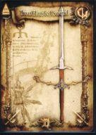
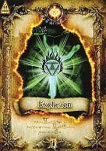
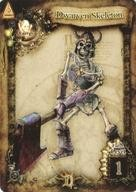

  

    

      
SEGA AM2 · QUEST OF D Ver.4.0 (2007) — アーカイブ

      <h1>Quest of D 4.0 — データカタログ</h1>
      
プレイヤーが使用可能な全アイテム（1005件）、物理Dフォースカード（628種 / 実物高画質スキャン 301枚）、スキル（177種）と内部IDを収録した日本語リファレンス。 <a href="../pt-br/">PT-BR版はこちら</a>。

      

        <strong>1005</strong> アイテム
        <strong>628</strong> カード
        <strong>301</strong> 高画質カード
        <strong>177</strong> スキル
      

      

        <a class="btn-primary" href="cards.html">Dフォースカードを見る →</a>
        <a class="btn-secondary" href="items.html">アイテム一覧へ</a>
      

    

    

      

      

      

    

  

<a class="home-card" data-spotlight href="items.html">
  01 · EQUIPMENT & CONSUMABLES
  
<h2>アイテム</h2>1005

  
武器・鎧・盾・兜・ブーツ・アクセサリー・ポーション・食料・魔法書・巻物・素材をアイコン・性能・内部ID付きで収録。

  アイテムを検索 →
</a>
<a class="home-card" data-spotlight href="cards.html">
  02 · PHYSICAL ARCADE DECK
  
<h2>Dフォースカード</h2>628

  
コレクション番号・バーコード・レアリティ・FLv・実物スキャン画像（301枚対応）・効果・内部IDを完全収録。

  カードを閲覧 →
</a>
<a class="home-card" data-spotlight href="skills.html">
  03 · COMBAT & MAGIC ARTS
  
<h2>スキル</h2>177

  
職業別・武器系統別のコンボ、特殊、メガクラッシュ、バリアおよび強化版（EX）をコマンドと内部ID付きで収録。

  スキルを確認 →
</a>

