[EN](../en/items.md) | [JA](../ja/items.md) | [PT-BR](../pt-br/items.md)

# アイテム

> Source: `project_d.xbe` .data table @ `0x5f8c24`–`0x648fa4` (the nine `*2` tables + `book2`) — reverse engineered

> **Quest of D 4.0 — The Battle Kingdom**（Sega Chihiro、`CDV-10035B`）の抽出データ。レコードは128バイトの `.data` 行で、フィールド0はここに示す大文字内部 ID を指す。日本語文字列は `text.bin`（5322エントリの SJIS テーブル）由来。名前解決の方法はセクションごとに記し、未解決フィールドは推測せず空欄のままにする。

v4 のアイテムは9つの `*2` テーブルに入っている。**表示名の主な根拠**は
`text.bin` 内の名前帯（`〈type〉／…` 形式の説明文字列と交互に並ぶ名前で、
位置合わせ前に説明文字列は除去済み）。解読メソッドメモ：

- `helm2`（100）と `food2`（21）は名前帯に **完全一致** —— 1:1。
- `weapon2`（358）は 3359–4298 の名前帯と序数対応で、 `WEAPON2_QI10_SHINKI` に
  **1つの欠番スロット** がある（テキストテーブルは QI09 `スパークアロー` と
  QI11 `雷電の矢` の間にエントリを持たない）。
- `boots2`、`armor2`、`shield2`、`acces2` は ID トークン ↔ カタカナキーワードの
  一致でスコア付けしたシーケンスアライメントで位置合わせした
  （例：`FIRE` ↔ `ファイアー`）。この方式の名前は **有力な候補であり
  確定ではない** —— 数行が1スロットずれている可能性がある。
- `potion2` と `book2` は手動で解読：`potion2` は名前／説明の
  三連組（2465–2541）を直接対応づけ、`book2` は属性段階の名前帯に対応し、
  **1786–1811 の26個の `*_EX` 書名で相互確認済み**（例：
  `THUNDER04_EX` ↔ `ライトニングチェインＥＸ` が `THUNDER04` ↔ `ライトニングチェイン` を
  証明する）。無印の `BOOK2_SK{nnn}` クラスタ（SK410–SK500 付近）は空欄のまま ——
  2342–2464 の約49個の技名（カラドボルグ … リジェネレーション）は
  まだ個別レコードに結びつけられない。
- 無印テーブル（`weapon`、`armor`、`helm`、`boots`、`shield`、`acces`、
  `potion`、`food`、`book`）は後方互換のために残された **旧 v1.x セット**。
  `*2` の範囲と重複するため、これらは末尾に
  概要のみ掲載し、展開はしない。

### v4 テーブル集計

| テーブル | レコード数 | jp 解決数 | 方式 |
|---|---|---|---|
| テーブル | レコード数 | jp 解決数 | 方式 |
|---|---|---|---|
| `weapon2` | 358 | 357 | アンカー 3359（KA01=ハンドアックス）。QI10 に1件欠番 |
| `helm2` | 100 | 100 | 完全一致 100/100 |
| `boots2` | 76 | 70 | NW アライメント 76/70 |
| `armor2` | 94 | 89 | NW アライメント 94/89 |
| `shield2` | 48 | 47 | NW アライメント 48/47 |
| `acces2` | 90 | 90 | NW アライメント 90/90 |
| `food2` | 21 | 21 | 完全一致 21/21 |
| `potion2` | 38 | 32 | 手動：名前／説明三連組 2465-2541。回復ブロック＋PO23-29 は暫定 |
| `book2` | 410 | 316 | 手動：属性段階＋EX ペア解読。無印 SK クラスタは空欄 |

### weapon2 — 武器 (358)

第2ブロックは **武器系統コード** —— 職業制限スキル接頭辞と同じコード群。
系統の読みは解決済みの名前から推定する
（KA はハンドアックス／フランキスカ、KS はショートソード／レイピア等）：

| コード | 件数 | 名前が示す内容 |
|---|---|---|
| `KS` | 57 | 片手剣（ショートソード, レイピア, ロングソード…） |
| `ST` | 47 | 杖・ロッド（クォータースタッフ, セプター, ヒールロッド…） |
| `KA` | 40 | 片手斧（ハンドアックス, フランキスカ, ウォーアックス…） |
| `NI` | 35 | 短剣（ダガー, ダーク, ソードブレイカー…） |
| `RA` | 35 | 両手斧（ブロードアックス, グレートアックス, バルディッシュ…） |
| `SP` | 33 | 槍（ショートスピア, パルチザン, トライデント…） |
| `RS` | 32 | 両手剣（バスタードソード, クレイモア, トゥハンドソード…） |
| `MA` | 30 | 棍棒・メイス（クラブ, メイス, モーニングスター…） |
| `NC` | 20 | ナックル・拳武器（ウッドグローブ, トライネイル, アイアンスパイク…） |
| `YU` | 20 | 弓（ウッドボウ, ロングボウ, グレートボウ…） |
| `QI` | 10 | 矢・矢筒（アロー, ファイアーアロー…） |

`*_D4SUMMON` 行は「大魔の〜」セット。`*_EX` 行は強化版
（ＥＸ の名前）。 `WEAPON2_QI10_SHINKI` にはテキストエントリがない。

#### `KA`（40）

| 内部id | va | jp |
|---|---|---|
| 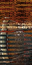 `WEAPON2_KA01_HANDAXE` | 0x62e124 | ハンドアックス |
| 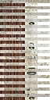 `WEAPON2_KA02_FRANCISCA` | 0x62e1a4 | フランキスカ |
|  `WEAPON2_KA03_WARAXE` | 0x62e224 | ウォーアックス |
| 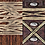 `WEAPON2_KA04_BATTLEAXE` | 0x62e2a4 | バトルアックス |
| 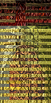 `WEAPON2_KA05_GOLDAXE` | 0x62e324 | ゴールドアックス |
| 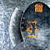 `WEAPON2_KA06_SHIELDAXE` | 0x62e3a4 | シールドアックス |
|  `WEAPON2_KA07_TRISTRAM` | 0x62e424 | ウェルテクス |
| `WEAPON2_KA08_WARAXE` | 0x62e4a4 | ★ウォーアックス |
| 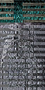 `WEAPON2_KA09_SILVERAXE` | 0x62e524 | シルバーアックス |
| 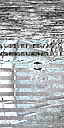 `WEAPON2_KA10_EGRET` | 0x62e5a4 | イーグレット |
|  `WEAPON2_KA11_ORC` | 0x62e624 | 邪鬼の斧 |
|  `WEAPON2_KA12_ORC_F` | 0x62e6a4 | 邪鬼の炎斧 |
|  `WEAPON2_KA13_ORC_I` | 0x62e724 | 邪鬼の氷斧 |
|  `WEAPON2_KA14_ORC_T` | 0x62e7a4 | 邪鬼の雷斧 |
|  `WEAPON2_KA15_MINOTAUR` | 0x62e824 | 牛人の斧 |
| 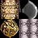 `WEAPON2_KA16_MINOTAUR_S` | 0x62e8a4 | 牛人兵の斧 |
| 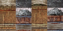 `WEAPON2_KA17_ROBBER` | 0x62e924 | 山賊の斧 |
|  `WEAPON2_KA18_CRESCENT` | 0x62e9a4 | クレセントアックス |
| 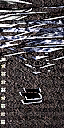 `WEAPON2_KA19_TAMECHAN2` | 0x62ea24 | スパイクアックス |
| 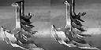 `WEAPON2_KA20_DEMONCHOPPER` | 0x62eaa4 | ブラックハチェット |
| 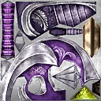 `WEAPON2_KA21_LILAC` | 0x62eb24 | サイレントアックス |
| 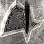 `WEAPON2_KA22_ARMOREDFROG` | 0x62eba4 | 蛙の斧 |
| 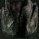 `WEAPON2_KA23_GIANTSTONE` | 0x62ec24 | 岩石巨人の斧 |
|  `WEAPON2_KA24_MUGGER` | 0x62eca4 | 悪漢の斧 |
| 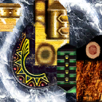 `WEAPON2_KA25_HORIHORI` | 0x62ed24 | トライブアックス |
| 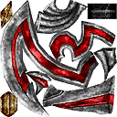 `WEAPON2_KA26_CRIMSON` | 0x62eda4 | クリムゾンライン |
| `WEAPON2_KA27_BATTLE` | 0x62ee24 | ★バトルアックス |
| `WEAPON2_KA28_SHIELD` | 0x62eea4 | ★シールドアックス |
| `WEAPON2_KA29_FRANCISCA` | 0x62ef24 | ★フランキスカ |
| `WEAPON2_KA30_HORIHORI` | 0x62efa4 | ★トライブアックス |
|  `WEAPON2_KA31_MACHINE_GOLD` | 0x62f024 | 黄金機兵の斧 |
|  `WEAPON2_KA32_HEVY_GUARD` | 0x62f0a4 | 重装兵の斧 |
| 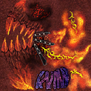 `WEAPON2_KA33_D4SHINKI1` | 0x62f124 | ヘルクリムゾン |
| 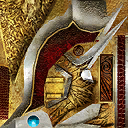 `WEAPON2_KA34_BARBARIAN` | 0x62f1a4 | バルバロスアックス |
| 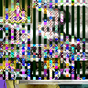 `WEAPON2_KA35_D4SHINKI2` | 0x62f224 | バロックアックス |
| 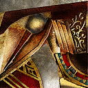 `WEAPON2_KA36_SUNLIGHT` | 0x62f2a4 | サンライトアックス |
| `WEAPON2_KA37_MOONLIGHT` | 0x62f324 | ムーンライトアックス |
| `WEAPON2_KA38_GLADIATOR` | 0x62f3a4 | カタストロフィー |
| `WEAPON2_KA39_D4SUMMON` | 0x62f424 | 大魔の斧 |
| 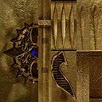 `WEAPON2_KA40_TRISTRAM_EX` | 0x62f4a4 | ウェルテクスＥＸ |

#### `KS`（57）

| 内部id | va | jp |
|---|---|---|
| 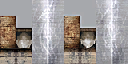 `WEAPON2_KS01_SHORTSWORD` | 0x62f524 | ショートソード |
| 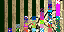 `WEAPON2_KS02_RAPIER` | 0x62f5a4 | レイピア |
| 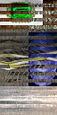 `WEAPON2_KS03_LONGSWORD` | 0x62f624 | ロングソード |
| 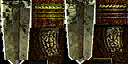 `WEAPON2_KS04_VIKINGSWORD` | 0x62f6a4 | ヴァイキングソード |
|  `WEAPON2_KS05_FALCHION` | 0x62f724 | ファルシオン |
|  `WEAPON2_KS06_GLADIUS` | 0x62f7a4 | グラディウス |
| 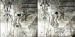 `WEAPON2_KS07_MITHRILBLADE` | 0x62f824 | ミスリルソード |
| 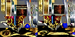 `WEAPON2_KS08_MAGICSWORD` | 0x62f8a4 | マジックソード |
| 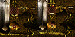 `WEAPON2_KS09_EXCALIBUR` | 0x62f924 | エクスカリバー |
| 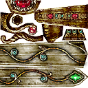 `WEAPON2_KS10_FAKESWORD` | 0x62f9a4 | フェイクソード |
| 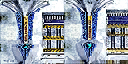 `WEAPON2_KS11_BOLG` | 0x62fa24 | アンサラー |
| 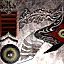 `WEAPON2_KS12_WHITESWORD` | 0x62faa4 | デモンズソード |
| 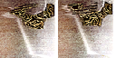 `WEAPON2_KS13_BLACKSWORD` | 0x62fb24 | グレートソード |
| 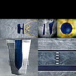 `WEAPON2_KS14_KNIGHTSWORD` | 0x62fba4 | ナイトソード |
| `WEAPON2_KS15_LONGSWORD` | 0x62fc24 | ★ロングソード |
| `WEAPON2_KS16_FALCHION` | 0x62fca4 | ★ファルシオン |
| 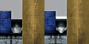 `WEAPON2_KS17_CULANNSWORD` | 0x62fd24 | クランのショートソード |
|  `WEAPON2_KS18_VIPERFUNG` | 0x62fda4 | バイパーファング |
| 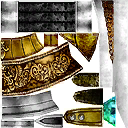 `WEAPON2_KS19_ROYAL` | 0x62fe24 | ホーリーソード |
|  `WEAPON2_KS20_SKELETON` | 0x62fea4 | 骸骨の剣 |
|  `WEAPON2_KS21_SKELETON_F` | 0x62ff24 | 骸骨の炎剣 |
| 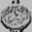 `WEAPON2_KS22_SKELETON_I` | 0x62ffa4 | 骸骨の氷剣 |
|  `WEAPON2_KS23_SKELETON_T` | 0x630024 | 骸骨の雷剣 |
| 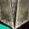 `WEAPON2_KS24_LIZARDMAN` | 0x6300a4 | 蜥蜴の剣 |
|  `WEAPON2_KS25_LIZARDNAN_G` | 0x630124 | 蜥蜴護衛兵の剣 |
| 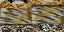 `WEAPON2_KS26_GOBLIN_F` | 0x6301a4 | 小鬼の剣 |
| 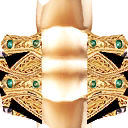 `WEAPON2_KS27_GOBLIN_L` | 0x630224 | 小鬼君主の剣 |
|  `WEAPON2_KS28_KOBOLD_W` | 0x6302a4 | 犬頭鬼の剣 |
| 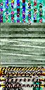 `WEAPON2_KS29_SAPPHIRE` | 0x630324 | サファイアエッジ |
| 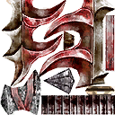 `WEAPON2_KS30_BLOODY` | 0x6303a4 | ブラッディスパイン |
| 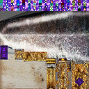 `WEAPON2_KS31_SHAMSHIR` | 0x630424 | シャムシール |
| 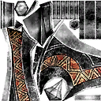 `WEAPON2_KS32_DIVIDER` | 0x6304a4 | ディバイドソード |
| 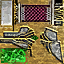 `WEAPON2_KS33_WING` | 0x630524 | ウィングソード |
| 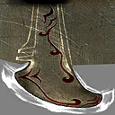 `WEAPON2_KS34_GUARDIANFROG` | 0x6305a4 | 蛙護衛兵の剣 |
|  `WEAPON2_KS35_ARMOREDFROGKING` | 0x630624 | 蛙王の剣 |
| 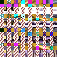 `WEAPON2_KS36_GIANTFIRE` | 0x6306a4 | 炎巨人の剣 |
| 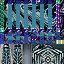 `WEAPON2_KS37_GIANTICE` | 0x630724 | 氷巨人の剣 |
|  `WEAPON2_KS38_SHINOBI` | 0x6307a4 | 忍の刀 |
|  `WEAPON2_KS39_SEIRYUTOU` | 0x630824 | 青龍刀 |
| 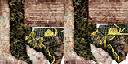 `WEAPON2_KS40_DRAGONSLAYER` | 0x6308a4 | ドラゴンソード |
| `WEAPON2_KS41_RAPIER` | 0x630924 | ★レイピア |
| `WEAPON2_KS42` | 0x6309a4 | ★ヴァイキングソード |
|  `WEAPON2_KS43_GLADIUS` | 0x630a24 | ★グラディウス |
| `WEAPON2_KS44_SHAMSHIR` | 0x630aa4 | ★シャムシール |
| `WEAPON2_KS45_SEIRYUTOU` | 0x630b24 | ★青龍刀 |
| 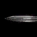 `WEAPON2_KS46_MACHINE` | 0x630ba4 | 機兵の剣 |
| 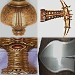 `WEAPON2_KS47_MACHINE_DARK` | 0x630c24 | 暗黒機兵の剣 |
|  `WEAPON2_KS48_DUBIOUS` | 0x630ca4 | 怪人の剣 |
|  `WEAPON2_KS49_MASTERRAPIER` | 0x630d24 | マスターレイピア |
|  `WEAPON2_KS50_TRIBE` | 0x630da4 | トライブエッジ |
|  `WEAPON2_KS51_D4SHINKI2` | 0x630e24 | グラディエーター |
|  `WEAPON2_KS52_BRINGER_R` | 0x630ea4 | ライトブリンガー |
|  `WEAPON2_KS53_BRINGER_L` | 0x630f24 | シャドウブリンガー |
|  `WEAPON2_KS54_RAGNAROK` | 0x630fa4 | アロンダイト |
|  `WEAPON2_KS55_PIRATE` | 0x631024 | 海賊の剣 |
| `WEAPON2_KS56_D4SUMMON` | 0x6310a4 | 大魔の剣 |
|  `WEAPON2_KS57_BOLG_EX` | 0x631124 | アンサラーＥＸ |

#### `MA`（30）

| 内部id | va | jp |
|---|---|---|
|  `WEAPON2_MA01_CLUB` | 0x6311a4 | クラブ |
|  `WEAPON2_MA02_MACE` | 0x631224 | メイス |
|  `WEAPON2_MA03_WARHAMMER` | 0x6312a4 | ウォーハンマー |
|  `WEAPON2_MA04_MORNINGSTAR` | 0x631324 | モーニングスター |
|  `WEAPON2_MA05_MITHRILHAMMER` | 0x6313a4 | ミスリルハンマー |
|  `WEAPON2_MA06_FAYHAMMER` | 0x631424 | ペルグランデ |
|  `WEAPON2_MA07_MJOLLNIR` | 0x6314a4 | ノームハンマー |
| `WEAPON2_MA08_MACE` | 0x631524 | ★メイス |
|  `WEAPON2_MA09_HOLYMACE` | 0x6315a4 | ホーリーメイス |
|  `WEAPON2_MA10_OAKCLUB` | 0x631624 | 樫のクラブ |
|  `WEAPON2_MA11_WARHAMMER_EX` | 0x6316a4 | ブライトハンマー |
|  `WEAPON2_MA12_GOBLIN_H` | 0x631724 | 小鬼の棍棒 |
|  `WEAPON2_MA13_KOBOLD` | 0x6317a4 | 犬頭鬼の棍棒 |
|  `WEAPON2_MA14_TROLL` | 0x631824 | 巨人の棍棒 |
|  `WEAPON2_MA15_TAMECHAN1` | 0x6318a4 | スクエアメイス |
|  `WEAPON2_MA16_STRIKE` | 0x631924 | スマッシュハンマー |
|  `WEAPON2_MA17_TIREI` | 0x6319a4 | クェイクハンマー |
|  `WEAPON2_MA18_HORIHORI` | 0x631a24 | ジャッジハンマー |
|  `WEAPON2_MA19_SHIMENKI` | 0x631aa4 | 鬼面の大槌 |
| `WEAPON2_MA20_WARHAMMER` | 0x631b24 | ★ウォーハンマー |
|  `WEAPON2_MA21_SHINKI` | 0x631ba4 | ストリクトメイス |
| `WEAPON2_MA22_WARHAMMER_EX` | 0x631c24 | ★ブライトハンマー |
| `WEAPON2_MA23_HORIHORI` | 0x631ca4 | ★ジャッジハンマー |
|  `WEAPON2_MA24_JADE` | 0x631d24 | 翡翠の大槌 |
|  `WEAPON2_MA25_D4SHINKI1` | 0x631da4 | レオパルドハンマー |
|  `WEAPON2_MA26_D4SHINKI2` | 0x631e24 | タイニーワンド |
|  `WEAPON2_MA27_D4SHINKI3` | 0x631ea4 | ブリガンティア |
|  `WEAPON2_MA28_PIKOHAMMER` | 0x631f24 | 錘 |
| `WEAPON2_MA29_D4SUMMON` | 0x631fa4 | 大魔の棍棒 |
|  `WEAPON2_MA30_FAYHAMMER_EX` | 0x632024 | ペルグランデＥＸ |

#### `NC`（20）

| 内部id | va | jp |
|---|---|---|
|  `WEAPON2_NC01_WAKKY` | 0x6320a4 | ウッドグローブ |
|  `WEAPON2_NC02_TAMECHAN` | 0x632124 | トライネイル |
|  `WEAPON2_NC03_MASSU` | 0x6321a4 | アイアンスパイク |
|  `WEAPON2_NC04_WAKKY2` | 0x632224 | クランチフィスト |
|  `WEAPON2_NC05_THRUST` | 0x6322a4 | スラストナックル |
|  `WEAPON2_NC06_BLADE` | 0x632324 | ブレイドナックル |
|  `WEAPON2_NC07_TETSUTUME` | 0x6323a4 | アサシンネイル |
|  `WEAPON2_NC08_SHINKI` | 0x632424 | ピアスグローブ |
| `WEAPON2_NC09_WAKKY` | 0x6324a4 | ★ウッドグローブ |
| `WEAPON2_NC10_MASSU` | 0x632524 | ★アイアンスパイク |
|  `WEAPON2_NC11_FLAME` | 0x6325a4 | フレイムナックル |
| `WEAPON2_NC12_TAMECHAN` | 0x632624 | ★トライネイル |
|  `WEAPON2_NC13_BEAST` | 0x6326a4 | 猛獣の爪 |
|  `WEAPON2_NC14_KAISER` | 0x632724 | カイザーナックル |
| `WEAPON2_NC15_MONK` | 0x6327a4 | 拳聖の手甲 |
|  `WEAPON2_NC16_D4SHINKI` | 0x632824 | ベインナックル |
|  `WEAPON2_NC17_SONIC` | 0x6328a4 | ソニックナックル |
|  `WEAPON2_NC18_GODHAND` | 0x632924 | ゴッドハンド |
|  `WEAPON2_NC19_GHOUL` | 0x6329a4 | 食屍鬼の手甲 |
| `WEAPON2_NC20_D4SUMMON` | 0x632a24 | 大魔の爪 |

#### `NI`（35）

| 内部id | va | jp |
|---|---|---|
|  `WEAPON2_NI01_DAGGER` | 0x632aa4 | ダガー |
|  `WEAPON2_NI02_DIRK` | 0x632b24 | ダーク |
|  `WEAPON2_NI03_POISONDAGGER` | 0x632ba4 | ポイズンダガー |
|  `WEAPON2_NI04_SWORDBRAKER` | 0x632c24 | ソードブレイカー |
|  `WEAPON2_NI05_KOTETSU` | 0x632ca4 | 古鉄 |
|  `WEAPON2_NI06_GALESDAGGER` | 0x632d24 | グラキエース |
| `WEAPON2_NI07_DIRK` | 0x632da4 | ★ダーク |
|  `WEAPON2_NI08_ROUND` | 0x632e24 | ラウンドナイフ |
|  `WEAPON2_NI09_STUNDAGGER` | 0x632ea4 | スタンダガー |
|  `WEAPON2_NI10_GOBLIN_C` | 0x632f24 | 小鬼の包丁 |
|  `WEAPON2_NI11_THIEF` | 0x632fa4 | 盗賊のダガー |
|  `WEAPON2_NI12_ASSASSIN` | 0x633024 | 暗殺者のダガー |
|  `WEAPON2_NI13_KERIS` | 0x6330a4 | クリス |
|  `WEAPON2_NI14_TAMECHAN2` | 0x633124 | ロットナイフ |
|  `WEAPON2_NI15_BURGLAR` | 0x6331a4 | 夜盗のナイフ |
|  `WEAPON2_NI16_CROSS` | 0x633224 | グレアナイフ |
|  `WEAPON2_NI17_SHINKI` | 0x6332a4 | フィートナイフ |
| `WEAPON2_NI18_POISONDAGGER` | 0x633324 | ★ポイズンダガー |
| `WEAPON2_NI19_ROUND` | 0x6333a4 | ★ラウンドナイフ |
|  `WEAPON2_NI20_SHINKI` | 0x633424 | デヴァステイター |
|  `WEAPON2_NI21_SAIJYOUI` | 0x6334a4 | ツインエッジ |
| `WEAPON2_NI22_TAMECHAN2` | 0x633524 | ★ロットナイフ |
|  `WEAPON2_NI23_SHINKI` | 0x6335a4 | サイ |
| `WEAPON2_NI24_STUNDAGGER` | 0x633624 | ★スタンダガー |
|  `WEAPON2_NI25_MOULIN` | 0x6336a4 | ムーラン |
|  `WEAPON2_NI26_KUKRI` | 0x633724 | ククリ |
|  `WEAPON2_NI27_SILENT` | 0x6337a4 | サイレントナイフ |
| `WEAPON2_NI28_PANIC` | 0x633824 | パニックナイフ |
|  `WEAPON2_NI29_D4SHINKI1` | 0x6338a4 | ルーンナイフ |
|  `WEAPON2_NI30_D4SHINKI2` | 0x633924 | ツヴァイダガー |
|  `WEAPON2_NI31_D4SHINKI3` | 0x6339a4 | インフィニティー |
|  `WEAPON2_NI32_PIRATE` | 0x633a24 | 海賊の短剣 |
| `WEAPON2_NI33_D4SUMMON` | 0x633aa4 | 大魔の短剣 |
|  `WEAPON2_NI34_CATHAND` | 0x633b24 | キャットスティンガー |
|  `WEAPON2_NI35_GALESDAGGER_EX` | 0x633ba4 | グラキエースＥＸ |

#### `QI`（10）

| 内部id | va | jp |
|---|---|---|
|  `WEAPON2_QI01_ARROW` | 0x633c24 | アロー |
|  `WEAPON2_QI02_FIREARROW` | 0x633ca4 | ファイアーアロー |
|  `WEAPON2_QI03_COLDARROW` | 0x633d24 | コールドアロー |
|  `WEAPON2_QI04_SPARKARROW` | 0x633da4 | サンダーアロー |
|  `WEAPON2_QI05_MITHRILARROW` | 0x633e24 | ダークアロー |
|  `WEAPON2_QI06_HOLYARROW` | 0x633ea4 | 太陽の矢 |
|  `WEAPON2_QI07_TAIYOUNOYA` | 0x633f24 | 銀の矢 |
|  `WEAPON2_QI08_SILVERARROW` | 0x633fa4 | ベアリアスアロー |
|  `WEAPON2_QI09_SHINKI` | 0x634024 | スパークアロー |
|  `WEAPON2_QI10_SHINKI` | 0x6340a4 |  |

#### `RA`（35）

| 内部id | va | jp |
|---|---|---|
|  `WEAPON2_RA01_BROADAXE` | 0x634124 | ブロードアックス |
|  `WEAPON2_RA02_GREATAXE` | 0x6341a4 | グレートアックス |
|  `WEAPON2_RA03_BERDYSH` | 0x634224 | バルディッシュ |
|  `WEAPON2_RA04_MITHRILAXE` | 0x6342a4 | ミスリルアックス |
|  `WEAPON2_RA05_DWARVENWARAXE` | 0x634324 | ドワーブンアックス |
|  `WEAPON2_RA06_SICKLEAXE` | 0x6343a4 | イビルシックル |
| `WEAPON2_RA07_BROADAXE` | 0x634424 | ★ブロードアックス |
|  `WEAPON2_RA08_DIVINEAXE` | 0x6344a4 | ディバインアックス |
|  `WEAPON2_RA09_STEELAXE` | 0x634524 | スチールアックス |
|  `WEAPON2_RA10_GREAT_EX1` | 0x6345a4 | ブーストアックス |
|  `WEAPON2_RA11_SKELETON_D` | 0x634624 | 骸骨の斧 |
|  `WEAPON2_RA12_SKELETON_DF` | 0x6346a4 | 骸骨の炎斧 |
|  `WEAPON2_RA13_SKELETON_DI` | 0x634724 | 骸骨の氷斧 |
|  `WEAPON2_RA14_SKELETON_DT` | 0x6347a4 | 骸骨の雷斧 |
|  `WEAPON2_RA15_GNOLL` | 0x634824 | 犬頭鬼の斧 |
|  `WEAPON2_RA16_ORC_C` | 0x6348a4 | 邪鬼首領の斧 |
|  `WEAPON2_RA17_ORC_CF` | 0x634924 | 邪鬼首領の炎斧 |
|  `WEAPON2_RA18_ORC_CI` | 0x6349a4 | 邪鬼首領の氷斧 |
|  `WEAPON2_RA19_ORC_CT` | 0x634a24 | 邪鬼首領の雷斧 |
|  `WEAPON2_RA20_MINOTAUR_B` | 0x634aa4 | 牛人の両手斧 |
|  `WEAPON2_RA21_MAGICIAN_D` | 0x634b24 | 黒魔術師の鎌 |
|  `WEAPON2_RA22_RUIN` | 0x634ba4 | ルーインアックス |
|  `WEAPON2_RA23_MINOTAURCOMMANDER` | 0x634c24 | 牛人司令官の斧 |
|  `WEAPON2_RA24_BATTLEHOE` | 0x634ca4 | バトルピック |
|  `WEAPON2_RA25_MARTIANDAWN` | 0x634d24 | インペリアルアックス |
| `WEAPON2_RA26_BERDYSH` | 0x634da4 | ★バルディッシュ |
|  `WEAPON2_RA27_SAIJYOUI` | 0x634e24 | グランドアックス |
| `WEAPON2_RA28_GREATAXE` | 0x634ea4 | ★グレートアックス |
| `WEAPON2_RA29_D4SHINKI1` | 0x634f24 | ブルートマホーク |
|  `WEAPON2_RA30_D4SHINKI2` | 0x634fa4 | アポカリプス |
|  `WEAPON2_RA31_GIGANT` | 0x635024 | ギガントアックス |
| `WEAPON2_RA32_EXECUTIONER` | 0x6350a4 | ウィンドアックス |
| `WEAPON2_RA33_APOCALYPSE` | 0x635124 | ディストピア |
| `WEAPON2_RA34_GIANT` | 0x6351a4 | 一つ目巨人の斧 |
| `WEAPON2_RA35_D4SUMMON` | 0x635224 | 大魔の大斧 |

#### `RS`（31）

| 内部id | va | jp |
|---|---|---|
|  `WEAPON2_RS01_BASTARDSWORD` | 0x6352a4 | バスタードソード |
|  `WEAPON2_RS02_CLAYMORE` | 0x635324 | クレイモア |
|  `WEAPON2_RS03_ZWEIHANDER` | 0x6353a4 | トゥハンドソード |
|  `WEAPON2_RS04_STEAM` | 0x635424 | スチームソード |
|  `WEAPON2_RS05_EXECUTIONERSSWORD` | 0x6354a4 | 断罪の剣 |
|  `WEAPON2_RS06_DRAGONKILLER` | 0x635524 | ドラゴンキラー |
|  `WEAPON2_RS07_MURASAME` | 0x6355a4 | 砕魔刀 |
|  `WEAPON2_RS08_PALAMEDES` | 0x635624 | クラウ・ソナス |
|  `WEAPON2_RS09_FLAMESWORD` | 0x6356a4 | フレイムソード |
| `WEAPON2_RS10_ZWEIHANDER` | 0x635724 | ★トゥハンドソード |
|  `WEAPON2_RS11_SQUARETHRUST` | 0x6357a4 | スクエアスラッシャー |
|  `WEAPON2_RS12_SKELETON_K` | 0x635824 | 骸骨騎士の剣 |
|  `WEAPON2_RS13_SKELETON_KF` | 0x6358a4 | 骸骨騎士の炎剣 |
|  `WEAPON2_RS14_SKELETON_KI` | 0x635924 | 骸骨騎士の氷剣 |
|  `WEAPON2_RS15_SKELETON_KT` | 0x6359a4 | 骸骨騎士の雷剣 |
|  `WEAPON2_RS16_TAMECHAN1` | 0x635a24 | ジェミニブレード |
|  `WEAPON2_RS17_CRYSTALEDGE` | 0x635aa4 | リフレクトソード |
|  `WEAPON2_RS18_SHINKI1` | 0x635b24 | ガーディアンブレード |
| `WEAPON2_RS19_CLAYMORE` | 0x635ba4 | ★クレイモア |
|  `WEAPON2_RS20_SHINKI` | 0x635c24 | 魔道の剣 |
|  `WEAPON2_RS22_SAIJYOUI` | 0x635ca4 | アルティマソード |
| `WEAPON2_RS23_SQUARETHRUST` | 0x635d24 | ★スクエアスラッシャー |
|  `WEAPON2_RS24_ICEBRAND` | 0x635da4 | アイスブランド |
|  `WEAPON2_RS25_THUNDERBLADE` | 0x635e24 | サンダーブレード |
| `WEAPON2_RS26_CALIBURN` | 0x635ea4 | カリバーン |
| `WEAPON2_RS27_MURAKUMO` | 0x635f24 | 天叢雲剣 |
|  `WEAPON2_RS28_AVALON` | 0x635fa4 | レオンハート |
|  `WEAPON2_RS29_SKELETON` | 0x636024 | 骸骨貴族の剣 |
| `WEAPON2_RS30_D4SUMMON` | 0x6360a4 | 大魔の大剣 |
|  `WEAPON2_RS31_SLAP` | 0x636124 | ハリセンブレード |
|  `WEAPON2_RS32_PALAMEDES_EX` | 0x6361a4 | クラウ・ソナスＥＸ |

#### `SP`（33）

| 内部id | va | jp |
|---|---|---|
|  `WEAPON2_SP01_SHORTSPEAR` | 0x636224 | ショートスピア |
|  `WEAPON2_SP02_AWLPIKE` | 0x6362a4 | オウルパイク |
|  `WEAPON2_SP03_PARTIZAN` | 0x636324 | パルチザン |
|  `WEAPON2_SP04_TRIDENT` | 0x6363a4 | トライデント |
|  `WEAPON2_SP05_MITHRILSPEAR` | 0x636424 | ミスリルスピア |
|  `WEAPON2_SP06_ICELANCE` | 0x6364a4 | アイススピア |
|  `WEAPON2_SP07_HOLYLANCE` | 0x636524 | ガイ・ボルガ |
| `WEAPON2_SP08_PARTIZAN` | 0x6365a4 | ★パルチザン |
|  `WEAPON2_SP09_FRAME` | 0x636624 | フレイムスピア |
|  `WEAPON2_SP10_THUNDER` | 0x6366a4 | サンダースピア |
|  `WEAPON2_SP11_LIZARDMAN_L` | 0x636724 | 蜥蜴槍兵の槍 |
|  `WEAPON2_SP12_LIZARDMAN_R` | 0x6367a4 | 王族蜥蜴の槍 |
|  `WEAPON2_SP13_KOBOLD_L` | 0x636824 | 犬頭鬼の槍 |
|  `WEAPON2_SP14_SALAMANDER` | 0x6368a4 | 火蜥蜴の槍 |
|  `WEAPON2_SP15_SALAMANDER_F` | 0x636924 | 氷蜥蜴の槍 |
|  `WEAPON2_SP16_SALAMANDER_H` | 0x6369a4 | 雷蜥蜴の槍 |
|  `WEAPON2_SP17_SPLITLANCE` | 0x636a24 | スプリットランス |
|  `WEAPON2_SP18_MUSSU` | 0x636aa4 | グレイブ |
|  `WEAPON2_SP19_RUSHING` | 0x636b24 | ラッシングスピア |
|  `WEAPON2_SP20_SHINKI1` | 0x636ba4 | ニードルランス |
| `WEAPON2_SP21_AWLPIKE` | 0x636c24 | ★オウルパイク |
| `WEAPON2_SP22_TRIDENT` | 0x636ca4 | ★トライデント |
|  `WEAPON2_SP23_BRIONAC` | 0x636d24 | ブリューナク |
| `WEAPON2_SP24_FRAME` | 0x636da4 | ★フレイムスピア |
| `WEAPON2_SP25_ICELANCE` | 0x636e24 | ★アイススピア |
| `WEAPON2_SP26_THUNDER` | 0x636ea4 | ★サンダースピア |
|  `WEAPON2_SP27_PARALYZER` | 0x636f24 | パラライザー |
|  `WEAPON2_SP28_SNAKEHALBERD` | 0x636fa4 | 軍神の蛇矛 |
|  `WEAPON2_SP29_D4SHINKI` | 0x637024 | ノーザンハルバード |
| `WEAPON2_SP30_DYSTOPIA` | 0x6370a4 | 虚空閃 |
|  `WEAPON2_SP31_FISHMAN` | 0x637124 | 魚人の槍 |
| `WEAPON2_SP32_D4SUMMON` | 0x6371a4 | 大魔の槍 |
|  `WEAPON2_SP33_HOLYLANCE_EX` | 0x637224 | ガイ・ボルガＥＸ |

#### `ST`（47）

| 内部id | va | jp |
|---|---|---|
|  `WEAPON2_ST01_QUARTERSTAFF` | 0x6372a4 | クォータースタッフ |
|  `WEAPON2_ST02_SCEPTER` | 0x637324 | セプター |
|  `WEAPON2_ST03_WIZARDSSTAFF` | 0x6373a4 | ウィザードスタッフ |
|  `WEAPON2_ST04_HEALROD` | 0x637424 | ヒールロッド |
|  `WEAPON2_ST05_MAGICALSTAFF` | 0x6374a4 | クリスタルワンド |
|  `WEAPON2_ST06_POWERSTAFF` | 0x637524 | パワースタッフ |
|  `WEAPON2_ST07_MYRDDINSTAFF` | 0x6375a4 | ユーデクス |
| `WEAPON2_ST08_WIZARDSSTAFF` | 0x637624 | ★ウィザードスタッフ |
|  `WEAPON2_ST09_MANASTAFF` | 0x6376a4 | マナスタッフ |
|  `WEAPON2_ST10_MAGESTAFF` | 0x637724 | メイジスタッフ |
|  `WEAPON2_ST11_WIZARD_EX1` | 0x6377a4 | フレイムスタッフ |
|  `WEAPON2_ST12_WIZARD_EX2` | 0x637824 | アイススタッフ |
|  `WEAPON2_ST13_WIZARD_EX3` | 0x6378a4 | サンダースタッフ |
|  `WEAPON2_ST14_SKELETON_M` | 0x637924 | 骸骨の杖 |
|  `WEAPON2_ST15_SKELETON_MF` | 0x6379a4 | 骸骨の炎杖 |
|  `WEAPON2_ST16_SKELETON_MI` | 0x637a24 | 骸骨の氷杖 |
|  `WEAPON2_ST17_SKELETON_MT` | 0x637aa4 | 骸骨の雷杖 |
|  `WEAPON2_ST18_ORC_M` | 0x637b24 | 邪鬼の杖 |
|  `WEAPON2_ST19_ORC_MF` | 0x637ba4 | 邪鬼の炎杖 |
|  `WEAPON2_ST20_ORC_MI` | 0x637c24 | 邪鬼の氷杖 |
|  `WEAPON2_ST21_ORC_MT` | 0x637ca4 | 邪鬼の雷杖 |
|  `WEAPON2_ST22_MAGICIAN` | 0x637d24 | 魔術師の杖 |
|  `WEAPON2_ST23_TAMECHAN1` | 0x637da4 | カースロッド |
|  `WEAPON2_ST24_MANA` | 0x637e24 | マナロッド |
|  `WEAPON2_ST25_NECROMANCER` | 0x637ea4 | 死霊術士の杖 |
|  `WEAPON2_ST26_SORCERESS` | 0x637f24 | 魔女の杖 |
|  `WEAPON2_ST27_CONJURER` | 0x637fa4 | 奇術師の杖 |
|  `WEAPON2_ST28_JEM` | 0x638024 | ジェムスタッフ |
|  `WEAPON2_ST29_SHINKI` | 0x6380a4 | セイクリッドワンド |
| `WEAPON2_ST30_MAGICALSTAFF` | 0x638124 | ★クリスタルワンド |
|  `WEAPON2_ST31_SHINKI` | 0x6381a4 | マギスタッフ |
|  `WEAPON2_ST32_SHINKI` | 0x638224 | アストラルワンド |
|  `WEAPON2_ST33_SAIJYOUI` | 0x6382a4 | エクリプスロッド |
| `WEAPON2_ST34_JEM` | 0x638324 | ★ジェムスタッフ |
| `WEAPON2_ST35_WIZARD_EX1` | 0x6383a4 | ★フレイムスタッフ |
| `WEAPON2_ST36_WIZARD_EX2` | 0x638424 | ★アイススタッフ |
| `WEAPON2_ST37_WIZARD_EX3` | 0x6384a4 | ★サンダースタッフ |
|  `WEAPON2_ST38_DRUID_ARCH` | 0x638524 | 大神官の杖 |
|  `WEAPON2_ST39_PRISMATIC` | 0x6385a4 | プリズマティックワンド |
| `WEAPON2_ST40_NECRO` | 0x638624 | イビルロッド |
| `WEAPON2_ST41_D4SHINKI1` | 0x6386a4 | マイティスタッフ |
|  `WEAPON2_ST42_ZOMBI` | 0x638724 | 死霊の杖 |
| `WEAPON2_ST43_D4SHINKI2` | 0x6387a4 | ラケシスの杖 |
| `WEAPON2_ST44_D4SUMMON` | 0x638824 | 大魔の杖 |
|  `WEAPON2_ST45_MAGICBROOM` | 0x6388a4 | マジカルブルーム |
|  `WEAPON2_ST46_MYRDDINSTAFF_EX` | 0x638924 | ユーデクスＥＸ |
| `WEAPON2_ST47_LAMIA` | 0x6389a4 | 蛇女の杖 |

#### `YU`（20）

| 内部id | va | jp |
|---|---|---|
|  `WEAPON2_YU01_WOODBOW` | 0x638a24 | ウッドボウ |
|  `WEAPON2_YU02_BATTLEBOW` | 0x638aa4 | バトルボウ |
|  `WEAPON2_YU03_LONGBOW` | 0x638b24 | ロングボウ |
|  `WEAPON2_YU04_GREATBOW` | 0x638ba4 | グレートボウ |
|  `WEAPON2_YU05_YUMI` | 0x638c24 | 紅桜 |
|  `WEAPON2_YU06_MITHRILBOW` | 0x638ca4 | ミスリルボウ |
|  `WEAPON2_YU07_TSUKINOYUMI` | 0x638d24 | 月の弓 |
| `WEAPON2_YU08_LONGBOW` | 0x638da4 | ★ロングボウ |
|  `WEAPON2_YU09_IRONBOW` | 0x638e24 | アイアンボウ |
|  `WEAPON2_YU10` | 0x638ea4 | 狩人の弓 |
| `WEAPON2_YU11_BATTLEBOW` | 0x638f24 | ★バトルボウ |
| `WEAPON2_YU12_GREATBOW` | 0x638fa4 | ★グレートボウ |
|  `WEAPON2_YU13_SHINKI` | 0x639024 | エルブンボウ |
| `WEAPON2_YU14_IRONBOW` | 0x6390a4 | ★アイアンボウ |
|  `WEAPON2_YU15_LUGH` | 0x639124 | ルーの弓 |
|  `WEAPON2_YU16_RANGER` | 0x6391a4 | ハンターズボウ |
|  `WEAPON2_YU17_D4SHINKI1` | 0x639224 | アサシンボウ |
|  `WEAPON2_YU18_D4SHINKI2` | 0x6392a4 | ディメンションボウ |
|  `WEAPON2_YU19_D4SHINKI3` | 0x639324 | タスラム |
| `WEAPON2_YU20_D4SUMMON` | 0x6393a4 | 大魔の弓 |

### armor2 — 鎧 — 胴鎧＆ローブ (94)

`AM*` は金属鎧、`RO*` はローブ／チュニック

| 内部id | va | jp |
|---|---|---|
|  `ARMOR2_AM01_LEATHER` | 0x63f1a4 | レザーアーマー |
|  `ARMOR2_AM02_JACKET` | 0x63f224 | レザージャケット |
|  `ARMOR2_AM03_CHAINMAIL` | 0x63f2a4 | チェインメイル |
|  `ARMOR2_AM04_SCALE` | 0x63f324 | スケイルメイル |
|  `ARMOR2_AM05_LAMELLAR` | 0x63f3a4 | ラメラアーマー |
|  `ARMOR2_AM06_IRON` | 0x63f424 | アイアンアーマー |
|  `ARMOR2_AM07_PLATE` | 0x63f4a4 | プレートメイル |
|  `ARMOR2_AM08_KNIGHT` | 0x63f524 | ナイトプレート |
|  `ARMOR2_AM09_FLAME` | 0x63f5a4 | フレイムアーマー |
|  `ARMOR2_AM10_ICE` | 0x63f624 | アイスアーマー |
|  `ARMOR2_AM11_SPARK` | 0x63f6a4 | スパークアーマー  |
|  `ARMOR2_AM12_MAGIC` | 0x63f724 | マジックアーマー |
|  `ARMOR2_AM13_CURE` | 0x63f7a4 | キュアアーマー |
|  `ARMOR2_AM14_BRIGANDINE` | 0x63f824 | ブリガンダイン |
|  `ARMOR2_AM15_MITHRIL` | 0x63f8a4 | ミスリルアーマー |
|  `ARMOR2_AM16_DRAGON` | 0x63f924 | ドラゴンアーマー |
|  `ARMOR2_AM17_LEATHER` | 0x63f9a4 | レザークロス |
|  `ARMOR2_AM18_CUCHULAIN` | 0x63fa24 | ソリッドアーマー |
|  `ARMOR2_AM19_SPIKE` | 0x63faa4 | スパイククロス |
|  `ARMOR2_AM20_WHITE` | 0x63fb24 | ホーリーメイル |
|  `ARMOR2_AM21_PIRATE` | 0x63fba4 | パイレーツプレート |
|  `ARMOR2_AM22_BLACK` | 0x63fc24 | デモンズアーマー |
|  `ARMOR2_AM23_CROTH` | 0x63fca4 |  |
|  `ARMOR2_AM24_DEFAULT` | 0x63fd24 | クロスアーマー |
|  `ARMOR2_AM25_FIGHTER` | 0x63fda4 | ファイタークロス |
| `ARMOR2_AM26_LEATHER` | 0x63fe24 | ★レザーアーマー |
| `ARMOR2_AM27_JACKET` | 0x63fea4 | ★レザージャケット |
| `ARMOR2_AM28_CHAINMAIL` | 0x63ff24 | ★チェインメイル |
| `ARMOR2_AM29_IRON` | 0x63ffa4 | ★アイアンアーマー |
| `ARMOR2_AM30_CROTH` | 0x640024 | ★クロスアーマー |
| `ARMOR2_AM31_COPPERCLOTH` | 0x6400a4 | カッパークロス |
|  `ARMOR2_AM32_DAIYOROI` | 0x640124 | 緋染の鎧 |
|  `ARMOR2_AM33_CHAINMALE_EX` | 0x6401a4 | クリムゾンチェイン |
|  `ARMOR2_AM34_CLOTH_EX` | 0x640224 | レイクロス |
|  `ARMOR2_AM35_DWARVEN` | 0x6402a4 | ドワーブンアーマー |
|  `ARMOR2_AM36_REFLECT` | 0x640324 | リフレクトアーマー |
| `ARMOR2_AM37_SCALE` | 0x6403a4 | ★スケイルメイル |
|  `ARMOR2_AM38_BONE` | 0x640424 | リブアーマー |
|  `ARMOR2_AM39_SHINKI` | 0x6404a4 | ジェネラルアーマー |
| `ARMOR2_AM40_SOURAN` | 0x640524 | 蒼藍の鎧 |
|  `ARMOR2_AM41_RUFFIAN` | 0x6405a4 | ラフィアンコート |
|  `ARMOR2_AM42_D4SHINKI1` | 0x640624 | アリサノスアーマー |
| `ARMOR2_AM43_D4SHINKI2` | 0x6406a4 | ブラッディクロス |
|  `ARMOR2_AM44_BARBAROS` | 0x640724 | バルバロスアーマー |
|  `ARMOR2_AM45_HUNTER` | 0x6407a4 | ハンターズクロス |
| `ARMOR2_AM46_D4SUMMON` | 0x640824 | 大魔の鎧 |
|  `ARMOR2_AM47_LORD` | 0x6408a4 | ロードオブローズ |
| `ARMOR2_AM48_D4SHINKI3` | 0x640924 | アルカナローブ |
|  `ARMOR2_AM49_DRAGON_EX` | 0x6409a4 | ドラゴニックアーマー |
|  `ARMOR2_AM50_SHADOWROBE_EX` | 0x640a24 | マーブルローブ |
|  `ARMOR2_AM51_KINGROBE_EX` | 0x640aa4 | エンペラーローブ |
|  `ARMOR2_AM52_NINJYA_EX` | 0x640b24 | 風魔装束 |
|  `ARMOR2_RO01_ROBE` | 0x640ba4 | メイジローブ |
| `ARMOR2_RO02_TUNIC` | 0x640c24 | フードローブ |
|  `ARMOR2_RO03_MAGEROBE` | 0x640ca4 |  |
|  `ARMOR2_RO04_HOODROBE` | 0x640d24 |  |
| `ARMOR2_RO05_SIRCOAT` | 0x640da4 |  |
|  `ARMOR2_RO06_CHASUBLE` | 0x640e24 | カズラ |
|  `ARMOR2_RO07_DALMATICA` | 0x640ea4 | ダルマティカ |
|  `ARMOR2_RO08_SHADOWROBE` | 0x640f24 | シャドウローブ |
|  `ARMOR2_RO09_KINGROBE` | 0x640fa4 | キングローブ |
|  `ARMOR2_RO10_PROTECTROBE` | 0x641024 | プロテクトローブ |
|  `ARMOR2_RO11_WIZARDROBE` | 0x6410a4 | ウィザードローブ |
|  `ARMOR2_RO12_BURGLARJACKET` | 0x641124 | バーグラージャケット |
|  `ARMOR2_RO13_SOULROBE` | 0x6411a4 | ソウルローブ |
| `ARMOR2_RO14_MAGEROBE` | 0x641224 | ★メイジローブ |
| `ARMOR2_RO15_HOODROBE` | 0x6412a4 | ★フードローブ |
| `ARMOR2_RO16_DALMATICA` | 0x641324 | ★ダルマティカ |
| `ARMOR2_RO17_WARLOCKROBE` | 0x6413a4 | ウォーロックローブ |
| `ARMOR2_RO18_DEGRATICA` | 0x641424 | ディグラティカ |
|  `ARMOR2_RO19_MUSSU1` | 0x6414a4 |  |
|  `ARMOR2_RO20_WAKKY1` | 0x641524 | リンガーローブ |
|  `ARMOR2_RO21_TAMECHAN1` | 0x6415a4 | カオスローブ |
|  `ARMOR2_RO22_WAKKY2` | 0x641624 | モンクフロック |
|  `ARMOR2_RO23_SHAMANQUILT` | 0x6416a4 | セイントローブ |
|  `ARMOR2_RO24_HOOD_EX` | 0x641724 | シャーマンキルト |
|  `ARMOR2_RO25_ELVEN` | 0x6417a4 | エンハンスローブ |
| `ARMOR2_RO26_CHASUBLE` | 0x641824 | ★カズラ |
| `ARMOR2_RO27_SHADOWROBE` | 0x6418a4 | ★シャドウローブ |
|  `ARMOR2_RO28_SHINKI` | 0x641924 | セイクリッドローブ |
|  `ARMOR2_RO29_SHINKI` | 0x6419a4 | アストラルローブ |
| `ARMOR2_RO30_PLATE` | 0x641a24 | ★プレートメイル |
|  `ARMOR2_RO31_SHINKI` | 0x641aa4 | バンデットメイル |
|  `ARMOR2_RO32_SHINKI` | 0x641b24 | 忍者装束 |
| `ARMOR2_RO33_LEATHER` | 0x641ba4 | ★レザークロス |
|  `ARMOR2_RO34_SHINKI` | 0x641c24 | アビスローブ |
|  `ARMOR2_RO35_SHINKI` | 0x641ca4 | ルミナスローブ |
|  `ARMOR2_RO36_SHINKI` | 0x641d24 | ノートリアスジャケット |
| `ARMOR2_RO37_ROZETTA` | 0x641da4 | ロゼッタローブ |
| `ARMOR2_RO38_MISTICAL` | 0x641e24 | オラクルローブ |
| `ARMOR2_RO39_DEMONIC` | 0x641ea4 | デモニックローブ |
|  `ARMOR2_RO40_HERMIT` | 0x641f24 | グレイスローブ |
| `ARMOR2_RO41_NECRO` | 0x641fa4 | イビルローブ |
|  `ARMOR2_RO42_KENSEI` | 0x642024 | 拳聖の僧服 |

### helm2 — 頭装備 (100)

帽子、兜、冠、仮面、眼鏡

| 内部id | va | jp |
|---|---|---|
|  `HELM2_HM00_D4SHINKI4` | 0x645e24 | アルカナベール |
|  `HELM2_HM01_HALF` | 0x645ea4 | ハーフヘルム |
|  `HELM2_HM02_IRON` | 0x645f24 | アイアンヘルム |
|  `HELM2_HM03_VIKING` | 0x645fa4 | ヴァイキングヘルム |
|  `HELM2_HM04_BARREL` | 0x646024 | バレルヘルム |
|  `HELM2_HM05_GREAT` | 0x6460a4 | グレートヘルム |
|  `HELM2_HM06_MITHRIL` | 0x646124 | ミスリルヘルム |
|  `HELM2_HM07_MAGIC` | 0x6461a4 | マジックヘルム |
|  `HELM2_HM08_KNIGHT` | 0x646224 | ナイトヘルム |
|  `HELM2_HM09_BANDANNA` | 0x6462a4 | バンダナ |
|  `HELM2_HM10_LEATHERHAT` | 0x646324 | レザーキャップ |
|  `HELM2_HM11_WINGHAT` | 0x6463a4 | ウィングヘルム |
|  `HELM2_HM12_KETTLEHAT` | 0x646424 | ケトルハット |
|  `HELM2_HM13_MAGICIANHAT` | 0x6464a4 | マジシャンハット |
|  `HELM2_HM14_MITLA` | 0x646524 | ミトラ |
|  `HELM2_HM15_WARLOCKCAP` | 0x6465a4 | ウォーロックキャップ |
|  `HELM2_HM16_SORCERERCAP` | 0x646624 | ソーサラーキャップ |
|  `HELM2_HM17_CLERICCAP` | 0x6466a4 | クレリックキャップ |
|  `HELM2_HM18_BISHOPCAP` | 0x646724 | ビショップキャップ |
|  `HELM2_HM19_CROTHCAP` | 0x6467a4 | クロスキャップ |
|  `HELM2_HM20_PIRATESHAT` | 0x646824 | パイレーツハット |
|  `HELM2_HM21_TIARA` | 0x6468a4 | ティアラ |
|  `HELM2_HM22_CIRCLET` | 0x646924 | サークレット |
|  `HELM2_HM23_WHITE` | 0x6469a4 | ホーリーヘルム |
|  `HELM2_HM24_BLACK` | 0x646a24 | デモンズヘルム |
|  `HELM2_HM25_WIZARDHAT` | 0x646aa4 | ウィザードハット |
|  `HELM2_HM26_PROTECTHAT` | 0x646b24 | プロテクトハット |
|  `HELM2_HM27_SPIKECAP` | 0x646ba4 | スパイクキャップ |
|  `HELM2_HM28_KINGCROWN` | 0x646c24 | キングクラウン |
|  `HELM2_HM29_SNAKEHEAD` | 0x646ca4 | スネークヘッド |
| `HELM2_HM30_IRON` | 0x646d24 | ★アイアンヘルム |
| `HELM2_HM31_LEATHERHAT` | 0x646da4 | ★レザーキャップ |
| `HELM2_HM32_MAGICIANHAT` | 0x646e24 | ★マジシャンハット |
| `HELM2_HM33_CLERICCAP` | 0x646ea4 | ★クレリックキャップ |
|  `HELM2_HM34_SCALE` | 0x646f24 | スケイルヘルム |
| `HELM2_HM35_RUSTYHAT` | 0x646fa4 | ラスティハット |
| `HELM2_HM36_WARLOCKCAP_EX` | 0x647024 | チャームキャップ |
|  `HELM2_HM37_CLERICCAP_EX` | 0x6470a4 | インディゴバニット |
|  `HELM2_HM38_HANNYA` | 0x647124 | 白鬼の兜 |
|  `HELM2_HM39_DIVINECIRCLET` | 0x6471a4 | ディバインサークレット |
|  `HELM2_HM40_QUEENTIARA` | 0x647224 | クイーンティアラ |
|  `HELM2_HM41_UNICORNHEAD` | 0x6472a4 | ユニコーンヘッド |
|  `HELM2_HM42_CUREHELM` | 0x647324 | キュアヘルム |
|  `HELM2_HM43_SHADOWHAT` | 0x6473a4 | シャドウハット |
|  `HELM2_HM44_NISOUZUKIN` | 0x647424 | フライアベール |
|  `HELM2_HM45_CROWN` | 0x6474a4 | ゴールドクラウン |
|  `HELM2_HM46_EARRING1` | 0x647524 | ウェイバーピアス |
|  `HELM2_HM47_GLASS` | 0x6475a4 | メガネ |
|  `HELM2_HM48_GOBLINMASK` | 0x647624 | ゴブリンマスク |
|  `HELM2_HM49_EARRING2` | 0x6476a4 | チャームピアス |
|  `HELM2_HM50_CLOWNMASK` | 0x647724 | ファントムマスク |
|  `HELM2_HM51_BARANCHE` | 0x6477a4 | バランチェ |
|  `HELM2_HM52_EVILEYE` | 0x647824 | イービルアイ |
|  `HELM2_HM53_VEIL` | 0x6478a4 | ワイアベール |
|  `HELM2_HM54_EYECAP` | 0x647924 | ブラインドマスク |
|  `HELM2_HM55_VALKYRIE` | 0x6479a4 | ヴァルキリエ |
|  `HELM2_HM56_IRONMASK` | 0x647a24 | アイアンマスク |
|  `HELM2_HM57_SKULLFACE` | 0x647aa4 | スカルフェイス |
|  `HELM2_HM58_BARRETTE` | 0x647b24 | ファルコンバレッタ |
|  `HELM2_HM59_PIERCE` | 0x647ba4 | リングピアス |
|  `HELM2_HM60_MASQUERADE` | 0x647c24 | マスカレイドマスク |
| `HELM2_HM61_MONOCLE` | 0x647ca4 | モノクル |
|  `HELM2_HM62_SPIDERFRAME` | 0x647d24 | スパイダーフレーム |
|  `HELM2_HM63_WARRIORFRAME` | 0x647da4 | ウォーリアーフレーム |
| `HELM2_HM64_SCALE` | 0x647e24 | ★スケイルヘルム |
| `HELM2_HM65_WARLOCKCAP` | 0x647ea4 | ★ウォーロックキャップ |
| `HELM2_HM66_SORCERERCAP` | 0x647f24 | ★ソーサラーキャップ |
| `HELM2_HM67_MITLA` | 0x647fa4 | ★ミトラ |
|  `HELM2_HM68_BONE` | 0x648024 | スカルヘルム |
|  `HELM2_HM69_DRAGON` | 0x6480a4 | ドラゴンヘルム |
|  `HELM2_HM70_SHINKI` | 0x648124 | セイクリッドハット |
|  `HELM2_HM71_SHINKI` | 0x6481a4 | アビスハット |
|  `HELM2_HM72_SHINKI` | 0x648224 | アストラルハット |
| `HELM2_HM73_BANDANNA` | 0x6482a4 | ★バンダナ |
|  `HELM2_HM74_SHINKI` | 0x648324 | 忍者頭巾 |
| `HELM2_HM75_BARREL` | 0x6483a4 | ★バレルヘルム |
|  `HELM2_HM76_SHINKI` | 0x648424 | ジェネラルヘルム |
|  `HELM2_HM77_SHINKI` | 0x6484a4 | ルミナスキャップ |
|  `HELM2_HM78_SHINKI` | 0x648524 | ノートリアスハット |
| `HELM2_HM79_SNAKEHEAD` | 0x6485a4 | ★スネークヘッド |
|  `HELM2_HM80_SOURAN` | 0x648624 | 蒼藍の兜 |
| `HELM2_HM81_ROZETTA` | 0x6486a4 | ロゼッタハット |
|  `HELM2_HM82_MISTICAL` | 0x648724 | オラクルクラウン |
|  `HELM2_HM83_RAFFIAN` | 0x6487a4 | ラフィアンターバン |
|  `HELM2_HM84_D4SHINKI2` | 0x648824 | アリサノスヘルム |
|  `HELM2_HM85_DEMONIC` | 0x6488a4 | デモニックヘルム |
|  `HELM2_HM86_HERMIT` | 0x648924 | グレイスクラウン |
| `HELM2_HM87_D4SHINKI3` | 0x6489a4 | ブラッディハット |
|  `HELM2_HM88_PRINCESS` | 0x648a24 | プリンセスティアラ |
|  `HELM2_HM89_ROYAL` | 0x648aa4 | ロイヤルクラウン |
|  `HELM2_HM90_D4SHINKI1` | 0x648b24 | ラムナミスバレッタ |
| `HELM2_HM91_ALTORISER` | 0x648ba4 | アルトライザー |
|  `HELM2_HM92_BARBAROS` | 0x648c24 | バルバロスヘルム |
|  `HELM2_HM93_KENSEI` | 0x648ca4 | 拳聖頭巾 |
|  `HELM2_HM94_EVIL` | 0x648d24 | イビルハット |
|  `HELM2_HM95_HUNTER` | 0x648da4 | ハンターズベレー |
|  `HELM2_HM96_DRAGON_EX` | 0x648e24 | ドラゴニックヘルム |
|  `HELM2_HM97_SHADOWHAT_EX` | 0x648ea4 | マーブルマスク |
|  `HELM2_HM98_KINGCROWN_EX` | 0x648f24 | エンペラークラウン |
|  `HELM2_HM99_NINJYA_EX` | 0x648fa4 | 風魔頭巾 |

### boots2 — ブーツ (76)

ブーツ、靴、脛当て

| 内部id | va | jp |
|---|---|---|
|  `BOOTS2_BT01_LONG` | 0x642f24 | ロングブーツ |
|  `BOOTS2_BT02_LEATHER` | 0x642fa4 | レザーブーツ |
|  `BOOTS2_BT03_WING` | 0x643024 | ウィングブーツ |
|  `BOOTS2_BT04_PLATE` | 0x6430a4 | アイアンブーツ |
|  `BOOTS2_BT05_KNIGHT` | 0x643124 | ナイトブーツ |
|  `BOOTS2_BT06_MITHRIL` | 0x6431a4 | ミスリルブーツ |
|  `BOOTS2_BT07_MAGICIANSHOES` | 0x643224 | マジシャンシューズ |
|  `BOOTS2_BT08_MAGIC` | 0x6432a4 | マジックブーツ |
|  `BOOTS2_BT09_WHITE` | 0x643324 | ホーリーブーツ |
|  `BOOTS2_BT10_BLACK` | 0x6433a4 | デモンズブーツ |
|  `BOOTS2_BT11_PRIEST` | 0x643424 |  |
|  `BOOTS2_BT12_WARRIOR` | 0x6434a4 |  |
|  `BOOTS2_BT13_CLERIC` | 0x643524 |  |
|  `BOOTS2_BT14_THIEF` | 0x6435a4 | プリーストブーツ |
|  `BOOTS2_BT15_MAGE` | 0x643624 | ラスティブーツ |
|  `BOOTS2_BT16_ROGUE` | 0x6436a4 | ローグブーツ |
|  `BOOTS2_BT17_SPEED` | 0x643724 | スピードブーツ |
|  `BOOTS2_BT18_WARM` | 0x6437a4 | ワームブーツ |
|  `BOOTS2_BT19_SPIKE` | 0x643824 | スパイクブーツ |
|  `BOOTS2_BT20_GATHER` | 0x6438a4 | ギャザーブーツ |
|  `BOOTS2_BT21_CROTH` | 0x643924 | クロスブーツ |
|  `BOOTS2_BT22_KING` | 0x6439a4 | キングブーツ |
|  `BOOTS2_BT23_SOUL` | 0x643a24 |  |
|  `BOOTS2_BT24_FIGHTER` | 0x643aa4 | ウィザードブーツ |
| `BOOTS2_BT25_LEATHER` | 0x643b24 | ★レザーブーツ |
| `BOOTS2_BT26_PLATE` | 0x643ba4 | ★アイアンブーツ |
| `BOOTS2_BT27_MAGICIANSHOES` | 0x643c24 | ★マジシャンシューズ |
| `BOOTS2_BT28_PRIEST` | 0x643ca4 | ★プリーストブーツ |
|  `BOOTS2_BT29_SCALE` | 0x643d24 | スケイルブーツ |
|  `BOOTS2_BT30_MANA` | 0x643da4 | マナブーツ |
| `BOOTS2_BT31_CROWNSHOES` | 0x643e24 | クラウンシューズ |
|  `BOOTS2_BT32_PRIEST_EX` | 0x643ea4 | オリエントブーツ |
|  `BOOTS2_BT33_SOUL_EX` | 0x643f24 | ノーブルブーツ |
|  `BOOTS2_BT34_DAIGUSOKU` | 0x643fa4 | 黒紋の脛当 |
|  `BOOTS2_BT35_CURE` | 0x644024 | キュアブーツ |
|  `BOOTS2_BT36_PROTECT` | 0x6440a4 | プロテクトブーツ |
|  `BOOTS2_BT37_BISHOP` | 0x644124 | モンクブーツ |
|  `BOOTS2_BT38_SHADOW` | 0x6441a4 | シャドウブーツ |
|  `BOOTS2_BT39_MAGE` | 0x644224 |  |
|  `BOOTS2_BT40_DWARVEN` | 0x6442a4 |  |
|  `BOOTS2_BT41_ELVEN` | 0x644324 | バインドブーツ |
|  `BOOTS2_BT42_SLASH` | 0x6443a4 | スラッシュブーツ |
|  `BOOTS2_BT43_SOARGREAVE` | 0x644424 | ソアグリーヴ |
| `BOOTS2_BT44_CROTH` | 0x6444a4 | ★クロスブーツ |
| `BOOTS2_BT45_SCALE` | 0x644524 | ★スケイルブーツ |
| `BOOTS2_BT46_MANA` | 0x6445a4 | ★マナブーツ |
|  `BOOTS2_BT47_BONE` | 0x644624 | シャンクブーツ |
|  `BOOTS2_BT48_DRAGON` | 0x6446a4 | ドラゴンブーツ |
|  `BOOTS2_BT49_SHINKI` | 0x644724 | セイクリッドブーツ |
|  `BOOTS2_BT50_SHINKI` | 0x6447a4 | アストラルブーツ |
|  `BOOTS2_BT51_SHINKI` | 0x644824 | フォールドブーツ |
|  `BOOTS2_BT52_SHINKI` | 0x6448a4 | 忍者脛当 |
|  `BOOTS2_BT53_SHINKI` | 0x644924 | ジェネラルブーツ |
|  `BOOTS2_BT54_SHINKI` | 0x6449a4 | アビスブーツ |
|  `BOOTS2_BT55_SHINKI` | 0x644a24 | ルミナスブーツ |
|  `BOOTS2_BT56_SHINKI` | 0x644aa4 | ノートリアスブーツ |
| `BOOTS2_BT57_WARRIOR` | 0x644b24 | ★ラスティブーツ |
| `BOOTS2_BT58_ROGUE` | 0x644ba4 | ★ローグブーツ |
| `BOOTS2_BT59_SPEED` | 0x644c24 | ★スピードブーツ |
| `BOOTS2_BT60_SOURAN` | 0x644ca4 | 蒼藍の脛当 |
|  `BOOTS2_BT61_ROZETTA` | 0x644d24 | ロゼッタブーツ |
|  `BOOTS2_BT62_MISTICAL` | 0x644da4 | オラクルブーツ |
| `BOOTS2_BT63_RAFFIAN` | 0x644e24 | ラフィアンシューズ |
|  `BOOTS2_BT64_D4SHINKI1` | 0x644ea4 | アリサノスブーツ |
| `BOOTS2_BT65_DEMONIC` | 0x644f24 | デモニックブーツ |
|  `BOOTS2_BT66_HERMIT` | 0x644fa4 | グレイスブーツ |
| `BOOTS2_BT67_D4SHINKI2` | 0x645024 | ブラッディブーツ |
|  `BOOTS2_BT68_BARBAROS` | 0x6450a4 | バルバロスブーツ |
| `BOOTS2_BT69_KENSEI` | 0x645124 | 拳聖の脛当 |
|  `BOOTS2_BT70_EVIL` | 0x6451a4 | イビルブーツ |
|  `BOOTS2_BT71_HUNTER` | 0x645224 | ハンターズブーツ |
|  `BOOTS2_BT72_D4SHINKI3` | 0x6452a4 | アルカナブーツ |
|  `BOOTS2_BT73_DRAGON_EX` | 0x645324 | ドラゴニックブーツ |
|  `BOOTS2_BT74_SHADOW_EX` | 0x6453a4 | マーブルブーツ |
|  `BOOTS2_BT75_KING_EX` | 0x645424 | エンペラーブーツ |
|  `BOOTS2_BT76_NINJYA_EX` | 0x6454a4 | 風魔脛当 |

### shield2 — 盾 (48)

バックラー、円盾／凧盾／塔盾

| 内部id | va | jp |
|---|---|---|
|  `SHIELD2_SH01_WOOD` | 0x62c1a4 | ウッドシールド |
|  `SHIELD2_SH02_BUCKLER` | 0x62c224 | バックラー |
|  `SHIELD2_SH03_ROUND` | 0x62c2a4 | ラウンドシールド |
|  `SHIELD2_SH04_LARGE` | 0x62c324 | ラージシールド |
|  `SHIELD2_SH05_KITE` | 0x62c3a4 | カイトシールド |
|  `SHIELD2_SH06_KNIGHT` | 0x62c424 | ナイトシールド |
|  `SHIELD2_SH07_WING` | 0x62c4a4 | ウィングシールド |
|  `SHIELD2_SH08_TOWER` | 0x62c524 | タワーシールド |
|  `SHIELD2_SH09_SPIKE` | 0x62c5a4 | スパイクシールド |
|  `SHIELD2_SH10_FLAME` | 0x62c624 | フレイムシールド |
|  `SHIELD2_SH11_ICE` | 0x62c6a4 | アイスシールド |
|  `SHIELD2_SH12_THUNDER` | 0x62c724 | サンダーシールド |
|  `SHIELD2_SH13_MAGIC` | 0x62c7a4 | マジックシールド |
|  `SHIELD2_SH14_DRAGON` | 0x62c824 | ドラゴンシールド |
|  `SHIELD2_SH15_MITHRIL` | 0x62c8a4 | ミスリルシールド |
|  `SHIELD2_SH16_REFLECT` | 0x62c924 | リフレクトシールド |
|  `SHIELD2_SH17_WHITE` | 0x62c9a4 | ホーリーシールド |
|  `SHIELD2_SH18_BLACK` | 0x62ca24 | デモンズシールド |
| `SHIELD2_SH19_ROUND` | 0x62caa4 | ★ラウンドシールド |
| `SHIELD2_SH20_LARGE` | 0x62cb24 | ★ラージシールド |
|  `SHIELD2_SH21_LEATHER` | 0x62cba4 | レザーシールド |
|  `SHIELD2_SH22_PALISADE` | 0x62cc24 | パリセイドシールド |
|  `SHIELD2_SH23_CHARCOAL` | 0x62cca4 | チャコールシールド |
|  `SHIELD2_SH24_SKELETON` | 0x62cd24 | 骸骨の盾 |
|  `SHIELD2_SH25_LIZARDMAN` | 0x62cda4 | 蜥蜴の盾 |
|  `SHIELD2_SH26_LIZARDNAN_G` | 0x62ce24 | 蜥蜴護衛兵の盾 |
|  `SHIELD2_SH27_GOBLIN_F` | 0x62cea4 | 小鬼の盾 |
|  `SHIELD2_SH28_KOBOLD_W` | 0x62cf24 | 犬頭鬼の盾 |
|  `SHIELD2_SH29_ORC` | 0x62cfa4 | 邪鬼の盾 |
| `SHIELD2_SH30_WING` | 0x62d024 | ★ウィングシールド |
| `SHIELD2_SH31_TOWER` | 0x62d0a4 | ★タワーシールド |
| `SHIELD2_SH32_PALISADE` | 0x62d124 | ★パリセイドシールド |
|  `SHIELD2_SH33_SHINKI` | 0x62d1a4 |  |
|  `SHIELD2_SH34_SHINKI` | 0x62d224 | ジェネラルシールド |
|  `SHIELD2_SH35_SHINKI` | 0x62d2a4 | ルミナスシールド |
| `SHIELD2_SH36_LARGE` | 0x62d324 | ノートリアスシールド |
| `SHIELD2_SH37_KITE` | 0x62d3a4 | ★カイトシールド |
|  `SHIELD2_SH38_MACHINE` | 0x62d424 | 機兵の盾 |
|  `SHIELD2_SH39_MACHINE_GOLD` | 0x62d4a4 | 黄金機兵の盾 |
|  `SHIELD2_SH40_MACHINE_DARK` | 0x62d524 | 暗黒機兵の盾 |
|  `SHIELD2_SH41_SOURAN` | 0x62d5a4 | 蒼藍の盾 |
|  `SHIELD2_SH42_MISTICAL` | 0x62d624 | オラクルシールド |
|  `SHIELD2_SH43_RAFFIAN` | 0x62d6a4 | ラフィアンシールド |
|  `SHIELD2_SH44_D4SHINKI1` | 0x62d724 | アリサノスシールド |
|  `SHIELD2_SH45_HERMIT` | 0x62d7a4 | グレイスシールド |
|  `SHIELD2_SH46_D4SHINKI2` | 0x62d824 | ブラッディシールド |
|  `SHIELD2_SH47_BARBAROS` | 0x62d8a4 | バルバロスシールド |
| `SHIELD2_SH50_D4SUMMON` | 0x62d924 | 大魔の盾 |

### acces2 — アクセサリ (90)

アミュレット、指輪、護符＋セガハードのイースターエッグセット
セガのゲーム機イースターエッグ・アクセサリ（`SC3000`、`SG1000`、`MARK3`、`MASTERSYSTEM`、`MEGADRIVE`、`MEGAJET`、`GENESIS_CDX`、`GAMEGEAR`、`SEGASATURN`、`DREAMCAST`、`DREAMCAST_R7`）を含む。

| 内部id | va | jp |
|---|---|---|
| `ACCES2_AL01_FIREAMULET` | 0x63ba24 | ファイアーアミュレット |
| `ACCES2_AL02_ICEAMULET` | 0x63baa4 | アイスアミュレット |
| `ACCES2_AL03_THUNDERAMULET` | 0x63bb24 | サンダーアミュレット |
| `ACCES2_AL04_HOLYAMULET` | 0x63bba4 | ホーリーアミュレット |
| `ACCES2_AL05_DARKAMULET` | 0x63bc24 | ダークアミュレット |
| `ACCES2_AL06_GREATAMULET` | 0x63bca4 | グレートアミュレット |
| `ACCES2_AL07_HOLYCHARM` | 0x63bd24 | 破邪の護符 |
| `ACCES2_AL08_GOODCHARM` | 0x63bda4 | 光の護符 |
| `ACCES2_AL09_EVILCHARM` | 0x63be24 | 風の護符 |
| `ACCES2_AL10_WATERCHARM` | 0x63bea4 | 水の護符 |
| `ACCES2_AL11_FIRECHARM` | 0x63bf24 | 炎の護符 |
| `ACCES2_AL12_EARTHCHARM` | 0x63bfa4 | 地の護符 |
| `ACCES2_AL13_OCEANCHARM` | 0x63c024 | 海の護符 |
| `ACCES2_AL14_LAWCHARM` | 0x63c0a4 | 法の護符 |
| `ACCES2_AL15_HOLYAMULET` | 0x63c124 | ★ホーリーアミュレット |
| `ACCES2_AL16_DARKAMULET` | 0x63c1a4 | ★ダークアミュレット |
| `ACCES2_AL17_GREATAMULET` | 0x63c224 | ★グレートアミュレット |
| `ACCES2_AL18_SILVERAMULET` | 0x63c2a4 | 銀のネックレス |
| `ACCES2_AL19_OMAMORI` | 0x63c324 | 朱鳥のお守り |
| `ACCES2_AL20_WISEAMULET` | 0x63c3a4 | リリーフアミュレット |
| `ACCES2_AL21_WISDOMAMULET` | 0x63c424 | ワイズアミュレット |
| `ACCES2_AL22_ETHERAMULET` | 0x63c4a4 | エーテルアミュレット |
| `ACCES2_AL23_DIANAAMULET` | 0x63c524 | ディアナアミュレット |
| `ACCES2_AL24_SOLAMULET` | 0x63c5a4 | ソルアミュレット |
| `ACCES2_AL25_DAMULET` | 0x63c624 | 魔道の首飾り |
| `ACCES2_AL26_FIREAMULET` | 0x63c6a4 | ★Ｆアミュレット |
| `ACCES2_AL27_ICEAMULET` | 0x63c724 | ★アイスアミュレット |
| `ACCES2_AL28_THUNDERAMULET` | 0x63c7a4 | ★サンダーアミュレット |
| `ACCES2_AL29_SC3000` | 0x63c824 | ＳＣ－３０００ |
| `ACCES2_AL30_SG1000` | 0x63c8a4 | ＳＧ－１０００ |
| `ACCES2_AL31_SG1000_2` | 0x63c924 | ＳＧ－１０００Ⅱ |
| `ACCES2_AL32_MARK3` | 0x63c9a4 | ＳＥＧＡ　ＭＡＲＫⅢ |
| `ACCES2_AL33_MASTERSYSTEM` | 0x63ca24 | マスターシステム |
| `ACCES2_AL34_MEGADRIVE` | 0x63caa4 | メガドライブ |
| `ACCES2_AL35_MEGADRIVE_SET` | 0x63cb24 | メガドライブセット |
| `ACCES2_AL36_MEGAJET` | 0x63cba4 | メガジェット |
| `ACCES2_AL37_GENESIS_CDX` | 0x63cc24 | ＧＥＮＥＳＩＳ　ＣＤＸ |
| `ACCES2_AL38_GAMEGEAR` | 0x63cca4 | ゲームギア |
| `ACCES2_AL39_SEGASATURN` | 0x63cd24 | セガサターン |
| `ACCES2_AL40_SEGASATURN_W` | 0x63cda4 | セガサターン　白 |
| `ACCES2_AL41_DREAMCAST` | 0x63ce24 | ドリームキャスト |
| `ACCES2_AL42_DREAMCAST_R7` | 0x63cea4 | ドリームキャストＲ７ |
| `ACCES2_AL43_D4SHINKI1` | 0x63cf24 | ブラッドアミュレット |
| `ACCES2_AL44_WILLAMULET` | 0x63cfa4 | ソウルアミュレット |
| `ACCES2_AL45_GLOWAMULET` | 0x63d024 | グロウアミュレット |
| `ACCES2_AL46_D4SHINKI2` | 0x63d0a4 | ジュピターアミュレット |
| `ACCES2_AL47_D4SHINKI3` | 0x63d124 | Ｄ４新規アミュレット２ |
| `ACCES2_RI01_SPELLRING` | 0x63d1a4 | マインドリング |
| `ACCES2_RI02_TOUGHNESSRING` | 0x63d224 | タフネスリング |
| `ACCES2_RI03_POWERRING` | 0x63d2a4 | パワーリング |
| `ACCES2_RI04_SPEEDRING` | 0x63d324 | スピードリング |
| `ACCES2_RI05_MAGICIANRING` | 0x63d3a4 | マジックリング |
| `ACCES2_RI06_SIGHTRING` | 0x63d424 | ゲイルリング |
| `ACCES2_RI07_HAPPYRING` | 0x63d4a4 | ギネヴィアの指輪 |
| `ACCES2_RI08_DICTATOR` | 0x63d524 | 支配者の指輪 |
| `ACCES2_RI09_GREATRING` | 0x63d5a4 | グレートリング |
| `ACCES2_RI10_LUCKRING` | 0x63d624 | ラックリング |
| `ACCES2_RI11` | 0x63d6a4 | バロルの邪眼 |
| `ACCES2_RI12` | 0x63d724 | 妖精王の紅玉 |
| `ACCES2_RI13` | 0x63d7a4 | 宝珠 |
| `ACCES2_RI14_SPELLRING` | 0x63d824 | ★マインドリング |
| `ACCES2_RI15_TOUGHNESSRING` | 0x63d8a4 | ★タフネスリング |
| `ACCES2_RI16_POWERRING` | 0x63d924 | ★パワーリング |
| `ACCES2_RI17_SPEEDRING` | 0x63d9a4 | ★スピードリング |
| `ACCES2_RI18_MAGICIANRING` | 0x63da24 | ★マジックリング |
| `ACCES2_RI19_SIGHTRING` | 0x63daa4 | ★ゲイルリング |
| `ACCES2_RI20_GREATRING` | 0x63db24 | ★グレートリング |
| `ACCES2_RI21_LUCKRING` | 0x63dba4 | ★ラックリング |
| `ACCES2_RI22_HAPPYRING` | 0x63dc24 | ★プロテクトリング |
| `ACCES2_RI23_KNIGHT` | 0x63dca4 | ナイトリング |
| `ACCES2_RI24_PROTECT` | 0x63dd24 | プロテクトリング |
| `ACCES2_RI25_DWARVEN` | 0x63dda4 | ドワーブンリング |
| `ACCES2_RI26_CRONUS` | 0x63de24 | クロノスリング |
| `ACCES2_RI27_ELVISH` | 0x63dea4 | エルビッシュリング |
| `ACCES2_RI28_TECH` | 0x63df24 | テックリング |
| `ACCES2_RI29_SENCE` | 0x63dfa4 | センスリング |
| `ACCES2_RI30_RISE` | 0x63e024 | ライズリング |
| `ACCES2_RI31_LIBERAL` | 0x63e0a4 | リベラルリング |
| `ACCES2_RI32_DEMONS` | 0x63e124 | デモンズリング |
| `ACCES2_RI33_DWARVEN` | 0x63e1a4 | ★ドワーブンリング |
| `ACCES2_RI34_CRONUS` | 0x63e224 | ★クロノスリング |
| `ACCES2_RI35_ELVISH` | 0x63e2a4 | ★エルビッシュリング |
| `ACCES2_RI36_FORCERING` | 0x63e324 | フォースリング |
| `ACCES2_RI37_VITALRING` | 0x63e3a4 | バイタルリング |
| `ACCES2_RI38_SPIRITRING` | 0x63e424 | スピリットリング |
| `ACCES2_RI39_MISTICALRING` | 0x63e4a4 | ウィルリング |
| `ACCES2_RI40_MOMENTRING` | 0x63e524 | モーメントリング |
| `ACCES2_RI41_WINDRING` | 0x63e5a4 | ウィンドリング |
| `ACCES2_RI42_FORTUNERING` | 0x63e624 | フォーチュンリング |
| `ACCES2_RI43_MASTERRING` | 0x63e6a4 | マスターリング |

### potion2 — ポーション (38)

回復・治癒・バフのポーション＆投げつけ用ステータス薬

| 内部id | va | jp |
|---|---|---|
| `POTION2_001` | 0x618724 |  |
| `POTION2_PO01_HEAL1` | 0x6187a4 | ポーション |
| `POTION2_PO02_HEAL2` | 0x618824 | ハイポーション |
| `POTION2_PO03_HEAL3` | 0x6188a4 | エリクシャー |
| `POTION2_PO04_ELIXIR` | 0x618924 |  |
| `POTION2_PO05_POISON1` | 0x6189a4 | 毒薬 |
| `POTION2_PO06_SLEEP1` | 0x618a24 | 眠り薬 |
| `POTION2_PO07_SILENCE1` | 0x618aa4 | 沈黙薬 |
| `POTION2_PO08_PANIC1` | 0x618b24 | 混乱薬 |
| `POTION2_PO09_C_POISON` | 0x618ba4 | 解毒薬 |
| `POTION2_PO10_C_SLEEP` | 0x618c24 | 目覚まし薬 |
| `POTION2_PO11_C_SILENT` | 0x618ca4 | 封印解除薬 |
| `POTION2_PO12_C_PANIC` | 0x618d24 | きつけ薬 |
| `POTION2_PO13_C_ALL` | 0x618da4 | 万能薬 |
| `POTION2_PO14_REGENE` | 0x618e24 | リジェネポーション |
| `POTION2_PO15_C_ROCK` | 0x618ea4 |  |
| `POTION2_PO16_INVISIBLE1` | 0x618f24 | 透明薬 |
| `POTION2_PO17_BLUSTER` | 0x618fa4 | 特攻草 *(暫定)* |
| `POTION2_PO18_STRIKE` | 0x619024 | 打撃草 |
| `POTION2_PO19_HEAL_MP` | 0x6190a4 | 林檎 *(暫定)* |
| `POTION2_PO20_HOLYWATER` | 0x619124 | 聖水 |
| `POTION2_PO22_BLOW_AGAINST` | 0x6191a4 | 風見の羽根 *(暫定)* |
| `POTION2_PO23` | 0x619224 | コウゲキリョクアガル *(暫定)* |
| `POTION2_PO24` | 0x6192a4 | マゼルナキケン *(暫定)* |
| `POTION2_PO25` | 0x619324 | ボウギョリョクアガル *(暫定)* |
| `POTION2_PO26` | 0x6193a4 | スピードアガル *(暫定)* |
| `POTION2_PO27` | 0x619424 |  |
| `POTION2_PO28` | 0x6194a4 |  |
| `POTION2_PO29` | 0x619524 |  |
| `POTION2_PO30_STRUP1` | 0x6195a4 | 攻撃力向上薬 |
| `POTION2_PO31_STRDW1` | 0x619624 | 攻撃力減少薬 |
| `POTION2_PO32_VITUP1` | 0x6196a4 | 防御力向上薬 |
| `POTION2_PO33_VITDW1` | 0x619724 | 防御力減少薬 |
| `POTION2_PO34_AGIUP1` | 0x6197a4 | 移動力向上薬 |
| `POTION2_PO35_AGIDW1` | 0x619824 | 移動力減少薬 |
| `POTION2_PO36_C_SLOW` | 0x6198a4 | キュアスロウ |
| `POTION2_PO37_C_BLIND` | 0x619924 | キュアブラインド |
| `POTION2_PO38_C_BLEED` | 0x6199a4 | キュアブリード |

### food2 — 食料 (21)

食料アイテム

| 内部id | va | jp |
|---|---|---|
| `FOOD2_FD01_MEAT` | 0x606ca4 | 肉 |
| `FOOD2_FD02_BIGMEAT` | 0x606d24 | 大きい肉 |
| `FOOD2_FD04_PUTREFY` | 0x606da4 | くさった肉 |
| `FOOD2_FD05_BREAD` | 0x606e24 | パン |
| `FOOD2_FD06_BIGBREAD` | 0x606ea4 | 大きいパン |
| `FOOD2_FD08_ADDLEBREAD` | 0x606f24 | くさったパン |
| `FOOD2_FD09_MUSH` | 0x606fa4 | きのこ |
| `FOOD2_FD10_CHEESE` | 0x607024 | チーズ |
| `FOOD2_FD11_CHIKEN` | 0x6070a4 | 鶏肉 |
| `FOOD2_FD12_DRAGONMEAT` | 0x607124 | ドラゴン肉 |
| `FOOD2_FD13_MONSTER_MEAL` | 0x6071a4 | モンスターフード |
| `FOOD2_FD14_FIREWORKS` | 0x607224 | 花火 |
| `FOOD2_FD15_CHOCOLATE` | 0x6072a4 | チョコレート |
| `FOOD2_FD16_PERSIMMON` | 0x607324 | 柿 |
| `FOOD2_FD17_MONSTER_MEAL_L` | 0x6073a4 | 生命の葉 |
| `FOOD2_FD18_MONSTER_MEAL_S` | 0x607424 | 力の実 |
| `FOOD2_FD19_MONSTER_MEAL_I` | 0x6074a4 | 魔力の果実 |
| `FOOD2_FD20_MONSTER_MEAL_V` | 0x607524 | 守りのハーブ |
| `FOOD2_FD21_D4FIREWORKS01` | 0x6075a4 | 花火（華） |
| `FOOD2_FD22_D4FIREWORKS02` | 0x607624 | 蛙花火 |
| `FOOD2_FD23_D4FIREWORKS03` | 0x6076a4 | 花火（飛星） |

### book2 — 書物・スクロール・素材・金貨 (410)

`book2` は複数の系統を混在させる：`GG` ダンジョンガジェット／鍵、`GO` 金貨、`JW` 宝石＆原石、`MS` 素材／ステータスアイテム、`MT` クラフト素材、`SC` スクロール魔法、`SK` スキル／魔法書。`SK` の番号は `SKILL_SK*` の番号空間を共有（書物 SK 260件 vs スキル208件）。無印 `BOOK2_SK{nnn}` ID（約71件）は多くが埋め込み型トークンを持たず大半が無名のまま。このセクションで *(暫定)* と付く名前は位置ベースの推測である。

#### `BOOK2_GG*` — 13件 — ガジェット＆鍵

| 内部id | va | jp |
|---|---|---|
| `BOOK2_GG04_FEATHER` | 0x5f8c24 | 帰還の翼 |
| `BOOK2_GG05_BLACKSMITH` | 0x5f8ca4 | クランへの修理依頼書 |
| `BOOK2_GG06_LEVELUP` | 0x5f8d24 | 成長の実 |
| `BOOK2_GG07_OCARINA` | 0x5f8da4 | オカリナ |
| `BOOK2_GG08_ALSTER` | 0x5f8e24 | アルスターの紋章 |
| `BOOK2_GG15_MAP` | 0x5f8ea4 | 地図 |
| `BOOK2_GG16_COMPASS` | 0x5f8f24 | 水晶 |
| `BOOK2_GG17_STONE_COVER` | 0x5f8fa4 | タリスマン |
| `BOOK2_GG21_SMALLCOIN1` | 0x5f9024 | カッパークレスト |
| `BOOK2_GG22_SMALLCOIN2` | 0x5f90a4 | シルバークレスト |
| `BOOK2_GG23_SMALLCOIN3` | 0x5f9124 | ゴールドクレスト |
| `BOOK2_GG24_SMALLCOIN4` | 0x5f91a4 | プラチナクレスト |
| `BOOK2_GG25_KEY_GREEN` | 0x5f9224 | 転生の鍵 |

#### `BOOK2_GO*` — 3件 — 金貨

| 内部id | va | jp |
|---|---|---|
| `BOOK2_GO09_COPPER` | 0x5f92a4 | スモールバッグ |
| `BOOK2_GO10_SILVER` | 0x5f9324 | バッグ |
| `BOOK2_GO11_GOLD` | 0x5f93a4 | ラージバッグ |

#### `BOOK2_JW*` — 21件 — 宝石＆原石

| 内部id | va | jp |
|---|---|---|
| `BOOK2_JW01_RUBY_ORE` | 0x5f9424 | ルビーの原石 |
| `BOOK2_JW02_DIAMOND_ORE` | 0x5f94a4 | ダイヤモンドの原石 |
| `BOOK2_JW03_TOPAZ_ORE` | 0x5f9524 | トパーズの原石 |
| `BOOK2_JW04_SAPPHIA_ORE` | 0x5f95a4 | サファイアの原石 |
| `BOOK2_JW05_AQUAMARINE_ORE` | 0x5f9624 | アクアマリンの原石 |
| `BOOK2_JW06_AMETHYST_ORE` | 0x5f96a4 | アメジストの原石 |
| `BOOK2_JW07_EMERALD_ORE` | 0x5f9724 | エメラルドの原石 |
| `BOOK2_JW08_RUBY` | 0x5f97a4 | ルビーの宝石 |
| `BOOK2_JW09_DIAMOND` | 0x5f9824 | ダイヤモンドの宝石 |
| `BOOK2_JW10_TOPAZ` | 0x5f98a4 | トパーズの宝石 |
| `BOOK2_JW11_SAPPHIA` | 0x5f9924 | サファイアの宝石 |
| `BOOK2_JW12_AQUAMARINE` | 0x5f99a4 | アクアマリンの宝石 |
| `BOOK2_JW13_AMETHYST` | 0x5f9a24 | アメジストの宝石 |
| `BOOK2_JW14_EMERALD` | 0x5f9aa4 | エメラルドの宝石 |
| `BOOK2_JW15_RUBY_GORGEOUS` | 0x5f9b24 | ルビーの塊鉱 |
| `BOOK2_JW16_DIAMOND_GORGEOUS` | 0x5f9ba4 | ダイヤモンドの塊鉱 |
| `BOOK2_JW17_TOPAZ_GORGEOUS` | 0x5f9c24 | トパーズの塊鉱 |
| `BOOK2_JW18_SAPPHIA_GORGEOUS` | 0x5f9ca4 | サファイアの塊鉱 |
| `BOOK2_JW19_AQUAMARINE_GORGEOUS` | 0x5f9d24 | アクアマリンの塊鉱 |
| `BOOK2_JW20_AMETHYST_GORGEOUS` | 0x5f9da4 | アメジストの塊鉱 |
| `BOOK2_JW21_EMERALD_GORGEOUS` | 0x5f9e24 | エメラルドの塊鉱 |

#### `BOOK2_MS*` — 24件 — 素材＆ステータスアイテム

| 内部id | va | jp |
|---|---|---|
| `BOOK2_MS01_MATERIAL` | 0x5f9ea4 | マテリアルストーン |
| `BOOK2_MS02_FIRE` | 0x5f9f24 | ファイアーストーン |
| `BOOK2_MS03_ICE` | 0x5f9fa4 | アイスストーン |
| `BOOK2_MS04_THUNDER` | 0x5fa024 | サンダーストーン |
| `BOOK2_MS05_HOLY` | 0x5fa0a4 | ホーリーストーン |
| `BOOK2_MS06_DARK` | 0x5fa124 | ダークストーン |
| `BOOK2_MS07_POWER` | 0x5fa1a4 | パワーストーン |
| `BOOK2_MS08_TOUGHNESS` | 0x5fa224 | タフネスストーン |
| `BOOK2_MS09_SPEED` | 0x5fa2a4 | スピードストーン |
| `BOOK2_MS10_GALE` | 0x5fa324 | ゲイルストーン |
| `BOOK2_MS11_MAGIC` | 0x5fa3a4 | マジックストーン |
| `BOOK2_MS12_MIND` | 0x5fa424 | マインドストーン |
| `BOOK2_MS13_LUCK` | 0x5fa4a4 | ラックストーン |
| `BOOK2_MS14_POISON` | 0x5fa524 | ポイズンストーン |
| `BOOK2_MS15_BREAK` | 0x5fa5a4 | ブレイクストーン |
| `BOOK2_MS16_SILENCE` | 0x5fa624 | サイレンスストーン |
| `BOOK2_MS17_PANIC` | 0x5fa6a4 | スリープストーン |
| `BOOK2_MS18_BLEED` | 0x5fa724 | ブリードストーン |
| `BOOK2_MS19_RISE` | 0x5fa7a4 | ライズストーン |
| `BOOK2_MS20_SENCE` | 0x5fa824 | センスストーン |
| `BOOK2_MS21_SOUL` | 0x5fa8a4 | ソウルストーン |
| `BOOK2_MS22_ETHER` | 0x5fa924 | エーテルストーン |
| `BOOK2_MS23_BLIND` | 0x5fa9a4 | ブラインドストーン |
| `BOOK2_MS24_SLOW` | 0x5faa24 | スロウストーン |

#### `BOOK2_MT*` — 55件 — クラフト素材

| 内部id | va | jp |
|---|---|---|
| `BOOK2_MT01_WHITE` | 0x5faaa4 | 白紙のスクロール |
| `BOOK2_MT02_MGC_POWDER` | 0x5fab24 | 魔力の粉 |
| `BOOK2_MT03_MGC_STONE` | 0x5faba4 | 魔錬石 |
| `BOOK2_MT04_ELEM_FIRE` | 0x5fac24 | ファイアーエレメント |
| `BOOK2_MT05_ELEM_ICE` | 0x5faca4 | アイスエレメント |
| `BOOK2_MT06_ELEM_THUNDER` | 0x5fad24 | サンダーエレメント |
| `BOOK2_MT07_ELEM_HOLY` | 0x5fada4 | 素材１ |
| `BOOK2_MT08_ELEM_DARK` | 0x5fae24 | 仮素材2 |
| `BOOK2_MT09_ORB_FIRE` | 0x5faea4 | ファイアーオーブ |
| `BOOK2_MT10_ORB_ICE` | 0x5faf24 | アイスオーブ |
| `BOOK2_MT11_ORB_THUNDER` | 0x5fafa4 | サンダーオーブ |
| `BOOK2_MT12_ORB_HOLY` | 0x5fb024 | ホーリーオーブ |
| `BOOK2_MT13_ORB_DARK` | 0x5fb0a4 | ダークオーブ |
| `BOOK2_MT14_IRON_RAW` | 0x5fb124 | 砂鉄 |
| `BOOK2_MT15_IRON` | 0x5fb1a4 | 鉄 |
| `BOOK2_MT16_IRON_INGOT` | 0x5fb224 | アイアンインゴット |
| `BOOK2_MT17_IRON_G` | 0x5fb2a4 | 仮素材3 |
| `BOOK2_MT18_LEATHER_BEAST` | 0x5fb324 | 獣の皮 |
| `BOOK2_MT19_LEATHER_TANNED` | 0x5fb3a4 | なめした皮 |
| `BOOK2_MT20_POLISHER` | 0x5fb424 | 研磨布 |
| `BOOK2_MT21_LEATHER_G` | 0x5fb4a4 | 育成の種 |
| `BOOK2_MT22_COTTON_RAW` | 0x5fb524 | 木綿 |
| `BOOK2_MT23_COTTON_CLOTH` | 0x5fb5a4 | コットンの生地 |
| `BOOK2_MT24_COTTON_STRING` | 0x5fb624 | 綿糸 |
| `BOOK2_MT25_COTTON_G` | 0x5fb6a4 | 仮素材5 |
| `BOOK2_MT26_TIMBER_TWIG` | 0x5fb724 | 小枝 |
| `BOOK2_MT27_TIMBER` | 0x5fb7a4 | 木材 |
| `BOOK2_MT28_TIMBER_BOARD` | 0x5fb824 | ヒヒイロカネ |
| `BOOK2_MT29_TIMBER_G` | 0x5fb8a4 | アボイタカラ |
| `BOOK2_MT30_ORICHALCON` | 0x5fb924 | オリハルコン |
| `BOOK2_MT31_ADAMANTITE` | 0x5fb9a4 | アダマンタイト |
| `BOOK2_MT32_MGC_DRAGON` | 0x5fba24 | 魔竜の宝玉 |
| `BOOK2_MT33_CRYSTAL_FIRE` | 0x5fbaa4 | ファイアークリスタル |
| `BOOK2_MT34_CRYSTAL_ICE` | 0x5fbb24 | アイスクリスタル |
| `BOOK2_MT35_CRYSTAL_THUNDER` | 0x5fbba4 | サンダークリスタル |
| `BOOK2_MT36_CRYSTAL_HOLY` | 0x5fbc24 | ホーリークリスタル |
| `BOOK2_MT37_CRYSTAL_DARK` | 0x5fbca4 | ダーククリスタル |
| `BOOK2_MT38_RING_PLANE` | 0x5fbd24 | プレーンリング |
| `BOOK2_MT39_JEWEL_FIRE` | 0x5fbda4 | フレイムジュエル |
| `BOOK2_MT40_JEWEL_ICE` | 0x5fbe24 | フロストジュエル |
| `BOOK2_MT41_JEWEL_THUNDER` | 0x5fbea4 | ライトニングジュエル |
| `BOOK2_MT42_WING` | 0x5fbf24 | 飛翔の翼 |
| `BOOK2_MT43_MGC_ROCK` | 0x5fbfa4 |  |
| `BOOK2_MT44` | 0x5fc024 |  |
| `BOOK2_MT45` | 0x5fc0a4 | 幻魔石 |
| `BOOK2_MT46_D4SOZAI1` | 0x5fc124 | プレーンアミュレット |
| `BOOK2_MT47_D4SOZAI2` | 0x5fc1a4 | ホーリージュエル |
| `BOOK2_MT48_D4SOZAI3` | 0x5fc224 | ダークジュエル |
| `BOOK2_MT49_D4SOZAI4` | 0x5fc2a4 | アレキサンドライト |
| `BOOK2_MT50_D4SOZAI5` | 0x5fc324 | カーバンクル |
| `BOOK2_MT51_D4SOZAI6` | 0x5fc3a4 | アルスマグナ |
| `BOOK2_MT52_D4SOZAI7` | 0x5fc424 | 賢者の石 |
| `BOOK2_MT53_D4SOZAI8` | 0x5fc4a4 | リアファイル |
| `BOOK2_MT54_D4SOZAI9` | 0x5fc524 | サングリアル |
| `BOOK2_MT55_D4SOZAI10` | 0x5fc5a4 | 新規素材１０ |

#### `BOOK2_SC*` — 34件 — スクロール

| 内部id | va | jp |
|---|---|---|
| `BOOK2_SC01_FIRE1` | 0x5fc624 | ファイアーボール |
| `BOOK2_SC02_FIRE2` | 0x5fc6a4 | フレアバースト |
| `BOOK2_SC03_FIRE3` | 0x5fc724 | ハードインフェルノ |
| `BOOK2_SC04_BLAST` | 0x5fc7a4 |  |
| `BOOK2_SC10_ICE1` | 0x5fc824 | アイスブラスト |
| `BOOK2_SC11_ICE2` | 0x5fc8a4 | フロストバイト |
| `BOOK2_SC12_ICE3` | 0x5fc924 | ブリザード |
| `BOOK2_SC16_THUNDER1` | 0x5fc9a4 | サンダーボール |
| `BOOK2_SC17_THUNDER2` | 0x5fca24 | ライトニングボルト |
| `BOOK2_SC18_THUNDER3` | 0x5fcaa4 | サンダーストーム |
| `BOOK2_SC22_HEAL1` | 0x5fcb24 | マイナーヒール |
| `BOOK2_SC23_HEAL2` | 0x5fcba4 | ヒール |
| `BOOK2_SC24_HEAL3` | 0x5fcc24 | スーパーヒール |
| `BOOK2_SC28_ABSORB1` | 0x5fcca4 | ドレイン *(暫定)* |
| `BOOK2_SC29_ABSORB2` | 0x5fcd24 | ソウルスティール *(暫定)* |
| `BOOK2_SC30_ABSORB3` | 0x5fcda4 | ドレインタッチ *(暫定)* |
| `BOOK2_SC34_ULTIMET` | 0x5fce24 |  |
| `BOOK2_SC35_LVLDOWN` | 0x5fcea4 | レベルダウン |
| `BOOK2_SC36_POISON1` | 0x5fcf24 | ポイズン |
| `BOOK2_SC37_SLEEP1` | 0x5fcfa4 | スリープ |
| `BOOK2_SC38_SILENCE1` | 0x5fd024 | サイレンス |
| `BOOK2_SC39_PANIC1` | 0x5fd0a4 | コンフューズ |
| `BOOK2_SC41_C_POISON` | 0x5fd124 | キュアポイズン |
| `BOOK2_SC42_C_SLEEP` | 0x5fd1a4 | アレイズ |
| `BOOK2_SC43_C_SILENCE` | 0x5fd224 | アンチサイレンス |
| `BOOK2_SC44_C_PANIC` | 0x5fd2a4 | キュアコンフューズ |
| `BOOK2_SC45_C_ALL` | 0x5fd324 | キュアオール |
| `BOOK2_SC46_DEFUP1` | 0x5fd3a4 |  |
| `BOOK2_SC47_STRUP1` | 0x5fd424 |  |
| `BOOK2_SC48_HITUP1` | 0x5fd4a4 |  |
| `BOOK2_SC49_DEFDW1` | 0x5fd524 |  |
| `BOOK2_SC50_STRDW1` | 0x5fd5a4 |  |
| `BOOK2_SC51_HITDW1` | 0x5fd624 |  |
| `BOOK2_SC52_SPDDW1` | 0x5fd6a4 |  |

#### `BOOK2_SK*` — 260件 — スキル＆魔法書

| 内部id | va | jp |
|---|---|---|
| `BOOK2_SK051_FIRE01` | 0x5fd724 | ファイアーボール |
| `BOOK2_SK052_FIRE02` | 0x5fd7a4 | フレアバースト |
| `BOOK2_SK053_FIRE03` | 0x5fd824 | ハードインフェルノ |
| `BOOK2_SK054_FIRE04` | 0x5fd8a4 | コンバージファイアー |
| `BOOK2_SK055_FIRE05` | 0x5fd924 | コンバージフレイム |
| `BOOK2_SK056_FIRE06` | 0x5fd9a4 | コンバージインフェルノ |
| `BOOK2_SK057_FIRE07` | 0x5fda24 | ファイアースピリット |
| `BOOK2_SK058_FIRE08` | 0x5fdaa4 | フレイムスピリット |
| `BOOK2_SK059_FIRE09` | 0x5fdb24 | サラマンダースピリット |
| `BOOK2_SK060_FIRE10` | 0x5fdba4 | エクスプロージョン |
| `BOOK2_SK061_FIRE11` | 0x5fdc24 | フレイムインフェルノ |
| `BOOK2_SK062_FIRE12` | 0x5fdca4 | ボルケーノ |
| `BOOK2_SK063_ICE01` | 0x5fdd24 | アイスブラスト |
| `BOOK2_SK064_ICE02` | 0x5fdda4 | フロストバイト |
| `BOOK2_SK065_ICE03` | 0x5fde24 | ブリザード |
| `BOOK2_SK066_ICE04` | 0x5fdea4 | アイススラッシュ |
| `BOOK2_SK067_ICE05` | 0x5fdf24 | フロストスラッシュ |
| `BOOK2_SK068_ICE06` | 0x5fdfa4 | ブリザードスラッシュ |
| `BOOK2_SK069_ICE07` | 0x5fe024 | アイスウインド |
| `BOOK2_SK070_ICE08` | 0x5fe0a4 | アイスストーム |
| `BOOK2_SK071_ICE09` | 0x5fe124 | アイスブリザード |
| `BOOK2_SK072_ICE10` | 0x5fe1a4 | Ｓストームインパクト |
| `BOOK2_SK073_ICE11` | 0x5fe224 | フリーズインパクト |
| `BOOK2_SK074_ICE12` | 0x5fe2a4 | ブリザードインパクト |
| `BOOK2_SK075_THUNDER01` | 0x5fe324 | サンダーボール |
| `BOOK2_SK076_THUNDER02` | 0x5fe3a4 | ライトニングボルト |
| `BOOK2_SK077_THUNDER03` | 0x5fe424 | サンダーストーム |
| `BOOK2_SK078_THUNDER04` | 0x5fe4a4 | ライトニングチェイン |
| `BOOK2_SK079_THUNDER05` | 0x5fe524 | サンダーチェイン |
| `BOOK2_SK080_THUNDER06` | 0x5fe5a4 | Ｔサンダーチェイン |
| `BOOK2_SK081_THUNDER07` | 0x5fe624 | ライトニングストーム |
| `BOOK2_SK082_THUNDER08` | 0x5fe6a4 | ライトニングトルネード |
| `BOOK2_SK083_THUNDER09` | 0x5fe724 | ライトニングテンペスト |
| `BOOK2_SK084_THUNDER10` | 0x5fe7a4 | 雷神の鉄槌 |
| `BOOK2_SK085_THUNDER11` | 0x5fe824 | 雷帝の鉄槌Ⅱ |
| `BOOK2_SK086_THUNDER12` | 0x5fe8a4 | 雷帝の鉄槌Ⅲ |
| `BOOK2_SK087_POISON01` | 0x5fe924 | ポイズン |
| `BOOK2_SK088_SLEEP01` | 0x5fe9a4 | スリープ |
| `BOOK2_SK089_PANIC01` | 0x5fea24 | コンフューズ |
| `BOOK2_SK090_STONE01` | 0x5feaa4 | ストーン |
| `BOOK2_SK091_POISON02` | 0x5feb24 | アシッドレイン |
| `BOOK2_SK092_STUN01` | 0x5feba4 | ショックウェーブ |
| `BOOK2_SK093` | 0x5fec24 | 旧ロードオブファランクス |
| `BOOK2_SK094_HOLY01` | 0x5feca4 | ホーリーアロー |
| `BOOK2_SK095_HOLY02` | 0x5fed24 | ホーリーライトニング |
| `BOOK2_SK096_HOLY03` | 0x5feda4 | ホーリーボルト |
| `BOOK2_SK097_HEAL01` | 0x5fee24 | マイナーヒーリング |
| `BOOK2_SK098_HEAL02` | 0x5feea4 | ヒーリング |
| `BOOK2_SK099_HEAL03` | 0x5fef24 | スーパーヒーリング |
| `BOOK2_SK100_HEAL04` | 0x5fefa4 | マイナーヒールノヴァ |
| `BOOK2_SK101_HEAL05` | 0x5ff024 | ヒールノヴァ |
| `BOOK2_SK102_HEAL06` | 0x5ff0a4 | スーパーヒールノヴァ |
| `BOOK2_SK103_HEAL07` | 0x5ff124 | Ｍヒールインパクト |
| `BOOK2_SK104_HEAL08` | 0x5ff1a4 | ヒールインパクト |
| `BOOK2_SK105_HEAL09` | 0x5ff224 | Ｓヒールインパクト |
| `BOOK2_SK106_SILENT01` | 0x5ff2a4 | サイレンス |
| `BOOK2_SK107_C_POISON01` | 0x5ff324 | キュアポイズン |
| `BOOK2_SK108_C_SLEEP01` | 0x5ff3a4 | アレイズ |
| `BOOK2_SK109_C_SILENT01` | 0x5ff424 | アンチサイレンス |
| `BOOK2_SK110_C_PANIC01` | 0x5ff4a4 | キュアコンフューズ |
| `BOOK2_SK111_C_ALL01` | 0x5ff524 | キュアオール |
| `BOOK2_SK112_STRUP01` | 0x5ff5a4 | ソングオブパワー |
| `BOOK2_SK113_STRUP02` | 0x5ff624 | ソングオブバトル |
| `BOOK2_SK114_STRUP03` | 0x5ff6a4 | ソングオブウォー |
| `BOOK2_SK115_DEFUP01` | 0x5ff724 | シールド |
| `BOOK2_SK116_DEFUP02` | 0x5ff7a4 | プロテクション |
| `BOOK2_SK117_DEFUP03` | 0x5ff824 | ディバイン |
| `BOOK2_SK118_STRDW01` | 0x5ff8a4 | パワーダウン |
| `BOOK2_SK119_STRDW02` | 0x5ff924 | ロストパワー |
| `BOOK2_SK120_STRDW03` | 0x5ff9a4 | ウィークネス |
| `BOOK2_SK121_DEFDW01` | 0x5ffa24 | エネバート |
| `BOOK2_SK122` | 0x5ffaa4 | 旧エンフィーブル *(暫定)* |
| `BOOK2_SK123_DEFDW03` | 0x5ffb24 | ウィーケニング |
| `BOOK2_SK124_BODY01` | 0x5ffba4 | ヒートボディ |
| `BOOK2_SK125_BODY02` | 0x5ffc24 | パーマネンス *(暫定)* |
| `BOOK2_SK128_BOMB` | 0x5ffca4 | ボム |
| `BOOK2_SK129_BOMB_STUN` | 0x5ffd24 | スタンボム |
| `BOOK2_SK130_BOMB_POISON` | 0x5ffda4 | ポイズンボム |
| `BOOK2_SK131_MINE01` | 0x5ffe24 | マイン |
| `BOOK2_SK132_MINE02` | 0x5ffea4 | アンブッシュ *(暫定)* |
| `BOOK2_SK133_MINE03` | 0x5fff24 | サイレントキル *(暫定)* |
| `BOOK2_SK134_INVISIBLE` | 0x5fffa4 | インビジブル |
| `BOOK2_SK135_STONE_COVER` | 0x600024 | プレディクト *(暫定)* |
| `BOOK2_SK136_IMPASSE` | 0x6000a4 | ディティクト *(暫定)* |
| `BOOK2_SK137_QUAKE1` | 0x600124 | グランドシェイカー |
| `BOOK2_SK138_QUAKE2` | 0x6001a4 | アースクェイク |
| `BOOK2_SK139_QUAKE3` | 0x600224 | レイジングガイア |
| `BOOK2_SK140_FIREWALL1` | 0x6002a4 | ファイアーウォール |
| `BOOK2_SK141_FIREWALL2` | 0x600324 | ファイアーウォール２ |
| `BOOK2_SK142_FIREWALL3` | 0x6003a4 | ファイアーウォール３ |
| `BOOK2_SK143_NOATTACK` | 0x600424 | ソリチュード *(暫定)* |
| `BOOK2_SK144_LVLDOWN` | 0x6004a4 | レベルダウン |
| `BOOK2_SK145_VITUP01` | 0x600524 | グレイス *(暫定)* |
| `BOOK2_SK146_DEXUP01` | 0x6005a4 | クイックネス |
| `BOOK2_SK147_AGIUP01` | 0x600624 | スウィットネス |
| `BOOK2_SK148_INTUP01` | 0x6006a4 | オーラ *(暫定)* |
| `BOOK2_SK149_MNDUP01` | 0x600724 |  |
| `BOOK2_SK150_LUCUP01` | 0x6007a4 | ラック |
| `BOOK2_SK211_SPEEDUP` | 0x600824 | スピードアップ |
| `BOOK2_SK212_ATKUP01` | 0x6008a4 | コンセントレーション *(暫定)* |
| `BOOK2_SK317_GRAPPLE` | 0x600924 | グラップル |
| `BOOK2_SK322_MANADRAIN` | 0x6009a4 | マナドレイン |
| `BOOK2_SK323_ENFEEBLE` | 0x600a24 | エンフィーブル |
| `BOOK2_SK324` | 0x600aa4 | 旧エンハンスマジック *(暫定)* |
| `BOOK2_SK329_HEAL06` | 0x600b24 |  |
| `BOOK2_SK330_RAPID` | 0x600ba4 | ラピッドムーブ |
| `BOOK2_SK331_HOLY06` | 0x600c24 | セイクレッドクラスター *(暫定)* |
| `BOOK2_SK332_HOLY05` | 0x600ca4 | セイクレッドサークル *(暫定)* |
| `BOOK2_SK333_DULLNESS` | 0x600d24 | ダルネス |
| `BOOK2_SK335_SNARE` | 0x600da4 | シャドウスネア |
| `BOOK2_SK336` | 0x600e24 | 旧サイレントフラッシュ *(暫定)* |
| `BOOK2_SK340_ARMS` | 0x600ea4 | アームズ |
| `BOOK2_SK351_DEMONIC` | 0x600f24 | デモニックレイド |
| `BOOK2_SK352_GRAVITY` | 0x600fa4 | グラビティフィールド |
| `BOOK2_SK353_VENOM` | 0x601024 | ベノム |
| `BOOK2_SK354_DARKFLARE` | 0x6010a4 | ダークフレア |
| `BOOK2_SK355_JAVELIN` | 0x601124 | アイスジャベリン |
| `BOOK2_SK359_HOLYSTREAM` | 0x6011a4 | ホーリーストリーム |
| `BOOK2_SK360_DESIRE` | 0x601224 | ソングオブデザイア |
| `BOOK2_SK362_FANG` | 0x6012a4 | タイガーファング |
| `BOOK2_SK363_BLASTARROW` | 0x601324 | ブラストアロー |
| `BOOK2_SK367_POISON_EN` | 0x6013a4 | エンチャントポイズン |
| `BOOK2_SK388_BODY01_EX` | 0x601424 | ヒートボディＥＸ |
| `BOOK2_SK389_ATKUP01_EX` | 0x6014a4 | コンセントレーションＥＸ *(暫定)* |
| `BOOK2_SK390_SPEEDUP_EX` | 0x601524 | スピードアップＥＸ |
| `BOOK2_SK391` | 0x6015a4 | 旧クロノストライフＥＸ |
| `BOOK2_SK392_FIRE04_EX` | 0x601624 | コンバージファイアーＥＸ |
| `BOOK2_SK393_FIRE11_EX` | 0x6016a4 | フレイムインフェルノＥＸ |
| `BOOK2_SK394_FIRE03_EX` | 0x601724 | ハードインフェルノＥＸ |
| `BOOK2_SK395_FIRE09_EX` | 0x6017a4 | サラマンダースピリットＥＸ |
| `BOOK2_SK396_ICE04_EX` | 0x601824 | アイススラッシュＥＸ |
| `BOOK2_SK397_ICE11_EX` | 0x6018a4 | フリーズインパクトＥＸ |
| `BOOK2_SK398_ICE03_EX` | 0x601924 | ブリザードＥＸ |
| `BOOK2_SK399_ICE09_EX` | 0x6019a4 | アイスブリザードＥＸ |
| `BOOK2_SK401_TORNADO01` | 0x601a24 | ホーリーウィンド |
| `BOOK2_SK402_TORNADO02` | 0x601aa4 | ホーリートルネード |
| `BOOK2_SK403_TORNADO03` | 0x601b24 | ホーリーストーム |
| `BOOK2_SK404_HOLY04` | 0x601ba4 | セイクレッドフォース *(暫定)* |
| `BOOK2_SK405_HOLY05` | 0x601c24 | ホーリー範囲魔法攻撃Ⅱ *(暫定)* |
| `BOOK2_SK406_HOLY06` | 0x601ca4 | ホーリー範囲魔法攻撃Ⅲ *(暫定)* |
| `BOOK2_SK407_SAINT01` | 0x601d24 | セイントライト |
| `BOOK2_SK408_SAINT02` | 0x601da4 | セイントブレス |
| `BOOK2_SK409_SAINT03` | 0x601e24 | セイントティアー |
| `BOOK2_SK410` | 0x601ea4 |  |
| `BOOK2_SK411` | 0x601f24 |  |
| `BOOK2_SK412` | 0x601fa4 |  |
| `BOOK2_SK413` | 0x602024 |  |
| `BOOK2_SK414` | 0x6020a4 |  |
| `BOOK2_SK415` | 0x602124 |  |
| `BOOK2_SK416` | 0x6021a4 |  |
| `BOOK2_SK417` | 0x602224 |  |
| `BOOK2_SK418` | 0x6022a4 |  |
| `BOOK2_SK419` | 0x602324 |  |
| `BOOK2_SK420_SHIELDBASH` | 0x6023a4 | シールドバッシュ |
| `BOOK2_SK421` | 0x602424 |  |
| `BOOK2_SK422` | 0x6024a4 |  |
| `BOOK2_SK423` | 0x602524 |  |
| `BOOK2_SK424` | 0x6025a4 |  |
| `BOOK2_SK425` | 0x602624 |  |
| `BOOK2_SK426` | 0x6026a4 |  |
| `BOOK2_SK427` | 0x602724 |  |
| `BOOK2_SK428` | 0x6027a4 |  |
| `BOOK2_SK429` | 0x602824 |  |
| `BOOK2_SK430` | 0x6028a4 |  |
| `BOOK2_SK431` | 0x602924 |  |
| `BOOK2_SK432` | 0x6029a4 |  |
| `BOOK2_SK433` | 0x602a24 |  |
| `BOOK2_SK434` | 0x602aa4 |  |
| `BOOK2_SK435` | 0x602b24 |  |
| `BOOK2_SK436` | 0x602ba4 |  |
| `BOOK2_SK437` | 0x602c24 |  |
| `BOOK2_SK438` | 0x602ca4 |  |
| `BOOK2_SK439` | 0x602d24 |  |
| `BOOK2_SK440` | 0x602da4 |  |
| `BOOK2_SK441` | 0x602e24 |  |
| `BOOK2_SK442` | 0x602ea4 |  |
| `BOOK2_SK443` | 0x602f24 |  |
| `BOOK2_SK444` | 0x602fa4 |  |
| `BOOK2_SK445` | 0x603024 |  |
| `BOOK2_SK446` | 0x6030a4 |  |
| `BOOK2_SK447` | 0x603124 |  |
| `BOOK2_SK448` | 0x6031a4 |  |
| `BOOK2_SK449` | 0x603224 |  |
| `BOOK2_SK450` | 0x6032a4 |  |
| `BOOK2_SK451_REGIST_FIRE` | 0x603324 | レジストファイアー |
| `BOOK2_SK452_REGIST_ICE` | 0x6033a4 | レジストアイス |
| `BOOK2_SK453_REGIST_THUNDER` | 0x603424 | レジストサンダー |
| `BOOK2_SK454_REGIST_HOLY` | 0x6034a4 | レジストホーリー |
| `BOOK2_SK455_REGIST_DARK` | 0x603524 | レジストダーク |
| `BOOK2_SK456` | 0x6035a4 | 旧クロノストライフ |
| `BOOK2_SK457_MPRATIO` | 0x603624 | ソウルリザレクション |
| `BOOK2_SK458_PROVOKE1` | 0x6036a4 | プロボーク |
| `BOOK2_SK459_PROVOKE2` | 0x603724 | ルアー *(暫定)* |
| `BOOK2_SK460` | 0x6037a4 |  |
| `BOOK2_SK461` | 0x603824 |  |
| `BOOK2_SK462` | 0x6038a4 |  |
| `BOOK2_SK463` | 0x603924 |  |
| `BOOK2_SK464` | 0x6039a4 |  |
| `BOOK2_SK465` | 0x603a24 |  |
| `BOOK2_SK466` | 0x603aa4 |  |
| `BOOK2_SK467` | 0x603b24 |  |
| `BOOK2_SK468` | 0x603ba4 |  |
| `BOOK2_SK469` | 0x603c24 |  |
| `BOOK2_SK470_MAGE01` | 0x603ca4 |  |
| `BOOK2_SK471_MAGE02` | 0x603d24 |  |
| `BOOK2_SK472_MAGE03` | 0x603da4 |  |
| `BOOK2_SK473` | 0x603e24 |  |
| `BOOK2_SK474` | 0x603ea4 |  |
| `BOOK2_SK475` | 0x603f24 |  |
| `BOOK2_SK476` | 0x603fa4 |  |
| `BOOK2_SK477` | 0x604024 |  |
| `BOOK2_SK478` | 0x6040a4 |  |
| `BOOK2_SK479` | 0x604124 |  |
| `BOOK2_SK480_BISHOP01` | 0x6041a4 |  |
| `BOOK2_SK481_BISHOP02` | 0x604224 |  |
| `BOOK2_SK482_BISHOP03` | 0x6042a4 |  |
| `BOOK2_SK483` | 0x604324 |  |
| `BOOK2_SK484` | 0x6043a4 |  |
| `BOOK2_SK485` | 0x604424 |  |
| `BOOK2_SK486` | 0x6044a4 |  |
| `BOOK2_SK487` | 0x604524 |  |
| `BOOK2_SK488` | 0x6045a4 |  |
| `BOOK2_SK489` | 0x604624 |  |
| `BOOK2_SK490_BANDIT01` | 0x6046a4 |  |
| `BOOK2_SK491` | 0x604724 |  |
| `BOOK2_SK492` | 0x6047a4 |  |
| `BOOK2_SK493` | 0x604824 |  |
| `BOOK2_SK494` | 0x6048a4 |  |
| `BOOK2_SK495` | 0x604924 |  |
| `BOOK2_SK496` | 0x6049a4 |  |
| `BOOK2_SK497` | 0x604a24 |  |
| `BOOK2_SK498` | 0x604aa4 |  |
| `BOOK2_SK499` | 0x604b24 |  |
| `BOOK2_SK500` | 0x604ba4 |  |
| `BOOK2_SK501_THUNDER04_EX` | 0x604c24 | ライトニングチェインＥＸ |
| `BOOK2_SK502_THUNDER10_EX` | 0x604ca4 | 雷神の鉄槌ＥＸ |
| `BOOK2_SK503_THUNDER03_EX` | 0x604d24 | サンダーストームＥＸ |
| `BOOK2_SK504_THUNDER09_EX` | 0x604da4 | ライトニングテンペストＥＸ |
| `BOOK2_SK505_POISON02_EX` | 0x604e24 | アシッドレインＥＸ |
| `BOOK2_SK506_MPRATIO_EX` | 0x604ea4 | ソウルリザレクションＥＸ |
| `BOOK2_SK507_QUAKE2_EX` | 0x604f24 | アースクェイクＥＸ |
| `BOOK2_SK513_STUN01_EX` | 0x604fa4 | ショックウェーブＥＸ |
| `BOOK2_SK514_HOLY02_EX` | 0x605024 | ホーリーライトニングＥＸ |
| `BOOK2_SK515_TORNADO03_EX` | 0x6050a4 | ホーリーストームＥＸ |
| `BOOK2_SK517_HEAL07_EX` | 0x605124 | ＭヒールインパクトＥＸ |
| `BOOK2_SK518_HEAL02_EX` | 0x6051a4 | ヒーリングＥＸ |
| `BOOK2_SK519_HEAL05_EX` | 0x605224 | ヒールノヴァＥＸ |
| `BOOK2_SK520_HEAL03_EX` | 0x6052a4 | スーパーヒーリングＥＸ |
| `BOOK2_SK521_DEXUP01_EX` | 0x605324 | クイックネスＥＸ |
| `BOOK2_SK522_AGIUP01_EX` | 0x6053a4 | スウィットネスＥＸ |
| `BOOK2_SK523_STRUP02_EX` | 0x605424 | ソングオブバトルＥＸ |
| `BOOK2_SK524` | 0x6054a4 | 旧ロードオブファランクスＥＸ |
| `BOOK2_SK533_MINE01_EX` | 0x605524 | マインＥＸ |
| `BOOK2_SK534_BOMB_STUN_EX` | 0x6055a4 | スタンボムＥＸ |
| `BOOK2_SK535_FANG_EX` | 0x605624 | タイガーファングＥＸ |
| `BOOK2_SK537_IMPASSE_EX` | 0x6056a4 | ディティクトＥＸ |
| `BOOK2_SK538_STONE_COVER_EX` | 0x605724 | プレディクトＥＸ |
| `BOOK2_SK539_INVISIBLE_EX` | 0x6057a4 | インビジブルＥＸ |
| `BOOK2_SK540_LUCUP01_EX` | 0x605824 | ラックＥＸ |
| `BOOK2_SK543_POISON_EN_EX` | 0x6058a4 | エンチャントポイズンＥＸ |

### 旧 v1.x テーブル（概要）

| テーブル | レコード数 | 接頭辞構成（上位） |
|---|---|---|
| `weapon` | 76 | ? ×76 |
| `armor` | 29 | ? ×29 |
| `helm` | 24 | ? ×24 |
| `boots` | 18 | ? ×18 |
| `shield` | 15 | ? ×15 |
| `acces` | 21 | ? ×21 |
| `potion` | 16 | ? ×16 |
| `food` | 8 | ? ×8 |
| `book` | 39 | ? ×39 |

ダンプ内のその他の小テーブル：`versus`（3）、`offline`（7）、`o41`（7）、`t`（24）、`36`（11）、`law`（4）、`hield`（5）—— VS モード、オフラインクエスト、オブジェクト／トラップ、役割不明のレコード。
