

  <h1>アイテム一覧 1005</h1>
  
プレイヤーが使用可能な全アイテムを収録。アイコンをクリックで拡大、⧉ で正確な内部IDをコピーできます。

  

    <input id="wiki-search" class="wiki-search" type="search" placeholder="アイテム名・説明・バーコード・ID (例: WEAPON2_KA01) で検索... ( / キー)">
    1005件中 1005件表示
    <button type="button" id="wiki-clear" class="clear-btn">リセット</button>
  

  
カテゴリ:<button type="button" class="pill active" data-filter="cat" data-val="ALL">すべて (1005)</button><button type="button" class="pill" data-filter="cat" data-val="WEAPON2">武器 (267)</button><button type="button" class="pill" data-filter="cat" data-val="SHIELD2">盾 (38)</button><button type="button" class="pill" data-filter="cat" data-val="ARMOR2">鎧・ローブ (87)</button><button type="button" class="pill" data-filter="cat" data-val="HELM2">兜・帽子 (100)</button><button type="button" class="pill" data-filter="cat" data-val="BOOTS2">ブーツ (70)</button><button type="button" class="pill" data-filter="cat" data-val="ACCES2">アクセサリー (90)</button><button type="button" class="pill" data-filter="cat" data-val="POTION2">ポーション (27)</button><button type="button" class="pill" data-filter="cat" data-val="FOOD2">食料 (21)</button><button type="button" class="pill" data-filter="cat" data-val="BOOK2_SK">魔法書・スキル書 (176)</button><button type="button" class="pill" data-filter="cat" data-val="BOOK2_UTIL">巻物・道具 (36)</button><button type="button" class="pill" data-filter="cat" data-val="BOOK2_MAT">宝石・素材 (93)</button>

  
武器系統:<button type="button" class="pill active" data-filter="sub" data-val="ALL">すべて</button><button type="button" class="pill" data-filter="sub" data-val="KA">KA · 片手斧 (27)</button><button type="button" class="pill" data-filter="sub" data-val="KS">KS · 片手剣 (38)</button><button type="button" class="pill" data-filter="sub" data-val="RA">RA · 両手斧 (21)</button><button type="button" class="pill" data-filter="sub" data-val="RS">RS · 両手剣 (25)</button><button type="button" class="pill" data-filter="sub" data-val="MA">MA · 棍棒・メイス (26)</button><button type="button" class="pill" data-filter="sub" data-val="NC">NC · ナックル (17)</button><button type="button" class="pill" data-filter="sub" data-val="NI">NI · 短剣・ナイフ (29)</button><button type="button" class="pill" data-filter="sub" data-val="SP">SP · 槍 (25)</button><button type="button" class="pill" data-filter="sub" data-val="ST">ST · 杖 (31)</button><button type="button" class="pill" data-filter="sub" data-val="YU">YU · 弓 (18)</button><button type="button" class="pill" data-filter="sub" data-val="QI">QI · 矢・矢筒 (10)</button>

  
種別:<button type="button" class="pill active" data-filter="flag" data-val="ALL">すべて</button><button type="button" class="pill" data-filter="flag" data-val="CARD">Dフォースカード有</button><button type="button" class="pill" data-filter="flag" data-val="STAR">★ 特別品</button><button type="button" class="pill" data-filter="flag" data-val="EX">EX 強化版</button>

条件に一致するアイテムが見つかりませんでした。

<h2 class="cat-title">武器 (267)</h2>

<table class="wiki-table"><thead><tr><th>アイコン</th><th>名称</th><th>ID</th><th>カテゴリ</th><th>性能・説明</th></tr></thead><tbody>
<tr data-id="WEAPON2_KA01_HANDAXE" data-cat="WEAPON2" data-sub="KA" data-flag="CARD" data-search="ハンドアックス weapon2_ka01_handaxe 武器 · 片手斧 片手斧／攻撃力：３０ · 装備に必要なｓｔｒ：５ 片手斧／一般的で簡素な斧 0-2126 021"><td class="col-img"></td><td class="col-name">
ハンドアックス
</td><td class="col-id"><code>WEAPON2_KA01_HANDAXE</code><button type="button" class="copy-id" data-copy="WEAPON2_KA01_HANDAXE" title="ID WEAPON2_KA01_HANDAXE をコピー" aria-label="ID WEAPON2_KA01_HANDAXE をコピー">⧉</button></td><td class="col-meta">武器 · 片手斧 カード #021 · 0-2126</td><td class="col-info">
片手斧／攻撃力：３０ · 装備に必要なＳＴＲ：５

片手斧／一般的で簡素な斧
</td></tr>
<tr data-id="WEAPON2_KA02_FRANCISCA" data-cat="WEAPON2" data-sub="KA" data-flag="CARD" data-search="フランキスカ weapon2_ka02_francisca 武器 · 片手斧 片手斧／攻撃力：５１ · 装備に必要なｓｔｒ：１０ 片手斧／地中海近くに住む勇猛な民族が愛用していた斧 0-2513 263"><td class="col-img">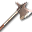</td><td class="col-name">
フランキスカ
</td><td class="col-id"><code>WEAPON2_KA02_FRANCISCA</code><button type="button" class="copy-id" data-copy="WEAPON2_KA02_FRANCISCA" title="ID WEAPON2_KA02_FRANCISCA をコピー" aria-label="ID WEAPON2_KA02_FRANCISCA をコピー">⧉</button></td><td class="col-meta">武器 · 片手斧 カード #263 · 0-2513</td><td class="col-info">
片手斧／攻撃力：５１ · 装備に必要なＳＴＲ：１０

片手斧／地中海近くに住む勇猛な民族が愛用していた斧
</td></tr>
<tr data-id="WEAPON2_KA03_WARAXE" data-cat="WEAPON2" data-sub="KA" data-flag="CARD" data-search="ウォーアックス weapon2_ka03_waraxe 武器 · 片手斧 片手斧／攻撃力：３６ · 装備に必要なｓｔｒ：１０ 片手斧／工具としての斧から発展して完成された戦闘用の斧 0-2128 102"><td class="col-img"></td><td class="col-name">
ウォーアックス
</td><td class="col-id"><code>WEAPON2_KA03_WARAXE</code><button type="button" class="copy-id" data-copy="WEAPON2_KA03_WARAXE" title="ID WEAPON2_KA03_WARAXE をコピー" aria-label="ID WEAPON2_KA03_WARAXE をコピー">⧉</button></td><td class="col-meta">武器 · 片手斧 カード #102 · 0-2128</td><td class="col-info">
片手斧／攻撃力：３６ · 装備に必要なＳＴＲ：１０

片手斧／工具としての斧から発展して完成された戦闘用の斧
</td></tr>
<tr data-id="WEAPON2_KA04_BATTLEAXE" data-cat="WEAPON2" data-sub="KA" data-flag="CARD" data-search="バトルアックス weapon2_ka04_battleaxe 武器 · 片手斧 片手斧／攻撃力：５７ · 装備に必要なｓｔｒ：１５ 片手斧／ウォーアックスをより戦闘向けにしたもの 0-2129 103"><td class="col-img">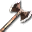</td><td class="col-name">
バトルアックス
</td><td class="col-id"><code>WEAPON2_KA04_BATTLEAXE</code><button type="button" class="copy-id" data-copy="WEAPON2_KA04_BATTLEAXE" title="ID WEAPON2_KA04_BATTLEAXE をコピー" aria-label="ID WEAPON2_KA04_BATTLEAXE をコピー">⧉</button></td><td class="col-meta">武器 · 片手斧 カード #103 · 0-2129</td><td class="col-info">
片手斧／攻撃力：５７ · 装備に必要なＳＴＲ：１５

片手斧／ウォーアックスをより戦闘向けにしたもの
</td></tr>
<tr data-id="WEAPON2_KA05_GOLDAXE" data-cat="WEAPON2" data-sub="KA" data-flag="" data-search="ゴールドアックス weapon2_ka05_goldaxe 武器 · 片手斧 片手斧／攻撃力：４０ · 装備に必要なｓｔｒ：１５ 片手斧／耐久性に優れた黄金で作られたバトルアックス "><td class="col-img">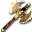</td><td class="col-name">
ゴールドアックス
</td><td class="col-id"><code>WEAPON2_KA05_GOLDAXE</code><button type="button" class="copy-id" data-copy="WEAPON2_KA05_GOLDAXE" title="ID WEAPON2_KA05_GOLDAXE をコピー" aria-label="ID WEAPON2_KA05_GOLDAXE をコピー">⧉</button></td><td class="col-meta">武器 · 片手斧</td><td class="col-info">
片手斧／攻撃力：４０ · 装備に必要なＳＴＲ：１５

片手斧／耐久性に優れた黄金で作られたバトルアックス
</td></tr>
<tr data-id="WEAPON2_KA06_SHIELDAXE" data-cat="WEAPON2" data-sub="KA" data-flag="CARD" data-search="シールドアックス weapon2_ka06_shieldaxe 武器 · 片手斧 片手斧／攻撃力：５２ · 装備に必要なｓｔｒ：１０ 片手斧／斧の柄の部分に鉄製のシールドを装着したもの 0-2507 259"><td class="col-img">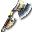</td><td class="col-name">
シールドアックス
</td><td class="col-id"><code>WEAPON2_KA06_SHIELDAXE</code><button type="button" class="copy-id" data-copy="WEAPON2_KA06_SHIELDAXE" title="ID WEAPON2_KA06_SHIELDAXE をコピー" aria-label="ID WEAPON2_KA06_SHIELDAXE をコピー">⧉</button></td><td class="col-meta">武器 · 片手斧 カード #259 · 0-2507</td><td class="col-info">
片手斧／攻撃力：５２ · 装備に必要なＳＴＲ：１０

片手斧／斧の柄の部分に鉄製のシールドを装着したもの
</td></tr>
<tr data-id="WEAPON2_KA07_TRISTRAM" data-cat="WEAPON2" data-sub="KA" data-flag="" data-search="ウェルテクス weapon2_ka07_tristram 武器 · 片手斧 片手斧／攻撃力：３０ · 装備に必要なｓｔｒ：なし 片手斧／神王のみが所有することを許された伝説の斧 "><td class="col-img">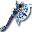</td><td class="col-name">
ウェルテクス
</td><td class="col-id"><code>WEAPON2_KA07_TRISTRAM</code><button type="button" class="copy-id" data-copy="WEAPON2_KA07_TRISTRAM" title="ID WEAPON2_KA07_TRISTRAM をコピー" aria-label="ID WEAPON2_KA07_TRISTRAM をコピー">⧉</button></td><td class="col-meta">武器 · 片手斧</td><td class="col-info">
片手斧／攻撃力：３０ · 装備に必要なＳＴＲ：なし

片手斧／神王のみが所有することを許された伝説の斧
</td></tr>
<tr data-id="WEAPON2_KA08_WARAXE" data-cat="WEAPON2" data-sub="KA" data-flag="STAR" data-search="★ウォーアックス weapon2_ka08_waraxe 武器 · 片手斧 片手斧／攻撃力：３８ · 装備に必要なｓｔｒ：なし 片手斧／工具としての斧から発展して完成された戦闘用の斧 "><td class="col-img"></td><td class="col-name">
★ウォーアックス
</td><td class="col-id"><code>WEAPON2_KA08_WARAXE</code><button type="button" class="copy-id" data-copy="WEAPON2_KA08_WARAXE" title="ID WEAPON2_KA08_WARAXE をコピー" aria-label="ID WEAPON2_KA08_WARAXE をコピー">⧉</button></td><td class="col-meta">武器 · 片手斧 ★ 特別</td><td class="col-info">
片手斧／攻撃力：３８ · 装備に必要なＳＴＲ：なし

片手斧／工具としての斧から発展して完成された戦闘用の斧
</td></tr>
<tr data-id="WEAPON2_KA09_SILVERAXE" data-cat="WEAPON2" data-sub="KA" data-flag="CARD" data-search="シルバーアックス weapon2_ka09_silveraxe 武器 · 片手斧 片手斧／攻撃力：３０ · 装備に必要なｓｔｒ：５ 片手斧／純銀製で作りの見事な美しいバトルアックス 0-2506 258"><td class="col-img">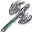</td><td class="col-name">
シルバーアックス
</td><td class="col-id"><code>WEAPON2_KA09_SILVERAXE</code><button type="button" class="copy-id" data-copy="WEAPON2_KA09_SILVERAXE" title="ID WEAPON2_KA09_SILVERAXE をコピー" aria-label="ID WEAPON2_KA09_SILVERAXE をコピー">⧉</button></td><td class="col-meta">武器 · 片手斧 カード #258 · 0-2506</td><td class="col-info">
片手斧／攻撃力：３０ · 装備に必要なＳＴＲ：５

片手斧／純銀製で作りの見事な美しいバトルアックス
</td></tr>
<tr data-id="WEAPON2_KA10_EGRET" data-cat="WEAPON2" data-sub="KA" data-flag="CARD" data-search="イーグレット weapon2_ka10_egret 武器 · 片手斧 片手斧／攻撃力：４６ · 装備に必要なｓｔｒ：１０ 片手斧／相手に向かって投げることができる片手斧 0-2611 369"><td class="col-img"></td><td class="col-name">
イーグレット
</td><td class="col-id"><code>WEAPON2_KA10_EGRET</code><button type="button" class="copy-id" data-copy="WEAPON2_KA10_EGRET" title="ID WEAPON2_KA10_EGRET をコピー" aria-label="ID WEAPON2_KA10_EGRET をコピー">⧉</button></td><td class="col-meta">武器 · 片手斧 カード #369 · 0-2611</td><td class="col-info">
片手斧／攻撃力：４６ · 装備に必要なＳＴＲ：１０

片手斧／相手に向かって投げることができる片手斧
</td></tr>
<tr data-id="WEAPON2_KA18_CRESCENT" data-cat="WEAPON2" data-sub="KA" data-flag="CARD" data-search="クレセントアックス weapon2_ka18_crescent 武器 · 片手斧 片手斧／攻撃力：６７ · 装備に必要なｓｔｒ：１５ 片手斧／曲線美を描く三日月型の刀身が人気を集めている斧 1-374 449"><td class="col-img"></td><td class="col-name">
クレセントアックス
</td><td class="col-id"><code>WEAPON2_KA18_CRESCENT</code><button type="button" class="copy-id" data-copy="WEAPON2_KA18_CRESCENT" title="ID WEAPON2_KA18_CRESCENT をコピー" aria-label="ID WEAPON2_KA18_CRESCENT をコピー">⧉</button></td><td class="col-meta">武器 · 片手斧 カード #449 · 1-374</td><td class="col-info">
片手斧／攻撃力：６７ · 装備に必要なＳＴＲ：１５

片手斧／曲線美を描く三日月型の刀身が人気を集めている斧
</td></tr>
<tr data-id="WEAPON2_KA19_TAMECHAN2" data-cat="WEAPON2" data-sub="KA" data-flag="CARD" data-search="スパイクアックス weapon2_ka19_tamechan2 武器 · 片手斧 片手斧／攻撃力：６１ · 装備に必要なｓｔｒ：１５ 片手斧／先端に刃ではなく鋭利な突起を付けた斧 0-2614 372"><td class="col-img"></td><td class="col-name">
スパイクアックス
</td><td class="col-id"><code>WEAPON2_KA19_TAMECHAN2</code><button type="button" class="copy-id" data-copy="WEAPON2_KA19_TAMECHAN2" title="ID WEAPON2_KA19_TAMECHAN2 をコピー" aria-label="ID WEAPON2_KA19_TAMECHAN2 をコピー">⧉</button></td><td class="col-meta">武器 · 片手斧 カード #372 · 0-2614</td><td class="col-info">
片手斧／攻撃力：６１ · 装備に必要なＳＴＲ：１５

片手斧／先端に刃ではなく鋭利な突起を付けた斧
</td></tr>
<tr data-id="WEAPON2_KA20_DEMONCHOPPER" data-cat="WEAPON2" data-sub="KA" data-flag="" data-search="ブラックハチェット weapon2_ka20_demonchopper 武器 · 片手斧 片手斧／攻撃力：４０ · 装備に必要なｓｔｒ：１５ 片手斧／闇の力を含んだ鉱石で作られている黒き斧 "><td class="col-img"></td><td class="col-name">
ブラックハチェット
</td><td class="col-id"><code>WEAPON2_KA20_DEMONCHOPPER</code><button type="button" class="copy-id" data-copy="WEAPON2_KA20_DEMONCHOPPER" title="ID WEAPON2_KA20_DEMONCHOPPER をコピー" aria-label="ID WEAPON2_KA20_DEMONCHOPPER をコピー">⧉</button></td><td class="col-meta">武器 · 片手斧</td><td class="col-info">
片手斧／攻撃力：４０ · 装備に必要なＳＴＲ：１５

片手斧／闇の力を含んだ鉱石で作られている黒き斧
</td></tr>
<tr data-id="WEAPON2_KA21_LILAC" data-cat="WEAPON2" data-sub="KA" data-flag="" data-search="サイレントアックス weapon2_ka21_lilac 武器 · 片手斧 片手斧／攻撃力：７０ · 装備に必要なｓｔｒ：１５ 片手斧／斬りつけた者の魔力を封じることができる斧 "><td class="col-img">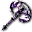</td><td class="col-name">
サイレントアックス
</td><td class="col-id"><code>WEAPON2_KA21_LILAC</code><button type="button" class="copy-id" data-copy="WEAPON2_KA21_LILAC" title="ID WEAPON2_KA21_LILAC をコピー" aria-label="ID WEAPON2_KA21_LILAC をコピー">⧉</button></td><td class="col-meta">武器 · 片手斧</td><td class="col-info">
片手斧／攻撃力：７０ · 装備に必要なＳＴＲ：１５

片手斧／斬りつけた者の魔力を封じることができる斧
</td></tr>
<tr data-id="WEAPON2_KA25_HORIHORI" data-cat="WEAPON2" data-sub="KA" data-flag="" data-search="トライブアックス weapon2_ka25_horihori 武器 · 片手斧 片手斧／攻撃力：５５ · 装備に必要なｓｔｒ：１０ 片手斧／蛮族の戦士たちが愛用している太陽の力を持った斧 "><td class="col-img">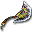</td><td class="col-name">
トライブアックス
</td><td class="col-id"><code>WEAPON2_KA25_HORIHORI</code><button type="button" class="copy-id" data-copy="WEAPON2_KA25_HORIHORI" title="ID WEAPON2_KA25_HORIHORI をコピー" aria-label="ID WEAPON2_KA25_HORIHORI をコピー">⧉</button></td><td class="col-meta">武器 · 片手斧</td><td class="col-info">
片手斧／攻撃力：５５ · 装備に必要なＳＴＲ：１０

片手斧／蛮族の戦士たちが愛用している太陽の力を持った斧
</td></tr>
<tr data-id="WEAPON2_KA26_CRIMSON" data-cat="WEAPON2" data-sub="KA" data-flag="CARD" data-search="クリムゾンライン weapon2_ka26_crimson 武器 · 片手斧 片手斧／攻撃力：６８ · 装備に必要なｓｔｒ：１５ 片手斧／使用者の血液と引き換えに破壊の力を授けるという斧 1-494 506"><td class="col-img">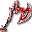</td><td class="col-name">
クリムゾンライン
</td><td class="col-id"><code>WEAPON2_KA26_CRIMSON</code><button type="button" class="copy-id" data-copy="WEAPON2_KA26_CRIMSON" title="ID WEAPON2_KA26_CRIMSON をコピー" aria-label="ID WEAPON2_KA26_CRIMSON をコピー">⧉</button></td><td class="col-meta">武器 · 片手斧 カード #506 · 1-494</td><td class="col-info">
片手斧／攻撃力：６８ · 装備に必要なＳＴＲ：１５

片手斧／使用者の血液と引き換えに破壊の力を授けるという斧
</td></tr>
<tr data-id="WEAPON2_KA27_BATTLE" data-cat="WEAPON2" data-sub="KA" data-flag="STAR" data-search="★バトルアックス weapon2_ka27_battle 武器 · 片手斧 片手斧／攻撃力：５０ · 装備に必要なｓｔｒ：なし 片手斧／ウォーアックスをより戦闘向けにしたもの "><td class="col-img"></td><td class="col-name">
★バトルアックス
</td><td class="col-id"><code>WEAPON2_KA27_BATTLE</code><button type="button" class="copy-id" data-copy="WEAPON2_KA27_BATTLE" title="ID WEAPON2_KA27_BATTLE をコピー" aria-label="ID WEAPON2_KA27_BATTLE をコピー">⧉</button></td><td class="col-meta">武器 · 片手斧 ★ 特別</td><td class="col-info">
片手斧／攻撃力：５０ · 装備に必要なＳＴＲ：なし

片手斧／ウォーアックスをより戦闘向けにしたもの
</td></tr>
<tr data-id="WEAPON2_KA28_SHIELD" data-cat="WEAPON2" data-sub="KA" data-flag="STAR" data-search="★シールドアックス weapon2_ka28_shield 武器 · 片手斧 片手斧／攻撃力：４６ · 装備に必要なｓｔｒ：なし 片手斧／斧の柄の部分に鉄製のシールドを装着したもの "><td class="col-img"></td><td class="col-name">
★シールドアックス
</td><td class="col-id"><code>WEAPON2_KA28_SHIELD</code><button type="button" class="copy-id" data-copy="WEAPON2_KA28_SHIELD" title="ID WEAPON2_KA28_SHIELD をコピー" aria-label="ID WEAPON2_KA28_SHIELD をコピー">⧉</button></td><td class="col-meta">武器 · 片手斧 ★ 特別</td><td class="col-info">
片手斧／攻撃力：４６ · 装備に必要なＳＴＲ：なし

片手斧／斧の柄の部分に鉄製のシールドを装着したもの
</td></tr>
<tr data-id="WEAPON2_KA29_FRANCISCA" data-cat="WEAPON2" data-sub="KA" data-flag="STAR" data-search="★フランキスカ weapon2_ka29_francisca 武器 · 片手斧 片手斧／攻撃力：４６ · 装備に必要なｓｔｒ：なし 片手斧／地中海近くに住む勇猛な民族が愛用していた斧 "><td class="col-img"></td><td class="col-name">
★フランキスカ
</td><td class="col-id"><code>WEAPON2_KA29_FRANCISCA</code><button type="button" class="copy-id" data-copy="WEAPON2_KA29_FRANCISCA" title="ID WEAPON2_KA29_FRANCISCA をコピー" aria-label="ID WEAPON2_KA29_FRANCISCA をコピー">⧉</button></td><td class="col-meta">武器 · 片手斧 ★ 特別</td><td class="col-info">
片手斧／攻撃力：４６ · 装備に必要なＳＴＲ：なし

片手斧／地中海近くに住む勇猛な民族が愛用していた斧
</td></tr>
<tr data-id="WEAPON2_KA30_HORIHORI" data-cat="WEAPON2" data-sub="KA" data-flag="STAR" data-search="★トライブアックス weapon2_ka30_horihori 武器 · 片手斧 片手斧／攻撃力：５０ · 装備に必要なｓｔｒ：なし 片手斧／蛮族の戦士たちが愛用している太陽の力を持った斧 "><td class="col-img"></td><td class="col-name">
★トライブアックス
</td><td class="col-id"><code>WEAPON2_KA30_HORIHORI</code><button type="button" class="copy-id" data-copy="WEAPON2_KA30_HORIHORI" title="ID WEAPON2_KA30_HORIHORI をコピー" aria-label="ID WEAPON2_KA30_HORIHORI をコピー">⧉</button></td><td class="col-meta">武器 · 片手斧 ★ 特別</td><td class="col-info">
片手斧／攻撃力：５０ · 装備に必要なＳＴＲ：なし

片手斧／蛮族の戦士たちが愛用している太陽の力を持った斧
</td></tr>
<tr data-id="WEAPON2_KA33_D4SHINKI1" data-cat="WEAPON2" data-sub="KA" data-flag="" data-search="ヘルクリムゾン weapon2_ka33_d4shinki1 武器 · 片手斧 片手斧／攻撃力：８５ · 装備に必要なｓｔｒ：１５ 片手斧／持ち主を喰らう斧が地獄の業火に包まれた姿 "><td class="col-img">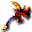</td><td class="col-name">
ヘルクリムゾン
</td><td class="col-id"><code>WEAPON2_KA33_D4SHINKI1</code><button type="button" class="copy-id" data-copy="WEAPON2_KA33_D4SHINKI1" title="ID WEAPON2_KA33_D4SHINKI1 をコピー" aria-label="ID WEAPON2_KA33_D4SHINKI1 をコピー">⧉</button></td><td class="col-meta">武器 · 片手斧</td><td class="col-info">
片手斧／攻撃力：８５ · 装備に必要なＳＴＲ：１５

片手斧／持ち主を喰らう斧が地獄の業火に包まれた姿
</td></tr>
<tr data-id="WEAPON2_KA34_BARBARIAN" data-cat="WEAPON2" data-sub="KA" data-flag="" data-search="バルバロスアックス weapon2_ka34_barbarian 武器 · 片手斧 片手斧／攻撃力：７２ · 装備に必要なｓｔｒ：１５ 片手斧／蛮族の勇者だけに与えられた戦闘用に特化した斧 "><td class="col-img">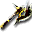</td><td class="col-name">
バルバロスアックス
</td><td class="col-id"><code>WEAPON2_KA34_BARBARIAN</code><button type="button" class="copy-id" data-copy="WEAPON2_KA34_BARBARIAN" title="ID WEAPON2_KA34_BARBARIAN をコピー" aria-label="ID WEAPON2_KA34_BARBARIAN をコピー">⧉</button></td><td class="col-meta">武器 · 片手斧</td><td class="col-info">
片手斧／攻撃力：７２ · 装備に必要なＳＴＲ：１５

片手斧／蛮族の勇者だけに与えられた戦闘用に特化した斧
</td></tr>
<tr data-id="WEAPON2_KA35_D4SHINKI2" data-cat="WEAPON2" data-sub="KA" data-flag="" data-search="バロックアックス weapon2_ka35_d4shinki2 武器 · 片手斧 片手斧／攻撃力：７６ · 装備に必要なｓｔｒ：１５ 片手斧／色とりどりで不思議な形をした斧 "><td class="col-img">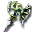</td><td class="col-name">
バロックアックス
</td><td class="col-id"><code>WEAPON2_KA35_D4SHINKI2</code><button type="button" class="copy-id" data-copy="WEAPON2_KA35_D4SHINKI2" title="ID WEAPON2_KA35_D4SHINKI2 をコピー" aria-label="ID WEAPON2_KA35_D4SHINKI2 をコピー">⧉</button></td><td class="col-meta">武器 · 片手斧</td><td class="col-info">
片手斧／攻撃力：７６ · 装備に必要なＳＴＲ：１５

片手斧／色とりどりで不思議な形をした斧
</td></tr>
<tr data-id="WEAPON2_KA36_SUNLIGHT" data-cat="WEAPON2" data-sub="KA" data-flag="" data-search="サンライトアックス weapon2_ka36_sunlight 武器 · 片手斧 片手斧／攻撃力：７３ · 装備に必要なｓｔｒ：１５ 片手斧／対となる片割れが揃うと真の力が解放されるという斧 "><td class="col-img">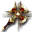</td><td class="col-name">
サンライトアックス
</td><td class="col-id"><code>WEAPON2_KA36_SUNLIGHT</code><button type="button" class="copy-id" data-copy="WEAPON2_KA36_SUNLIGHT" title="ID WEAPON2_KA36_SUNLIGHT をコピー" aria-label="ID WEAPON2_KA36_SUNLIGHT をコピー">⧉</button></td><td class="col-meta">武器 · 片手斧</td><td class="col-info">
片手斧／攻撃力：７３ · 装備に必要なＳＴＲ：１５

片手斧／対となる片割れが揃うと真の力が解放されるという斧
</td></tr>
<tr data-id="WEAPON2_KA37_MOONLIGHT" data-cat="WEAPON2" data-sub="KA" data-flag="" data-search="ムーンライトアックス weapon2_ka37_moonlight 武器 · 片手斧 片手斧／攻撃力：７５ · 装備に必要なｓｔｒ：１５ 片手斧／対となる片割れが揃うと真の力が解放されるという斧 "><td class="col-img">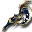</td><td class="col-name">
ムーンライトアックス
</td><td class="col-id"><code>WEAPON2_KA37_MOONLIGHT</code><button type="button" class="copy-id" data-copy="WEAPON2_KA37_MOONLIGHT" title="ID WEAPON2_KA37_MOONLIGHT をコピー" aria-label="ID WEAPON2_KA37_MOONLIGHT をコピー">⧉</button></td><td class="col-meta">武器 · 片手斧</td><td class="col-info">
片手斧／攻撃力：７５ · 装備に必要なＳＴＲ：１５

片手斧／対となる片割れが揃うと真の力が解放されるという斧
</td></tr>
<tr data-id="WEAPON2_KA38_GLADIATOR" data-cat="WEAPON2" data-sub="KA" data-flag="" data-search="カタストロフィー weapon2_ka38_gladiator 武器 · 片手斧 片手斧／攻撃力：７９ · 装備に必要なｓｔｒ：１５ 片手斧／歴史を見守ってきたといわれる破滅の斧 "><td class="col-img">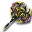</td><td class="col-name">
カタストロフィー
</td><td class="col-id"><code>WEAPON2_KA38_GLADIATOR</code><button type="button" class="copy-id" data-copy="WEAPON2_KA38_GLADIATOR" title="ID WEAPON2_KA38_GLADIATOR をコピー" aria-label="ID WEAPON2_KA38_GLADIATOR をコピー">⧉</button></td><td class="col-meta">武器 · 片手斧</td><td class="col-info">
片手斧／攻撃力：７９ · 装備に必要なＳＴＲ：１５

片手斧／歴史を見守ってきたといわれる破滅の斧
</td></tr>
<tr data-id="WEAPON2_KA40_TRISTRAM_EX" data-cat="WEAPON2" data-sub="KA" data-flag="EX" data-search="ウェルテクスｅｘ weapon2_ka40_tristram_ex 武器 · 片手斧 片手斧／攻撃力：６０ · 装備に必要なｓｔｒ：なし 片手斧／神器ウェルテクスを模して作られた片手斧 "><td class="col-img">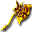</td><td class="col-name">
ウェルテクスＥＸ
</td><td class="col-id"><code>WEAPON2_KA40_TRISTRAM_EX</code><button type="button" class="copy-id" data-copy="WEAPON2_KA40_TRISTRAM_EX" title="ID WEAPON2_KA40_TRISTRAM_EX をコピー" aria-label="ID WEAPON2_KA40_TRISTRAM_EX をコピー">⧉</button></td><td class="col-meta">武器 · 片手斧 EX</td><td class="col-info">
片手斧／攻撃力：６０ · 装備に必要なＳＴＲ：なし

片手斧／神器ウェルテクスを模して作られた片手斧
</td></tr>
<tr data-id="WEAPON2_KS01_SHORTSWORD" data-cat="WEAPON2" data-sub="KS" data-flag="CARD" data-search="ショートソード weapon2_ks01_shortsword 武器 · 片手剣 片手剣／攻撃力：２４ · 装備に必要なｓｔｒ：５ 片手剣／新米冒険者向きの剣 0-2108 018"><td class="col-img"></td><td class="col-name">
ショートソード
</td><td class="col-id"><code>WEAPON2_KS01_SHORTSWORD</code><button type="button" class="copy-id" data-copy="WEAPON2_KS01_SHORTSWORD" title="ID WEAPON2_KS01_SHORTSWORD をコピー" aria-label="ID WEAPON2_KS01_SHORTSWORD をコピー">⧉</button></td><td class="col-meta">武器 · 片手剣 カード #018 · 0-2108</td><td class="col-info">
片手剣／攻撃力：２４ · 装備に必要なＳＴＲ：５

片手剣／新米冒険者向きの剣
</td></tr>
<tr data-id="WEAPON2_KS02_RAPIER" data-cat="WEAPON2" data-sub="KS" data-flag="CARD" data-search="レイピア weapon2_ks02_rapier 武器 · 片手剣 片手剣／攻撃力：３３ · 装備に必要なｓｔｒ：５ 片手剣／軽装備の相手を斬りつけることに重きを置いた剣 0-2700 494"><td class="col-img"></td><td class="col-name">
レイピア
</td><td class="col-id"><code>WEAPON2_KS02_RAPIER</code><button type="button" class="copy-id" data-copy="WEAPON2_KS02_RAPIER" title="ID WEAPON2_KS02_RAPIER をコピー" aria-label="ID WEAPON2_KS02_RAPIER をコピー">⧉</button></td><td class="col-meta">武器 · 片手剣 カード #494 · 0-2700</td><td class="col-info">
片手剣／攻撃力：３３ · 装備に必要なＳＴＲ：５

片手剣／軽装備の相手を斬りつけることに重きを置いた剣
</td></tr>
<tr data-id="WEAPON2_KS03_LONGSWORD" data-cat="WEAPON2" data-sub="KS" data-flag="CARD" data-search="ロングソード weapon2_ks03_longsword 武器 · 片手剣 片手剣／攻撃力：３４ · 装備に必要なｓｔｒ：５ 片手剣／馬上から相手を突き刺すのに適した長さを持つ 0-2110 099"><td class="col-img">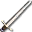</td><td class="col-name">
ロングソード
</td><td class="col-id"><code>WEAPON2_KS03_LONGSWORD</code><button type="button" class="copy-id" data-copy="WEAPON2_KS03_LONGSWORD" title="ID WEAPON2_KS03_LONGSWORD をコピー" aria-label="ID WEAPON2_KS03_LONGSWORD をコピー">⧉</button></td><td class="col-meta">武器 · 片手剣 カード #099 · 0-2110</td><td class="col-info">
片手剣／攻撃力：３４ · 装備に必要なＳＴＲ：５

片手剣／馬上から相手を突き刺すのに適した長さを持つ
</td></tr>
<tr data-id="WEAPON2_KS04_VIKINGSWORD" data-cat="WEAPON2" data-sub="KS" data-flag="CARD" data-search="ヴァイキングソード weapon2_ks04_vikingsword 武器 · 片手剣 片手剣／攻撃力：３０ · 装備に必要なｓｔｒ：５ 片手剣／海の民ヴァイキングが用いた肉厚で幅広な鉄製の剣 0-2501 253"><td class="col-img">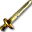</td><td class="col-name">
ヴァイキングソード
</td><td class="col-id"><code>WEAPON2_KS04_VIKINGSWORD</code><button type="button" class="copy-id" data-copy="WEAPON2_KS04_VIKINGSWORD" title="ID WEAPON2_KS04_VIKINGSWORD をコピー" aria-label="ID WEAPON2_KS04_VIKINGSWORD をコピー">⧉</button></td><td class="col-meta">武器 · 片手剣 カード #253 · 0-2501</td><td class="col-info">
片手剣／攻撃力：３０ · 装備に必要なＳＴＲ：５

片手剣／海の民ヴァイキングが用いた肉厚で幅広な鉄製の剣
</td></tr>
<tr data-id="WEAPON2_KS05_FALCHION" data-cat="WEAPON2" data-sub="KS" data-flag="CARD" data-search="ファルシオン weapon2_ks05_falchion 武器 · 片手剣 片手剣／攻撃力：５４ · 装備に必要なｓｔｒ：１０ 片手剣／砂漠の民が愛用している重量感ある片刃の曲刀 0-2365 250"><td class="col-img">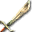</td><td class="col-name">
ファルシオン
</td><td class="col-id"><code>WEAPON2_KS05_FALCHION</code><button type="button" class="copy-id" data-copy="WEAPON2_KS05_FALCHION" title="ID WEAPON2_KS05_FALCHION をコピー" aria-label="ID WEAPON2_KS05_FALCHION をコピー">⧉</button></td><td class="col-meta">武器 · 片手剣 カード #250 · 0-2365</td><td class="col-info">
片手剣／攻撃力：５４ · 装備に必要なＳＴＲ：１０

片手剣／砂漠の民が愛用している重量感ある片刃の曲刀
</td></tr>
<tr data-id="WEAPON2_KS06_GLADIUS" data-cat="WEAPON2" data-sub="KS" data-flag="CARD" data-search="グラディウス weapon2_ks06_gladius 武器 · 片手剣 片手剣／攻撃力：４５ · 装備に必要なｓｔｒ：１０ 片手剣／闘技場で戦う剣闘士たちも愛用する扱いやすい剣 0-2113 019"><td class="col-img"></td><td class="col-name">
グラディウス
</td><td class="col-id"><code>WEAPON2_KS06_GLADIUS</code><button type="button" class="copy-id" data-copy="WEAPON2_KS06_GLADIUS" title="ID WEAPON2_KS06_GLADIUS をコピー" aria-label="ID WEAPON2_KS06_GLADIUS をコピー">⧉</button></td><td class="col-meta">武器 · 片手剣 カード #019 · 0-2113</td><td class="col-info">
片手剣／攻撃力：４５ · 装備に必要なＳＴＲ：１０

片手剣／闘技場で戦う剣闘士たちも愛用する扱いやすい剣
</td></tr>
<tr data-id="WEAPON2_KS07_MITHRILBLADE" data-cat="WEAPON2" data-sub="KS" data-flag="CARD" data-search="ミスリルソード weapon2_ks07_mithrilblade 武器 · 片手剣 片手剣／攻撃力：６５ · 装備に必要なｓｔｒ：１０ 片手剣／魔力を持つ金属のミスリルを材料にした硬く軽い剣 1-248 173"><td class="col-img"></td><td class="col-name">
ミスリルソード
</td><td class="col-id"><code>WEAPON2_KS07_MITHRILBLADE</code><button type="button" class="copy-id" data-copy="WEAPON2_KS07_MITHRILBLADE" title="ID WEAPON2_KS07_MITHRILBLADE をコピー" aria-label="ID WEAPON2_KS07_MITHRILBLADE をコピー">⧉</button></td><td class="col-meta">武器 · 片手剣 カード #173 · 1-248</td><td class="col-info">
片手剣／攻撃力：６５ · 装備に必要なＳＴＲ：１０

片手剣／魔力を持つ金属のミスリルを材料にした硬く軽い剣
</td></tr>
<tr data-id="WEAPON2_KS08_MAGICSWORD" data-cat="WEAPON2" data-sub="KS" data-flag="CARD" data-search="マジックソード weapon2_ks08_magicsword 武器 · 片手剣 片手剣／攻撃力：１２ · 装備に必要なｓｔｒ：なし 片手剣／魔術儀式用の祭具で魔法の使用が可能になる 1-371 375"><td class="col-img">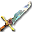</td><td class="col-name">
マジックソード
</td><td class="col-id"><code>WEAPON2_KS08_MAGICSWORD</code><button type="button" class="copy-id" data-copy="WEAPON2_KS08_MAGICSWORD" title="ID WEAPON2_KS08_MAGICSWORD をコピー" aria-label="ID WEAPON2_KS08_MAGICSWORD をコピー">⧉</button></td><td class="col-meta">武器 · 片手剣 カード #375 · 1-371</td><td class="col-info">
片手剣／攻撃力：１２ · 装備に必要なＳＴＲ：なし

片手剣／魔術儀式用の祭具で魔法の使用が可能になる
</td></tr>
<tr data-id="WEAPON2_KS09_EXCALIBUR" data-cat="WEAPON2" data-sub="KS" data-flag="" data-search="エクスカリバー weapon2_ks09_excalibur 武器 · 片手剣 片手剣／攻撃力：６８ · 装備に必要なｓｔｒ：１５ 片手剣／鋭さと強靱さを併せ持った伝説の名剣 "><td class="col-img"></td><td class="col-name">
エクスカリバー
</td><td class="col-id"><code>WEAPON2_KS09_EXCALIBUR</code><button type="button" class="copy-id" data-copy="WEAPON2_KS09_EXCALIBUR" title="ID WEAPON2_KS09_EXCALIBUR をコピー" aria-label="ID WEAPON2_KS09_EXCALIBUR をコピー">⧉</button></td><td class="col-meta">武器 · 片手剣</td><td class="col-info">
片手剣／攻撃力：６８ · 装備に必要なＳＴＲ：１５

片手剣／鋭さと強靱さを併せ持った伝説の名剣
</td></tr>
<tr data-id="WEAPON2_KS10_FAKESWORD" data-cat="WEAPON2" data-sub="KS" data-flag="CARD" data-search="フェイクソード weapon2_ks10_fakesword 武器 · 片手剣 片手剣／攻撃力：３５ · 装備に必要なｓｔｒ：５ 片手剣／剣全体に煌びやかな装飾を施した鑑賞用の長剣 0-2701 495"><td class="col-img">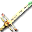</td><td class="col-name">
フェイクソード
</td><td class="col-id"><code>WEAPON2_KS10_FAKESWORD</code><button type="button" class="copy-id" data-copy="WEAPON2_KS10_FAKESWORD" title="ID WEAPON2_KS10_FAKESWORD をコピー" aria-label="ID WEAPON2_KS10_FAKESWORD をコピー">⧉</button></td><td class="col-meta">武器 · 片手剣 カード #495 · 0-2701</td><td class="col-info">
片手剣／攻撃力：３５ · 装備に必要なＳＴＲ：５

片手剣／剣全体に煌びやかな装飾を施した鑑賞用の長剣
</td></tr>
<tr data-id="WEAPON2_KS11_BOLG" data-cat="WEAPON2" data-sub="KS" data-flag="" data-search="アンサラー weapon2_ks11_bolg 武器 · 片手剣 片手剣／攻撃力：３０ · 装備に必要なｓｔｒ：なし 片手剣／神王のみが所有することを許された伝説の片手剣 "><td class="col-img"></td><td class="col-name">
アンサラー
</td><td class="col-id"><code>WEAPON2_KS11_BOLG</code><button type="button" class="copy-id" data-copy="WEAPON2_KS11_BOLG" title="ID WEAPON2_KS11_BOLG をコピー" aria-label="ID WEAPON2_KS11_BOLG をコピー">⧉</button></td><td class="col-meta">武器 · 片手剣</td><td class="col-info">
片手剣／攻撃力：３０ · 装備に必要なＳＴＲ：なし

片手剣／神王のみが所有することを許された伝説の片手剣
</td></tr>
<tr data-id="WEAPON2_KS12_WHITESWORD" data-cat="WEAPON2" data-sub="KS" data-flag="CARD" data-search="デモンズソード weapon2_ks12_whitesword 武器 · 片手剣 片手剣／攻撃力：４０ · 装備に必要なｓｔｒ：１０ 片手剣／禍々しい黒き力を封じ込められた長剣 1-430 501"><td class="col-img"></td><td class="col-name">
デモンズソード
</td><td class="col-id"><code>WEAPON2_KS12_WHITESWORD</code><button type="button" class="copy-id" data-copy="WEAPON2_KS12_WHITESWORD" title="ID WEAPON2_KS12_WHITESWORD をコピー" aria-label="ID WEAPON2_KS12_WHITESWORD をコピー">⧉</button></td><td class="col-meta">武器 · 片手剣 カード #501 · 1-430</td><td class="col-info">
片手剣／攻撃力：４０ · 装備に必要なＳＴＲ：１０

片手剣／禍々しい黒き力を封じ込められた長剣
</td></tr>
<tr data-id="WEAPON2_KS13_BLACKSWORD" data-cat="WEAPON2" data-sub="KS" data-flag="CARD" data-search="グレートソード weapon2_ks13_blacksword 武器 · 片手剣 片手剣／攻撃力：６５ · 装備に必要なｓｔｒ：１５ 片手剣／優れた者だけが携える美麗な装飾と切れ味を誇る剣 1-373 448"><td class="col-img">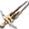</td><td class="col-name">
グレートソード
</td><td class="col-id"><code>WEAPON2_KS13_BLACKSWORD</code><button type="button" class="copy-id" data-copy="WEAPON2_KS13_BLACKSWORD" title="ID WEAPON2_KS13_BLACKSWORD をコピー" aria-label="ID WEAPON2_KS13_BLACKSWORD をコピー">⧉</button></td><td class="col-meta">武器 · 片手剣 カード #448 · 1-373</td><td class="col-info">
片手剣／攻撃力：６５ · 装備に必要なＳＴＲ：１５

片手剣／優れた者だけが携える美麗な装飾と切れ味を誇る剣
</td></tr>
<tr data-id="WEAPON2_KS14_KNIGHTSWORD" data-cat="WEAPON2" data-sub="KS" data-flag="" data-search="ナイトソード weapon2_ks14_knightsword 武器 · 片手剣 片手剣／攻撃力：６１ · 装備に必要なｓｔｒ：１０ 片手剣／真の騎士にのみ使用が許される伝説の剣 "><td class="col-img"></td><td class="col-name">
ナイトソード
</td><td class="col-id"><code>WEAPON2_KS14_KNIGHTSWORD</code><button type="button" class="copy-id" data-copy="WEAPON2_KS14_KNIGHTSWORD" title="ID WEAPON2_KS14_KNIGHTSWORD をコピー" aria-label="ID WEAPON2_KS14_KNIGHTSWORD をコピー">⧉</button></td><td class="col-meta">武器 · 片手剣</td><td class="col-info">
片手剣／攻撃力：６１ · 装備に必要なＳＴＲ：１０

片手剣／真の騎士にのみ使用が許される伝説の剣
</td></tr>
<tr data-id="WEAPON2_KS15_LONGSWORD" data-cat="WEAPON2" data-sub="KS" data-flag="STAR" data-search="★ロングソード weapon2_ks15_longsword 武器 · 片手剣 片手剣／攻撃力：３２ · 装備に必要なｓｔｒ：なし 片手剣／馬上から相手を突き刺すのに適した長さを持つ "><td class="col-img"></td><td class="col-name">
★ロングソード
</td><td class="col-id"><code>WEAPON2_KS15_LONGSWORD</code><button type="button" class="copy-id" data-copy="WEAPON2_KS15_LONGSWORD" title="ID WEAPON2_KS15_LONGSWORD をコピー" aria-label="ID WEAPON2_KS15_LONGSWORD をコピー">⧉</button></td><td class="col-meta">武器 · 片手剣 ★ 特別</td><td class="col-info">
片手剣／攻撃力：３２ · 装備に必要なＳＴＲ：なし

片手剣／馬上から相手を突き刺すのに適した長さを持つ
</td></tr>
<tr data-id="WEAPON2_KS16_FALCHION" data-cat="WEAPON2" data-sub="KS" data-flag="STAR" data-search="★ファルシオン weapon2_ks16_falchion 武器 · 片手剣 片手剣／攻撃力：４９ · 装備に必要なｓｔｒ：なし 片手剣／砂漠の民が愛用している重量感ある片刃の曲刀 "><td class="col-img">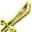</td><td class="col-name">
★ファルシオン
</td><td class="col-id"><code>WEAPON2_KS16_FALCHION</code><button type="button" class="copy-id" data-copy="WEAPON2_KS16_FALCHION" title="ID WEAPON2_KS16_FALCHION をコピー" aria-label="ID WEAPON2_KS16_FALCHION をコピー">⧉</button></td><td class="col-meta">武器 · 片手剣 ★ 特別</td><td class="col-info">
片手剣／攻撃力：４９ · 装備に必要なＳＴＲ：なし

片手剣／砂漠の民が愛用している重量感ある片刃の曲刀
</td></tr>
<tr data-id="WEAPON2_KS17_CULANNSWORD" data-cat="WEAPON2" data-sub="KS" data-flag="CARD" data-search="クランのショートソード weapon2_ks17_culannsword 武器 · 片手剣 片手剣／攻撃力：３２ · 装備に必要なｓｔｒ：なし 片手剣／名工クランが鍛えた初心者向けの片手剣 0-2350 "><td class="col-img"></td><td class="col-name">
クランのショートソード
</td><td class="col-id"><code>WEAPON2_KS17_CULANNSWORD</code><button type="button" class="copy-id" data-copy="WEAPON2_KS17_CULANNSWORD" title="ID WEAPON2_KS17_CULANNSWORD をコピー" aria-label="ID WEAPON2_KS17_CULANNSWORD をコピー">⧉</button></td><td class="col-meta">武器 · 片手剣 カード #— · 0-2350</td><td class="col-info">
片手剣／攻撃力：３２ · 装備に必要なＳＴＲ：なし

片手剣／名工クランが鍛えた初心者向けの片手剣
</td></tr>
<tr data-id="WEAPON2_KS18_VIPERFUNG" data-cat="WEAPON2" data-sub="KS" data-flag="CARD" data-search="バイパーファング weapon2_ks18_viperfung 武器 · 片手剣 片手剣／攻撃力：５０ · 装備に必要なｓｔｒ：１０ 片手剣／毒蛇の牙のような鋭い切先をした片手剣 0-2504 256"><td class="col-img">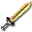</td><td class="col-name">
バイパーファング
</td><td class="col-id"><code>WEAPON2_KS18_VIPERFUNG</code><button type="button" class="copy-id" data-copy="WEAPON2_KS18_VIPERFUNG" title="ID WEAPON2_KS18_VIPERFUNG をコピー" aria-label="ID WEAPON2_KS18_VIPERFUNG をコピー">⧉</button></td><td class="col-meta">武器 · 片手剣 カード #256 · 0-2504</td><td class="col-info">
片手剣／攻撃力：５０ · 装備に必要なＳＴＲ：１０

片手剣／毒蛇の牙のような鋭い切先をした片手剣
</td></tr>
<tr data-id="WEAPON2_KS19_ROYAL" data-cat="WEAPON2" data-sub="KS" data-flag="CARD" data-search="ホーリーソード weapon2_ks19_royal 武器 · 片手剣 片手剣／攻撃力：３５ · 装備に必要なｓｔｒ：５ 片手剣／白き力に護られた長剣で俊敏に振り回せる 1-431 502"><td class="col-img">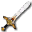</td><td class="col-name">
ホーリーソード
</td><td class="col-id"><code>WEAPON2_KS19_ROYAL</code><button type="button" class="copy-id" data-copy="WEAPON2_KS19_ROYAL" title="ID WEAPON2_KS19_ROYAL をコピー" aria-label="ID WEAPON2_KS19_ROYAL をコピー">⧉</button></td><td class="col-meta">武器 · 片手剣 カード #502 · 1-431</td><td class="col-info">
片手剣／攻撃力：３５ · 装備に必要なＳＴＲ：５

片手剣／白き力に護られた長剣で俊敏に振り回せる
</td></tr>
<tr data-id="WEAPON2_KS29_SAPPHIRE" data-cat="WEAPON2" data-sub="KS" data-flag="" data-search="サファイアエッジ weapon2_ks29_sapphire 武器 · 片手剣 片手剣／攻撃力：８３ · 装備に必要なｓｔｒ：１０ 片手剣／特別な力を持つ純粋なサファイアで作られた宝剣 "><td class="col-img">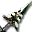</td><td class="col-name">
サファイアエッジ
</td><td class="col-id"><code>WEAPON2_KS29_SAPPHIRE</code><button type="button" class="copy-id" data-copy="WEAPON2_KS29_SAPPHIRE" title="ID WEAPON2_KS29_SAPPHIRE をコピー" aria-label="ID WEAPON2_KS29_SAPPHIRE をコピー">⧉</button></td><td class="col-meta">武器 · 片手剣</td><td class="col-info">
片手剣／攻撃力：８３ · 装備に必要なＳＴＲ：１０

片手剣／特別な力を持つ純粋なサファイアで作られた宝剣
</td></tr>
<tr data-id="WEAPON2_KS30_BLOODY" data-cat="WEAPON2" data-sub="KS" data-flag="" data-search="ブラッディスパイン weapon2_ks30_bloody 武器 · 片手剣 片手剣／攻撃力：５５ · 装備に必要なｓｔｒ：１０ 片手剣／吸血鬼の如き牙を持つ歪な形状の剣 "><td class="col-img">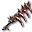</td><td class="col-name">
ブラッディスパイン
</td><td class="col-id"><code>WEAPON2_KS30_BLOODY</code><button type="button" class="copy-id" data-copy="WEAPON2_KS30_BLOODY" title="ID WEAPON2_KS30_BLOODY をコピー" aria-label="ID WEAPON2_KS30_BLOODY をコピー">⧉</button></td><td class="col-meta">武器 · 片手剣</td><td class="col-info">
片手剣／攻撃力：５５ · 装備に必要なＳＴＲ：１０

片手剣／吸血鬼の如き牙を持つ歪な形状の剣
</td></tr>
<tr data-id="WEAPON2_KS31_SHAMSHIR" data-cat="WEAPON2" data-sub="KS" data-flag="" data-search="シャムシール weapon2_ks31_shamshir 武器 · 片手剣 片手剣／攻撃力：５０ · 装備に必要なｓｔｒ：５ 片手剣／振り下ろすことで威力を最大限に発揮する剣 "><td class="col-img">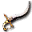</td><td class="col-name">
シャムシール
</td><td class="col-id"><code>WEAPON2_KS31_SHAMSHIR</code><button type="button" class="copy-id" data-copy="WEAPON2_KS31_SHAMSHIR" title="ID WEAPON2_KS31_SHAMSHIR をコピー" aria-label="ID WEAPON2_KS31_SHAMSHIR をコピー">⧉</button></td><td class="col-meta">武器 · 片手剣</td><td class="col-info">
片手剣／攻撃力：５０ · 装備に必要なＳＴＲ：５

片手剣／振り下ろすことで威力を最大限に発揮する剣
</td></tr>
<tr data-id="WEAPON2_KS32_DIVIDER" data-cat="WEAPON2" data-sub="KS" data-flag="" data-search="ディバイドソード weapon2_ks32_divider 武器 · 片手剣 片手剣／攻撃力：６７ · 装備に必要なｓｔｒ：１０ 片手剣／鉈を戦闘用に改良した断ち切ることに優れた剣 "><td class="col-img">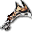</td><td class="col-name">
ディバイドソード
</td><td class="col-id"><code>WEAPON2_KS32_DIVIDER</code><button type="button" class="copy-id" data-copy="WEAPON2_KS32_DIVIDER" title="ID WEAPON2_KS32_DIVIDER をコピー" aria-label="ID WEAPON2_KS32_DIVIDER をコピー">⧉</button></td><td class="col-meta">武器 · 片手剣</td><td class="col-info">
片手剣／攻撃力：６７ · 装備に必要なＳＴＲ：１０

片手剣／鉈を戦闘用に改良した断ち切ることに優れた剣
</td></tr>
<tr data-id="WEAPON2_KS33_WING" data-cat="WEAPON2" data-sub="KS" data-flag="" data-search="ウィングソード weapon2_ks33_wing 武器 · 片手剣 片手剣／攻撃力：５８ · 装備に必要なｓｔｒ：５ 片手剣／神速で飛ぶことのできる鳥の羽で作られた剣 "><td class="col-img">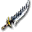</td><td class="col-name">
ウィングソード
</td><td class="col-id"><code>WEAPON2_KS33_WING</code><button type="button" class="copy-id" data-copy="WEAPON2_KS33_WING" title="ID WEAPON2_KS33_WING をコピー" aria-label="ID WEAPON2_KS33_WING をコピー">⧉</button></td><td class="col-meta">武器 · 片手剣</td><td class="col-info">
片手剣／攻撃力：５８ · 装備に必要なＳＴＲ：５

片手剣／神速で飛ぶことのできる鳥の羽で作られた剣
</td></tr>
<tr data-id="WEAPON2_KS39_SEIRYUTOU" data-cat="WEAPON2" data-sub="KS" data-flag="CARD" data-search="青龍刀 weapon2_ks39_seiryutou 武器 · 片手剣 片手剣／攻撃力：５２ · 装備に必要なｓｔｒ：１０ 片手剣／古来より伝わる幅広の切っ先を持つ大振りの刀 0-2702 496"><td class="col-img"></td><td class="col-name">
青龍刀
</td><td class="col-id"><code>WEAPON2_KS39_SEIRYUTOU</code><button type="button" class="copy-id" data-copy="WEAPON2_KS39_SEIRYUTOU" title="ID WEAPON2_KS39_SEIRYUTOU をコピー" aria-label="ID WEAPON2_KS39_SEIRYUTOU をコピー">⧉</button></td><td class="col-meta">武器 · 片手剣 カード #496 · 0-2702</td><td class="col-info">
片手剣／攻撃力：５２ · 装備に必要なＳＴＲ：１０

片手剣／古来より伝わる幅広の切っ先を持つ大振りの刀
</td></tr>
<tr data-id="WEAPON2_KS40_DRAGONSLAYER" data-cat="WEAPON2" data-sub="KS" data-flag="" data-search="ドラゴンソード weapon2_ks40_dragonslayer 武器 · 片手剣 片手剣／攻撃力：６４ · 装備に必要なｓｔｒ：１５ 片手剣／ドラゴンのしなやかな尻尾の皮膚で作られた剣 "><td class="col-img">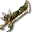</td><td class="col-name">
ドラゴンソード
</td><td class="col-id"><code>WEAPON2_KS40_DRAGONSLAYER</code><button type="button" class="copy-id" data-copy="WEAPON2_KS40_DRAGONSLAYER" title="ID WEAPON2_KS40_DRAGONSLAYER をコピー" aria-label="ID WEAPON2_KS40_DRAGONSLAYER をコピー">⧉</button></td><td class="col-meta">武器 · 片手剣</td><td class="col-info">
片手剣／攻撃力：６４ · 装備に必要なＳＴＲ：１５

片手剣／ドラゴンのしなやかな尻尾の皮膚で作られた剣
</td></tr>
<tr data-id="WEAPON2_KS41_RAPIER" data-cat="WEAPON2" data-sub="KS" data-flag="STAR" data-search="★レイピア weapon2_ks41_rapier 武器 · 片手剣 片手剣／攻撃力：３１ · 装備に必要なｓｔｒ：なし 片手剣／軽装備の相手を斬りつけることに重きを置いた剣 "><td class="col-img"></td><td class="col-name">
★レイピア
</td><td class="col-id"><code>WEAPON2_KS41_RAPIER</code><button type="button" class="copy-id" data-copy="WEAPON2_KS41_RAPIER" title="ID WEAPON2_KS41_RAPIER をコピー" aria-label="ID WEAPON2_KS41_RAPIER をコピー">⧉</button></td><td class="col-meta">武器 · 片手剣 ★ 特別</td><td class="col-info">
片手剣／攻撃力：３１ · 装備に必要なＳＴＲ：なし

片手剣／軽装備の相手を斬りつけることに重きを置いた剣
</td></tr>
<tr data-id="WEAPON2_KS42" data-cat="WEAPON2" data-sub="KS" data-flag="STAR" data-search="★ヴァイキングソード weapon2_ks42 武器 · 片手剣 片手剣／攻撃力：２６ · 装備に必要なｓｔｒ：なし 片手剣／海の民ヴァイキングが用いた肉厚で幅広な鉄製の剣 "><td class="col-img"></td><td class="col-name">
★ヴァイキングソード
</td><td class="col-id"><code>WEAPON2_KS42</code><button type="button" class="copy-id" data-copy="WEAPON2_KS42" title="ID WEAPON2_KS42 をコピー" aria-label="ID WEAPON2_KS42 をコピー">⧉</button></td><td class="col-meta">武器 · 片手剣 ★ 特別</td><td class="col-info">
片手剣／攻撃力：２６ · 装備に必要なＳＴＲ：なし

片手剣／海の民ヴァイキングが用いた肉厚で幅広な鉄製の剣
</td></tr>
<tr data-id="WEAPON2_KS43_GLADIUS" data-cat="WEAPON2" data-sub="KS" data-flag="STAR" data-search="★グラディウス weapon2_ks43_gladius 武器 · 片手剣 片手剣／攻撃力：４０ · 装備に必要なｓｔｒ：なし 片手剣／闘技場で戦う剣闘士たちも愛用する扱いやすい剣 "><td class="col-img"></td><td class="col-name">
★グラディウス
</td><td class="col-id"><code>WEAPON2_KS43_GLADIUS</code><button type="button" class="copy-id" data-copy="WEAPON2_KS43_GLADIUS" title="ID WEAPON2_KS43_GLADIUS をコピー" aria-label="ID WEAPON2_KS43_GLADIUS をコピー">⧉</button></td><td class="col-meta">武器 · 片手剣 ★ 特別</td><td class="col-info">
片手剣／攻撃力：４０ · 装備に必要なＳＴＲ：なし

片手剣／闘技場で戦う剣闘士たちも愛用する扱いやすい剣
</td></tr>
<tr data-id="WEAPON2_KS44_SHAMSHIR" data-cat="WEAPON2" data-sub="KS" data-flag="STAR" data-search="★シャムシール weapon2_ks44_shamshir 武器 · 片手剣 片手剣／攻撃力：４５ · 装備に必要なｓｔｒ：なし 片手剣／振り下ろすことで威力を最大限に発揮する剣 "><td class="col-img"></td><td class="col-name">
★シャムシール
</td><td class="col-id"><code>WEAPON2_KS44_SHAMSHIR</code><button type="button" class="copy-id" data-copy="WEAPON2_KS44_SHAMSHIR" title="ID WEAPON2_KS44_SHAMSHIR をコピー" aria-label="ID WEAPON2_KS44_SHAMSHIR をコピー">⧉</button></td><td class="col-meta">武器 · 片手剣 ★ 特別</td><td class="col-info">
片手剣／攻撃力：４５ · 装備に必要なＳＴＲ：なし

片手剣／振り下ろすことで威力を最大限に発揮する剣
</td></tr>
<tr data-id="WEAPON2_KS45_SEIRYUTOU" data-cat="WEAPON2" data-sub="KS" data-flag="STAR" data-search="★青龍刀 weapon2_ks45_seiryutou 武器 · 片手剣 片手剣／攻撃力：４６ · 装備に必要なｓｔｒ：なし 片手剣／古来より伝わる幅広の切っ先を持つ大振りの刀 "><td class="col-img">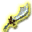</td><td class="col-name">
★青龍刀
</td><td class="col-id"><code>WEAPON2_KS45_SEIRYUTOU</code><button type="button" class="copy-id" data-copy="WEAPON2_KS45_SEIRYUTOU" title="ID WEAPON2_KS45_SEIRYUTOU をコピー" aria-label="ID WEAPON2_KS45_SEIRYUTOU をコピー">⧉</button></td><td class="col-meta">武器 · 片手剣 ★ 特別</td><td class="col-info">
片手剣／攻撃力：４６ · 装備に必要なＳＴＲ：なし

片手剣／古来より伝わる幅広の切っ先を持つ大振りの刀
</td></tr>
<tr data-id="WEAPON2_KS49_MASTERRAPIER" data-cat="WEAPON2" data-sub="KS" data-flag="" data-search="マスターレイピア weapon2_ks49_masterrapier 武器 · 片手剣 片手剣／攻撃力：５３ · 装備に必要なｓｔｒ：５ 片手剣／相手を斬りつけることよりも刺すことを重視した剣 "><td class="col-img"></td><td class="col-name">
マスターレイピア
</td><td class="col-id"><code>WEAPON2_KS49_MASTERRAPIER</code><button type="button" class="copy-id" data-copy="WEAPON2_KS49_MASTERRAPIER" title="ID WEAPON2_KS49_MASTERRAPIER をコピー" aria-label="ID WEAPON2_KS49_MASTERRAPIER をコピー">⧉</button></td><td class="col-meta">武器 · 片手剣</td><td class="col-info">
片手剣／攻撃力：５３ · 装備に必要なＳＴＲ：５

片手剣／相手を斬りつけることよりも刺すことを重視した剣
</td></tr>
<tr data-id="WEAPON2_KS50_TRIBE" data-cat="WEAPON2" data-sub="KS" data-flag="" data-search="トライブエッジ weapon2_ks50_tribe 武器 · 片手剣 片手剣／攻撃力：５０ · 装備に必要なｓｔｒ：１０ 片手剣／大きく湾曲した刃が特徴的な片手剣 "><td class="col-img">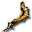</td><td class="col-name">
トライブエッジ
</td><td class="col-id"><code>WEAPON2_KS50_TRIBE</code><button type="button" class="copy-id" data-copy="WEAPON2_KS50_TRIBE" title="ID WEAPON2_KS50_TRIBE をコピー" aria-label="ID WEAPON2_KS50_TRIBE をコピー">⧉</button></td><td class="col-meta">武器 · 片手剣</td><td class="col-info">
片手剣／攻撃力：５０ · 装備に必要なＳＴＲ：１０

片手剣／大きく湾曲した刃が特徴的な片手剣
</td></tr>
<tr data-id="WEAPON2_KS51_D4SHINKI2" data-cat="WEAPON2" data-sub="KS" data-flag="" data-search="グラディエーター weapon2_ks51_d4shinki2 武器 · 片手剣 片手剣／攻撃力：７３ · 装備に必要なｓｔｒ：１０ 片手剣／罪人の怨念が込められた剣 "><td class="col-img">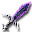</td><td class="col-name">
グラディエーター
</td><td class="col-id"><code>WEAPON2_KS51_D4SHINKI2</code><button type="button" class="copy-id" data-copy="WEAPON2_KS51_D4SHINKI2" title="ID WEAPON2_KS51_D4SHINKI2 をコピー" aria-label="ID WEAPON2_KS51_D4SHINKI2 をコピー">⧉</button></td><td class="col-meta">武器 · 片手剣</td><td class="col-info">
片手剣／攻撃力：７３ · 装備に必要なＳＴＲ：１０

片手剣／罪人の怨念が込められた剣
</td></tr>
<tr data-id="WEAPON2_KS52_BRINGER_R" data-cat="WEAPON2" data-sub="KS" data-flag="" data-search="ライトブリンガー weapon2_ks52_bringer_r 武器 · 片手剣 片手剣／攻撃力：７２ · 装備に必要なｓｔｒ：１０ 片手剣／絶大な力を恐れた神々が二つに分断したといわれる剣 "><td class="col-img">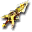</td><td class="col-name">
ライトブリンガー
</td><td class="col-id"><code>WEAPON2_KS52_BRINGER_R</code><button type="button" class="copy-id" data-copy="WEAPON2_KS52_BRINGER_R" title="ID WEAPON2_KS52_BRINGER_R をコピー" aria-label="ID WEAPON2_KS52_BRINGER_R をコピー">⧉</button></td><td class="col-meta">武器 · 片手剣</td><td class="col-info">
片手剣／攻撃力：７２ · 装備に必要なＳＴＲ：１０

片手剣／絶大な力を恐れた神々が二つに分断したといわれる剣
</td></tr>
<tr data-id="WEAPON2_KS53_BRINGER_L" data-cat="WEAPON2" data-sub="KS" data-flag="" data-search="シャドウブリンガー weapon2_ks53_bringer_l 武器 · 片手剣 片手剣／攻撃力：７４ · 装備に必要なｓｔｒ：１０ 片手剣／絶大な力を恐れた神々が二つに分断したといわれる剣 "><td class="col-img">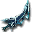</td><td class="col-name">
シャドウブリンガー
</td><td class="col-id"><code>WEAPON2_KS53_BRINGER_L</code><button type="button" class="copy-id" data-copy="WEAPON2_KS53_BRINGER_L" title="ID WEAPON2_KS53_BRINGER_L をコピー" aria-label="ID WEAPON2_KS53_BRINGER_L をコピー">⧉</button></td><td class="col-meta">武器 · 片手剣</td><td class="col-info">
片手剣／攻撃力：７４ · 装備に必要なＳＴＲ：１０

片手剣／絶大な力を恐れた神々が二つに分断したといわれる剣
</td></tr>
<tr data-id="WEAPON2_KS54_RAGNAROK" data-cat="WEAPON2" data-sub="KS" data-flag="" data-search="アロンダイト weapon2_ks54_ragnarok 武器 · 片手剣 片手剣／攻撃力：７７ · 装備に必要なｓｔｒ：１０ 片手剣／人々の運命を司るといわれる幻の剣 "><td class="col-img">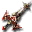</td><td class="col-name">
アロンダイト
</td><td class="col-id"><code>WEAPON2_KS54_RAGNAROK</code><button type="button" class="copy-id" data-copy="WEAPON2_KS54_RAGNAROK" title="ID WEAPON2_KS54_RAGNAROK をコピー" aria-label="ID WEAPON2_KS54_RAGNAROK をコピー">⧉</button></td><td class="col-meta">武器 · 片手剣</td><td class="col-info">
片手剣／攻撃力：７７ · 装備に必要なＳＴＲ：１０

片手剣／人々の運命を司るといわれる幻の剣
</td></tr>
<tr data-id="WEAPON2_KS57_BOLG_EX" data-cat="WEAPON2" data-sub="KS" data-flag="EX" data-search="アンサラーｅｘ weapon2_ks57_bolg_ex 武器 · 片手剣 片手剣／攻撃力：５８ · 装備に必要なｓｔｒ：なし 片手剣／神器アンサラーを模して作られた剣 "><td class="col-img">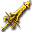</td><td class="col-name">
アンサラーＥＸ
</td><td class="col-id"><code>WEAPON2_KS57_BOLG_EX</code><button type="button" class="copy-id" data-copy="WEAPON2_KS57_BOLG_EX" title="ID WEAPON2_KS57_BOLG_EX をコピー" aria-label="ID WEAPON2_KS57_BOLG_EX をコピー">⧉</button></td><td class="col-meta">武器 · 片手剣 EX</td><td class="col-info">
片手剣／攻撃力：５８ · 装備に必要なＳＴＲ：なし

片手剣／神器アンサラーを模して作られた剣
</td></tr>
<tr data-id="WEAPON2_MA01_CLUB" data-cat="WEAPON2" data-sub="MA" data-flag="CARD" data-search="クラブ weapon2_ma01_club 武器 · 棍棒・メイス 棍棒／攻撃力：２１ · 装備に必要なｓｔｒ：５ 棍棒／簡単で最も原始的な鈍器 0-2141 025"><td class="col-img">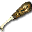</td><td class="col-name">
クラブ
</td><td class="col-id"><code>WEAPON2_MA01_CLUB</code><button type="button" class="copy-id" data-copy="WEAPON2_MA01_CLUB" title="ID WEAPON2_MA01_CLUB をコピー" aria-label="ID WEAPON2_MA01_CLUB をコピー">⧉</button></td><td class="col-meta">武器 · 棍棒・メイス カード #025 · 0-2141</td><td class="col-info">
棍棒／攻撃力：２１ · 装備に必要なＳＴＲ：５

棍棒／簡単で最も原始的な鈍器
</td></tr>
<tr data-id="WEAPON2_MA02_MACE" data-cat="WEAPON2" data-sub="MA" data-flag="CARD" data-search="メイス weapon2_ma02_mace 武器 · 棍棒・メイス 棍棒／攻撃力：３４ · 装備に必要なｓｔｒ：５ 棍棒／殴打することに特化した鉄製の鈍器 0-2142 104"><td class="col-img">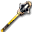</td><td class="col-name">
メイス
</td><td class="col-id"><code>WEAPON2_MA02_MACE</code><button type="button" class="copy-id" data-copy="WEAPON2_MA02_MACE" title="ID WEAPON2_MA02_MACE をコピー" aria-label="ID WEAPON2_MA02_MACE をコピー">⧉</button></td><td class="col-meta">武器 · 棍棒・メイス カード #104 · 0-2142</td><td class="col-info">
棍棒／攻撃力：３４ · 装備に必要なＳＴＲ：５

棍棒／殴打することに特化した鉄製の鈍器
</td></tr>
<tr data-id="WEAPON2_MA03_WARHAMMER" data-cat="WEAPON2" data-sub="MA" data-flag="CARD" data-search="ウォーハンマー weapon2_ma03_warhammer 武器 · 棍棒・メイス 棍棒／攻撃力：５１ · 装備に必要なｓｔｒ：１０ 棍棒／金槌を武器へと改良した戦槌 0-2364 249"><td class="col-img">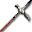</td><td class="col-name">
ウォーハンマー
</td><td class="col-id"><code>WEAPON2_MA03_WARHAMMER</code><button type="button" class="copy-id" data-copy="WEAPON2_MA03_WARHAMMER" title="ID WEAPON2_MA03_WARHAMMER をコピー" aria-label="ID WEAPON2_MA03_WARHAMMER をコピー">⧉</button></td><td class="col-meta">武器 · 棍棒・メイス カード #249 · 0-2364</td><td class="col-info">
棍棒／攻撃力：５１ · 装備に必要なＳＴＲ：１０

棍棒／金槌を武器へと改良した戦槌
</td></tr>
<tr data-id="WEAPON2_MA04_MORNINGSTAR" data-cat="WEAPON2" data-sub="MA" data-flag="CARD" data-search="モーニングスター weapon2_ma04_morningstar 武器 · 棍棒・メイス 棍棒／攻撃力：６４ · 装備に必要なｓｔｒ：１０ 棍棒／たくさんの棘が突き出た鉄球が特徴的なメイス 1-437 503"><td class="col-img">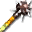</td><td class="col-name">
モーニングスター
</td><td class="col-id"><code>WEAPON2_MA04_MORNINGSTAR</code><button type="button" class="copy-id" data-copy="WEAPON2_MA04_MORNINGSTAR" title="ID WEAPON2_MA04_MORNINGSTAR をコピー" aria-label="ID WEAPON2_MA04_MORNINGSTAR をコピー">⧉</button></td><td class="col-meta">武器 · 棍棒・メイス カード #503 · 1-437</td><td class="col-info">
棍棒／攻撃力：６４ · 装備に必要なＳＴＲ：１０

棍棒／たくさんの棘が突き出た鉄球が特徴的なメイス
</td></tr>
<tr data-id="WEAPON2_MA05_MITHRILHAMMER" data-cat="WEAPON2" data-sub="MA" data-flag="CARD" data-search="ミスリルハンマー weapon2_ma05_mithrilhammer 武器 · 棍棒・メイス 棍棒／攻撃力：６３ · 装備に必要なｓｔｒ：１０ 棍棒／魔力を持つ金属のミスリルを材料にしたハンマー 1-420 454"><td class="col-img"></td><td class="col-name">
ミスリルハンマー
</td><td class="col-id"><code>WEAPON2_MA05_MITHRILHAMMER</code><button type="button" class="copy-id" data-copy="WEAPON2_MA05_MITHRILHAMMER" title="ID WEAPON2_MA05_MITHRILHAMMER をコピー" aria-label="ID WEAPON2_MA05_MITHRILHAMMER をコピー">⧉</button></td><td class="col-meta">武器 · 棍棒・メイス カード #454 · 1-420</td><td class="col-info">
棍棒／攻撃力：６３ · 装備に必要なＳＴＲ：１０

棍棒／魔力を持つ金属のミスリルを材料にしたハンマー
</td></tr>
<tr data-id="WEAPON2_MA06_FAYHAMMER" data-cat="WEAPON2" data-sub="MA" data-flag="" data-search="ペルグランデ weapon2_ma06_fayhammer 武器 · 棍棒・メイス 棍棒／攻撃力：３０ · 装備に必要なｓｔｒ：なし 棍棒／一振りで世界を変えるとされる絶大な威力を持つ槌 "><td class="col-img">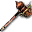</td><td class="col-name">
ペルグランデ
</td><td class="col-id"><code>WEAPON2_MA06_FAYHAMMER</code><button type="button" class="copy-id" data-copy="WEAPON2_MA06_FAYHAMMER" title="ID WEAPON2_MA06_FAYHAMMER をコピー" aria-label="ID WEAPON2_MA06_FAYHAMMER をコピー">⧉</button></td><td class="col-meta">武器 · 棍棒・メイス</td><td class="col-info">
棍棒／攻撃力：３０ · 装備に必要なＳＴＲ：なし

棍棒／一振りで世界を変えるとされる絶大な威力を持つ槌
</td></tr>
<tr data-id="WEAPON2_MA07_MJOLLNIR" data-cat="WEAPON2" data-sub="MA" data-flag="" data-search="ノームハンマー weapon2_ma07_mjollnir 武器 · 棍棒・メイス 棍棒／攻撃力：６９ · 装備に必要なｓｔｒ：５ 棍棒／地の精霊ノームが作り出したといわれる棍棒 "><td class="col-img">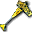</td><td class="col-name">
ノームハンマー
</td><td class="col-id"><code>WEAPON2_MA07_MJOLLNIR</code><button type="button" class="copy-id" data-copy="WEAPON2_MA07_MJOLLNIR" title="ID WEAPON2_MA07_MJOLLNIR をコピー" aria-label="ID WEAPON2_MA07_MJOLLNIR をコピー">⧉</button></td><td class="col-meta">武器 · 棍棒・メイス</td><td class="col-info">
棍棒／攻撃力：６９ · 装備に必要なＳＴＲ：５

棍棒／地の精霊ノームが作り出したといわれる棍棒
</td></tr>
<tr data-id="WEAPON2_MA08_MACE" data-cat="WEAPON2" data-sub="MA" data-flag="STAR" data-search="★メイス weapon2_ma08_mace 武器 · 棍棒・メイス 棍棒／攻撃力：３４ · 装備に必要なｓｔｒ：なし 棍棒／殴打することに特化した鉄製の鈍器 "><td class="col-img"></td><td class="col-name">
★メイス
</td><td class="col-id"><code>WEAPON2_MA08_MACE</code><button type="button" class="copy-id" data-copy="WEAPON2_MA08_MACE" title="ID WEAPON2_MA08_MACE をコピー" aria-label="ID WEAPON2_MA08_MACE をコピー">⧉</button></td><td class="col-meta">武器 · 棍棒・メイス ★ 特別</td><td class="col-info">
棍棒／攻撃力：３４ · 装備に必要なＳＴＲ：なし

棍棒／殴打することに特化した鉄製の鈍器
</td></tr>
<tr data-id="WEAPON2_MA09_HOLYMACE" data-cat="WEAPON2" data-sub="MA" data-flag="CARD" data-search="ホーリーメイス weapon2_ma09_holymace 武器 · 棍棒・メイス 棍棒／攻撃力：３４ · 装備に必要なｓｔｒ：５ 棍棒／聖なる力で覆われている鉄製の鈍器 0-2510 262"><td class="col-img"></td><td class="col-name">
ホーリーメイス
</td><td class="col-id"><code>WEAPON2_MA09_HOLYMACE</code><button type="button" class="copy-id" data-copy="WEAPON2_MA09_HOLYMACE" title="ID WEAPON2_MA09_HOLYMACE をコピー" aria-label="ID WEAPON2_MA09_HOLYMACE をコピー">⧉</button></td><td class="col-meta">武器 · 棍棒・メイス カード #262 · 0-2510</td><td class="col-info">
棍棒／攻撃力：３４ · 装備に必要なＳＴＲ：５

棍棒／聖なる力で覆われている鉄製の鈍器
</td></tr>
<tr data-id="WEAPON2_MA10_OAKCLUB" data-cat="WEAPON2" data-sub="MA" data-flag="CARD" data-search="樫のクラブ weapon2_ma10_oakclub 武器 · 棍棒・メイス 棍棒／攻撃力：３０ · 装備に必要なｓｔｒ：なし 棍棒／小振りで女性でも扱える強度の高い鈍器 0-2351 "><td class="col-img">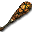</td><td class="col-name">
樫のクラブ
</td><td class="col-id"><code>WEAPON2_MA10_OAKCLUB</code><button type="button" class="copy-id" data-copy="WEAPON2_MA10_OAKCLUB" title="ID WEAPON2_MA10_OAKCLUB をコピー" aria-label="ID WEAPON2_MA10_OAKCLUB をコピー">⧉</button></td><td class="col-meta">武器 · 棍棒・メイス カード #— · 0-2351</td><td class="col-info">
棍棒／攻撃力：３０ · 装備に必要なＳＴＲ：なし

棍棒／小振りで女性でも扱える強度の高い鈍器
</td></tr>
<tr data-id="WEAPON2_MA11_WARHAMMER_EX" data-cat="WEAPON2" data-sub="MA" data-flag="CARD,EX" data-search="ブライトハンマー weapon2_ma11_warhammer_ex 武器 · 棍棒・メイス 棍棒／攻撃力：４３ · 装備に必要なｓｔｒ：５ 棍棒／叩くだけでなく、刺すことも可能なハンマー 0-2610 368"><td class="col-img">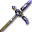</td><td class="col-name">
ブライトハンマー
</td><td class="col-id"><code>WEAPON2_MA11_WARHAMMER_EX</code><button type="button" class="copy-id" data-copy="WEAPON2_MA11_WARHAMMER_EX" title="ID WEAPON2_MA11_WARHAMMER_EX をコピー" aria-label="ID WEAPON2_MA11_WARHAMMER_EX をコピー">⧉</button></td><td class="col-meta">武器 · 棍棒・メイス カード #368 · 0-2610 EX</td><td class="col-info">
棍棒／攻撃力：４３ · 装備に必要なＳＴＲ：５

棍棒／叩くだけでなく、刺すことも可能なハンマー
</td></tr>
<tr data-id="WEAPON2_MA15_TAMECHAN1" data-cat="WEAPON2" data-sub="MA" data-flag="CARD" data-search="スクエアメイス weapon2_ma15_tamechan1 武器 · 棍棒・メイス 棍棒／攻撃力：５７ · 装備に必要なｓｔｒ：１０ 棍棒／四角く重い槌が振り下ろすスピードを高めてくれる棍棒 0-2615 444"><td class="col-img">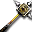</td><td class="col-name">
スクエアメイス
</td><td class="col-id"><code>WEAPON2_MA15_TAMECHAN1</code><button type="button" class="copy-id" data-copy="WEAPON2_MA15_TAMECHAN1" title="ID WEAPON2_MA15_TAMECHAN1 をコピー" aria-label="ID WEAPON2_MA15_TAMECHAN1 をコピー">⧉</button></td><td class="col-meta">武器 · 棍棒・メイス カード #444 · 0-2615</td><td class="col-info">
棍棒／攻撃力：５７ · 装備に必要なＳＴＲ：１０

棍棒／四角く重い槌が振り下ろすスピードを高めてくれる棍棒
</td></tr>
<tr data-id="WEAPON2_MA16_STRIKE" data-cat="WEAPON2" data-sub="MA" data-flag="" data-search="スマッシュハンマー weapon2_ma16_strike 武器 · 棍棒・メイス 棍棒／攻撃力：６１ · 装備に必要なｓｔｒ：１０ 棍棒／見た目の美しさと高い威力を兼ね備えた白金製の棍棒 "><td class="col-img">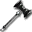</td><td class="col-name">
スマッシュハンマー
</td><td class="col-id"><code>WEAPON2_MA16_STRIKE</code><button type="button" class="copy-id" data-copy="WEAPON2_MA16_STRIKE" title="ID WEAPON2_MA16_STRIKE をコピー" aria-label="ID WEAPON2_MA16_STRIKE をコピー">⧉</button></td><td class="col-meta">武器 · 棍棒・メイス</td><td class="col-info">
棍棒／攻撃力：６１ · 装備に必要なＳＴＲ：１０

棍棒／見た目の美しさと高い威力を兼ね備えた白金製の棍棒
</td></tr>
<tr data-id="WEAPON2_MA17_TIREI" data-cat="WEAPON2" data-sub="MA" data-flag="" data-search="クェイクハンマー weapon2_ma17_tirei 武器 · 棍棒・メイス 棍棒／攻撃力：８１ · 装備に必要なｓｔｒ：１０ 棍棒／大地の力を吸収し大地を共鳴させることができる棍棒 "><td class="col-img">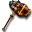</td><td class="col-name">
クェイクハンマー
</td><td class="col-id"><code>WEAPON2_MA17_TIREI</code><button type="button" class="copy-id" data-copy="WEAPON2_MA17_TIREI" title="ID WEAPON2_MA17_TIREI をコピー" aria-label="ID WEAPON2_MA17_TIREI をコピー">⧉</button></td><td class="col-meta">武器 · 棍棒・メイス</td><td class="col-info">
棍棒／攻撃力：８１ · 装備に必要なＳＴＲ：１０

棍棒／大地の力を吸収し大地を共鳴させることができる棍棒
</td></tr>
<tr data-id="WEAPON2_MA18_HORIHORI" data-cat="WEAPON2" data-sub="MA" data-flag="" data-search="ジャッジハンマー weapon2_ma18_horihori 武器 · 棍棒・メイス 棍棒／攻撃力：４９ · 装備に必要なｓｔｒ：１０ 棍棒／悪しき心を持つ者に神罰を下すという裁きの棍棒 "><td class="col-img">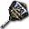</td><td class="col-name">
ジャッジハンマー
</td><td class="col-id"><code>WEAPON2_MA18_HORIHORI</code><button type="button" class="copy-id" data-copy="WEAPON2_MA18_HORIHORI" title="ID WEAPON2_MA18_HORIHORI をコピー" aria-label="ID WEAPON2_MA18_HORIHORI をコピー">⧉</button></td><td class="col-meta">武器 · 棍棒・メイス</td><td class="col-info">
棍棒／攻撃力：４９ · 装備に必要なＳＴＲ：１０

棍棒／悪しき心を持つ者に神罰を下すという裁きの棍棒
</td></tr>
<tr data-id="WEAPON2_MA19_SHIMENKI" data-cat="WEAPON2" data-sub="MA" data-flag="" data-search="鬼面の大槌 weapon2_ma19_shimenki 武器 · 棍棒・メイス 棍棒／攻撃力：６３ · 装備に必要なｓｔｒ：１０ 棍棒／鬼の角のような鋭い突起がついた不気味な大槌 "><td class="col-img"></td><td class="col-name">
鬼面の大槌
</td><td class="col-id"><code>WEAPON2_MA19_SHIMENKI</code><button type="button" class="copy-id" data-copy="WEAPON2_MA19_SHIMENKI" title="ID WEAPON2_MA19_SHIMENKI をコピー" aria-label="ID WEAPON2_MA19_SHIMENKI をコピー">⧉</button></td><td class="col-meta">武器 · 棍棒・メイス</td><td class="col-info">
棍棒／攻撃力：６３ · 装備に必要なＳＴＲ：１０

棍棒／鬼の角のような鋭い突起がついた不気味な大槌
</td></tr>
<tr data-id="WEAPON2_MA20_WARHAMMER" data-cat="WEAPON2" data-sub="MA" data-flag="STAR" data-search="★ウォーハンマー weapon2_ma20_warhammer 武器 · 棍棒・メイス 棍棒／攻撃力：４５ · 装備に必要なｓｔｒ：なし 棍棒／金槌を武器へと改良した戦槌 "><td class="col-img"></td><td class="col-name">
★ウォーハンマー
</td><td class="col-id"><code>WEAPON2_MA20_WARHAMMER</code><button type="button" class="copy-id" data-copy="WEAPON2_MA20_WARHAMMER" title="ID WEAPON2_MA20_WARHAMMER をコピー" aria-label="ID WEAPON2_MA20_WARHAMMER をコピー">⧉</button></td><td class="col-meta">武器 · 棍棒・メイス ★ 特別</td><td class="col-info">
棍棒／攻撃力：４５ · 装備に必要なＳＴＲ：なし

棍棒／金槌を武器へと改良した戦槌
</td></tr>
<tr data-id="WEAPON2_MA21_SHINKI" data-cat="WEAPON2" data-sub="MA" data-flag="" data-search="ストリクトメイス weapon2_ma21_shinki 武器 · 棍棒・メイス 棍棒／攻撃力：６６ · 装備に必要なｓｔｒ：５ 棍棒／厳格な司教のみが扱うことを許された棍棒 "><td class="col-img"></td><td class="col-name">
ストリクトメイス
</td><td class="col-id"><code>WEAPON2_MA21_SHINKI</code><button type="button" class="copy-id" data-copy="WEAPON2_MA21_SHINKI" title="ID WEAPON2_MA21_SHINKI をコピー" aria-label="ID WEAPON2_MA21_SHINKI をコピー">⧉</button></td><td class="col-meta">武器 · 棍棒・メイス</td><td class="col-info">
棍棒／攻撃力：６６ · 装備に必要なＳＴＲ：５

棍棒／厳格な司教のみが扱うことを許された棍棒
</td></tr>
<tr data-id="WEAPON2_MA22_WARHAMMER_EX" data-cat="WEAPON2" data-sub="MA" data-flag="STAR,EX" data-search="★ブライトハンマー weapon2_ma22_warhammer_ex 武器 · 棍棒・メイス 棍棒／攻撃力：３８ · 装備に必要なｓｔｒ：なし 棍棒／叩くだけでなく、刺すことも可能なハンマー "><td class="col-img"></td><td class="col-name">
★ブライトハンマー
</td><td class="col-id"><code>WEAPON2_MA22_WARHAMMER_EX</code><button type="button" class="copy-id" data-copy="WEAPON2_MA22_WARHAMMER_EX" title="ID WEAPON2_MA22_WARHAMMER_EX をコピー" aria-label="ID WEAPON2_MA22_WARHAMMER_EX をコピー">⧉</button></td><td class="col-meta">武器 · 棍棒・メイス ★ 特別 EX</td><td class="col-info">
棍棒／攻撃力：３８ · 装備に必要なＳＴＲ：なし

棍棒／叩くだけでなく、刺すことも可能なハンマー
</td></tr>
<tr data-id="WEAPON2_MA23_HORIHORI" data-cat="WEAPON2" data-sub="MA" data-flag="STAR" data-search="★ジャッジハンマー weapon2_ma23_horihori 武器 · 棍棒・メイス 棍棒／攻撃力：４４ · 装備に必要なｓｔｒ：なし 棍棒／悪しき心を持つ者に神罰を下すという裁きの棍棒 "><td class="col-img"></td><td class="col-name">
★ジャッジハンマー
</td><td class="col-id"><code>WEAPON2_MA23_HORIHORI</code><button type="button" class="copy-id" data-copy="WEAPON2_MA23_HORIHORI" title="ID WEAPON2_MA23_HORIHORI をコピー" aria-label="ID WEAPON2_MA23_HORIHORI をコピー">⧉</button></td><td class="col-meta">武器 · 棍棒・メイス ★ 特別</td><td class="col-info">
棍棒／攻撃力：４４ · 装備に必要なＳＴＲ：なし

棍棒／悪しき心を持つ者に神罰を下すという裁きの棍棒
</td></tr>
<tr data-id="WEAPON2_MA24_JADE" data-cat="WEAPON2" data-sub="MA" data-flag="" data-search="翡翠の大槌 weapon2_ma24_jade 武器 · 棍棒・メイス 棍棒／攻撃力：５５ · 装備に必要なｓｔｒ：１０ 棍棒／高僧の法力を注入した翡翠から作られた棍棒 "><td class="col-img"></td><td class="col-name">
翡翠の大槌
</td><td class="col-id"><code>WEAPON2_MA24_JADE</code><button type="button" class="copy-id" data-copy="WEAPON2_MA24_JADE" title="ID WEAPON2_MA24_JADE をコピー" aria-label="ID WEAPON2_MA24_JADE をコピー">⧉</button></td><td class="col-meta">武器 · 棍棒・メイス</td><td class="col-info">
棍棒／攻撃力：５５ · 装備に必要なＳＴＲ：１０

棍棒／高僧の法力を注入した翡翠から作られた棍棒
</td></tr>
<tr data-id="WEAPON2_MA25_D4SHINKI1" data-cat="WEAPON2" data-sub="MA" data-flag="" data-search="レオパルドハンマー weapon2_ma25_d4shinki1 武器 · 棍棒・メイス 棍棒／攻撃力：７５ · 装備に必要なｓｔｒ：１０ 棍棒／豹の毛並みを模した紋様が彫られた鎚 "><td class="col-img"></td><td class="col-name">
レオパルドハンマー
</td><td class="col-id"><code>WEAPON2_MA25_D4SHINKI1</code><button type="button" class="copy-id" data-copy="WEAPON2_MA25_D4SHINKI1" title="ID WEAPON2_MA25_D4SHINKI1 をコピー" aria-label="ID WEAPON2_MA25_D4SHINKI1 をコピー">⧉</button></td><td class="col-meta">武器 · 棍棒・メイス</td><td class="col-info">
棍棒／攻撃力：７５ · 装備に必要なＳＴＲ：１０

棍棒／豹の毛並みを模した紋様が彫られた鎚
</td></tr>
<tr data-id="WEAPON2_MA26_D4SHINKI2" data-cat="WEAPON2" data-sub="MA" data-flag="" data-search="タイニーワンド weapon2_ma26_d4shinki2 武器 · 棍棒・メイス 棍棒／攻撃力：４３ · 装備に必要なｓｔｒ：なし 棍棒／棍棒でありながら片手で扱う杖のような珍しい武器 "><td class="col-img"></td><td class="col-name">
タイニーワンド
</td><td class="col-id"><code>WEAPON2_MA26_D4SHINKI2</code><button type="button" class="copy-id" data-copy="WEAPON2_MA26_D4SHINKI2" title="ID WEAPON2_MA26_D4SHINKI2 をコピー" aria-label="ID WEAPON2_MA26_D4SHINKI2 をコピー">⧉</button></td><td class="col-meta">武器 · 棍棒・メイス</td><td class="col-info">
棍棒／攻撃力：４３ · 装備に必要なＳＴＲ：なし

棍棒／棍棒でありながら片手で扱う杖のような珍しい武器
</td></tr>
<tr data-id="WEAPON2_MA27_D4SHINKI3" data-cat="WEAPON2" data-sub="MA" data-flag="" data-search="ブリガンティア weapon2_ma27_d4shinki3 武器 · 棍棒・メイス 棍棒／攻撃力：７３ · 装備に必要なｓｔｒ：１０ 棍棒／女神ブリガンティアの名を冠するメイス "><td class="col-img"></td><td class="col-name">
ブリガンティア
</td><td class="col-id"><code>WEAPON2_MA27_D4SHINKI3</code><button type="button" class="copy-id" data-copy="WEAPON2_MA27_D4SHINKI3" title="ID WEAPON2_MA27_D4SHINKI3 をコピー" aria-label="ID WEAPON2_MA27_D4SHINKI3 をコピー">⧉</button></td><td class="col-meta">武器 · 棍棒・メイス</td><td class="col-info">
棍棒／攻撃力：７３ · 装備に必要なＳＴＲ：１０

棍棒／女神ブリガンティアの名を冠するメイス
</td></tr>
<tr data-id="WEAPON2_MA28_PIKOHAMMER" data-cat="WEAPON2" data-sub="MA" data-flag="" data-search="錘 weapon2_ma28_pikohammer 武器 · 棍棒・メイス 棍棒／攻撃力：６０ · 装備に必要なｓｔｒ：なし 棍棒／舞踊でも使用される鑑賞性の高い武器 "><td class="col-img"></td><td class="col-name">
錘
</td><td class="col-id"><code>WEAPON2_MA28_PIKOHAMMER</code><button type="button" class="copy-id" data-copy="WEAPON2_MA28_PIKOHAMMER" title="ID WEAPON2_MA28_PIKOHAMMER をコピー" aria-label="ID WEAPON2_MA28_PIKOHAMMER をコピー">⧉</button></td><td class="col-meta">武器 · 棍棒・メイス</td><td class="col-info">
棍棒／攻撃力：６０ · 装備に必要なＳＴＲ：なし

棍棒／舞踊でも使用される鑑賞性の高い武器
</td></tr>
<tr data-id="WEAPON2_MA30_FAYHAMMER_EX" data-cat="WEAPON2" data-sub="MA" data-flag="EX" data-search="ペルグランデｅｘ weapon2_ma30_fayhammer_ex 武器 · 棍棒・メイス 棍棒／攻撃力：５６ · 装備に必要なｓｔｒ：なし 棍棒／神器ペルグランデを模して作られた槌 "><td class="col-img"></td><td class="col-name">
ペルグランデＥＸ
</td><td class="col-id"><code>WEAPON2_MA30_FAYHAMMER_EX</code><button type="button" class="copy-id" data-copy="WEAPON2_MA30_FAYHAMMER_EX" title="ID WEAPON2_MA30_FAYHAMMER_EX をコピー" aria-label="ID WEAPON2_MA30_FAYHAMMER_EX をコピー">⧉</button></td><td class="col-meta">武器 · 棍棒・メイス EX</td><td class="col-info">
棍棒／攻撃力：５６ · 装備に必要なＳＴＲ：なし

棍棒／神器ペルグランデを模して作られた槌
</td></tr>
<tr data-id="WEAPON2_NC01_WAKKY" data-cat="WEAPON2" data-sub="NC" data-flag="" data-search="ウッドグローブ weapon2_nc01_wakky 武器 · ナックル ナックル／攻撃力：３０ · 装備に必要なｓｔｒ：なし ナックル／初心者が愛用している木製のナックル "><td class="col-img"></td><td class="col-name">
ウッドグローブ
</td><td class="col-id"><code>WEAPON2_NC01_WAKKY</code><button type="button" class="copy-id" data-copy="WEAPON2_NC01_WAKKY" title="ID WEAPON2_NC01_WAKKY をコピー" aria-label="ID WEAPON2_NC01_WAKKY をコピー">⧉</button></td><td class="col-meta">武器 · ナックル</td><td class="col-info">
ナックル／攻撃力：３０ · 装備に必要なＳＴＲ：なし

ナックル／初心者が愛用している木製のナックル
</td></tr>
<tr data-id="WEAPON2_NC02_TAMECHAN" data-cat="WEAPON2" data-sub="NC" data-flag="" data-search="トライネイル weapon2_nc02_tamechan 武器 · ナックル ナックル／攻撃力：５１ · 装備に必要なｓｔｒ：なし ナックル／敵を貫き、切り裂く鋭利な爪がついたナックル "><td class="col-img"></td><td class="col-name">
トライネイル
</td><td class="col-id"><code>WEAPON2_NC02_TAMECHAN</code><button type="button" class="copy-id" data-copy="WEAPON2_NC02_TAMECHAN" title="ID WEAPON2_NC02_TAMECHAN をコピー" aria-label="ID WEAPON2_NC02_TAMECHAN をコピー">⧉</button></td><td class="col-meta">武器 · ナックル</td><td class="col-info">
ナックル／攻撃力：５１ · 装備に必要なＳＴＲ：なし

ナックル／敵を貫き、切り裂く鋭利な爪がついたナックル
</td></tr>
<tr data-id="WEAPON2_NC03_MASSU" data-cat="WEAPON2" data-sub="NC" data-flag="CARD" data-search="アイアンスパイク weapon2_nc03_massu 武器 · ナックル ナックル／攻撃力：４２ · 装備に必要なｓｔｒ：なし ナックル／３本の棘がついた鋼鉄のナックル 0-2605 367"><td class="col-img"></td><td class="col-name">
アイアンスパイク
</td><td class="col-id"><code>WEAPON2_NC03_MASSU</code><button type="button" class="copy-id" data-copy="WEAPON2_NC03_MASSU" title="ID WEAPON2_NC03_MASSU をコピー" aria-label="ID WEAPON2_NC03_MASSU をコピー">⧉</button></td><td class="col-meta">武器 · ナックル カード #367 · 0-2605</td><td class="col-info">
ナックル／攻撃力：４２ · 装備に必要なＳＴＲ：なし

ナックル／３本の棘がついた鋼鉄のナックル
</td></tr>
<tr data-id="WEAPON2_NC04_WAKKY2" data-cat="WEAPON2" data-sub="NC" data-flag="" data-search="クランチフィスト weapon2_nc04_wakky2 武器 · ナックル ナックル／攻撃力：６７ · 装備に必要なｓｔｒ：なし ナックル／獰猛な獣の牙で作られたグローブ "><td class="col-img"></td><td class="col-name">
クランチフィスト
</td><td class="col-id"><code>WEAPON2_NC04_WAKKY2</code><button type="button" class="copy-id" data-copy="WEAPON2_NC04_WAKKY2" title="ID WEAPON2_NC04_WAKKY2 をコピー" aria-label="ID WEAPON2_NC04_WAKKY2 をコピー">⧉</button></td><td class="col-meta">武器 · ナックル</td><td class="col-info">
ナックル／攻撃力：６７ · 装備に必要なＳＴＲ：なし

ナックル／獰猛な獣の牙で作られたグローブ
</td></tr>
<tr data-id="WEAPON2_NC05_THRUST" data-cat="WEAPON2" data-sub="NC" data-flag="CARD" data-search="スラストナックル weapon2_nc05_thrust 武器 · ナックル ナックル／攻撃力：５４ · 装備に必要なｓｔｒ：なし ナックル／硬く折れないという獣の角で作られたグローブ 0-2617 446"><td class="col-img"></td><td class="col-name">
スラストナックル
</td><td class="col-id"><code>WEAPON2_NC05_THRUST</code><button type="button" class="copy-id" data-copy="WEAPON2_NC05_THRUST" title="ID WEAPON2_NC05_THRUST をコピー" aria-label="ID WEAPON2_NC05_THRUST をコピー">⧉</button></td><td class="col-meta">武器 · ナックル カード #446 · 0-2617</td><td class="col-info">
ナックル／攻撃力：５４ · 装備に必要なＳＴＲ：なし

ナックル／硬く折れないという獣の角で作られたグローブ
</td></tr>
<tr data-id="WEAPON2_NC06_BLADE" data-cat="WEAPON2" data-sub="NC" data-flag="CARD" data-search="ブレイドナックル weapon2_nc06_blade 武器 · ナックル ナックル／攻撃力：５８ · 装備に必要なｓｔｒ：なし ナックル／鋼鉄の短刀をつけて極限まで威力を高めたグローブ 1-378 451"><td class="col-img"></td><td class="col-name">
ブレイドナックル
</td><td class="col-id"><code>WEAPON2_NC06_BLADE</code><button type="button" class="copy-id" data-copy="WEAPON2_NC06_BLADE" title="ID WEAPON2_NC06_BLADE をコピー" aria-label="ID WEAPON2_NC06_BLADE をコピー">⧉</button></td><td class="col-meta">武器 · ナックル カード #451 · 1-378</td><td class="col-info">
ナックル／攻撃力：５８ · 装備に必要なＳＴＲ：なし

ナックル／鋼鉄の短刀をつけて極限まで威力を高めたグローブ
</td></tr>
<tr data-id="WEAPON2_NC07_TETSUTUME" data-cat="WEAPON2" data-sub="NC" data-flag="CARD" data-search="アサシンネイル weapon2_nc07_tetsutume 武器 · ナックル ナックル／攻撃力：４５ · 装備に必要なｓｔｒ：なし ナックル／４本の長い鉤爪を有した独特な形状のグローブ 0-2705 497"><td class="col-img"></td><td class="col-name">
アサシンネイル
</td><td class="col-id"><code>WEAPON2_NC07_TETSUTUME</code><button type="button" class="copy-id" data-copy="WEAPON2_NC07_TETSUTUME" title="ID WEAPON2_NC07_TETSUTUME をコピー" aria-label="ID WEAPON2_NC07_TETSUTUME をコピー">⧉</button></td><td class="col-meta">武器 · ナックル カード #497 · 0-2705</td><td class="col-info">
ナックル／攻撃力：４５ · 装備に必要なＳＴＲ：なし

ナックル／４本の長い鉤爪を有した独特な形状のグローブ
</td></tr>
<tr data-id="WEAPON2_NC08_SHINKI" data-cat="WEAPON2" data-sub="NC" data-flag="" data-search="ピアスグローブ weapon2_nc08_shinki 武器 · ナックル ナックル／攻撃力：６４ · 装備に必要なｓｔｒ：なし ナックル／軽い金属で作られた殺傷力の高いグローブ "><td class="col-img"></td><td class="col-name">
ピアスグローブ
</td><td class="col-id"><code>WEAPON2_NC08_SHINKI</code><button type="button" class="copy-id" data-copy="WEAPON2_NC08_SHINKI" title="ID WEAPON2_NC08_SHINKI をコピー" aria-label="ID WEAPON2_NC08_SHINKI をコピー">⧉</button></td><td class="col-meta">武器 · ナックル</td><td class="col-info">
ナックル／攻撃力：６４ · 装備に必要なＳＴＲ：なし

ナックル／軽い金属で作られた殺傷力の高いグローブ
</td></tr>
<tr data-id="WEAPON2_NC09_WAKKY" data-cat="WEAPON2" data-sub="NC" data-flag="STAR" data-search="★ウッドグローブ weapon2_nc09_wakky 武器 · ナックル ナックル／攻撃力：２８ · 装備に必要なｓｔｒ：なし ナックル／初心者が愛用している木製のナックル "><td class="col-img"></td><td class="col-name">
★ウッドグローブ
</td><td class="col-id"><code>WEAPON2_NC09_WAKKY</code><button type="button" class="copy-id" data-copy="WEAPON2_NC09_WAKKY" title="ID WEAPON2_NC09_WAKKY をコピー" aria-label="ID WEAPON2_NC09_WAKKY をコピー">⧉</button></td><td class="col-meta">武器 · ナックル ★ 特別</td><td class="col-info">
ナックル／攻撃力：２８ · 装備に必要なＳＴＲ：なし

ナックル／初心者が愛用している木製のナックル
</td></tr>
<tr data-id="WEAPON2_NC10_MASSU" data-cat="WEAPON2" data-sub="NC" data-flag="STAR" data-search="★アイアンスパイク weapon2_nc10_massu 武器 · ナックル ナックル／攻撃力：３７ · 装備に必要なｓｔｒ：なし ナックル／３本の棘がついた鋼鉄のナックル "><td class="col-img"></td><td class="col-name">
★アイアンスパイク
</td><td class="col-id"><code>WEAPON2_NC10_MASSU</code><button type="button" class="copy-id" data-copy="WEAPON2_NC10_MASSU" title="ID WEAPON2_NC10_MASSU をコピー" aria-label="ID WEAPON2_NC10_MASSU をコピー">⧉</button></td><td class="col-meta">武器 · ナックル ★ 特別</td><td class="col-info">
ナックル／攻撃力：３７ · 装備に必要なＳＴＲ：なし

ナックル／３本の棘がついた鋼鉄のナックル
</td></tr>
<tr data-id="WEAPON2_NC11_FLAME" data-cat="WEAPON2" data-sub="NC" data-flag="" data-search="フレイムナックル weapon2_nc11_flame 武器 · ナックル ナックル／攻撃力：４０ · 装備に必要なｓｔｒ：なし ナックル／全てを焼き尽くすほどの業火を纏うグローブ "><td class="col-img"></td><td class="col-name">
フレイムナックル
</td><td class="col-id"><code>WEAPON2_NC11_FLAME</code><button type="button" class="copy-id" data-copy="WEAPON2_NC11_FLAME" title="ID WEAPON2_NC11_FLAME をコピー" aria-label="ID WEAPON2_NC11_FLAME をコピー">⧉</button></td><td class="col-meta">武器 · ナックル</td><td class="col-info">
ナックル／攻撃力：４０ · 装備に必要なＳＴＲ：なし

ナックル／全てを焼き尽くすほどの業火を纏うグローブ
</td></tr>
<tr data-id="WEAPON2_NC12_TAMECHAN" data-cat="WEAPON2" data-sub="NC" data-flag="STAR" data-search="★トライネイル weapon2_nc12_tamechan 武器 · ナックル ナックル／攻撃力：４６ · 装備に必要なｓｔｒ：なし ナックル／敵を貫き、切り裂く鋭利な爪がついたナックル "><td class="col-img"></td><td class="col-name">
★トライネイル
</td><td class="col-id"><code>WEAPON2_NC12_TAMECHAN</code><button type="button" class="copy-id" data-copy="WEAPON2_NC12_TAMECHAN" title="ID WEAPON2_NC12_TAMECHAN をコピー" aria-label="ID WEAPON2_NC12_TAMECHAN をコピー">⧉</button></td><td class="col-meta">武器 · ナックル ★ 特別</td><td class="col-info">
ナックル／攻撃力：４６ · 装備に必要なＳＴＲ：なし

ナックル／敵を貫き、切り裂く鋭利な爪がついたナックル
</td></tr>
<tr data-id="WEAPON2_NC14_KAISER" data-cat="WEAPON2" data-sub="NC" data-flag="" data-search="カイザーナックル weapon2_nc14_kaiser 武器 · ナックル ナックル／攻撃力：８０ · 装備に必要なｓｔｒ：なし ナックル／己の気をオーラ状に具現化して攻撃する事ができる "><td class="col-img"></td><td class="col-name">
カイザーナックル
</td><td class="col-id"><code>WEAPON2_NC14_KAISER</code><button type="button" class="copy-id" data-copy="WEAPON2_NC14_KAISER" title="ID WEAPON2_NC14_KAISER をコピー" aria-label="ID WEAPON2_NC14_KAISER をコピー">⧉</button></td><td class="col-meta">武器 · ナックル</td><td class="col-info">
ナックル／攻撃力：８０ · 装備に必要なＳＴＲ：なし

ナックル／己の気をオーラ状に具現化して攻撃する事ができる
</td></tr>
<tr data-id="WEAPON2_NC15_MONK" data-cat="WEAPON2" data-sub="NC" data-flag="" data-search="拳聖の手甲 weapon2_nc15_monk 武器 · ナックル ナックル／攻撃力：６３ · 装備に必要なｓｔｒ：なし ナックル／数珠を模した宝玉が特徴の格闘武器 "><td class="col-img"></td><td class="col-name">
拳聖の手甲
</td><td class="col-id"><code>WEAPON2_NC15_MONK</code><button type="button" class="copy-id" data-copy="WEAPON2_NC15_MONK" title="ID WEAPON2_NC15_MONK をコピー" aria-label="ID WEAPON2_NC15_MONK をコピー">⧉</button></td><td class="col-meta">武器 · ナックル</td><td class="col-info">
ナックル／攻撃力：６３ · 装備に必要なＳＴＲ：なし

ナックル／数珠を模した宝玉が特徴の格闘武器
</td></tr>
<tr data-id="WEAPON2_NC16_D4SHINKI" data-cat="WEAPON2" data-sub="NC" data-flag="" data-search="ベインナックル weapon2_nc16_d4shinki 武器 · ナックル ナックル／攻撃力：６８ · 装備に必要なｓｔｒ：なし ナックル／邪神と契約を交わし授かったと伝わる異形の武器 "><td class="col-img"></td><td class="col-name">
ベインナックル
</td><td class="col-id"><code>WEAPON2_NC16_D4SHINKI</code><button type="button" class="copy-id" data-copy="WEAPON2_NC16_D4SHINKI" title="ID WEAPON2_NC16_D4SHINKI をコピー" aria-label="ID WEAPON2_NC16_D4SHINKI をコピー">⧉</button></td><td class="col-meta">武器 · ナックル</td><td class="col-info">
ナックル／攻撃力：６８ · 装備に必要なＳＴＲ：なし

ナックル／邪神と契約を交わし授かったと伝わる異形の武器
</td></tr>
<tr data-id="WEAPON2_NC17_SONIC" data-cat="WEAPON2" data-sub="NC" data-flag="CARD" data-search="ソニックナックル weapon2_nc17_sonic 武器 · ナックル ナックル／攻撃力：６０ · 装備に必要なｓｔｒ：なし ナックル／特殊な魔法力を込めた金属で作られたグローブ 1-491 504"><td class="col-img"></td><td class="col-name">
ソニックナックル
</td><td class="col-id"><code>WEAPON2_NC17_SONIC</code><button type="button" class="copy-id" data-copy="WEAPON2_NC17_SONIC" title="ID WEAPON2_NC17_SONIC をコピー" aria-label="ID WEAPON2_NC17_SONIC をコピー">⧉</button></td><td class="col-meta">武器 · ナックル カード #504 · 1-491</td><td class="col-info">
ナックル／攻撃力：６０ · 装備に必要なＳＴＲ：なし

ナックル／特殊な魔法力を込めた金属で作られたグローブ
</td></tr>
<tr data-id="WEAPON2_NC18_GODHAND" data-cat="WEAPON2" data-sub="NC" data-flag="" data-search="ゴッドハンド weapon2_nc18_godhand 武器 · ナックル ナックル／攻撃力：７２ · 装備に必要なｓｔｒ：なし ナックル／大地も震える神の名を持つ究極の拳 "><td class="col-img"></td><td class="col-name">
ゴッドハンド
</td><td class="col-id"><code>WEAPON2_NC18_GODHAND</code><button type="button" class="copy-id" data-copy="WEAPON2_NC18_GODHAND" title="ID WEAPON2_NC18_GODHAND をコピー" aria-label="ID WEAPON2_NC18_GODHAND をコピー">⧉</button></td><td class="col-meta">武器 · ナックル</td><td class="col-info">
ナックル／攻撃力：７２ · 装備に必要なＳＴＲ：なし

ナックル／大地も震える神の名を持つ究極の拳
</td></tr>
<tr data-id="WEAPON2_NI01_DAGGER" data-cat="WEAPON2" data-sub="NI" data-flag="CARD" data-search="ダガー weapon2_ni01_dagger 武器 · 短剣・ナイフ ナイフ／攻撃力：１８ · 装備に必要なｓｔｒ：なし ナイフ／小型の簡素なナイフ 0-2147 026"><td class="col-img"></td><td class="col-name">
ダガー
</td><td class="col-id"><code>WEAPON2_NI01_DAGGER</code><button type="button" class="copy-id" data-copy="WEAPON2_NI01_DAGGER" title="ID WEAPON2_NI01_DAGGER をコピー" aria-label="ID WEAPON2_NI01_DAGGER をコピー">⧉</button></td><td class="col-meta">武器 · 短剣・ナイフ カード #026 · 0-2147</td><td class="col-info">
ナイフ／攻撃力：１８ · 装備に必要なＳＴＲ：なし

ナイフ／小型の簡素なナイフ
</td></tr>
<tr data-id="WEAPON2_NI02_DIRK" data-cat="WEAPON2" data-sub="NI" data-flag="CARD" data-search="ダーク weapon2_ni02_dirk 武器 · 短剣・ナイフ ナイフ／攻撃力：２５ · 装備に必要なｓｔｒ：なし ナイフ／高地に住む勇猛な部族が愛用するナイフ 0-2148 105"><td class="col-img"></td><td class="col-name">
ダーク
</td><td class="col-id"><code>WEAPON2_NI02_DIRK</code><button type="button" class="copy-id" data-copy="WEAPON2_NI02_DIRK" title="ID WEAPON2_NI02_DIRK をコピー" aria-label="ID WEAPON2_NI02_DIRK をコピー">⧉</button></td><td class="col-meta">武器 · 短剣・ナイフ カード #105 · 0-2148</td><td class="col-info">
ナイフ／攻撃力：２５ · 装備に必要なＳＴＲ：なし

ナイフ／高地に住む勇猛な部族が愛用するナイフ
</td></tr>
<tr data-id="WEAPON2_NI03_POISONDAGGER" data-cat="WEAPON2" data-sub="NI" data-flag="CARD" data-search="ポイズンダガー weapon2_ni03_poisondagger 武器 · 短剣・ナイフ ナイフ／攻撃力：３３ · 装備に必要なｓｔｒ：なし ナイフ／刃に毒を仕込ませている暗殺用ナイフ 0-2149 106"><td class="col-img"></td><td class="col-name">
ポイズンダガー
</td><td class="col-id"><code>WEAPON2_NI03_POISONDAGGER</code><button type="button" class="copy-id" data-copy="WEAPON2_NI03_POISONDAGGER" title="ID WEAPON2_NI03_POISONDAGGER をコピー" aria-label="ID WEAPON2_NI03_POISONDAGGER をコピー">⧉</button></td><td class="col-meta">武器 · 短剣・ナイフ カード #106 · 0-2149</td><td class="col-info">
ナイフ／攻撃力：３３ · 装備に必要なＳＴＲ：なし

ナイフ／刃に毒を仕込ませている暗殺用ナイフ
</td></tr>
<tr data-id="WEAPON2_NI04_SWORDBRAKER" data-cat="WEAPON2" data-sub="NI" data-flag="CARD" data-search="ソードブレイカー weapon2_ni04_swordbraker 武器 · 短剣・ナイフ ナイフ／攻撃力：３６ · 装備に必要なｓｔｒ：なし ナイフ／剣を受け止め破壊するために作られた短剣 0-2514 264"><td class="col-img"></td><td class="col-name">
ソードブレイカー
</td><td class="col-id"><code>WEAPON2_NI04_SWORDBRAKER</code><button type="button" class="copy-id" data-copy="WEAPON2_NI04_SWORDBRAKER" title="ID WEAPON2_NI04_SWORDBRAKER をコピー" aria-label="ID WEAPON2_NI04_SWORDBRAKER をコピー">⧉</button></td><td class="col-meta">武器 · 短剣・ナイフ カード #264 · 0-2514</td><td class="col-info">
ナイフ／攻撃力：３６ · 装備に必要なＳＴＲ：なし

ナイフ／剣を受け止め破壊するために作られた短剣
</td></tr>
<tr data-id="WEAPON2_NI05_KOTETSU" data-cat="WEAPON2" data-sub="NI" data-flag="CARD" data-search="古鉄 weapon2_ni05_kotetsu 武器 · 短剣・ナイフ ナイフ／攻撃力：５４ · 装備に必要なｓｔｒ：なし ナイフ／東洋の刀匠が生み出した名作と名高い小刀 1-436 499"><td class="col-img"></td><td class="col-name">
古鉄
</td><td class="col-id"><code>WEAPON2_NI05_KOTETSU</code><button type="button" class="copy-id" data-copy="WEAPON2_NI05_KOTETSU" title="ID WEAPON2_NI05_KOTETSU をコピー" aria-label="ID WEAPON2_NI05_KOTETSU をコピー">⧉</button></td><td class="col-meta">武器 · 短剣・ナイフ カード #499 · 1-436</td><td class="col-info">
ナイフ／攻撃力：５４ · 装備に必要なＳＴＲ：なし

ナイフ／東洋の刀匠が生み出した名作と名高い小刀
</td></tr>
<tr data-id="WEAPON2_NI06_GALESDAGGER" data-cat="WEAPON2" data-sub="NI" data-flag="" data-search="グラキエース weapon2_ni06_galesdagger 武器 · 短剣・ナイフ ナイフ／攻撃力：３０ · 装備に必要なｓｔｒ：なし ナイフ／長期の斬り合いを想定して作られた短剣 "><td class="col-img"></td><td class="col-name">
グラキエース
</td><td class="col-id"><code>WEAPON2_NI06_GALESDAGGER</code><button type="button" class="copy-id" data-copy="WEAPON2_NI06_GALESDAGGER" title="ID WEAPON2_NI06_GALESDAGGER をコピー" aria-label="ID WEAPON2_NI06_GALESDAGGER をコピー">⧉</button></td><td class="col-meta">武器 · 短剣・ナイフ</td><td class="col-info">
ナイフ／攻撃力：３０ · 装備に必要なＳＴＲ：なし

ナイフ／長期の斬り合いを想定して作られた短剣
</td></tr>
<tr data-id="WEAPON2_NI07_DIRK" data-cat="WEAPON2" data-sub="NI" data-flag="STAR" data-search="★ダーク weapon2_ni07_dirk 武器 · 短剣・ナイフ ナイフ／攻撃力：２４ · 装備に必要なｓｔｒ：なし ナイフ／高地に住む勇猛な部族が愛用するナイフ "><td class="col-img"></td><td class="col-name">
★ダーク
</td><td class="col-id"><code>WEAPON2_NI07_DIRK</code><button type="button" class="copy-id" data-copy="WEAPON2_NI07_DIRK" title="ID WEAPON2_NI07_DIRK をコピー" aria-label="ID WEAPON2_NI07_DIRK をコピー">⧉</button></td><td class="col-meta">武器 · 短剣・ナイフ ★ 特別</td><td class="col-info">
ナイフ／攻撃力：２４ · 装備に必要なＳＴＲ：なし

ナイフ／高地に住む勇猛な部族が愛用するナイフ
</td></tr>
<tr data-id="WEAPON2_NI08_ROUND" data-cat="WEAPON2" data-sub="NI" data-flag="CARD" data-search="ラウンドナイフ weapon2_ni08_round 武器 · 短剣・ナイフ ナイフ／攻撃力：１４ · 装備に必要なｓｔｒ：なし ナイフ／殺傷能力は低いが強烈な一撃が出やすいナイフ 0-2502 254"><td class="col-img"></td><td class="col-name">
ラウンドナイフ
</td><td class="col-id"><code>WEAPON2_NI08_ROUND</code><button type="button" class="copy-id" data-copy="WEAPON2_NI08_ROUND" title="ID WEAPON2_NI08_ROUND をコピー" aria-label="ID WEAPON2_NI08_ROUND をコピー">⧉</button></td><td class="col-meta">武器 · 短剣・ナイフ カード #254 · 0-2502</td><td class="col-info">
ナイフ／攻撃力：１４ · 装備に必要なＳＴＲ：なし

ナイフ／殺傷能力は低いが強烈な一撃が出やすいナイフ
</td></tr>
<tr data-id="WEAPON2_NI09_STUNDAGGER" data-cat="WEAPON2" data-sub="NI" data-flag="CARD" data-search="スタンダガー weapon2_ni09_stundagger 武器 · 短剣・ナイフ ナイフ／攻撃力：３０ · 装備に必要なｓｔｒ：なし ナイフ／刃に神経毒を仕込んだ特殊なナイフ 0-2503 255"><td class="col-img"></td><td class="col-name">
スタンダガー
</td><td class="col-id"><code>WEAPON2_NI09_STUNDAGGER</code><button type="button" class="copy-id" data-copy="WEAPON2_NI09_STUNDAGGER" title="ID WEAPON2_NI09_STUNDAGGER をコピー" aria-label="ID WEAPON2_NI09_STUNDAGGER をコピー">⧉</button></td><td class="col-meta">武器 · 短剣・ナイフ カード #255 · 0-2503</td><td class="col-info">
ナイフ／攻撃力：３０ · 装備に必要なＳＴＲ：なし

ナイフ／刃に神経毒を仕込んだ特殊なナイフ
</td></tr>
<tr data-id="WEAPON2_NI13_KERIS" data-cat="WEAPON2" data-sub="NI" data-flag="CARD" data-search="クリス weapon2_ni13_keris 武器 · 短剣・ナイフ ナイフ／攻撃力：４７ · 装備に必要なｓｔｒ：なし ナイフ／特徴的な刀身を持つお守りとして扱われていた短剣 0-2613 371"><td class="col-img"></td><td class="col-name">
クリス
</td><td class="col-id"><code>WEAPON2_NI13_KERIS</code><button type="button" class="copy-id" data-copy="WEAPON2_NI13_KERIS" title="ID WEAPON2_NI13_KERIS をコピー" aria-label="ID WEAPON2_NI13_KERIS をコピー">⧉</button></td><td class="col-meta">武器 · 短剣・ナイフ カード #371 · 0-2613</td><td class="col-info">
ナイフ／攻撃力：４７ · 装備に必要なＳＴＲ：なし

ナイフ／特徴的な刀身を持つお守りとして扱われていた短剣
</td></tr>
<tr data-id="WEAPON2_NI14_TAMECHAN2" data-cat="WEAPON2" data-sub="NI" data-flag="CARD" data-search="ロットナイフ weapon2_ni14_tamechan2 武器 · 短剣・ナイフ ナイフ／攻撃力：４２ · 装備に必要なｓｔｒ：なし ナイフ／あらゆる毒素を帯びた恐るべき能力を持つナイフ 0-2616 445"><td class="col-img"></td><td class="col-name">
ロットナイフ
</td><td class="col-id"><code>WEAPON2_NI14_TAMECHAN2</code><button type="button" class="copy-id" data-copy="WEAPON2_NI14_TAMECHAN2" title="ID WEAPON2_NI14_TAMECHAN2 をコピー" aria-label="ID WEAPON2_NI14_TAMECHAN2 をコピー">⧉</button></td><td class="col-meta">武器 · 短剣・ナイフ カード #445 · 0-2616</td><td class="col-info">
ナイフ／攻撃力：４２ · 装備に必要なＳＴＲ：なし

ナイフ／あらゆる毒素を帯びた恐るべき能力を持つナイフ
</td></tr>
<tr data-id="WEAPON2_NI16_CROSS" data-cat="WEAPON2" data-sub="NI" data-flag="" data-search="グレアナイフ weapon2_ni16_cross 武器 · 短剣・ナイフ ナイフ／攻撃力：５１ · 装備に必要なｓｔｒ：なし ナイフ／太陽の光を象った大きめの刃を持つナイフ "><td class="col-img"></td><td class="col-name">
グレアナイフ
</td><td class="col-id"><code>WEAPON2_NI16_CROSS</code><button type="button" class="copy-id" data-copy="WEAPON2_NI16_CROSS" title="ID WEAPON2_NI16_CROSS をコピー" aria-label="ID WEAPON2_NI16_CROSS をコピー">⧉</button></td><td class="col-meta">武器 · 短剣・ナイフ</td><td class="col-info">
ナイフ／攻撃力：５１ · 装備に必要なＳＴＲ：なし

ナイフ／太陽の光を象った大きめの刃を持つナイフ
</td></tr>
<tr data-id="WEAPON2_NI17_SHINKI" data-cat="WEAPON2" data-sub="NI" data-flag="" data-search="フィートナイフ weapon2_ni17_shinki 武器 · 短剣・ナイフ ナイフ／攻撃力：５８ · 装備に必要なｓｔｒ：なし ナイフ／軽量化のために刃の中心をくり抜いてあるナイフ "><td class="col-img"></td><td class="col-name">
フィートナイフ
</td><td class="col-id"><code>WEAPON2_NI17_SHINKI</code><button type="button" class="copy-id" data-copy="WEAPON2_NI17_SHINKI" title="ID WEAPON2_NI17_SHINKI をコピー" aria-label="ID WEAPON2_NI17_SHINKI をコピー">⧉</button></td><td class="col-meta">武器 · 短剣・ナイフ</td><td class="col-info">
ナイフ／攻撃力：５８ · 装備に必要なＳＴＲ：なし

ナイフ／軽量化のために刃の中心をくり抜いてあるナイフ
</td></tr>
<tr data-id="WEAPON2_NI18_POISONDAGGER" data-cat="WEAPON2" data-sub="NI" data-flag="STAR" data-search="★ポイズンダガー weapon2_ni18_poisondagger 武器 · 短剣・ナイフ ナイフ／攻撃力：２９ · 装備に必要なｓｔｒ：なし ナイフ／刃に毒を仕込ませている暗殺用ナイフ "><td class="col-img"></td><td class="col-name">
★ポイズンダガー
</td><td class="col-id"><code>WEAPON2_NI18_POISONDAGGER</code><button type="button" class="copy-id" data-copy="WEAPON2_NI18_POISONDAGGER" title="ID WEAPON2_NI18_POISONDAGGER をコピー" aria-label="ID WEAPON2_NI18_POISONDAGGER をコピー">⧉</button></td><td class="col-meta">武器 · 短剣・ナイフ ★ 特別</td><td class="col-info">
ナイフ／攻撃力：２９ · 装備に必要なＳＴＲ：なし

ナイフ／刃に毒を仕込ませている暗殺用ナイフ
</td></tr>
<tr data-id="WEAPON2_NI19_ROUND" data-cat="WEAPON2" data-sub="NI" data-flag="STAR" data-search="★ラウンドナイフ weapon2_ni19_round 武器 · 短剣・ナイフ ナイフ／攻撃力：１１ · 装備に必要なｓｔｒ：なし ナイフ／殺傷能力は低いが強烈な一撃が出やすいナイフ "><td class="col-img"></td><td class="col-name">
★ラウンドナイフ
</td><td class="col-id"><code>WEAPON2_NI19_ROUND</code><button type="button" class="copy-id" data-copy="WEAPON2_NI19_ROUND" title="ID WEAPON2_NI19_ROUND をコピー" aria-label="ID WEAPON2_NI19_ROUND をコピー">⧉</button></td><td class="col-meta">武器 · 短剣・ナイフ ★ 特別</td><td class="col-info">
ナイフ／攻撃力：１１ · 装備に必要なＳＴＲ：なし

ナイフ／殺傷能力は低いが強烈な一撃が出やすいナイフ
</td></tr>
<tr data-id="WEAPON2_NI20_SHINKI" data-cat="WEAPON2" data-sub="NI" data-flag="" data-search="デヴァステイター weapon2_ni20_shinki 武器 · 短剣・ナイフ ナイフ／攻撃力：７６ · 装備に必要なｓｔｒ：なし ナイフ／武器自体に盗みの能力が備わっている希少なナイフ "><td class="col-img"></td><td class="col-name">
デヴァステイター
</td><td class="col-id"><code>WEAPON2_NI20_SHINKI</code><button type="button" class="copy-id" data-copy="WEAPON2_NI20_SHINKI" title="ID WEAPON2_NI20_SHINKI をコピー" aria-label="ID WEAPON2_NI20_SHINKI をコピー">⧉</button></td><td class="col-meta">武器 · 短剣・ナイフ</td><td class="col-info">
ナイフ／攻撃力：７６ · 装備に必要なＳＴＲ：なし

ナイフ／武器自体に盗みの能力が備わっている希少なナイフ
</td></tr>
<tr data-id="WEAPON2_NI21_SAIJYOUI" data-cat="WEAPON2" data-sub="NI" data-flag="" data-search="ツインエッジ weapon2_ni21_saijyoui 武器 · 短剣・ナイフ ナイフ／攻撃力：６４ · 装備に必要なｓｔｒ：なし ナイフ／柄の両端に鋭い刃を持たせた扱いの難しいナイフ "><td class="col-img"></td><td class="col-name">
ツインエッジ
</td><td class="col-id"><code>WEAPON2_NI21_SAIJYOUI</code><button type="button" class="copy-id" data-copy="WEAPON2_NI21_SAIJYOUI" title="ID WEAPON2_NI21_SAIJYOUI をコピー" aria-label="ID WEAPON2_NI21_SAIJYOUI をコピー">⧉</button></td><td class="col-meta">武器 · 短剣・ナイフ</td><td class="col-info">
ナイフ／攻撃力：６４ · 装備に必要なＳＴＲ：なし

ナイフ／柄の両端に鋭い刃を持たせた扱いの難しいナイフ
</td></tr>
<tr data-id="WEAPON2_NI22_TAMECHAN2" data-cat="WEAPON2" data-sub="NI" data-flag="STAR" data-search="★ロットナイフ weapon2_ni22_tamechan2 武器 · 短剣・ナイフ ナイフ／攻撃力：３７ · 装備に必要なｓｔｒ：なし ナイフ／あらゆる毒素を帯びた恐るべき能力を持つナイフ "><td class="col-img"></td><td class="col-name">
★ロットナイフ
</td><td class="col-id"><code>WEAPON2_NI22_TAMECHAN2</code><button type="button" class="copy-id" data-copy="WEAPON2_NI22_TAMECHAN2" title="ID WEAPON2_NI22_TAMECHAN2 をコピー" aria-label="ID WEAPON2_NI22_TAMECHAN2 をコピー">⧉</button></td><td class="col-meta">武器 · 短剣・ナイフ ★ 特別</td><td class="col-info">
ナイフ／攻撃力：３７ · 装備に必要なＳＴＲ：なし

ナイフ／あらゆる毒素を帯びた恐るべき能力を持つナイフ
</td></tr>
<tr data-id="WEAPON2_NI23_SHINKI" data-cat="WEAPON2" data-sub="NI" data-flag="" data-search="サイ weapon2_ni23_shinki 武器 · 短剣・ナイフ ナイフ／攻撃力：６２ · 装備に必要なｓｔｒ：なし ナイフ／武道具として古くから存在する鉄芯で作られた武器 "><td class="col-img"></td><td class="col-name">
サイ
</td><td class="col-id"><code>WEAPON2_NI23_SHINKI</code><button type="button" class="copy-id" data-copy="WEAPON2_NI23_SHINKI" title="ID WEAPON2_NI23_SHINKI をコピー" aria-label="ID WEAPON2_NI23_SHINKI をコピー">⧉</button></td><td class="col-meta">武器 · 短剣・ナイフ</td><td class="col-info">
ナイフ／攻撃力：６２ · 装備に必要なＳＴＲ：なし

ナイフ／武道具として古くから存在する鉄芯で作られた武器
</td></tr>
<tr data-id="WEAPON2_NI24_STUNDAGGER" data-cat="WEAPON2" data-sub="NI" data-flag="STAR" data-search="★スタンダガー weapon2_ni24_stundagger 武器 · 短剣・ナイフ ナイフ／攻撃力：２６ · 装備に必要なｓｔｒ：なし ナイフ／刃に神経毒を仕込んだ特殊なナイフ "><td class="col-img"></td><td class="col-name">
★スタンダガー
</td><td class="col-id"><code>WEAPON2_NI24_STUNDAGGER</code><button type="button" class="copy-id" data-copy="WEAPON2_NI24_STUNDAGGER" title="ID WEAPON2_NI24_STUNDAGGER をコピー" aria-label="ID WEAPON2_NI24_STUNDAGGER をコピー">⧉</button></td><td class="col-meta">武器 · 短剣・ナイフ ★ 特別</td><td class="col-info">
ナイフ／攻撃力：２６ · 装備に必要なＳＴＲ：なし

ナイフ／刃に神経毒を仕込んだ特殊なナイフ
</td></tr>
<tr data-id="WEAPON2_NI25_MOULIN" data-cat="WEAPON2" data-sub="NI" data-flag="CARD" data-search="ムーラン weapon2_ni25_moulin 武器 · 短剣・ナイフ ナイフ／攻撃力：６３ · 装備に必要なｓｔｒ：なし ナイフ／暗殺者に古くから伝わる風車に似た形状の短剣 1-493 500"><td class="col-img"></td><td class="col-name">
ムーラン
</td><td class="col-id"><code>WEAPON2_NI25_MOULIN</code><button type="button" class="copy-id" data-copy="WEAPON2_NI25_MOULIN" title="ID WEAPON2_NI25_MOULIN をコピー" aria-label="ID WEAPON2_NI25_MOULIN をコピー">⧉</button></td><td class="col-meta">武器 · 短剣・ナイフ カード #500 · 1-493</td><td class="col-info">
ナイフ／攻撃力：６３ · 装備に必要なＳＴＲ：なし

ナイフ／暗殺者に古くから伝わる風車に似た形状の短剣
</td></tr>
<tr data-id="WEAPON2_NI26_KUKRI" data-cat="WEAPON2" data-sub="NI" data-flag="" data-search="ククリ weapon2_ni26_kukri 武器 · 短剣・ナイフ ナイフ／攻撃力：６１ · 装備に必要なｓｔｒ：なし ナイフ／生活の知恵から生まれた機能性の高い短剣 "><td class="col-img"></td><td class="col-name">
ククリ
</td><td class="col-id"><code>WEAPON2_NI26_KUKRI</code><button type="button" class="copy-id" data-copy="WEAPON2_NI26_KUKRI" title="ID WEAPON2_NI26_KUKRI をコピー" aria-label="ID WEAPON2_NI26_KUKRI をコピー">⧉</button></td><td class="col-meta">武器 · 短剣・ナイフ</td><td class="col-info">
ナイフ／攻撃力：６１ · 装備に必要なＳＴＲ：なし

ナイフ／生活の知恵から生まれた機能性の高い短剣
</td></tr>
<tr data-id="WEAPON2_NI27_SILENT" data-cat="WEAPON2" data-sub="NI" data-flag="" data-search="サイレントナイフ weapon2_ni27_silent 武器 · 短剣・ナイフ ナイフ／攻撃力：４６ · 装備に必要なｓｔｒ：なし ナイフ／刃に沈黙効果のある薬を塗りこんだ暗殺用ナイフ "><td class="col-img"></td><td class="col-name">
サイレントナイフ
</td><td class="col-id"><code>WEAPON2_NI27_SILENT</code><button type="button" class="copy-id" data-copy="WEAPON2_NI27_SILENT" title="ID WEAPON2_NI27_SILENT をコピー" aria-label="ID WEAPON2_NI27_SILENT をコピー">⧉</button></td><td class="col-meta">武器 · 短剣・ナイフ</td><td class="col-info">
ナイフ／攻撃力：４６ · 装備に必要なＳＴＲ：なし

ナイフ／刃に沈黙効果のある薬を塗りこんだ暗殺用ナイフ
</td></tr>
<tr data-id="WEAPON2_NI28_PANIC" data-cat="WEAPON2" data-sub="NI" data-flag="" data-search="パニックナイフ weapon2_ni28_panic 武器 · 短剣・ナイフ ナイフ／攻撃力：４３ · 装備に必要なｓｔｒ：なし ナイフ／刃に混乱効果のある薬を塗りこんだ暗殺用ナイフ "><td class="col-img"></td><td class="col-name">
パニックナイフ
</td><td class="col-id"><code>WEAPON2_NI28_PANIC</code><button type="button" class="copy-id" data-copy="WEAPON2_NI28_PANIC" title="ID WEAPON2_NI28_PANIC をコピー" aria-label="ID WEAPON2_NI28_PANIC をコピー">⧉</button></td><td class="col-meta">武器 · 短剣・ナイフ</td><td class="col-info">
ナイフ／攻撃力：４３ · 装備に必要なＳＴＲ：なし

ナイフ／刃に混乱効果のある薬を塗りこんだ暗殺用ナイフ
</td></tr>
<tr data-id="WEAPON2_NI29_D4SHINKI1" data-cat="WEAPON2" data-sub="NI" data-flag="" data-search="ルーンナイフ weapon2_ni29_d4shinki1 武器 · 短剣・ナイフ ナイフ／攻撃力：６７ · 装備に必要なｓｔｒ：なし ナイフ／鮮やかな橙色の刀身が美しい短剣 "><td class="col-img"></td><td class="col-name">
ルーンナイフ
</td><td class="col-id"><code>WEAPON2_NI29_D4SHINKI1</code><button type="button" class="copy-id" data-copy="WEAPON2_NI29_D4SHINKI1" title="ID WEAPON2_NI29_D4SHINKI1 をコピー" aria-label="ID WEAPON2_NI29_D4SHINKI1 をコピー">⧉</button></td><td class="col-meta">武器 · 短剣・ナイフ</td><td class="col-info">
ナイフ／攻撃力：６７ · 装備に必要なＳＴＲ：なし

ナイフ／鮮やかな橙色の刀身が美しい短剣
</td></tr>
<tr data-id="WEAPON2_NI30_D4SHINKI2" data-cat="WEAPON2" data-sub="NI" data-flag="" data-search="ツヴァイダガー weapon2_ni30_d4shinki2 武器 · 短剣・ナイフ ナイフ／攻撃力：２４ · 装備に必要なｓｔｒ：なし ナイフ／美しい宝珠の装飾を施した鑑賞性の高いナイフ "><td class="col-img"></td><td class="col-name">
ツヴァイダガー
</td><td class="col-id"><code>WEAPON2_NI30_D4SHINKI2</code><button type="button" class="copy-id" data-copy="WEAPON2_NI30_D4SHINKI2" title="ID WEAPON2_NI30_D4SHINKI2 をコピー" aria-label="ID WEAPON2_NI30_D4SHINKI2 をコピー">⧉</button></td><td class="col-meta">武器 · 短剣・ナイフ</td><td class="col-info">
ナイフ／攻撃力：２４ · 装備に必要なＳＴＲ：なし

ナイフ／美しい宝珠の装飾を施した鑑賞性の高いナイフ
</td></tr>
<tr data-id="WEAPON2_NI31_D4SHINKI3" data-cat="WEAPON2" data-sub="NI" data-flag="" data-search="インフィニティー weapon2_ni31_d4shinki3 武器 · 短剣・ナイフ ナイフ／攻撃力：７１ · 装備に必要なｓｔｒ：なし ナイフ／無限の可能性を秘めていると伝わる伝説の短剣 "><td class="col-img"></td><td class="col-name">
インフィニティー
</td><td class="col-id"><code>WEAPON2_NI31_D4SHINKI3</code><button type="button" class="copy-id" data-copy="WEAPON2_NI31_D4SHINKI3" title="ID WEAPON2_NI31_D4SHINKI3 をコピー" aria-label="ID WEAPON2_NI31_D4SHINKI3 をコピー">⧉</button></td><td class="col-meta">武器 · 短剣・ナイフ</td><td class="col-info">
ナイフ／攻撃力：７１ · 装備に必要なＳＴＲ：なし

ナイフ／無限の可能性を秘めていると伝わる伝説の短剣
</td></tr>
<tr data-id="WEAPON2_NI34_CATHAND" data-cat="WEAPON2" data-sub="NI" data-flag="" data-search="キャットスティンガー weapon2_ni34_cathand 武器 · 短剣・ナイフ ナイフ／攻撃力：５３ · 装備に必要なｓｔｒ：なし ナイフ／猫の振る舞いをヒントに作製されたナイフ "><td class="col-img"></td><td class="col-name">
キャットスティンガー
</td><td class="col-id"><code>WEAPON2_NI34_CATHAND</code><button type="button" class="copy-id" data-copy="WEAPON2_NI34_CATHAND" title="ID WEAPON2_NI34_CATHAND をコピー" aria-label="ID WEAPON2_NI34_CATHAND をコピー">⧉</button></td><td class="col-meta">武器 · 短剣・ナイフ</td><td class="col-info">
ナイフ／攻撃力：５３ · 装備に必要なＳＴＲ：なし

ナイフ／猫の振る舞いをヒントに作製されたナイフ
</td></tr>
<tr data-id="WEAPON2_NI35_GALESDAGGER_EX" data-cat="WEAPON2" data-sub="NI" data-flag="EX" data-search="グラキエースｅｘ weapon2_ni35_galesdagger_ex 武器 · 短剣・ナイフ ナイフ／攻撃力：５２ · 装備に必要なｓｔｒ：なし ナイフ／神器グラキエースを模して作られた短剣 "><td class="col-img"></td><td class="col-name">
グラキエースＥＸ
</td><td class="col-id"><code>WEAPON2_NI35_GALESDAGGER_EX</code><button type="button" class="copy-id" data-copy="WEAPON2_NI35_GALESDAGGER_EX" title="ID WEAPON2_NI35_GALESDAGGER_EX をコピー" aria-label="ID WEAPON2_NI35_GALESDAGGER_EX をコピー">⧉</button></td><td class="col-meta">武器 · 短剣・ナイフ EX</td><td class="col-info">
ナイフ／攻撃力：５２ · 装備に必要なＳＴＲ：なし

ナイフ／神器グラキエースを模して作られた短剣
</td></tr>
<tr data-id="WEAPON2_QI01_ARROW" data-cat="WEAPON2" data-sub="QI" data-flag="CARD" data-search="アロー weapon2_qi01_arrow 武器 · 矢・矢筒 矢筒／攻撃力：５～ · 装備に必要なｓｔｒ：なし 矢筒／安物で威力は望めないが取り回しのよい矢 0-2161 028"><td class="col-img"></td><td class="col-name">
アロー
</td><td class="col-id"><code>WEAPON2_QI01_ARROW</code><button type="button" class="copy-id" data-copy="WEAPON2_QI01_ARROW" title="ID WEAPON2_QI01_ARROW をコピー" aria-label="ID WEAPON2_QI01_ARROW をコピー">⧉</button></td><td class="col-meta">武器 · 矢・矢筒 カード #028 · 0-2161</td><td class="col-info">
矢筒／攻撃力：５～ · 装備に必要なＳＴＲ：なし

矢筒／安物で威力は望めないが取り回しのよい矢
</td></tr>
<tr data-id="WEAPON2_QI02_FIREARROW" data-cat="WEAPON2" data-sub="QI" data-flag="CARD" data-search="ファイアーアロー weapon2_qi02_firearrow 武器 · 矢・矢筒 矢筒／攻撃力：４～ · 装備に必要なｓｔｒ：なし 矢筒／矢先が炎に包まれている魔法の矢 0-2162 029"><td class="col-img"></td><td class="col-name">
ファイアーアロー
</td><td class="col-id"><code>WEAPON2_QI02_FIREARROW</code><button type="button" class="copy-id" data-copy="WEAPON2_QI02_FIREARROW" title="ID WEAPON2_QI02_FIREARROW をコピー" aria-label="ID WEAPON2_QI02_FIREARROW をコピー">⧉</button></td><td class="col-meta">武器 · 矢・矢筒 カード #029 · 0-2162</td><td class="col-info">
矢筒／攻撃力：４～ · 装備に必要なＳＴＲ：なし

矢筒／矢先が炎に包まれている魔法の矢
</td></tr>
<tr data-id="WEAPON2_QI03_COLDARROW" data-cat="WEAPON2" data-sub="QI" data-flag="CARD" data-search="コールドアロー weapon2_qi03_coldarrow 武器 · 矢・矢筒 矢筒／攻撃力：４～ · 装備に必要なｓｔｒ：なし 矢筒／矢先に冷気を封じ込めた魔法の矢 0-2163 030"><td class="col-img"></td><td class="col-name">
コールドアロー
</td><td class="col-id"><code>WEAPON2_QI03_COLDARROW</code><button type="button" class="copy-id" data-copy="WEAPON2_QI03_COLDARROW" title="ID WEAPON2_QI03_COLDARROW をコピー" aria-label="ID WEAPON2_QI03_COLDARROW をコピー">⧉</button></td><td class="col-meta">武器 · 矢・矢筒 カード #030 · 0-2163</td><td class="col-info">
矢筒／攻撃力：４～ · 装備に必要なＳＴＲ：なし

矢筒／矢先に冷気を封じ込めた魔法の矢
</td></tr>
<tr data-id="WEAPON2_QI04_SPARKARROW" data-cat="WEAPON2" data-sub="QI" data-flag="CARD" data-search="サンダーアロー weapon2_qi04_sparkarrow 武器 · 矢・矢筒 矢筒／攻撃力：４～ · 装備に必要なｓｔｒ：なし 矢筒／矢先に雷の力を封じ込めた魔法の矢 0-2164 031"><td class="col-img"></td><td class="col-name">
サンダーアロー
</td><td class="col-id"><code>WEAPON2_QI04_SPARKARROW</code><button type="button" class="copy-id" data-copy="WEAPON2_QI04_SPARKARROW" title="ID WEAPON2_QI04_SPARKARROW をコピー" aria-label="ID WEAPON2_QI04_SPARKARROW をコピー">⧉</button></td><td class="col-meta">武器 · 矢・矢筒 カード #031 · 0-2164</td><td class="col-info">
矢筒／攻撃力：４～ · 装備に必要なＳＴＲ：なし

矢筒／矢先に雷の力を封じ込めた魔法の矢
</td></tr>
<tr data-id="WEAPON2_QI05_MITHRILARROW" data-cat="WEAPON2" data-sub="QI" data-flag="CARD" data-search="ダークアロー weapon2_qi05_mithrilarrow 武器 · 矢・矢筒 矢筒／攻撃力：４～ · 装備に必要なｓｔｒ：なし 矢筒／闇の力により風切り音を立てずに相手へ突き刺さる矢 0-2517 267"><td class="col-img"></td><td class="col-name">
ダークアロー
</td><td class="col-id"><code>WEAPON2_QI05_MITHRILARROW</code><button type="button" class="copy-id" data-copy="WEAPON2_QI05_MITHRILARROW" title="ID WEAPON2_QI05_MITHRILARROW をコピー" aria-label="ID WEAPON2_QI05_MITHRILARROW をコピー">⧉</button></td><td class="col-meta">武器 · 矢・矢筒 カード #267 · 0-2517</td><td class="col-info">
矢筒／攻撃力：４～ · 装備に必要なＳＴＲ：なし

矢筒／闇の力により風切り音を立てずに相手へ突き刺さる矢
</td></tr>
<tr data-id="WEAPON2_QI06_HOLYARROW" data-cat="WEAPON2" data-sub="QI" data-flag="CARD" data-search="ホーリーアロー weapon2_qi06_holyarrow 武器 · 矢・矢筒 矢筒／攻撃力：４～ · 装備に必要なｓｔｒ：なし 矢筒／聖なる力を矢先に封じ込めた矢 0-2518 268/156"><td class="col-img"></td><td class="col-name">
ホーリーアロー
</td><td class="col-id"><code>WEAPON2_QI06_HOLYARROW</code><button type="button" class="copy-id" data-copy="WEAPON2_QI06_HOLYARROW" title="ID WEAPON2_QI06_HOLYARROW をコピー" aria-label="ID WEAPON2_QI06_HOLYARROW をコピー">⧉</button></td><td class="col-meta">武器 · 矢・矢筒 カード #268/156 · 0-2518</td><td class="col-info">
矢筒／攻撃力：４～ · 装備に必要なＳＴＲ：なし

矢筒／聖なる力を矢先に封じ込めた矢
</td></tr>
<tr data-id="WEAPON2_QI07_TAIYOUNOYA" data-cat="WEAPON2" data-sub="QI" data-flag="" data-search="太陽の矢 weapon2_qi07_taiyounoya 武器 · 矢・矢筒 矢筒／攻撃力：６０～ · 装備に必要なｓｔｒ：なし 矢筒／太陽の如き熱さと輝かしさを併せ持った矢 "><td class="col-img"></td><td class="col-name">
太陽の矢
</td><td class="col-id"><code>WEAPON2_QI07_TAIYOUNOYA</code><button type="button" class="copy-id" data-copy="WEAPON2_QI07_TAIYOUNOYA" title="ID WEAPON2_QI07_TAIYOUNOYA をコピー" aria-label="ID WEAPON2_QI07_TAIYOUNOYA をコピー">⧉</button></td><td class="col-meta">武器 · 矢・矢筒</td><td class="col-info">
矢筒／攻撃力：６０～ · 装備に必要なＳＴＲ：なし

矢筒／太陽の如き熱さと輝かしさを併せ持った矢
</td></tr>
<tr data-id="WEAPON2_QI08_SILVERARROW" data-cat="WEAPON2" data-sub="QI" data-flag="" data-search="銀の矢 weapon2_qi08_silverarrow 武器 · 矢・矢筒 矢筒／攻撃力：１００ · 装備に必要なｓｔｒ：なし 矢筒／銀を嫌うモンスターには強力な武器となる矢 "><td class="col-img"></td><td class="col-name">
銀の矢
</td><td class="col-id"><code>WEAPON2_QI08_SILVERARROW</code><button type="button" class="copy-id" data-copy="WEAPON2_QI08_SILVERARROW" title="ID WEAPON2_QI08_SILVERARROW をコピー" aria-label="ID WEAPON2_QI08_SILVERARROW をコピー">⧉</button></td><td class="col-meta">武器 · 矢・矢筒</td><td class="col-info">
矢筒／攻撃力：１００ · 装備に必要なＳＴＲ：なし

矢筒／銀を嫌うモンスターには強力な武器となる矢
</td></tr>
<tr data-id="WEAPON2_QI09_SHINKI" data-cat="WEAPON2" data-sub="QI" data-flag="" data-search="ベアリアスアロー weapon2_qi09_shinki 武器 · 矢・矢筒 矢筒／攻撃力：８～ · 装備に必要なｓｔｒ：なし 矢筒／様々な種類の毒が鏃に塗ってある猛毒の矢 "><td class="col-img"></td><td class="col-name">
ベアリアスアロー
</td><td class="col-id"><code>WEAPON2_QI09_SHINKI</code><button type="button" class="copy-id" data-copy="WEAPON2_QI09_SHINKI" title="ID WEAPON2_QI09_SHINKI をコピー" aria-label="ID WEAPON2_QI09_SHINKI をコピー">⧉</button></td><td class="col-meta">武器 · 矢・矢筒</td><td class="col-info">
矢筒／攻撃力：８～ · 装備に必要なＳＴＲ：なし

矢筒／様々な種類の毒が鏃に塗ってある猛毒の矢
</td></tr>
<tr data-id="WEAPON2_QI10_SHINKI" data-cat="WEAPON2" data-sub="QI" data-flag="" data-search="スパークアロー weapon2_qi10_shinki 武器 · 矢・矢筒 矢筒／攻撃力：６～ · 装備に必要なｓｔｒ：なし 矢筒／標的に刺さると爆発する鏃に火薬の込められた矢 "><td class="col-img"></td><td class="col-name">
スパークアロー
</td><td class="col-id"><code>WEAPON2_QI10_SHINKI</code><button type="button" class="copy-id" data-copy="WEAPON2_QI10_SHINKI" title="ID WEAPON2_QI10_SHINKI をコピー" aria-label="ID WEAPON2_QI10_SHINKI をコピー">⧉</button></td><td class="col-meta">武器 · 矢・矢筒</td><td class="col-info">
矢筒／攻撃力：６～ · 装備に必要なＳＴＲ：なし

矢筒／標的に刺さると爆発する鏃に火薬の込められた矢
</td></tr>
<tr data-id="WEAPON2_RA01_BROADAXE" data-cat="WEAPON2" data-sub="RA" data-flag="CARD" data-search="ブロードアックス weapon2_ra01_broadaxe 武器 · 両手斧 両手斧／攻撃力：３１ · 装備に必要なｓｔｒ：１０ 両手斧／新米戦士向きの両手斧 0-2132 022"><td class="col-img"></td><td class="col-name">
ブロードアックス
</td><td class="col-id"><code>WEAPON2_RA01_BROADAXE</code><button type="button" class="copy-id" data-copy="WEAPON2_RA01_BROADAXE" title="ID WEAPON2_RA01_BROADAXE をコピー" aria-label="ID WEAPON2_RA01_BROADAXE をコピー">⧉</button></td><td class="col-meta">武器 · 両手斧 カード #022 · 0-2132</td><td class="col-info">
両手斧／攻撃力：３１ · 装備に必要なＳＴＲ：１０

両手斧／新米戦士向きの両手斧
</td></tr>
<tr data-id="WEAPON2_RA02_GREATAXE" data-cat="WEAPON2" data-sub="RA" data-flag="CARD" data-search="グレートアックス weapon2_ra02_greataxe 武器 · 両手斧 両手斧／攻撃力：５４ · 装備に必要なｓｔｒ：１０ 両手斧／両刃に改良して破壊力殺傷能力を向上させた大斧 0-2133 174"><td class="col-img"></td><td class="col-name">
グレートアックス
</td><td class="col-id"><code>WEAPON2_RA02_GREATAXE</code><button type="button" class="copy-id" data-copy="WEAPON2_RA02_GREATAXE" title="ID WEAPON2_RA02_GREATAXE をコピー" aria-label="ID WEAPON2_RA02_GREATAXE をコピー">⧉</button></td><td class="col-meta">武器 · 両手斧 カード #174 · 0-2133</td><td class="col-info">
両手斧／攻撃力：５４ · 装備に必要なＳＴＲ：１０

両手斧／両刃に改良して破壊力殺傷能力を向上させた大斧
</td></tr>
<tr data-id="WEAPON2_RA03_BERDYSH" data-cat="WEAPON2" data-sub="RA" data-flag="CARD" data-search="バルディッシュ weapon2_ra03_berdysh 武器 · 両手斧 両手斧／攻撃力：６０ · 装備に必要なｓｔｒ：１５ 両手斧／槍のように突き刺すこともできる長尺の斧 0-2704 "><td class="col-img"></td><td class="col-name">
バルディッシュ
</td><td class="col-id"><code>WEAPON2_RA03_BERDYSH</code><button type="button" class="copy-id" data-copy="WEAPON2_RA03_BERDYSH" title="ID WEAPON2_RA03_BERDYSH をコピー" aria-label="ID WEAPON2_RA03_BERDYSH をコピー">⧉</button></td><td class="col-meta">武器 · 両手斧 カード #— · 0-2704</td><td class="col-info">
両手斧／攻撃力：６０ · 装備に必要なＳＴＲ：１５

両手斧／槍のように突き刺すこともできる長尺の斧
</td></tr>
<tr data-id="WEAPON2_RA04_MITHRILAXE" data-cat="WEAPON2" data-sub="RA" data-flag="CARD" data-search="ミスリルアックス weapon2_ra04_mithrilaxe 武器 · 両手斧 両手斧／攻撃力：７０ · 装備に必要なｓｔｒ：１０ 両手斧／魔力を持つ金属のミスリルを材料にした軽量の斧 1-416 377"><td class="col-img"></td><td class="col-name">
ミスリルアックス
</td><td class="col-id"><code>WEAPON2_RA04_MITHRILAXE</code><button type="button" class="copy-id" data-copy="WEAPON2_RA04_MITHRILAXE" title="ID WEAPON2_RA04_MITHRILAXE をコピー" aria-label="ID WEAPON2_RA04_MITHRILAXE をコピー">⧉</button></td><td class="col-meta">武器 · 両手斧 カード #377 · 1-416</td><td class="col-info">
両手斧／攻撃力：７０ · 装備に必要なＳＴＲ：１０

両手斧／魔力を持つ金属のミスリルを材料にした軽量の斧
</td></tr>
<tr data-id="WEAPON2_RA05_DWARVENWARAXE" data-cat="WEAPON2" data-sub="RA" data-flag="" data-search="ドワーブンアックス weapon2_ra05_dwarvenwaraxe 武器 · 両手斧 両手斧／攻撃力：６２ · 装備に必要なｓｔｒ：１５ 両手斧／ドワーフ族の戦士のみに与えられる戦斧 "><td class="col-img"></td><td class="col-name">
ドワーブンアックス
</td><td class="col-id"><code>WEAPON2_RA05_DWARVENWARAXE</code><button type="button" class="copy-id" data-copy="WEAPON2_RA05_DWARVENWARAXE" title="ID WEAPON2_RA05_DWARVENWARAXE をコピー" aria-label="ID WEAPON2_RA05_DWARVENWARAXE をコピー">⧉</button></td><td class="col-meta">武器 · 両手斧</td><td class="col-info">
両手斧／攻撃力：６２ · 装備に必要なＳＴＲ：１５

両手斧／ドワーフ族の戦士のみに与えられる戦斧
</td></tr>
<tr data-id="WEAPON2_RA06_SICKLEAXE" data-cat="WEAPON2" data-sub="RA" data-flag="" data-search="イビルシックル weapon2_ra06_sickleaxe 武器 · 両手斧 両手斧／攻撃力：６３ · 装備に必要なｓｔｒ：１５ 両手斧／巨大な鎌を思わせる刃渡りの長い斧 "><td class="col-img"></td><td class="col-name">
イビルシックル
</td><td class="col-id"><code>WEAPON2_RA06_SICKLEAXE</code><button type="button" class="copy-id" data-copy="WEAPON2_RA06_SICKLEAXE" title="ID WEAPON2_RA06_SICKLEAXE をコピー" aria-label="ID WEAPON2_RA06_SICKLEAXE をコピー">⧉</button></td><td class="col-meta">武器 · 両手斧</td><td class="col-info">
両手斧／攻撃力：６３ · 装備に必要なＳＴＲ：１５

両手斧／巨大な鎌を思わせる刃渡りの長い斧
</td></tr>
<tr data-id="WEAPON2_RA07_BROADAXE" data-cat="WEAPON2" data-sub="RA" data-flag="STAR" data-search="★ブロードアックス weapon2_ra07_broadaxe 武器 · 両手斧 両手斧／攻撃力：３１ · 装備に必要なｓｔｒ：なし 両手斧／新米戦士などが扱う両手で扱う斧 "><td class="col-img"></td><td class="col-name">
★ブロードアックス
</td><td class="col-id"><code>WEAPON2_RA07_BROADAXE</code><button type="button" class="copy-id" data-copy="WEAPON2_RA07_BROADAXE" title="ID WEAPON2_RA07_BROADAXE をコピー" aria-label="ID WEAPON2_RA07_BROADAXE をコピー">⧉</button></td><td class="col-meta">武器 · 両手斧 ★ 特別</td><td class="col-info">
両手斧／攻撃力：３１ · 装備に必要なＳＴＲ：なし

両手斧／新米戦士などが扱う両手で扱う斧
</td></tr>
<tr data-id="WEAPON2_RA08_DIVINEAXE" data-cat="WEAPON2" data-sub="RA" data-flag="CARD" data-search="ディバインアックス weapon2_ra08_divineaxe 武器 · 両手斧 両手斧／攻撃力：４７ · 装備に必要なｓｔｒ：１５ 両手斧／女神像に加護の力が宿っている両手斧 1-370 374"><td class="col-img"></td><td class="col-name">
ディバインアックス
</td><td class="col-id"><code>WEAPON2_RA08_DIVINEAXE</code><button type="button" class="copy-id" data-copy="WEAPON2_RA08_DIVINEAXE" title="ID WEAPON2_RA08_DIVINEAXE をコピー" aria-label="ID WEAPON2_RA08_DIVINEAXE をコピー">⧉</button></td><td class="col-meta">武器 · 両手斧 カード #374 · 1-370</td><td class="col-info">
両手斧／攻撃力：４７ · 装備に必要なＳＴＲ：１５

両手斧／女神像に加護の力が宿っている両手斧
</td></tr>
<tr data-id="WEAPON2_RA09_STEELAXE" data-cat="WEAPON2" data-sub="RA" data-flag="CARD" data-search="スチールアックス weapon2_ra09_steelaxe 武器 · 両手斧 両手斧／攻撃力：３３ · 装備に必要なｓｔｒ：なし 両手斧／刃先は巨大だが軽量で非力な者でも扱える両手斧 0-2508 260"><td class="col-img"></td><td class="col-name">
スチールアックス
</td><td class="col-id"><code>WEAPON2_RA09_STEELAXE</code><button type="button" class="copy-id" data-copy="WEAPON2_RA09_STEELAXE" title="ID WEAPON2_RA09_STEELAXE をコピー" aria-label="ID WEAPON2_RA09_STEELAXE をコピー">⧉</button></td><td class="col-meta">武器 · 両手斧 カード #260 · 0-2508</td><td class="col-info">
両手斧／攻撃力：３３ · 装備に必要なＳＴＲ：なし

両手斧／刃先は巨大だが軽量で非力な者でも扱える両手斧
</td></tr>
<tr data-id="WEAPON2_RA10_GREAT_EX1" data-cat="WEAPON2" data-sub="RA" data-flag="CARD" data-search="ブーストアックス weapon2_ra10_great_ex1 武器 · 両手斧 両手斧／攻撃力：４８ · 装備に必要なｓｔｒ：５ 両手斧／軽量に作られた、素早い動きにも対応できる両手斧 0-2509 261"><td class="col-img"></td><td class="col-name">
ブーストアックス
</td><td class="col-id"><code>WEAPON2_RA10_GREAT_EX1</code><button type="button" class="copy-id" data-copy="WEAPON2_RA10_GREAT_EX1" title="ID WEAPON2_RA10_GREAT_EX1 をコピー" aria-label="ID WEAPON2_RA10_GREAT_EX1 をコピー">⧉</button></td><td class="col-meta">武器 · 両手斧 カード #261 · 0-2509</td><td class="col-info">
両手斧／攻撃力：４８ · 装備に必要なＳＴＲ：５

両手斧／軽量に作られた、素早い動きにも対応できる両手斧
</td></tr>
<tr data-id="WEAPON2_RA22_RUIN" data-cat="WEAPON2" data-sub="RA" data-flag="CARD" data-search="ルーインアックス weapon2_ra22_ruin 武器 · 両手斧 両手斧／攻撃力：７２ · 装備に必要なｓｔｒ：２０ 両手斧／光を闇に変えるほどの禍々しき力を持つ暗黒の斧 1-375 450"><td class="col-img"></td><td class="col-name">
ルーインアックス
</td><td class="col-id"><code>WEAPON2_RA22_RUIN</code><button type="button" class="copy-id" data-copy="WEAPON2_RA22_RUIN" title="ID WEAPON2_RA22_RUIN をコピー" aria-label="ID WEAPON2_RA22_RUIN をコピー">⧉</button></td><td class="col-meta">武器 · 両手斧 カード #450 · 1-375</td><td class="col-info">
両手斧／攻撃力：７２ · 装備に必要なＳＴＲ：２０

両手斧／光を闇に変えるほどの禍々しき力を持つ暗黒の斧
</td></tr>
<tr data-id="WEAPON2_RA24_BATTLEHOE" data-cat="WEAPON2" data-sub="RA" data-flag="" data-search="バトルピック weapon2_ra24_battlehoe 武器 · 両手斧 両手斧／攻撃力：６４ · 装備に必要なｓｔｒ：１５ 両手斧／機能性の高い農具の鍬を参考にして作られた斧 "><td class="col-img"></td><td class="col-name">
バトルピック
</td><td class="col-id"><code>WEAPON2_RA24_BATTLEHOE</code><button type="button" class="copy-id" data-copy="WEAPON2_RA24_BATTLEHOE" title="ID WEAPON2_RA24_BATTLEHOE をコピー" aria-label="ID WEAPON2_RA24_BATTLEHOE をコピー">⧉</button></td><td class="col-meta">武器 · 両手斧</td><td class="col-info">
両手斧／攻撃力：６４ · 装備に必要なＳＴＲ：１５

両手斧／機能性の高い農具の鍬を参考にして作られた斧
</td></tr>
<tr data-id="WEAPON2_RA25_MARTIANDAWN" data-cat="WEAPON2" data-sub="RA" data-flag="" data-search="インペリアルアックス weapon2_ra25_martiandawn 武器 · 両手斧 両手斧／攻撃力：７４ · 装備に必要なｓｔｒ：２０ 両手斧／大地の守り神がこの世にもたらしたといわれる斧 "><td class="col-img"></td><td class="col-name">
インペリアルアックス
</td><td class="col-id"><code>WEAPON2_RA25_MARTIANDAWN</code><button type="button" class="copy-id" data-copy="WEAPON2_RA25_MARTIANDAWN" title="ID WEAPON2_RA25_MARTIANDAWN をコピー" aria-label="ID WEAPON2_RA25_MARTIANDAWN をコピー">⧉</button></td><td class="col-meta">武器 · 両手斧</td><td class="col-info">
両手斧／攻撃力：７４ · 装備に必要なＳＴＲ：２０

両手斧／大地の守り神がこの世にもたらしたといわれる斧
</td></tr>
<tr data-id="WEAPON2_RA26_BERDYSH" data-cat="WEAPON2" data-sub="RA" data-flag="STAR" data-search="★バルディッシュ weapon2_ra26_berdysh 武器 · 両手斧 両手斧／攻撃力：５３ · 装備に必要なｓｔｒ：なし 両手斧／槍のように突き刺すこともできる長尺の斧 "><td class="col-img"></td><td class="col-name">
★バルディッシュ
</td><td class="col-id"><code>WEAPON2_RA26_BERDYSH</code><button type="button" class="copy-id" data-copy="WEAPON2_RA26_BERDYSH" title="ID WEAPON2_RA26_BERDYSH をコピー" aria-label="ID WEAPON2_RA26_BERDYSH をコピー">⧉</button></td><td class="col-meta">武器 · 両手斧 ★ 特別</td><td class="col-info">
両手斧／攻撃力：５３ · 装備に必要なＳＴＲ：なし

両手斧／槍のように突き刺すこともできる長尺の斧
</td></tr>
<tr data-id="WEAPON2_RA27_SAIJYOUI" data-cat="WEAPON2" data-sub="RA" data-flag="" data-search="グランドアックス weapon2_ra27_saijyoui 武器 · 両手斧 両手斧／攻撃力：７５ · 装備に必要なｓｔｒ：１５ 両手斧／身の丈を超えるほどの大きさを誇る大斧 "><td class="col-img"></td><td class="col-name">
グランドアックス
</td><td class="col-id"><code>WEAPON2_RA27_SAIJYOUI</code><button type="button" class="copy-id" data-copy="WEAPON2_RA27_SAIJYOUI" title="ID WEAPON2_RA27_SAIJYOUI をコピー" aria-label="ID WEAPON2_RA27_SAIJYOUI をコピー">⧉</button></td><td class="col-meta">武器 · 両手斧</td><td class="col-info">
両手斧／攻撃力：７５ · 装備に必要なＳＴＲ：１５

両手斧／身の丈を超えるほどの大きさを誇る大斧
</td></tr>
<tr data-id="WEAPON2_RA28_GREATAXE" data-cat="WEAPON2" data-sub="RA" data-flag="STAR" data-search="★グレートアックス weapon2_ra28_greataxe 武器 · 両手斧 両手斧／攻撃力：４８ · 装備に必要なｓｔｒ：なし 両手斧／両刃に改良して破壊力殺傷能力を向上させた大斧 "><td class="col-img"></td><td class="col-name">
★グレートアックス
</td><td class="col-id"><code>WEAPON2_RA28_GREATAXE</code><button type="button" class="copy-id" data-copy="WEAPON2_RA28_GREATAXE" title="ID WEAPON2_RA28_GREATAXE をコピー" aria-label="ID WEAPON2_RA28_GREATAXE をコピー">⧉</button></td><td class="col-meta">武器 · 両手斧 ★ 特別</td><td class="col-info">
両手斧／攻撃力：４８ · 装備に必要なＳＴＲ：なし

両手斧／両刃に改良して破壊力殺傷能力を向上させた大斧
</td></tr>
<tr data-id="WEAPON2_RA29_D4SHINKI1" data-cat="WEAPON2" data-sub="RA" data-flag="" data-search="ブルートマホーク weapon2_ra29_d4shinki1 武器 · 両手斧 両手斧／攻撃力：７９ · 装備に必要なｓｔｒ：１５ 両手斧／見る者を魅了する美しい青い刃が特徴的な大斧 "><td class="col-img"></td><td class="col-name">
ブルートマホーク
</td><td class="col-id"><code>WEAPON2_RA29_D4SHINKI1</code><button type="button" class="copy-id" data-copy="WEAPON2_RA29_D4SHINKI1" title="ID WEAPON2_RA29_D4SHINKI1 をコピー" aria-label="ID WEAPON2_RA29_D4SHINKI1 をコピー">⧉</button></td><td class="col-meta">武器 · 両手斧</td><td class="col-info">
両手斧／攻撃力：７９ · 装備に必要なＳＴＲ：１５

両手斧／見る者を魅了する美しい青い刃が特徴的な大斧
</td></tr>
<tr data-id="WEAPON2_RA30_D4SHINKI2" data-cat="WEAPON2" data-sub="RA" data-flag="" data-search="アポカリプス weapon2_ra30_d4shinki2 武器 · 両手斧 両手斧／攻撃力：９０ · 装備に必要なｓｔｒ：２０ 両手斧／黙示録の名を冠する究極の両手斧 "><td class="col-img"></td><td class="col-name">
アポカリプス
</td><td class="col-id"><code>WEAPON2_RA30_D4SHINKI2</code><button type="button" class="copy-id" data-copy="WEAPON2_RA30_D4SHINKI2" title="ID WEAPON2_RA30_D4SHINKI2 をコピー" aria-label="ID WEAPON2_RA30_D4SHINKI2 をコピー">⧉</button></td><td class="col-meta">武器 · 両手斧</td><td class="col-info">
両手斧／攻撃力：９０ · 装備に必要なＳＴＲ：２０

両手斧／黙示録の名を冠する究極の両手斧
</td></tr>
<tr data-id="WEAPON2_RA31_GIGANT" data-cat="WEAPON2" data-sub="RA" data-flag="" data-search="ギガントアックス weapon2_ra31_gigant 武器 · 両手斧 両手斧／攻撃力：８８ · 装備に必要なｓｔｒ：２０ 両手斧／非常に重く、使い手を選ぶ巨大な斧 "><td class="col-img"></td><td class="col-name">
ギガントアックス
</td><td class="col-id"><code>WEAPON2_RA31_GIGANT</code><button type="button" class="copy-id" data-copy="WEAPON2_RA31_GIGANT" title="ID WEAPON2_RA31_GIGANT をコピー" aria-label="ID WEAPON2_RA31_GIGANT をコピー">⧉</button></td><td class="col-meta">武器 · 両手斧</td><td class="col-info">
両手斧／攻撃力：８８ · 装備に必要なＳＴＲ：２０

両手斧／非常に重く、使い手を選ぶ巨大な斧
</td></tr>
<tr data-id="WEAPON2_RA32_EXECUTIONER" data-cat="WEAPON2" data-sub="RA" data-flag="" data-search="ウィンドアックス weapon2_ra32_executioner 武器 · 両手斧 両手斧／攻撃力：７８ · 装備に必要なｓｔｒ：１５ 両手斧／蒼い双刃が美しい風をイメージした斧 "><td class="col-img"></td><td class="col-name">
ウィンドアックス
</td><td class="col-id"><code>WEAPON2_RA32_EXECUTIONER</code><button type="button" class="copy-id" data-copy="WEAPON2_RA32_EXECUTIONER" title="ID WEAPON2_RA32_EXECUTIONER をコピー" aria-label="ID WEAPON2_RA32_EXECUTIONER をコピー">⧉</button></td><td class="col-meta">武器 · 両手斧</td><td class="col-info">
両手斧／攻撃力：７８ · 装備に必要なＳＴＲ：１５

両手斧／蒼い双刃が美しい風をイメージした斧
</td></tr>
<tr data-id="WEAPON2_RA33_APOCALYPSE" data-cat="WEAPON2" data-sub="RA" data-flag="" data-search="ディストピア weapon2_ra33_apocalypse 武器 · 両手斧 両手斧／攻撃力：８４ · 装備に必要なｓｔｒ：２０ 両手斧／非常に強力な負のオーラを纏った魔斧 "><td class="col-img"></td><td class="col-name">
ディストピア
</td><td class="col-id"><code>WEAPON2_RA33_APOCALYPSE</code><button type="button" class="copy-id" data-copy="WEAPON2_RA33_APOCALYPSE" title="ID WEAPON2_RA33_APOCALYPSE をコピー" aria-label="ID WEAPON2_RA33_APOCALYPSE をコピー">⧉</button></td><td class="col-meta">武器 · 両手斧</td><td class="col-info">
両手斧／攻撃力：８４ · 装備に必要なＳＴＲ：２０

両手斧／非常に強力な負のオーラを纏った魔斧
</td></tr>
<tr data-id="WEAPON2_RS01_BASTARDSWORD" data-cat="WEAPON2" data-sub="RS" data-flag="CARD" data-search="バスタードソード weapon2_rs01_bastardsword 武器 · 両手剣 両手剣／攻撃力：３０ · 装備に必要なｓｔｒ：１０ 両手剣／新米戦士向きの大剣 0-2120 020"><td class="col-img"></td><td class="col-name">
バスタードソード
</td><td class="col-id"><code>WEAPON2_RS01_BASTARDSWORD</code><button type="button" class="copy-id" data-copy="WEAPON2_RS01_BASTARDSWORD" title="ID WEAPON2_RS01_BASTARDSWORD をコピー" aria-label="ID WEAPON2_RS01_BASTARDSWORD をコピー">⧉</button></td><td class="col-meta">武器 · 両手剣 カード #020 · 0-2120</td><td class="col-info">
両手剣／攻撃力：３０ · 装備に必要なＳＴＲ：１０

両手剣／新米戦士向きの大剣
</td></tr>
<tr data-id="WEAPON2_RS02_CLAYMORE" data-cat="WEAPON2" data-sub="RS" data-flag="" data-search="クレイモア weapon2_rs02_claymore 武器 · 両手剣 両手剣／攻撃力：５９ · 装備に必要なｓｔｒ：１５ 両手剣／高地に住む非常に勇猛な部族が愛用していた大剣 "><td class="col-img"></td><td class="col-name">
クレイモア
</td><td class="col-id"><code>WEAPON2_RS02_CLAYMORE</code><button type="button" class="copy-id" data-copy="WEAPON2_RS02_CLAYMORE" title="ID WEAPON2_RS02_CLAYMORE をコピー" aria-label="ID WEAPON2_RS02_CLAYMORE をコピー">⧉</button></td><td class="col-meta">武器 · 両手剣</td><td class="col-info">
両手剣／攻撃力：５９ · 装備に必要なＳＴＲ：１５

両手剣／高地に住む非常に勇猛な部族が愛用していた大剣
</td></tr>
<tr data-id="WEAPON2_RS03_ZWEIHANDER" data-cat="WEAPON2" data-sub="RS" data-flag="CARD" data-search="トゥハンドソード weapon2_rs03_zweihander 武器 · 両手剣 両手剣／攻撃力：４８ · 装備に必要なｓｔｒ：１０ 両手剣／身の丈を越えるほどの長さを持つ大剣 0-2122 100"><td class="col-img"></td><td class="col-name">
トゥハンドソード
</td><td class="col-id"><code>WEAPON2_RS03_ZWEIHANDER</code><button type="button" class="copy-id" data-copy="WEAPON2_RS03_ZWEIHANDER" title="ID WEAPON2_RS03_ZWEIHANDER をコピー" aria-label="ID WEAPON2_RS03_ZWEIHANDER をコピー">⧉</button></td><td class="col-meta">武器 · 両手剣 カード #100 · 0-2122</td><td class="col-info">
両手剣／攻撃力：４８ · 装備に必要なＳＴＲ：１０

両手剣／身の丈を越えるほどの長さを持つ大剣
</td></tr>
<tr data-id="WEAPON2_RS04_STEAM" data-cat="WEAPON2" data-sub="RS" data-flag="" data-search="スチームソード weapon2_rs04_steam 武器 · 両手剣 両手剣／攻撃力：６３～ · 装備に必要なｓｔｒ：１０ 両手剣／刀身から蒸気を吹き出す巨大な剣 "><td class="col-img"></td><td class="col-name">
スチームソード
</td><td class="col-id"><code>WEAPON2_RS04_STEAM</code><button type="button" class="copy-id" data-copy="WEAPON2_RS04_STEAM" title="ID WEAPON2_RS04_STEAM をコピー" aria-label="ID WEAPON2_RS04_STEAM をコピー">⧉</button></td><td class="col-meta">武器 · 両手剣</td><td class="col-info">
両手剣／攻撃力：６３～ · 装備に必要なＳＴＲ：１０

両手剣／刀身から蒸気を吹き出す巨大な剣
</td></tr>
<tr data-id="WEAPON2_RS05_EXECUTIONERSSWORD" data-cat="WEAPON2" data-sub="RS" data-flag="CARD" data-search="断罪の剣 weapon2_rs05_executionerssword 武器 · 両手剣 両手剣／攻撃力：５３ · 装備に必要なｓｔｒ：１０ 両手剣／死刑執行人が罪人の首を切り落とす際に使った刀剣 1-434 498"><td class="col-img"></td><td class="col-name">
断罪の剣
</td><td class="col-id"><code>WEAPON2_RS05_EXECUTIONERSSWORD</code><button type="button" class="copy-id" data-copy="WEAPON2_RS05_EXECUTIONERSSWORD" title="ID WEAPON2_RS05_EXECUTIONERSSWORD をコピー" aria-label="ID WEAPON2_RS05_EXECUTIONERSSWORD をコピー">⧉</button></td><td class="col-meta">武器 · 両手剣 カード #498 · 1-434</td><td class="col-info">
両手剣／攻撃力：５３ · 装備に必要なＳＴＲ：１０

両手剣／死刑執行人が罪人の首を切り落とす際に使った刀剣
</td></tr>
<tr data-id="WEAPON2_RS06_DRAGONKILLER" data-cat="WEAPON2" data-sub="RS" data-flag="CARD" data-search="ドラゴンキラー weapon2_rs06_dragonkiller 武器 · 両手剣 両手剣／攻撃力：６９ · 装備に必要なｓｔｒ：２０ 両手剣／ドラゴンの硬い皮膚を切り裂くために作られた剣 1-250 101"><td class="col-img"></td><td class="col-name">
ドラゴンキラー
</td><td class="col-id"><code>WEAPON2_RS06_DRAGONKILLER</code><button type="button" class="copy-id" data-copy="WEAPON2_RS06_DRAGONKILLER" title="ID WEAPON2_RS06_DRAGONKILLER をコピー" aria-label="ID WEAPON2_RS06_DRAGONKILLER をコピー">⧉</button></td><td class="col-meta">武器 · 両手剣 カード #101 · 1-250</td><td class="col-info">
両手剣／攻撃力：６９ · 装備に必要なＳＴＲ：２０

両手剣／ドラゴンの硬い皮膚を切り裂くために作られた剣
</td></tr>
<tr data-id="WEAPON2_RS07_MURASAME" data-cat="WEAPON2" data-sub="RS" data-flag="" data-search="砕魔刀 weapon2_rs07_murasame 武器 · 両手剣 両手剣／攻撃力：６９ · 装備に必要なｓｔｒ：１５ 両手剣／東の国から伝わった刀身に水気を帯びた宝刀 "><td class="col-img"></td><td class="col-name">
砕魔刀
</td><td class="col-id"><code>WEAPON2_RS07_MURASAME</code><button type="button" class="copy-id" data-copy="WEAPON2_RS07_MURASAME" title="ID WEAPON2_RS07_MURASAME をコピー" aria-label="ID WEAPON2_RS07_MURASAME をコピー">⧉</button></td><td class="col-meta">武器 · 両手剣</td><td class="col-info">
両手剣／攻撃力：６９ · 装備に必要なＳＴＲ：１５

両手剣／東の国から伝わった刀身に水気を帯びた宝刀
</td></tr>
<tr data-id="WEAPON2_RS08_PALAMEDES" data-cat="WEAPON2" data-sub="RS" data-flag="" data-search="クラウ・ソナス weapon2_rs08_palamedes 武器 · 両手剣 両手剣／攻撃力：３０ · 装備に必要なｓｔｒ：なし 両手剣／神王のみが所有することを許された伝説の大剣 "><td class="col-img"></td><td class="col-name">
クラウ・ソナス
</td><td class="col-id"><code>WEAPON2_RS08_PALAMEDES</code><button type="button" class="copy-id" data-copy="WEAPON2_RS08_PALAMEDES" title="ID WEAPON2_RS08_PALAMEDES をコピー" aria-label="ID WEAPON2_RS08_PALAMEDES をコピー">⧉</button></td><td class="col-meta">武器 · 両手剣</td><td class="col-info">
両手剣／攻撃力：３０ · 装備に必要なＳＴＲ：なし

両手剣／神王のみが所有することを許された伝説の大剣
</td></tr>
<tr data-id="WEAPON2_RS09_FLAMESWORD" data-cat="WEAPON2" data-sub="RS" data-flag="CARD" data-search="フレイムソード weapon2_rs09_flamesword 武器 · 両手剣 両手剣／攻撃力：４１ · 装備に必要なｓｔｒ：１５ 両手剣／斬りつけられた者を業火で焼き尽くす刀剣 1-435 554"><td class="col-img"></td><td class="col-name">
フレイムソード
</td><td class="col-id"><code>WEAPON2_RS09_FLAMESWORD</code><button type="button" class="copy-id" data-copy="WEAPON2_RS09_FLAMESWORD" title="ID WEAPON2_RS09_FLAMESWORD をコピー" aria-label="ID WEAPON2_RS09_FLAMESWORD をコピー">⧉</button></td><td class="col-meta">武器 · 両手剣 カード #554 · 1-435</td><td class="col-info">
両手剣／攻撃力：４１ · 装備に必要なＳＴＲ：１５

両手剣／斬りつけられた者を業火で焼き尽くす刀剣
</td></tr>
<tr data-id="WEAPON2_RS10_ZWEIHANDER" data-cat="WEAPON2" data-sub="RS" data-flag="STAR" data-search="★トゥハンドソード weapon2_rs10_zweihander 武器 · 両手剣 両手剣／攻撃力：４２ · 装備に必要なｓｔｒ：なし 両手剣／身の丈を越えるほどの長さを持つ大剣 "><td class="col-img"></td><td class="col-name">
★トゥハンドソード
</td><td class="col-id"><code>WEAPON2_RS10_ZWEIHANDER</code><button type="button" class="copy-id" data-copy="WEAPON2_RS10_ZWEIHANDER" title="ID WEAPON2_RS10_ZWEIHANDER をコピー" aria-label="ID WEAPON2_RS10_ZWEIHANDER をコピー">⧉</button></td><td class="col-meta">武器 · 両手剣 ★ 特別</td><td class="col-info">
両手剣／攻撃力：４２ · 装備に必要なＳＴＲ：なし

両手剣／身の丈を越えるほどの長さを持つ大剣
</td></tr>
<tr data-id="WEAPON2_RS11_SQUARETHRUST" data-cat="WEAPON2" data-sub="RS" data-flag="CARD" data-search="スクエアスラッシャー weapon2_rs11_squarethrust 武器 · 両手剣 両手剣／攻撃力：４５ · 装備に必要なｓｔｒ：１０ 両手剣／敵を突き刺して投げることができる優れた両手剣 0-2505 257"><td class="col-img"></td><td class="col-name">
スクエアスラッシャー
</td><td class="col-id"><code>WEAPON2_RS11_SQUARETHRUST</code><button type="button" class="copy-id" data-copy="WEAPON2_RS11_SQUARETHRUST" title="ID WEAPON2_RS11_SQUARETHRUST をコピー" aria-label="ID WEAPON2_RS11_SQUARETHRUST をコピー">⧉</button></td><td class="col-meta">武器 · 両手剣 カード #257 · 0-2505</td><td class="col-info">
両手剣／攻撃力：４５ · 装備に必要なＳＴＲ：１０

両手剣／敵を突き刺して投げることができる優れた両手剣
</td></tr>
<tr data-id="WEAPON2_RS16_TAMECHAN1" data-cat="WEAPON2" data-sub="RS" data-flag="" data-search="ジェミニブレード weapon2_rs16_tamechan1 武器 · 両手剣 両手剣／攻撃力：６５ · 装備に必要なｓｔｒ：１５ 両手剣／ａ＋ｇで光と闇の属性を剣に宿すことができる大剣 "><td class="col-img"></td><td class="col-name">
ジェミニブレード
</td><td class="col-id"><code>WEAPON2_RS16_TAMECHAN1</code><button type="button" class="copy-id" data-copy="WEAPON2_RS16_TAMECHAN1" title="ID WEAPON2_RS16_TAMECHAN1 をコピー" aria-label="ID WEAPON2_RS16_TAMECHAN1 をコピー">⧉</button></td><td class="col-meta">武器 · 両手剣</td><td class="col-info">
両手剣／攻撃力：６５ · 装備に必要なＳＴＲ：１５

両手剣／Ａ＋Ｇで光と闇の属性を剣に宿すことができる大剣
</td></tr>
<tr data-id="WEAPON2_RS17_CRYSTALEDGE" data-cat="WEAPON2" data-sub="RS" data-flag="" data-search="リフレクトソード weapon2_rs17_crystaledge 武器 · 両手剣 両手剣／攻撃力：７６ · 装備に必要なｓｔｒ：１５ 両手剣／魔力を跳ね返す力を持つ美しい長剣 "><td class="col-img"></td><td class="col-name">
リフレクトソード
</td><td class="col-id"><code>WEAPON2_RS17_CRYSTALEDGE</code><button type="button" class="copy-id" data-copy="WEAPON2_RS17_CRYSTALEDGE" title="ID WEAPON2_RS17_CRYSTALEDGE をコピー" aria-label="ID WEAPON2_RS17_CRYSTALEDGE をコピー">⧉</button></td><td class="col-meta">武器 · 両手剣</td><td class="col-info">
両手剣／攻撃力：７６ · 装備に必要なＳＴＲ：１５

両手剣／魔力を跳ね返す力を持つ美しい長剣
</td></tr>
<tr data-id="WEAPON2_RS18_SHINKI1" data-cat="WEAPON2" data-sub="RS" data-flag="" data-search="ガーディアンブレード weapon2_rs18_shinki1 武器 · 両手剣 両手剣／攻撃力：７３ · 装備に必要なｓｔｒ：１５ 両手剣／幅広で強固な刃が盾の役目も果たす大剣 "><td class="col-img"></td><td class="col-name">
ガーディアンブレード
</td><td class="col-id"><code>WEAPON2_RS18_SHINKI1</code><button type="button" class="copy-id" data-copy="WEAPON2_RS18_SHINKI1" title="ID WEAPON2_RS18_SHINKI1 をコピー" aria-label="ID WEAPON2_RS18_SHINKI1 をコピー">⧉</button></td><td class="col-meta">武器 · 両手剣</td><td class="col-info">
両手剣／攻撃力：７３ · 装備に必要なＳＴＲ：１５

両手剣／幅広で強固な刃が盾の役目も果たす大剣
</td></tr>
<tr data-id="WEAPON2_RS19_CLAYMORE" data-cat="WEAPON2" data-sub="RS" data-flag="STAR" data-search="★クレイモア weapon2_rs19_claymore 武器 · 両手剣 両手剣／攻撃力：５４ · 装備に必要なｓｔｒ：なし 両手剣／高地に住む非常に勇猛な部族が愛用していた大剣 "><td class="col-img"></td><td class="col-name">
★クレイモア
</td><td class="col-id"><code>WEAPON2_RS19_CLAYMORE</code><button type="button" class="copy-id" data-copy="WEAPON2_RS19_CLAYMORE" title="ID WEAPON2_RS19_CLAYMORE をコピー" aria-label="ID WEAPON2_RS19_CLAYMORE をコピー">⧉</button></td><td class="col-meta">武器 · 両手剣 ★ 特別</td><td class="col-info">
両手剣／攻撃力：５４ · 装備に必要なＳＴＲ：なし

両手剣／高地に住む非常に勇猛な部族が愛用していた大剣
</td></tr>
<tr data-id="WEAPON2_RS20_SHINKI" data-cat="WEAPON2" data-sub="RS" data-flag="" data-search="魔道の剣 weapon2_rs20_shinki 武器 · 両手剣 両手剣／攻撃力：４０ · 装備に必要なｓｔｒ：なし 両手剣／使う者の心が反映するという魔道の力を持つ剣 "><td class="col-img"></td><td class="col-name">
魔道の剣
</td><td class="col-id"><code>WEAPON2_RS20_SHINKI</code><button type="button" class="copy-id" data-copy="WEAPON2_RS20_SHINKI" title="ID WEAPON2_RS20_SHINKI をコピー" aria-label="ID WEAPON2_RS20_SHINKI をコピー">⧉</button></td><td class="col-meta">武器 · 両手剣</td><td class="col-info">
両手剣／攻撃力：４０ · 装備に必要なＳＴＲ：なし

両手剣／使う者の心が反映するという魔道の力を持つ剣
</td></tr>
<tr data-id="WEAPON2_RS22_SAIJYOUI" data-cat="WEAPON2" data-sub="RS" data-flag="CARD" data-search="アルティマソード weapon2_rs22_saijyoui 武器 · 両手剣 両手剣／攻撃力：７２ · 装備に必要なｓｔｒ：１５ 両手剣／他に類を見ない破壊力を持つ究極という名の大剣 1-492 505"><td class="col-img"></td><td class="col-name">
アルティマソード
</td><td class="col-id"><code>WEAPON2_RS22_SAIJYOUI</code><button type="button" class="copy-id" data-copy="WEAPON2_RS22_SAIJYOUI" title="ID WEAPON2_RS22_SAIJYOUI をコピー" aria-label="ID WEAPON2_RS22_SAIJYOUI をコピー">⧉</button></td><td class="col-meta">武器 · 両手剣 カード #505 · 1-492</td><td class="col-info">
両手剣／攻撃力：７２ · 装備に必要なＳＴＲ：１５

両手剣／他に類を見ない破壊力を持つ究極という名の大剣
</td></tr>
<tr data-id="WEAPON2_RS23_SQUARETHRUST" data-cat="WEAPON2" data-sub="RS" data-flag="STAR" data-search="★スクエアスラッシャー weapon2_rs23_squarethrust 武器 · 両手剣 両手剣／攻撃力：４０ · 装備に必要なｓｔｒ：なし 両手剣／敵を突き刺して投げることができる優れた両手剣 "><td class="col-img"></td><td class="col-name">
★スクエアスラッシャー
</td><td class="col-id"><code>WEAPON2_RS23_SQUARETHRUST</code><button type="button" class="copy-id" data-copy="WEAPON2_RS23_SQUARETHRUST" title="ID WEAPON2_RS23_SQUARETHRUST をコピー" aria-label="ID WEAPON2_RS23_SQUARETHRUST をコピー">⧉</button></td><td class="col-meta">武器 · 両手剣 ★ 特別</td><td class="col-info">
両手剣／攻撃力：４０ · 装備に必要なＳＴＲ：なし

両手剣／敵を突き刺して投げることができる優れた両手剣
</td></tr>
<tr data-id="WEAPON2_RS24_ICEBRAND" data-cat="WEAPON2" data-sub="RS" data-flag="CARD" data-search="アイスブランド weapon2_rs24_icebrand 武器 · 両手剣 両手剣／攻撃力：４１ · 装備に必要なｓｔｒ：１５ 両手剣／灼熱の地においても溶けない氷塊で作られた大剣 1-432 556"><td class="col-img"></td><td class="col-name">
アイスブランド
</td><td class="col-id"><code>WEAPON2_RS24_ICEBRAND</code><button type="button" class="copy-id" data-copy="WEAPON2_RS24_ICEBRAND" title="ID WEAPON2_RS24_ICEBRAND をコピー" aria-label="ID WEAPON2_RS24_ICEBRAND をコピー">⧉</button></td><td class="col-meta">武器 · 両手剣 カード #556 · 1-432</td><td class="col-info">
両手剣／攻撃力：４１ · 装備に必要なＳＴＲ：１５

両手剣／灼熱の地においても溶けない氷塊で作られた大剣
</td></tr>
<tr data-id="WEAPON2_RS25_THUNDERBLADE" data-cat="WEAPON2" data-sub="RS" data-flag="CARD" data-search="サンダーブレード weapon2_rs25_thunderblade 武器 · 両手剣 両手剣／攻撃力：４１ · 装備に必要なｓｔｒ：１５ 両手剣／稲妻の力を宿した見た目にも珍しい剣 1-433 555"><td class="col-img"></td><td class="col-name">
サンダーブレード
</td><td class="col-id"><code>WEAPON2_RS25_THUNDERBLADE</code><button type="button" class="copy-id" data-copy="WEAPON2_RS25_THUNDERBLADE" title="ID WEAPON2_RS25_THUNDERBLADE をコピー" aria-label="ID WEAPON2_RS25_THUNDERBLADE をコピー">⧉</button></td><td class="col-meta">武器 · 両手剣 カード #555 · 1-433</td><td class="col-info">
両手剣／攻撃力：４１ · 装備に必要なＳＴＲ：１５

両手剣／稲妻の力を宿した見た目にも珍しい剣
</td></tr>
<tr data-id="WEAPON2_RS26_CALIBURN" data-cat="WEAPON2" data-sub="RS" data-flag="" data-search="カリバーン weapon2_rs26_caliburn 武器 · 両手剣 両手剣／攻撃力：７７ · 装備に必要なｓｔｒ：１５ 両手剣／二対の紅い刀身が王を見定めるといわれる選定の剣 "><td class="col-img"></td><td class="col-name">
カリバーン
</td><td class="col-id"><code>WEAPON2_RS26_CALIBURN</code><button type="button" class="copy-id" data-copy="WEAPON2_RS26_CALIBURN" title="ID WEAPON2_RS26_CALIBURN をコピー" aria-label="ID WEAPON2_RS26_CALIBURN をコピー">⧉</button></td><td class="col-meta">武器 · 両手剣</td><td class="col-info">
両手剣／攻撃力：７７ · 装備に必要なＳＴＲ：１５

両手剣／二対の紅い刀身が王を見定めるといわれる選定の剣
</td></tr>
<tr data-id="WEAPON2_RS27_MURAKUMO" data-cat="WEAPON2" data-sub="RS" data-flag="" data-search="天叢雲剣 weapon2_rs27_murakumo 武器 · 両手剣 両手剣／攻撃力：７８ · 装備に必要なｓｔｒ：１０ 両手剣／東方の国で八頭の龍を討伐した際に出てきたという剣 "><td class="col-img"></td><td class="col-name">
天叢雲剣
</td><td class="col-id"><code>WEAPON2_RS27_MURAKUMO</code><button type="button" class="copy-id" data-copy="WEAPON2_RS27_MURAKUMO" title="ID WEAPON2_RS27_MURAKUMO をコピー" aria-label="ID WEAPON2_RS27_MURAKUMO をコピー">⧉</button></td><td class="col-meta">武器 · 両手剣</td><td class="col-info">
両手剣／攻撃力：７８ · 装備に必要なＳＴＲ：１０

両手剣／東方の国で八頭の龍を討伐した際に出てきたという剣
</td></tr>
<tr data-id="WEAPON2_RS28_AVALON" data-cat="WEAPON2" data-sub="RS" data-flag="" data-search="レオンハート weapon2_rs28_avalon 武器 · 両手剣 両手剣／攻撃力：８２ · 装備に必要なｓｔｒ：１０ 両手剣／生命の源である大地の力を授けられたという大剣 "><td class="col-img"></td><td class="col-name">
レオンハート
</td><td class="col-id"><code>WEAPON2_RS28_AVALON</code><button type="button" class="copy-id" data-copy="WEAPON2_RS28_AVALON" title="ID WEAPON2_RS28_AVALON をコピー" aria-label="ID WEAPON2_RS28_AVALON をコピー">⧉</button></td><td class="col-meta">武器 · 両手剣</td><td class="col-info">
両手剣／攻撃力：８２ · 装備に必要なＳＴＲ：１０

両手剣／生命の源である大地の力を授けられたという大剣
</td></tr>
<tr data-id="WEAPON2_RS31_SLAP" data-cat="WEAPON2" data-sub="RS" data-flag="" data-search="ハリセンブレード weapon2_rs31_slap 武器 · 両手剣 両手剣／攻撃力：６５ · 装備に必要なｓｔｒ：なし 両手剣／祭りや祝い事で用いたとされる剣状の道具 "><td class="col-img"></td><td class="col-name">
ハリセンブレード
</td><td class="col-id"><code>WEAPON2_RS31_SLAP</code><button type="button" class="copy-id" data-copy="WEAPON2_RS31_SLAP" title="ID WEAPON2_RS31_SLAP をコピー" aria-label="ID WEAPON2_RS31_SLAP をコピー">⧉</button></td><td class="col-meta">武器 · 両手剣</td><td class="col-info">
両手剣／攻撃力：６５ · 装備に必要なＳＴＲ：なし

両手剣／祭りや祝い事で用いたとされる剣状の道具
</td></tr>
<tr data-id="WEAPON2_RS32_PALAMEDES_EX" data-cat="WEAPON2" data-sub="RS" data-flag="EX" data-search="クラウ・ソナスｅｘ weapon2_rs32_palamedes_ex 武器 · 両手剣 両手剣／攻撃力：６２ · 装備に必要なｓｔｒ：なし 両手剣／神器クラウ・ソナスを模して作られた剣 "><td class="col-img"></td><td class="col-name">
クラウ・ソナスＥＸ
</td><td class="col-id"><code>WEAPON2_RS32_PALAMEDES_EX</code><button type="button" class="copy-id" data-copy="WEAPON2_RS32_PALAMEDES_EX" title="ID WEAPON2_RS32_PALAMEDES_EX をコピー" aria-label="ID WEAPON2_RS32_PALAMEDES_EX をコピー">⧉</button></td><td class="col-meta">武器 · 両手剣 EX</td><td class="col-info">
両手剣／攻撃力：６２ · 装備に必要なＳＴＲ：なし

両手剣／神器クラウ・ソナスを模して作られた剣
</td></tr>
<tr data-id="WEAPON2_SP01_SHORTSPEAR" data-cat="WEAPON2" data-sub="SP" data-flag="CARD" data-search="ショートスピア weapon2_sp01_shortspear 武器 · 槍 槍／攻撃力：２４ · 装備に必要なｓｔｒ：５ 槍／戦闘訓練用の簡素な槍 0-2136 023"><td class="col-img"></td><td class="col-name">
ショートスピア
</td><td class="col-id"><code>WEAPON2_SP01_SHORTSPEAR</code><button type="button" class="copy-id" data-copy="WEAPON2_SP01_SHORTSPEAR" title="ID WEAPON2_SP01_SHORTSPEAR をコピー" aria-label="ID WEAPON2_SP01_SHORTSPEAR をコピー">⧉</button></td><td class="col-meta">武器 · 槍 カード #023 · 0-2136</td><td class="col-info">
槍／攻撃力：２４ · 装備に必要なＳＴＲ：５

槍／戦闘訓練用の簡素な槍
</td></tr>
<tr data-id="WEAPON2_SP02_AWLPIKE" data-cat="WEAPON2" data-sub="SP" data-flag="CARD" data-search="オウルパイク weapon2_sp02_awlpike 武器 · 槍 槍／攻撃力：５０ · 装備に必要なｓｔｒ：５ 槍／敵に向かって投げ飛ばすことができる軽量の槍 0-2612 370"><td class="col-img"></td><td class="col-name">
オウルパイク
</td><td class="col-id"><code>WEAPON2_SP02_AWLPIKE</code><button type="button" class="copy-id" data-copy="WEAPON2_SP02_AWLPIKE" title="ID WEAPON2_SP02_AWLPIKE をコピー" aria-label="ID WEAPON2_SP02_AWLPIKE をコピー">⧉</button></td><td class="col-meta">武器 · 槍 カード #370 · 0-2612</td><td class="col-info">
槍／攻撃力：５０ · 装備に必要なＳＴＲ：５

槍／敵に向かって投げ飛ばすことができる軽量の槍
</td></tr>
<tr data-id="WEAPON2_SP03_PARTIZAN" data-cat="WEAPON2" data-sub="SP" data-flag="CARD" data-search="パルチザン weapon2_sp03_partizan 武器 · 槍 槍／攻撃力：３６ · 装備に必要なｓｔｒ：５ 槍／矛先を鍛え上げ、殺傷能力を向上させた槍 0-2138 024"><td class="col-img"></td><td class="col-name">
パルチザン
</td><td class="col-id"><code>WEAPON2_SP03_PARTIZAN</code><button type="button" class="copy-id" data-copy="WEAPON2_SP03_PARTIZAN" title="ID WEAPON2_SP03_PARTIZAN をコピー" aria-label="ID WEAPON2_SP03_PARTIZAN をコピー">⧉</button></td><td class="col-meta">武器 · 槍 カード #024 · 0-2138</td><td class="col-info">
槍／攻撃力：３６ · 装備に必要なＳＴＲ：５

槍／矛先を鍛え上げ、殺傷能力を向上させた槍
</td></tr>
<tr data-id="WEAPON2_SP04_TRIDENT" data-cat="WEAPON2" data-sub="SP" data-flag="CARD" data-search="トライデント weapon2_sp04_trident 武器 · 槍 槍／攻撃力：４６ · 装備に必要なｓｔｒ：５ 槍／海の神のシンボルとも言える武器。雷撃を秘めている 0-2139 214"><td class="col-img"></td><td class="col-name">
トライデント
</td><td class="col-id"><code>WEAPON2_SP04_TRIDENT</code><button type="button" class="copy-id" data-copy="WEAPON2_SP04_TRIDENT" title="ID WEAPON2_SP04_TRIDENT をコピー" aria-label="ID WEAPON2_SP04_TRIDENT をコピー">⧉</button></td><td class="col-meta">武器 · 槍 カード #214 · 0-2139</td><td class="col-info">
槍／攻撃力：４６ · 装備に必要なＳＴＲ：５

槍／海の神のシンボルとも言える武器。雷撃を秘めている
</td></tr>
<tr data-id="WEAPON2_SP05_MITHRILSPEAR" data-cat="WEAPON2" data-sub="SP" data-flag="CARD" data-search="ミスリルスピア weapon2_sp05_mithrilspear 武器 · 槍 槍／攻撃力：６７ · 装備に必要なｓｔｒ：１０ 槍／魔力を持つ金属のミスリルを材料にした鋭利で軽量な槍 1-419 453"><td class="col-img"></td><td class="col-name">
ミスリルスピア
</td><td class="col-id"><code>WEAPON2_SP05_MITHRILSPEAR</code><button type="button" class="copy-id" data-copy="WEAPON2_SP05_MITHRILSPEAR" title="ID WEAPON2_SP05_MITHRILSPEAR をコピー" aria-label="ID WEAPON2_SP05_MITHRILSPEAR をコピー">⧉</button></td><td class="col-meta">武器 · 槍 カード #453 · 1-419</td><td class="col-info">
槍／攻撃力：６７ · 装備に必要なＳＴＲ：１０

槍／魔力を持つ金属のミスリルを材料にした鋭利で軽量な槍
</td></tr>
<tr data-id="WEAPON2_SP06_ICELANCE" data-cat="WEAPON2" data-sub="SP" data-flag="CARD" data-search="アイススピア weapon2_sp06_icelance 武器 · 槍 槍／攻撃力：１２ · 装備に必要なｓｔｒ：１０ 槍／氷の力を詰め込んで穂先を創り上げたという槍 1-257 215"><td class="col-img"></td><td class="col-name">
アイススピア
</td><td class="col-id"><code>WEAPON2_SP06_ICELANCE</code><button type="button" class="copy-id" data-copy="WEAPON2_SP06_ICELANCE" title="ID WEAPON2_SP06_ICELANCE をコピー" aria-label="ID WEAPON2_SP06_ICELANCE をコピー">⧉</button></td><td class="col-meta">武器 · 槍 カード #215 · 1-257</td><td class="col-info">
槍／攻撃力：１２ · 装備に必要なＳＴＲ：１０

槍／氷の力を詰め込んで穂先を創り上げたという槍
</td></tr>
<tr data-id="WEAPON2_SP07_HOLYLANCE" data-cat="WEAPON2" data-sub="SP" data-flag="" data-search="ガイ・ボルガ weapon2_sp07_holylance 武器 · 槍 槍／攻撃力：３０ · 装備に必要なｓｔｒ：なし 槍／英雄クーフーリンが師匠のスカアハから授かった魔槍 "><td class="col-img"></td><td class="col-name">
ガイ・ボルガ
</td><td class="col-id"><code>WEAPON2_SP07_HOLYLANCE</code><button type="button" class="copy-id" data-copy="WEAPON2_SP07_HOLYLANCE" title="ID WEAPON2_SP07_HOLYLANCE をコピー" aria-label="ID WEAPON2_SP07_HOLYLANCE をコピー">⧉</button></td><td class="col-meta">武器 · 槍</td><td class="col-info">
槍／攻撃力：３０ · 装備に必要なＳＴＲ：なし

槍／英雄クーフーリンが師匠のスカアハから授かった魔槍
</td></tr>
<tr data-id="WEAPON2_SP08_PARTIZAN" data-cat="WEAPON2" data-sub="SP" data-flag="STAR" data-search="★パルチザン weapon2_sp08_partizan 武器 · 槍 槍／攻撃力：３１ · 装備に必要なｓｔｒ：なし 槍／矛先を鍛え上げ、殺傷能力を向上させた槍 "><td class="col-img"></td><td class="col-name">
★パルチザン
</td><td class="col-id"><code>WEAPON2_SP08_PARTIZAN</code><button type="button" class="copy-id" data-copy="WEAPON2_SP08_PARTIZAN" title="ID WEAPON2_SP08_PARTIZAN をコピー" aria-label="ID WEAPON2_SP08_PARTIZAN をコピー">⧉</button></td><td class="col-meta">武器 · 槍 ★ 特別</td><td class="col-info">
槍／攻撃力：３１ · 装備に必要なＳＴＲ：なし

槍／矛先を鍛え上げ、殺傷能力を向上させた槍
</td></tr>
<tr data-id="WEAPON2_SP09_FRAME" data-cat="WEAPON2" data-sub="SP" data-flag="CARD" data-search="フレイムスピア weapon2_sp09_frame 武器 · 槍 槍／攻撃力：１２ · 装備に必要なｓｔｒ：１０ 槍／熱き炎の魔力を穂先に封じ込めた魔槍 1-344 323"><td class="col-img"></td><td class="col-name">
フレイムスピア
</td><td class="col-id"><code>WEAPON2_SP09_FRAME</code><button type="button" class="copy-id" data-copy="WEAPON2_SP09_FRAME" title="ID WEAPON2_SP09_FRAME をコピー" aria-label="ID WEAPON2_SP09_FRAME をコピー">⧉</button></td><td class="col-meta">武器 · 槍 カード #323 · 1-344</td><td class="col-info">
槍／攻撃力：１２ · 装備に必要なＳＴＲ：１０

槍／熱き炎の魔力を穂先に封じ込めた魔槍
</td></tr>
<tr data-id="WEAPON2_SP10_THUNDER" data-cat="WEAPON2" data-sub="SP" data-flag="CARD" data-search="サンダースピア weapon2_sp10_thunder 武器 · 槍 槍／攻撃力：１２ · 装備に必要なｓｔｒ：１０ 槍／雷の破壊力を穂先に備えた扱う者を選ばない魔槍 1-345 324"><td class="col-img"></td><td class="col-name">
サンダースピア
</td><td class="col-id"><code>WEAPON2_SP10_THUNDER</code><button type="button" class="copy-id" data-copy="WEAPON2_SP10_THUNDER" title="ID WEAPON2_SP10_THUNDER をコピー" aria-label="ID WEAPON2_SP10_THUNDER をコピー">⧉</button></td><td class="col-meta">武器 · 槍 カード #324 · 1-345</td><td class="col-info">
槍／攻撃力：１２ · 装備に必要なＳＴＲ：１０

槍／雷の破壊力を穂先に備えた扱う者を選ばない魔槍
</td></tr>
<tr data-id="WEAPON2_SP17_SPLITLANCE" data-cat="WEAPON2" data-sub="SP" data-flag="" data-search="スプリットランス weapon2_sp17_splitlance 武器 · 槍 槍／攻撃力：６９ · 装備に必要なｓｔｒ：１０ 槍／突いた時に威力を発揮する２本の鋭い矛先を備えた槍 "><td class="col-img"></td><td class="col-name">
スプリットランス
</td><td class="col-id"><code>WEAPON2_SP17_SPLITLANCE</code><button type="button" class="copy-id" data-copy="WEAPON2_SP17_SPLITLANCE" title="ID WEAPON2_SP17_SPLITLANCE をコピー" aria-label="ID WEAPON2_SP17_SPLITLANCE をコピー">⧉</button></td><td class="col-meta">武器 · 槍</td><td class="col-info">
槍／攻撃力：６９ · 装備に必要なＳＴＲ：１０

槍／突いた時に威力を発揮する２本の鋭い矛先を備えた槍
</td></tr>
<tr data-id="WEAPON2_SP18_MUSSU" data-cat="WEAPON2" data-sub="SP" data-flag="CARD" data-search="グレイブ weapon2_sp18_mussu 武器 · 槍 槍／攻撃力：６７ · 装備に必要なｓｔｒ：１０ 槍／独特な形状の大振りな刃が取り付けられた扱いやすい槍 1-376 447"><td class="col-img"></td><td class="col-name">
グレイブ
</td><td class="col-id"><code>WEAPON2_SP18_MUSSU</code><button type="button" class="copy-id" data-copy="WEAPON2_SP18_MUSSU" title="ID WEAPON2_SP18_MUSSU をコピー" aria-label="ID WEAPON2_SP18_MUSSU をコピー">⧉</button></td><td class="col-meta">武器 · 槍 カード #447 · 1-376</td><td class="col-info">
槍／攻撃力：６７ · 装備に必要なＳＴＲ：１０

槍／独特な形状の大振りな刃が取り付けられた扱いやすい槍
</td></tr>
<tr data-id="WEAPON2_SP19_RUSHING" data-cat="WEAPON2" data-sub="SP" data-flag="" data-search="ラッシングスピア weapon2_sp19_rushing 武器 · 槍 槍／攻撃力：６１ · 装備に必要なｓｔｒ：１０ 槍／奥深くまで突き刺さるよう極限まで研ぎ澄ました槍 "><td class="col-img"></td><td class="col-name">
ラッシングスピア
</td><td class="col-id"><code>WEAPON2_SP19_RUSHING</code><button type="button" class="copy-id" data-copy="WEAPON2_SP19_RUSHING" title="ID WEAPON2_SP19_RUSHING をコピー" aria-label="ID WEAPON2_SP19_RUSHING をコピー">⧉</button></td><td class="col-meta">武器 · 槍</td><td class="col-info">
槍／攻撃力：６１ · 装備に必要なＳＴＲ：１０

槍／奥深くまで突き刺さるよう極限まで研ぎ澄ました槍
</td></tr>
<tr data-id="WEAPON2_SP20_SHINKI1" data-cat="WEAPON2" data-sub="SP" data-flag="" data-search="ニードルランス weapon2_sp20_shinki1 武器 · 槍 槍／攻撃力：７３ · 装備に必要なｓｔｒ：１０ 槍／善なる神を打ち倒したと伝えられる黒き魔槍 "><td class="col-img"></td><td class="col-name">
ニードルランス
</td><td class="col-id"><code>WEAPON2_SP20_SHINKI1</code><button type="button" class="copy-id" data-copy="WEAPON2_SP20_SHINKI1" title="ID WEAPON2_SP20_SHINKI1 をコピー" aria-label="ID WEAPON2_SP20_SHINKI1 をコピー">⧉</button></td><td class="col-meta">武器 · 槍</td><td class="col-info">
槍／攻撃力：７３ · 装備に必要なＳＴＲ：１０

槍／善なる神を打ち倒したと伝えられる黒き魔槍
</td></tr>
<tr data-id="WEAPON2_SP21_AWLPIKE" data-cat="WEAPON2" data-sub="SP" data-flag="STAR" data-search="★オウルパイク weapon2_sp21_awlpike 武器 · 槍 槍／攻撃力：４４ · 装備に必要なｓｔｒ：なし 槍／敵に向かって投げ飛ばすことができる軽量の槍 "><td class="col-img"></td><td class="col-name">
★オウルパイク
</td><td class="col-id"><code>WEAPON2_SP21_AWLPIKE</code><button type="button" class="copy-id" data-copy="WEAPON2_SP21_AWLPIKE" title="ID WEAPON2_SP21_AWLPIKE をコピー" aria-label="ID WEAPON2_SP21_AWLPIKE をコピー">⧉</button></td><td class="col-meta">武器 · 槍 ★ 特別</td><td class="col-info">
槍／攻撃力：４４ · 装備に必要なＳＴＲ：なし

槍／敵に向かって投げ飛ばすことができる軽量の槍
</td></tr>
<tr data-id="WEAPON2_SP22_TRIDENT" data-cat="WEAPON2" data-sub="SP" data-flag="STAR" data-search="★トライデント weapon2_sp22_trident 武器 · 槍 槍／攻撃力：４１ · 装備に必要なｓｔｒ：なし 槍／海の神のシンボルとも言える武器。雷撃を秘めている "><td class="col-img"></td><td class="col-name">
★トライデント
</td><td class="col-id"><code>WEAPON2_SP22_TRIDENT</code><button type="button" class="copy-id" data-copy="WEAPON2_SP22_TRIDENT" title="ID WEAPON2_SP22_TRIDENT をコピー" aria-label="ID WEAPON2_SP22_TRIDENT をコピー">⧉</button></td><td class="col-meta">武器 · 槍 ★ 特別</td><td class="col-info">
槍／攻撃力：４１ · 装備に必要なＳＴＲ：なし

槍／海の神のシンボルとも言える武器。雷撃を秘めている
</td></tr>
<tr data-id="WEAPON2_SP23_BRIONAC" data-cat="WEAPON2" data-sub="SP" data-flag="" data-search="ブリューナク weapon2_sp23_brionac 武器 · 槍 槍／攻撃力：７５ · 装備に必要なｓｔｒ：１０ 槍／ａ＋ｇで聖なる光の矢を放つ至高の槍 "><td class="col-img"></td><td class="col-name">
ブリューナク
</td><td class="col-id"><code>WEAPON2_SP23_BRIONAC</code><button type="button" class="copy-id" data-copy="WEAPON2_SP23_BRIONAC" title="ID WEAPON2_SP23_BRIONAC をコピー" aria-label="ID WEAPON2_SP23_BRIONAC をコピー">⧉</button></td><td class="col-meta">武器 · 槍</td><td class="col-info">
槍／攻撃力：７５ · 装備に必要なＳＴＲ：１０

槍／Ａ＋Ｇで聖なる光の矢を放つ至高の槍
</td></tr>
<tr data-id="WEAPON2_SP24_FRAME" data-cat="WEAPON2" data-sub="SP" data-flag="STAR" data-search="★フレイムスピア weapon2_sp24_frame 武器 · 槍 槍／攻撃力：１０ · 装備に必要なｓｔｒ：なし 槍／熱き炎の魔力を穂先に封じ込めた魔槍 "><td class="col-img"></td><td class="col-name">
★フレイムスピア
</td><td class="col-id"><code>WEAPON2_SP24_FRAME</code><button type="button" class="copy-id" data-copy="WEAPON2_SP24_FRAME" title="ID WEAPON2_SP24_FRAME をコピー" aria-label="ID WEAPON2_SP24_FRAME をコピー">⧉</button></td><td class="col-meta">武器 · 槍 ★ 特別</td><td class="col-info">
槍／攻撃力：１０ · 装備に必要なＳＴＲ：なし

槍／熱き炎の魔力を穂先に封じ込めた魔槍
</td></tr>
<tr data-id="WEAPON2_SP25_ICELANCE" data-cat="WEAPON2" data-sub="SP" data-flag="STAR" data-search="★アイススピア weapon2_sp25_icelance 武器 · 槍 槍／攻撃力：１０ · 装備に必要なｓｔｒ：なし 槍／氷の力を詰め込んで穂先を創り上げたという槍 "><td class="col-img"></td><td class="col-name">
★アイススピア
</td><td class="col-id"><code>WEAPON2_SP25_ICELANCE</code><button type="button" class="copy-id" data-copy="WEAPON2_SP25_ICELANCE" title="ID WEAPON2_SP25_ICELANCE をコピー" aria-label="ID WEAPON2_SP25_ICELANCE をコピー">⧉</button></td><td class="col-meta">武器 · 槍 ★ 特別</td><td class="col-info">
槍／攻撃力：１０ · 装備に必要なＳＴＲ：なし

槍／氷の力を詰め込んで穂先を創り上げたという槍
</td></tr>
<tr data-id="WEAPON2_SP26_THUNDER" data-cat="WEAPON2" data-sub="SP" data-flag="STAR" data-search="★サンダースピア weapon2_sp26_thunder 武器 · 槍 槍／攻撃力：１０ · 装備に必要なｓｔｒ：なし 槍／雷の破壊力を穂先に備えた扱う者を選ばない魔槍 "><td class="col-img"></td><td class="col-name">
★サンダースピア
</td><td class="col-id"><code>WEAPON2_SP26_THUNDER</code><button type="button" class="copy-id" data-copy="WEAPON2_SP26_THUNDER" title="ID WEAPON2_SP26_THUNDER をコピー" aria-label="ID WEAPON2_SP26_THUNDER をコピー">⧉</button></td><td class="col-meta">武器 · 槍 ★ 特別</td><td class="col-info">
槍／攻撃力：１０ · 装備に必要なＳＴＲ：なし

槍／雷の破壊力を穂先に備えた扱う者を選ばない魔槍
</td></tr>
<tr data-id="WEAPON2_SP27_PARALYZER" data-cat="WEAPON2" data-sub="SP" data-flag="" data-search="パラライザー weapon2_sp27_paralyzer 武器 · 槍 槍／攻撃力：４８ · 装備に必要なｓｔｒ：５ 槍／魔力が込められた槍ａ＋ｇで属性を付加する "><td class="col-img"></td><td class="col-name">
パラライザー
</td><td class="col-id"><code>WEAPON2_SP27_PARALYZER</code><button type="button" class="copy-id" data-copy="WEAPON2_SP27_PARALYZER" title="ID WEAPON2_SP27_PARALYZER をコピー" aria-label="ID WEAPON2_SP27_PARALYZER をコピー">⧉</button></td><td class="col-meta">武器 · 槍</td><td class="col-info">
槍／攻撃力：４８ · 装備に必要なＳＴＲ：５

槍／魔力が込められた槍Ａ＋Ｇで属性を付加する
</td></tr>
<tr data-id="WEAPON2_SP28_SNAKEHALBERD" data-cat="WEAPON2" data-sub="SP" data-flag="" data-search="軍神の蛇矛 weapon2_sp28_snakehalberd 武器 · 槍 槍／攻撃力：７４ · 装備に必要なｓｔｒ：５ 槍／蛇のようにうねった穂先の形状が特徴的な東洋の槍 "><td class="col-img"></td><td class="col-name">
軍神の蛇矛
</td><td class="col-id"><code>WEAPON2_SP28_SNAKEHALBERD</code><button type="button" class="copy-id" data-copy="WEAPON2_SP28_SNAKEHALBERD" title="ID WEAPON2_SP28_SNAKEHALBERD をコピー" aria-label="ID WEAPON2_SP28_SNAKEHALBERD をコピー">⧉</button></td><td class="col-meta">武器 · 槍</td><td class="col-info">
槍／攻撃力：７４ · 装備に必要なＳＴＲ：５

槍／蛇のようにうねった穂先の形状が特徴的な東洋の槍
</td></tr>
<tr data-id="WEAPON2_SP29_D4SHINKI" data-cat="WEAPON2" data-sub="SP" data-flag="" data-search="ノーザンハルバード weapon2_sp29_d4shinki 武器 · 槍 槍／攻撃力：７５ · 装備に必要なｓｔｒ：１０ 槍／北方の寒冷地より伝わる巨大な刃をもった槍 "><td class="col-img"></td><td class="col-name">
ノーザンハルバード
</td><td class="col-id"><code>WEAPON2_SP29_D4SHINKI</code><button type="button" class="copy-id" data-copy="WEAPON2_SP29_D4SHINKI" title="ID WEAPON2_SP29_D4SHINKI をコピー" aria-label="ID WEAPON2_SP29_D4SHINKI をコピー">⧉</button></td><td class="col-meta">武器 · 槍</td><td class="col-info">
槍／攻撃力：７５ · 装備に必要なＳＴＲ：１０

槍／北方の寒冷地より伝わる巨大な刃をもった槍
</td></tr>
<tr data-id="WEAPON2_SP30_DYSTOPIA" data-cat="WEAPON2" data-sub="SP" data-flag="" data-search="虚空閃 weapon2_sp30_dystopia 武器 · 槍 槍／攻撃力：８０ · 装備に必要なｓｔｒ：１０ 槍／虚空ですらも閃くと伝わる古の魔槍 "><td class="col-img"></td><td class="col-name">
虚空閃
</td><td class="col-id"><code>WEAPON2_SP30_DYSTOPIA</code><button type="button" class="copy-id" data-copy="WEAPON2_SP30_DYSTOPIA" title="ID WEAPON2_SP30_DYSTOPIA をコピー" aria-label="ID WEAPON2_SP30_DYSTOPIA をコピー">⧉</button></td><td class="col-meta">武器 · 槍</td><td class="col-info">
槍／攻撃力：８０ · 装備に必要なＳＴＲ：１０

槍／虚空ですらも閃くと伝わる古の魔槍
</td></tr>
<tr data-id="WEAPON2_SP33_HOLYLANCE_EX" data-cat="WEAPON2" data-sub="SP" data-flag="EX" data-search="ガイ・ボルガｅｘ weapon2_sp33_holylance_ex 武器 · 槍 槍／攻撃力：６１ · 装備に必要なｓｔｒ：なし 槍／神器ガイ・ボルガを模して作られた槍 "><td class="col-img"></td><td class="col-name">
ガイ・ボルガＥＸ
</td><td class="col-id"><code>WEAPON2_SP33_HOLYLANCE_EX</code><button type="button" class="copy-id" data-copy="WEAPON2_SP33_HOLYLANCE_EX" title="ID WEAPON2_SP33_HOLYLANCE_EX をコピー" aria-label="ID WEAPON2_SP33_HOLYLANCE_EX をコピー">⧉</button></td><td class="col-meta">武器 · 槍 EX</td><td class="col-info">
槍／攻撃力：６１ · 装備に必要なＳＴＲ：なし

槍／神器ガイ・ボルガを模して作られた槍
</td></tr>
<tr data-id="WEAPON2_ST01_QUARTERSTAFF" data-cat="WEAPON2" data-sub="ST" data-flag="CARD" data-search="クォータースタッフ weapon2_st01_quarterstaff 武器 · 杖 杖／攻撃力：２０ · 装備に必要なｓｔｒ：なし 杖／魔法使い向きの簡素な杖 0-2152 165"><td class="col-img"></td><td class="col-name">
クォータースタッフ
</td><td class="col-id"><code>WEAPON2_ST01_QUARTERSTAFF</code><button type="button" class="copy-id" data-copy="WEAPON2_ST01_QUARTERSTAFF" title="ID WEAPON2_ST01_QUARTERSTAFF をコピー" aria-label="ID WEAPON2_ST01_QUARTERSTAFF をコピー">⧉</button></td><td class="col-meta">武器 · 杖 カード #165 · 0-2152</td><td class="col-info">
杖／攻撃力：２０ · 装備に必要なＳＴＲ：なし

杖／魔法使い向きの簡素な杖
</td></tr>
<tr data-id="WEAPON2_ST02_SCEPTER" data-cat="WEAPON2" data-sub="ST" data-flag="CARD" data-search="セプター weapon2_st02_scepter 武器 · 杖 杖／攻撃力：２５ · 装備に必要なｓｔｒ：なし 杖／装飾を施した木製の王笏 0-2153 166"><td class="col-img"></td><td class="col-name">
セプター
</td><td class="col-id"><code>WEAPON2_ST02_SCEPTER</code><button type="button" class="copy-id" data-copy="WEAPON2_ST02_SCEPTER" title="ID WEAPON2_ST02_SCEPTER をコピー" aria-label="ID WEAPON2_ST02_SCEPTER をコピー">⧉</button></td><td class="col-meta">武器 · 杖 カード #166 · 0-2153</td><td class="col-info">
杖／攻撃力：２５ · 装備に必要なＳＴＲ：なし

杖／装飾を施した木製の王笏
</td></tr>
<tr data-id="WEAPON2_ST03_WIZARDSSTAFF" data-cat="WEAPON2" data-sub="ST" data-flag="CARD" data-search="ウィザードスタッフ weapon2_st03_wizardsstaff 武器 · 杖 杖／攻撃力：３３ · 装備に必要なｓｔｒ：なし 杖／高名な魔術師も愛用している魔力が向上する杖 0-2154 207"><td class="col-img"></td><td class="col-name">
ウィザードスタッフ
</td><td class="col-id"><code>WEAPON2_ST03_WIZARDSSTAFF</code><button type="button" class="copy-id" data-copy="WEAPON2_ST03_WIZARDSSTAFF" title="ID WEAPON2_ST03_WIZARDSSTAFF をコピー" aria-label="ID WEAPON2_ST03_WIZARDSSTAFF をコピー">⧉</button></td><td class="col-meta">武器 · 杖 カード #207 · 0-2154</td><td class="col-info">
杖／攻撃力：３３ · 装備に必要なＳＴＲ：なし

杖／高名な魔術師も愛用している魔力が向上する杖
</td></tr>
<tr data-id="WEAPON2_ST04_HEALROD" data-cat="WEAPON2" data-sub="ST" data-flag="" data-search="ヒールロッド weapon2_st04_healrod 武器 · 杖 杖／攻撃力：５０ · 装備に必要なｓｔｒ：なし 杖／生命を司る大樹の枝で作られた不思議な杖 "><td class="col-img"></td><td class="col-name">
ヒールロッド
</td><td class="col-id"><code>WEAPON2_ST04_HEALROD</code><button type="button" class="copy-id" data-copy="WEAPON2_ST04_HEALROD" title="ID WEAPON2_ST04_HEALROD をコピー" aria-label="ID WEAPON2_ST04_HEALROD をコピー">⧉</button></td><td class="col-meta">武器 · 杖</td><td class="col-info">
杖／攻撃力：５０ · 装備に必要なＳＴＲ：なし

杖／生命を司る大樹の枝で作られた不思議な杖
</td></tr>
<tr data-id="WEAPON2_ST05_MAGICALSTAFF" data-cat="WEAPON2" data-sub="ST" data-flag="CARD" data-search="クリスタルワンド weapon2_st05_magicalstaff 武器 · 杖 杖／攻撃力：３５ · 装備に必要なｓｔｒ：なし 杖／先端に冠した宝玉の力で所有者の魔力を向上させる 0-2618 373"><td class="col-img"></td><td class="col-name">
クリスタルワンド
</td><td class="col-id"><code>WEAPON2_ST05_MAGICALSTAFF</code><button type="button" class="copy-id" data-copy="WEAPON2_ST05_MAGICALSTAFF" title="ID WEAPON2_ST05_MAGICALSTAFF をコピー" aria-label="ID WEAPON2_ST05_MAGICALSTAFF をコピー">⧉</button></td><td class="col-meta">武器 · 杖 カード #373 · 0-2618</td><td class="col-info">
杖／攻撃力：３５ · 装備に必要なＳＴＲ：なし

杖／先端に冠した宝玉の力で所有者の魔力を向上させる
</td></tr>
<tr data-id="WEAPON2_ST06_POWERSTAFF" data-cat="WEAPON2" data-sub="ST" data-flag="" data-search="パワースタッフ weapon2_st06_powerstaff 武器 · 杖 杖／攻撃力：５７ · 装備に必要なｓｔｒ：５ 杖／杖に込めた魔法の力を物理的な攻撃力へと転換させる "><td class="col-img"></td><td class="col-name">
パワースタッフ
</td><td class="col-id"><code>WEAPON2_ST06_POWERSTAFF</code><button type="button" class="copy-id" data-copy="WEAPON2_ST06_POWERSTAFF" title="ID WEAPON2_ST06_POWERSTAFF をコピー" aria-label="ID WEAPON2_ST06_POWERSTAFF をコピー">⧉</button></td><td class="col-meta">武器 · 杖</td><td class="col-info">
杖／攻撃力：５７ · 装備に必要なＳＴＲ：５

杖／杖に込めた魔法の力を物理的な攻撃力へと転換させる
</td></tr>
<tr data-id="WEAPON2_ST07_MYRDDINSTAFF" data-cat="WEAPON2" data-sub="ST" data-flag="" data-search="ユーデクス weapon2_st07_myrddinstaff 武器 · 杖 杖／攻撃力：３０ · 装備に必要なｓｔｒ：なし 杖／魔族間のみに伝えられる究極の杖 "><td class="col-img"></td><td class="col-name">
ユーデクス
</td><td class="col-id"><code>WEAPON2_ST07_MYRDDINSTAFF</code><button type="button" class="copy-id" data-copy="WEAPON2_ST07_MYRDDINSTAFF" title="ID WEAPON2_ST07_MYRDDINSTAFF をコピー" aria-label="ID WEAPON2_ST07_MYRDDINSTAFF をコピー">⧉</button></td><td class="col-meta">武器 · 杖</td><td class="col-info">
杖／攻撃力：３０ · 装備に必要なＳＴＲ：なし

杖／魔族間のみに伝えられる究極の杖
</td></tr>
<tr data-id="WEAPON2_ST08_WIZARDSSTAFF" data-cat="WEAPON2" data-sub="ST" data-flag="STAR" data-search="★ウィザードスタッフ weapon2_st08_wizardsstaff 武器 · 杖 杖／攻撃力：２８ · 装備に必要なｓｔｒ：なし 杖／高名な魔術師も愛用している魔力が向上する杖 "><td class="col-img"></td><td class="col-name">
★ウィザードスタッフ
</td><td class="col-id"><code>WEAPON2_ST08_WIZARDSSTAFF</code><button type="button" class="copy-id" data-copy="WEAPON2_ST08_WIZARDSSTAFF" title="ID WEAPON2_ST08_WIZARDSSTAFF をコピー" aria-label="ID WEAPON2_ST08_WIZARDSSTAFF をコピー">⧉</button></td><td class="col-meta">武器 · 杖 ★ 特別</td><td class="col-info">
杖／攻撃力：２８ · 装備に必要なＳＴＲ：なし

杖／高名な魔術師も愛用している魔力が向上する杖
</td></tr>
<tr data-id="WEAPON2_ST09_MANASTAFF" data-cat="WEAPON2" data-sub="ST" data-flag="" data-search="マナスタッフ weapon2_st09_manastaff 武器 · 杖 杖／攻撃力：４５ · 装備に必要なｓｔｒ：なし 杖／物理攻撃に優れている強度の高い杖 "><td class="col-img"></td><td class="col-name">
マナスタッフ
</td><td class="col-id"><code>WEAPON2_ST09_MANASTAFF</code><button type="button" class="copy-id" data-copy="WEAPON2_ST09_MANASTAFF" title="ID WEAPON2_ST09_MANASTAFF をコピー" aria-label="ID WEAPON2_ST09_MANASTAFF をコピー">⧉</button></td><td class="col-meta">武器 · 杖</td><td class="col-info">
杖／攻撃力：４５ · 装備に必要なＳＴＲ：なし

杖／物理攻撃に優れている強度の高い杖
</td></tr>
<tr data-id="WEAPON2_ST10_MAGESTAFF" data-cat="WEAPON2" data-sub="ST" data-flag="CARD" data-search="メイジスタッフ weapon2_st10_magestaff 武器 · 杖 杖／攻撃力：２６ · 装備に必要なｓｔｒ：なし 杖／軽量で美麗な細工が施されている杖 0-2352 "><td class="col-img"></td><td class="col-name">
メイジスタッフ
</td><td class="col-id"><code>WEAPON2_ST10_MAGESTAFF</code><button type="button" class="copy-id" data-copy="WEAPON2_ST10_MAGESTAFF" title="ID WEAPON2_ST10_MAGESTAFF をコピー" aria-label="ID WEAPON2_ST10_MAGESTAFF をコピー">⧉</button></td><td class="col-meta">武器 · 杖 カード #— · 0-2352</td><td class="col-info">
杖／攻撃力：２６ · 装備に必要なＳＴＲ：なし

杖／軽量で美麗な細工が施されている杖
</td></tr>
<tr data-id="WEAPON2_ST11_WIZARD_EX1" data-cat="WEAPON2" data-sub="ST" data-flag="CARD" data-search="フレイムスタッフ weapon2_st11_wizard_ex1 武器 · 杖 杖／攻撃力：８ · 装備に必要なｓｔｒ：なし 杖／杖の先から炎を飛ばすことができる魔力の杖 0-2571 320"><td class="col-img"></td><td class="col-name">
フレイムスタッフ
</td><td class="col-id"><code>WEAPON2_ST11_WIZARD_EX1</code><button type="button" class="copy-id" data-copy="WEAPON2_ST11_WIZARD_EX1" title="ID WEAPON2_ST11_WIZARD_EX1 をコピー" aria-label="ID WEAPON2_ST11_WIZARD_EX1 をコピー">⧉</button></td><td class="col-meta">武器 · 杖 カード #320 · 0-2571</td><td class="col-info">
杖／攻撃力：８ · 装備に必要なＳＴＲ：なし

杖／杖の先から炎を飛ばすことができる魔力の杖
</td></tr>
<tr data-id="WEAPON2_ST12_WIZARD_EX2" data-cat="WEAPON2" data-sub="ST" data-flag="CARD" data-search="アイススタッフ weapon2_st12_wizard_ex2 武器 · 杖 杖／攻撃力：８ · 装備に必要なｓｔｒ：なし 杖／杖の先から冷気を放つことができる魔力の杖 0-2572 321"><td class="col-img"></td><td class="col-name">
アイススタッフ
</td><td class="col-id"><code>WEAPON2_ST12_WIZARD_EX2</code><button type="button" class="copy-id" data-copy="WEAPON2_ST12_WIZARD_EX2" title="ID WEAPON2_ST12_WIZARD_EX2 をコピー" aria-label="ID WEAPON2_ST12_WIZARD_EX2 をコピー">⧉</button></td><td class="col-meta">武器 · 杖 カード #321 · 0-2572</td><td class="col-info">
杖／攻撃力：８ · 装備に必要なＳＴＲ：なし

杖／杖の先から冷気を放つことができる魔力の杖
</td></tr>
<tr data-id="WEAPON2_ST13_WIZARD_EX3" data-cat="WEAPON2" data-sub="ST" data-flag="CARD" data-search="サンダースタッフ weapon2_st13_wizard_ex3 武器 · 杖 杖／攻撃力：８ · 装備に必要なｓｔｒ：なし 杖／杖の先から雷を放つことができる魔力の杖 0-2573 322"><td class="col-img"></td><td class="col-name">
サンダースタッフ
</td><td class="col-id"><code>WEAPON2_ST13_WIZARD_EX3</code><button type="button" class="copy-id" data-copy="WEAPON2_ST13_WIZARD_EX3" title="ID WEAPON2_ST13_WIZARD_EX3 をコピー" aria-label="ID WEAPON2_ST13_WIZARD_EX3 をコピー">⧉</button></td><td class="col-meta">武器 · 杖 カード #322 · 0-2573</td><td class="col-info">
杖／攻撃力：８ · 装備に必要なＳＴＲ：なし

杖／杖の先から雷を放つことができる魔力の杖
</td></tr>
<tr data-id="WEAPON2_ST23_TAMECHAN1" data-cat="WEAPON2" data-sub="ST" data-flag="CARD" data-search="カースロッド weapon2_st23_tamechan1 武器 · 杖 杖／攻撃力：３９ · 装備に必要なｓｔｒ：なし 杖／不気味な装飾を施された強力な魔力を秘めた呪いの杖 1-377 452"><td class="col-img"></td><td class="col-name">
カースロッド
</td><td class="col-id"><code>WEAPON2_ST23_TAMECHAN1</code><button type="button" class="copy-id" data-copy="WEAPON2_ST23_TAMECHAN1" title="ID WEAPON2_ST23_TAMECHAN1 をコピー" aria-label="ID WEAPON2_ST23_TAMECHAN1 をコピー">⧉</button></td><td class="col-meta">武器 · 杖 カード #452 · 1-377</td><td class="col-info">
杖／攻撃力：３９ · 装備に必要なＳＴＲ：なし

杖／不気味な装飾を施された強力な魔力を秘めた呪いの杖
</td></tr>
<tr data-id="WEAPON2_ST24_MANA" data-cat="WEAPON2" data-sub="ST" data-flag="" data-search="マナロッド weapon2_st24_mana 武器 · 杖 杖／攻撃力：３７ · 装備に必要なｓｔｒ：なし 杖／精霊の力が宿っているという特別な杖 "><td class="col-img"></td><td class="col-name">
マナロッド
</td><td class="col-id"><code>WEAPON2_ST24_MANA</code><button type="button" class="copy-id" data-copy="WEAPON2_ST24_MANA" title="ID WEAPON2_ST24_MANA をコピー" aria-label="ID WEAPON2_ST24_MANA をコピー">⧉</button></td><td class="col-meta">武器 · 杖</td><td class="col-info">
杖／攻撃力：３７ · 装備に必要なＳＴＲ：なし

杖／精霊の力が宿っているという特別な杖
</td></tr>
<tr data-id="WEAPON2_ST28_JEM" data-cat="WEAPON2" data-sub="ST" data-flag="" data-search="ジェムスタッフ weapon2_st28_jem 武器 · 杖 杖／攻撃力：３８ · 装備に必要なｓｔｒ：なし 杖／使用者の魔力の強さをきらめく光で表す不思議な杖 "><td class="col-img"></td><td class="col-name">
ジェムスタッフ
</td><td class="col-id"><code>WEAPON2_ST28_JEM</code><button type="button" class="copy-id" data-copy="WEAPON2_ST28_JEM" title="ID WEAPON2_ST28_JEM をコピー" aria-label="ID WEAPON2_ST28_JEM をコピー">⧉</button></td><td class="col-meta">武器 · 杖</td><td class="col-info">
杖／攻撃力：３８ · 装備に必要なＳＴＲ：なし

杖／使用者の魔力の強さをきらめく光で表す不思議な杖
</td></tr>
<tr data-id="WEAPON2_ST29_SHINKI" data-cat="WEAPON2" data-sub="ST" data-flag="" data-search="セイクリッドワンド weapon2_st29_shinki 武器 · 杖 杖／攻撃力：４３ · 装備に必要なｓｔｒ：なし 杖／純白の樹木で作られた豊かな自然の力を持つ杖 "><td class="col-img"></td><td class="col-name">
セイクリッドワンド
</td><td class="col-id"><code>WEAPON2_ST29_SHINKI</code><button type="button" class="copy-id" data-copy="WEAPON2_ST29_SHINKI" title="ID WEAPON2_ST29_SHINKI をコピー" aria-label="ID WEAPON2_ST29_SHINKI をコピー">⧉</button></td><td class="col-meta">武器 · 杖</td><td class="col-info">
杖／攻撃力：４３ · 装備に必要なＳＴＲ：なし

杖／純白の樹木で作られた豊かな自然の力を持つ杖
</td></tr>
<tr data-id="WEAPON2_ST30_MAGICALSTAFF" data-cat="WEAPON2" data-sub="ST" data-flag="STAR" data-search="★クリスタルワンド weapon2_st30_magicalstaff 武器 · 杖 杖／攻撃力：３０ · 装備に必要なｓｔｒ：なし 杖／先端に冠した宝玉の力で所有者の魔力を向上させる "><td class="col-img"></td><td class="col-name">
★クリスタルワンド
</td><td class="col-id"><code>WEAPON2_ST30_MAGICALSTAFF</code><button type="button" class="copy-id" data-copy="WEAPON2_ST30_MAGICALSTAFF" title="ID WEAPON2_ST30_MAGICALSTAFF をコピー" aria-label="ID WEAPON2_ST30_MAGICALSTAFF をコピー">⧉</button></td><td class="col-meta">武器 · 杖 ★ 特別</td><td class="col-info">
杖／攻撃力：３０ · 装備に必要なＳＴＲ：なし

杖／先端に冠した宝玉の力で所有者の魔力を向上させる
</td></tr>
<tr data-id="WEAPON2_ST31_SHINKI" data-cat="WEAPON2" data-sub="ST" data-flag="" data-search="マギスタッフ weapon2_st31_shinki 武器 · 杖 杖／攻撃力：８ · 装備に必要なｓｔｒ：なし 杖／炎、氷、雷の相反する３つの属性を持つ珍しい杖 "><td class="col-img"></td><td class="col-name">
マギスタッフ
</td><td class="col-id"><code>WEAPON2_ST31_SHINKI</code><button type="button" class="copy-id" data-copy="WEAPON2_ST31_SHINKI" title="ID WEAPON2_ST31_SHINKI をコピー" aria-label="ID WEAPON2_ST31_SHINKI をコピー">⧉</button></td><td class="col-meta">武器 · 杖</td><td class="col-info">
杖／攻撃力：８ · 装備に必要なＳＴＲ：なし

杖／炎、氷、雷の相反する３つの属性を持つ珍しい杖
</td></tr>
<tr data-id="WEAPON2_ST32_SHINKI" data-cat="WEAPON2" data-sub="ST" data-flag="CARD" data-search="アストラルワンド weapon2_st32_shinki 武器 · 杖 杖／攻撃力：５５ · 装備に必要なｓｔｒ：なし 杖／白き力と黒き力の双方を極めた神が使っていた杖 1-379 464"><td class="col-img"></td><td class="col-name">
アストラルワンド
</td><td class="col-id"><code>WEAPON2_ST32_SHINKI</code><button type="button" class="copy-id" data-copy="WEAPON2_ST32_SHINKI" title="ID WEAPON2_ST32_SHINKI をコピー" aria-label="ID WEAPON2_ST32_SHINKI をコピー">⧉</button></td><td class="col-meta">武器 · 杖 カード #464 · 1-379</td><td class="col-info">
杖／攻撃力：５５ · 装備に必要なＳＴＲ：なし

杖／白き力と黒き力の双方を極めた神が使っていた杖
</td></tr>
<tr data-id="WEAPON2_ST33_SAIJYOUI" data-cat="WEAPON2" data-sub="ST" data-flag="" data-search="エクリプスロッド weapon2_st33_saijyoui 武器 · 杖 杖／攻撃力：５４ · 装備に必要なｓｔｒ：なし 杖／闇の力を吸収して黒き輝きを増すという禍々しき杖 "><td class="col-img"></td><td class="col-name">
エクリプスロッド
</td><td class="col-id"><code>WEAPON2_ST33_SAIJYOUI</code><button type="button" class="copy-id" data-copy="WEAPON2_ST33_SAIJYOUI" title="ID WEAPON2_ST33_SAIJYOUI をコピー" aria-label="ID WEAPON2_ST33_SAIJYOUI をコピー">⧉</button></td><td class="col-meta">武器 · 杖</td><td class="col-info">
杖／攻撃力：５４ · 装備に必要なＳＴＲ：なし

杖／闇の力を吸収して黒き輝きを増すという禍々しき杖
</td></tr>
<tr data-id="WEAPON2_ST34_JEM" data-cat="WEAPON2" data-sub="ST" data-flag="STAR" data-search="★ジェムスタッフ weapon2_st34_jem 武器 · 杖 杖／攻撃力：３３ · 装備に必要なｓｔｒ：なし 杖／使用者の魔力の強さをきらめく光で表す不思議な杖 "><td class="col-img"></td><td class="col-name">
★ジェムスタッフ
</td><td class="col-id"><code>WEAPON2_ST34_JEM</code><button type="button" class="copy-id" data-copy="WEAPON2_ST34_JEM" title="ID WEAPON2_ST34_JEM をコピー" aria-label="ID WEAPON2_ST34_JEM をコピー">⧉</button></td><td class="col-meta">武器 · 杖 ★ 特別</td><td class="col-info">
杖／攻撃力：３３ · 装備に必要なＳＴＲ：なし

杖／使用者の魔力の強さをきらめく光で表す不思議な杖
</td></tr>
<tr data-id="WEAPON2_ST35_WIZARD_EX1" data-cat="WEAPON2" data-sub="ST" data-flag="STAR" data-search="★フレイムスタッフ weapon2_st35_wizard_ex1 武器 · 杖 杖／攻撃力：８ · 装備に必要なｓｔｒ：なし 杖／杖の先から炎を飛ばすことができる魔力の杖 "><td class="col-img"></td><td class="col-name">
★フレイムスタッフ
</td><td class="col-id"><code>WEAPON2_ST35_WIZARD_EX1</code><button type="button" class="copy-id" data-copy="WEAPON2_ST35_WIZARD_EX1" title="ID WEAPON2_ST35_WIZARD_EX1 をコピー" aria-label="ID WEAPON2_ST35_WIZARD_EX1 をコピー">⧉</button></td><td class="col-meta">武器 · 杖 ★ 特別</td><td class="col-info">
杖／攻撃力：８ · 装備に必要なＳＴＲ：なし

杖／杖の先から炎を飛ばすことができる魔力の杖
</td></tr>
<tr data-id="WEAPON2_ST36_WIZARD_EX2" data-cat="WEAPON2" data-sub="ST" data-flag="STAR" data-search="★アイススタッフ weapon2_st36_wizard_ex2 武器 · 杖 杖／攻撃力：８ · 装備に必要なｓｔｒ：なし 杖／杖の先から冷気を放つことができる魔力の杖 "><td class="col-img"></td><td class="col-name">
★アイススタッフ
</td><td class="col-id"><code>WEAPON2_ST36_WIZARD_EX2</code><button type="button" class="copy-id" data-copy="WEAPON2_ST36_WIZARD_EX2" title="ID WEAPON2_ST36_WIZARD_EX2 をコピー" aria-label="ID WEAPON2_ST36_WIZARD_EX2 をコピー">⧉</button></td><td class="col-meta">武器 · 杖 ★ 特別</td><td class="col-info">
杖／攻撃力：８ · 装備に必要なＳＴＲ：なし

杖／杖の先から冷気を放つことができる魔力の杖
</td></tr>
<tr data-id="WEAPON2_ST37_WIZARD_EX3" data-cat="WEAPON2" data-sub="ST" data-flag="STAR" data-search="★サンダースタッフ weapon2_st37_wizard_ex3 武器 · 杖 杖／攻撃力：８ · 装備に必要なｓｔｒ：なし 杖／杖の先から雷を放つことができる魔力の杖 "><td class="col-img"></td><td class="col-name">
★サンダースタッフ
</td><td class="col-id"><code>WEAPON2_ST37_WIZARD_EX3</code><button type="button" class="copy-id" data-copy="WEAPON2_ST37_WIZARD_EX3" title="ID WEAPON2_ST37_WIZARD_EX3 をコピー" aria-label="ID WEAPON2_ST37_WIZARD_EX3 をコピー">⧉</button></td><td class="col-meta">武器 · 杖 ★ 特別</td><td class="col-info">
杖／攻撃力：８ · 装備に必要なＳＴＲ：なし

杖／杖の先から雷を放つことができる魔力の杖
</td></tr>
<tr data-id="WEAPON2_ST39_PRISMATIC" data-cat="WEAPON2" data-sub="ST" data-flag="" data-search="プリズマティックワンド weapon2_st39_prismatic 武器 · 杖 杖／攻撃力：４１ · 装備に必要なｓｔｒ：なし 杖／攻撃がヒットするたびにｍｐを吸収する杖 "><td class="col-img"></td><td class="col-name">
プリズマティックワンド
</td><td class="col-id"><code>WEAPON2_ST39_PRISMATIC</code><button type="button" class="copy-id" data-copy="WEAPON2_ST39_PRISMATIC" title="ID WEAPON2_ST39_PRISMATIC をコピー" aria-label="ID WEAPON2_ST39_PRISMATIC をコピー">⧉</button></td><td class="col-meta">武器 · 杖</td><td class="col-info">
杖／攻撃力：４１ · 装備に必要なＳＴＲ：なし

杖／攻撃がヒットするたびにＭＰを吸収する杖
</td></tr>
<tr data-id="WEAPON2_ST40_NECRO" data-cat="WEAPON2" data-sub="ST" data-flag="" data-search="イビルロッド weapon2_st40_necro 武器 · 杖 杖／攻撃力：３８ · 装備に必要なｓｔｒ：なし 杖／力なき冒険者の力を吸い取ってしまう呪われたロッド "><td class="col-img"></td><td class="col-name">
イビルロッド
</td><td class="col-id"><code>WEAPON2_ST40_NECRO</code><button type="button" class="copy-id" data-copy="WEAPON2_ST40_NECRO" title="ID WEAPON2_ST40_NECRO をコピー" aria-label="ID WEAPON2_ST40_NECRO をコピー">⧉</button></td><td class="col-meta">武器 · 杖</td><td class="col-info">
杖／攻撃力：３８ · 装備に必要なＳＴＲ：なし

杖／力なき冒険者の力を吸い取ってしまう呪われたロッド
</td></tr>
<tr data-id="WEAPON2_ST41_D4SHINKI1" data-cat="WEAPON2" data-sub="ST" data-flag="" data-search="マイティスタッフ weapon2_st41_d4shinki1 武器 · 杖 杖／攻撃力：７０ · 装備に必要なｓｔｒ：なし 杖／打撃による攻撃に特化して作られた棍棒のような杖 "><td class="col-img"></td><td class="col-name">
マイティスタッフ
</td><td class="col-id"><code>WEAPON2_ST41_D4SHINKI1</code><button type="button" class="copy-id" data-copy="WEAPON2_ST41_D4SHINKI1" title="ID WEAPON2_ST41_D4SHINKI1 をコピー" aria-label="ID WEAPON2_ST41_D4SHINKI1 をコピー">⧉</button></td><td class="col-meta">武器 · 杖</td><td class="col-info">
杖／攻撃力：７０ · 装備に必要なＳＴＲ：なし

杖／打撃による攻撃に特化して作られた棍棒のような杖
</td></tr>
<tr data-id="WEAPON2_ST43_D4SHINKI2" data-cat="WEAPON2" data-sub="ST" data-flag="" data-search="ラケシスの杖 weapon2_st43_d4shinki2 武器 · 杖 杖／攻撃力：６１ · 装備に必要なｓｔｒ：なし 杖／運命を司る女神がその手に携えていたと伝わる神杖 "><td class="col-img"></td><td class="col-name">
ラケシスの杖
</td><td class="col-id"><code>WEAPON2_ST43_D4SHINKI2</code><button type="button" class="copy-id" data-copy="WEAPON2_ST43_D4SHINKI2" title="ID WEAPON2_ST43_D4SHINKI2 をコピー" aria-label="ID WEAPON2_ST43_D4SHINKI2 をコピー">⧉</button></td><td class="col-meta">武器 · 杖</td><td class="col-info">
杖／攻撃力：６１ · 装備に必要なＳＴＲ：なし

杖／運命を司る女神がその手に携えていたと伝わる神杖
</td></tr>
<tr data-id="WEAPON2_ST45_MAGICBROOM" data-cat="WEAPON2" data-sub="ST" data-flag="" data-search="マジカルブルーム weapon2_st45_magicbroom 武器 · 杖 杖／攻撃力：５０ · 装備に必要なｓｔｒ：なし 杖／魔法使いの魔力錬成には欠かせないホウキ型の武器 "><td class="col-img"></td><td class="col-name">
マジカルブルーム
</td><td class="col-id"><code>WEAPON2_ST45_MAGICBROOM</code><button type="button" class="copy-id" data-copy="WEAPON2_ST45_MAGICBROOM" title="ID WEAPON2_ST45_MAGICBROOM をコピー" aria-label="ID WEAPON2_ST45_MAGICBROOM をコピー">⧉</button></td><td class="col-meta">武器 · 杖</td><td class="col-info">
杖／攻撃力：５０ · 装備に必要なＳＴＲ：なし

杖／魔法使いの魔力錬成には欠かせないホウキ型の武器
</td></tr>
<tr data-id="WEAPON2_ST46_MYRDDINSTAFF_EX" data-cat="WEAPON2" data-sub="ST" data-flag="EX" data-search="ユーデクスｅｘ weapon2_st46_myrddinstaff_ex 武器 · 杖 杖／攻撃力：５４ · 装備に必要なｓｔｒ：なし 杖／神器ユーデクスを模して作られた杖 "><td class="col-img"></td><td class="col-name">
ユーデクスＥＸ
</td><td class="col-id"><code>WEAPON2_ST46_MYRDDINSTAFF_EX</code><button type="button" class="copy-id" data-copy="WEAPON2_ST46_MYRDDINSTAFF_EX" title="ID WEAPON2_ST46_MYRDDINSTAFF_EX をコピー" aria-label="ID WEAPON2_ST46_MYRDDINSTAFF_EX をコピー">⧉</button></td><td class="col-meta">武器 · 杖 EX</td><td class="col-info">
杖／攻撃力：５４ · 装備に必要なＳＴＲ：なし

杖／神器ユーデクスを模して作られた杖
</td></tr>
<tr data-id="WEAPON2_YU01_WOODBOW" data-cat="WEAPON2" data-sub="YU" data-flag="CARD" data-search="ウッドボウ weapon2_yu01_woodbow 武器 · 弓 弓／攻撃力：３ · 装備に必要なｓｔｒ：なし 弓／木材で作った簡素な弓 0-2157 027"><td class="col-img"></td><td class="col-name">
ウッドボウ
</td><td class="col-id"><code>WEAPON2_YU01_WOODBOW</code><button type="button" class="copy-id" data-copy="WEAPON2_YU01_WOODBOW" title="ID WEAPON2_YU01_WOODBOW をコピー" aria-label="ID WEAPON2_YU01_WOODBOW をコピー">⧉</button></td><td class="col-meta">武器 · 弓 カード #027 · 0-2157</td><td class="col-info">
弓／攻撃力：３ · 装備に必要なＳＴＲ：なし

弓／木材で作った簡素な弓
</td></tr>
<tr data-id="WEAPON2_YU02_BATTLEBOW" data-cat="WEAPON2" data-sub="YU" data-flag="" data-search="バトルボウ weapon2_yu02_battlebow 武器 · 弓 弓／攻撃力：６ · 装備に必要なｓｔｒ：なし 弓／複数の材質を組み合わせて弾力を向上させた弓 "><td class="col-img"></td><td class="col-name">
バトルボウ
</td><td class="col-id"><code>WEAPON2_YU02_BATTLEBOW</code><button type="button" class="copy-id" data-copy="WEAPON2_YU02_BATTLEBOW" title="ID WEAPON2_YU02_BATTLEBOW をコピー" aria-label="ID WEAPON2_YU02_BATTLEBOW をコピー">⧉</button></td><td class="col-meta">武器 · 弓</td><td class="col-info">
弓／攻撃力：６ · 装備に必要なＳＴＲ：なし

弓／複数の材質を組み合わせて弾力を向上させた弓
</td></tr>
<tr data-id="WEAPON2_YU03_LONGBOW" data-cat="WEAPON2" data-sub="YU" data-flag="CARD" data-search="ロングボウ weapon2_yu03_longbow 武器 · 弓 弓／攻撃力：１２ · 装備に必要なｓｔｒ：なし 弓／戦闘用に強化された長い弓 0-2516 266"><td class="col-img"></td><td class="col-name">
ロングボウ
</td><td class="col-id"><code>WEAPON2_YU03_LONGBOW</code><button type="button" class="copy-id" data-copy="WEAPON2_YU03_LONGBOW" title="ID WEAPON2_YU03_LONGBOW をコピー" aria-label="ID WEAPON2_YU03_LONGBOW をコピー">⧉</button></td><td class="col-meta">武器 · 弓 カード #266 · 0-2516</td><td class="col-info">
弓／攻撃力：１２ · 装備に必要なＳＴＲ：なし

弓／戦闘用に強化された長い弓
</td></tr>
<tr data-id="WEAPON2_YU04_GREATBOW" data-cat="WEAPON2" data-sub="YU" data-flag="CARD" data-search="グレートボウ weapon2_yu04_greatbow 武器 · 弓 弓／攻撃力：１７ · 装備に必要なｓｔｒ：なし 弓／狙撃の名手が好んで扱う戦闘用に特化された弓 0-2160 107"><td class="col-img"></td><td class="col-name">
グレートボウ
</td><td class="col-id"><code>WEAPON2_YU04_GREATBOW</code><button type="button" class="copy-id" data-copy="WEAPON2_YU04_GREATBOW" title="ID WEAPON2_YU04_GREATBOW をコピー" aria-label="ID WEAPON2_YU04_GREATBOW をコピー">⧉</button></td><td class="col-meta">武器 · 弓 カード #107 · 0-2160</td><td class="col-info">
弓／攻撃力：１７ · 装備に必要なＳＴＲ：なし

弓／狙撃の名手が好んで扱う戦闘用に特化された弓
</td></tr>
<tr data-id="WEAPON2_YU05_YUMI" data-cat="WEAPON2" data-sub="YU" data-flag="CARD" data-search="紅桜 weapon2_yu05_yumi 武器 · 弓 弓／攻撃力：２５ · 装備に必要なｓｔｒ：なし 弓／武士の活躍していた時代に使われていた和弓 1-372 376"><td class="col-img"></td><td class="col-name">
紅桜
</td><td class="col-id"><code>WEAPON2_YU05_YUMI</code><button type="button" class="copy-id" data-copy="WEAPON2_YU05_YUMI" title="ID WEAPON2_YU05_YUMI をコピー" aria-label="ID WEAPON2_YU05_YUMI をコピー">⧉</button></td><td class="col-meta">武器 · 弓 カード #376 · 1-372</td><td class="col-info">
弓／攻撃力：２５ · 装備に必要なＳＴＲ：なし

弓／武士の活躍していた時代に使われていた和弓
</td></tr>
<tr data-id="WEAPON2_YU06_MITHRILBOW" data-cat="WEAPON2" data-sub="YU" data-flag="CARD" data-search="ミスリルボウ weapon2_yu06_mithrilbow 武器 · 弓 弓／攻撃力：３０ · 装備に必要なｓｔｒ：なし 弓／魔力を持つ金属のミスリルを材料にした軽量で高精度な弓 1-421 378"><td class="col-img"></td><td class="col-name">
ミスリルボウ
</td><td class="col-id"><code>WEAPON2_YU06_MITHRILBOW</code><button type="button" class="copy-id" data-copy="WEAPON2_YU06_MITHRILBOW" title="ID WEAPON2_YU06_MITHRILBOW をコピー" aria-label="ID WEAPON2_YU06_MITHRILBOW をコピー">⧉</button></td><td class="col-meta">武器 · 弓 カード #378 · 1-421</td><td class="col-info">
弓／攻撃力：３０ · 装備に必要なＳＴＲ：なし

弓／魔力を持つ金属のミスリルを材料にした軽量で高精度な弓
</td></tr>
<tr data-id="WEAPON2_YU07_TSUKINOYUMI" data-cat="WEAPON2" data-sub="YU" data-flag="" data-search="月の弓 weapon2_yu07_tsukinoyumi 武器 · 弓 弓／攻撃力：５ · 装備に必要なｓｔｒ：なし 弓／下弦の月をイメージして作られたとされる不思議な弓 "><td class="col-img"></td><td class="col-name">
月の弓
</td><td class="col-id"><code>WEAPON2_YU07_TSUKINOYUMI</code><button type="button" class="copy-id" data-copy="WEAPON2_YU07_TSUKINOYUMI" title="ID WEAPON2_YU07_TSUKINOYUMI をコピー" aria-label="ID WEAPON2_YU07_TSUKINOYUMI をコピー">⧉</button></td><td class="col-meta">武器 · 弓</td><td class="col-info">
弓／攻撃力：５ · 装備に必要なＳＴＲ：なし

弓／下弦の月をイメージして作られたとされる不思議な弓
</td></tr>
<tr data-id="WEAPON2_YU08_LONGBOW" data-cat="WEAPON2" data-sub="YU" data-flag="STAR" data-search="★ロングボウ weapon2_yu08_longbow 武器 · 弓 弓／攻撃力：１１ · 装備に必要なｓｔｒ：なし 弓／戦闘用に強化された長い弓 "><td class="col-img"></td><td class="col-name">
★ロングボウ
</td><td class="col-id"><code>WEAPON2_YU08_LONGBOW</code><button type="button" class="copy-id" data-copy="WEAPON2_YU08_LONGBOW" title="ID WEAPON2_YU08_LONGBOW をコピー" aria-label="ID WEAPON2_YU08_LONGBOW をコピー">⧉</button></td><td class="col-meta">武器 · 弓 ★ 特別</td><td class="col-info">
弓／攻撃力：１１ · 装備に必要なＳＴＲ：なし

弓／戦闘用に強化された長い弓
</td></tr>
<tr data-id="WEAPON2_YU09_IRONBOW" data-cat="WEAPON2" data-sub="YU" data-flag="CARD" data-search="アイアンボウ weapon2_yu09_ironbow 武器 · 弓 弓／攻撃力：９ · 装備に必要なｓｔｒ：なし 弓／鋼鉄で作られた破壊力のある重い弓 0-2515 265"><td class="col-img"></td><td class="col-name">
アイアンボウ
</td><td class="col-id"><code>WEAPON2_YU09_IRONBOW</code><button type="button" class="copy-id" data-copy="WEAPON2_YU09_IRONBOW" title="ID WEAPON2_YU09_IRONBOW をコピー" aria-label="ID WEAPON2_YU09_IRONBOW をコピー">⧉</button></td><td class="col-meta">武器 · 弓 カード #265 · 0-2515</td><td class="col-info">
弓／攻撃力：９ · 装備に必要なＳＴＲ：なし

弓／鋼鉄で作られた破壊力のある重い弓
</td></tr>
<tr data-id="WEAPON2_YU11_BATTLEBOW" data-cat="WEAPON2" data-sub="YU" data-flag="STAR" data-search="★バトルボウ weapon2_yu11_battlebow 武器 · 弓 弓／攻撃力：５ · 装備に必要なｓｔｒ：なし 弓／複数の材質を組み合わせて弾力を向上させた弓 "><td class="col-img"></td><td class="col-name">
★バトルボウ
</td><td class="col-id"><code>WEAPON2_YU11_BATTLEBOW</code><button type="button" class="copy-id" data-copy="WEAPON2_YU11_BATTLEBOW" title="ID WEAPON2_YU11_BATTLEBOW をコピー" aria-label="ID WEAPON2_YU11_BATTLEBOW をコピー">⧉</button></td><td class="col-meta">武器 · 弓 ★ 特別</td><td class="col-info">
弓／攻撃力：５ · 装備に必要なＳＴＲ：なし

弓／複数の材質を組み合わせて弾力を向上させた弓
</td></tr>
<tr data-id="WEAPON2_YU12_GREATBOW" data-cat="WEAPON2" data-sub="YU" data-flag="STAR" data-search="★グレートボウ weapon2_yu12_greatbow 武器 · 弓 弓／攻撃力：１６ · 装備に必要なｓｔｒ：なし 弓／狙撃の名手が好んで扱う戦闘用に特化された弓 "><td class="col-img"></td><td class="col-name">
★グレートボウ
</td><td class="col-id"><code>WEAPON2_YU12_GREATBOW</code><button type="button" class="copy-id" data-copy="WEAPON2_YU12_GREATBOW" title="ID WEAPON2_YU12_GREATBOW をコピー" aria-label="ID WEAPON2_YU12_GREATBOW をコピー">⧉</button></td><td class="col-meta">武器 · 弓 ★ 特別</td><td class="col-info">
弓／攻撃力：１６ · 装備に必要なＳＴＲ：なし

弓／狙撃の名手が好んで扱う戦闘用に特化された弓
</td></tr>
<tr data-id="WEAPON2_YU13_SHINKI" data-cat="WEAPON2" data-sub="YU" data-flag="" data-search="エルブンボウ weapon2_yu13_shinki 武器 · 弓 弓／攻撃力：２８ · 装備に必要なｓｔｒ：なし 弓／エルフが射ると特別な能力が発揮されるという不思議な弓 "><td class="col-img"></td><td class="col-name">
エルブンボウ
</td><td class="col-id"><code>WEAPON2_YU13_SHINKI</code><button type="button" class="copy-id" data-copy="WEAPON2_YU13_SHINKI" title="ID WEAPON2_YU13_SHINKI をコピー" aria-label="ID WEAPON2_YU13_SHINKI をコピー">⧉</button></td><td class="col-meta">武器 · 弓</td><td class="col-info">
弓／攻撃力：２８ · 装備に必要なＳＴＲ：なし

弓／エルフが射ると特別な能力が発揮されるという不思議な弓
</td></tr>
<tr data-id="WEAPON2_YU14_IRONBOW" data-cat="WEAPON2" data-sub="YU" data-flag="STAR" data-search="★アイアンボウ weapon2_yu14_ironbow 武器 · 弓 弓／攻撃力：８ · 装備に必要なｓｔｒ：なし 弓／鋼鉄で作られた破壊力のある重い弓 "><td class="col-img"></td><td class="col-name">
★アイアンボウ
</td><td class="col-id"><code>WEAPON2_YU14_IRONBOW</code><button type="button" class="copy-id" data-copy="WEAPON2_YU14_IRONBOW" title="ID WEAPON2_YU14_IRONBOW をコピー" aria-label="ID WEAPON2_YU14_IRONBOW をコピー">⧉</button></td><td class="col-meta">武器 · 弓 ★ 特別</td><td class="col-info">
弓／攻撃力：８ · 装備に必要なＳＴＲ：なし

弓／鋼鉄で作られた破壊力のある重い弓
</td></tr>
<tr data-id="WEAPON2_YU15_LUGH" data-cat="WEAPON2" data-sub="YU" data-flag="" data-search="ルーの弓 weapon2_yu15_lugh 武器 · 弓 弓／攻撃力：４７ · 装備に必要なｓｔｒ：なし 弓／エレメントを矢の如く形成して放つことができる神の弓 "><td class="col-img"></td><td class="col-name">
ルーの弓
</td><td class="col-id"><code>WEAPON2_YU15_LUGH</code><button type="button" class="copy-id" data-copy="WEAPON2_YU15_LUGH" title="ID WEAPON2_YU15_LUGH をコピー" aria-label="ID WEAPON2_YU15_LUGH をコピー">⧉</button></td><td class="col-meta">武器 · 弓</td><td class="col-info">
弓／攻撃力：４７ · 装備に必要なＳＴＲ：なし

弓／エレメントを矢の如く形成して放つことができる神の弓
</td></tr>
<tr data-id="WEAPON2_YU16_RANGER" data-cat="WEAPON2" data-sub="YU" data-flag="" data-search="ハンターズボウ weapon2_yu16_ranger 武器 · 弓 弓／攻撃力：３２ · 装備に必要なｓｔｒ：なし 弓／狩猟用ではなく完全な戦闘用として練磨された弓 "><td class="col-img"></td><td class="col-name">
ハンターズボウ
</td><td class="col-id"><code>WEAPON2_YU16_RANGER</code><button type="button" class="copy-id" data-copy="WEAPON2_YU16_RANGER" title="ID WEAPON2_YU16_RANGER をコピー" aria-label="ID WEAPON2_YU16_RANGER をコピー">⧉</button></td><td class="col-meta">武器 · 弓</td><td class="col-info">
弓／攻撃力：３２ · 装備に必要なＳＴＲ：なし

弓／狩猟用ではなく完全な戦闘用として練磨された弓
</td></tr>
<tr data-id="WEAPON2_YU17_D4SHINKI1" data-cat="WEAPON2" data-sub="YU" data-flag="" data-search="アサシンボウ weapon2_yu17_d4shinki1 武器 · 弓 弓／攻撃力：３４ · 装備に必要なｓｔｒ：なし 弓／魔族の翼を切り取り作られた負のオーラを放つ弓 "><td class="col-img"></td><td class="col-name">
アサシンボウ
</td><td class="col-id"><code>WEAPON2_YU17_D4SHINKI1</code><button type="button" class="copy-id" data-copy="WEAPON2_YU17_D4SHINKI1" title="ID WEAPON2_YU17_D4SHINKI1 をコピー" aria-label="ID WEAPON2_YU17_D4SHINKI1 をコピー">⧉</button></td><td class="col-meta">武器 · 弓</td><td class="col-info">
弓／攻撃力：３４ · 装備に必要なＳＴＲ：なし

弓／魔族の翼を切り取り作られた負のオーラを放つ弓
</td></tr>
<tr data-id="WEAPON2_YU18_D4SHINKI2" data-cat="WEAPON2" data-sub="YU" data-flag="" data-search="ディメンションボウ weapon2_yu18_d4shinki2 武器 · 弓 弓／攻撃力：２９ · 装備に必要なｓｔｒ：なし 弓／次元の彼方から現れたと伝わる謎の弓 "><td class="col-img"></td><td class="col-name">
ディメンションボウ
</td><td class="col-id"><code>WEAPON2_YU18_D4SHINKI2</code><button type="button" class="copy-id" data-copy="WEAPON2_YU18_D4SHINKI2" title="ID WEAPON2_YU18_D4SHINKI2 をコピー" aria-label="ID WEAPON2_YU18_D4SHINKI2 をコピー">⧉</button></td><td class="col-meta">武器 · 弓</td><td class="col-info">
弓／攻撃力：２９ · 装備に必要なＳＴＲ：なし

弓／次元の彼方から現れたと伝わる謎の弓
</td></tr>
<tr data-id="WEAPON2_YU19_D4SHINKI3" data-cat="WEAPON2" data-sub="YU" data-flag="" data-search="タスラム weapon2_yu19_d4shinki3 武器 · 弓 弓／攻撃力：３８ · 装備に必要なｓｔｒ：なし 弓／神々の手により創造されたと伝わる長弓 "><td class="col-img"></td><td class="col-name">
タスラム
</td><td class="col-id"><code>WEAPON2_YU19_D4SHINKI3</code><button type="button" class="copy-id" data-copy="WEAPON2_YU19_D4SHINKI3" title="ID WEAPON2_YU19_D4SHINKI3 をコピー" aria-label="ID WEAPON2_YU19_D4SHINKI3 をコピー">⧉</button></td><td class="col-meta">武器 · 弓</td><td class="col-info">
弓／攻撃力：３８ · 装備に必要なＳＴＲ：なし

弓／神々の手により創造されたと伝わる長弓
</td></tr>
</tbody></table>

<h2 class="cat-title">盾 (38)</h2>

<table class="wiki-table"><thead><tr><th>アイコン</th><th>名称</th><th>ID</th><th>カテゴリ</th><th>性能・説明</th></tr></thead><tbody>
<tr data-id="SHIELD2_SH01_WOOD" data-cat="SHIELD2" data-sub="" data-flag="CARD" data-search="ウッドシールド shield2_sh01_wood 盾 盾／防御力：１ · 装備に必要なｓｔｒ：なし 盾／外周が強化された木製の盾 0-2187 036"><td class="col-img"></td><td class="col-name">
ウッドシールド
</td><td class="col-id"><code>SHIELD2_SH01_WOOD</code><button type="button" class="copy-id" data-copy="SHIELD2_SH01_WOOD" title="ID SHIELD2_SH01_WOOD をコピー" aria-label="ID SHIELD2_SH01_WOOD をコピー">⧉</button></td><td class="col-meta">盾 カード #036 · 0-2187</td><td class="col-info">
盾／防御力：１ · 装備に必要なＳＴＲ：なし

盾／外周が強化された木製の盾
</td></tr>
<tr data-id="SHIELD2_SH02_BUCKLER" data-cat="SHIELD2" data-sub="" data-flag="CARD" data-search="バックラー shield2_sh02_buckler 盾 盾／防御力：２ · 装備に必要なｓｔｒ：なし 盾／新米冒険者向きの簡素な盾 0-2188 037"><td class="col-img"></td><td class="col-name">
バックラー
</td><td class="col-id"><code>SHIELD2_SH02_BUCKLER</code><button type="button" class="copy-id" data-copy="SHIELD2_SH02_BUCKLER" title="ID SHIELD2_SH02_BUCKLER をコピー" aria-label="ID SHIELD2_SH02_BUCKLER をコピー">⧉</button></td><td class="col-meta">盾 カード #037 · 0-2188</td><td class="col-info">
盾／防御力：２ · 装備に必要なＳＴＲ：なし

盾／新米冒険者向きの簡素な盾
</td></tr>
<tr data-id="SHIELD2_SH03_ROUND" data-cat="SHIELD2" data-sub="" data-flag="CARD" data-search="ラウンドシールド shield2_sh03_round 盾 盾／防御力：３ · 装備に必要なｓｔｒ：なし 盾／相手の攻撃を受け流すのに適した金属製の盾 0-2189 038"><td class="col-img"></td><td class="col-name">
ラウンドシールド
</td><td class="col-id"><code>SHIELD2_SH03_ROUND</code><button type="button" class="copy-id" data-copy="SHIELD2_SH03_ROUND" title="ID SHIELD2_SH03_ROUND をコピー" aria-label="ID SHIELD2_SH03_ROUND をコピー">⧉</button></td><td class="col-meta">盾 カード #038 · 0-2189</td><td class="col-info">
盾／防御力：３ · 装備に必要なＳＴＲ：なし

盾／相手の攻撃を受け流すのに適した金属製の盾
</td></tr>
<tr data-id="SHIELD2_SH04_LARGE" data-cat="SHIELD2" data-sub="" data-flag="CARD" data-search="ラージシールド shield2_sh04_large 盾 盾／防御力：５ · 装備に必要なｓｔｒ：なし 盾／高さが１メートルを超える大きな盾 0-2190 112"><td class="col-img"></td><td class="col-name">
ラージシールド
</td><td class="col-id"><code>SHIELD2_SH04_LARGE</code><button type="button" class="copy-id" data-copy="SHIELD2_SH04_LARGE" title="ID SHIELD2_SH04_LARGE をコピー" aria-label="ID SHIELD2_SH04_LARGE をコピー">⧉</button></td><td class="col-meta">盾 カード #112 · 0-2190</td><td class="col-info">
盾／防御力：５ · 装備に必要なＳＴＲ：なし

盾／高さが１メートルを超える大きな盾
</td></tr>
<tr data-id="SHIELD2_SH05_KITE" data-cat="SHIELD2" data-sub="" data-flag="" data-search="カイトシールド shield2_sh05_kite 盾 盾／防御力：４ · 装備に必要なｓｔｒ：１０ 盾／凧（カイト）のようなひし形の盾 "><td class="col-img"></td><td class="col-name">
カイトシールド
</td><td class="col-id"><code>SHIELD2_SH05_KITE</code><button type="button" class="copy-id" data-copy="SHIELD2_SH05_KITE" title="ID SHIELD2_SH05_KITE をコピー" aria-label="ID SHIELD2_SH05_KITE をコピー">⧉</button></td><td class="col-meta">盾</td><td class="col-info">
盾／防御力：４ · 装備に必要なＳＴＲ：１０

盾／凧（カイト）のようなひし形の盾
</td></tr>
<tr data-id="SHIELD2_SH06_KNIGHT" data-cat="SHIELD2" data-sub="" data-flag="" data-search="ナイトシールド shield2_sh06_knight 盾 盾／防御力：６ · 装備に必要なｓｔｒ：１０ 盾／騎士たちが携えている金属製で大型の盾 "><td class="col-img"></td><td class="col-name">
ナイトシールド
</td><td class="col-id"><code>SHIELD2_SH06_KNIGHT</code><button type="button" class="copy-id" data-copy="SHIELD2_SH06_KNIGHT" title="ID SHIELD2_SH06_KNIGHT をコピー" aria-label="ID SHIELD2_SH06_KNIGHT をコピー">⧉</button></td><td class="col-meta">盾</td><td class="col-info">
盾／防御力：６ · 装備に必要なＳＴＲ：１０

盾／騎士たちが携えている金属製で大型の盾
</td></tr>
<tr data-id="SHIELD2_SH07_WING" data-cat="SHIELD2" data-sub="" data-flag="CARD" data-search="ウィングシールド shield2_sh07_wing 盾 盾／防御力：１ · 装備に必要なｓｔｒ：なし 盾／立派な鳥のレリーフがついた金属製の盾 0-2526 276"><td class="col-img"></td><td class="col-name">
ウィングシールド
</td><td class="col-id"><code>SHIELD2_SH07_WING</code><button type="button" class="copy-id" data-copy="SHIELD2_SH07_WING" title="ID SHIELD2_SH07_WING をコピー" aria-label="ID SHIELD2_SH07_WING をコピー">⧉</button></td><td class="col-meta">盾 カード #276 · 0-2526</td><td class="col-info">
盾／防御力：１ · 装備に必要なＳＴＲ：なし

盾／立派な鳥のレリーフがついた金属製の盾
</td></tr>
<tr data-id="SHIELD2_SH08_TOWER" data-cat="SHIELD2" data-sub="" data-flag="CARD" data-search="タワーシールド shield2_sh08_tower 盾 盾／防御力：６ · 装備に必要なｓｔｒ：１０ 盾／丈が高く、防御面積が広い重量のある大盾 0-2622 382"><td class="col-img"></td><td class="col-name">
タワーシールド
</td><td class="col-id"><code>SHIELD2_SH08_TOWER</code><button type="button" class="copy-id" data-copy="SHIELD2_SH08_TOWER" title="ID SHIELD2_SH08_TOWER をコピー" aria-label="ID SHIELD2_SH08_TOWER をコピー">⧉</button></td><td class="col-meta">盾 カード #382 · 0-2622</td><td class="col-info">
盾／防御力：６ · 装備に必要なＳＴＲ：１０

盾／丈が高く、防御面積が広い重量のある大盾
</td></tr>
<tr data-id="SHIELD2_SH09_SPIKE" data-cat="SHIELD2" data-sub="" data-flag="" data-search="スパイクシールド shield2_sh09_spike 盾 盾／防御力：５ · 装備に必要なｓｔｒ：１０ 盾／金属製の突起（スパイク）がついた盾 "><td class="col-img"></td><td class="col-name">
スパイクシールド
</td><td class="col-id"><code>SHIELD2_SH09_SPIKE</code><button type="button" class="copy-id" data-copy="SHIELD2_SH09_SPIKE" title="ID SHIELD2_SH09_SPIKE をコピー" aria-label="ID SHIELD2_SH09_SPIKE をコピー">⧉</button></td><td class="col-meta">盾</td><td class="col-info">
盾／防御力：５ · 装備に必要なＳＴＲ：１０

盾／金属製の突起（スパイク）がついた盾
</td></tr>
<tr data-id="SHIELD2_SH10_FLAME" data-cat="SHIELD2" data-sub="" data-flag="" data-search="フレイムシールド shield2_sh10_flame 盾 盾／防御力：３ · 装備に必要なｓｔｒ：５ 盾／火炎の力を宿し、表面に炎を纏わせている盾 "><td class="col-img"></td><td class="col-name">
フレイムシールド
</td><td class="col-id"><code>SHIELD2_SH10_FLAME</code><button type="button" class="copy-id" data-copy="SHIELD2_SH10_FLAME" title="ID SHIELD2_SH10_FLAME をコピー" aria-label="ID SHIELD2_SH10_FLAME をコピー">⧉</button></td><td class="col-meta">盾</td><td class="col-info">
盾／防御力：３ · 装備に必要なＳＴＲ：５

盾／火炎の力を宿し、表面に炎を纏わせている盾
</td></tr>
<tr data-id="SHIELD2_SH11_ICE" data-cat="SHIELD2" data-sub="" data-flag="CARD" data-search="アイスシールド shield2_sh11_ice 盾 盾／防御力：１ · 装備に必要なｓｔｒ：５ 盾／氷の結晶をかたどった奇抜なデザインが特徴の盾 0-2197 175"><td class="col-img"></td><td class="col-name">
アイスシールド
</td><td class="col-id"><code>SHIELD2_SH11_ICE</code><button type="button" class="copy-id" data-copy="SHIELD2_SH11_ICE" title="ID SHIELD2_SH11_ICE をコピー" aria-label="ID SHIELD2_SH11_ICE をコピー">⧉</button></td><td class="col-meta">盾 カード #175 · 0-2197</td><td class="col-info">
盾／防御力：１ · 装備に必要なＳＴＲ：５

盾／氷の結晶をかたどった奇抜なデザインが特徴の盾
</td></tr>
<tr data-id="SHIELD2_SH12_THUNDER" data-cat="SHIELD2" data-sub="" data-flag="" data-search="サンダーシールド shield2_sh12_thunder 盾 盾／防御力：２ · 装備に必要なｓｔｒ：５ 盾／雷の力を宿し、表面に稲妻を走らせている盾 "><td class="col-img"></td><td class="col-name">
サンダーシールド
</td><td class="col-id"><code>SHIELD2_SH12_THUNDER</code><button type="button" class="copy-id" data-copy="SHIELD2_SH12_THUNDER" title="ID SHIELD2_SH12_THUNDER をコピー" aria-label="ID SHIELD2_SH12_THUNDER をコピー">⧉</button></td><td class="col-meta">盾</td><td class="col-info">
盾／防御力：２ · 装備に必要なＳＴＲ：５

盾／雷の力を宿し、表面に稲妻を走らせている盾
</td></tr>
<tr data-id="SHIELD2_SH13_MAGIC" data-cat="SHIELD2" data-sub="" data-flag="CARD" data-search="マジックシールド shield2_sh13_magic 盾 盾／防御力：５ · 装備に必要なｓｔｒ：なし 盾／魔力が封じ込められた魔法の盾 1-443 516"><td class="col-img"></td><td class="col-name">
マジックシールド
</td><td class="col-id"><code>SHIELD2_SH13_MAGIC</code><button type="button" class="copy-id" data-copy="SHIELD2_SH13_MAGIC" title="ID SHIELD2_SH13_MAGIC をコピー" aria-label="ID SHIELD2_SH13_MAGIC をコピー">⧉</button></td><td class="col-meta">盾 カード #516 · 1-443</td><td class="col-info">
盾／防御力：５ · 装備に必要なＳＴＲ：なし

盾／魔力が封じ込められた魔法の盾
</td></tr>
<tr data-id="SHIELD2_SH14_DRAGON" data-cat="SHIELD2" data-sub="" data-flag="CARD" data-search="ドラゴンシールド shield2_sh14_dragon 盾 盾／防御力：８ · 装備に必要なｓｔｒ：１０ 盾／ドラゴンの皮膚を基礎に牙や金属で装飾を施した盾 1-280 219"><td class="col-img"></td><td class="col-name">
ドラゴンシールド
</td><td class="col-id"><code>SHIELD2_SH14_DRAGON</code><button type="button" class="copy-id" data-copy="SHIELD2_SH14_DRAGON" title="ID SHIELD2_SH14_DRAGON をコピー" aria-label="ID SHIELD2_SH14_DRAGON をコピー">⧉</button></td><td class="col-meta">盾 カード #219 · 1-280</td><td class="col-info">
盾／防御力：８ · 装備に必要なＳＴＲ：１０

盾／ドラゴンの皮膚を基礎に牙や金属で装飾を施した盾
</td></tr>
<tr data-id="SHIELD2_SH15_MITHRIL" data-cat="SHIELD2" data-sub="" data-flag="CARD" data-search="ミスリルシールド shield2_sh15_mithril 盾 盾／防御力：７ · 装備に必要なｓｔｒ：５ 盾／鋼よりも硬い鉱物ミスリルで作られた軽量の盾 1-281 176"><td class="col-img"></td><td class="col-name">
ミスリルシールド
</td><td class="col-id"><code>SHIELD2_SH15_MITHRIL</code><button type="button" class="copy-id" data-copy="SHIELD2_SH15_MITHRIL" title="ID SHIELD2_SH15_MITHRIL をコピー" aria-label="ID SHIELD2_SH15_MITHRIL をコピー">⧉</button></td><td class="col-meta">盾 カード #176 · 1-281</td><td class="col-info">
盾／防御力：７ · 装備に必要なＳＴＲ：５

盾／鋼よりも硬い鉱物ミスリルで作られた軽量の盾
</td></tr>
<tr data-id="SHIELD2_SH16_REFLECT" data-cat="SHIELD2" data-sub="" data-flag="" data-search="リフレクトシールド shield2_sh16_reflect 盾 盾／防御力：１ · 装備に必要なｓｔｒ：なし 盾／魔法の力により盾で受けとめた衝撃を相手にはね返す盾 "><td class="col-img"></td><td class="col-name">
リフレクトシールド
</td><td class="col-id"><code>SHIELD2_SH16_REFLECT</code><button type="button" class="copy-id" data-copy="SHIELD2_SH16_REFLECT" title="ID SHIELD2_SH16_REFLECT をコピー" aria-label="ID SHIELD2_SH16_REFLECT をコピー">⧉</button></td><td class="col-meta">盾</td><td class="col-info">
盾／防御力：１ · 装備に必要なＳＴＲ：なし

盾／魔法の力により盾で受けとめた衝撃を相手にはね返す盾
</td></tr>
<tr data-id="SHIELD2_SH17_WHITE" data-cat="SHIELD2" data-sub="" data-flag="" data-search="ホーリーシールド shield2_sh17_white 盾 盾／防御力：５ · 装備に必要なｓｔｒ：５ 盾／白き力によって防御力が高められている木彫りの盾 "><td class="col-img"></td><td class="col-name">
ホーリーシールド
</td><td class="col-id"><code>SHIELD2_SH17_WHITE</code><button type="button" class="copy-id" data-copy="SHIELD2_SH17_WHITE" title="ID SHIELD2_SH17_WHITE をコピー" aria-label="ID SHIELD2_SH17_WHITE をコピー">⧉</button></td><td class="col-meta">盾</td><td class="col-info">
盾／防御力：５ · 装備に必要なＳＴＲ：５

盾／白き力によって防御力が高められている木彫りの盾
</td></tr>
<tr data-id="SHIELD2_SH18_BLACK" data-cat="SHIELD2" data-sub="" data-flag="" data-search="デモンズシールド shield2_sh18_black 盾 盾／防御力：６ · 装備に必要なｓｔｒ：１０ 盾／不気味な怪物の骨をかたどったレリーフが飾られた盾 "><td class="col-img"></td><td class="col-name">
デモンズシールド
</td><td class="col-id"><code>SHIELD2_SH18_BLACK</code><button type="button" class="copy-id" data-copy="SHIELD2_SH18_BLACK" title="ID SHIELD2_SH18_BLACK をコピー" aria-label="ID SHIELD2_SH18_BLACK をコピー">⧉</button></td><td class="col-meta">盾</td><td class="col-info">
盾／防御力：６ · 装備に必要なＳＴＲ：１０

盾／不気味な怪物の骨をかたどったレリーフが飾られた盾
</td></tr>
<tr data-id="SHIELD2_SH19_ROUND" data-cat="SHIELD2" data-sub="" data-flag="STAR" data-search="★ラウンドシールド shield2_sh19_round 盾 盾／防御力：２ · 装備に必要なｓｔｒ：なし 盾／相手の攻撃を受け流すのに適した金属製の盾 "><td class="col-img"></td><td class="col-name">
★ラウンドシールド
</td><td class="col-id"><code>SHIELD2_SH19_ROUND</code><button type="button" class="copy-id" data-copy="SHIELD2_SH19_ROUND" title="ID SHIELD2_SH19_ROUND をコピー" aria-label="ID SHIELD2_SH19_ROUND をコピー">⧉</button></td><td class="col-meta">盾 ★ 特別</td><td class="col-info">
盾／防御力：２ · 装備に必要なＳＴＲ：なし

盾／相手の攻撃を受け流すのに適した金属製の盾
</td></tr>
<tr data-id="SHIELD2_SH20_LARGE" data-cat="SHIELD2" data-sub="" data-flag="STAR" data-search="★ラージシールド shield2_sh20_large 盾 盾／防御力：４ · 装備に必要なｓｔｒ：なし 盾／高さが１メートルを超える大きな盾 "><td class="col-img"></td><td class="col-name">
★ラージシールド
</td><td class="col-id"><code>SHIELD2_SH20_LARGE</code><button type="button" class="copy-id" data-copy="SHIELD2_SH20_LARGE" title="ID SHIELD2_SH20_LARGE をコピー" aria-label="ID SHIELD2_SH20_LARGE をコピー">⧉</button></td><td class="col-meta">盾 ★ 特別</td><td class="col-info">
盾／防御力：４ · 装備に必要なＳＴＲ：なし

盾／高さが１メートルを超える大きな盾
</td></tr>
<tr data-id="SHIELD2_SH21_LEATHER" data-cat="SHIELD2" data-sub="" data-flag="" data-search="レザーシールド shield2_sh21_leather 盾 盾／防御力：１ · 装備に必要なｓｔｒ：なし 盾／機動力を高めるために軽量に作られた盾 "><td class="col-img"></td><td class="col-name">
レザーシールド
</td><td class="col-id"><code>SHIELD2_SH21_LEATHER</code><button type="button" class="copy-id" data-copy="SHIELD2_SH21_LEATHER" title="ID SHIELD2_SH21_LEATHER をコピー" aria-label="ID SHIELD2_SH21_LEATHER をコピー">⧉</button></td><td class="col-meta">盾</td><td class="col-info">
盾／防御力：１ · 装備に必要なＳＴＲ：なし

盾／機動力を高めるために軽量に作られた盾
</td></tr>
<tr data-id="SHIELD2_SH22_PALISADE" data-cat="SHIELD2" data-sub="" data-flag="CARD" data-search="パリセイドシールド shield2_sh22_palisade 盾 盾／防御力：４ · 装備に必要なｓｔｒ：なし 盾／鋼を柵状に束ねて作られた強度の高い盾 0-2527 277"><td class="col-img"></td><td class="col-name">
パリセイドシールド
</td><td class="col-id"><code>SHIELD2_SH22_PALISADE</code><button type="button" class="copy-id" data-copy="SHIELD2_SH22_PALISADE" title="ID SHIELD2_SH22_PALISADE をコピー" aria-label="ID SHIELD2_SH22_PALISADE をコピー">⧉</button></td><td class="col-meta">盾 カード #277 · 0-2527</td><td class="col-info">
盾／防御力：４ · 装備に必要なＳＴＲ：なし

盾／鋼を柵状に束ねて作られた強度の高い盾
</td></tr>
<tr data-id="SHIELD2_SH23_CHARCOAL" data-cat="SHIELD2" data-sub="" data-flag="CARD" data-search="チャコールシールド shield2_sh23_charcoal 盾 盾／防御力：２ · 装備に必要なｓｔｒ：なし 盾／消し炭を利用して作られた小型の盾 0-2356 "><td class="col-img"></td><td class="col-name">
チャコールシールド
</td><td class="col-id"><code>SHIELD2_SH23_CHARCOAL</code><button type="button" class="copy-id" data-copy="SHIELD2_SH23_CHARCOAL" title="ID SHIELD2_SH23_CHARCOAL をコピー" aria-label="ID SHIELD2_SH23_CHARCOAL をコピー">⧉</button></td><td class="col-meta">盾 カード #— · 0-2356</td><td class="col-info">
盾／防御力：２ · 装備に必要なＳＴＲ：なし

盾／消し炭を利用して作られた小型の盾
</td></tr>
<tr data-id="SHIELD2_SH30_WING" data-cat="SHIELD2" data-sub="" data-flag="STAR" data-search="★ウィングシールド shield2_sh30_wing 盾 盾／防御力：１ · 装備に必要なｓｔｒ：なし 盾／立派な鳥のレリーフがついた金属製の盾 "><td class="col-img"></td><td class="col-name">
★ウィングシールド
</td><td class="col-id"><code>SHIELD2_SH30_WING</code><button type="button" class="copy-id" data-copy="SHIELD2_SH30_WING" title="ID SHIELD2_SH30_WING をコピー" aria-label="ID SHIELD2_SH30_WING をコピー">⧉</button></td><td class="col-meta">盾 ★ 特別</td><td class="col-info">
盾／防御力：１ · 装備に必要なＳＴＲ：なし

盾／立派な鳥のレリーフがついた金属製の盾
</td></tr>
<tr data-id="SHIELD2_SH31_TOWER" data-cat="SHIELD2" data-sub="" data-flag="STAR" data-search="★タワーシールド shield2_sh31_tower 盾 盾／防御力：５ · 装備に必要なｓｔｒ：なし 盾／丈が高く、防御面積が広い重量のある大盾 "><td class="col-img"></td><td class="col-name">
★タワーシールド
</td><td class="col-id"><code>SHIELD2_SH31_TOWER</code><button type="button" class="copy-id" data-copy="SHIELD2_SH31_TOWER" title="ID SHIELD2_SH31_TOWER をコピー" aria-label="ID SHIELD2_SH31_TOWER をコピー">⧉</button></td><td class="col-meta">盾 ★ 特別</td><td class="col-info">
盾／防御力：５ · 装備に必要なＳＴＲ：なし

盾／丈が高く、防御面積が広い重量のある大盾
</td></tr>
<tr data-id="SHIELD2_SH32_PALISADE" data-cat="SHIELD2" data-sub="" data-flag="STAR" data-search="★パリセイドシールド shield2_sh32_palisade 盾 盾／防御力：３ · 装備に必要なｓｔｒ：なし 盾／鋼を柵状に束ねて作られた強度の高い盾 "><td class="col-img"></td><td class="col-name">
★パリセイドシールド
</td><td class="col-id"><code>SHIELD2_SH32_PALISADE</code><button type="button" class="copy-id" data-copy="SHIELD2_SH32_PALISADE" title="ID SHIELD2_SH32_PALISADE をコピー" aria-label="ID SHIELD2_SH32_PALISADE をコピー">⧉</button></td><td class="col-meta">盾 ★ 特別</td><td class="col-info">
盾／防御力：３ · 装備に必要なＳＴＲ：なし

盾／鋼を柵状に束ねて作られた強度の高い盾
</td></tr>
<tr data-id="SHIELD2_SH33_SHINKI" data-cat="SHIELD2" data-sub="" data-flag="" data-search="ジェネラルシールド shield2_sh33_shinki 盾 盾／防御力：７ · 装備に必要なｓｔｒ：１０ 盾／多大な戦果をあげた騎士にのみ与えられる盾 "><td class="col-img"></td><td class="col-name">
ジェネラルシールド
</td><td class="col-id"><code>SHIELD2_SH33_SHINKI</code><button type="button" class="copy-id" data-copy="SHIELD2_SH33_SHINKI" title="ID SHIELD2_SH33_SHINKI をコピー" aria-label="ID SHIELD2_SH33_SHINKI をコピー">⧉</button></td><td class="col-meta">盾</td><td class="col-info">
盾／防御力：７ · 装備に必要なＳＴＲ：１０

盾／多大な戦果をあげた騎士にのみ与えられる盾
</td></tr>
<tr data-id="SHIELD2_SH34_SHINKI" data-cat="SHIELD2" data-sub="" data-flag="" data-search="ルミナスシールド shield2_sh34_shinki 盾 盾／防御力：６ · 装備に必要なｓｔｒ：５ 盾／太陽の装飾が聖なる光を発するという清き盾 "><td class="col-img"></td><td class="col-name">
ルミナスシールド
</td><td class="col-id"><code>SHIELD2_SH34_SHINKI</code><button type="button" class="copy-id" data-copy="SHIELD2_SH34_SHINKI" title="ID SHIELD2_SH34_SHINKI をコピー" aria-label="ID SHIELD2_SH34_SHINKI をコピー">⧉</button></td><td class="col-meta">盾</td><td class="col-info">
盾／防御力：６ · 装備に必要なＳＴＲ：５

盾／太陽の装飾が聖なる光を発するという清き盾
</td></tr>
<tr data-id="SHIELD2_SH35_SHINKI" data-cat="SHIELD2" data-sub="" data-flag="" data-search="ノートリアスシールド shield2_sh35_shinki 盾 盾／防御力：５ · 装備に必要なｓｔｒ：５ 盾／海賊が戦闘の際に使っている刃のついた攻撃的な盾 "><td class="col-img"></td><td class="col-name">
ノートリアスシールド
</td><td class="col-id"><code>SHIELD2_SH35_SHINKI</code><button type="button" class="copy-id" data-copy="SHIELD2_SH35_SHINKI" title="ID SHIELD2_SH35_SHINKI をコピー" aria-label="ID SHIELD2_SH35_SHINKI をコピー">⧉</button></td><td class="col-meta">盾</td><td class="col-info">
盾／防御力：５ · 装備に必要なＳＴＲ：５

盾／海賊が戦闘の際に使っている刃のついた攻撃的な盾
</td></tr>
<tr data-id="SHIELD2_SH36_LARGE" data-cat="SHIELD2" data-sub="" data-flag="STAR" data-search="★ラージシールド shield2_sh36_large 盾 盾／防御力：５ · 装備に必要なｓｔｒ：なし 盾／高さが１メートルを超える大きな盾 "><td class="col-img"></td><td class="col-name">
★ラージシールド
</td><td class="col-id"><code>SHIELD2_SH36_LARGE</code><button type="button" class="copy-id" data-copy="SHIELD2_SH36_LARGE" title="ID SHIELD2_SH36_LARGE をコピー" aria-label="ID SHIELD2_SH36_LARGE をコピー">⧉</button></td><td class="col-meta">盾 ★ 特別</td><td class="col-info">
盾／防御力：５ · 装備に必要なＳＴＲ：なし

盾／高さが１メートルを超える大きな盾
</td></tr>
<tr data-id="SHIELD2_SH37_KITE" data-cat="SHIELD2" data-sub="" data-flag="STAR" data-search="★カイトシールド shield2_sh37_kite 盾 盾／防御力：３ · 装備に必要なｓｔｒ：なし 盾／凧（カイト）のようなひし形の盾 "><td class="col-img"></td><td class="col-name">
★カイトシールド
</td><td class="col-id"><code>SHIELD2_SH37_KITE</code><button type="button" class="copy-id" data-copy="SHIELD2_SH37_KITE" title="ID SHIELD2_SH37_KITE をコピー" aria-label="ID SHIELD2_SH37_KITE をコピー">⧉</button></td><td class="col-meta">盾 ★ 特別</td><td class="col-info">
盾／防御力：３ · 装備に必要なＳＴＲ：なし

盾／凧（カイト）のようなひし形の盾
</td></tr>
<tr data-id="SHIELD2_SH41_SOURAN" data-cat="SHIELD2" data-sub="" data-flag="" data-search="蒼藍の盾 shield2_sh41_souran 盾 盾／防御力：６ · 装備に必要なｓｔｒ：１０ 盾／東方の大覇王が戦陣に立つ際、身につけていた盾 "><td class="col-img"></td><td class="col-name">
蒼藍の盾
</td><td class="col-id"><code>SHIELD2_SH41_SOURAN</code><button type="button" class="copy-id" data-copy="SHIELD2_SH41_SOURAN" title="ID SHIELD2_SH41_SOURAN をコピー" aria-label="ID SHIELD2_SH41_SOURAN をコピー">⧉</button></td><td class="col-meta">盾</td><td class="col-info">
盾／防御力：６ · 装備に必要なＳＴＲ：１０

盾／東方の大覇王が戦陣に立つ際、身につけていた盾
</td></tr>
<tr data-id="SHIELD2_SH42_MISTICAL" data-cat="SHIELD2" data-sub="" data-flag="" data-search="オラクルシールド shield2_sh42_mistical 盾 盾／防御力：３ · 装備に必要なｓｔｒ：５ 盾／部族の神聖な儀式でも使用される太陽をモチーフにした盾 "><td class="col-img"></td><td class="col-name">
オラクルシールド
</td><td class="col-id"><code>SHIELD2_SH42_MISTICAL</code><button type="button" class="copy-id" data-copy="SHIELD2_SH42_MISTICAL" title="ID SHIELD2_SH42_MISTICAL をコピー" aria-label="ID SHIELD2_SH42_MISTICAL をコピー">⧉</button></td><td class="col-meta">盾</td><td class="col-info">
盾／防御力：３ · 装備に必要なＳＴＲ：５

盾／部族の神聖な儀式でも使用される太陽をモチーフにした盾
</td></tr>
<tr data-id="SHIELD2_SH43_RAFFIAN" data-cat="SHIELD2" data-sub="" data-flag="" data-search="ラフィアンシールド shield2_sh43_raffian 盾 盾／防御力：３ · 装備に必要なｓｔｒ：５ 盾／山賊が愛用する三日月状に形成した盾 "><td class="col-img"></td><td class="col-name">
ラフィアンシールド
</td><td class="col-id"><code>SHIELD2_SH43_RAFFIAN</code><button type="button" class="copy-id" data-copy="SHIELD2_SH43_RAFFIAN" title="ID SHIELD2_SH43_RAFFIAN をコピー" aria-label="ID SHIELD2_SH43_RAFFIAN をコピー">⧉</button></td><td class="col-meta">盾</td><td class="col-info">
盾／防御力：３ · 装備に必要なＳＴＲ：５

盾／山賊が愛用する三日月状に形成した盾
</td></tr>
<tr data-id="SHIELD2_SH44_D4SHINKI1" data-cat="SHIELD2" data-sub="" data-flag="" data-search="アリサノスシールド shield2_sh44_d4shinki1 盾 盾／防御力：８ · 装備に必要なｓｔｒ：１０ 盾／王国に忠誠を誓った騎士のみ着用を許された伝説の盾 "><td class="col-img"></td><td class="col-name">
アリサノスシールド
</td><td class="col-id"><code>SHIELD2_SH44_D4SHINKI1</code><button type="button" class="copy-id" data-copy="SHIELD2_SH44_D4SHINKI1" title="ID SHIELD2_SH44_D4SHINKI1 をコピー" aria-label="ID SHIELD2_SH44_D4SHINKI1 をコピー">⧉</button></td><td class="col-meta">盾</td><td class="col-info">
盾／防御力：８ · 装備に必要なＳＴＲ：１０

盾／王国に忠誠を誓った騎士のみ着用を許された伝説の盾
</td></tr>
<tr data-id="SHIELD2_SH45_HERMIT" data-cat="SHIELD2" data-sub="" data-flag="" data-search="グレイスシールド shield2_sh45_hermit 盾 盾／防御力：６ · 装備に必要なｓｔｒ：５ 盾／貴金属を散りばめ派手に仕立てた権力者用の盾 "><td class="col-img"></td><td class="col-name">
グレイスシールド
</td><td class="col-id"><code>SHIELD2_SH45_HERMIT</code><button type="button" class="copy-id" data-copy="SHIELD2_SH45_HERMIT" title="ID SHIELD2_SH45_HERMIT をコピー" aria-label="ID SHIELD2_SH45_HERMIT をコピー">⧉</button></td><td class="col-meta">盾</td><td class="col-info">
盾／防御力：６ · 装備に必要なＳＴＲ：５

盾／貴金属を散りばめ派手に仕立てた権力者用の盾
</td></tr>
<tr data-id="SHIELD2_SH46_D4SHINKI2" data-cat="SHIELD2" data-sub="" data-flag="" data-search="ブラッディシールド shield2_sh46_d4shinki2 盾 盾／防御力：４ · 装備に必要なｓｔｒ：５ 盾／敵の返り血を吸い続け、それ自体が悪魔化した盾 "><td class="col-img"></td><td class="col-name">
ブラッディシールド
</td><td class="col-id"><code>SHIELD2_SH46_D4SHINKI2</code><button type="button" class="copy-id" data-copy="SHIELD2_SH46_D4SHINKI2" title="ID SHIELD2_SH46_D4SHINKI2 をコピー" aria-label="ID SHIELD2_SH46_D4SHINKI2 をコピー">⧉</button></td><td class="col-meta">盾</td><td class="col-info">
盾／防御力：４ · 装備に必要なＳＴＲ：５

盾／敵の返り血を吸い続け、それ自体が悪魔化した盾
</td></tr>
<tr data-id="SHIELD2_SH47_BARBAROS" data-cat="SHIELD2" data-sub="" data-flag="" data-search="バルバロスシールド shield2_sh47_barbaros 盾 盾／防御力：７ · 装備に必要なｓｔｒ：１０ 盾／高位の蛮族のみ着用する事ができると言われる盾 "><td class="col-img"></td><td class="col-name">
バルバロスシールド
</td><td class="col-id"><code>SHIELD2_SH47_BARBAROS</code><button type="button" class="copy-id" data-copy="SHIELD2_SH47_BARBAROS" title="ID SHIELD2_SH47_BARBAROS をコピー" aria-label="ID SHIELD2_SH47_BARBAROS をコピー">⧉</button></td><td class="col-meta">盾</td><td class="col-info">
盾／防御力：７ · 装備に必要なＳＴＲ：１０

盾／高位の蛮族のみ着用する事ができると言われる盾
</td></tr>
</tbody></table>

<h2 class="cat-title">鎧・ローブ (87)</h2>

<table class="wiki-table"><thead><tr><th>アイコン</th><th>名称</th><th>ID</th><th>カテゴリ</th><th>性能・説明</th></tr></thead><tbody>
<tr data-id="ARMOR2_AM01_LEATHER" data-cat="ARMOR2" data-sub="" data-flag="CARD" data-search="レザーアーマー armor2_am01_leather 鎧・ローブ 鎧／防御力：１３ · 装備に必要なｓｔｒ：５ 鎧／なめした皮で作られている軽量な鎧 0-2524 274"><td class="col-img"></td><td class="col-name">
レザーアーマー
</td><td class="col-id"><code>ARMOR2_AM01_LEATHER</code><button type="button" class="copy-id" data-copy="ARMOR2_AM01_LEATHER" title="ID ARMOR2_AM01_LEATHER をコピー" aria-label="ID ARMOR2_AM01_LEATHER をコピー">⧉</button></td><td class="col-meta">鎧・ローブ カード #274 · 0-2524</td><td class="col-info">
鎧／防御力：１３ · 装備に必要なＳＴＲ：５

鎧／なめした皮で作られている軽量な鎧
</td></tr>
<tr data-id="ARMOR2_AM02_JACKET" data-cat="ARMOR2" data-sub="" data-flag="CARD" data-search="レザージャケット armor2_am02_jacket 鎧・ローブ 鎧／防御力：６ · 装備に必要なｓｔｒ：なし 鎧／なめした皮で作られた軽くて動きやすい上着 0-2523 273"><td class="col-img"></td><td class="col-name">
レザージャケット
</td><td class="col-id"><code>ARMOR2_AM02_JACKET</code><button type="button" class="copy-id" data-copy="ARMOR2_AM02_JACKET" title="ID ARMOR2_AM02_JACKET をコピー" aria-label="ID ARMOR2_AM02_JACKET をコピー">⧉</button></td><td class="col-meta">鎧・ローブ カード #273 · 0-2523</td><td class="col-info">
鎧／防御力：６ · 装備に必要なＳＴＲ：なし

鎧／なめした皮で作られた軽くて動きやすい上着
</td></tr>
<tr data-id="ARMOR2_AM03_CHAINMAIL" data-cat="ARMOR2" data-sub="" data-flag="CARD" data-search="チェインメイル armor2_am03_chainmail 鎧・ローブ 鎧／防御力：１９ · 装備に必要なｓｔｒ：１０ 鎧／鎖を編みこんで作られた鎧 0-2170 033"><td class="col-img"></td><td class="col-name">
チェインメイル
</td><td class="col-id"><code>ARMOR2_AM03_CHAINMAIL</code><button type="button" class="copy-id" data-copy="ARMOR2_AM03_CHAINMAIL" title="ID ARMOR2_AM03_CHAINMAIL をコピー" aria-label="ID ARMOR2_AM03_CHAINMAIL をコピー">⧉</button></td><td class="col-meta">鎧・ローブ カード #033 · 0-2170</td><td class="col-info">
鎧／防御力：１９ · 装備に必要なＳＴＲ：１０

鎧／鎖を編みこんで作られた鎧
</td></tr>
<tr data-id="ARMOR2_AM04_SCALE" data-cat="ARMOR2" data-sub="" data-flag="CARD" data-search="スケイルメイル armor2_am04_scale 鎧・ローブ 鎧／防御力：２０ · 装備に必要なｓｔｒ：１０ 鎧／小さな金属片を魚の鱗のように並べて作った鎧 0-2522 272"><td class="col-img"></td><td class="col-name">
スケイルメイル
</td><td class="col-id"><code>ARMOR2_AM04_SCALE</code><button type="button" class="copy-id" data-copy="ARMOR2_AM04_SCALE" title="ID ARMOR2_AM04_SCALE をコピー" aria-label="ID ARMOR2_AM04_SCALE をコピー">⧉</button></td><td class="col-meta">鎧・ローブ カード #272 · 0-2522</td><td class="col-info">
鎧／防御力：２０ · 装備に必要なＳＴＲ：１０

鎧／小さな金属片を魚の鱗のように並べて作った鎧
</td></tr>
<tr data-id="ARMOR2_AM05_LAMELLAR" data-cat="ARMOR2" data-sub="" data-flag="CARD" data-search="ラメラアーマー armor2_am05_lamellar 鎧・ローブ 鎧／防御力：２１ · 装備に必要なｓｔｒ：１０ 鎧／分厚い鉄の板で作られた鎧は肉体を確実に守ってくれる 0-2171 108"><td class="col-img"></td><td class="col-name">
ラメラアーマー
</td><td class="col-id"><code>ARMOR2_AM05_LAMELLAR</code><button type="button" class="copy-id" data-copy="ARMOR2_AM05_LAMELLAR" title="ID ARMOR2_AM05_LAMELLAR をコピー" aria-label="ID ARMOR2_AM05_LAMELLAR をコピー">⧉</button></td><td class="col-meta">鎧・ローブ カード #108 · 0-2171</td><td class="col-info">
鎧／防御力：２１ · 装備に必要なＳＴＲ：１０

鎧／分厚い鉄の板で作られた鎧は肉体を確実に守ってくれる
</td></tr>
<tr data-id="ARMOR2_AM06_IRON" data-cat="ARMOR2" data-sub="" data-flag="CARD" data-search="アイアンアーマー armor2_am06_iron 鎧・ローブ 鎧／防御力：２６ · 装備に必要なｓｔｒ：１０ 鎧／鉄板で覆われた強固な鎧防御力は高いがやや重い 0-2172 109"><td class="col-img"></td><td class="col-name">
アイアンアーマー
</td><td class="col-id"><code>ARMOR2_AM06_IRON</code><button type="button" class="copy-id" data-copy="ARMOR2_AM06_IRON" title="ID ARMOR2_AM06_IRON をコピー" aria-label="ID ARMOR2_AM06_IRON をコピー">⧉</button></td><td class="col-meta">鎧・ローブ カード #109 · 0-2172</td><td class="col-info">
鎧／防御力：２６ · 装備に必要なＳＴＲ：１０

鎧／鉄板で覆われた強固な鎧防御力は高いがやや重い
</td></tr>
<tr data-id="ARMOR2_AM07_PLATE" data-cat="ARMOR2" data-sub="" data-flag="CARD" data-search="プレートメイル armor2_am07_plate 鎧・ローブ 鎧／防御力：２６ · 装備に必要なｓｔｒ：１０ 鎧／大きめの金属の板をつなぎ合わせて作った鎧 0-2574 327"><td class="col-img"></td><td class="col-name">
プレートメイル
</td><td class="col-id"><code>ARMOR2_AM07_PLATE</code><button type="button" class="copy-id" data-copy="ARMOR2_AM07_PLATE" title="ID ARMOR2_AM07_PLATE をコピー" aria-label="ID ARMOR2_AM07_PLATE をコピー">⧉</button></td><td class="col-meta">鎧・ローブ カード #327 · 0-2574</td><td class="col-info">
鎧／防御力：２６ · 装備に必要なＳＴＲ：１０

鎧／大きめの金属の板をつなぎ合わせて作った鎧
</td></tr>
<tr data-id="ARMOR2_AM08_KNIGHT" data-cat="ARMOR2" data-sub="" data-flag="" data-search="ナイトプレート armor2_am08_knight 鎧・ローブ 鎧／防御力：２４ · 装備に必要なｓｔｒ：１０ 鎧／騎士の称号を持つ者のみが着用を許された鎧 "><td class="col-img"></td><td class="col-name">
ナイトプレート
</td><td class="col-id"><code>ARMOR2_AM08_KNIGHT</code><button type="button" class="copy-id" data-copy="ARMOR2_AM08_KNIGHT" title="ID ARMOR2_AM08_KNIGHT をコピー" aria-label="ID ARMOR2_AM08_KNIGHT をコピー">⧉</button></td><td class="col-meta">鎧・ローブ</td><td class="col-info">
鎧／防御力：２４ · 装備に必要なＳＴＲ：１０

鎧／騎士の称号を持つ者のみが着用を許された鎧
</td></tr>
<tr data-id="ARMOR2_AM09_FLAME" data-cat="ARMOR2" data-sub="" data-flag="" data-search="フレイムアーマー armor2_am09_flame 鎧・ローブ 鎧／防御力：２２ · 装備に必要なｓｔｒ：５ 鎧／火炎の力を宿し、優れた防御力を発揮する深紅の鎧 "><td class="col-img"></td><td class="col-name">
フレイムアーマー
</td><td class="col-id"><code>ARMOR2_AM09_FLAME</code><button type="button" class="copy-id" data-copy="ARMOR2_AM09_FLAME" title="ID ARMOR2_AM09_FLAME をコピー" aria-label="ID ARMOR2_AM09_FLAME をコピー">⧉</button></td><td class="col-meta">鎧・ローブ</td><td class="col-info">
鎧／防御力：２２ · 装備に必要なＳＴＲ：５

鎧／火炎の力を宿し、優れた防御力を発揮する深紅の鎧
</td></tr>
<tr data-id="ARMOR2_AM10_ICE" data-cat="ARMOR2" data-sub="" data-flag="" data-search="アイスアーマー armor2_am10_ice 鎧・ローブ 鎧／防御力：１４ · 装備に必要なｓｔｒ：５ 鎧／氷の力を宿し、優れた防御力を発揮する紺碧の鎧 "><td class="col-img"></td><td class="col-name">
アイスアーマー
</td><td class="col-id"><code>ARMOR2_AM10_ICE</code><button type="button" class="copy-id" data-copy="ARMOR2_AM10_ICE" title="ID ARMOR2_AM10_ICE をコピー" aria-label="ID ARMOR2_AM10_ICE をコピー">⧉</button></td><td class="col-meta">鎧・ローブ</td><td class="col-info">
鎧／防御力：１４ · 装備に必要なＳＴＲ：５

鎧／氷の力を宿し、優れた防御力を発揮する紺碧の鎧
</td></tr>
<tr data-id="ARMOR2_AM11_SPARK" data-cat="ARMOR2" data-sub="" data-flag="" data-search="スパークアーマー armor2_am11_spark 鎧・ローブ 鎧／防御力：１８ · 装備に必要なｓｔｒ：５ 鎧／雷の力を宿して雷神を思わせる外観を持つ黄金色の鎧 "><td class="col-img"></td><td class="col-name">
スパークアーマー
</td><td class="col-id"><code>ARMOR2_AM11_SPARK</code><button type="button" class="copy-id" data-copy="ARMOR2_AM11_SPARK" title="ID ARMOR2_AM11_SPARK をコピー" aria-label="ID ARMOR2_AM11_SPARK をコピー">⧉</button></td><td class="col-meta">鎧・ローブ</td><td class="col-info">
鎧／防御力：１８ · 装備に必要なＳＴＲ：５

鎧／雷の力を宿して雷神を思わせる外観を持つ黄金色の鎧
</td></tr>
<tr data-id="ARMOR2_AM12_MAGIC" data-cat="ARMOR2" data-sub="" data-flag="CARD" data-search="マジックアーマー armor2_am12_magic 鎧・ローブ 鎧／防御力：１８ · 装備に必要なｓｔｒ：なし 鎧／封じこめられた魔力でダメージを軽減する魔法の鎧 1-380 393"><td class="col-img"></td><td class="col-name">
マジックアーマー
</td><td class="col-id"><code>ARMOR2_AM12_MAGIC</code><button type="button" class="copy-id" data-copy="ARMOR2_AM12_MAGIC" title="ID ARMOR2_AM12_MAGIC をコピー" aria-label="ID ARMOR2_AM12_MAGIC をコピー">⧉</button></td><td class="col-meta">鎧・ローブ カード #393 · 1-380</td><td class="col-info">
鎧／防御力：１８ · 装備に必要なＳＴＲ：なし

鎧／封じこめられた魔力でダメージを軽減する魔法の鎧
</td></tr>
<tr data-id="ARMOR2_AM13_CURE" data-cat="ARMOR2" data-sub="" data-flag="" data-search="キュアアーマー armor2_am13_cure 鎧・ローブ 鎧／防御力：２７ · 装備に必要なｓｔｒ：１０ 鎧／救護の役目を果たす者が戦場に着ていく鎧 "><td class="col-img"></td><td class="col-name">
キュアアーマー
</td><td class="col-id"><code>ARMOR2_AM13_CURE</code><button type="button" class="copy-id" data-copy="ARMOR2_AM13_CURE" title="ID ARMOR2_AM13_CURE をコピー" aria-label="ID ARMOR2_AM13_CURE をコピー">⧉</button></td><td class="col-meta">鎧・ローブ</td><td class="col-info">
鎧／防御力：２７ · 装備に必要なＳＴＲ：１０

鎧／救護の役目を果たす者が戦場に着ていく鎧
</td></tr>
<tr data-id="ARMOR2_AM14_BRIGANDINE" data-cat="ARMOR2" data-sub="" data-flag="" data-search="ブリガンダイン armor2_am14_brigandine 鎧・ローブ 鎧／防御力：３０ · 装備に必要なｓｔｒ：１０ 鎧／分厚い鉄板を貼り合わせた防御面に特化した鎧 "><td class="col-img"></td><td class="col-name">
ブリガンダイン
</td><td class="col-id"><code>ARMOR2_AM14_BRIGANDINE</code><button type="button" class="copy-id" data-copy="ARMOR2_AM14_BRIGANDINE" title="ID ARMOR2_AM14_BRIGANDINE をコピー" aria-label="ID ARMOR2_AM14_BRIGANDINE をコピー">⧉</button></td><td class="col-meta">鎧・ローブ</td><td class="col-info">
鎧／防御力：３０ · 装備に必要なＳＴＲ：１０

鎧／分厚い鉄板を貼り合わせた防御面に特化した鎧
</td></tr>
<tr data-id="ARMOR2_AM15_MITHRIL" data-cat="ARMOR2" data-sub="" data-flag="CARD" data-search="ミスリルアーマー armor2_am15_mithril 鎧・ローブ 鎧／防御力：３３ · 装備に必要なｓｔｒ：１０ 鎧／魔力を持った金属のミスリルで作られた銀色の鎧 1-278 218"><td class="col-img"></td><td class="col-name">
ミスリルアーマー
</td><td class="col-id"><code>ARMOR2_AM15_MITHRIL</code><button type="button" class="copy-id" data-copy="ARMOR2_AM15_MITHRIL" title="ID ARMOR2_AM15_MITHRIL をコピー" aria-label="ID ARMOR2_AM15_MITHRIL をコピー">⧉</button></td><td class="col-meta">鎧・ローブ カード #218 · 1-278</td><td class="col-info">
鎧／防御力：３３ · 装備に必要なＳＴＲ：１０

鎧／魔力を持った金属のミスリルで作られた銀色の鎧
</td></tr>
<tr data-id="ARMOR2_AM16_DRAGON" data-cat="ARMOR2" data-sub="" data-flag="CARD" data-search="ドラゴンアーマー armor2_am16_dragon 鎧・ローブ 鎧／防御力：３１ · 装備に必要なｓｔｒ：１５ 鎧／ドラゴンの皮膚で作られた鋼鉄のごとき硬さを誇る鎧 1-265 216"><td class="col-img"></td><td class="col-name">
ドラゴンアーマー
</td><td class="col-id"><code>ARMOR2_AM16_DRAGON</code><button type="button" class="copy-id" data-copy="ARMOR2_AM16_DRAGON" title="ID ARMOR2_AM16_DRAGON をコピー" aria-label="ID ARMOR2_AM16_DRAGON をコピー">⧉</button></td><td class="col-meta">鎧・ローブ カード #216 · 1-265</td><td class="col-info">
鎧／防御力：３１ · 装備に必要なＳＴＲ：１５

鎧／ドラゴンの皮膚で作られた鋼鉄のごとき硬さを誇る鎧
</td></tr>
<tr data-id="ARMOR2_AM17_LEATHER" data-cat="ARMOR2" data-sub="" data-flag="CARD" data-search="レザークロス armor2_am17_leather 鎧・ローブ 鎧／防御力：１２ · 装備に必要なｓｔｒ：５ 鎧／硬めの皮で作られた防御力に優れた皮鎧 0-2525 275"><td class="col-img"></td><td class="col-name">
レザークロス
</td><td class="col-id"><code>ARMOR2_AM17_LEATHER</code><button type="button" class="copy-id" data-copy="ARMOR2_AM17_LEATHER" title="ID ARMOR2_AM17_LEATHER をコピー" aria-label="ID ARMOR2_AM17_LEATHER をコピー">⧉</button></td><td class="col-meta">鎧・ローブ カード #275 · 0-2525</td><td class="col-info">
鎧／防御力：１２ · 装備に必要なＳＴＲ：５

鎧／硬めの皮で作られた防御力に優れた皮鎧
</td></tr>
<tr data-id="ARMOR2_AM18_CUCHULAIN" data-cat="ARMOR2" data-sub="" data-flag="CARD" data-search="ソリッドアーマー armor2_am18_cuchulain 鎧・ローブ 鎧／防御力：２３ · 装備に必要なｓｔｒ：１０ 鎧／鋼鉄を重ね合わせて作り上げた防御力の高い鎧 1-439 557"><td class="col-img"></td><td class="col-name">
ソリッドアーマー
</td><td class="col-id"><code>ARMOR2_AM18_CUCHULAIN</code><button type="button" class="copy-id" data-copy="ARMOR2_AM18_CUCHULAIN" title="ID ARMOR2_AM18_CUCHULAIN をコピー" aria-label="ID ARMOR2_AM18_CUCHULAIN をコピー">⧉</button></td><td class="col-meta">鎧・ローブ カード #557 · 1-439</td><td class="col-info">
鎧／防御力：２３ · 装備に必要なＳＴＲ：１０

鎧／鋼鉄を重ね合わせて作り上げた防御力の高い鎧
</td></tr>
<tr data-id="ARMOR2_AM19_SPIKE" data-cat="ARMOR2" data-sub="" data-flag="CARD" data-search="スパイククロス armor2_am19_spike 鎧・ローブ 鎧／防御力：１６ · 装備に必要なｓｔｒ：１０ 鎧／右肩にスパイクのついた鉄製の鎧 0-2706 507"><td class="col-img"></td><td class="col-name">
スパイククロス
</td><td class="col-id"><code>ARMOR2_AM19_SPIKE</code><button type="button" class="copy-id" data-copy="ARMOR2_AM19_SPIKE" title="ID ARMOR2_AM19_SPIKE をコピー" aria-label="ID ARMOR2_AM19_SPIKE をコピー">⧉</button></td><td class="col-meta">鎧・ローブ カード #507 · 0-2706</td><td class="col-info">
鎧／防御力：１６ · 装備に必要なＳＴＲ：１０

鎧／右肩にスパイクのついた鉄製の鎧
</td></tr>
<tr data-id="ARMOR2_AM20_WHITE" data-cat="ARMOR2" data-sub="" data-flag="" data-search="ホーリーメイル armor2_am20_white 鎧・ローブ 鎧／防御力：２１ · 装備に必要なｓｔｒ：５ 鎧／白き力によって防御力を高められた鎧 "><td class="col-img"></td><td class="col-name">
ホーリーメイル
</td><td class="col-id"><code>ARMOR2_AM20_WHITE</code><button type="button" class="copy-id" data-copy="ARMOR2_AM20_WHITE" title="ID ARMOR2_AM20_WHITE をコピー" aria-label="ID ARMOR2_AM20_WHITE をコピー">⧉</button></td><td class="col-meta">鎧・ローブ</td><td class="col-info">
鎧／防御力：２１ · 装備に必要なＳＴＲ：５

鎧／白き力によって防御力を高められた鎧
</td></tr>
<tr data-id="ARMOR2_AM21_PIRATE" data-cat="ARMOR2" data-sub="" data-flag="" data-search="パイレーツプレート armor2_am21_pirate 鎧・ローブ 鎧／防御力：２８ · 装備に必要なｓｔｒ：５ 鎧／海賊たちが好んで使用する錆びない防具 "><td class="col-img"></td><td class="col-name">
パイレーツプレート
</td><td class="col-id"><code>ARMOR2_AM21_PIRATE</code><button type="button" class="copy-id" data-copy="ARMOR2_AM21_PIRATE" title="ID ARMOR2_AM21_PIRATE をコピー" aria-label="ID ARMOR2_AM21_PIRATE をコピー">⧉</button></td><td class="col-meta">鎧・ローブ</td><td class="col-info">
鎧／防御力：２８ · 装備に必要なＳＴＲ：５

鎧／海賊たちが好んで使用する錆びない防具
</td></tr>
<tr data-id="ARMOR2_AM22_BLACK" data-cat="ARMOR2" data-sub="" data-flag="" data-search="デモンズアーマー armor2_am22_black 鎧・ローブ 鎧／防御力：３０ · 装備に必要なｓｔｒ：１０ 鎧／黒き力を封じ込めて妖しい輝きを発する鎧 "><td class="col-img"></td><td class="col-name">
デモンズアーマー
</td><td class="col-id"><code>ARMOR2_AM22_BLACK</code><button type="button" class="copy-id" data-copy="ARMOR2_AM22_BLACK" title="ID ARMOR2_AM22_BLACK をコピー" aria-label="ID ARMOR2_AM22_BLACK をコピー">⧉</button></td><td class="col-meta">鎧・ローブ</td><td class="col-info">
鎧／防御力：３０ · 装備に必要なＳＴＲ：１０

鎧／黒き力を封じ込めて妖しい輝きを発する鎧
</td></tr>
<tr data-id="ARMOR2_AM23_CROTH" data-cat="ARMOR2" data-sub="" data-flag="CARD" data-search="クロスアーマー armor2_am23_croth 鎧・ローブ 鎧／防御力：９ · 装備に必要なｓｔｒ：なし 鎧／分厚い布で作られているぶん装飾などの加工がしやすい 0-2177 035"><td class="col-img"></td><td class="col-name">
クロスアーマー
</td><td class="col-id"><code>ARMOR2_AM23_CROTH</code><button type="button" class="copy-id" data-copy="ARMOR2_AM23_CROTH" title="ID ARMOR2_AM23_CROTH をコピー" aria-label="ID ARMOR2_AM23_CROTH をコピー">⧉</button></td><td class="col-meta">鎧・ローブ カード #035 · 0-2177</td><td class="col-info">
鎧／防御力：９ · 装備に必要なＳＴＲ：なし

鎧／分厚い布で作られているぶん装飾などの加工がしやすい
</td></tr>
<tr data-id="ARMOR2_AM24_DEFAULT" data-cat="ARMOR2" data-sub="" data-flag="CARD" data-search="ファイタークロス armor2_am24_default 鎧・ローブ 鎧／防御力：８ · 装備に必要なｓｔｒ：１０ 鎧／動きやすさ重視の軽量防具 0-2169 032"><td class="col-img"></td><td class="col-name">
ファイタークロス
</td><td class="col-id"><code>ARMOR2_AM24_DEFAULT</code><button type="button" class="copy-id" data-copy="ARMOR2_AM24_DEFAULT" title="ID ARMOR2_AM24_DEFAULT をコピー" aria-label="ID ARMOR2_AM24_DEFAULT をコピー">⧉</button></td><td class="col-meta">鎧・ローブ カード #032 · 0-2169</td><td class="col-info">
鎧／防御力：８ · 装備に必要なＳＴＲ：１０

鎧／動きやすさ重視の軽量防具
</td></tr>
<tr data-id="ARMOR2_AM26_LEATHER" data-cat="ARMOR2" data-sub="" data-flag="STAR" data-search="★レザーアーマー armor2_am26_leather 鎧・ローブ 鎧／防御力：１４ · 装備に必要なｓｔｒ：５ 鎧／なめした皮で作られている軽量な鎧 "><td class="col-img"></td><td class="col-name">
★レザーアーマー
</td><td class="col-id"><code>ARMOR2_AM26_LEATHER</code><button type="button" class="copy-id" data-copy="ARMOR2_AM26_LEATHER" title="ID ARMOR2_AM26_LEATHER をコピー" aria-label="ID ARMOR2_AM26_LEATHER をコピー">⧉</button></td><td class="col-meta">鎧・ローブ ★ 特別</td><td class="col-info">
鎧／防御力：１４ · 装備に必要なＳＴＲ：５

鎧／なめした皮で作られている軽量な鎧
</td></tr>
<tr data-id="ARMOR2_AM27_JACKET" data-cat="ARMOR2" data-sub="" data-flag="STAR" data-search="★レザージャケット armor2_am27_jacket 鎧・ローブ 鎧／防御力：５ · 装備に必要なｓｔｒ：なし 鎧／なめした皮で作られた軽くて動きやすい上着 "><td class="col-img"></td><td class="col-name">
★レザージャケット
</td><td class="col-id"><code>ARMOR2_AM27_JACKET</code><button type="button" class="copy-id" data-copy="ARMOR2_AM27_JACKET" title="ID ARMOR2_AM27_JACKET をコピー" aria-label="ID ARMOR2_AM27_JACKET をコピー">⧉</button></td><td class="col-meta">鎧・ローブ ★ 特別</td><td class="col-info">
鎧／防御力：５ · 装備に必要なＳＴＲ：なし

鎧／なめした皮で作られた軽くて動きやすい上着
</td></tr>
<tr data-id="ARMOR2_AM28_CHAINMAIL" data-cat="ARMOR2" data-sub="" data-flag="STAR" data-search="★チェインメイル armor2_am28_chainmail 鎧・ローブ 鎧／防御力：１８ · 装備に必要なｓｔｒ：なし 鎧／鎖を編みこんで作られた鎧 "><td class="col-img"></td><td class="col-name">
★チェインメイル
</td><td class="col-id"><code>ARMOR2_AM28_CHAINMAIL</code><button type="button" class="copy-id" data-copy="ARMOR2_AM28_CHAINMAIL" title="ID ARMOR2_AM28_CHAINMAIL をコピー" aria-label="ID ARMOR2_AM28_CHAINMAIL をコピー">⧉</button></td><td class="col-meta">鎧・ローブ ★ 特別</td><td class="col-info">
鎧／防御力：１８ · 装備に必要なＳＴＲ：なし

鎧／鎖を編みこんで作られた鎧
</td></tr>
<tr data-id="ARMOR2_AM29_IRON" data-cat="ARMOR2" data-sub="" data-flag="STAR" data-search="★アイアンアーマー armor2_am29_iron 鎧・ローブ 鎧／防御力：２５ · 装備に必要なｓｔｒ：なし 鎧／鉄板で覆われた強固な鎧防御力は高いがやや重い "><td class="col-img"></td><td class="col-name">
★アイアンアーマー
</td><td class="col-id"><code>ARMOR2_AM29_IRON</code><button type="button" class="copy-id" data-copy="ARMOR2_AM29_IRON" title="ID ARMOR2_AM29_IRON をコピー" aria-label="ID ARMOR2_AM29_IRON をコピー">⧉</button></td><td class="col-meta">鎧・ローブ ★ 特別</td><td class="col-info">
鎧／防御力：２５ · 装備に必要なＳＴＲ：なし

鎧／鉄板で覆われた強固な鎧防御力は高いがやや重い
</td></tr>
<tr data-id="ARMOR2_AM30_CROTH" data-cat="ARMOR2" data-sub="" data-flag="STAR" data-search="★クロスアーマー armor2_am30_croth 鎧・ローブ 鎧／防御力：８ · 装備に必要なｓｔｒ：なし 鎧／分厚い布で作られているぶん装飾などの加工がしやすい "><td class="col-img"></td><td class="col-name">
★クロスアーマー
</td><td class="col-id"><code>ARMOR2_AM30_CROTH</code><button type="button" class="copy-id" data-copy="ARMOR2_AM30_CROTH" title="ID ARMOR2_AM30_CROTH をコピー" aria-label="ID ARMOR2_AM30_CROTH をコピー">⧉</button></td><td class="col-meta">鎧・ローブ ★ 特別</td><td class="col-info">
鎧／防御力：８ · 装備に必要なＳＴＲ：なし

鎧／分厚い布で作られているぶん装飾などの加工がしやすい
</td></tr>
<tr data-id="ARMOR2_AM31_COPPERCLOTH" data-cat="ARMOR2" data-sub="" data-flag="CARD" data-search="カッパークロス armor2_am31_coppercloth 鎧・ローブ 鎧／防御力：１４ · 装備に必要なｓｔｒ：なし 鎧／防御力は低いが動きやすい銅製の訓練用鎧 0-2353 "><td class="col-img"></td><td class="col-name">
カッパークロス
</td><td class="col-id"><code>ARMOR2_AM31_COPPERCLOTH</code><button type="button" class="copy-id" data-copy="ARMOR2_AM31_COPPERCLOTH" title="ID ARMOR2_AM31_COPPERCLOTH をコピー" aria-label="ID ARMOR2_AM31_COPPERCLOTH をコピー">⧉</button></td><td class="col-meta">鎧・ローブ カード #— · 0-2353</td><td class="col-info">
鎧／防御力：１４ · 装備に必要なＳＴＲ：なし

鎧／防御力は低いが動きやすい銅製の訓練用鎧
</td></tr>
<tr data-id="ARMOR2_AM32_DAIYOROI" data-cat="ARMOR2" data-sub="" data-flag="" data-search="緋染の鎧 armor2_am32_daiyoroi 鎧・ローブ 鎧／防御力：２４ · 装備に必要なｓｔｒ：１５ 鎧／戦乱時代の東洋で使用されていた鎧 "><td class="col-img"></td><td class="col-name">
緋染の鎧
</td><td class="col-id"><code>ARMOR2_AM32_DAIYOROI</code><button type="button" class="copy-id" data-copy="ARMOR2_AM32_DAIYOROI" title="ID ARMOR2_AM32_DAIYOROI をコピー" aria-label="ID ARMOR2_AM32_DAIYOROI をコピー">⧉</button></td><td class="col-meta">鎧・ローブ</td><td class="col-info">
鎧／防御力：２４ · 装備に必要なＳＴＲ：１５

鎧／戦乱時代の東洋で使用されていた鎧
</td></tr>
<tr data-id="ARMOR2_AM33_CHAINMALE_EX" data-cat="ARMOR2" data-sub="" data-flag="CARD,EX" data-search="クリムゾンチェイン armor2_am33_chainmale_ex 鎧・ローブ 鎧／防御力：１９ · 装備に必要なｓｔｒ：１０ 鎧／太目の鎖が編みこまれた強度の高い鎧 0-2619 379"><td class="col-img"></td><td class="col-name">
クリムゾンチェイン
</td><td class="col-id"><code>ARMOR2_AM33_CHAINMALE_EX</code><button type="button" class="copy-id" data-copy="ARMOR2_AM33_CHAINMALE_EX" title="ID ARMOR2_AM33_CHAINMALE_EX をコピー" aria-label="ID ARMOR2_AM33_CHAINMALE_EX をコピー">⧉</button></td><td class="col-meta">鎧・ローブ カード #379 · 0-2619 EX</td><td class="col-info">
鎧／防御力：１９ · 装備に必要なＳＴＲ：１０

鎧／太目の鎖が編みこまれた強度の高い鎧
</td></tr>
<tr data-id="ARMOR2_AM34_CLOTH_EX" data-cat="ARMOR2" data-sub="" data-flag="CARD,EX" data-search="レイクロス armor2_am34_cloth_ex 鎧・ローブ 衣服／防御力：１０ · 装備に必要なｓｔｒ：なし 衣服／雷に対する耐性が高い法力を秘めた法衣 0-2620 381"><td class="col-img"></td><td class="col-name">
レイクロス
</td><td class="col-id"><code>ARMOR2_AM34_CLOTH_EX</code><button type="button" class="copy-id" data-copy="ARMOR2_AM34_CLOTH_EX" title="ID ARMOR2_AM34_CLOTH_EX をコピー" aria-label="ID ARMOR2_AM34_CLOTH_EX をコピー">⧉</button></td><td class="col-meta">鎧・ローブ カード #381 · 0-2620 EX</td><td class="col-info">
衣服／防御力：１０ · 装備に必要なＳＴＲ：なし

衣服／雷に対する耐性が高い法力を秘めた法衣
</td></tr>
<tr data-id="ARMOR2_AM36_REFLECT" data-cat="ARMOR2" data-sub="" data-flag="" data-search="リフレクトアーマー armor2_am36_reflect 鎧・ローブ 鎧／防御力：１ · 装備に必要なｓｔｒ：なし 鎧／鏡のように磨き上げられた魔法を寄せ付けない鎧 "><td class="col-img"></td><td class="col-name">
リフレクトアーマー
</td><td class="col-id"><code>ARMOR2_AM36_REFLECT</code><button type="button" class="copy-id" data-copy="ARMOR2_AM36_REFLECT" title="ID ARMOR2_AM36_REFLECT をコピー" aria-label="ID ARMOR2_AM36_REFLECT をコピー">⧉</button></td><td class="col-meta">鎧・ローブ</td><td class="col-info">
鎧／防御力：１ · 装備に必要なＳＴＲ：なし

鎧／鏡のように磨き上げられた魔法を寄せ付けない鎧
</td></tr>
<tr data-id="ARMOR2_AM37_SCALE" data-cat="ARMOR2" data-sub="" data-flag="STAR" data-search="★スケイルメイル armor2_am37_scale 鎧・ローブ 鎧／防御力：２０ · 装備に必要なｓｔｒ：なし 鎧／小さな金属片を魚の鱗のように並べて作った鎧 "><td class="col-img"></td><td class="col-name">
★スケイルメイル
</td><td class="col-id"><code>ARMOR2_AM37_SCALE</code><button type="button" class="copy-id" data-copy="ARMOR2_AM37_SCALE" title="ID ARMOR2_AM37_SCALE をコピー" aria-label="ID ARMOR2_AM37_SCALE をコピー">⧉</button></td><td class="col-meta">鎧・ローブ ★ 特別</td><td class="col-info">
鎧／防御力：２０ · 装備に必要なＳＴＲ：なし

鎧／小さな金属片を魚の鱗のように並べて作った鎧
</td></tr>
<tr data-id="ARMOR2_AM38_BONE" data-cat="ARMOR2" data-sub="" data-flag="" data-search="リブアーマー armor2_am38_bone 鎧・ローブ 鎧／防御力：２５ · 装備に必要なｓｔｒ：５ 鎧／動物の肋骨で作られた古くから伝わる頑丈な鎧 "><td class="col-img"></td><td class="col-name">
リブアーマー
</td><td class="col-id"><code>ARMOR2_AM38_BONE</code><button type="button" class="copy-id" data-copy="ARMOR2_AM38_BONE" title="ID ARMOR2_AM38_BONE をコピー" aria-label="ID ARMOR2_AM38_BONE をコピー">⧉</button></td><td class="col-meta">鎧・ローブ</td><td class="col-info">
鎧／防御力：２５ · 装備に必要なＳＴＲ：５

鎧／動物の肋骨で作られた古くから伝わる頑丈な鎧
</td></tr>
<tr data-id="ARMOR2_AM39_SHINKI" data-cat="ARMOR2" data-sub="" data-flag="" data-search="ジェネラルアーマー armor2_am39_shinki 鎧・ローブ 鎧／防御力：３２ · 装備に必要なｓｔｒ：１０ 鎧／功績をあげた騎士に与えられる、真紅のマントを纏いし鎧 "><td class="col-img"></td><td class="col-name">
ジェネラルアーマー
</td><td class="col-id"><code>ARMOR2_AM39_SHINKI</code><button type="button" class="copy-id" data-copy="ARMOR2_AM39_SHINKI" title="ID ARMOR2_AM39_SHINKI をコピー" aria-label="ID ARMOR2_AM39_SHINKI をコピー">⧉</button></td><td class="col-meta">鎧・ローブ</td><td class="col-info">
鎧／防御力：３２ · 装備に必要なＳＴＲ：１０

鎧／功績をあげた騎士に与えられる、真紅のマントを纏いし鎧
</td></tr>
<tr data-id="ARMOR2_AM40_SOURAN" data-cat="ARMOR2" data-sub="" data-flag="" data-search="蒼藍の鎧 armor2_am40_souran 鎧・ローブ 鎧／防御力：２６ · 装備に必要なｓｔｒ：１０ 鎧／東方の大覇王が戦陣に立つ際、身につけていた甲冑 "><td class="col-img"></td><td class="col-name">
蒼藍の鎧
</td><td class="col-id"><code>ARMOR2_AM40_SOURAN</code><button type="button" class="copy-id" data-copy="ARMOR2_AM40_SOURAN" title="ID ARMOR2_AM40_SOURAN をコピー" aria-label="ID ARMOR2_AM40_SOURAN をコピー">⧉</button></td><td class="col-meta">鎧・ローブ</td><td class="col-info">
鎧／防御力：２６ · 装備に必要なＳＴＲ：１０

鎧／東方の大覇王が戦陣に立つ際、身につけていた甲冑
</td></tr>
<tr data-id="ARMOR2_AM41_RUFFIAN" data-cat="ARMOR2" data-sub="" data-flag="" data-search="ラフィアンコート armor2_am41_ruffian 鎧・ローブ 鎧／防御力：２１ · 装備に必要なｓｔｒ：５ 鎧／森の中での戦闘を想定して作製された軽装の鎧 "><td class="col-img"></td><td class="col-name">
ラフィアンコート
</td><td class="col-id"><code>ARMOR2_AM41_RUFFIAN</code><button type="button" class="copy-id" data-copy="ARMOR2_AM41_RUFFIAN" title="ID ARMOR2_AM41_RUFFIAN をコピー" aria-label="ID ARMOR2_AM41_RUFFIAN をコピー">⧉</button></td><td class="col-meta">鎧・ローブ</td><td class="col-info">
鎧／防御力：２１ · 装備に必要なＳＴＲ：５

鎧／森の中での戦闘を想定して作製された軽装の鎧
</td></tr>
<tr data-id="ARMOR2_AM42_D4SHINKI1" data-cat="ARMOR2" data-sub="" data-flag="" data-search="アリサノスアーマー armor2_am42_d4shinki1 鎧・ローブ 鎧／防御力：３０ · 装備に必要なｓｔｒ：１５ 鎧／王国に忠誠を誓った騎士のみ着用を許された伝説の鎧 "><td class="col-img"></td><td class="col-name">
アリサノスアーマー
</td><td class="col-id"><code>ARMOR2_AM42_D4SHINKI1</code><button type="button" class="copy-id" data-copy="ARMOR2_AM42_D4SHINKI1" title="ID ARMOR2_AM42_D4SHINKI1 をコピー" aria-label="ID ARMOR2_AM42_D4SHINKI1 をコピー">⧉</button></td><td class="col-meta">鎧・ローブ</td><td class="col-info">
鎧／防御力：３０ · 装備に必要なＳＴＲ：１５

鎧／王国に忠誠を誓った騎士のみ着用を許された伝説の鎧
</td></tr>
<tr data-id="ARMOR2_AM43_D4SHINKI2" data-cat="ARMOR2" data-sub="" data-flag="" data-search="ブラッディクロス armor2_am43_d4shinki2 鎧・ローブ 鎧／防御力：１８ · 装備に必要なｓｔｒ：５ 鎧／敵の返り血を吸い続け、それ自体が悪魔化した鎧 "><td class="col-img"></td><td class="col-name">
ブラッディクロス
</td><td class="col-id"><code>ARMOR2_AM43_D4SHINKI2</code><button type="button" class="copy-id" data-copy="ARMOR2_AM43_D4SHINKI2" title="ID ARMOR2_AM43_D4SHINKI2 をコピー" aria-label="ID ARMOR2_AM43_D4SHINKI2 をコピー">⧉</button></td><td class="col-meta">鎧・ローブ</td><td class="col-info">
鎧／防御力：１８ · 装備に必要なＳＴＲ：５

鎧／敵の返り血を吸い続け、それ自体が悪魔化した鎧
</td></tr>
<tr data-id="ARMOR2_AM44_BARBAROS" data-cat="ARMOR2" data-sub="" data-flag="" data-search="バルバロスアーマー armor2_am44_barbaros 鎧・ローブ 鎧／防御力：２７ · 装備に必要なｓｔｒ：１０ 鎧／高位の蛮族のみ着用する事ができると伝わる鎧 "><td class="col-img"></td><td class="col-name">
バルバロスアーマー
</td><td class="col-id"><code>ARMOR2_AM44_BARBAROS</code><button type="button" class="copy-id" data-copy="ARMOR2_AM44_BARBAROS" title="ID ARMOR2_AM44_BARBAROS をコピー" aria-label="ID ARMOR2_AM44_BARBAROS をコピー">⧉</button></td><td class="col-meta">鎧・ローブ</td><td class="col-info">
鎧／防御力：２７ · 装備に必要なＳＴＲ：１０

鎧／高位の蛮族のみ着用する事ができると伝わる鎧
</td></tr>
<tr data-id="ARMOR2_AM45_HUNTER" data-cat="ARMOR2" data-sub="" data-flag="" data-search="ハンターズクロス armor2_am45_hunter 鎧・ローブ 衣服／防御力：１７ · 装備に必要なｓｔｒ：５ 衣服／一人前と認められた狩人にのみ授けられる戦装束 "><td class="col-img"></td><td class="col-name">
ハンターズクロス
</td><td class="col-id"><code>ARMOR2_AM45_HUNTER</code><button type="button" class="copy-id" data-copy="ARMOR2_AM45_HUNTER" title="ID ARMOR2_AM45_HUNTER をコピー" aria-label="ID ARMOR2_AM45_HUNTER をコピー">⧉</button></td><td class="col-meta">鎧・ローブ</td><td class="col-info">
衣服／防御力：１７ · 装備に必要なＳＴＲ：５

衣服／一人前と認められた狩人にのみ授けられる戦装束
</td></tr>
<tr data-id="ARMOR2_AM47_LORD" data-cat="ARMOR2" data-sub="" data-flag="" data-search="ロードオブローズ armor2_am47_lord 鎧・ローブ 鎧／防御力：３０ · 装備に必要なｓｔｒ：なし 鎧／栄えある名誉を勝ち取った者だけが着る事を許された服 "><td class="col-img"></td><td class="col-name">
ロードオブローズ
</td><td class="col-id"><code>ARMOR2_AM47_LORD</code><button type="button" class="copy-id" data-copy="ARMOR2_AM47_LORD" title="ID ARMOR2_AM47_LORD をコピー" aria-label="ID ARMOR2_AM47_LORD をコピー">⧉</button></td><td class="col-meta">鎧・ローブ</td><td class="col-info">
鎧／防御力：３０ · 装備に必要なＳＴＲ：なし

鎧／栄えある名誉を勝ち取った者だけが着る事を許された服
</td></tr>
<tr data-id="ARMOR2_AM48_D4SHINKI3" data-cat="ARMOR2" data-sub="" data-flag="" data-search="アルカナローブ armor2_am48_d4shinki3 鎧・ローブ 衣服／防御力：１９ · 装備に必要なｓｔｒ：なし 衣服／聖と闇の相反する理を同時に有する奇跡のローブ "><td class="col-img"></td><td class="col-name">
アルカナローブ
</td><td class="col-id"><code>ARMOR2_AM48_D4SHINKI3</code><button type="button" class="copy-id" data-copy="ARMOR2_AM48_D4SHINKI3" title="ID ARMOR2_AM48_D4SHINKI3 をコピー" aria-label="ID ARMOR2_AM48_D4SHINKI3 をコピー">⧉</button></td><td class="col-meta">鎧・ローブ</td><td class="col-info">
衣服／防御力：１９ · 装備に必要なＳＴＲ：なし

衣服／聖と闇の相反する理を同時に有する奇跡のローブ
</td></tr>
<tr data-id="ARMOR2_AM49_DRAGON_EX" data-cat="ARMOR2" data-sub="" data-flag="EX" data-search="ドラゴニックアーマー armor2_am49_dragon_ex 鎧・ローブ 鎧／防御力：３１ · 装備に必要なｓｔｒ：１５ 鎧／ドラゴンの意思が宿り、人間離れした力を発揮する鎧 "><td class="col-img"></td><td class="col-name">
ドラゴニックアーマー
</td><td class="col-id"><code>ARMOR2_AM49_DRAGON_EX</code><button type="button" class="copy-id" data-copy="ARMOR2_AM49_DRAGON_EX" title="ID ARMOR2_AM49_DRAGON_EX をコピー" aria-label="ID ARMOR2_AM49_DRAGON_EX をコピー">⧉</button></td><td class="col-meta">鎧・ローブ EX</td><td class="col-info">
鎧／防御力：３１ · 装備に必要なＳＴＲ：１５

鎧／ドラゴンの意思が宿り、人間離れした力を発揮する鎧
</td></tr>
<tr data-id="ARMOR2_AM50_SHADOWROBE_EX" data-cat="ARMOR2" data-sub="" data-flag="EX" data-search="マーブルローブ armor2_am50_shadowrobe_ex 鎧・ローブ 衣服／防御力：１２ · 装備に必要なｓｔｒ：なし 衣服／貴族の出で立ちを思わせる派手な色合いのローブ "><td class="col-img"></td><td class="col-name">
マーブルローブ
</td><td class="col-id"><code>ARMOR2_AM50_SHADOWROBE_EX</code><button type="button" class="copy-id" data-copy="ARMOR2_AM50_SHADOWROBE_EX" title="ID ARMOR2_AM50_SHADOWROBE_EX をコピー" aria-label="ID ARMOR2_AM50_SHADOWROBE_EX をコピー">⧉</button></td><td class="col-meta">鎧・ローブ EX</td><td class="col-info">
衣服／防御力：１２ · 装備に必要なＳＴＲ：なし

衣服／貴族の出で立ちを思わせる派手な色合いのローブ
</td></tr>
<tr data-id="ARMOR2_AM51_KINGROBE_EX" data-cat="ARMOR2" data-sub="" data-flag="EX" data-search="エンペラーローブ armor2_am51_kingrobe_ex 鎧・ローブ 衣服／防御力：１３ · 装備に必要なｓｔｒ：５ 衣服／圧倒的な存在感が伝説として語り継がれているローブ "><td class="col-img"></td><td class="col-name">
エンペラーローブ
</td><td class="col-id"><code>ARMOR2_AM51_KINGROBE_EX</code><button type="button" class="copy-id" data-copy="ARMOR2_AM51_KINGROBE_EX" title="ID ARMOR2_AM51_KINGROBE_EX をコピー" aria-label="ID ARMOR2_AM51_KINGROBE_EX をコピー">⧉</button></td><td class="col-meta">鎧・ローブ EX</td><td class="col-info">
衣服／防御力：１３ · 装備に必要なＳＴＲ：５

衣服／圧倒的な存在感が伝説として語り継がれているローブ
</td></tr>
<tr data-id="ARMOR2_AM52_NINJYA_EX" data-cat="ARMOR2" data-sub="" data-flag="EX" data-search="風魔装束 armor2_am52_ninjya_ex 鎧・ローブ 衣服／防御力：１５ · 装備に必要なｓｔｒ：５ 衣服／東洋の島国に存在する風魔一族が着用していた装束 "><td class="col-img"></td><td class="col-name">
風魔装束
</td><td class="col-id"><code>ARMOR2_AM52_NINJYA_EX</code><button type="button" class="copy-id" data-copy="ARMOR2_AM52_NINJYA_EX" title="ID ARMOR2_AM52_NINJYA_EX をコピー" aria-label="ID ARMOR2_AM52_NINJYA_EX をコピー">⧉</button></td><td class="col-meta">鎧・ローブ EX</td><td class="col-info">
衣服／防御力：１５ · 装備に必要なＳＴＲ：５

衣服／東洋の島国に存在する風魔一族が着用していた装束
</td></tr>
<tr data-id="ARMOR2_RO03_MAGEROBE" data-cat="ARMOR2" data-sub="" data-flag="CARD" data-search="メイジローブ armor2_ro03_magerobe 鎧・ローブ 衣服／防御力：４ · 装備に必要なｓｔｒ：なし 衣服／魔法使いがよく着ている魔法のローブ 0-2180 110"><td class="col-img"></td><td class="col-name">
メイジローブ
</td><td class="col-id"><code>ARMOR2_RO03_MAGEROBE</code><button type="button" class="copy-id" data-copy="ARMOR2_RO03_MAGEROBE" title="ID ARMOR2_RO03_MAGEROBE をコピー" aria-label="ID ARMOR2_RO03_MAGEROBE をコピー">⧉</button></td><td class="col-meta">鎧・ローブ カード #110 · 0-2180</td><td class="col-info">
衣服／防御力：４ · 装備に必要なＳＴＲ：なし

衣服／魔法使いがよく着ている魔法のローブ
</td></tr>
<tr data-id="ARMOR2_RO04_HOODROBE" data-cat="ARMOR2" data-sub="" data-flag="CARD" data-search="フードローブ armor2_ro04_hoodrobe 鎧・ローブ 衣服／防御力：５ · 装備に必要なｓｔｒ：なし 衣服／外観から鎧と見誤ってしまう一風変わったローブ 0-2181 111"><td class="col-img"></td><td class="col-name">
フードローブ
</td><td class="col-id"><code>ARMOR2_RO04_HOODROBE</code><button type="button" class="copy-id" data-copy="ARMOR2_RO04_HOODROBE" title="ID ARMOR2_RO04_HOODROBE をコピー" aria-label="ID ARMOR2_RO04_HOODROBE をコピー">⧉</button></td><td class="col-meta">鎧・ローブ カード #111 · 0-2181</td><td class="col-info">
衣服／防御力：５ · 装備に必要なＳＴＲ：なし

衣服／外観から鎧と見誤ってしまう一風変わったローブ
</td></tr>
<tr data-id="ARMOR2_RO06_CHASUBLE" data-cat="ARMOR2" data-sub="" data-flag="CARD" data-search="カズラ armor2_ro06_chasuble 鎧・ローブ 衣服／防御力：１７ · 装備に必要なｓｔｒ：なし 衣服／儀式を行う司祭が纏う衣で高級な素材で作られている 0-2576 329"><td class="col-img"></td><td class="col-name">
カズラ
</td><td class="col-id"><code>ARMOR2_RO06_CHASUBLE</code><button type="button" class="copy-id" data-copy="ARMOR2_RO06_CHASUBLE" title="ID ARMOR2_RO06_CHASUBLE をコピー" aria-label="ID ARMOR2_RO06_CHASUBLE をコピー">⧉</button></td><td class="col-meta">鎧・ローブ カード #329 · 0-2576</td><td class="col-info">
衣服／防御力：１７ · 装備に必要なＳＴＲ：なし

衣服／儀式を行う司祭が纏う衣で高級な素材で作られている
</td></tr>
<tr data-id="ARMOR2_RO07_DALMATICA" data-cat="ARMOR2" data-sub="" data-flag="CARD" data-search="ダルマティカ armor2_ro07_dalmatica 鎧・ローブ 衣服／防御力：８ · 装備に必要なｓｔｒ：５ 衣服／聖職者が儀式の時に着用する聖なる力を秘めた法衣 0-2176 034"><td class="col-img"></td><td class="col-name">
ダルマティカ
</td><td class="col-id"><code>ARMOR2_RO07_DALMATICA</code><button type="button" class="copy-id" data-copy="ARMOR2_RO07_DALMATICA" title="ID ARMOR2_RO07_DALMATICA をコピー" aria-label="ID ARMOR2_RO07_DALMATICA をコピー">⧉</button></td><td class="col-meta">鎧・ローブ カード #034 · 0-2176</td><td class="col-info">
衣服／防御力：８ · 装備に必要なＳＴＲ：５

衣服／聖職者が儀式の時に着用する聖なる力を秘めた法衣
</td></tr>
<tr data-id="ARMOR2_RO08_SHADOWROBE" data-cat="ARMOR2" data-sub="" data-flag="CARD" data-search="シャドウローブ armor2_ro08_shadowrobe 鎧・ローブ 衣服／防御力：１１ · 装備に必要なｓｔｒ：なし 衣服／闇の力によって強化された魔法のローブ 0-2575 384"><td class="col-img"></td><td class="col-name">
シャドウローブ
</td><td class="col-id"><code>ARMOR2_RO08_SHADOWROBE</code><button type="button" class="copy-id" data-copy="ARMOR2_RO08_SHADOWROBE" title="ID ARMOR2_RO08_SHADOWROBE をコピー" aria-label="ID ARMOR2_RO08_SHADOWROBE をコピー">⧉</button></td><td class="col-meta">鎧・ローブ カード #384 · 0-2575</td><td class="col-info">
衣服／防御力：１１ · 装備に必要なＳＴＲ：なし

衣服／闇の力によって強化された魔法のローブ
</td></tr>
<tr data-id="ARMOR2_RO09_KINGROBE" data-cat="ARMOR2" data-sub="" data-flag="CARD" data-search="キングローブ armor2_ro09_kingrobe 鎧・ローブ 衣服／防御力：１１ · 装備に必要なｓｔｒ：５ 衣服／着た者は王者になるという言い伝えがあるローブ 1-329 248"><td class="col-img"></td><td class="col-name">
キングローブ
</td><td class="col-id"><code>ARMOR2_RO09_KINGROBE</code><button type="button" class="copy-id" data-copy="ARMOR2_RO09_KINGROBE" title="ID ARMOR2_RO09_KINGROBE をコピー" aria-label="ID ARMOR2_RO09_KINGROBE をコピー">⧉</button></td><td class="col-meta">鎧・ローブ カード #248 · 1-329</td><td class="col-info">
衣服／防御力：１１ · 装備に必要なＳＴＲ：５

衣服／着た者は王者になるという言い伝えがあるローブ
</td></tr>
<tr data-id="ARMOR2_RO10_PROTECTROBE" data-cat="ARMOR2" data-sub="" data-flag="" data-search="プロテクトローブ armor2_ro10_protectrobe 鎧・ローブ 衣服／防御力：１７ · 装備に必要なｓｔｒ：５ 衣服／肩当てや胸当てなどのパーツを装備した強化型ローブ "><td class="col-img"></td><td class="col-name">
プロテクトローブ
</td><td class="col-id"><code>ARMOR2_RO10_PROTECTROBE</code><button type="button" class="copy-id" data-copy="ARMOR2_RO10_PROTECTROBE" title="ID ARMOR2_RO10_PROTECTROBE をコピー" aria-label="ID ARMOR2_RO10_PROTECTROBE をコピー">⧉</button></td><td class="col-meta">鎧・ローブ</td><td class="col-info">
衣服／防御力：１７ · 装備に必要なＳＴＲ：５

衣服／肩当てや胸当てなどのパーツを装備した強化型ローブ
</td></tr>
<tr data-id="ARMOR2_RO11_WIZARDROBE" data-cat="ARMOR2" data-sub="" data-flag="CARD" data-search="ウィザードローブ armor2_ro11_wizardrobe 鎧・ローブ 衣服／防御力：８ · 装備に必要なｓｔｒ：なし 衣服／強力な魔力により高い防御力を発揮する魔法のローブ 1-271 217"><td class="col-img"></td><td class="col-name">
ウィザードローブ
</td><td class="col-id"><code>ARMOR2_RO11_WIZARDROBE</code><button type="button" class="copy-id" data-copy="ARMOR2_RO11_WIZARDROBE" title="ID ARMOR2_RO11_WIZARDROBE をコピー" aria-label="ID ARMOR2_RO11_WIZARDROBE をコピー">⧉</button></td><td class="col-meta">鎧・ローブ カード #217 · 1-271</td><td class="col-info">
衣服／防御力：８ · 装備に必要なＳＴＲ：なし

衣服／強力な魔力により高い防御力を発揮する魔法のローブ
</td></tr>
<tr data-id="ARMOR2_RO12_BURGLARJACKET" data-cat="ARMOR2" data-sub="" data-flag="CARD" data-search="バーグラージャケット armor2_ro12_burglarjacket 鎧・ローブ 衣服／防御力：１８ · 装備に必要なｓｔｒ：５ 衣服／動物の毛皮が大胆にあしらわれた野性的なジャケット 1-438 508"><td class="col-img"></td><td class="col-name">
バーグラージャケット
</td><td class="col-id"><code>ARMOR2_RO12_BURGLARJACKET</code><button type="button" class="copy-id" data-copy="ARMOR2_RO12_BURGLARJACKET" title="ID ARMOR2_RO12_BURGLARJACKET をコピー" aria-label="ID ARMOR2_RO12_BURGLARJACKET をコピー">⧉</button></td><td class="col-meta">鎧・ローブ カード #508 · 1-438</td><td class="col-info">
衣服／防御力：１８ · 装備に必要なＳＴＲ：５

衣服／動物の毛皮が大胆にあしらわれた野性的なジャケット
</td></tr>
<tr data-id="ARMOR2_RO13_SOULROBE" data-cat="ARMOR2" data-sub="" data-flag="" data-search="ソウルローブ armor2_ro13_soulrobe 鎧・ローブ 衣服／防御力：１３ · 装備に必要なｓｔｒ：なし 衣服／獣の毛をあしらった魂を映し出すローブ "><td class="col-img"></td><td class="col-name">
ソウルローブ
</td><td class="col-id"><code>ARMOR2_RO13_SOULROBE</code><button type="button" class="copy-id" data-copy="ARMOR2_RO13_SOULROBE" title="ID ARMOR2_RO13_SOULROBE をコピー" aria-label="ID ARMOR2_RO13_SOULROBE をコピー">⧉</button></td><td class="col-meta">鎧・ローブ</td><td class="col-info">
衣服／防御力：１３ · 装備に必要なＳＴＲ：なし

衣服／獣の毛をあしらった魂を映し出すローブ
</td></tr>
<tr data-id="ARMOR2_RO14_MAGEROBE" data-cat="ARMOR2" data-sub="" data-flag="STAR" data-search="★メイジローブ armor2_ro14_magerobe 鎧・ローブ 衣服／防御力：３ · 装備に必要なｓｔｒ：なし 衣服／魔法使いがよく着ている魔法のローブ "><td class="col-img"></td><td class="col-name">
★メイジローブ
</td><td class="col-id"><code>ARMOR2_RO14_MAGEROBE</code><button type="button" class="copy-id" data-copy="ARMOR2_RO14_MAGEROBE" title="ID ARMOR2_RO14_MAGEROBE をコピー" aria-label="ID ARMOR2_RO14_MAGEROBE をコピー">⧉</button></td><td class="col-meta">鎧・ローブ ★ 特別</td><td class="col-info">
衣服／防御力：３ · 装備に必要なＳＴＲ：なし

衣服／魔法使いがよく着ている魔法のローブ
</td></tr>
<tr data-id="ARMOR2_RO15_HOODROBE" data-cat="ARMOR2" data-sub="" data-flag="STAR" data-search="★フードローブ armor2_ro15_hoodrobe 鎧・ローブ 衣服／防御力：５ · 装備に必要なｓｔｒ：なし 衣服／外観から鎧と見誤ってしまう一風変わったローブ "><td class="col-img"></td><td class="col-name">
★フードローブ
</td><td class="col-id"><code>ARMOR2_RO15_HOODROBE</code><button type="button" class="copy-id" data-copy="ARMOR2_RO15_HOODROBE" title="ID ARMOR2_RO15_HOODROBE をコピー" aria-label="ID ARMOR2_RO15_HOODROBE をコピー">⧉</button></td><td class="col-meta">鎧・ローブ ★ 特別</td><td class="col-info">
衣服／防御力：５ · 装備に必要なＳＴＲ：なし

衣服／外観から鎧と見誤ってしまう一風変わったローブ
</td></tr>
<tr data-id="ARMOR2_RO16_DALMATICA" data-cat="ARMOR2" data-sub="" data-flag="STAR" data-search="★ダルマティカ armor2_ro16_dalmatica 鎧・ローブ 衣服／防御力：６ · 装備に必要なｓｔｒ：なし 衣服／聖職者が儀式の時に着用する聖なる力を秘めた法衣 "><td class="col-img"></td><td class="col-name">
★ダルマティカ
</td><td class="col-id"><code>ARMOR2_RO16_DALMATICA</code><button type="button" class="copy-id" data-copy="ARMOR2_RO16_DALMATICA" title="ID ARMOR2_RO16_DALMATICA をコピー" aria-label="ID ARMOR2_RO16_DALMATICA をコピー">⧉</button></td><td class="col-meta">鎧・ローブ ★ 特別</td><td class="col-info">
衣服／防御力：６ · 装備に必要なＳＴＲ：なし

衣服／聖職者が儀式の時に着用する聖なる力を秘めた法衣
</td></tr>
<tr data-id="ARMOR2_RO17_WARLOCKROBE" data-cat="ARMOR2" data-sub="" data-flag="CARD" data-search="ウォーロックローブ armor2_ro17_warlockrobe 鎧・ローブ 衣服／防御力：４ · 装備に必要なｓｔｒ：なし 衣服／見習いの魔法使いが着用する魔法のローブ 0-2354 041"><td class="col-img"></td><td class="col-name">
ウォーロックローブ
</td><td class="col-id"><code>ARMOR2_RO17_WARLOCKROBE</code><button type="button" class="copy-id" data-copy="ARMOR2_RO17_WARLOCKROBE" title="ID ARMOR2_RO17_WARLOCKROBE をコピー" aria-label="ID ARMOR2_RO17_WARLOCKROBE をコピー">⧉</button></td><td class="col-meta">鎧・ローブ カード #041 · 0-2354</td><td class="col-info">
衣服／防御力：４ · 装備に必要なＳＴＲ：なし

衣服／見習いの魔法使いが着用する魔法のローブ
</td></tr>
<tr data-id="ARMOR2_RO18_DEGRATICA" data-cat="ARMOR2" data-sub="" data-flag="CARD" data-search="ディグラティカ armor2_ro18_degratica 鎧・ローブ 衣服／防御力：７ · 装備に必要なｓｔｒ：なし 衣服／未熟な僧侶用に作られた作業着と兼用の法衣 0-2355 "><td class="col-img"></td><td class="col-name">
ディグラティカ
</td><td class="col-id"><code>ARMOR2_RO18_DEGRATICA</code><button type="button" class="copy-id" data-copy="ARMOR2_RO18_DEGRATICA" title="ID ARMOR2_RO18_DEGRATICA をコピー" aria-label="ID ARMOR2_RO18_DEGRATICA をコピー">⧉</button></td><td class="col-meta">鎧・ローブ カード #— · 0-2355</td><td class="col-info">
衣服／防御力：７ · 装備に必要なＳＴＲ：なし

衣服／未熟な僧侶用に作られた作業着と兼用の法衣
</td></tr>
<tr data-id="ARMOR2_RO19_MUSSU1" data-cat="ARMOR2" data-sub="" data-flag="CARD" data-search="リンガーローブ armor2_ro19_mussu1 鎧・ローブ 衣服／防御力：１９ · 装備に必要なｓｔｒ：なし 衣服／多量の純金で装飾を施してある価値の高いローブ 1-441 559"><td class="col-img"></td><td class="col-name">
リンガーローブ
</td><td class="col-id"><code>ARMOR2_RO19_MUSSU1</code><button type="button" class="copy-id" data-copy="ARMOR2_RO19_MUSSU1" title="ID ARMOR2_RO19_MUSSU1 をコピー" aria-label="ID ARMOR2_RO19_MUSSU1 をコピー">⧉</button></td><td class="col-meta">鎧・ローブ カード #559 · 1-441</td><td class="col-info">
衣服／防御力：１９ · 装備に必要なＳＴＲ：なし

衣服／多量の純金で装飾を施してある価値の高いローブ
</td></tr>
<tr data-id="ARMOR2_RO20_WAKKY1" data-cat="ARMOR2" data-sub="" data-flag="" data-search="カオスローブ armor2_ro20_wakky1 鎧・ローブ 衣服／防御力：１６ · 装備に必要なｓｔｒ：なし 衣服／世界を混沌に陥れるだけの力を得られるローブ "><td class="col-img"></td><td class="col-name">
カオスローブ
</td><td class="col-id"><code>ARMOR2_RO20_WAKKY1</code><button type="button" class="copy-id" data-copy="ARMOR2_RO20_WAKKY1" title="ID ARMOR2_RO20_WAKKY1 をコピー" aria-label="ID ARMOR2_RO20_WAKKY1 をコピー">⧉</button></td><td class="col-meta">鎧・ローブ</td><td class="col-info">
衣服／防御力：１６ · 装備に必要なＳＴＲ：なし

衣服／世界を混沌に陥れるだけの力を得られるローブ
</td></tr>
<tr data-id="ARMOR2_RO21_TAMECHAN1" data-cat="ARMOR2" data-sub="" data-flag="CARD" data-search="モンクフロック armor2_ro21_tamechan1 鎧・ローブ 衣服／防御力：１１ · 装備に必要なｓｔｒ：５ 衣服／体術を扱う僧たちが着用する動きやすく改良された衣服 0-2637 380"><td class="col-img"></td><td class="col-name">
モンクフロック
</td><td class="col-id"><code>ARMOR2_RO21_TAMECHAN1</code><button type="button" class="copy-id" data-copy="ARMOR2_RO21_TAMECHAN1" title="ID ARMOR2_RO21_TAMECHAN1 をコピー" aria-label="ID ARMOR2_RO21_TAMECHAN1 をコピー">⧉</button></td><td class="col-meta">鎧・ローブ カード #380 · 0-2637</td><td class="col-info">
衣服／防御力：１１ · 装備に必要なＳＴＲ：５

衣服／体術を扱う僧たちが着用する動きやすく改良された衣服
</td></tr>
<tr data-id="ARMOR2_RO22_WAKKY2" data-cat="ARMOR2" data-sub="" data-flag="" data-search="セイントローブ armor2_ro22_wakky2 鎧・ローブ 衣服／防御力：６ · 装備に必要なｓｔｒ：なし 衣服／天使の羽が邪悪な力を跳ね除けてくれる神聖なローブ "><td class="col-img"></td><td class="col-name">
セイントローブ
</td><td class="col-id"><code>ARMOR2_RO22_WAKKY2</code><button type="button" class="copy-id" data-copy="ARMOR2_RO22_WAKKY2" title="ID ARMOR2_RO22_WAKKY2 をコピー" aria-label="ID ARMOR2_RO22_WAKKY2 をコピー">⧉</button></td><td class="col-meta">鎧・ローブ</td><td class="col-info">
衣服／防御力：６ · 装備に必要なＳＴＲ：なし

衣服／天使の羽が邪悪な力を跳ね除けてくれる神聖なローブ
</td></tr>
<tr data-id="ARMOR2_RO23_SHAMANQUILT" data-cat="ARMOR2" data-sub="" data-flag="CARD" data-search="シャーマンキルト armor2_ro23_shamanquilt 鎧・ローブ 衣服／防御力：９ · 装備に必要なｓｔｒ：なし 衣服／魔力を向上させるという刺青が特徴的な風変わりな衣装 1-440 558"><td class="col-img"></td><td class="col-name">
シャーマンキルト
</td><td class="col-id"><code>ARMOR2_RO23_SHAMANQUILT</code><button type="button" class="copy-id" data-copy="ARMOR2_RO23_SHAMANQUILT" title="ID ARMOR2_RO23_SHAMANQUILT をコピー" aria-label="ID ARMOR2_RO23_SHAMANQUILT をコピー">⧉</button></td><td class="col-meta">鎧・ローブ カード #558 · 1-440</td><td class="col-info">
衣服／防御力：９ · 装備に必要なＳＴＲ：なし

衣服／魔力を向上させるという刺青が特徴的な風変わりな衣装
</td></tr>
<tr data-id="ARMOR2_RO24_HOOD_EX" data-cat="ARMOR2" data-sub="" data-flag="CARD,EX" data-search="エンハンスローブ armor2_ro24_hood_ex 鎧・ローブ 衣服／防御力：９ · 装備に必要なｓｔｒ：５ 衣服／聖職者が好んで着用する、精神力が高まるローブ 0-2621 455"><td class="col-img"></td><td class="col-name">
エンハンスローブ
</td><td class="col-id"><code>ARMOR2_RO24_HOOD_EX</code><button type="button" class="copy-id" data-copy="ARMOR2_RO24_HOOD_EX" title="ID ARMOR2_RO24_HOOD_EX をコピー" aria-label="ID ARMOR2_RO24_HOOD_EX をコピー">⧉</button></td><td class="col-meta">鎧・ローブ カード #455 · 0-2621 EX</td><td class="col-info">
衣服／防御力：９ · 装備に必要なＳＴＲ：５

衣服／聖職者が好んで着用する、精神力が高まるローブ
</td></tr>
<tr data-id="ARMOR2_RO26_CHASUBLE" data-cat="ARMOR2" data-sub="" data-flag="STAR" data-search="★カズラ armor2_ro26_chasuble 鎧・ローブ 衣服／防御力：１７ · 装備に必要なｓｔｒ：なし 衣服／儀式を行う司祭が纏う衣で高級な素材で作られている "><td class="col-img"></td><td class="col-name">
★カズラ
</td><td class="col-id"><code>ARMOR2_RO26_CHASUBLE</code><button type="button" class="copy-id" data-copy="ARMOR2_RO26_CHASUBLE" title="ID ARMOR2_RO26_CHASUBLE をコピー" aria-label="ID ARMOR2_RO26_CHASUBLE をコピー">⧉</button></td><td class="col-meta">鎧・ローブ ★ 特別</td><td class="col-info">
衣服／防御力：１７ · 装備に必要なＳＴＲ：なし

衣服／儀式を行う司祭が纏う衣で高級な素材で作られている
</td></tr>
<tr data-id="ARMOR2_RO27_SHADOWROBE" data-cat="ARMOR2" data-sub="" data-flag="STAR" data-search="★シャドウローブ armor2_ro27_shadowrobe 鎧・ローブ 衣服／防御力：１０ · 装備に必要なｓｔｒ：なし 衣服／闇の力によって強化された魔法のローブ "><td class="col-img"></td><td class="col-name">
★シャドウローブ
</td><td class="col-id"><code>ARMOR2_RO27_SHADOWROBE</code><button type="button" class="copy-id" data-copy="ARMOR2_RO27_SHADOWROBE" title="ID ARMOR2_RO27_SHADOWROBE をコピー" aria-label="ID ARMOR2_RO27_SHADOWROBE をコピー">⧉</button></td><td class="col-meta">鎧・ローブ ★ 特別</td><td class="col-info">
衣服／防御力：１０ · 装備に必要なＳＴＲ：なし

衣服／闇の力によって強化された魔法のローブ
</td></tr>
<tr data-id="ARMOR2_RO28_SHINKI" data-cat="ARMOR2" data-sub="" data-flag="" data-search="セイクリッドローブ armor2_ro28_shinki 鎧・ローブ 衣服／防御力：７ · 装備に必要なｓｔｒ：なし 衣服／自然界を統治する神木の繊維で織られたローブ "><td class="col-img"></td><td class="col-name">
セイクリッドローブ
</td><td class="col-id"><code>ARMOR2_RO28_SHINKI</code><button type="button" class="copy-id" data-copy="ARMOR2_RO28_SHINKI" title="ID ARMOR2_RO28_SHINKI をコピー" aria-label="ID ARMOR2_RO28_SHINKI をコピー">⧉</button></td><td class="col-meta">鎧・ローブ</td><td class="col-info">
衣服／防御力：７ · 装備に必要なＳＴＲ：なし

衣服／自然界を統治する神木の繊維で織られたローブ
</td></tr>
<tr data-id="ARMOR2_RO29_SHINKI" data-cat="ARMOR2" data-sub="" data-flag="CARD" data-search="アストラルローブ armor2_ro29_shinki 鎧・ローブ 衣服／防御力：１３ · 装備に必要なｓｔｒ：なし 衣服／白き力と黒き力の双方を極めた神が着ていたローブ 1-388 465"><td class="col-img"></td><td class="col-name">
アストラルローブ
</td><td class="col-id"><code>ARMOR2_RO29_SHINKI</code><button type="button" class="copy-id" data-copy="ARMOR2_RO29_SHINKI" title="ID ARMOR2_RO29_SHINKI をコピー" aria-label="ID ARMOR2_RO29_SHINKI をコピー">⧉</button></td><td class="col-meta">鎧・ローブ カード #465 · 1-388</td><td class="col-info">
衣服／防御力：１３ · 装備に必要なＳＴＲ：なし

衣服／白き力と黒き力の双方を極めた神が着ていたローブ
</td></tr>
<tr data-id="ARMOR2_RO30_PLATE" data-cat="ARMOR2" data-sub="" data-flag="STAR" data-search="★プレートメイル armor2_ro30_plate 鎧・ローブ 鎧／防御力：２４ · 装備に必要なｓｔｒ：１０ 鎧／大きめの金属の板をつなぎ合わせて作った鎧 "><td class="col-img"></td><td class="col-name">
★プレートメイル
</td><td class="col-id"><code>ARMOR2_RO30_PLATE</code><button type="button" class="copy-id" data-copy="ARMOR2_RO30_PLATE" title="ID ARMOR2_RO30_PLATE をコピー" aria-label="ID ARMOR2_RO30_PLATE をコピー">⧉</button></td><td class="col-meta">鎧・ローブ ★ 特別</td><td class="col-info">
鎧／防御力：２４ · 装備に必要なＳＴＲ：１０

鎧／大きめの金属の板をつなぎ合わせて作った鎧
</td></tr>
<tr data-id="ARMOR2_RO31_SHINKI" data-cat="ARMOR2" data-sub="" data-flag="CARD" data-search="バンデットメイル armor2_ro31_shinki 鎧・ローブ 鎧／防御力：１９ · 装備に必要なｓｔｒ：５ 鎧／主に山賊の着る、動きやすさと保温性に優れた鎧 1-442 560"><td class="col-img"></td><td class="col-name">
バンデットメイル
</td><td class="col-id"><code>ARMOR2_RO31_SHINKI</code><button type="button" class="copy-id" data-copy="ARMOR2_RO31_SHINKI" title="ID ARMOR2_RO31_SHINKI をコピー" aria-label="ID ARMOR2_RO31_SHINKI をコピー">⧉</button></td><td class="col-meta">鎧・ローブ カード #560 · 1-442</td><td class="col-info">
鎧／防御力：１９ · 装備に必要なＳＴＲ：５

鎧／主に山賊の着る、動きやすさと保温性に優れた鎧
</td></tr>
<tr data-id="ARMOR2_RO32_SHINKI" data-cat="ARMOR2" data-sub="" data-flag="" data-search="忍者装束 armor2_ro32_shinki 鎧・ローブ 衣服／防御力：１４ · 装備に必要なｓｔｒ：５ 衣服／忍者が隠密行動をとる際に着るという動きやすい服 "><td class="col-img"></td><td class="col-name">
忍者装束
</td><td class="col-id"><code>ARMOR2_RO32_SHINKI</code><button type="button" class="copy-id" data-copy="ARMOR2_RO32_SHINKI" title="ID ARMOR2_RO32_SHINKI をコピー" aria-label="ID ARMOR2_RO32_SHINKI をコピー">⧉</button></td><td class="col-meta">鎧・ローブ</td><td class="col-info">
衣服／防御力：１４ · 装備に必要なＳＴＲ：５

衣服／忍者が隠密行動をとる際に着るという動きやすい服
</td></tr>
<tr data-id="ARMOR2_RO33_LEATHER" data-cat="ARMOR2" data-sub="" data-flag="STAR" data-search="★レザークロス armor2_ro33_leather 鎧・ローブ 鎧／防御力：１１ · 装備に必要なｓｔｒ：５ 鎧／硬めの皮で作られた防御力に優れた皮鎧 "><td class="col-img"></td><td class="col-name">
★レザークロス
</td><td class="col-id"><code>ARMOR2_RO33_LEATHER</code><button type="button" class="copy-id" data-copy="ARMOR2_RO33_LEATHER" title="ID ARMOR2_RO33_LEATHER をコピー" aria-label="ID ARMOR2_RO33_LEATHER をコピー">⧉</button></td><td class="col-meta">鎧・ローブ ★ 特別</td><td class="col-info">
鎧／防御力：１１ · 装備に必要なＳＴＲ：５

鎧／硬めの皮で作られた防御力に優れた皮鎧
</td></tr>
<tr data-id="ARMOR2_RO34_SHINKI" data-cat="ARMOR2" data-sub="" data-flag="" data-search="アビスローブ armor2_ro34_shinki 鎧・ローブ 衣服／防御力：１４ · 装備に必要なｓｔｒ：なし 衣服／高い魔力を持つ者だけに引き継がれる賢者のローブ "><td class="col-img"></td><td class="col-name">
アビスローブ
</td><td class="col-id"><code>ARMOR2_RO34_SHINKI</code><button type="button" class="copy-id" data-copy="ARMOR2_RO34_SHINKI" title="ID ARMOR2_RO34_SHINKI をコピー" aria-label="ID ARMOR2_RO34_SHINKI をコピー">⧉</button></td><td class="col-meta">鎧・ローブ</td><td class="col-info">
衣服／防御力：１４ · 装備に必要なＳＴＲ：なし

衣服／高い魔力を持つ者だけに引き継がれる賢者のローブ
</td></tr>
<tr data-id="ARMOR2_RO35_SHINKI" data-cat="ARMOR2" data-sub="" data-flag="" data-search="ルミナスローブ armor2_ro35_shinki 鎧・ローブ 衣服／防御力：１６ · 装備に必要なｓｔｒ：５ 衣服／功績を認められた僧侶が授かる聖者のローブ "><td class="col-img"></td><td class="col-name">
ルミナスローブ
</td><td class="col-id"><code>ARMOR2_RO35_SHINKI</code><button type="button" class="copy-id" data-copy="ARMOR2_RO35_SHINKI" title="ID ARMOR2_RO35_SHINKI をコピー" aria-label="ID ARMOR2_RO35_SHINKI をコピー">⧉</button></td><td class="col-meta">鎧・ローブ</td><td class="col-info">
衣服／防御力：１６ · 装備に必要なＳＴＲ：５

衣服／功績を認められた僧侶が授かる聖者のローブ
</td></tr>
<tr data-id="ARMOR2_RO36_SHINKI" data-cat="ARMOR2" data-sub="" data-flag="" data-search="ノートリアスジャケット armor2_ro36_shinki 鎧・ローブ 衣服／防御力：２３ · 装備に必要なｓｔｒ：５ 衣服／気性の激しい海賊たちの着る、袖や襟に刃を備えた服 "><td class="col-img"></td><td class="col-name">
ノートリアスジャケット
</td><td class="col-id"><code>ARMOR2_RO36_SHINKI</code><button type="button" class="copy-id" data-copy="ARMOR2_RO36_SHINKI" title="ID ARMOR2_RO36_SHINKI をコピー" aria-label="ID ARMOR2_RO36_SHINKI をコピー">⧉</button></td><td class="col-meta">鎧・ローブ</td><td class="col-info">
衣服／防御力：２３ · 装備に必要なＳＴＲ：５

衣服／気性の激しい海賊たちの着る、袖や襟に刃を備えた服
</td></tr>
<tr data-id="ARMOR2_RO37_ROZETTA" data-cat="ARMOR2" data-sub="" data-flag="" data-search="ロゼッタローブ armor2_ro37_rozetta 鎧・ローブ 衣服／防御力：１５ · 装備に必要なｓｔｒ：なし 衣服／見る者を魅了して止まない、美麗な羽をあしらった礼服 "><td class="col-img"></td><td class="col-name">
ロゼッタローブ
</td><td class="col-id"><code>ARMOR2_RO37_ROZETTA</code><button type="button" class="copy-id" data-copy="ARMOR2_RO37_ROZETTA" title="ID ARMOR2_RO37_ROZETTA をコピー" aria-label="ID ARMOR2_RO37_ROZETTA をコピー">⧉</button></td><td class="col-meta">鎧・ローブ</td><td class="col-info">
衣服／防御力：１５ · 装備に必要なＳＴＲ：なし

衣服／見る者を魅了して止まない、美麗な羽をあしらった礼服
</td></tr>
<tr data-id="ARMOR2_RO38_MISTICAL" data-cat="ARMOR2" data-sub="" data-flag="" data-search="オラクルローブ armor2_ro38_mistical 鎧・ローブ 衣服／防御力：８ · 装備に必要なｓｔｒ：５ 衣服／神々の魔法力を注いだ絹で織られた神聖なローブ "><td class="col-img"></td><td class="col-name">
オラクルローブ
</td><td class="col-id"><code>ARMOR2_RO38_MISTICAL</code><button type="button" class="copy-id" data-copy="ARMOR2_RO38_MISTICAL" title="ID ARMOR2_RO38_MISTICAL をコピー" aria-label="ID ARMOR2_RO38_MISTICAL をコピー">⧉</button></td><td class="col-meta">鎧・ローブ</td><td class="col-info">
衣服／防御力：８ · 装備に必要なＳＴＲ：５

衣服／神々の魔法力を注いだ絹で織られた神聖なローブ
</td></tr>
<tr data-id="ARMOR2_RO39_DEMONIC" data-cat="ARMOR2" data-sub="" data-flag="" data-search="デモニックローブ armor2_ro39_demonic 鎧・ローブ 衣服／防御力：１９ · 装備に必要なｓｔｒ：なし 衣服／魔道を極めた魔法使いだけが着用を許された服 "><td class="col-img"></td><td class="col-name">
デモニックローブ
</td><td class="col-id"><code>ARMOR2_RO39_DEMONIC</code><button type="button" class="copy-id" data-copy="ARMOR2_RO39_DEMONIC" title="ID ARMOR2_RO39_DEMONIC をコピー" aria-label="ID ARMOR2_RO39_DEMONIC をコピー">⧉</button></td><td class="col-meta">鎧・ローブ</td><td class="col-info">
衣服／防御力：１９ · 装備に必要なＳＴＲ：なし

衣服／魔道を極めた魔法使いだけが着用を許された服
</td></tr>
<tr data-id="ARMOR2_RO40_HERMIT" data-cat="ARMOR2" data-sub="" data-flag="" data-search="グレイスローブ armor2_ro40_hermit 鎧・ローブ 衣服／防御力：１８ · 装備に必要なｓｔｒ：５ 衣服／貴金属を散りばめ派手に仕立てた権力者用の長衣 "><td class="col-img"></td><td class="col-name">
グレイスローブ
</td><td class="col-id"><code>ARMOR2_RO40_HERMIT</code><button type="button" class="copy-id" data-copy="ARMOR2_RO40_HERMIT" title="ID ARMOR2_RO40_HERMIT をコピー" aria-label="ID ARMOR2_RO40_HERMIT をコピー">⧉</button></td><td class="col-meta">鎧・ローブ</td><td class="col-info">
衣服／防御力：１８ · 装備に必要なＳＴＲ：５

衣服／貴金属を散りばめ派手に仕立てた権力者用の長衣
</td></tr>
<tr data-id="ARMOR2_RO41_NECRO" data-cat="ARMOR2" data-sub="" data-flag="" data-search="イビルローブ armor2_ro41_necro 鎧・ローブ 衣服／防御力：１１ · 装備に必要なｓｔｒ：なし 衣服／力なき冒険者の力を吸い取ってしまう呪われたローブ "><td class="col-img"></td><td class="col-name">
イビルローブ
</td><td class="col-id"><code>ARMOR2_RO41_NECRO</code><button type="button" class="copy-id" data-copy="ARMOR2_RO41_NECRO" title="ID ARMOR2_RO41_NECRO をコピー" aria-label="ID ARMOR2_RO41_NECRO をコピー">⧉</button></td><td class="col-meta">鎧・ローブ</td><td class="col-info">
衣服／防御力：１１ · 装備に必要なＳＴＲ：なし

衣服／力なき冒険者の力を吸い取ってしまう呪われたローブ
</td></tr>
<tr data-id="ARMOR2_RO42_KENSEI" data-cat="ARMOR2" data-sub="" data-flag="" data-search="拳聖の僧服 armor2_ro42_kensei 鎧・ローブ 衣服／防御力：１５ · 装備に必要なｓｔｒ：５ 衣服／東方に伝わる特殊な布を使用して織られた貴重な服 "><td class="col-img"></td><td class="col-name">
拳聖の僧服
</td><td class="col-id"><code>ARMOR2_RO42_KENSEI</code><button type="button" class="copy-id" data-copy="ARMOR2_RO42_KENSEI" title="ID ARMOR2_RO42_KENSEI をコピー" aria-label="ID ARMOR2_RO42_KENSEI をコピー">⧉</button></td><td class="col-meta">鎧・ローブ</td><td class="col-info">
衣服／防御力：１５ · 装備に必要なＳＴＲ：５

衣服／東方に伝わる特殊な布を使用して織られた貴重な服
</td></tr>
</tbody></table>

<h2 class="cat-title">兜・帽子 (100)</h2>

<table class="wiki-table"><thead><tr><th>アイコン</th><th>名称</th><th>ID</th><th>カテゴリ</th><th>性能・説明</th></tr></thead><tbody>
<tr data-id="HELM2_HM00_D4SHINKI4" data-cat="HELM2" data-sub="" data-flag="" data-search="アルカナベール helm2_hm00_d4shinki4 兜・帽子 帽子／防御力：７ · 装備に必要なｓｔｒ：なし 帽子／聖と闇の相反する理を同時に有する奇跡のベール "><td class="col-img"></td><td class="col-name">
アルカナベール
</td><td class="col-id"><code>HELM2_HM00_D4SHINKI4</code><button type="button" class="copy-id" data-copy="HELM2_HM00_D4SHINKI4" title="ID HELM2_HM00_D4SHINKI4 をコピー" aria-label="ID HELM2_HM00_D4SHINKI4 をコピー">⧉</button></td><td class="col-meta">兜・帽子</td><td class="col-info">
帽子／防御力：７ · 装備に必要なＳＴＲ：なし

帽子／聖と闇の相反する理を同時に有する奇跡のベール
</td></tr>
<tr data-id="HELM2_HM01_HALF" data-cat="HELM2" data-sub="" data-flag="CARD" data-search="ハーフヘルム helm2_hm01_half 兜・帽子 兜／防御力：５ · 装備に必要なｓｔｒ：１０ 兜／薄い金属の板を組み合わせて作った簡易型ヘルメット 0-2201 039"><td class="col-img"></td><td class="col-name">
ハーフヘルム
</td><td class="col-id"><code>HELM2_HM01_HALF</code><button type="button" class="copy-id" data-copy="HELM2_HM01_HALF" title="ID HELM2_HM01_HALF をコピー" aria-label="ID HELM2_HM01_HALF をコピー">⧉</button></td><td class="col-meta">兜・帽子 カード #039 · 0-2201</td><td class="col-info">
兜／防御力：５ · 装備に必要なＳＴＲ：１０

兜／薄い金属の板を組み合わせて作った簡易型ヘルメット
</td></tr>
<tr data-id="HELM2_HM02_IRON" data-cat="HELM2" data-sub="" data-flag="CARD" data-search="アイアンヘルム helm2_hm02_iron 兜・帽子 兜／防御力：９ · 装備に必要なｓｔｒ：１０ 兜／分厚い鉄の板で頭部を包み込んだ本格的なヘルメット 0-2202 040"><td class="col-img"></td><td class="col-name">
アイアンヘルム
</td><td class="col-id"><code>HELM2_HM02_IRON</code><button type="button" class="copy-id" data-copy="HELM2_HM02_IRON" title="ID HELM2_HM02_IRON をコピー" aria-label="ID HELM2_HM02_IRON をコピー">⧉</button></td><td class="col-meta">兜・帽子 カード #040 · 0-2202</td><td class="col-info">
兜／防御力：９ · 装備に必要なＳＴＲ：１０

兜／分厚い鉄の板で頭部を包み込んだ本格的なヘルメット
</td></tr>
<tr data-id="HELM2_HM03_VIKING" data-cat="HELM2" data-sub="" data-flag="CARD" data-search="ヴァイキングヘルム helm2_hm03_viking 兜・帽子 兜／防御力：７ · 装備に必要なｓｔｒ：１０ 兜／海の民ヴァイキングが使用していたというヘルメット 0-2520 270"><td class="col-img"></td><td class="col-name">
ヴァイキングヘルム
</td><td class="col-id"><code>HELM2_HM03_VIKING</code><button type="button" class="copy-id" data-copy="HELM2_HM03_VIKING" title="ID HELM2_HM03_VIKING をコピー" aria-label="ID HELM2_HM03_VIKING をコピー">⧉</button></td><td class="col-meta">兜・帽子 カード #270 · 0-2520</td><td class="col-info">
兜／防御力：７ · 装備に必要なＳＴＲ：１０

兜／海の民ヴァイキングが使用していたというヘルメット
</td></tr>
<tr data-id="HELM2_HM04_BARREL" data-cat="HELM2" data-sub="" data-flag="CARD" data-search="バレルヘルム helm2_hm04_barrel 兜・帽子 兜／防御力：７ · 装備に必要なｓｔｒ：１０ 兜／頭も顔もすっぽりと覆い隠してしまうヘルメット 0-2623 386"><td class="col-img"></td><td class="col-name">
バレルヘルム
</td><td class="col-id"><code>HELM2_HM04_BARREL</code><button type="button" class="copy-id" data-copy="HELM2_HM04_BARREL" title="ID HELM2_HM04_BARREL をコピー" aria-label="ID HELM2_HM04_BARREL をコピー">⧉</button></td><td class="col-meta">兜・帽子 カード #386 · 0-2623</td><td class="col-info">
兜／防御力：７ · 装備に必要なＳＴＲ：１０

兜／頭も顔もすっぽりと覆い隠してしまうヘルメット
</td></tr>
<tr data-id="HELM2_HM05_GREAT" data-cat="HELM2" data-sub="" data-flag="CARD" data-search="グレートヘルム helm2_hm05_great 兜・帽子 兜／防御力：１０ · 装備に必要なｓｔｒ：１５ 兜／天をつくような巨大な角の飾りが施されたヘルメット 1-283 177"><td class="col-img"></td><td class="col-name">
グレートヘルム
</td><td class="col-id"><code>HELM2_HM05_GREAT</code><button type="button" class="copy-id" data-copy="HELM2_HM05_GREAT" title="ID HELM2_HM05_GREAT をコピー" aria-label="ID HELM2_HM05_GREAT をコピー">⧉</button></td><td class="col-meta">兜・帽子 カード #177 · 1-283</td><td class="col-info">
兜／防御力：１０ · 装備に必要なＳＴＲ：１５

兜／天をつくような巨大な角の飾りが施されたヘルメット
</td></tr>
<tr data-id="HELM2_HM06_MITHRIL" data-cat="HELM2" data-sub="" data-flag="CARD" data-search="ミスリルヘルム helm2_hm06_mithril 兜・帽子 兜／防御力：１５ · 装備に必要なｓｔｒ：５ 兜／鋼より硬く鉄より軽いミスリルで作られたヘルメット 1-284 220"><td class="col-img"></td><td class="col-name">
ミスリルヘルム
</td><td class="col-id"><code>HELM2_HM06_MITHRIL</code><button type="button" class="copy-id" data-copy="HELM2_HM06_MITHRIL" title="ID HELM2_HM06_MITHRIL をコピー" aria-label="ID HELM2_HM06_MITHRIL をコピー">⧉</button></td><td class="col-meta">兜・帽子 カード #220 · 1-284</td><td class="col-info">
兜／防御力：１５ · 装備に必要なＳＴＲ：５

兜／鋼より硬く鉄より軽いミスリルで作られたヘルメット
</td></tr>
<tr data-id="HELM2_HM07_MAGIC" data-cat="HELM2" data-sub="" data-flag="CARD" data-search="マジックヘルム helm2_hm07_magic 兜・帽子 兜／防御力：７ · 装備に必要なｓｔｒ：なし 兜／ダメージを軽減する魔力が封じ込められた兜 1-348 330"><td class="col-img"></td><td class="col-name">
マジックヘルム
</td><td class="col-id"><code>HELM2_HM07_MAGIC</code><button type="button" class="copy-id" data-copy="HELM2_HM07_MAGIC" title="ID HELM2_HM07_MAGIC をコピー" aria-label="ID HELM2_HM07_MAGIC をコピー">⧉</button></td><td class="col-meta">兜・帽子 カード #330 · 1-348</td><td class="col-info">
兜／防御力：７ · 装備に必要なＳＴＲ：なし

兜／ダメージを軽減する魔力が封じ込められた兜
</td></tr>
<tr data-id="HELM2_HM08_KNIGHT" data-cat="HELM2" data-sub="" data-flag="" data-search="ナイトヘルム helm2_hm08_knight 兜・帽子 兜／防御力：１０ · 装備に必要なｓｔｒ：１０ 兜／馬上で戦う騎士のために作られた兜 "><td class="col-img"></td><td class="col-name">
ナイトヘルム
</td><td class="col-id"><code>HELM2_HM08_KNIGHT</code><button type="button" class="copy-id" data-copy="HELM2_HM08_KNIGHT" title="ID HELM2_HM08_KNIGHT をコピー" aria-label="ID HELM2_HM08_KNIGHT をコピー">⧉</button></td><td class="col-meta">兜・帽子</td><td class="col-info">
兜／防御力：１０ · 装備に必要なＳＴＲ：１０

兜／馬上で戦う騎士のために作られた兜
</td></tr>
<tr data-id="HELM2_HM09_BANDANNA" data-cat="HELM2" data-sub="" data-flag="CARD" data-search="バンダナ helm2_hm09_bandanna 兜・帽子 帽子／防御力：１ · 装備に必要なｓｔｒ：なし 帽子／頭を覆う大きめの布で防御力はほぼないに等しい 0-2707 510"><td class="col-img"></td><td class="col-name">
バンダナ
</td><td class="col-id"><code>HELM2_HM09_BANDANNA</code><button type="button" class="copy-id" data-copy="HELM2_HM09_BANDANNA" title="ID HELM2_HM09_BANDANNA をコピー" aria-label="ID HELM2_HM09_BANDANNA をコピー">⧉</button></td><td class="col-meta">兜・帽子 カード #510 · 0-2707</td><td class="col-info">
帽子／防御力：１ · 装備に必要なＳＴＲ：なし

帽子／頭を覆う大きめの布で防御力はほぼないに等しい
</td></tr>
<tr data-id="HELM2_HM10_LEATHERHAT" data-cat="HELM2" data-sub="" data-flag="CARD" data-search="レザーキャップ helm2_hm10_leatherhat 兜・帽子 帽子／防御力：２ · 装備に必要なｓｔｒ：なし 帽子／なめした皮で作られた頭部全体をすっぽりと覆う帽子 0-2519 269"><td class="col-img"></td><td class="col-name">
レザーキャップ
</td><td class="col-id"><code>HELM2_HM10_LEATHERHAT</code><button type="button" class="copy-id" data-copy="HELM2_HM10_LEATHERHAT" title="ID HELM2_HM10_LEATHERHAT をコピー" aria-label="ID HELM2_HM10_LEATHERHAT をコピー">⧉</button></td><td class="col-meta">兜・帽子 カード #269 · 0-2519</td><td class="col-info">
帽子／防御力：２ · 装備に必要なＳＴＲ：なし

帽子／なめした皮で作られた頭部全体をすっぽりと覆う帽子
</td></tr>
<tr data-id="HELM2_HM11_WINGHAT" data-cat="HELM2" data-sub="" data-flag="CARD" data-search="ウィングヘルム helm2_hm11_winghat 兜・帽子 兜／防御力：４ · 装備に必要なｓｔｒ：なし 兜／鳥の羽根飾りがついたおしゃれな兜 0-2708 509"><td class="col-img"></td><td class="col-name">
ウィングヘルム
</td><td class="col-id"><code>HELM2_HM11_WINGHAT</code><button type="button" class="copy-id" data-copy="HELM2_HM11_WINGHAT" title="ID HELM2_HM11_WINGHAT をコピー" aria-label="ID HELM2_HM11_WINGHAT をコピー">⧉</button></td><td class="col-meta">兜・帽子 カード #509 · 0-2708</td><td class="col-info">
兜／防御力：４ · 装備に必要なＳＴＲ：なし

兜／鳥の羽根飾りがついたおしゃれな兜
</td></tr>
<tr data-id="HELM2_HM12_KETTLEHAT" data-cat="HELM2" data-sub="" data-flag="CARD" data-search="ケトルハット helm2_hm12_kettlehat 兜・帽子 帽子／防御力：３ · 装備に必要なｓｔｒ：なし 帽子／外見がやかん（ケトル）に似ている帽子 0-2209 113"><td class="col-img"></td><td class="col-name">
ケトルハット
</td><td class="col-id"><code>HELM2_HM12_KETTLEHAT</code><button type="button" class="copy-id" data-copy="HELM2_HM12_KETTLEHAT" title="ID HELM2_HM12_KETTLEHAT をコピー" aria-label="ID HELM2_HM12_KETTLEHAT をコピー">⧉</button></td><td class="col-meta">兜・帽子 カード #113 · 0-2209</td><td class="col-info">
帽子／防御力：３ · 装備に必要なＳＴＲ：なし

帽子／外見がやかん（ケトル）に似ている帽子
</td></tr>
<tr data-id="HELM2_HM13_MAGICIANHAT" data-cat="HELM2" data-sub="" data-flag="CARD" data-search="マジシャンハット helm2_hm13_magicianhat 兜・帽子 帽子／防御力：２ · 装備に必要なｓｔｒ：なし 帽子／幅の広いつばがついた魔法使いの定番アイテム 0-2215 115"><td class="col-img"></td><td class="col-name">
マジシャンハット
</td><td class="col-id"><code>HELM2_HM13_MAGICIANHAT</code><button type="button" class="copy-id" data-copy="HELM2_HM13_MAGICIANHAT" title="ID HELM2_HM13_MAGICIANHAT をコピー" aria-label="ID HELM2_HM13_MAGICIANHAT をコピー">⧉</button></td><td class="col-meta">兜・帽子 カード #115 · 0-2215</td><td class="col-info">
帽子／防御力：２ · 装備に必要なＳＴＲ：なし

帽子／幅の広いつばがついた魔法使いの定番アイテム
</td></tr>
<tr data-id="HELM2_HM14_MITLA" data-cat="HELM2" data-sub="" data-flag="CARD" data-search="ミトラ helm2_hm14_mitla 兜・帽子 帽子／防御力：２ · 装備に必要なｓｔｒ：５ 帽子／聖なる儀式の時に司教が身につける宝冠 0-2210 178"><td class="col-img"></td><td class="col-name">
ミトラ
</td><td class="col-id"><code>HELM2_HM14_MITLA</code><button type="button" class="copy-id" data-copy="HELM2_HM14_MITLA" title="ID HELM2_HM14_MITLA をコピー" aria-label="ID HELM2_HM14_MITLA をコピー">⧉</button></td><td class="col-meta">兜・帽子 カード #178 · 0-2210</td><td class="col-info">
帽子／防御力：２ · 装備に必要なＳＴＲ：５

帽子／聖なる儀式の時に司教が身につける宝冠
</td></tr>
<tr data-id="HELM2_HM15_WARLOCKCAP" data-cat="HELM2" data-sub="" data-flag="CARD" data-search="ウォーロックキャップ helm2_hm15_warlockcap 兜・帽子 帽子／防御力：３ · 装備に必要なｓｔｒ：なし 帽子／魔法使いたちが好んでかぶる布製の帽子 0-2211 041"><td class="col-img"></td><td class="col-name">
ウォーロックキャップ
</td><td class="col-id"><code>HELM2_HM15_WARLOCKCAP</code><button type="button" class="copy-id" data-copy="HELM2_HM15_WARLOCKCAP" title="ID HELM2_HM15_WARLOCKCAP をコピー" aria-label="ID HELM2_HM15_WARLOCKCAP をコピー">⧉</button></td><td class="col-meta">兜・帽子 カード #041 · 0-2211</td><td class="col-info">
帽子／防御力：３ · 装備に必要なＳＴＲ：なし

帽子／魔法使いたちが好んでかぶる布製の帽子
</td></tr>
<tr data-id="HELM2_HM16_SORCERERCAP" data-cat="HELM2" data-sub="" data-flag="CARD" data-search="ソーサラーキャップ helm2_hm16_sorcerercap 兜・帽子 帽子／防御力：５ · 装備に必要なｓｔｒ：なし 帽子／帽子というより冠といった印象を受ける帽子 0-2212 114"><td class="col-img"></td><td class="col-name">
ソーサラーキャップ
</td><td class="col-id"><code>HELM2_HM16_SORCERERCAP</code><button type="button" class="copy-id" data-copy="HELM2_HM16_SORCERERCAP" title="ID HELM2_HM16_SORCERERCAP をコピー" aria-label="ID HELM2_HM16_SORCERERCAP をコピー">⧉</button></td><td class="col-meta">兜・帽子 カード #114 · 0-2212</td><td class="col-info">
帽子／防御力：５ · 装備に必要なＳＴＲ：なし

帽子／帽子というより冠といった印象を受ける帽子
</td></tr>
<tr data-id="HELM2_HM17_CLERICCAP" data-cat="HELM2" data-sub="" data-flag="CARD" data-search="クレリックキャップ helm2_hm17_clericcap 兜・帽子 帽子／防御力：４ · 装備に必要なｓｔｒ：５ 帽子／女性の僧侶たちに人気のあるキャップ 0-2213 042"><td class="col-img"></td><td class="col-name">
クレリックキャップ
</td><td class="col-id"><code>HELM2_HM17_CLERICCAP</code><button type="button" class="copy-id" data-copy="HELM2_HM17_CLERICCAP" title="ID HELM2_HM17_CLERICCAP をコピー" aria-label="ID HELM2_HM17_CLERICCAP をコピー">⧉</button></td><td class="col-meta">兜・帽子 カード #042 · 0-2213</td><td class="col-info">
帽子／防御力：４ · 装備に必要なＳＴＲ：５

帽子／女性の僧侶たちに人気のあるキャップ
</td></tr>
<tr data-id="HELM2_HM18_BISHOPCAP" data-cat="HELM2" data-sub="" data-flag="CARD" data-search="ビショップキャップ helm2_hm18_bishopcap 兜・帽子 帽子／防御力：６ · 装備に必要なｓｔｒ：５ 帽子／僧侶や司教が儀式の時にかぶる帽子 0-2627 389"><td class="col-img"></td><td class="col-name">
ビショップキャップ
</td><td class="col-id"><code>HELM2_HM18_BISHOPCAP</code><button type="button" class="copy-id" data-copy="HELM2_HM18_BISHOPCAP" title="ID HELM2_HM18_BISHOPCAP をコピー" aria-label="ID HELM2_HM18_BISHOPCAP をコピー">⧉</button></td><td class="col-meta">兜・帽子 カード #389 · 0-2627</td><td class="col-info">
帽子／防御力：６ · 装備に必要なＳＴＲ：５

帽子／僧侶や司教が儀式の時にかぶる帽子
</td></tr>
<tr data-id="HELM2_HM19_CROTHCAP" data-cat="HELM2" data-sub="" data-flag="" data-search="クロスキャップ helm2_hm19_crothcap 兜・帽子 帽子／防御力：４ · 装備に必要なｓｔｒ：なし 帽子／頭から後頭部にかけてすっぽりと覆う皮製の帽子 "><td class="col-img"></td><td class="col-name">
クロスキャップ
</td><td class="col-id"><code>HELM2_HM19_CROTHCAP</code><button type="button" class="copy-id" data-copy="HELM2_HM19_CROTHCAP" title="ID HELM2_HM19_CROTHCAP をコピー" aria-label="ID HELM2_HM19_CROTHCAP をコピー">⧉</button></td><td class="col-meta">兜・帽子</td><td class="col-info">
帽子／防御力：４ · 装備に必要なＳＴＲ：なし

帽子／頭から後頭部にかけてすっぽりと覆う皮製の帽子
</td></tr>
<tr data-id="HELM2_HM20_PIRATESHAT" data-cat="HELM2" data-sub="" data-flag="" data-search="パイレーツハット helm2_hm20_pirateshat 兜・帽子 帽子／防御力：５ · 装備に必要なｓｔｒ：なし 帽子／海賊（パイレーツ）達が着用している逆三角形の帽子 "><td class="col-img"></td><td class="col-name">
パイレーツハット
</td><td class="col-id"><code>HELM2_HM20_PIRATESHAT</code><button type="button" class="copy-id" data-copy="HELM2_HM20_PIRATESHAT" title="ID HELM2_HM20_PIRATESHAT をコピー" aria-label="ID HELM2_HM20_PIRATESHAT をコピー">⧉</button></td><td class="col-meta">兜・帽子</td><td class="col-info">
帽子／防御力：５ · 装備に必要なＳＴＲ：なし

帽子／海賊（パイレーツ）達が着用している逆三角形の帽子
</td></tr>
<tr data-id="HELM2_HM21_TIARA" data-cat="HELM2" data-sub="" data-flag="CARD" data-search="ティアラ helm2_hm21_tiara 兜・帽子 帽子／防御力：１ · 装備に必要なｓｔｒ：なし 帽子／美しい宝石があしらわれた美しい髪飾り 1-288 179"><td class="col-img"></td><td class="col-name">
ティアラ
</td><td class="col-id"><code>HELM2_HM21_TIARA</code><button type="button" class="copy-id" data-copy="HELM2_HM21_TIARA" title="ID HELM2_HM21_TIARA をコピー" aria-label="ID HELM2_HM21_TIARA をコピー">⧉</button></td><td class="col-meta">兜・帽子 カード #179 · 1-288</td><td class="col-info">
帽子／防御力：１ · 装備に必要なＳＴＲ：なし

帽子／美しい宝石があしらわれた美しい髪飾り
</td></tr>
<tr data-id="HELM2_HM22_CIRCLET" data-cat="HELM2" data-sub="" data-flag="CARD" data-search="サークレット helm2_hm22_circlet 兜・帽子 帽子／防御力：１ · 装備に必要なｓｔｒ：なし 帽子／大きな宝石を大胆にあしらった頭飾り 1-347 326"><td class="col-img"></td><td class="col-name">
サークレット
</td><td class="col-id"><code>HELM2_HM22_CIRCLET</code><button type="button" class="copy-id" data-copy="HELM2_HM22_CIRCLET" title="ID HELM2_HM22_CIRCLET をコピー" aria-label="ID HELM2_HM22_CIRCLET をコピー">⧉</button></td><td class="col-meta">兜・帽子 カード #326 · 1-347</td><td class="col-info">
帽子／防御力：１ · 装備に必要なＳＴＲ：なし

帽子／大きな宝石を大胆にあしらった頭飾り
</td></tr>
<tr data-id="HELM2_HM23_WHITE" data-cat="HELM2" data-sub="" data-flag="" data-search="ホーリーヘルム helm2_hm23_white 兜・帽子 兜／防御力：８ · 装備に必要なｓｔｒ：５ 兜／白き力によって格段に防御力を高められた兜 "><td class="col-img"></td><td class="col-name">
ホーリーヘルム
</td><td class="col-id"><code>HELM2_HM23_WHITE</code><button type="button" class="copy-id" data-copy="HELM2_HM23_WHITE" title="ID HELM2_HM23_WHITE をコピー" aria-label="ID HELM2_HM23_WHITE をコピー">⧉</button></td><td class="col-meta">兜・帽子</td><td class="col-info">
兜／防御力：８ · 装備に必要なＳＴＲ：５

兜／白き力によって格段に防御力を高められた兜
</td></tr>
<tr data-id="HELM2_HM24_BLACK" data-cat="HELM2" data-sub="" data-flag="" data-search="デモンズヘルム helm2_hm24_black 兜・帽子 兜／防御力：１０ · 装備に必要なｓｔｒ：１０ 兜／黒き力を封じ込めて防御力をアップした兜 "><td class="col-img"></td><td class="col-name">
デモンズヘルム
</td><td class="col-id"><code>HELM2_HM24_BLACK</code><button type="button" class="copy-id" data-copy="HELM2_HM24_BLACK" title="ID HELM2_HM24_BLACK をコピー" aria-label="ID HELM2_HM24_BLACK をコピー">⧉</button></td><td class="col-meta">兜・帽子</td><td class="col-info">
兜／防御力：１０ · 装備に必要なＳＴＲ：１０

兜／黒き力を封じ込めて防御力をアップした兜
</td></tr>
<tr data-id="HELM2_HM25_WIZARDHAT" data-cat="HELM2" data-sub="" data-flag="CARD" data-search="ウィザードハット helm2_hm25_wizardhat 兜・帽子 帽子／防御力：３ · 装備に必要なｓｔｒ：なし 帽子／高名な魔術師が魔法の力を封じ込めたとんがり帽子 1-346 325"><td class="col-img"></td><td class="col-name">
ウィザードハット
</td><td class="col-id"><code>HELM2_HM25_WIZARDHAT</code><button type="button" class="copy-id" data-copy="HELM2_HM25_WIZARDHAT" title="ID HELM2_HM25_WIZARDHAT をコピー" aria-label="ID HELM2_HM25_WIZARDHAT をコピー">⧉</button></td><td class="col-meta">兜・帽子 カード #325 · 1-346</td><td class="col-info">
帽子／防御力：３ · 装備に必要なＳＴＲ：なし

帽子／高名な魔術師が魔法の力を封じ込めたとんがり帽子
</td></tr>
<tr data-id="HELM2_HM26_PROTECTHAT" data-cat="HELM2" data-sub="" data-flag="" data-search="プロテクトハット helm2_hm26_protecthat 兜・帽子 帽子／防御力：５ · 装備に必要なｓｔｒ：５ 帽子／金属板で形成された高さのある円筒型の帽子 "><td class="col-img"></td><td class="col-name">
プロテクトハット
</td><td class="col-id"><code>HELM2_HM26_PROTECTHAT</code><button type="button" class="copy-id" data-copy="HELM2_HM26_PROTECTHAT" title="ID HELM2_HM26_PROTECTHAT をコピー" aria-label="ID HELM2_HM26_PROTECTHAT をコピー">⧉</button></td><td class="col-meta">兜・帽子</td><td class="col-info">
帽子／防御力：５ · 装備に必要なＳＴＲ：５

帽子／金属板で形成された高さのある円筒型の帽子
</td></tr>
<tr data-id="HELM2_HM27_SPIKECAP" data-cat="HELM2" data-sub="" data-flag="" data-search="スパイクキャップ helm2_hm27_spikecap 兜・帽子 帽子／防御力：７ · 装備に必要なｓｔｒ：５ 帽子／先端のとがった突起物がいくつもついた帽子 "><td class="col-img"></td><td class="col-name">
スパイクキャップ
</td><td class="col-id"><code>HELM2_HM27_SPIKECAP</code><button type="button" class="copy-id" data-copy="HELM2_HM27_SPIKECAP" title="ID HELM2_HM27_SPIKECAP をコピー" aria-label="ID HELM2_HM27_SPIKECAP をコピー">⧉</button></td><td class="col-meta">兜・帽子</td><td class="col-info">
帽子／防御力：７ · 装備に必要なＳＴＲ：５

帽子／先端のとがった突起物がいくつもついた帽子
</td></tr>
<tr data-id="HELM2_HM28_KINGCROWN" data-cat="HELM2" data-sub="" data-flag="CARD" data-search="キングクラウン helm2_hm28_kingcrown 兜・帽子 帽子／防御力：４ · 装備に必要なｓｔｒ：５ 帽子／高名な王が凱旋時に着用した式典用の兜 1-294 180"><td class="col-img"></td><td class="col-name">
キングクラウン
</td><td class="col-id"><code>HELM2_HM28_KINGCROWN</code><button type="button" class="copy-id" data-copy="HELM2_HM28_KINGCROWN" title="ID HELM2_HM28_KINGCROWN をコピー" aria-label="ID HELM2_HM28_KINGCROWN をコピー">⧉</button></td><td class="col-meta">兜・帽子 カード #180 · 1-294</td><td class="col-info">
帽子／防御力：４ · 装備に必要なＳＴＲ：５

帽子／高名な王が凱旋時に着用した式典用の兜
</td></tr>
<tr data-id="HELM2_HM29_SNAKEHEAD" data-cat="HELM2" data-sub="" data-flag="CARD" data-search="スネークヘッド helm2_hm29_snakehead 兜・帽子 帽子／防御力：５ · 装備に必要なｓｔｒ：なし 帽子／大蛇の尻尾の部分を切り落として帽子に加工したもの 0-2624 456"><td class="col-img"></td><td class="col-name">
スネークヘッド
</td><td class="col-id"><code>HELM2_HM29_SNAKEHEAD</code><button type="button" class="copy-id" data-copy="HELM2_HM29_SNAKEHEAD" title="ID HELM2_HM29_SNAKEHEAD をコピー" aria-label="ID HELM2_HM29_SNAKEHEAD をコピー">⧉</button></td><td class="col-meta">兜・帽子 カード #456 · 0-2624</td><td class="col-info">
帽子／防御力：５ · 装備に必要なＳＴＲ：なし

帽子／大蛇の尻尾の部分を切り落として帽子に加工したもの
</td></tr>
<tr data-id="HELM2_HM30_IRON" data-cat="HELM2" data-sub="" data-flag="STAR" data-search="★アイアンヘルム helm2_hm30_iron 兜・帽子 兜／防御力：８ · 装備に必要なｓｔｒ：なし 兜／分厚い鉄の板で頭部を包み込んだ本格的なヘルメット "><td class="col-img"></td><td class="col-name">
★アイアンヘルム
</td><td class="col-id"><code>HELM2_HM30_IRON</code><button type="button" class="copy-id" data-copy="HELM2_HM30_IRON" title="ID HELM2_HM30_IRON をコピー" aria-label="ID HELM2_HM30_IRON をコピー">⧉</button></td><td class="col-meta">兜・帽子 ★ 特別</td><td class="col-info">
兜／防御力：８ · 装備に必要なＳＴＲ：なし

兜／分厚い鉄の板で頭部を包み込んだ本格的なヘルメット
</td></tr>
<tr data-id="HELM2_HM31_LEATHERHAT" data-cat="HELM2" data-sub="" data-flag="STAR" data-search="★レザーキャップ helm2_hm31_leatherhat 兜・帽子 帽子／防御力：１ · 装備に必要なｓｔｒ：なし 帽子／なめした皮で作られた頭部全体をすっぽりと覆う帽子 "><td class="col-img"></td><td class="col-name">
★レザーキャップ
</td><td class="col-id"><code>HELM2_HM31_LEATHERHAT</code><button type="button" class="copy-id" data-copy="HELM2_HM31_LEATHERHAT" title="ID HELM2_HM31_LEATHERHAT をコピー" aria-label="ID HELM2_HM31_LEATHERHAT をコピー">⧉</button></td><td class="col-meta">兜・帽子 ★ 特別</td><td class="col-info">
帽子／防御力：１ · 装備に必要なＳＴＲ：なし

帽子／なめした皮で作られた頭部全体をすっぽりと覆う帽子
</td></tr>
<tr data-id="HELM2_HM32_MAGICIANHAT" data-cat="HELM2" data-sub="" data-flag="STAR" data-search="★マジシャンハット helm2_hm32_magicianhat 兜・帽子 帽子／防御力：１ · 装備に必要なｓｔｒ：なし 帽子／幅の広いつばがついた魔法使いの定番アイテム "><td class="col-img"></td><td class="col-name">
★マジシャンハット
</td><td class="col-id"><code>HELM2_HM32_MAGICIANHAT</code><button type="button" class="copy-id" data-copy="HELM2_HM32_MAGICIANHAT" title="ID HELM2_HM32_MAGICIANHAT をコピー" aria-label="ID HELM2_HM32_MAGICIANHAT をコピー">⧉</button></td><td class="col-meta">兜・帽子 ★ 特別</td><td class="col-info">
帽子／防御力：１ · 装備に必要なＳＴＲ：なし

帽子／幅の広いつばがついた魔法使いの定番アイテム
</td></tr>
<tr data-id="HELM2_HM33_CLERICCAP" data-cat="HELM2" data-sub="" data-flag="STAR" data-search="★クレリックキャップ helm2_hm33_clericcap 兜・帽子 帽子／防御力：３ · 装備に必要なｓｔｒ：なし 帽子／女性の僧侶たちに人気のあるキャップ "><td class="col-img"></td><td class="col-name">
★クレリックキャップ
</td><td class="col-id"><code>HELM2_HM33_CLERICCAP</code><button type="button" class="copy-id" data-copy="HELM2_HM33_CLERICCAP" title="ID HELM2_HM33_CLERICCAP をコピー" aria-label="ID HELM2_HM33_CLERICCAP をコピー">⧉</button></td><td class="col-meta">兜・帽子 ★ 特別</td><td class="col-info">
帽子／防御力：３ · 装備に必要なＳＴＲ：なし

帽子／女性の僧侶たちに人気のあるキャップ
</td></tr>
<tr data-id="HELM2_HM34_SCALE" data-cat="HELM2" data-sub="" data-flag="CARD" data-search="スケイルヘルム helm2_hm34_scale 兜・帽子 帽子／防御力：５ · 装備に必要なｓｔｒ：なし 帽子／小さな金属片を魚の鱗のように並べて作った兜 0-2521 271"><td class="col-img"></td><td class="col-name">
スケイルヘルム
</td><td class="col-id"><code>HELM2_HM34_SCALE</code><button type="button" class="copy-id" data-copy="HELM2_HM34_SCALE" title="ID HELM2_HM34_SCALE をコピー" aria-label="ID HELM2_HM34_SCALE をコピー">⧉</button></td><td class="col-meta">兜・帽子 カード #271 · 0-2521</td><td class="col-info">
帽子／防御力：５ · 装備に必要なＳＴＲ：なし

帽子／小さな金属片を魚の鱗のように並べて作った兜
</td></tr>
<tr data-id="HELM2_HM35_RUSTYHAT" data-cat="HELM2" data-sub="" data-flag="CARD" data-search="ラスティハット helm2_hm35_rustyhat 兜・帽子 帽子／防御力：４ · 装備に必要なｓｔｒ：なし 帽子／使い古された年代物の戦闘用帽子 0-2357 "><td class="col-img"></td><td class="col-name">
ラスティハット
</td><td class="col-id"><code>HELM2_HM35_RUSTYHAT</code><button type="button" class="copy-id" data-copy="HELM2_HM35_RUSTYHAT" title="ID HELM2_HM35_RUSTYHAT をコピー" aria-label="ID HELM2_HM35_RUSTYHAT をコピー">⧉</button></td><td class="col-meta">兜・帽子 カード #— · 0-2357</td><td class="col-info">
帽子／防御力：４ · 装備に必要なＳＴＲ：なし

帽子／使い古された年代物の戦闘用帽子
</td></tr>
<tr data-id="HELM2_HM36_WARLOCKCAP_EX" data-cat="HELM2" data-sub="" data-flag="CARD,EX" data-search="チャームキャップ helm2_hm36_warlockcap_ex 兜・帽子 帽子／防御力：４ · 装備に必要なｓｔｒ：なし 帽子／保護の魔力により強度が増した可愛らしい帽子 0-2625 387"><td class="col-img"></td><td class="col-name">
チャームキャップ
</td><td class="col-id"><code>HELM2_HM36_WARLOCKCAP_EX</code><button type="button" class="copy-id" data-copy="HELM2_HM36_WARLOCKCAP_EX" title="ID HELM2_HM36_WARLOCKCAP_EX をコピー" aria-label="ID HELM2_HM36_WARLOCKCAP_EX をコピー">⧉</button></td><td class="col-meta">兜・帽子 カード #387 · 0-2625 EX</td><td class="col-info">
帽子／防御力：４ · 装備に必要なＳＴＲ：なし

帽子／保護の魔力により強度が増した可愛らしい帽子
</td></tr>
<tr data-id="HELM2_HM37_CLERICCAP_EX" data-cat="HELM2" data-sub="" data-flag="CARD,EX" data-search="インディゴバニット helm2_hm37_clericcap_ex 兜・帽子 帽子／防御力：５ · 装備に必要なｓｔｒ：５ 帽子／己の精神力を注ぎ込むことにより強化される帽子 0-2626 388"><td class="col-img"></td><td class="col-name">
インディゴバニット
</td><td class="col-id"><code>HELM2_HM37_CLERICCAP_EX</code><button type="button" class="copy-id" data-copy="HELM2_HM37_CLERICCAP_EX" title="ID HELM2_HM37_CLERICCAP_EX をコピー" aria-label="ID HELM2_HM37_CLERICCAP_EX をコピー">⧉</button></td><td class="col-meta">兜・帽子 カード #388 · 0-2626 EX</td><td class="col-info">
帽子／防御力：５ · 装備に必要なＳＴＲ：５

帽子／己の精神力を注ぎ込むことにより強化される帽子
</td></tr>
<tr data-id="HELM2_HM38_HANNYA" data-cat="HELM2" data-sub="" data-flag="CARD" data-search="白鬼の兜 helm2_hm38_hannya 兜・帽子 兜／防御力：５ · 装備に必要なｓｔｒ：５ 兜／鬼神の如き強さと智慧を象徴して作られた兜 1-381 459"><td class="col-img"></td><td class="col-name">
白鬼の兜
</td><td class="col-id"><code>HELM2_HM38_HANNYA</code><button type="button" class="copy-id" data-copy="HELM2_HM38_HANNYA" title="ID HELM2_HM38_HANNYA をコピー" aria-label="ID HELM2_HM38_HANNYA をコピー">⧉</button></td><td class="col-meta">兜・帽子 カード #459 · 1-381</td><td class="col-info">
兜／防御力：５ · 装備に必要なＳＴＲ：５

兜／鬼神の如き強さと智慧を象徴して作られた兜
</td></tr>
<tr data-id="HELM2_HM39_DIVINECIRCLET" data-cat="HELM2" data-sub="" data-flag="CARD" data-search="ディバインサークレット helm2_hm39_divinecirclet 兜・帽子 帽子／防御力：１ · 装備に必要なｓｔｒ：なし 帽子／邪悪な魂を浄化する崇高な女神が彫られた聖なる頭飾り 1-382 460"><td class="col-img"></td><td class="col-name">
ディバインサークレット
</td><td class="col-id"><code>HELM2_HM39_DIVINECIRCLET</code><button type="button" class="copy-id" data-copy="HELM2_HM39_DIVINECIRCLET" title="ID HELM2_HM39_DIVINECIRCLET をコピー" aria-label="ID HELM2_HM39_DIVINECIRCLET をコピー">⧉</button></td><td class="col-meta">兜・帽子 カード #460 · 1-382</td><td class="col-info">
帽子／防御力：１ · 装備に必要なＳＴＲ：なし

帽子／邪悪な魂を浄化する崇高な女神が彫られた聖なる頭飾り
</td></tr>
<tr data-id="HELM2_HM40_QUEENTIARA" data-cat="HELM2" data-sub="" data-flag="CARD" data-search="クイーンティアラ helm2_hm40_queentiara 兜・帽子 帽子／防御力：１ · 装備に必要なｓｔｒ：なし 帽子／シンプルな装飾だが強大な魔力を秘めた髪飾り 1-383 461"><td class="col-img"></td><td class="col-name">
クイーンティアラ
</td><td class="col-id"><code>HELM2_HM40_QUEENTIARA</code><button type="button" class="copy-id" data-copy="HELM2_HM40_QUEENTIARA" title="ID HELM2_HM40_QUEENTIARA をコピー" aria-label="ID HELM2_HM40_QUEENTIARA をコピー">⧉</button></td><td class="col-meta">兜・帽子 カード #461 · 1-383</td><td class="col-info">
帽子／防御力：１ · 装備に必要なＳＴＲ：なし

帽子／シンプルな装飾だが強大な魔力を秘めた髪飾り
</td></tr>
<tr data-id="HELM2_HM41_UNICORNHEAD" data-cat="HELM2" data-sub="" data-flag="CARD" data-search="ユニコーンヘッド helm2_hm41_unicornhead 兜・帽子 帽子／防御力：１ · 装備に必要なｓｔｒ：なし 帽子／一角獣をモチーフに作られた角のついた髪飾り 0-2630 383"><td class="col-img"></td><td class="col-name">
ユニコーンヘッド
</td><td class="col-id"><code>HELM2_HM41_UNICORNHEAD</code><button type="button" class="copy-id" data-copy="HELM2_HM41_UNICORNHEAD" title="ID HELM2_HM41_UNICORNHEAD をコピー" aria-label="ID HELM2_HM41_UNICORNHEAD をコピー">⧉</button></td><td class="col-meta">兜・帽子 カード #383 · 0-2630</td><td class="col-info">
帽子／防御力：１ · 装備に必要なＳＴＲ：なし

帽子／一角獣をモチーフに作られた角のついた髪飾り
</td></tr>
<tr data-id="HELM2_HM42_CUREHELM" data-cat="HELM2" data-sub="" data-flag="" data-search="キュアヘルム helm2_hm42_curehelm 兜・帽子 兜／防御力：５ · 装備に必要なｓｔｒ：５ 兜／額に守護の石のついた救護兵が戦場で被る兜 "><td class="col-img"></td><td class="col-name">
キュアヘルム
</td><td class="col-id"><code>HELM2_HM42_CUREHELM</code><button type="button" class="copy-id" data-copy="HELM2_HM42_CUREHELM" title="ID HELM2_HM42_CUREHELM をコピー" aria-label="ID HELM2_HM42_CUREHELM をコピー">⧉</button></td><td class="col-meta">兜・帽子</td><td class="col-info">
兜／防御力：５ · 装備に必要なＳＴＲ：５

兜／額に守護の石のついた救護兵が戦場で被る兜
</td></tr>
<tr data-id="HELM2_HM43_SHADOWHAT" data-cat="HELM2" data-sub="" data-flag="CARD" data-search="シャドウハット helm2_hm43_shadowhat 兜・帽子 帽子／防御力：５ · 装備に必要なｓｔｒ：なし 帽子／闇の力によって強化された魔力をもたらす帽子 0-2631 384"><td class="col-img"></td><td class="col-name">
シャドウハット
</td><td class="col-id"><code>HELM2_HM43_SHADOWHAT</code><button type="button" class="copy-id" data-copy="HELM2_HM43_SHADOWHAT" title="ID HELM2_HM43_SHADOWHAT をコピー" aria-label="ID HELM2_HM43_SHADOWHAT をコピー">⧉</button></td><td class="col-meta">兜・帽子 カード #384 · 0-2631</td><td class="col-info">
帽子／防御力：５ · 装備に必要なＳＴＲ：なし

帽子／闇の力によって強化された魔力をもたらす帽子
</td></tr>
<tr data-id="HELM2_HM44_NISOUZUKIN" data-cat="HELM2" data-sub="" data-flag="CARD" data-search="フライアベール helm2_hm44_nisouzukin 兜・帽子 帽子／防御力：７ · 装備に必要なｓｔｒ：なし 帽子／額に守護の石を付け頭部の守りを高めた修道士の帽子 0-2632 385"><td class="col-img"></td><td class="col-name">
フライアベール
</td><td class="col-id"><code>HELM2_HM44_NISOUZUKIN</code><button type="button" class="copy-id" data-copy="HELM2_HM44_NISOUZUKIN" title="ID HELM2_HM44_NISOUZUKIN をコピー" aria-label="ID HELM2_HM44_NISOUZUKIN をコピー">⧉</button></td><td class="col-meta">兜・帽子 カード #385 · 0-2632</td><td class="col-info">
帽子／防御力：７ · 装備に必要なＳＴＲ：なし

帽子／額に守護の石を付け頭部の守りを高めた修道士の帽子
</td></tr>
<tr data-id="HELM2_HM45_CROWN" data-cat="HELM2" data-sub="" data-flag="" data-search="ゴールドクラウン helm2_hm45_crown 兜・帽子 帽子／防御力：１ · 装備に必要なｓｔｒ：なし 帽子／純金と宝石で作り上げた女性僧侶に人気の髪飾り "><td class="col-img"></td><td class="col-name">
ゴールドクラウン
</td><td class="col-id"><code>HELM2_HM45_CROWN</code><button type="button" class="copy-id" data-copy="HELM2_HM45_CROWN" title="ID HELM2_HM45_CROWN をコピー" aria-label="ID HELM2_HM45_CROWN をコピー">⧉</button></td><td class="col-meta">兜・帽子</td><td class="col-info">
帽子／防御力：１ · 装備に必要なＳＴＲ：なし

帽子／純金と宝石で作り上げた女性僧侶に人気の髪飾り
</td></tr>
<tr data-id="HELM2_HM46_EARRING1" data-cat="HELM2" data-sub="" data-flag="" data-search="ウェイバーピアス helm2_hm46_earring1 兜・帽子 装飾品／防御力：１ · 装備に必要なｓｔｒ：なし 装飾品／ひらひらと舞い飛ぶ蝶をイメージして作られたピアス "><td class="col-img"></td><td class="col-name">
ウェイバーピアス
</td><td class="col-id"><code>HELM2_HM46_EARRING1</code><button type="button" class="copy-id" data-copy="HELM2_HM46_EARRING1" title="ID HELM2_HM46_EARRING1 をコピー" aria-label="ID HELM2_HM46_EARRING1 をコピー">⧉</button></td><td class="col-meta">兜・帽子</td><td class="col-info">
装飾品／防御力：１ · 装備に必要なＳＴＲ：なし

装飾品／ひらひらと舞い飛ぶ蝶をイメージして作られたピアス
</td></tr>
<tr data-id="HELM2_HM47_GLASS" data-cat="HELM2" data-sub="" data-flag="CARD" data-search="メガネ helm2_hm47_glass 兜・帽子 装飾品／防御力：１ · 装備に必要なｓｔｒ：なし 装飾品／特殊なレンズを使い不思議な力が宿ったメガネ 0-2710 511"><td class="col-img"></td><td class="col-name">
メガネ
</td><td class="col-id"><code>HELM2_HM47_GLASS</code><button type="button" class="copy-id" data-copy="HELM2_HM47_GLASS" title="ID HELM2_HM47_GLASS をコピー" aria-label="ID HELM2_HM47_GLASS をコピー">⧉</button></td><td class="col-meta">兜・帽子 カード #511 · 0-2710</td><td class="col-info">
装飾品／防御力：１ · 装備に必要なＳＴＲ：なし

装飾品／特殊なレンズを使い不思議な力が宿ったメガネ
</td></tr>
<tr data-id="HELM2_HM48_GOBLINMASK" data-cat="HELM2" data-sub="" data-flag="CARD" data-search="ゴブリンマスク helm2_hm48_goblinmask 兜・帽子 仮面／防御力：１ · 装備に必要なｓｔｒ：なし 仮面／魔除けのお守りと信じられている木製の仮面 1-360 "><td class="col-img"></td><td class="col-name">
ゴブリンマスク
</td><td class="col-id"><code>HELM2_HM48_GOBLINMASK</code><button type="button" class="copy-id" data-copy="HELM2_HM48_GOBLINMASK" title="ID HELM2_HM48_GOBLINMASK をコピー" aria-label="ID HELM2_HM48_GOBLINMASK をコピー">⧉</button></td><td class="col-meta">兜・帽子 カード #— · 1-360</td><td class="col-info">
仮面／防御力：１ · 装備に必要なＳＴＲ：なし

仮面／魔除けのお守りと信じられている木製の仮面
</td></tr>
<tr data-id="HELM2_HM49_EARRING2" data-cat="HELM2" data-sub="" data-flag="" data-search="チャームピアス helm2_hm49_earring2 兜・帽子 装飾品／防御力：１ · 装備に必要なｓｔｒ：なし 装飾品／人の心を惹き付ける音を出す不思議なリングのピアス "><td class="col-img"></td><td class="col-name">
チャームピアス
</td><td class="col-id"><code>HELM2_HM49_EARRING2</code><button type="button" class="copy-id" data-copy="HELM2_HM49_EARRING2" title="ID HELM2_HM49_EARRING2 をコピー" aria-label="ID HELM2_HM49_EARRING2 をコピー">⧉</button></td><td class="col-meta">兜・帽子</td><td class="col-info">
装飾品／防御力：１ · 装備に必要なＳＴＲ：なし

装飾品／人の心を惹き付ける音を出す不思議なリングのピアス
</td></tr>
<tr data-id="HELM2_HM50_CLOWNMASK" data-cat="HELM2" data-sub="" data-flag="" data-search="ファントムマスク helm2_hm50_clownmask 兜・帽子 仮面／防御力：１ · 装備に必要なｓｔｒ：なし 仮面／演劇などでよく使われている不思議な顔のお面 "><td class="col-img"></td><td class="col-name">
ファントムマスク
</td><td class="col-id"><code>HELM2_HM50_CLOWNMASK</code><button type="button" class="copy-id" data-copy="HELM2_HM50_CLOWNMASK" title="ID HELM2_HM50_CLOWNMASK をコピー" aria-label="ID HELM2_HM50_CLOWNMASK をコピー">⧉</button></td><td class="col-meta">兜・帽子</td><td class="col-info">
仮面／防御力：１ · 装備に必要なＳＴＲ：なし

仮面／演劇などでよく使われている不思議な顔のお面
</td></tr>
<tr data-id="HELM2_HM51_BARANCHE" data-cat="HELM2" data-sub="" data-flag="" data-search="バランチェ helm2_hm51_baranche 兜・帽子 仮面／防御力：１ · 装備に必要なｓｔｒ：なし 仮面／鋼鉄製で非常に頑丈な顔の下部を保護するマスク "><td class="col-img"></td><td class="col-name">
バランチェ
</td><td class="col-id"><code>HELM2_HM51_BARANCHE</code><button type="button" class="copy-id" data-copy="HELM2_HM51_BARANCHE" title="ID HELM2_HM51_BARANCHE をコピー" aria-label="ID HELM2_HM51_BARANCHE をコピー">⧉</button></td><td class="col-meta">兜・帽子</td><td class="col-info">
仮面／防御力：１ · 装備に必要なＳＴＲ：なし

仮面／鋼鉄製で非常に頑丈な顔の下部を保護するマスク
</td></tr>
<tr data-id="HELM2_HM52_EVILEYE" data-cat="HELM2" data-sub="" data-flag="CARD" data-search="イービルアイ helm2_hm52_evileye 兜・帽子 仮面／防御力：１ · 装備に必要なｓｔｒ：なし 仮面／悪魔の目と呼ばれている恐ろしい能力を持つマスク 0-2711 512"><td class="col-img"></td><td class="col-name">
イービルアイ
</td><td class="col-id"><code>HELM2_HM52_EVILEYE</code><button type="button" class="copy-id" data-copy="HELM2_HM52_EVILEYE" title="ID HELM2_HM52_EVILEYE をコピー" aria-label="ID HELM2_HM52_EVILEYE をコピー">⧉</button></td><td class="col-meta">兜・帽子 カード #512 · 0-2711</td><td class="col-info">
仮面／防御力：１ · 装備に必要なＳＴＲ：なし

仮面／悪魔の目と呼ばれている恐ろしい能力を持つマスク
</td></tr>
<tr data-id="HELM2_HM53_VEIL" data-cat="HELM2" data-sub="" data-flag="" data-search="ワイアベール helm2_hm53_veil 兜・帽子 仮面／防御力：１ · 装備に必要なｓｔｒ：なし 仮面／特殊な繊維を束ねたナイフをも通さない強靭なベール "><td class="col-img"></td><td class="col-name">
ワイアベール
</td><td class="col-id"><code>HELM2_HM53_VEIL</code><button type="button" class="copy-id" data-copy="HELM2_HM53_VEIL" title="ID HELM2_HM53_VEIL をコピー" aria-label="ID HELM2_HM53_VEIL をコピー">⧉</button></td><td class="col-meta">兜・帽子</td><td class="col-info">
仮面／防御力：１ · 装備に必要なＳＴＲ：なし

仮面／特殊な繊維を束ねたナイフをも通さない強靭なベール
</td></tr>
<tr data-id="HELM2_HM54_EYECAP" data-cat="HELM2" data-sub="" data-flag="" data-search="ブラインドマスク helm2_hm54_eyecap 兜・帽子 仮面／防御力：１ · 装備に必要なｓｔｒ：なし 仮面／視界を奪うように目を隠す無数の穴が開けられたマスク "><td class="col-img"></td><td class="col-name">
ブラインドマスク
</td><td class="col-id"><code>HELM2_HM54_EYECAP</code><button type="button" class="copy-id" data-copy="HELM2_HM54_EYECAP" title="ID HELM2_HM54_EYECAP をコピー" aria-label="ID HELM2_HM54_EYECAP をコピー">⧉</button></td><td class="col-meta">兜・帽子</td><td class="col-info">
仮面／防御力：１ · 装備に必要なＳＴＲ：なし

仮面／視界を奪うように目を隠す無数の穴が開けられたマスク
</td></tr>
<tr data-id="HELM2_HM55_VALKYRIE" data-cat="HELM2" data-sub="" data-flag="CARD" data-search="ヴァルキリエ helm2_hm55_valkyrie 兜・帽子 帽子／防御力：１ · 装備に必要なｓｔｒ：なし 帽子／死と戦の女神がつけていたとされる装飾品 1-445 513"><td class="col-img"></td><td class="col-name">
ヴァルキリエ
</td><td class="col-id"><code>HELM2_HM55_VALKYRIE</code><button type="button" class="copy-id" data-copy="HELM2_HM55_VALKYRIE" title="ID HELM2_HM55_VALKYRIE をコピー" aria-label="ID HELM2_HM55_VALKYRIE をコピー">⧉</button></td><td class="col-meta">兜・帽子 カード #513 · 1-445</td><td class="col-info">
帽子／防御力：１ · 装備に必要なＳＴＲ：なし

帽子／死と戦の女神がつけていたとされる装飾品
</td></tr>
<tr data-id="HELM2_HM56_IRONMASK" data-cat="HELM2" data-sub="" data-flag="CARD" data-search="アイアンマスク helm2_hm56_ironmask 兜・帽子 仮面／防御力：２ · 装備に必要なｓｔｒ：なし 仮面／鋼鉄で作られた顔の前面を覆う強固な仮面 0-2709 265"><td class="col-img"></td><td class="col-name">
アイアンマスク
</td><td class="col-id"><code>HELM2_HM56_IRONMASK</code><button type="button" class="copy-id" data-copy="HELM2_HM56_IRONMASK" title="ID HELM2_HM56_IRONMASK をコピー" aria-label="ID HELM2_HM56_IRONMASK をコピー">⧉</button></td><td class="col-meta">兜・帽子 カード #265 · 0-2709</td><td class="col-info">
仮面／防御力：２ · 装備に必要なＳＴＲ：なし

仮面／鋼鉄で作られた顔の前面を覆う強固な仮面
</td></tr>
<tr data-id="HELM2_HM57_SKULLFACE" data-cat="HELM2" data-sub="" data-flag="" data-search="スカルフェイス helm2_hm57_skullface 兜・帽子 仮面／防御力：１ · 装備に必要なｓｔｒ：なし 仮面／呪いの儀式などで使われる不気味なドクロのお面 "><td class="col-img"></td><td class="col-name">
スカルフェイス
</td><td class="col-id"><code>HELM2_HM57_SKULLFACE</code><button type="button" class="copy-id" data-copy="HELM2_HM57_SKULLFACE" title="ID HELM2_HM57_SKULLFACE をコピー" aria-label="ID HELM2_HM57_SKULLFACE をコピー">⧉</button></td><td class="col-meta">兜・帽子</td><td class="col-info">
仮面／防御力：１ · 装備に必要なＳＴＲ：なし

仮面／呪いの儀式などで使われる不気味なドクロのお面
</td></tr>
<tr data-id="HELM2_HM58_BARRETTE" data-cat="HELM2" data-sub="" data-flag="CARD" data-search="ファルコンバレッタ helm2_hm58_barrette 兜・帽子 帽子／防御力：１ · 装備に必要なｓｔｒ：なし 帽子／速さの象徴である隼をモチーフに作られた頭飾り 1-444 514"><td class="col-img"></td><td class="col-name">
ファルコンバレッタ
</td><td class="col-id"><code>HELM2_HM58_BARRETTE</code><button type="button" class="copy-id" data-copy="HELM2_HM58_BARRETTE" title="ID HELM2_HM58_BARRETTE をコピー" aria-label="ID HELM2_HM58_BARRETTE をコピー">⧉</button></td><td class="col-meta">兜・帽子 カード #514 · 1-444</td><td class="col-info">
帽子／防御力：１ · 装備に必要なＳＴＲ：なし

帽子／速さの象徴である隼をモチーフに作られた頭飾り
</td></tr>
<tr data-id="HELM2_HM59_PIERCE" data-cat="HELM2" data-sub="" data-flag="" data-search="リングピアス helm2_hm59_pierce 兜・帽子 装飾品／防御力：１ · 装備に必要なｓｔｒ：なし 装飾品／着用者に安らぎを与えると言われているピアス "><td class="col-img"></td><td class="col-name">
リングピアス
</td><td class="col-id"><code>HELM2_HM59_PIERCE</code><button type="button" class="copy-id" data-copy="HELM2_HM59_PIERCE" title="ID HELM2_HM59_PIERCE をコピー" aria-label="ID HELM2_HM59_PIERCE をコピー">⧉</button></td><td class="col-meta">兜・帽子</td><td class="col-info">
装飾品／防御力：１ · 装備に必要なＳＴＲ：なし

装飾品／着用者に安らぎを与えると言われているピアス
</td></tr>
<tr data-id="HELM2_HM60_MASQUERADE" data-cat="HELM2" data-sub="" data-flag="CARD" data-search="マスカレイドマスク helm2_hm60_masquerade 兜・帽子 仮面／防御力：１ · 装備に必要なｓｔｒ：なし 仮面／ミステリアスな雰囲気の一般的な仮装用マスク 0-2712 "><td class="col-img"></td><td class="col-name">
マスカレイドマスク
</td><td class="col-id"><code>HELM2_HM60_MASQUERADE</code><button type="button" class="copy-id" data-copy="HELM2_HM60_MASQUERADE" title="ID HELM2_HM60_MASQUERADE をコピー" aria-label="ID HELM2_HM60_MASQUERADE をコピー">⧉</button></td><td class="col-meta">兜・帽子 カード #— · 0-2712</td><td class="col-info">
仮面／防御力：１ · 装備に必要なＳＴＲ：なし

仮面／ミステリアスな雰囲気の一般的な仮装用マスク
</td></tr>
<tr data-id="HELM2_HM61_MONOCLE" data-cat="HELM2" data-sub="" data-flag="" data-search="モノクル helm2_hm61_monocle 兜・帽子 装飾品／防御力：１ · 装備に必要なｓｔｒ：なし 装飾品／宝石を磨き上げたレンズの高級感溢れる片眼鏡 "><td class="col-img"></td><td class="col-name">
モノクル
</td><td class="col-id"><code>HELM2_HM61_MONOCLE</code><button type="button" class="copy-id" data-copy="HELM2_HM61_MONOCLE" title="ID HELM2_HM61_MONOCLE をコピー" aria-label="ID HELM2_HM61_MONOCLE をコピー">⧉</button></td><td class="col-meta">兜・帽子</td><td class="col-info">
装飾品／防御力：１ · 装備に必要なＳＴＲ：なし

装飾品／宝石を磨き上げたレンズの高級感溢れる片眼鏡
</td></tr>
<tr data-id="HELM2_HM62_SPIDERFRAME" data-cat="HELM2" data-sub="" data-flag="" data-search="スパイダーフレーム helm2_hm62_spiderframe 兜・帽子 仮面／防御力：１ · 装備に必要なｓｔｒ：なし 仮面／蜘蛛の足に似せた形状のお守りの意味合いを持つマスク "><td class="col-img"></td><td class="col-name">
スパイダーフレーム
</td><td class="col-id"><code>HELM2_HM62_SPIDERFRAME</code><button type="button" class="copy-id" data-copy="HELM2_HM62_SPIDERFRAME" title="ID HELM2_HM62_SPIDERFRAME をコピー" aria-label="ID HELM2_HM62_SPIDERFRAME をコピー">⧉</button></td><td class="col-meta">兜・帽子</td><td class="col-info">
仮面／防御力：１ · 装備に必要なＳＴＲ：なし

仮面／蜘蛛の足に似せた形状のお守りの意味合いを持つマスク
</td></tr>
<tr data-id="HELM2_HM63_WARRIORFRAME" data-cat="HELM2" data-sub="" data-flag="" data-search="ウォーリアーフレーム helm2_hm63_warriorframe 兜・帽子 仮面／防御力：１ · 装備に必要なｓｔｒ：なし 仮面／三日月型の飾りがついた蛮族の戦士たち愛用のマスク "><td class="col-img"></td><td class="col-name">
ウォーリアーフレーム
</td><td class="col-id"><code>HELM2_HM63_WARRIORFRAME</code><button type="button" class="copy-id" data-copy="HELM2_HM63_WARRIORFRAME" title="ID HELM2_HM63_WARRIORFRAME をコピー" aria-label="ID HELM2_HM63_WARRIORFRAME をコピー">⧉</button></td><td class="col-meta">兜・帽子</td><td class="col-info">
仮面／防御力：１ · 装備に必要なＳＴＲ：なし

仮面／三日月型の飾りがついた蛮族の戦士たち愛用のマスク
</td></tr>
<tr data-id="HELM2_HM64_SCALE" data-cat="HELM2" data-sub="" data-flag="STAR" data-search="★スケイルヘルム helm2_hm64_scale 兜・帽子 帽子／防御力：５ · 装備に必要なｓｔｒ：なし 帽子／小さな金属片を魚の鱗のように並べて作った兜 "><td class="col-img"></td><td class="col-name">
★スケイルヘルム
</td><td class="col-id"><code>HELM2_HM64_SCALE</code><button type="button" class="copy-id" data-copy="HELM2_HM64_SCALE" title="ID HELM2_HM64_SCALE をコピー" aria-label="ID HELM2_HM64_SCALE をコピー">⧉</button></td><td class="col-meta">兜・帽子 ★ 特別</td><td class="col-info">
帽子／防御力：５ · 装備に必要なＳＴＲ：なし

帽子／小さな金属片を魚の鱗のように並べて作った兜
</td></tr>
<tr data-id="HELM2_HM65_WARLOCKCAP" data-cat="HELM2" data-sub="" data-flag="STAR" data-search="★ウォーロックキャップ helm2_hm65_warlockcap 兜・帽子 帽子／防御力：２ · 装備に必要なｓｔｒ：なし 帽子／魔法使いたちが好んでかぶる布製の帽子 "><td class="col-img"></td><td class="col-name">
★ウォーロックキャップ
</td><td class="col-id"><code>HELM2_HM65_WARLOCKCAP</code><button type="button" class="copy-id" data-copy="HELM2_HM65_WARLOCKCAP" title="ID HELM2_HM65_WARLOCKCAP をコピー" aria-label="ID HELM2_HM65_WARLOCKCAP をコピー">⧉</button></td><td class="col-meta">兜・帽子 ★ 特別</td><td class="col-info">
帽子／防御力：２ · 装備に必要なＳＴＲ：なし

帽子／魔法使いたちが好んでかぶる布製の帽子
</td></tr>
<tr data-id="HELM2_HM66_SORCERERCAP" data-cat="HELM2" data-sub="" data-flag="STAR" data-search="★ソーサラーキャップ helm2_hm66_sorcerercap 兜・帽子 帽子／防御力：４ · 装備に必要なｓｔｒ：なし 帽子／帽子というより冠といった印象を受ける帽子 "><td class="col-img"></td><td class="col-name">
★ソーサラーキャップ
</td><td class="col-id"><code>HELM2_HM66_SORCERERCAP</code><button type="button" class="copy-id" data-copy="HELM2_HM66_SORCERERCAP" title="ID HELM2_HM66_SORCERERCAP をコピー" aria-label="ID HELM2_HM66_SORCERERCAP をコピー">⧉</button></td><td class="col-meta">兜・帽子 ★ 特別</td><td class="col-info">
帽子／防御力：４ · 装備に必要なＳＴＲ：なし

帽子／帽子というより冠といった印象を受ける帽子
</td></tr>
<tr data-id="HELM2_HM67_MITLA" data-cat="HELM2" data-sub="" data-flag="STAR" data-search="★ミトラ helm2_hm67_mitla 兜・帽子 帽子／防御力：２ · 装備に必要なｓｔｒ：なし 帽子／聖なる儀式の時に司教が身につける宝冠 "><td class="col-img"></td><td class="col-name">
★ミトラ
</td><td class="col-id"><code>HELM2_HM67_MITLA</code><button type="button" class="copy-id" data-copy="HELM2_HM67_MITLA" title="ID HELM2_HM67_MITLA をコピー" aria-label="ID HELM2_HM67_MITLA をコピー">⧉</button></td><td class="col-meta">兜・帽子 ★ 特別</td><td class="col-info">
帽子／防御力：２ · 装備に必要なＳＴＲ：なし

帽子／聖なる儀式の時に司教が身につける宝冠
</td></tr>
<tr data-id="HELM2_HM68_BONE" data-cat="HELM2" data-sub="" data-flag="" data-search="スカルヘルム helm2_hm68_bone 兜・帽子 兜／防御力：８ · 装備に必要なｓｔｒ：５ 兜／鋭い角や赤い羽根が特徴的な、動物の頭骨で作られた兜 "><td class="col-img"></td><td class="col-name">
スカルヘルム
</td><td class="col-id"><code>HELM2_HM68_BONE</code><button type="button" class="copy-id" data-copy="HELM2_HM68_BONE" title="ID HELM2_HM68_BONE をコピー" aria-label="ID HELM2_HM68_BONE をコピー">⧉</button></td><td class="col-meta">兜・帽子</td><td class="col-info">
兜／防御力：８ · 装備に必要なＳＴＲ：５

兜／鋭い角や赤い羽根が特徴的な、動物の頭骨で作られた兜
</td></tr>
<tr data-id="HELM2_HM69_DRAGON" data-cat="HELM2" data-sub="" data-flag="" data-search="ドラゴンヘルム helm2_hm69_dragon 兜・帽子 兜／防御力：１４ · 装備に必要なｓｔｒ：１０ 兜／ドラゴンの頭蓋骨に皮膚を重ね合わせた強固な兜 "><td class="col-img"></td><td class="col-name">
ドラゴンヘルム
</td><td class="col-id"><code>HELM2_HM69_DRAGON</code><button type="button" class="copy-id" data-copy="HELM2_HM69_DRAGON" title="ID HELM2_HM69_DRAGON をコピー" aria-label="ID HELM2_HM69_DRAGON をコピー">⧉</button></td><td class="col-meta">兜・帽子</td><td class="col-info">
兜／防御力：１４ · 装備に必要なＳＴＲ：１０

兜／ドラゴンの頭蓋骨に皮膚を重ね合わせた強固な兜
</td></tr>
<tr data-id="HELM2_HM70_SHINKI" data-cat="HELM2" data-sub="" data-flag="" data-search="セイクリッドハット helm2_hm70_shinki 兜・帽子 帽子／防御力：３ · 装備に必要なｓｔｒ：なし 帽子／自然の持つ豊かな力で保護された汚れなき帽子 "><td class="col-img"></td><td class="col-name">
セイクリッドハット
</td><td class="col-id"><code>HELM2_HM70_SHINKI</code><button type="button" class="copy-id" data-copy="HELM2_HM70_SHINKI" title="ID HELM2_HM70_SHINKI をコピー" aria-label="ID HELM2_HM70_SHINKI をコピー">⧉</button></td><td class="col-meta">兜・帽子</td><td class="col-info">
帽子／防御力：３ · 装備に必要なＳＴＲ：なし

帽子／自然の持つ豊かな力で保護された汚れなき帽子
</td></tr>
<tr data-id="HELM2_HM71_SHINKI" data-cat="HELM2" data-sub="" data-flag="" data-search="アビスハット helm2_hm71_shinki 兜・帽子 帽子／防御力：６ · 装備に必要なｓｔｒ：なし 帽子／高い魔力と共に賢者としての知恵も手に入る帽子 "><td class="col-img"></td><td class="col-name">
アビスハット
</td><td class="col-id"><code>HELM2_HM71_SHINKI</code><button type="button" class="copy-id" data-copy="HELM2_HM71_SHINKI" title="ID HELM2_HM71_SHINKI をコピー" aria-label="ID HELM2_HM71_SHINKI をコピー">⧉</button></td><td class="col-meta">兜・帽子</td><td class="col-info">
帽子／防御力：６ · 装備に必要なＳＴＲ：なし

帽子／高い魔力と共に賢者としての知恵も手に入る帽子
</td></tr>
<tr data-id="HELM2_HM72_SHINKI" data-cat="HELM2" data-sub="" data-flag="CARD" data-search="アストラルハット helm2_hm72_shinki 兜・帽子 帽子／防御力：５ · 装備に必要なｓｔｒ：なし 帽子／白き力と黒き力の双方を極めた神が被っていた帽子 1-390 467"><td class="col-img"></td><td class="col-name">
アストラルハット
</td><td class="col-id"><code>HELM2_HM72_SHINKI</code><button type="button" class="copy-id" data-copy="HELM2_HM72_SHINKI" title="ID HELM2_HM72_SHINKI をコピー" aria-label="ID HELM2_HM72_SHINKI をコピー">⧉</button></td><td class="col-meta">兜・帽子 カード #467 · 1-390</td><td class="col-info">
帽子／防御力：５ · 装備に必要なＳＴＲ：なし

帽子／白き力と黒き力の双方を極めた神が被っていた帽子
</td></tr>
<tr data-id="HELM2_HM73_BANDANNA" data-cat="HELM2" data-sub="" data-flag="STAR" data-search="★バンダナ helm2_hm73_bandanna 兜・帽子 帽子／防御力：１ · 装備に必要なｓｔｒ：なし 帽子／頭を覆う大きめの布で防御力はほぼないに等しい "><td class="col-img"></td><td class="col-name">
★バンダナ
</td><td class="col-id"><code>HELM2_HM73_BANDANNA</code><button type="button" class="copy-id" data-copy="HELM2_HM73_BANDANNA" title="ID HELM2_HM73_BANDANNA をコピー" aria-label="ID HELM2_HM73_BANDANNA をコピー">⧉</button></td><td class="col-meta">兜・帽子 ★ 特別</td><td class="col-info">
帽子／防御力：１ · 装備に必要なＳＴＲ：なし

帽子／頭を覆う大きめの布で防御力はほぼないに等しい
</td></tr>
<tr data-id="HELM2_HM74_SHINKI" data-cat="HELM2" data-sub="" data-flag="" data-search="忍者頭巾 helm2_hm74_shinki 兜・帽子 帽子／防御力：７ · 装備に必要なｓｔｒ：５ 帽子／忍者が隠密行動をとる際に被る顔全体を覆い隠す頭巾 "><td class="col-img"></td><td class="col-name">
忍者頭巾
</td><td class="col-id"><code>HELM2_HM74_SHINKI</code><button type="button" class="copy-id" data-copy="HELM2_HM74_SHINKI" title="ID HELM2_HM74_SHINKI をコピー" aria-label="ID HELM2_HM74_SHINKI をコピー">⧉</button></td><td class="col-meta">兜・帽子</td><td class="col-info">
帽子／防御力：７ · 装備に必要なＳＴＲ：５

帽子／忍者が隠密行動をとる際に被る顔全体を覆い隠す頭巾
</td></tr>
<tr data-id="HELM2_HM75_BARREL" data-cat="HELM2" data-sub="" data-flag="STAR" data-search="★バレルヘルム helm2_hm75_barrel 兜・帽子 兜／防御力：６ · 装備に必要なｓｔｒ：なし 兜／頭も顔もすっぽりと覆い隠してしまうヘルメット "><td class="col-img"></td><td class="col-name">
★バレルヘルム
</td><td class="col-id"><code>HELM2_HM75_BARREL</code><button type="button" class="copy-id" data-copy="HELM2_HM75_BARREL" title="ID HELM2_HM75_BARREL をコピー" aria-label="ID HELM2_HM75_BARREL をコピー">⧉</button></td><td class="col-meta">兜・帽子 ★ 特別</td><td class="col-info">
兜／防御力：６ · 装備に必要なＳＴＲ：なし

兜／頭も顔もすっぽりと覆い隠してしまうヘルメット
</td></tr>
<tr data-id="HELM2_HM76_SHINKI" data-cat="HELM2" data-sub="" data-flag="" data-search="ジェネラルヘルム helm2_hm76_shinki 兜・帽子 兜／防御力：１２ · 装備に必要なｓｔｒ：１０ 兜／功績をあげた騎士に与えられる、顔全体を覆う鋼の兜 "><td class="col-img"></td><td class="col-name">
ジェネラルヘルム
</td><td class="col-id"><code>HELM2_HM76_SHINKI</code><button type="button" class="copy-id" data-copy="HELM2_HM76_SHINKI" title="ID HELM2_HM76_SHINKI をコピー" aria-label="ID HELM2_HM76_SHINKI をコピー">⧉</button></td><td class="col-meta">兜・帽子</td><td class="col-info">
兜／防御力：１２ · 装備に必要なＳＴＲ：１０

兜／功績をあげた騎士に与えられる、顔全体を覆う鋼の兜
</td></tr>
<tr data-id="HELM2_HM77_SHINKI" data-cat="HELM2" data-sub="" data-flag="" data-search="ルミナスキャップ helm2_hm77_shinki 兜・帽子 帽子／防御力：６ · 装備に必要なｓｔｒ：５ 帽子／上級神官が神聖な儀式の正装として被る帽子 "><td class="col-img"></td><td class="col-name">
ルミナスキャップ
</td><td class="col-id"><code>HELM2_HM77_SHINKI</code><button type="button" class="copy-id" data-copy="HELM2_HM77_SHINKI" title="ID HELM2_HM77_SHINKI をコピー" aria-label="ID HELM2_HM77_SHINKI をコピー">⧉</button></td><td class="col-meta">兜・帽子</td><td class="col-info">
帽子／防御力：６ · 装備に必要なＳＴＲ：５

帽子／上級神官が神聖な儀式の正装として被る帽子
</td></tr>
<tr data-id="HELM2_HM78_SHINKI" data-cat="HELM2" data-sub="" data-flag="" data-search="ノートリアスハット helm2_hm78_shinki 兜・帽子 帽子／防御力：５ · 装備に必要なｓｔｒ：５ 帽子／気性の荒い海の男たちが被る機能性を重視した帽子 "><td class="col-img"></td><td class="col-name">
ノートリアスハット
</td><td class="col-id"><code>HELM2_HM78_SHINKI</code><button type="button" class="copy-id" data-copy="HELM2_HM78_SHINKI" title="ID HELM2_HM78_SHINKI をコピー" aria-label="ID HELM2_HM78_SHINKI をコピー">⧉</button></td><td class="col-meta">兜・帽子</td><td class="col-info">
帽子／防御力：５ · 装備に必要なＳＴＲ：５

帽子／気性の荒い海の男たちが被る機能性を重視した帽子
</td></tr>
<tr data-id="HELM2_HM79_SNAKEHEAD" data-cat="HELM2" data-sub="" data-flag="STAR" data-search="★スネークヘッド helm2_hm79_snakehead 兜・帽子 帽子／防御力：４ · 装備に必要なｓｔｒ：なし 帽子／大蛇の尻尾の部分を切り落として帽子に加工したもの "><td class="col-img"></td><td class="col-name">
★スネークヘッド
</td><td class="col-id"><code>HELM2_HM79_SNAKEHEAD</code><button type="button" class="copy-id" data-copy="HELM2_HM79_SNAKEHEAD" title="ID HELM2_HM79_SNAKEHEAD をコピー" aria-label="ID HELM2_HM79_SNAKEHEAD をコピー">⧉</button></td><td class="col-meta">兜・帽子 ★ 特別</td><td class="col-info">
帽子／防御力：４ · 装備に必要なＳＴＲ：なし

帽子／大蛇の尻尾の部分を切り落として帽子に加工したもの
</td></tr>
<tr data-id="HELM2_HM80_SOURAN" data-cat="HELM2" data-sub="" data-flag="" data-search="蒼藍の兜 helm2_hm80_souran 兜・帽子 兜／防御力：８ · 装備に必要なｓｔｒ：１０ 兜／東方の大覇王が戦陣に立つ際、身につけていた兜 "><td class="col-img"></td><td class="col-name">
蒼藍の兜
</td><td class="col-id"><code>HELM2_HM80_SOURAN</code><button type="button" class="copy-id" data-copy="HELM2_HM80_SOURAN" title="ID HELM2_HM80_SOURAN をコピー" aria-label="ID HELM2_HM80_SOURAN をコピー">⧉</button></td><td class="col-meta">兜・帽子</td><td class="col-info">
兜／防御力：８ · 装備に必要なＳＴＲ：１０

兜／東方の大覇王が戦陣に立つ際、身につけていた兜
</td></tr>
<tr data-id="HELM2_HM81_ROZETTA" data-cat="HELM2" data-sub="" data-flag="" data-search="ロゼッタハット helm2_hm81_rozetta 兜・帽子 帽子／防御力：４ · 装備に必要なｓｔｒ：なし 帽子／見る者を魅了して止まない、美しい装飾を施した帽子 "><td class="col-img"></td><td class="col-name">
ロゼッタハット
</td><td class="col-id"><code>HELM2_HM81_ROZETTA</code><button type="button" class="copy-id" data-copy="HELM2_HM81_ROZETTA" title="ID HELM2_HM81_ROZETTA をコピー" aria-label="ID HELM2_HM81_ROZETTA をコピー">⧉</button></td><td class="col-meta">兜・帽子</td><td class="col-info">
帽子／防御力：４ · 装備に必要なＳＴＲ：なし

帽子／見る者を魅了して止まない、美しい装飾を施した帽子
</td></tr>
<tr data-id="HELM2_HM82_MISTICAL" data-cat="HELM2" data-sub="" data-flag="" data-search="オラクルクラウン helm2_hm82_mistical 兜・帽子 帽子／防御力：１ · 装備に必要なｓｔｒ：５ 帽子／枯れる事の無い神界の樹木の葉で作られた冠 "><td class="col-img"></td><td class="col-name">
オラクルクラウン
</td><td class="col-id"><code>HELM2_HM82_MISTICAL</code><button type="button" class="copy-id" data-copy="HELM2_HM82_MISTICAL" title="ID HELM2_HM82_MISTICAL をコピー" aria-label="ID HELM2_HM82_MISTICAL をコピー">⧉</button></td><td class="col-meta">兜・帽子</td><td class="col-info">
帽子／防御力：１ · 装備に必要なＳＴＲ：５

帽子／枯れる事の無い神界の樹木の葉で作られた冠
</td></tr>
<tr data-id="HELM2_HM83_RAFFIAN" data-cat="HELM2" data-sub="" data-flag="" data-search="ラフィアンターバン helm2_hm83_raffian 兜・帽子 帽子／防御力：６ · 装備に必要なｓｔｒ：５ 帽子／賊の長たる者だけが身に着ける事を許された帽子 "><td class="col-img"></td><td class="col-name">
ラフィアンターバン
</td><td class="col-id"><code>HELM2_HM83_RAFFIAN</code><button type="button" class="copy-id" data-copy="HELM2_HM83_RAFFIAN" title="ID HELM2_HM83_RAFFIAN をコピー" aria-label="ID HELM2_HM83_RAFFIAN をコピー">⧉</button></td><td class="col-meta">兜・帽子</td><td class="col-info">
帽子／防御力：６ · 装備に必要なＳＴＲ：５

帽子／賊の長たる者だけが身に着ける事を許された帽子
</td></tr>
<tr data-id="HELM2_HM84_D4SHINKI2" data-cat="HELM2" data-sub="" data-flag="" data-search="アリサノスヘルム helm2_hm84_d4shinki2 兜・帽子 兜／防御力：１０ · 装備に必要なｓｔｒ：１５ 兜／王国に忠誠を誓った騎士のみ着用を許された伝説の兜 "><td class="col-img"></td><td class="col-name">
アリサノスヘルム
</td><td class="col-id"><code>HELM2_HM84_D4SHINKI2</code><button type="button" class="copy-id" data-copy="HELM2_HM84_D4SHINKI2" title="ID HELM2_HM84_D4SHINKI2 をコピー" aria-label="ID HELM2_HM84_D4SHINKI2 をコピー">⧉</button></td><td class="col-meta">兜・帽子</td><td class="col-info">
兜／防御力：１０ · 装備に必要なＳＴＲ：１５

兜／王国に忠誠を誓った騎士のみ着用を許された伝説の兜
</td></tr>
<tr data-id="HELM2_HM85_DEMONIC" data-cat="HELM2" data-sub="" data-flag="" data-search="デモニックヘルム helm2_hm85_demonic 兜・帽子 兜／防御力：８ · 装備に必要なｓｔｒ：なし 兜／魔道を極めた魔法使いだけが着用を許された兜 "><td class="col-img"></td><td class="col-name">
デモニックヘルム
</td><td class="col-id"><code>HELM2_HM85_DEMONIC</code><button type="button" class="copy-id" data-copy="HELM2_HM85_DEMONIC" title="ID HELM2_HM85_DEMONIC をコピー" aria-label="ID HELM2_HM85_DEMONIC をコピー">⧉</button></td><td class="col-meta">兜・帽子</td><td class="col-info">
兜／防御力：８ · 装備に必要なＳＴＲ：なし

兜／魔道を極めた魔法使いだけが着用を許された兜
</td></tr>
<tr data-id="HELM2_HM86_HERMIT" data-cat="HELM2" data-sub="" data-flag="" data-search="グレイスクラウン helm2_hm86_hermit 兜・帽子 帽子／防御力：６ · 装備に必要なｓｔｒ：５ 帽子／貴金属を散りばめ派手に仕立てた権力者用の頭飾り "><td class="col-img"></td><td class="col-name">
グレイスクラウン
</td><td class="col-id"><code>HELM2_HM86_HERMIT</code><button type="button" class="copy-id" data-copy="HELM2_HM86_HERMIT" title="ID HELM2_HM86_HERMIT をコピー" aria-label="ID HELM2_HM86_HERMIT をコピー">⧉</button></td><td class="col-meta">兜・帽子</td><td class="col-info">
帽子／防御力：６ · 装備に必要なＳＴＲ：５

帽子／貴金属を散りばめ派手に仕立てた権力者用の頭飾り
</td></tr>
<tr data-id="HELM2_HM87_D4SHINKI3" data-cat="HELM2" data-sub="" data-flag="" data-search="ブラッディハット helm2_hm87_d4shinki3 兜・帽子 帽子／防御力：８ · 装備に必要なｓｔｒ：５ 帽子／敵の返り血を吸い続け、それ自体が悪魔化した兜 "><td class="col-img"></td><td class="col-name">
ブラッディハット
</td><td class="col-id"><code>HELM2_HM87_D4SHINKI3</code><button type="button" class="copy-id" data-copy="HELM2_HM87_D4SHINKI3" title="ID HELM2_HM87_D4SHINKI3 をコピー" aria-label="ID HELM2_HM87_D4SHINKI3 をコピー">⧉</button></td><td class="col-meta">兜・帽子</td><td class="col-info">
帽子／防御力：８ · 装備に必要なＳＴＲ：５

帽子／敵の返り血を吸い続け、それ自体が悪魔化した兜
</td></tr>
<tr data-id="HELM2_HM88_PRINCESS" data-cat="HELM2" data-sub="" data-flag="" data-search="プリンセスティアラ helm2_hm88_princess 兜・帽子 帽子／防御力：１ · 装備に必要なｓｔｒ：なし 帽子／エルフ族に伝わる貴重な宝石をちりばめた髪飾り "><td class="col-img"></td><td class="col-name">
プリンセスティアラ
</td><td class="col-id"><code>HELM2_HM88_PRINCESS</code><button type="button" class="copy-id" data-copy="HELM2_HM88_PRINCESS" title="ID HELM2_HM88_PRINCESS をコピー" aria-label="ID HELM2_HM88_PRINCESS をコピー">⧉</button></td><td class="col-meta">兜・帽子</td><td class="col-info">
帽子／防御力：１ · 装備に必要なＳＴＲ：なし

帽子／エルフ族に伝わる貴重な宝石をちりばめた髪飾り
</td></tr>
<tr data-id="HELM2_HM89_ROYAL" data-cat="HELM2" data-sub="" data-flag="" data-search="ロイヤルクラウン helm2_hm89_royal 兜・帽子 帽子／防御力：１ · 装備に必要なｓｔｒ：なし 帽子／魔を追い払い神の祝福を持つとされる冠 "><td class="col-img"></td><td class="col-name">
ロイヤルクラウン
</td><td class="col-id"><code>HELM2_HM89_ROYAL</code><button type="button" class="copy-id" data-copy="HELM2_HM89_ROYAL" title="ID HELM2_HM89_ROYAL をコピー" aria-label="ID HELM2_HM89_ROYAL をコピー">⧉</button></td><td class="col-meta">兜・帽子</td><td class="col-info">
帽子／防御力：１ · 装備に必要なＳＴＲ：なし

帽子／魔を追い払い神の祝福を持つとされる冠
</td></tr>
<tr data-id="HELM2_HM90_D4SHINKI1" data-cat="HELM2" data-sub="" data-flag="" data-search="ラムナミスバレッタ helm2_hm90_d4shinki1 兜・帽子 帽子／防御力：１ · 装備に必要なｓｔｒ：５ 帽子／伝説の神獣「ラムナミス」の角をあしらった髪飾り "><td class="col-img"></td><td class="col-name">
ラムナミスバレッタ
</td><td class="col-id"><code>HELM2_HM90_D4SHINKI1</code><button type="button" class="copy-id" data-copy="HELM2_HM90_D4SHINKI1" title="ID HELM2_HM90_D4SHINKI1 をコピー" aria-label="ID HELM2_HM90_D4SHINKI1 をコピー">⧉</button></td><td class="col-meta">兜・帽子</td><td class="col-info">
帽子／防御力：１ · 装備に必要なＳＴＲ：５

帽子／伝説の神獣「ラムナミス」の角をあしらった髪飾り
</td></tr>
<tr data-id="HELM2_HM91_ALTORISER" data-cat="HELM2" data-sub="" data-flag="" data-search="アルトライザー helm2_hm91_altoriser 兜・帽子 帽子／防御力：１ · 装備に必要なｓｔｒ：５ 帽子／地上に舞い降りた天使の羽を用いた珠玉の装飾品 "><td class="col-img"></td><td class="col-name">
アルトライザー
</td><td class="col-id"><code>HELM2_HM91_ALTORISER</code><button type="button" class="copy-id" data-copy="HELM2_HM91_ALTORISER" title="ID HELM2_HM91_ALTORISER をコピー" aria-label="ID HELM2_HM91_ALTORISER をコピー">⧉</button></td><td class="col-meta">兜・帽子</td><td class="col-info">
帽子／防御力：１ · 装備に必要なＳＴＲ：５

帽子／地上に舞い降りた天使の羽を用いた珠玉の装飾品
</td></tr>
<tr data-id="HELM2_HM92_BARBAROS" data-cat="HELM2" data-sub="" data-flag="" data-search="バルバロスヘルム helm2_hm92_barbaros 兜・帽子 兜／防御力：１３ · 装備に必要なｓｔｒ：１０ 兜／高位の蛮族のみ着用する事ができると伝わる兜 "><td class="col-img"></td><td class="col-name">
バルバロスヘルム
</td><td class="col-id"><code>HELM2_HM92_BARBAROS</code><button type="button" class="copy-id" data-copy="HELM2_HM92_BARBAROS" title="ID HELM2_HM92_BARBAROS をコピー" aria-label="ID HELM2_HM92_BARBAROS をコピー">⧉</button></td><td class="col-meta">兜・帽子</td><td class="col-info">
兜／防御力：１３ · 装備に必要なＳＴＲ：１０

兜／高位の蛮族のみ着用する事ができると伝わる兜
</td></tr>
<tr data-id="HELM2_HM93_KENSEI" data-cat="HELM2" data-sub="" data-flag="" data-search="拳聖頭巾 helm2_hm93_kensei 兜・帽子 帽子／防御力：６ · 装備に必要なｓｔｒ：５ 帽子／東方に伝わる特殊な布を使用して織られた貴重な頭巾 "><td class="col-img"></td><td class="col-name">
拳聖頭巾
</td><td class="col-id"><code>HELM2_HM93_KENSEI</code><button type="button" class="copy-id" data-copy="HELM2_HM93_KENSEI" title="ID HELM2_HM93_KENSEI をコピー" aria-label="ID HELM2_HM93_KENSEI をコピー">⧉</button></td><td class="col-meta">兜・帽子</td><td class="col-info">
帽子／防御力：６ · 装備に必要なＳＴＲ：５

帽子／東方に伝わる特殊な布を使用して織られた貴重な頭巾
</td></tr>
<tr data-id="HELM2_HM94_EVIL" data-cat="HELM2" data-sub="" data-flag="" data-search="イビルハット helm2_hm94_evil 兜・帽子 帽子／防御力：５ · 装備に必要なｓｔｒ：なし 帽子／力なき冒険者の力を吸い取ってしまう呪われた帽子 "><td class="col-img"></td><td class="col-name">
イビルハット
</td><td class="col-id"><code>HELM2_HM94_EVIL</code><button type="button" class="copy-id" data-copy="HELM2_HM94_EVIL" title="ID HELM2_HM94_EVIL をコピー" aria-label="ID HELM2_HM94_EVIL をコピー">⧉</button></td><td class="col-meta">兜・帽子</td><td class="col-info">
帽子／防御力：５ · 装備に必要なＳＴＲ：なし

帽子／力なき冒険者の力を吸い取ってしまう呪われた帽子
</td></tr>
<tr data-id="HELM2_HM95_HUNTER" data-cat="HELM2" data-sub="" data-flag="" data-search="ハンターズベレー helm2_hm95_hunter 兜・帽子 帽子／防御力：５ · 装備に必要なｓｔｒ：５ 帽子／一人前と認められた狩人にのみ授けられるベレー帽 "><td class="col-img"></td><td class="col-name">
ハンターズベレー
</td><td class="col-id"><code>HELM2_HM95_HUNTER</code><button type="button" class="copy-id" data-copy="HELM2_HM95_HUNTER" title="ID HELM2_HM95_HUNTER をコピー" aria-label="ID HELM2_HM95_HUNTER をコピー">⧉</button></td><td class="col-meta">兜・帽子</td><td class="col-info">
帽子／防御力：５ · 装備に必要なＳＴＲ：５

帽子／一人前と認められた狩人にのみ授けられるベレー帽
</td></tr>
<tr data-id="HELM2_HM96_DRAGON_EX" data-cat="HELM2" data-sub="" data-flag="EX" data-search="ドラゴニックヘルム helm2_hm96_dragon_ex 兜・帽子 兜／防御力：１４ · 装備に必要なｓｔｒ：１５ 兜／高名な名工がドラゴンの力を渇望して作製した兜 "><td class="col-img"></td><td class="col-name">
ドラゴニックヘルム
</td><td class="col-id"><code>HELM2_HM96_DRAGON_EX</code><button type="button" class="copy-id" data-copy="HELM2_HM96_DRAGON_EX" title="ID HELM2_HM96_DRAGON_EX をコピー" aria-label="ID HELM2_HM96_DRAGON_EX をコピー">⧉</button></td><td class="col-meta">兜・帽子 EX</td><td class="col-info">
兜／防御力：１４ · 装備に必要なＳＴＲ：１５

兜／高名な名工がドラゴンの力を渇望して作製した兜
</td></tr>
<tr data-id="HELM2_HM97_SHADOWHAT_EX" data-cat="HELM2" data-sub="" data-flag="EX" data-search="マーブルマスク helm2_hm97_shadowhat_ex 兜・帽子 仮面／防御力：１ · 装備に必要なｓｔｒ：なし 仮面／貴族の出で立ちを思わせる派手な色合いのマスク "><td class="col-img"></td><td class="col-name">
マーブルマスク
</td><td class="col-id"><code>HELM2_HM97_SHADOWHAT_EX</code><button type="button" class="copy-id" data-copy="HELM2_HM97_SHADOWHAT_EX" title="ID HELM2_HM97_SHADOWHAT_EX をコピー" aria-label="ID HELM2_HM97_SHADOWHAT_EX をコピー">⧉</button></td><td class="col-meta">兜・帽子 EX</td><td class="col-info">
仮面／防御力：１ · 装備に必要なＳＴＲ：なし

仮面／貴族の出で立ちを思わせる派手な色合いのマスク
</td></tr>
<tr data-id="HELM2_HM98_KINGCROWN_EX" data-cat="HELM2" data-sub="" data-flag="EX" data-search="エンペラークラウン helm2_hm98_kingcrown_ex 兜・帽子 帽子／防御力：５ · 装備に必要なｓｔｒ：５ 帽子／頂点に立つ者だけが手にすることができる冠 "><td class="col-img"></td><td class="col-name">
エンペラークラウン
</td><td class="col-id"><code>HELM2_HM98_KINGCROWN_EX</code><button type="button" class="copy-id" data-copy="HELM2_HM98_KINGCROWN_EX" title="ID HELM2_HM98_KINGCROWN_EX をコピー" aria-label="ID HELM2_HM98_KINGCROWN_EX をコピー">⧉</button></td><td class="col-meta">兜・帽子 EX</td><td class="col-info">
帽子／防御力：５ · 装備に必要なＳＴＲ：５

帽子／頂点に立つ者だけが手にすることができる冠
</td></tr>
<tr data-id="HELM2_HM99_NINJYA_EX" data-cat="HELM2" data-sub="" data-flag="EX" data-search="風魔頭巾 helm2_hm99_ninjya_ex 兜・帽子 帽子／防御力：５ · 装備に必要なｓｔｒ：５ 帽子／東洋の島国に存在する風魔一族が着用していた頭巾 "><td class="col-img"></td><td class="col-name">
風魔頭巾
</td><td class="col-id"><code>HELM2_HM99_NINJYA_EX</code><button type="button" class="copy-id" data-copy="HELM2_HM99_NINJYA_EX" title="ID HELM2_HM99_NINJYA_EX をコピー" aria-label="ID HELM2_HM99_NINJYA_EX をコピー">⧉</button></td><td class="col-meta">兜・帽子 EX</td><td class="col-info">
帽子／防御力：５ · 装備に必要なＳＴＲ：５

帽子／東洋の島国に存在する風魔一族が着用していた頭巾
</td></tr>
</tbody></table>

<h2 class="cat-title">ブーツ (70)</h2>

<table class="wiki-table"><thead><tr><th>アイコン</th><th>名称</th><th>ID</th><th>カテゴリ</th><th>性能・説明</th></tr></thead><tbody>
<tr data-id="BOOTS2_BT01_LONG" data-cat="BOOTS2" data-sub="" data-flag="CARD" data-search="ロングブーツ boots2_bt01_long ブーツ 具足／防御力：４ · 装備に必要なｓｔｒ：なし 具足／ひざ上までを保護する皮製の長いブーツ 0-2531 281"><td class="col-img"></td><td class="col-name">
ロングブーツ
</td><td class="col-id"><code>BOOTS2_BT01_LONG</code><button type="button" class="copy-id" data-copy="BOOTS2_BT01_LONG" title="ID BOOTS2_BT01_LONG をコピー" aria-label="ID BOOTS2_BT01_LONG をコピー">⧉</button></td><td class="col-meta">ブーツ カード #281 · 0-2531</td><td class="col-info">
具足／防御力：４ · 装備に必要なＳＴＲ：なし

具足／ひざ上までを保護する皮製の長いブーツ
</td></tr>
<tr data-id="BOOTS2_BT02_LEATHER" data-cat="BOOTS2" data-sub="" data-flag="CARD" data-search="レザーブーツ boots2_bt02_leather ブーツ 具足／防御力：２ · 装備に必要なｓｔｒ：なし 具足／軽さと動きやすさを追求した皮製のブーツ 0-2532 282"><td class="col-img"></td><td class="col-name">
レザーブーツ
</td><td class="col-id"><code>BOOTS2_BT02_LEATHER</code><button type="button" class="copy-id" data-copy="BOOTS2_BT02_LEATHER" title="ID BOOTS2_BT02_LEATHER をコピー" aria-label="ID BOOTS2_BT02_LEATHER をコピー">⧉</button></td><td class="col-meta">ブーツ カード #282 · 0-2532</td><td class="col-info">
具足／防御力：２ · 装備に必要なＳＴＲ：なし

具足／軽さと動きやすさを追求した皮製のブーツ
</td></tr>
<tr data-id="BOOTS2_BT03_WING" data-cat="BOOTS2" data-sub="" data-flag="" data-search="ウィングブーツ boots2_bt03_wing ブーツ 具足／防御力：２ · 装備に必要なｓｔｒ：なし 具足／翼をかたどった飾りのついたブーツ "><td class="col-img"></td><td class="col-name">
ウィングブーツ
</td><td class="col-id"><code>BOOTS2_BT03_WING</code><button type="button" class="copy-id" data-copy="BOOTS2_BT03_WING" title="ID BOOTS2_BT03_WING をコピー" aria-label="ID BOOTS2_BT03_WING をコピー">⧉</button></td><td class="col-meta">ブーツ</td><td class="col-info">
具足／防御力：２ · 装備に必要なＳＴＲ：なし

具足／翼をかたどった飾りのついたブーツ
</td></tr>
<tr data-id="BOOTS2_BT04_PLATE" data-cat="BOOTS2" data-sub="" data-flag="CARD" data-search="アイアンブーツ boots2_bt04_plate ブーツ 具足／防御力：７ · 装備に必要なｓｔｒ：１０ 具足／鉄の板を加工して作った金属製のブーツ 0-2221 043"><td class="col-img"></td><td class="col-name">
アイアンブーツ
</td><td class="col-id"><code>BOOTS2_BT04_PLATE</code><button type="button" class="copy-id" data-copy="BOOTS2_BT04_PLATE" title="ID BOOTS2_BT04_PLATE をコピー" aria-label="ID BOOTS2_BT04_PLATE をコピー">⧉</button></td><td class="col-meta">ブーツ カード #043 · 0-2221</td><td class="col-info">
具足／防御力：７ · 装備に必要なＳＴＲ：１０

具足／鉄の板を加工して作った金属製のブーツ
</td></tr>
<tr data-id="BOOTS2_BT05_KNIGHT" data-cat="BOOTS2" data-sub="" data-flag="" data-search="ナイトブーツ boots2_bt05_knight ブーツ 具足／防御力：８ · 装備に必要なｓｔｒ：１０ 具足／馬上で戦う騎士のために作られたブーツ "><td class="col-img"></td><td class="col-name">
ナイトブーツ
</td><td class="col-id"><code>BOOTS2_BT05_KNIGHT</code><button type="button" class="copy-id" data-copy="BOOTS2_BT05_KNIGHT" title="ID BOOTS2_BT05_KNIGHT をコピー" aria-label="ID BOOTS2_BT05_KNIGHT をコピー">⧉</button></td><td class="col-meta">ブーツ</td><td class="col-info">
具足／防御力：８ · 装備に必要なＳＴＲ：１０

具足／馬上で戦う騎士のために作られたブーツ
</td></tr>
<tr data-id="BOOTS2_BT06_MITHRIL" data-cat="BOOTS2" data-sub="" data-flag="CARD" data-search="ミスリルブーツ boots2_bt06_mithril ブーツ 具足／防御力：１４ · 装備に必要なｓｔｒ：５ 具足／鉄より軽く鋼より硬い金属ミスリルで作られたブーツ 1-296 221"><td class="col-img"></td><td class="col-name">
ミスリルブーツ
</td><td class="col-id"><code>BOOTS2_BT06_MITHRIL</code><button type="button" class="copy-id" data-copy="BOOTS2_BT06_MITHRIL" title="ID BOOTS2_BT06_MITHRIL をコピー" aria-label="ID BOOTS2_BT06_MITHRIL をコピー">⧉</button></td><td class="col-meta">ブーツ カード #221 · 1-296</td><td class="col-info">
具足／防御力：１４ · 装備に必要なＳＴＲ：５

具足／鉄より軽く鋼より硬い金属ミスリルで作られたブーツ
</td></tr>
<tr data-id="BOOTS2_BT07_MAGICIANSHOES" data-cat="BOOTS2" data-sub="" data-flag="CARD" data-search="マジシャンシューズ boots2_bt07_magicianshoes ブーツ 具足／防御力：３ · 装備に必要なｓｔｒ：なし 具足／秘められた魔力で力を発揮する皮と布で作られた靴 1-297 117"><td class="col-img"></td><td class="col-name">
マジシャンシューズ
</td><td class="col-id"><code>BOOTS2_BT07_MAGICIANSHOES</code><button type="button" class="copy-id" data-copy="BOOTS2_BT07_MAGICIANSHOES" title="ID BOOTS2_BT07_MAGICIANSHOES をコピー" aria-label="ID BOOTS2_BT07_MAGICIANSHOES をコピー">⧉</button></td><td class="col-meta">ブーツ カード #117 · 1-297</td><td class="col-info">
具足／防御力：３ · 装備に必要なＳＴＲ：なし

具足／秘められた魔力で力を発揮する皮と布で作られた靴
</td></tr>
<tr data-id="BOOTS2_BT08_MAGIC" data-cat="BOOTS2" data-sub="" data-flag="CARD" data-search="マジックブーツ boots2_bt08_magic ブーツ 具足／防御力：７ · 装備に必要なｓｔｒ：なし 具足／ダメージを軽減する魔力が封じ込められたブーツ 1-349 331"><td class="col-img"></td><td class="col-name">
マジックブーツ
</td><td class="col-id"><code>BOOTS2_BT08_MAGIC</code><button type="button" class="copy-id" data-copy="BOOTS2_BT08_MAGIC" title="ID BOOTS2_BT08_MAGIC をコピー" aria-label="ID BOOTS2_BT08_MAGIC をコピー">⧉</button></td><td class="col-meta">ブーツ カード #331 · 1-349</td><td class="col-info">
具足／防御力：７ · 装備に必要なＳＴＲ：なし

具足／ダメージを軽減する魔力が封じ込められたブーツ
</td></tr>
<tr data-id="BOOTS2_BT09_WHITE" data-cat="BOOTS2" data-sub="" data-flag="" data-search="ホーリーブーツ boots2_bt09_white ブーツ 具足／防御力：７ · 装備に必要なｓｔｒ：５ 具足／白き力によって運動能力を高められたブーツ "><td class="col-img"></td><td class="col-name">
ホーリーブーツ
</td><td class="col-id"><code>BOOTS2_BT09_WHITE</code><button type="button" class="copy-id" data-copy="BOOTS2_BT09_WHITE" title="ID BOOTS2_BT09_WHITE をコピー" aria-label="ID BOOTS2_BT09_WHITE をコピー">⧉</button></td><td class="col-meta">ブーツ</td><td class="col-info">
具足／防御力：７ · 装備に必要なＳＴＲ：５

具足／白き力によって運動能力を高められたブーツ
</td></tr>
<tr data-id="BOOTS2_BT10_BLACK" data-cat="BOOTS2" data-sub="" data-flag="" data-search="デモンズブーツ boots2_bt10_black ブーツ 具足／防御力：９ · 装備に必要なｓｔｒ：１０ 具足／黒き力によって能力を高められたブーツ "><td class="col-img"></td><td class="col-name">
デモンズブーツ
</td><td class="col-id"><code>BOOTS2_BT10_BLACK</code><button type="button" class="copy-id" data-copy="BOOTS2_BT10_BLACK" title="ID BOOTS2_BT10_BLACK をコピー" aria-label="ID BOOTS2_BT10_BLACK をコピー">⧉</button></td><td class="col-meta">ブーツ</td><td class="col-info">
具足／防御力：９ · 装備に必要なＳＴＲ：１０

具足／黒き力によって能力を高められたブーツ
</td></tr>
<tr data-id="BOOTS2_BT11_PRIEST" data-cat="BOOTS2" data-sub="" data-flag="CARD" data-search="プリーストブーツ boots2_bt11_priest ブーツ 具足／防御力：３ · 装備に必要なｓｔｒ：５ 具足／聖なる祈りで清められた布製の靴 0-2225 118"><td class="col-img"></td><td class="col-name">
プリーストブーツ
</td><td class="col-id"><code>BOOTS2_BT11_PRIEST</code><button type="button" class="copy-id" data-copy="BOOTS2_BT11_PRIEST" title="ID BOOTS2_BT11_PRIEST をコピー" aria-label="ID BOOTS2_BT11_PRIEST をコピー">⧉</button></td><td class="col-meta">ブーツ カード #118 · 0-2225</td><td class="col-info">
具足／防御力：３ · 装備に必要なＳＴＲ：５

具足／聖なる祈りで清められた布製の靴
</td></tr>
<tr data-id="BOOTS2_BT12_WARRIOR" data-cat="BOOTS2" data-sub="" data-flag="CARD" data-search="ラスティブーツ boots2_bt12_warrior ブーツ 具足／防御力：５ · 装備に必要なｓｔｒ：１０ 具足／右足側が鉄製、左足側が皮でできているシューズ 0-2220 116"><td class="col-img"></td><td class="col-name">
ラスティブーツ
</td><td class="col-id"><code>BOOTS2_BT12_WARRIOR</code><button type="button" class="copy-id" data-copy="BOOTS2_BT12_WARRIOR" title="ID BOOTS2_BT12_WARRIOR をコピー" aria-label="ID BOOTS2_BT12_WARRIOR をコピー">⧉</button></td><td class="col-meta">ブーツ カード #116 · 0-2220</td><td class="col-info">
具足／防御力：５ · 装備に必要なＳＴＲ：１０

具足／右足側が鉄製、左足側が皮でできているシューズ
</td></tr>
<tr data-id="BOOTS2_BT16_ROGUE" data-cat="BOOTS2" data-sub="" data-flag="CARD" data-search="ローグブーツ boots2_bt16_rogue ブーツ 具足／防御力：４ · 装備に必要なｓｔｒ：なし 具足／シーフブーツを軽くして機能性を高めた盗賊用ブーツ 0-2713 515"><td class="col-img"></td><td class="col-name">
ローグブーツ
</td><td class="col-id"><code>BOOTS2_BT16_ROGUE</code><button type="button" class="copy-id" data-copy="BOOTS2_BT16_ROGUE" title="ID BOOTS2_BT16_ROGUE をコピー" aria-label="ID BOOTS2_BT16_ROGUE をコピー">⧉</button></td><td class="col-meta">ブーツ カード #515 · 0-2713</td><td class="col-info">
具足／防御力：４ · 装備に必要なＳＴＲ：なし

具足／シーフブーツを軽くして機能性を高めた盗賊用ブーツ
</td></tr>
<tr data-id="BOOTS2_BT17_SPEED" data-cat="BOOTS2" data-sub="" data-flag="" data-search="スピードブーツ boots2_bt17_speed ブーツ 具足／防御力：２ · 装備に必要なｓｔｒ：なし 具足／履く者の移動力を向上させる特殊なブーツ "><td class="col-img"></td><td class="col-name">
スピードブーツ
</td><td class="col-id"><code>BOOTS2_BT17_SPEED</code><button type="button" class="copy-id" data-copy="BOOTS2_BT17_SPEED" title="ID BOOTS2_BT17_SPEED をコピー" aria-label="ID BOOTS2_BT17_SPEED をコピー">⧉</button></td><td class="col-meta">ブーツ</td><td class="col-info">
具足／防御力：２ · 装備に必要なＳＴＲ：なし

具足／履く者の移動力を向上させる特殊なブーツ
</td></tr>
<tr data-id="BOOTS2_BT18_WARM" data-cat="BOOTS2" data-sub="" data-flag="" data-search="ワームブーツ boots2_bt18_warm ブーツ 具足／防御力：５ · 装備に必要なｓｔｒ：なし 具足／動物の皮で作られた保温性にも優れたブーツ "><td class="col-img"></td><td class="col-name">
ワームブーツ
</td><td class="col-id"><code>BOOTS2_BT18_WARM</code><button type="button" class="copy-id" data-copy="BOOTS2_BT18_WARM" title="ID BOOTS2_BT18_WARM をコピー" aria-label="ID BOOTS2_BT18_WARM をコピー">⧉</button></td><td class="col-meta">ブーツ</td><td class="col-info">
具足／防御力：５ · 装備に必要なＳＴＲ：なし

具足／動物の皮で作られた保温性にも優れたブーツ
</td></tr>
<tr data-id="BOOTS2_BT19_SPIKE" data-cat="BOOTS2" data-sub="" data-flag="" data-search="スパイクブーツ boots2_bt19_spike ブーツ 具足／防御力：５ · 装備に必要なｓｔｒ：５ 具足／スパイクのついた鉄板で作られた頑丈なブーツ "><td class="col-img"></td><td class="col-name">
スパイクブーツ
</td><td class="col-id"><code>BOOTS2_BT19_SPIKE</code><button type="button" class="copy-id" data-copy="BOOTS2_BT19_SPIKE" title="ID BOOTS2_BT19_SPIKE をコピー" aria-label="ID BOOTS2_BT19_SPIKE をコピー">⧉</button></td><td class="col-meta">ブーツ</td><td class="col-info">
具足／防御力：５ · 装備に必要なＳＴＲ：５

具足／スパイクのついた鉄板で作られた頑丈なブーツ
</td></tr>
<tr data-id="BOOTS2_BT20_GATHER" data-cat="BOOTS2" data-sub="" data-flag="" data-search="ギャザーブーツ boots2_bt20_gather ブーツ 具足／防御力：６ · 装備に必要なｓｔｒ：なし 具足／僧侶達が履いている皮製のブーツ "><td class="col-img"></td><td class="col-name">
ギャザーブーツ
</td><td class="col-id"><code>BOOTS2_BT20_GATHER</code><button type="button" class="copy-id" data-copy="BOOTS2_BT20_GATHER" title="ID BOOTS2_BT20_GATHER をコピー" aria-label="ID BOOTS2_BT20_GATHER をコピー">⧉</button></td><td class="col-meta">ブーツ</td><td class="col-info">
具足／防御力：６ · 装備に必要なＳＴＲ：なし

具足／僧侶達が履いている皮製のブーツ
</td></tr>
<tr data-id="BOOTS2_BT21_CROTH" data-cat="BOOTS2" data-sub="" data-flag="CARD" data-search="クロスブーツ boots2_bt21_croth ブーツ 具足／防御力：４ · 装備に必要なｓｔｒ：なし 具足／皮製のブーツの上にオーバーブーツを装備したもの 0-2529 279"><td class="col-img"></td><td class="col-name">
クロスブーツ
</td><td class="col-id"><code>BOOTS2_BT21_CROTH</code><button type="button" class="copy-id" data-copy="BOOTS2_BT21_CROTH" title="ID BOOTS2_BT21_CROTH をコピー" aria-label="ID BOOTS2_BT21_CROTH をコピー">⧉</button></td><td class="col-meta">ブーツ カード #279 · 0-2529</td><td class="col-info">
具足／防御力：４ · 装備に必要なＳＴＲ：なし

具足／皮製のブーツの上にオーバーブーツを装備したもの
</td></tr>
<tr data-id="BOOTS2_BT22_KING" data-cat="BOOTS2" data-sub="" data-flag="CARD" data-search="キングブーツ boots2_bt22_king ブーツ 具足／防御力：６ · 装備に必要なｓｔｒ：５ 具足／布と皮で作られた僧侶のための高級なブーツ 1-299 181"><td class="col-img"></td><td class="col-name">
キングブーツ
</td><td class="col-id"><code>BOOTS2_BT22_KING</code><button type="button" class="copy-id" data-copy="BOOTS2_BT22_KING" title="ID BOOTS2_BT22_KING をコピー" aria-label="ID BOOTS2_BT22_KING をコピー">⧉</button></td><td class="col-meta">ブーツ カード #181 · 1-299</td><td class="col-info">
具足／防御力：６ · 装備に必要なＳＴＲ：５

具足／布と皮で作られた僧侶のための高級なブーツ
</td></tr>
<tr data-id="BOOTS2_BT23_SOUL" data-cat="BOOTS2" data-sub="" data-flag="CARD" data-search="ウィザードブーツ boots2_bt23_soul ブーツ 具足／防御力：４ · 装備に必要なｓｔｒ：なし 具足／妖しい光を放つクリスタルをあしらった皮製のブーツ 1-300 222"><td class="col-img"></td><td class="col-name">
ウィザードブーツ
</td><td class="col-id"><code>BOOTS2_BT23_SOUL</code><button type="button" class="copy-id" data-copy="BOOTS2_BT23_SOUL" title="ID BOOTS2_BT23_SOUL をコピー" aria-label="ID BOOTS2_BT23_SOUL をコピー">⧉</button></td><td class="col-meta">ブーツ カード #222 · 1-300</td><td class="col-info">
具足／防御力：４ · 装備に必要なＳＴＲ：なし

具足／妖しい光を放つクリスタルをあしらった皮製のブーツ
</td></tr>
<tr data-id="BOOTS2_BT25_LEATHER" data-cat="BOOTS2" data-sub="" data-flag="STAR" data-search="★レザーブーツ boots2_bt25_leather ブーツ 具足／防御力：１ · 装備に必要なｓｔｒ：なし 具足／軽さと動きやすさを追求した皮製のブーツ "><td class="col-img"></td><td class="col-name">
★レザーブーツ
</td><td class="col-id"><code>BOOTS2_BT25_LEATHER</code><button type="button" class="copy-id" data-copy="BOOTS2_BT25_LEATHER" title="ID BOOTS2_BT25_LEATHER をコピー" aria-label="ID BOOTS2_BT25_LEATHER をコピー">⧉</button></td><td class="col-meta">ブーツ ★ 特別</td><td class="col-info">
具足／防御力：１ · 装備に必要なＳＴＲ：なし

具足／軽さと動きやすさを追求した皮製のブーツ
</td></tr>
<tr data-id="BOOTS2_BT26_PLATE" data-cat="BOOTS2" data-sub="" data-flag="STAR" data-search="★アイアンブーツ boots2_bt26_plate ブーツ 具足／防御力：７ · 装備に必要なｓｔｒ：なし 具足／鉄の板を加工して作った金属製のブーツ "><td class="col-img"></td><td class="col-name">
★アイアンブーツ
</td><td class="col-id"><code>BOOTS2_BT26_PLATE</code><button type="button" class="copy-id" data-copy="BOOTS2_BT26_PLATE" title="ID BOOTS2_BT26_PLATE をコピー" aria-label="ID BOOTS2_BT26_PLATE をコピー">⧉</button></td><td class="col-meta">ブーツ ★ 特別</td><td class="col-info">
具足／防御力：７ · 装備に必要なＳＴＲ：なし

具足／鉄の板を加工して作った金属製のブーツ
</td></tr>
<tr data-id="BOOTS2_BT27_MAGICIANSHOES" data-cat="BOOTS2" data-sub="" data-flag="STAR" data-search="★マジシャンシューズ boots2_bt27_magicianshoes ブーツ 具足／防御力：２ · 装備に必要なｓｔｒ：なし 具足／秘められた魔力で力を発揮する皮と布で作られた靴 "><td class="col-img"></td><td class="col-name">
★マジシャンシューズ
</td><td class="col-id"><code>BOOTS2_BT27_MAGICIANSHOES</code><button type="button" class="copy-id" data-copy="BOOTS2_BT27_MAGICIANSHOES" title="ID BOOTS2_BT27_MAGICIANSHOES をコピー" aria-label="ID BOOTS2_BT27_MAGICIANSHOES をコピー">⧉</button></td><td class="col-meta">ブーツ ★ 特別</td><td class="col-info">
具足／防御力：２ · 装備に必要なＳＴＲ：なし

具足／秘められた魔力で力を発揮する皮と布で作られた靴
</td></tr>
<tr data-id="BOOTS2_BT28_PRIEST" data-cat="BOOTS2" data-sub="" data-flag="STAR" data-search="★プリーストブーツ boots2_bt28_priest ブーツ 具足／防御力：２ · 装備に必要なｓｔｒ：なし 具足／聖なる祈りで清められた布製の靴 "><td class="col-img"></td><td class="col-name">
★プリーストブーツ
</td><td class="col-id"><code>BOOTS2_BT28_PRIEST</code><button type="button" class="copy-id" data-copy="BOOTS2_BT28_PRIEST" title="ID BOOTS2_BT28_PRIEST をコピー" aria-label="ID BOOTS2_BT28_PRIEST をコピー">⧉</button></td><td class="col-meta">ブーツ ★ 特別</td><td class="col-info">
具足／防御力：２ · 装備に必要なＳＴＲ：なし

具足／聖なる祈りで清められた布製の靴
</td></tr>
<tr data-id="BOOTS2_BT29_SCALE" data-cat="BOOTS2" data-sub="" data-flag="CARD" data-search="スケイルブーツ boots2_bt29_scale ブーツ 具足／防御力：５ · 装備に必要なｓｔｒ：なし 具足／小さな金属片を魚の鱗のように並べて作ったブーツ 0-2528 278"><td class="col-img"></td><td class="col-name">
スケイルブーツ
</td><td class="col-id"><code>BOOTS2_BT29_SCALE</code><button type="button" class="copy-id" data-copy="BOOTS2_BT29_SCALE" title="ID BOOTS2_BT29_SCALE をコピー" aria-label="ID BOOTS2_BT29_SCALE をコピー">⧉</button></td><td class="col-meta">ブーツ カード #278 · 0-2528</td><td class="col-info">
具足／防御力：５ · 装備に必要なＳＴＲ：なし

具足／小さな金属片を魚の鱗のように並べて作ったブーツ
</td></tr>
<tr data-id="BOOTS2_BT30_MANA" data-cat="BOOTS2" data-sub="" data-flag="CARD" data-search="マナブーツ boots2_bt30_mana ブーツ 具足／防御力：３ · 装備に必要なｓｔｒ：なし 具足／魔法力で保護された長丈の疲れにくいブーツ 0-2530 280"><td class="col-img"></td><td class="col-name">
マナブーツ
</td><td class="col-id"><code>BOOTS2_BT30_MANA</code><button type="button" class="copy-id" data-copy="BOOTS2_BT30_MANA" title="ID BOOTS2_BT30_MANA をコピー" aria-label="ID BOOTS2_BT30_MANA をコピー">⧉</button></td><td class="col-meta">ブーツ カード #280 · 0-2530</td><td class="col-info">
具足／防御力：３ · 装備に必要なＳＴＲ：なし

具足／魔法力で保護された長丈の疲れにくいブーツ
</td></tr>
<tr data-id="BOOTS2_BT31_CROWNSHOES" data-cat="BOOTS2" data-sub="" data-flag="CARD" data-search="クラウンシューズ boots2_bt31_crownshoes ブーツ 具足／防御力：３ · 装備に必要なｓｔｒ：なし 具足／道化師や見習い魔法使いが好んで履く派手な靴 0-2358 "><td class="col-img"></td><td class="col-name">
クラウンシューズ
</td><td class="col-id"><code>BOOTS2_BT31_CROWNSHOES</code><button type="button" class="copy-id" data-copy="BOOTS2_BT31_CROWNSHOES" title="ID BOOTS2_BT31_CROWNSHOES をコピー" aria-label="ID BOOTS2_BT31_CROWNSHOES をコピー">⧉</button></td><td class="col-meta">ブーツ カード #— · 0-2358</td><td class="col-info">
具足／防御力：３ · 装備に必要なＳＴＲ：なし

具足／道化師や見習い魔法使いが好んで履く派手な靴
</td></tr>
<tr data-id="BOOTS2_BT32_PRIEST_EX" data-cat="BOOTS2" data-sub="" data-flag="CARD,EX" data-search="オリエントブーツ boots2_bt32_priest_ex ブーツ 具足／防御力：４ · 装備に必要なｓｔｒ：５ 具足／遥か東方より伝わってきたといわれる神秘的な靴 0-2628 390"><td class="col-img"></td><td class="col-name">
オリエントブーツ
</td><td class="col-id"><code>BOOTS2_BT32_PRIEST_EX</code><button type="button" class="copy-id" data-copy="BOOTS2_BT32_PRIEST_EX" title="ID BOOTS2_BT32_PRIEST_EX をコピー" aria-label="ID BOOTS2_BT32_PRIEST_EX をコピー">⧉</button></td><td class="col-meta">ブーツ カード #390 · 0-2628 EX</td><td class="col-info">
具足／防御力：４ · 装備に必要なＳＴＲ：５

具足／遥か東方より伝わってきたといわれる神秘的な靴
</td></tr>
<tr data-id="BOOTS2_BT33_SOUL_EX" data-cat="BOOTS2" data-sub="" data-flag="CARD,EX" data-search="ノーブルブーツ boots2_bt33_soul_ex ブーツ 具足／防御力：５ · 装備に必要なｓｔｒ：なし 具足／高貴な者たちが好んで履くという上質の靴 0-2629 391"><td class="col-img"></td><td class="col-name">
ノーブルブーツ
</td><td class="col-id"><code>BOOTS2_BT33_SOUL_EX</code><button type="button" class="copy-id" data-copy="BOOTS2_BT33_SOUL_EX" title="ID BOOTS2_BT33_SOUL_EX をコピー" aria-label="ID BOOTS2_BT33_SOUL_EX をコピー">⧉</button></td><td class="col-meta">ブーツ カード #391 · 0-2629 EX</td><td class="col-info">
具足／防御力：５ · 装備に必要なＳＴＲ：なし

具足／高貴な者たちが好んで履くという上質の靴
</td></tr>
<tr data-id="BOOTS2_BT34_DAIGUSOKU" data-cat="BOOTS2" data-sub="" data-flag="CARD" data-search="黒紋の脛当 boots2_bt34_daigusoku ブーツ 具足／防御力：６ · 装備に必要なｓｔｒ：１０ 具足／戦乱時代の東洋で使用されていた由緒正しき脛当 1-384 462"><td class="col-img"></td><td class="col-name">
黒紋の脛当
</td><td class="col-id"><code>BOOTS2_BT34_DAIGUSOKU</code><button type="button" class="copy-id" data-copy="BOOTS2_BT34_DAIGUSOKU" title="ID BOOTS2_BT34_DAIGUSOKU をコピー" aria-label="ID BOOTS2_BT34_DAIGUSOKU をコピー">⧉</button></td><td class="col-meta">ブーツ カード #462 · 1-384</td><td class="col-info">
具足／防御力：６ · 装備に必要なＳＴＲ：１０

具足／戦乱時代の東洋で使用されていた由緒正しき脛当
</td></tr>
<tr data-id="BOOTS2_BT35_CURE" data-cat="BOOTS2" data-sub="" data-flag="" data-search="キュアブーツ boots2_bt35_cure ブーツ 具足／防御力：６ · 装備に必要なｓｔｒ：５ 具足／抜群の履き心地で疲れることがないという靴 "><td class="col-img"></td><td class="col-name">
キュアブーツ
</td><td class="col-id"><code>BOOTS2_BT35_CURE</code><button type="button" class="copy-id" data-copy="BOOTS2_BT35_CURE" title="ID BOOTS2_BT35_CURE をコピー" aria-label="ID BOOTS2_BT35_CURE をコピー">⧉</button></td><td class="col-meta">ブーツ</td><td class="col-info">
具足／防御力：６ · 装備に必要なＳＴＲ：５

具足／抜群の履き心地で疲れることがないという靴
</td></tr>
<tr data-id="BOOTS2_BT36_PROTECT" data-cat="BOOTS2" data-sub="" data-flag="CARD" data-search="プロテクトブーツ boots2_bt36_protect ブーツ 具足／防御力：６ · 装備に必要なｓｔｒ：５ 具足／金属のプレートを重ね合わせて保護力を強化した靴 1-385 463"><td class="col-img"></td><td class="col-name">
プロテクトブーツ
</td><td class="col-id"><code>BOOTS2_BT36_PROTECT</code><button type="button" class="copy-id" data-copy="BOOTS2_BT36_PROTECT" title="ID BOOTS2_BT36_PROTECT をコピー" aria-label="ID BOOTS2_BT36_PROTECT をコピー">⧉</button></td><td class="col-meta">ブーツ カード #463 · 1-385</td><td class="col-info">
具足／防御力：６ · 装備に必要なＳＴＲ：５

具足／金属のプレートを重ね合わせて保護力を強化した靴
</td></tr>
<tr data-id="BOOTS2_BT37_BISHOP" data-cat="BOOTS2" data-sub="" data-flag="CARD" data-search="モンクブーツ boots2_bt37_bishop ブーツ 具足／防御力：２ · 装備に必要なｓｔｒ：５ 具足／体術を扱う僧たちが着用する見事な装飾がされたブーツ 0-2633 392"><td class="col-img"></td><td class="col-name">
モンクブーツ
</td><td class="col-id"><code>BOOTS2_BT37_BISHOP</code><button type="button" class="copy-id" data-copy="BOOTS2_BT37_BISHOP" title="ID BOOTS2_BT37_BISHOP をコピー" aria-label="ID BOOTS2_BT37_BISHOP をコピー">⧉</button></td><td class="col-meta">ブーツ カード #392 · 0-2633</td><td class="col-info">
具足／防御力：２ · 装備に必要なＳＴＲ：５

具足／体術を扱う僧たちが着用する見事な装飾がされたブーツ
</td></tr>
<tr data-id="BOOTS2_BT38_SHADOW" data-cat="BOOTS2" data-sub="" data-flag="CARD" data-search="シャドウブーツ boots2_bt38_shadow ブーツ 具足／防御力：５ · 装備に必要なｓｔｒ：なし 具足／闇の力で強化された履き心地の良いブーツ 0-2634 457"><td class="col-img"></td><td class="col-name">
シャドウブーツ
</td><td class="col-id"><code>BOOTS2_BT38_SHADOW</code><button type="button" class="copy-id" data-copy="BOOTS2_BT38_SHADOW" title="ID BOOTS2_BT38_SHADOW をコピー" aria-label="ID BOOTS2_BT38_SHADOW をコピー">⧉</button></td><td class="col-meta">ブーツ カード #457 · 0-2634</td><td class="col-info">
具足／防御力：５ · 装備に必要なＳＴＲ：なし

具足／闇の力で強化された履き心地の良いブーツ
</td></tr>
<tr data-id="BOOTS2_BT39_MAGE" data-cat="BOOTS2" data-sub="" data-flag="CARD" data-search="バインドブーツ boots2_bt39_mage ブーツ 具足／防御力：２ · 装備に必要なｓｔｒ：なし 具足／魔力を秘めた紐で縛り上げて履くブーツ 0-2635 458"><td class="col-img"></td><td class="col-name">
バインドブーツ
</td><td class="col-id"><code>BOOTS2_BT39_MAGE</code><button type="button" class="copy-id" data-copy="BOOTS2_BT39_MAGE" title="ID BOOTS2_BT39_MAGE をコピー" aria-label="ID BOOTS2_BT39_MAGE をコピー">⧉</button></td><td class="col-meta">ブーツ カード #458 · 0-2635</td><td class="col-info">
具足／防御力：２ · 装備に必要なＳＴＲ：なし

具足／魔力を秘めた紐で縛り上げて履くブーツ
</td></tr>
<tr data-id="BOOTS2_BT42_SLASH" data-cat="BOOTS2" data-sub="" data-flag="" data-search="スラッシュブーツ boots2_bt42_slash ブーツ 具足／防御力：６ · 装備に必要なｓｔｒ：５ 具足／つま先に刃を付けた軽くて柔軟な金属製のブーツ "><td class="col-img"></td><td class="col-name">
スラッシュブーツ
</td><td class="col-id"><code>BOOTS2_BT42_SLASH</code><button type="button" class="copy-id" data-copy="BOOTS2_BT42_SLASH" title="ID BOOTS2_BT42_SLASH をコピー" aria-label="ID BOOTS2_BT42_SLASH をコピー">⧉</button></td><td class="col-meta">ブーツ</td><td class="col-info">
具足／防御力：６ · 装備に必要なＳＴＲ：５

具足／つま先に刃を付けた軽くて柔軟な金属製のブーツ
</td></tr>
<tr data-id="BOOTS2_BT43_SOARGREAVE" data-cat="BOOTS2" data-sub="" data-flag="" data-search="ソアグリーヴ boots2_bt43_soargreave ブーツ 具足／防御力：５ · 装備に必要なｓｔｒ：５ 具足／大空に舞い上がれるほどの軽さを得られるブーツ "><td class="col-img"></td><td class="col-name">
ソアグリーヴ
</td><td class="col-id"><code>BOOTS2_BT43_SOARGREAVE</code><button type="button" class="copy-id" data-copy="BOOTS2_BT43_SOARGREAVE" title="ID BOOTS2_BT43_SOARGREAVE をコピー" aria-label="ID BOOTS2_BT43_SOARGREAVE をコピー">⧉</button></td><td class="col-meta">ブーツ</td><td class="col-info">
具足／防御力：５ · 装備に必要なＳＴＲ：５

具足／大空に舞い上がれるほどの軽さを得られるブーツ
</td></tr>
<tr data-id="BOOTS2_BT44_CROTH" data-cat="BOOTS2" data-sub="" data-flag="STAR" data-search="★クロスブーツ boots2_bt44_croth ブーツ 具足／防御力：３ · 装備に必要なｓｔｒ：なし 具足／皮製のブーツの上にオーバーブーツを装備したもの "><td class="col-img"></td><td class="col-name">
★クロスブーツ
</td><td class="col-id"><code>BOOTS2_BT44_CROTH</code><button type="button" class="copy-id" data-copy="BOOTS2_BT44_CROTH" title="ID BOOTS2_BT44_CROTH をコピー" aria-label="ID BOOTS2_BT44_CROTH をコピー">⧉</button></td><td class="col-meta">ブーツ ★ 特別</td><td class="col-info">
具足／防御力：３ · 装備に必要なＳＴＲ：なし

具足／皮製のブーツの上にオーバーブーツを装備したもの
</td></tr>
<tr data-id="BOOTS2_BT45_SCALE" data-cat="BOOTS2" data-sub="" data-flag="STAR" data-search="★スケイルブーツ boots2_bt45_scale ブーツ 具足／防御力：４ · 装備に必要なｓｔｒ：なし 具足／小さな金属片を魚の鱗のように並べて作ったブーツ "><td class="col-img"></td><td class="col-name">
★スケイルブーツ
</td><td class="col-id"><code>BOOTS2_BT45_SCALE</code><button type="button" class="copy-id" data-copy="BOOTS2_BT45_SCALE" title="ID BOOTS2_BT45_SCALE をコピー" aria-label="ID BOOTS2_BT45_SCALE をコピー">⧉</button></td><td class="col-meta">ブーツ ★ 特別</td><td class="col-info">
具足／防御力：４ · 装備に必要なＳＴＲ：なし

具足／小さな金属片を魚の鱗のように並べて作ったブーツ
</td></tr>
<tr data-id="BOOTS2_BT46_MANA" data-cat="BOOTS2" data-sub="" data-flag="STAR" data-search="★マナブーツ boots2_bt46_mana ブーツ 具足／防御力：２ · 装備に必要なｓｔｒ：なし 具足／魔法力で保護された長丈の疲れにくいブーツ "><td class="col-img"></td><td class="col-name">
★マナブーツ
</td><td class="col-id"><code>BOOTS2_BT46_MANA</code><button type="button" class="copy-id" data-copy="BOOTS2_BT46_MANA" title="ID BOOTS2_BT46_MANA をコピー" aria-label="ID BOOTS2_BT46_MANA をコピー">⧉</button></td><td class="col-meta">ブーツ ★ 特別</td><td class="col-info">
具足／防御力：２ · 装備に必要なＳＴＲ：なし

具足／魔法力で保護された長丈の疲れにくいブーツ
</td></tr>
<tr data-id="BOOTS2_BT47_BONE" data-cat="BOOTS2" data-sub="" data-flag="" data-search="シャンクブーツ boots2_bt47_bone ブーツ 具足／防御力：５ · 装備に必要なｓｔｒ：５ 具足／足を使った攻撃も有効になる、鋭い突起がついた靴 "><td class="col-img"></td><td class="col-name">
シャンクブーツ
</td><td class="col-id"><code>BOOTS2_BT47_BONE</code><button type="button" class="copy-id" data-copy="BOOTS2_BT47_BONE" title="ID BOOTS2_BT47_BONE をコピー" aria-label="ID BOOTS2_BT47_BONE をコピー">⧉</button></td><td class="col-meta">ブーツ</td><td class="col-info">
具足／防御力：５ · 装備に必要なＳＴＲ：５

具足／足を使った攻撃も有効になる、鋭い突起がついた靴
</td></tr>
<tr data-id="BOOTS2_BT48_DRAGON" data-cat="BOOTS2" data-sub="" data-flag="" data-search="ドラゴンブーツ boots2_bt48_dragon ブーツ 具足／防御力：１０ · 装備に必要なｓｔｒ：１０ 具足／柔軟性の高いドラゴンの皮膚を縫い合わせて作った靴 "><td class="col-img"></td><td class="col-name">
ドラゴンブーツ
</td><td class="col-id"><code>BOOTS2_BT48_DRAGON</code><button type="button" class="copy-id" data-copy="BOOTS2_BT48_DRAGON" title="ID BOOTS2_BT48_DRAGON をコピー" aria-label="ID BOOTS2_BT48_DRAGON をコピー">⧉</button></td><td class="col-meta">ブーツ</td><td class="col-info">
具足／防御力：１０ · 装備に必要なＳＴＲ：１０

具足／柔軟性の高いドラゴンの皮膚を縫い合わせて作った靴
</td></tr>
<tr data-id="BOOTS2_BT49_SHINKI" data-cat="BOOTS2" data-sub="" data-flag="" data-search="セイクリッドブーツ boots2_bt49_shinki ブーツ 具足／防御力：２ · 装備に必要なｓｔｒ：なし 具足／天然の樹木の繊維から作られた履き心地の良い靴 "><td class="col-img"></td><td class="col-name">
セイクリッドブーツ
</td><td class="col-id"><code>BOOTS2_BT49_SHINKI</code><button type="button" class="copy-id" data-copy="BOOTS2_BT49_SHINKI" title="ID BOOTS2_BT49_SHINKI をコピー" aria-label="ID BOOTS2_BT49_SHINKI をコピー">⧉</button></td><td class="col-meta">ブーツ</td><td class="col-info">
具足／防御力：２ · 装備に必要なＳＴＲ：なし

具足／天然の樹木の繊維から作られた履き心地の良い靴
</td></tr>
<tr data-id="BOOTS2_BT50_SHINKI" data-cat="BOOTS2" data-sub="" data-flag="CARD" data-search="アストラルブーツ boots2_bt50_shinki ブーツ 具足／防御力：６ · 装備に必要なｓｔｒ：なし 具足／白き力と黒き力の双方を極めた神が履いていた靴 1-389 466"><td class="col-img"></td><td class="col-name">
アストラルブーツ
</td><td class="col-id"><code>BOOTS2_BT50_SHINKI</code><button type="button" class="copy-id" data-copy="BOOTS2_BT50_SHINKI" title="ID BOOTS2_BT50_SHINKI をコピー" aria-label="ID BOOTS2_BT50_SHINKI をコピー">⧉</button></td><td class="col-meta">ブーツ カード #466 · 1-389</td><td class="col-info">
具足／防御力：６ · 装備に必要なＳＴＲ：なし

具足／白き力と黒き力の双方を極めた神が履いていた靴
</td></tr>
<tr data-id="BOOTS2_BT51_SHINKI" data-cat="BOOTS2" data-sub="" data-flag="" data-search="フォールドブーツ boots2_bt51_shinki ブーツ 具足／防御力：４ · 装備に必要なｓｔｒ：なし 具足／高い魔力を含んだ鉱石で補強をした布製のブーツ "><td class="col-img"></td><td class="col-name">
フォールドブーツ
</td><td class="col-id"><code>BOOTS2_BT51_SHINKI</code><button type="button" class="copy-id" data-copy="BOOTS2_BT51_SHINKI" title="ID BOOTS2_BT51_SHINKI をコピー" aria-label="ID BOOTS2_BT51_SHINKI をコピー">⧉</button></td><td class="col-meta">ブーツ</td><td class="col-info">
具足／防御力：４ · 装備に必要なＳＴＲ：なし

具足／高い魔力を含んだ鉱石で補強をした布製のブーツ
</td></tr>
<tr data-id="BOOTS2_BT52_SHINKI" data-cat="BOOTS2" data-sub="" data-flag="" data-search="忍者脛当 boots2_bt52_shinki ブーツ 具足／防御力：５ · 装備に必要なｓｔｒ：５ 具足／忍者が隠密行動をとる際に着けていた機動力の高い脛当 "><td class="col-img"></td><td class="col-name">
忍者脛当
</td><td class="col-id"><code>BOOTS2_BT52_SHINKI</code><button type="button" class="copy-id" data-copy="BOOTS2_BT52_SHINKI" title="ID BOOTS2_BT52_SHINKI をコピー" aria-label="ID BOOTS2_BT52_SHINKI をコピー">⧉</button></td><td class="col-meta">ブーツ</td><td class="col-info">
具足／防御力：５ · 装備に必要なＳＴＲ：５

具足／忍者が隠密行動をとる際に着けていた機動力の高い脛当
</td></tr>
<tr data-id="BOOTS2_BT53_SHINKI" data-cat="BOOTS2" data-sub="" data-flag="" data-search="ジェネラルブーツ boots2_bt53_shinki ブーツ 具足／防御力：９ · 装備に必要なｓｔｒ：１０ 具足／功績を認められた騎士に与えられる豪華な装飾のブーツ "><td class="col-img"></td><td class="col-name">
ジェネラルブーツ
</td><td class="col-id"><code>BOOTS2_BT53_SHINKI</code><button type="button" class="copy-id" data-copy="BOOTS2_BT53_SHINKI" title="ID BOOTS2_BT53_SHINKI をコピー" aria-label="ID BOOTS2_BT53_SHINKI をコピー">⧉</button></td><td class="col-meta">ブーツ</td><td class="col-info">
具足／防御力：９ · 装備に必要なＳＴＲ：１０

具足／功績を認められた騎士に与えられる豪華な装飾のブーツ
</td></tr>
<tr data-id="BOOTS2_BT54_SHINKI" data-cat="BOOTS2" data-sub="" data-flag="" data-search="アビスブーツ boots2_bt54_shinki ブーツ 具足／防御力：４ · 装備に必要なｓｔｒ：なし 具足／大地の力を吸収して魔力に変えるという賢者の靴 "><td class="col-img"></td><td class="col-name">
アビスブーツ
</td><td class="col-id"><code>BOOTS2_BT54_SHINKI</code><button type="button" class="copy-id" data-copy="BOOTS2_BT54_SHINKI" title="ID BOOTS2_BT54_SHINKI をコピー" aria-label="ID BOOTS2_BT54_SHINKI をコピー">⧉</button></td><td class="col-meta">ブーツ</td><td class="col-info">
具足／防御力：４ · 装備に必要なＳＴＲ：なし

具足／大地の力を吸収して魔力に変えるという賢者の靴
</td></tr>
<tr data-id="BOOTS2_BT55_SHINKI" data-cat="BOOTS2" data-sub="" data-flag="" data-search="ルミナスブーツ boots2_bt55_shinki ブーツ 具足／防御力：５ · 装備に必要なｓｔｒ：５ 具足／聖者のために作られた清き光で保護されている靴 "><td class="col-img"></td><td class="col-name">
ルミナスブーツ
</td><td class="col-id"><code>BOOTS2_BT55_SHINKI</code><button type="button" class="copy-id" data-copy="BOOTS2_BT55_SHINKI" title="ID BOOTS2_BT55_SHINKI をコピー" aria-label="ID BOOTS2_BT55_SHINKI をコピー">⧉</button></td><td class="col-meta">ブーツ</td><td class="col-info">
具足／防御力：５ · 装備に必要なＳＴＲ：５

具足／聖者のために作られた清き光で保護されている靴
</td></tr>
<tr data-id="BOOTS2_BT56_SHINKI" data-cat="BOOTS2" data-sub="" data-flag="" data-search="ノートリアスブーツ boots2_bt56_shinki ブーツ 具足／防御力：５ · 装備に必要なｓｔｒ：５ 具足／海の男たちが履いている防水加工が施された靴 "><td class="col-img"></td><td class="col-name">
ノートリアスブーツ
</td><td class="col-id"><code>BOOTS2_BT56_SHINKI</code><button type="button" class="copy-id" data-copy="BOOTS2_BT56_SHINKI" title="ID BOOTS2_BT56_SHINKI をコピー" aria-label="ID BOOTS2_BT56_SHINKI をコピー">⧉</button></td><td class="col-meta">ブーツ</td><td class="col-info">
具足／防御力：５ · 装備に必要なＳＴＲ：５

具足／海の男たちが履いている防水加工が施された靴
</td></tr>
<tr data-id="BOOTS2_BT57_WARRIOR" data-cat="BOOTS2" data-sub="" data-flag="STAR" data-search="★ラスティブーツ boots2_bt57_warrior ブーツ 具足／防御力：４ · 装備に必要なｓｔｒ：なし 具足／右足側が鉄製、左足側が皮でできているシューズ "><td class="col-img"></td><td class="col-name">
★ラスティブーツ
</td><td class="col-id"><code>BOOTS2_BT57_WARRIOR</code><button type="button" class="copy-id" data-copy="BOOTS2_BT57_WARRIOR" title="ID BOOTS2_BT57_WARRIOR をコピー" aria-label="ID BOOTS2_BT57_WARRIOR をコピー">⧉</button></td><td class="col-meta">ブーツ ★ 特別</td><td class="col-info">
具足／防御力：４ · 装備に必要なＳＴＲ：なし

具足／右足側が鉄製、左足側が皮でできているシューズ
</td></tr>
<tr data-id="BOOTS2_BT58_ROGUE" data-cat="BOOTS2" data-sub="" data-flag="STAR" data-search="★ローグブーツ boots2_bt58_rogue ブーツ 具足／防御力：４ · 装備に必要なｓｔｒ：なし 具足／シーフブーツを軽くして機能性を高めた盗賊用ブーツ "><td class="col-img"></td><td class="col-name">
★ローグブーツ
</td><td class="col-id"><code>BOOTS2_BT58_ROGUE</code><button type="button" class="copy-id" data-copy="BOOTS2_BT58_ROGUE" title="ID BOOTS2_BT58_ROGUE をコピー" aria-label="ID BOOTS2_BT58_ROGUE をコピー">⧉</button></td><td class="col-meta">ブーツ ★ 特別</td><td class="col-info">
具足／防御力：４ · 装備に必要なＳＴＲ：なし

具足／シーフブーツを軽くして機能性を高めた盗賊用ブーツ
</td></tr>
<tr data-id="BOOTS2_BT59_SPEED" data-cat="BOOTS2" data-sub="" data-flag="STAR" data-search="★スピードブーツ boots2_bt59_speed ブーツ 具足／防御力：１ · 装備に必要なｓｔｒ：なし 具足／履く者の移動力を向上させる特殊なブーツ "><td class="col-img"></td><td class="col-name">
★スピードブーツ
</td><td class="col-id"><code>BOOTS2_BT59_SPEED</code><button type="button" class="copy-id" data-copy="BOOTS2_BT59_SPEED" title="ID BOOTS2_BT59_SPEED をコピー" aria-label="ID BOOTS2_BT59_SPEED をコピー">⧉</button></td><td class="col-meta">ブーツ ★ 特別</td><td class="col-info">
具足／防御力：１ · 装備に必要なＳＴＲ：なし

具足／履く者の移動力を向上させる特殊なブーツ
</td></tr>
<tr data-id="BOOTS2_BT60_SOURAN" data-cat="BOOTS2" data-sub="" data-flag="" data-search="蒼藍の脛当 boots2_bt60_souran ブーツ 具足／防御力：７ · 装備に必要なｓｔｒ：１０ 具足／東方の大覇王が戦陣に立つ際、身につけていた具足 "><td class="col-img"></td><td class="col-name">
蒼藍の脛当
</td><td class="col-id"><code>BOOTS2_BT60_SOURAN</code><button type="button" class="copy-id" data-copy="BOOTS2_BT60_SOURAN" title="ID BOOTS2_BT60_SOURAN をコピー" aria-label="ID BOOTS2_BT60_SOURAN をコピー">⧉</button></td><td class="col-meta">ブーツ</td><td class="col-info">
具足／防御力：７ · 装備に必要なＳＴＲ：１０

具足／東方の大覇王が戦陣に立つ際、身につけていた具足
</td></tr>
<tr data-id="BOOTS2_BT61_ROZETTA" data-cat="BOOTS2" data-sub="" data-flag="" data-search="ロゼッタブーツ boots2_bt61_rozetta ブーツ 具足／防御力：４ · 装備に必要なｓｔｒ：なし 具足／見る者を魅了して止まない、美しい装飾を施した靴 "><td class="col-img"></td><td class="col-name">
ロゼッタブーツ
</td><td class="col-id"><code>BOOTS2_BT61_ROZETTA</code><button type="button" class="copy-id" data-copy="BOOTS2_BT61_ROZETTA" title="ID BOOTS2_BT61_ROZETTA をコピー" aria-label="ID BOOTS2_BT61_ROZETTA をコピー">⧉</button></td><td class="col-meta">ブーツ</td><td class="col-info">
具足／防御力：４ · 装備に必要なＳＴＲ：なし

具足／見る者を魅了して止まない、美しい装飾を施した靴
</td></tr>
<tr data-id="BOOTS2_BT62_MISTICAL" data-cat="BOOTS2" data-sub="" data-flag="" data-search="オラクルブーツ boots2_bt62_mistical ブーツ 具足／防御力：２ · 装備に必要なｓｔｒ：５ 具足／神に仕える者が履いていたとされる靴 "><td class="col-img"></td><td class="col-name">
オラクルブーツ
</td><td class="col-id"><code>BOOTS2_BT62_MISTICAL</code><button type="button" class="copy-id" data-copy="BOOTS2_BT62_MISTICAL" title="ID BOOTS2_BT62_MISTICAL をコピー" aria-label="ID BOOTS2_BT62_MISTICAL をコピー">⧉</button></td><td class="col-meta">ブーツ</td><td class="col-info">
具足／防御力：２ · 装備に必要なＳＴＲ：５

具足／神に仕える者が履いていたとされる靴
</td></tr>
<tr data-id="BOOTS2_BT63_RAFFIAN" data-cat="BOOTS2" data-sub="" data-flag="" data-search="ラフィアンシューズ boots2_bt63_raffian ブーツ 具足／防御力：４ · 装備に必要なｓｔｒ：５ 具足／沢のかかった球状の装飾が煌びやかな靴 "><td class="col-img"></td><td class="col-name">
ラフィアンシューズ
</td><td class="col-id"><code>BOOTS2_BT63_RAFFIAN</code><button type="button" class="copy-id" data-copy="BOOTS2_BT63_RAFFIAN" title="ID BOOTS2_BT63_RAFFIAN をコピー" aria-label="ID BOOTS2_BT63_RAFFIAN をコピー">⧉</button></td><td class="col-meta">ブーツ</td><td class="col-info">
具足／防御力：４ · 装備に必要なＳＴＲ：５

具足／沢のかかった球状の装飾が煌びやかな靴
</td></tr>
<tr data-id="BOOTS2_BT64_D4SHINKI1" data-cat="BOOTS2" data-sub="" data-flag="" data-search="アリサノスブーツ boots2_bt64_d4shinki1 ブーツ 具足／防御力：８ · 装備に必要なｓｔｒ：１０ 具足／王国に忠誠を誓った騎士のみ着用を許された伝説の具足 "><td class="col-img"></td><td class="col-name">
アリサノスブーツ
</td><td class="col-id"><code>BOOTS2_BT64_D4SHINKI1</code><button type="button" class="copy-id" data-copy="BOOTS2_BT64_D4SHINKI1" title="ID BOOTS2_BT64_D4SHINKI1 をコピー" aria-label="ID BOOTS2_BT64_D4SHINKI1 をコピー">⧉</button></td><td class="col-meta">ブーツ</td><td class="col-info">
具足／防御力：８ · 装備に必要なＳＴＲ：１０

具足／王国に忠誠を誓った騎士のみ着用を許された伝説の具足
</td></tr>
<tr data-id="BOOTS2_BT65_DEMONIC" data-cat="BOOTS2" data-sub="" data-flag="" data-search="デモニックブーツ boots2_bt65_demonic ブーツ 具足／防御力：５ · 装備に必要なｓｔｒ：なし 具足／魔道を極めた魔法使いだけが着用を許された具足 "><td class="col-img"></td><td class="col-name">
デモニックブーツ
</td><td class="col-id"><code>BOOTS2_BT65_DEMONIC</code><button type="button" class="copy-id" data-copy="BOOTS2_BT65_DEMONIC" title="ID BOOTS2_BT65_DEMONIC をコピー" aria-label="ID BOOTS2_BT65_DEMONIC をコピー">⧉</button></td><td class="col-meta">ブーツ</td><td class="col-info">
具足／防御力：５ · 装備に必要なＳＴＲ：なし

具足／魔道を極めた魔法使いだけが着用を許された具足
</td></tr>
<tr data-id="BOOTS2_BT66_HERMIT" data-cat="BOOTS2" data-sub="" data-flag="" data-search="グレイスブーツ boots2_bt66_hermit ブーツ 具足／防御力：５ · 装備に必要なｓｔｒ：５ 具足／貴金属を散りばめ派手に仕立てた権力者用の具足 "><td class="col-img"></td><td class="col-name">
グレイスブーツ
</td><td class="col-id"><code>BOOTS2_BT66_HERMIT</code><button type="button" class="copy-id" data-copy="BOOTS2_BT66_HERMIT" title="ID BOOTS2_BT66_HERMIT をコピー" aria-label="ID BOOTS2_BT66_HERMIT をコピー">⧉</button></td><td class="col-meta">ブーツ</td><td class="col-info">
具足／防御力：５ · 装備に必要なＳＴＲ：５

具足／貴金属を散りばめ派手に仕立てた権力者用の具足
</td></tr>
<tr data-id="BOOTS2_BT67_D4SHINKI2" data-cat="BOOTS2" data-sub="" data-flag="" data-search="ブラッディブーツ boots2_bt67_d4shinki2 ブーツ 具足／防御力：７ · 装備に必要なｓｔｒ：５ 具足／敵の返り血を吸い続け、それ自体が悪魔化した具足 "><td class="col-img"></td><td class="col-name">
ブラッディブーツ
</td><td class="col-id"><code>BOOTS2_BT67_D4SHINKI2</code><button type="button" class="copy-id" data-copy="BOOTS2_BT67_D4SHINKI2" title="ID BOOTS2_BT67_D4SHINKI2 をコピー" aria-label="ID BOOTS2_BT67_D4SHINKI2 をコピー">⧉</button></td><td class="col-meta">ブーツ</td><td class="col-info">
具足／防御力：７ · 装備に必要なＳＴＲ：５

具足／敵の返り血を吸い続け、それ自体が悪魔化した具足
</td></tr>
<tr data-id="BOOTS2_BT68_BARBAROS" data-cat="BOOTS2" data-sub="" data-flag="" data-search="バルバロスブーツ boots2_bt68_barbaros ブーツ 具足／防御力：７ · 装備に必要なｓｔｒ：１０ 具足／高位の蛮族のみ着用する事ができると伝わる具足 "><td class="col-img"></td><td class="col-name">
バルバロスブーツ
</td><td class="col-id"><code>BOOTS2_BT68_BARBAROS</code><button type="button" class="copy-id" data-copy="BOOTS2_BT68_BARBAROS" title="ID BOOTS2_BT68_BARBAROS をコピー" aria-label="ID BOOTS2_BT68_BARBAROS をコピー">⧉</button></td><td class="col-meta">ブーツ</td><td class="col-info">
具足／防御力：７ · 装備に必要なＳＴＲ：１０

具足／高位の蛮族のみ着用する事ができると伝わる具足
</td></tr>
<tr data-id="BOOTS2_BT69_KENSEI" data-cat="BOOTS2" data-sub="" data-flag="" data-search="拳聖の脛当 boots2_bt69_kensei ブーツ 具足／防御力：５ · 装備に必要なｓｔｒ：５ 具足／東方に伝わる特殊な布を使用して織られた貴重な具足 "><td class="col-img"></td><td class="col-name">
拳聖の脛当
</td><td class="col-id"><code>BOOTS2_BT69_KENSEI</code><button type="button" class="copy-id" data-copy="BOOTS2_BT69_KENSEI" title="ID BOOTS2_BT69_KENSEI をコピー" aria-label="ID BOOTS2_BT69_KENSEI をコピー">⧉</button></td><td class="col-meta">ブーツ</td><td class="col-info">
具足／防御力：５ · 装備に必要なＳＴＲ：５

具足／東方に伝わる特殊な布を使用して織られた貴重な具足
</td></tr>
<tr data-id="BOOTS2_BT70_EVIL" data-cat="BOOTS2" data-sub="" data-flag="" data-search="イビルブーツ boots2_bt70_evil ブーツ 具足／防御力：５ · 装備に必要なｓｔｒ：なし 具足／力なき冒険者の力を吸い取ってしまう呪われたブーツ "><td class="col-img"></td><td class="col-name">
イビルブーツ
</td><td class="col-id"><code>BOOTS2_BT70_EVIL</code><button type="button" class="copy-id" data-copy="BOOTS2_BT70_EVIL" title="ID BOOTS2_BT70_EVIL をコピー" aria-label="ID BOOTS2_BT70_EVIL をコピー">⧉</button></td><td class="col-meta">ブーツ</td><td class="col-info">
具足／防御力：５ · 装備に必要なＳＴＲ：なし

具足／力なき冒険者の力を吸い取ってしまう呪われたブーツ
</td></tr>
<tr data-id="BOOTS2_BT71_HUNTER" data-cat="BOOTS2" data-sub="" data-flag="" data-search="ハンターズブーツ boots2_bt71_hunter ブーツ 具足／防御力：４ · 装備に必要なｓｔｒ：５ 具足／一人前と認められた狩人にのみ授けられるブーツ "><td class="col-img"></td><td class="col-name">
ハンターズブーツ
</td><td class="col-id"><code>BOOTS2_BT71_HUNTER</code><button type="button" class="copy-id" data-copy="BOOTS2_BT71_HUNTER" title="ID BOOTS2_BT71_HUNTER をコピー" aria-label="ID BOOTS2_BT71_HUNTER をコピー">⧉</button></td><td class="col-meta">ブーツ</td><td class="col-info">
具足／防御力：４ · 装備に必要なＳＴＲ：５

具足／一人前と認められた狩人にのみ授けられるブーツ
</td></tr>
<tr data-id="BOOTS2_BT72_D4SHINKI3" data-cat="BOOTS2" data-sub="" data-flag="" data-search="アルカナブーツ boots2_bt72_d4shinki3 ブーツ 具足／防御力：７ · 装備に必要なｓｔｒ：なし 具足／聖と闇の相反する理を同時に有する奇跡のブーツ "><td class="col-img"></td><td class="col-name">
アルカナブーツ
</td><td class="col-id"><code>BOOTS2_BT72_D4SHINKI3</code><button type="button" class="copy-id" data-copy="BOOTS2_BT72_D4SHINKI3" title="ID BOOTS2_BT72_D4SHINKI3 をコピー" aria-label="ID BOOTS2_BT72_D4SHINKI3 をコピー">⧉</button></td><td class="col-meta">ブーツ</td><td class="col-info">
具足／防御力：７ · 装備に必要なＳＴＲ：なし

具足／聖と闇の相反する理を同時に有する奇跡のブーツ
</td></tr>
<tr data-id="BOOTS2_BT73_DRAGON_EX" data-cat="BOOTS2" data-sub="" data-flag="EX" data-search="ドラゴニックブーツ boots2_bt73_dragon_ex ブーツ 具足／防御力：１０ · 装備に必要なｓｔｒ：１０ 具足／ドラゴンの鋭敏さを体現すべく作製されたブーツ "><td class="col-img"></td><td class="col-name">
ドラゴニックブーツ
</td><td class="col-id"><code>BOOTS2_BT73_DRAGON_EX</code><button type="button" class="copy-id" data-copy="BOOTS2_BT73_DRAGON_EX" title="ID BOOTS2_BT73_DRAGON_EX をコピー" aria-label="ID BOOTS2_BT73_DRAGON_EX をコピー">⧉</button></td><td class="col-meta">ブーツ EX</td><td class="col-info">
具足／防御力：１０ · 装備に必要なＳＴＲ：１０

具足／ドラゴンの鋭敏さを体現すべく作製されたブーツ
</td></tr>
<tr data-id="BOOTS2_BT74_SHADOW_EX" data-cat="BOOTS2" data-sub="" data-flag="EX" data-search="マーブルブーツ boots2_bt74_shadow_ex ブーツ 具足／防御力：５ · 装備に必要なｓｔｒ：なし 具足／貴族の出で立ちを思わせる派手な色合いのブーツ "><td class="col-img"></td><td class="col-name">
マーブルブーツ
</td><td class="col-id"><code>BOOTS2_BT74_SHADOW_EX</code><button type="button" class="copy-id" data-copy="BOOTS2_BT74_SHADOW_EX" title="ID BOOTS2_BT74_SHADOW_EX をコピー" aria-label="ID BOOTS2_BT74_SHADOW_EX をコピー">⧉</button></td><td class="col-meta">ブーツ EX</td><td class="col-info">
具足／防御力：５ · 装備に必要なＳＴＲ：なし

具足／貴族の出で立ちを思わせる派手な色合いのブーツ
</td></tr>
<tr data-id="BOOTS2_BT75_KING_EX" data-cat="BOOTS2" data-sub="" data-flag="EX" data-search="エンペラーブーツ boots2_bt75_king_ex ブーツ 具足／防御力：６ · 装備に必要なｓｔｒ：５ 具足／高貴な貴族が好んで履いていたと言われるブーツ "><td class="col-img"></td><td class="col-name">
エンペラーブーツ
</td><td class="col-id"><code>BOOTS2_BT75_KING_EX</code><button type="button" class="copy-id" data-copy="BOOTS2_BT75_KING_EX" title="ID BOOTS2_BT75_KING_EX をコピー" aria-label="ID BOOTS2_BT75_KING_EX をコピー">⧉</button></td><td class="col-meta">ブーツ EX</td><td class="col-info">
具足／防御力：６ · 装備に必要なＳＴＲ：５

具足／高貴な貴族が好んで履いていたと言われるブーツ
</td></tr>
<tr data-id="BOOTS2_BT76_NINJYA_EX" data-cat="BOOTS2" data-sub="" data-flag="EX" data-search="風魔脛当 boots2_bt76_ninjya_ex ブーツ 具足／防御力：５ · 装備に必要なｓｔｒ：５ 具足／東洋の島国に存在する風魔一族が着用していた脛当 "><td class="col-img"></td><td class="col-name">
風魔脛当
</td><td class="col-id"><code>BOOTS2_BT76_NINJYA_EX</code><button type="button" class="copy-id" data-copy="BOOTS2_BT76_NINJYA_EX" title="ID BOOTS2_BT76_NINJYA_EX をコピー" aria-label="ID BOOTS2_BT76_NINJYA_EX をコピー">⧉</button></td><td class="col-meta">ブーツ EX</td><td class="col-info">
具足／防御力：５ · 装備に必要なＳＴＲ：５

具足／東洋の島国に存在する風魔一族が着用していた脛当
</td></tr>
</tbody></table>

<h2 class="cat-title">アクセサリー (90)</h2>

<table class="wiki-table"><thead><tr><th>アイコン</th><th>名称</th><th>ID</th><th>カテゴリ</th><th>性能・説明</th></tr></thead><tbody>
<tr data-id="ACCES2_AL01_FIREAMULET" data-cat="ACCES2" data-sub="" data-flag="CARD" data-search="ファイアーアミュレット acces2_al01_fireamulet アクセサリー アミュレット／防御力：１ · 装備に必要なｓｔｒ：なし アミュレット／火炎の力を封じ込めた首飾り 0-2232 044"><td class="col-img"></td><td class="col-name">
ファイアーアミュレット
</td><td class="col-id"><code>ACCES2_AL01_FIREAMULET</code><button type="button" class="copy-id" data-copy="ACCES2_AL01_FIREAMULET" title="ID ACCES2_AL01_FIREAMULET をコピー" aria-label="ID ACCES2_AL01_FIREAMULET をコピー">⧉</button></td><td class="col-meta">アクセサリー カード #044 · 0-2232</td><td class="col-info">
アミュレット／防御力：１ · 装備に必要なＳＴＲ：なし

アミュレット／火炎の力を封じ込めた首飾り
</td></tr>
<tr data-id="ACCES2_AL02_ICEAMULET" data-cat="ACCES2" data-sub="" data-flag="CARD" data-search="アイスアミュレット acces2_al02_iceamulet アクセサリー アミュレット／防御力：１ · 装備に必要なｓｔｒ：なし アミュレット／氷の力を封じ込めた首飾り 0-2233 182"><td class="col-img"></td><td class="col-name">
アイスアミュレット
</td><td class="col-id"><code>ACCES2_AL02_ICEAMULET</code><button type="button" class="copy-id" data-copy="ACCES2_AL02_ICEAMULET" title="ID ACCES2_AL02_ICEAMULET をコピー" aria-label="ID ACCES2_AL02_ICEAMULET をコピー">⧉</button></td><td class="col-meta">アクセサリー カード #182 · 0-2233</td><td class="col-info">
アミュレット／防御力：１ · 装備に必要なＳＴＲ：なし

アミュレット／氷の力を封じ込めた首飾り
</td></tr>
<tr data-id="ACCES2_AL03_THUNDERAMULET" data-cat="ACCES2" data-sub="" data-flag="CARD" data-search="サンダーアミュレット acces2_al03_thunderamulet アクセサリー アミュレット／防御力：１ · 装備に必要なｓｔｒ：なし アミュレット／雷の力を封じ込めた金色に光り輝く首飾り 0-2234 183"><td class="col-img"></td><td class="col-name">
サンダーアミュレット
</td><td class="col-id"><code>ACCES2_AL03_THUNDERAMULET</code><button type="button" class="copy-id" data-copy="ACCES2_AL03_THUNDERAMULET" title="ID ACCES2_AL03_THUNDERAMULET をコピー" aria-label="ID ACCES2_AL03_THUNDERAMULET をコピー">⧉</button></td><td class="col-meta">アクセサリー カード #183 · 0-2234</td><td class="col-info">
アミュレット／防御力：１ · 装備に必要なＳＴＲ：なし

アミュレット／雷の力を封じ込めた金色に光り輝く首飾り
</td></tr>
<tr data-id="ACCES2_AL04_HOLYAMULET" data-cat="ACCES2" data-sub="" data-flag="CARD" data-search="ホーリーアミュレット acces2_al04_holyamulet アクセサリー アミュレット／防御力：１ · 装備に必要なｓｔｒ：なし アミュレット／聖なる力を封じ込めたメダリオン付き首飾り 1-331 252"><td class="col-img"></td><td class="col-name">
ホーリーアミュレット
</td><td class="col-id"><code>ACCES2_AL04_HOLYAMULET</code><button type="button" class="copy-id" data-copy="ACCES2_AL04_HOLYAMULET" title="ID ACCES2_AL04_HOLYAMULET をコピー" aria-label="ID ACCES2_AL04_HOLYAMULET をコピー">⧉</button></td><td class="col-meta">アクセサリー カード #252 · 1-331</td><td class="col-info">
アミュレット／防御力：１ · 装備に必要なＳＴＲ：なし

アミュレット／聖なる力を封じ込めたメダリオン付き首飾り
</td></tr>
<tr data-id="ACCES2_AL05_DARKAMULET" data-cat="ACCES2" data-sub="" data-flag="CARD" data-search="ダークアミュレット acces2_al05_darkamulet アクセサリー アミュレット／防御力：１ · 装備に必要なｓｔｒ：なし アミュレット／闇の力が封じ込められた首飾り 1-330 251"><td class="col-img"></td><td class="col-name">
ダークアミュレット
</td><td class="col-id"><code>ACCES2_AL05_DARKAMULET</code><button type="button" class="copy-id" data-copy="ACCES2_AL05_DARKAMULET" title="ID ACCES2_AL05_DARKAMULET をコピー" aria-label="ID ACCES2_AL05_DARKAMULET をコピー">⧉</button></td><td class="col-meta">アクセサリー カード #251 · 1-330</td><td class="col-info">
アミュレット／防御力：１ · 装備に必要なＳＴＲ：なし

アミュレット／闇の力が封じ込められた首飾り
</td></tr>
<tr data-id="ACCES2_AL06_GREATAMULET" data-cat="ACCES2" data-sub="" data-flag="" data-search="グレートアミュレット acces2_al06_greatamulet アクセサリー アミュレット／防御力：１ · 装備に必要なｓｔｒ：なし アミュレット／存在を知る者も少ない世にも珍しい首飾り "><td class="col-img"></td><td class="col-name">
グレートアミュレット
</td><td class="col-id"><code>ACCES2_AL06_GREATAMULET</code><button type="button" class="copy-id" data-copy="ACCES2_AL06_GREATAMULET" title="ID ACCES2_AL06_GREATAMULET をコピー" aria-label="ID ACCES2_AL06_GREATAMULET をコピー">⧉</button></td><td class="col-meta">アクセサリー</td><td class="col-info">
アミュレット／防御力：１ · 装備に必要なＳＴＲ：なし

アミュレット／存在を知る者も少ない世にも珍しい首飾り
</td></tr>
<tr data-id="ACCES2_AL07_HOLYCHARM" data-cat="ACCES2" data-sub="" data-flag="" data-search="破邪の護符 acces2_al07_holycharm アクセサリー アミュレット／防御力：１ · 装備に必要なｓｔｒ：なし アミュレット／邪悪な者を追い払う力がこめられたお札 "><td class="col-img"></td><td class="col-name">
破邪の護符
</td><td class="col-id"><code>ACCES2_AL07_HOLYCHARM</code><button type="button" class="copy-id" data-copy="ACCES2_AL07_HOLYCHARM" title="ID ACCES2_AL07_HOLYCHARM をコピー" aria-label="ID ACCES2_AL07_HOLYCHARM をコピー">⧉</button></td><td class="col-meta">アクセサリー</td><td class="col-info">
アミュレット／防御力：１ · 装備に必要なＳＴＲ：なし

アミュレット／邪悪な者を追い払う力がこめられたお札
</td></tr>
<tr data-id="ACCES2_AL08_GOODCHARM" data-cat="ACCES2" data-sub="" data-flag="" data-search="光の護符 acces2_al08_goodcharm アクセサリー アミュレット／防御力：１ · 装備に必要なｓｔｒ：なし アミュレット／光の魔力を封じ込めた魔法のお札 "><td class="col-img"></td><td class="col-name">
光の護符
</td><td class="col-id"><code>ACCES2_AL08_GOODCHARM</code><button type="button" class="copy-id" data-copy="ACCES2_AL08_GOODCHARM" title="ID ACCES2_AL08_GOODCHARM をコピー" aria-label="ID ACCES2_AL08_GOODCHARM をコピー">⧉</button></td><td class="col-meta">アクセサリー</td><td class="col-info">
アミュレット／防御力：１ · 装備に必要なＳＴＲ：なし

アミュレット／光の魔力を封じ込めた魔法のお札
</td></tr>
<tr data-id="ACCES2_AL09_EVILCHARM" data-cat="ACCES2" data-sub="" data-flag="" data-search="風の護符 acces2_al09_evilcharm アクセサリー アミュレット／防御力：１ · 装備に必要なｓｔｒ：なし アミュレット／風の魔力を封じ込めた魔法のお札 "><td class="col-img"></td><td class="col-name">
風の護符
</td><td class="col-id"><code>ACCES2_AL09_EVILCHARM</code><button type="button" class="copy-id" data-copy="ACCES2_AL09_EVILCHARM" title="ID ACCES2_AL09_EVILCHARM をコピー" aria-label="ID ACCES2_AL09_EVILCHARM をコピー">⧉</button></td><td class="col-meta">アクセサリー</td><td class="col-info">
アミュレット／防御力：１ · 装備に必要なＳＴＲ：なし

アミュレット／風の魔力を封じ込めた魔法のお札
</td></tr>
<tr data-id="ACCES2_AL10_WATERCHARM" data-cat="ACCES2" data-sub="" data-flag="" data-search="水の護符 acces2_al10_watercharm アクセサリー アミュレット／防御力：１ · 装備に必要なｓｔｒ：なし アミュレット／水の魔力を封じ込めた魔法のお札 "><td class="col-img"></td><td class="col-name">
水の護符
</td><td class="col-id"><code>ACCES2_AL10_WATERCHARM</code><button type="button" class="copy-id" data-copy="ACCES2_AL10_WATERCHARM" title="ID ACCES2_AL10_WATERCHARM をコピー" aria-label="ID ACCES2_AL10_WATERCHARM をコピー">⧉</button></td><td class="col-meta">アクセサリー</td><td class="col-info">
アミュレット／防御力：１ · 装備に必要なＳＴＲ：なし

アミュレット／水の魔力を封じ込めた魔法のお札
</td></tr>
<tr data-id="ACCES2_AL11_FIRECHARM" data-cat="ACCES2" data-sub="" data-flag="" data-search="炎の護符 acces2_al11_firecharm アクセサリー アミュレット／防御力：１ · 装備に必要なｓｔｒ：なし アミュレット／炎の魔力を封じ込めた魔法のお札 "><td class="col-img"></td><td class="col-name">
炎の護符
</td><td class="col-id"><code>ACCES2_AL11_FIRECHARM</code><button type="button" class="copy-id" data-copy="ACCES2_AL11_FIRECHARM" title="ID ACCES2_AL11_FIRECHARM をコピー" aria-label="ID ACCES2_AL11_FIRECHARM をコピー">⧉</button></td><td class="col-meta">アクセサリー</td><td class="col-info">
アミュレット／防御力：１ · 装備に必要なＳＴＲ：なし

アミュレット／炎の魔力を封じ込めた魔法のお札
</td></tr>
<tr data-id="ACCES2_AL12_EARTHCHARM" data-cat="ACCES2" data-sub="" data-flag="" data-search="地の護符 acces2_al12_earthcharm アクセサリー アミュレット／防御力：１ · 装備に必要なｓｔｒ：なし アミュレット／大地の力を封じ込めた魔法のお札 "><td class="col-img"></td><td class="col-name">
地の護符
</td><td class="col-id"><code>ACCES2_AL12_EARTHCHARM</code><button type="button" class="copy-id" data-copy="ACCES2_AL12_EARTHCHARM" title="ID ACCES2_AL12_EARTHCHARM をコピー" aria-label="ID ACCES2_AL12_EARTHCHARM をコピー">⧉</button></td><td class="col-meta">アクセサリー</td><td class="col-info">
アミュレット／防御力：１ · 装備に必要なＳＴＲ：なし

アミュレット／大地の力を封じ込めた魔法のお札
</td></tr>
<tr data-id="ACCES2_AL13_OCEANCHARM" data-cat="ACCES2" data-sub="" data-flag="" data-search="海の護符 acces2_al13_oceancharm アクセサリー アミュレット／防御力：１ · 装備に必要なｓｔｒ：なし アミュレット／海の力を封じ込めた魔法のお札 "><td class="col-img"></td><td class="col-name">
海の護符
</td><td class="col-id"><code>ACCES2_AL13_OCEANCHARM</code><button type="button" class="copy-id" data-copy="ACCES2_AL13_OCEANCHARM" title="ID ACCES2_AL13_OCEANCHARM をコピー" aria-label="ID ACCES2_AL13_OCEANCHARM をコピー">⧉</button></td><td class="col-meta">アクセサリー</td><td class="col-info">
アミュレット／防御力：１ · 装備に必要なＳＴＲ：なし

アミュレット／海の力を封じ込めた魔法のお札
</td></tr>
<tr data-id="ACCES2_AL14_LAWCHARM" data-cat="ACCES2" data-sub="" data-flag="" data-search="法の護符 acces2_al14_lawcharm アクセサリー アミュレット／防御力：１ · 装備に必要なｓｔｒ：なし アミュレット／秩序をもらたす法の力がこめられたお札 "><td class="col-img"></td><td class="col-name">
法の護符
</td><td class="col-id"><code>ACCES2_AL14_LAWCHARM</code><button type="button" class="copy-id" data-copy="ACCES2_AL14_LAWCHARM" title="ID ACCES2_AL14_LAWCHARM をコピー" aria-label="ID ACCES2_AL14_LAWCHARM をコピー">⧉</button></td><td class="col-meta">アクセサリー</td><td class="col-info">
アミュレット／防御力：１ · 装備に必要なＳＴＲ：なし

アミュレット／秩序をもらたす法の力がこめられたお札
</td></tr>
<tr data-id="ACCES2_AL15_HOLYAMULET" data-cat="ACCES2" data-sub="" data-flag="STAR" data-search="★ホーリーアミュレット acces2_al15_holyamulet アクセサリー アミュレット／防御力：１ · 装備に必要なｓｔｒ：なし アミュレット／聖なる力を封じ込めたメダリオン付き首飾り "><td class="col-img"></td><td class="col-name">
★ホーリーアミュレット
</td><td class="col-id"><code>ACCES2_AL15_HOLYAMULET</code><button type="button" class="copy-id" data-copy="ACCES2_AL15_HOLYAMULET" title="ID ACCES2_AL15_HOLYAMULET をコピー" aria-label="ID ACCES2_AL15_HOLYAMULET をコピー">⧉</button></td><td class="col-meta">アクセサリー ★ 特別</td><td class="col-info">
アミュレット／防御力：１ · 装備に必要なＳＴＲ：なし

アミュレット／聖なる力を封じ込めたメダリオン付き首飾り
</td></tr>
<tr data-id="ACCES2_AL16_DARKAMULET" data-cat="ACCES2" data-sub="" data-flag="STAR" data-search="★ダークアミュレット acces2_al16_darkamulet アクセサリー アミュレット／防御力：１ · 装備に必要なｓｔｒ：なし アミュレット／闇の力が封じ込められた首飾り "><td class="col-img"></td><td class="col-name">
★ダークアミュレット
</td><td class="col-id"><code>ACCES2_AL16_DARKAMULET</code><button type="button" class="copy-id" data-copy="ACCES2_AL16_DARKAMULET" title="ID ACCES2_AL16_DARKAMULET をコピー" aria-label="ID ACCES2_AL16_DARKAMULET をコピー">⧉</button></td><td class="col-meta">アクセサリー ★ 特別</td><td class="col-info">
アミュレット／防御力：１ · 装備に必要なＳＴＲ：なし

アミュレット／闇の力が封じ込められた首飾り
</td></tr>
<tr data-id="ACCES2_AL17_GREATAMULET" data-cat="ACCES2" data-sub="" data-flag="STAR" data-search="★グレートアミュレット acces2_al17_greatamulet アクセサリー アミュレット／防御力：１ · 装備に必要なｓｔｒ：なし アミュレット／存在を知る者も少ない世にも珍しい首飾り "><td class="col-img"></td><td class="col-name">
★グレートアミュレット
</td><td class="col-id"><code>ACCES2_AL17_GREATAMULET</code><button type="button" class="copy-id" data-copy="ACCES2_AL17_GREATAMULET" title="ID ACCES2_AL17_GREATAMULET をコピー" aria-label="ID ACCES2_AL17_GREATAMULET をコピー">⧉</button></td><td class="col-meta">アクセサリー ★ 特別</td><td class="col-info">
アミュレット／防御力：１ · 装備に必要なＳＴＲ：なし

アミュレット／存在を知る者も少ない世にも珍しい首飾り
</td></tr>
<tr data-id="ACCES2_AL18_SILVERAMULET" data-cat="ACCES2" data-sub="" data-flag="" data-search="銀のネックレス acces2_al18_silveramulet アクセサリー アミュレット／防御力：１ · 装備に必要なｓｔｒ：なし アミュレット／純銀を細工して作られたネックレス "><td class="col-img"></td><td class="col-name">
銀のネックレス
</td><td class="col-id"><code>ACCES2_AL18_SILVERAMULET</code><button type="button" class="copy-id" data-copy="ACCES2_AL18_SILVERAMULET" title="ID ACCES2_AL18_SILVERAMULET をコピー" aria-label="ID ACCES2_AL18_SILVERAMULET をコピー">⧉</button></td><td class="col-meta">アクセサリー</td><td class="col-info">
アミュレット／防御力：１ · 装備に必要なＳＴＲ：なし

アミュレット／純銀を細工して作られたネックレス
</td></tr>
<tr data-id="ACCES2_AL19_OMAMORI" data-cat="ACCES2" data-sub="" data-flag="" data-search="朱鳥のお守り acces2_al19_omamori アクセサリー アミュレット／防御力：１ · 装備に必要なｓｔｒ：なし アミュレット／朱鳥の羽で作られた東洋の島国のお守り "><td class="col-img"></td><td class="col-name">
朱鳥のお守り
</td><td class="col-id"><code>ACCES2_AL19_OMAMORI</code><button type="button" class="copy-id" data-copy="ACCES2_AL19_OMAMORI" title="ID ACCES2_AL19_OMAMORI をコピー" aria-label="ID ACCES2_AL19_OMAMORI をコピー">⧉</button></td><td class="col-meta">アクセサリー</td><td class="col-info">
アミュレット／防御力：１ · 装備に必要なＳＴＲ：なし

アミュレット／朱鳥の羽で作られた東洋の島国のお守り
</td></tr>
<tr data-id="ACCES2_AL20_WISEAMULET" data-cat="ACCES2" data-sub="" data-flag="" data-search="リリーフアミュレット acces2_al20_wiseamulet アクセサリー アミュレット／防御力：１ · 装備に必要なｓｔｒ：なし アミュレット／魔法詠唱時の消費精神力が抑えられる首飾り "><td class="col-img"></td><td class="col-name">
リリーフアミュレット
</td><td class="col-id"><code>ACCES2_AL20_WISEAMULET</code><button type="button" class="copy-id" data-copy="ACCES2_AL20_WISEAMULET" title="ID ACCES2_AL20_WISEAMULET をコピー" aria-label="ID ACCES2_AL20_WISEAMULET をコピー">⧉</button></td><td class="col-meta">アクセサリー</td><td class="col-info">
アミュレット／防御力：１ · 装備に必要なＳＴＲ：なし

アミュレット／魔法詠唱時の消費精神力が抑えられる首飾り
</td></tr>
<tr data-id="ACCES2_AL21_WISDOMAMULET" data-cat="ACCES2" data-sub="" data-flag="" data-search="ワイズアミュレット acces2_al21_wisdomamulet アクセサリー アミュレット／防御力：１ · 装備に必要なｓｔｒ：なし アミュレット／魔法詠唱時の消費魔力が抑えられる首飾り "><td class="col-img"></td><td class="col-name">
ワイズアミュレット
</td><td class="col-id"><code>ACCES2_AL21_WISDOMAMULET</code><button type="button" class="copy-id" data-copy="ACCES2_AL21_WISDOMAMULET" title="ID ACCES2_AL21_WISDOMAMULET をコピー" aria-label="ID ACCES2_AL21_WISDOMAMULET をコピー">⧉</button></td><td class="col-meta">アクセサリー</td><td class="col-info">
アミュレット／防御力：１ · 装備に必要なＳＴＲ：なし

アミュレット／魔法詠唱時の消費魔力が抑えられる首飾り
</td></tr>
<tr data-id="ACCES2_AL22_ETHERAMULET" data-cat="ACCES2" data-sub="" data-flag="" data-search="エーテルアミュレット acces2_al22_etheramulet アクセサリー アミュレット／防御力：１ · 装備に必要なｓｔｒ：なし アミュレット／身につけた者を癒す効果があるという首飾り "><td class="col-img"></td><td class="col-name">
エーテルアミュレット
</td><td class="col-id"><code>ACCES2_AL22_ETHERAMULET</code><button type="button" class="copy-id" data-copy="ACCES2_AL22_ETHERAMULET" title="ID ACCES2_AL22_ETHERAMULET をコピー" aria-label="ID ACCES2_AL22_ETHERAMULET をコピー">⧉</button></td><td class="col-meta">アクセサリー</td><td class="col-info">
アミュレット／防御力：１ · 装備に必要なＳＴＲ：なし

アミュレット／身につけた者を癒す効果があるという首飾り
</td></tr>
<tr data-id="ACCES2_AL23_DIANAAMULET" data-cat="ACCES2" data-sub="" data-flag="" data-search="ディアナアミュレット acces2_al23_dianaamulet アクセサリー アミュレット／防御力：１ · 装備に必要なｓｔｒ：なし アミュレット／混乱、眠り、盲目、毒を防ぐ首飾り "><td class="col-img"></td><td class="col-name">
ディアナアミュレット
</td><td class="col-id"><code>ACCES2_AL23_DIANAAMULET</code><button type="button" class="copy-id" data-copy="ACCES2_AL23_DIANAAMULET" title="ID ACCES2_AL23_DIANAAMULET をコピー" aria-label="ID ACCES2_AL23_DIANAAMULET をコピー">⧉</button></td><td class="col-meta">アクセサリー</td><td class="col-info">
アミュレット／防御力：１ · 装備に必要なＳＴＲ：なし

アミュレット／混乱、眠り、盲目、毒を防ぐ首飾り
</td></tr>
<tr data-id="ACCES2_AL24_SOLAMULET" data-cat="ACCES2" data-sub="" data-flag="" data-search="ソルアミュレット acces2_al24_solamulet アクセサリー アミュレット／防御力：１ · 装備に必要なｓｔｒ：なし アミュレット／沈黙、石化、気絶を防ぐ首飾り "><td class="col-img"></td><td class="col-name">
ソルアミュレット
</td><td class="col-id"><code>ACCES2_AL24_SOLAMULET</code><button type="button" class="copy-id" data-copy="ACCES2_AL24_SOLAMULET" title="ID ACCES2_AL24_SOLAMULET をコピー" aria-label="ID ACCES2_AL24_SOLAMULET をコピー">⧉</button></td><td class="col-meta">アクセサリー</td><td class="col-info">
アミュレット／防御力：１ · 装備に必要なＳＴＲ：なし

アミュレット／沈黙、石化、気絶を防ぐ首飾り
</td></tr>
<tr data-id="ACCES2_AL25_DAMULET" data-cat="ACCES2" data-sub="" data-flag="" data-search="魔道の首飾り acces2_al25_damulet アクセサリー アミュレット／防御力：１ · 装備に必要なｓｔｒ：なし アミュレット／この世界を支配する「魔道」の力を持つ首飾り "><td class="col-img"></td><td class="col-name">
魔道の首飾り
</td><td class="col-id"><code>ACCES2_AL25_DAMULET</code><button type="button" class="copy-id" data-copy="ACCES2_AL25_DAMULET" title="ID ACCES2_AL25_DAMULET をコピー" aria-label="ID ACCES2_AL25_DAMULET をコピー">⧉</button></td><td class="col-meta">アクセサリー</td><td class="col-info">
アミュレット／防御力：１ · 装備に必要なＳＴＲ：なし

アミュレット／この世界を支配する「魔道」の力を持つ首飾り
</td></tr>
<tr data-id="ACCES2_AL26_FIREAMULET" data-cat="ACCES2" data-sub="" data-flag="STAR" data-search="★ｆアミュレット acces2_al26_fireamulet アクセサリー アミュレット／防御力：１ · 装備に必要なｓｔｒ：なし アミュレット／火炎の力を封じ込めた首飾り "><td class="col-img"></td><td class="col-name">
★Ｆアミュレット
</td><td class="col-id"><code>ACCES2_AL26_FIREAMULET</code><button type="button" class="copy-id" data-copy="ACCES2_AL26_FIREAMULET" title="ID ACCES2_AL26_FIREAMULET をコピー" aria-label="ID ACCES2_AL26_FIREAMULET をコピー">⧉</button></td><td class="col-meta">アクセサリー ★ 特別</td><td class="col-info">
アミュレット／防御力：１ · 装備に必要なＳＴＲ：なし

アミュレット／火炎の力を封じ込めた首飾り
</td></tr>
<tr data-id="ACCES2_AL27_ICEAMULET" data-cat="ACCES2" data-sub="" data-flag="STAR" data-search="★アイスアミュレット acces2_al27_iceamulet アクセサリー アミュレット／防御力：１ · 装備に必要なｓｔｒ：なし アミュレット／氷の力を封じ込めた首飾り "><td class="col-img"></td><td class="col-name">
★アイスアミュレット
</td><td class="col-id"><code>ACCES2_AL27_ICEAMULET</code><button type="button" class="copy-id" data-copy="ACCES2_AL27_ICEAMULET" title="ID ACCES2_AL27_ICEAMULET をコピー" aria-label="ID ACCES2_AL27_ICEAMULET をコピー">⧉</button></td><td class="col-meta">アクセサリー ★ 特別</td><td class="col-info">
アミュレット／防御力：１ · 装備に必要なＳＴＲ：なし

アミュレット／氷の力を封じ込めた首飾り
</td></tr>
<tr data-id="ACCES2_AL28_THUNDERAMULET" data-cat="ACCES2" data-sub="" data-flag="STAR" data-search="★サンダーアミュレット acces2_al28_thunderamulet アクセサリー アミュレット／防御力：１ · 装備に必要なｓｔｒ：なし アミュレット／雷の力を封じ込めた金色に光り輝く首飾り "><td class="col-img"></td><td class="col-name">
★サンダーアミュレット
</td><td class="col-id"><code>ACCES2_AL28_THUNDERAMULET</code><button type="button" class="copy-id" data-copy="ACCES2_AL28_THUNDERAMULET" title="ID ACCES2_AL28_THUNDERAMULET をコピー" aria-label="ID ACCES2_AL28_THUNDERAMULET をコピー">⧉</button></td><td class="col-meta">アクセサリー ★ 特別</td><td class="col-info">
アミュレット／防御力：１ · 装備に必要なＳＴＲ：なし

アミュレット／雷の力を封じ込めた金色に光り輝く首飾り
</td></tr>
<tr data-id="ACCES2_AL29_SC3000" data-cat="ACCES2" data-sub="" data-flag="" data-search="ｓｃ－３０００ acces2_al29_sc3000 アクセサリー ｓｅｇａハード／防御力：１ · 装備に必要なｓｔｒ：なし １９８３年７月発売ｓｃはセガコンピューターの略 "><td class="col-img"></td><td class="col-name">
ＳＣ－３０００
</td><td class="col-id"><code>ACCES2_AL29_SC3000</code><button type="button" class="copy-id" data-copy="ACCES2_AL29_SC3000" title="ID ACCES2_AL29_SC3000 をコピー" aria-label="ID ACCES2_AL29_SC3000 をコピー">⧉</button></td><td class="col-meta">アクセサリー</td><td class="col-info">
ＳＥＧＡハード／防御力：１ · 装備に必要なＳＴＲ：なし

１９８３年７月発売ＳＣはセガコンピューターの略
</td></tr>
<tr data-id="ACCES2_AL30_SG1000" data-cat="ACCES2" data-sub="" data-flag="" data-search="ｓｇ－１０００ acces2_al30_sg1000 アクセサリー ｓｅｇａハード／防御力：１ · 装備に必要なｓｔｒ：なし １９８３年７月発売ｓｇはセガゲームの略 "><td class="col-img"></td><td class="col-name">
ＳＧ－１０００
</td><td class="col-id"><code>ACCES2_AL30_SG1000</code><button type="button" class="copy-id" data-copy="ACCES2_AL30_SG1000" title="ID ACCES2_AL30_SG1000 をコピー" aria-label="ID ACCES2_AL30_SG1000 をコピー">⧉</button></td><td class="col-meta">アクセサリー</td><td class="col-info">
ＳＥＧＡハード／防御力：１ · 装備に必要なＳＴＲ：なし

１９８３年７月発売ＳＧはセガゲームの略
</td></tr>
<tr data-id="ACCES2_AL31_SG1000_2" data-cat="ACCES2" data-sub="" data-flag="" data-search="ｓｇ－１０００ⅱ acces2_al31_sg1000_2 アクセサリー ｓｅｇａハード／防御力：１ · 装備に必要なｓｔｒ：なし １９８４年７月発売別売のキーボードが装着可能 "><td class="col-img"></td><td class="col-name">
ＳＧ－１０００Ⅱ
</td><td class="col-id"><code>ACCES2_AL31_SG1000_2</code><button type="button" class="copy-id" data-copy="ACCES2_AL31_SG1000_2" title="ID ACCES2_AL31_SG1000_2 をコピー" aria-label="ID ACCES2_AL31_SG1000_2 をコピー">⧉</button></td><td class="col-meta">アクセサリー</td><td class="col-info">
ＳＥＧＡハード／防御力：１ · 装備に必要なＳＴＲ：なし

１９８４年７月発売別売のキーボードが装着可能
</td></tr>
<tr data-id="ACCES2_AL32_MARK3" data-cat="ACCES2" data-sub="" data-flag="" data-search="ｓｅｇａ ｍａｒｋⅲ acces2_al32_mark3 アクセサリー ｓｅｇａハード／防御力：１ · 装備に必要なｓｔｒ：なし １９８５年１０月発売下位互換性を持つ機能強化機 "><td class="col-img"></td><td class="col-name">
ＳＥＧＡ ＭＡＲＫⅢ
</td><td class="col-id"><code>ACCES2_AL32_MARK3</code><button type="button" class="copy-id" data-copy="ACCES2_AL32_MARK3" title="ID ACCES2_AL32_MARK3 をコピー" aria-label="ID ACCES2_AL32_MARK3 をコピー">⧉</button></td><td class="col-meta">アクセサリー</td><td class="col-info">
ＳＥＧＡハード／防御力：１ · 装備に必要なＳＴＲ：なし

１９８５年１０月発売下位互換性を持つ機能強化機
</td></tr>
<tr data-id="ACCES2_AL33_MASTERSYSTEM" data-cat="ACCES2" data-sub="" data-flag="" data-search="マスターシステム acces2_al33_mastersystem アクセサリー ｓｅｇａハード／防御力：１ · 装備に必要なｓｔｒ：なし １９８７年１１月発売ｆｍ音源ユニット内蔵マークⅲ "><td class="col-img"></td><td class="col-name">
マスターシステム
</td><td class="col-id"><code>ACCES2_AL33_MASTERSYSTEM</code><button type="button" class="copy-id" data-copy="ACCES2_AL33_MASTERSYSTEM" title="ID ACCES2_AL33_MASTERSYSTEM をコピー" aria-label="ID ACCES2_AL33_MASTERSYSTEM をコピー">⧉</button></td><td class="col-meta">アクセサリー</td><td class="col-info">
ＳＥＧＡハード／防御力：１ · 装備に必要なＳＴＲ：なし

１９８７年１１月発売ＦＭ音源ユニット内蔵マークⅢ
</td></tr>
<tr data-id="ACCES2_AL34_MEGADRIVE" data-cat="ACCES2" data-sub="" data-flag="" data-search="メガドライブ acces2_al34_megadrive アクセサリー ｓｅｇａハード／防御力：１ · 装備に必要なｓｔｒ：なし １９８８年１０月発売黒地に黄金の１６ｂｉｔ "><td class="col-img"></td><td class="col-name">
メガドライブ
</td><td class="col-id"><code>ACCES2_AL34_MEGADRIVE</code><button type="button" class="copy-id" data-copy="ACCES2_AL34_MEGADRIVE" title="ID ACCES2_AL34_MEGADRIVE をコピー" aria-label="ID ACCES2_AL34_MEGADRIVE をコピー">⧉</button></td><td class="col-meta">アクセサリー</td><td class="col-info">
ＳＥＧＡハード／防御力：１ · 装備に必要なＳＴＲ：なし

１９８８年１０月発売黒地に黄金の１６ＢＩＴ
</td></tr>
<tr data-id="ACCES2_AL35_MEGADRIVE_SET" data-cat="ACCES2" data-sub="" data-flag="" data-search="メガドライブセット acces2_al35_megadrive_set アクセサリー ｓｅｇａハード／防御力：１ · 装備に必要なｓｔｒ：なし １９９４年１２月発売メガドラ３種の神器セット "><td class="col-img"></td><td class="col-name">
メガドライブセット
</td><td class="col-id"><code>ACCES2_AL35_MEGADRIVE_SET</code><button type="button" class="copy-id" data-copy="ACCES2_AL35_MEGADRIVE_SET" title="ID ACCES2_AL35_MEGADRIVE_SET をコピー" aria-label="ID ACCES2_AL35_MEGADRIVE_SET をコピー">⧉</button></td><td class="col-meta">アクセサリー</td><td class="col-info">
ＳＥＧＡハード／防御力：１ · 装備に必要なＳＴＲ：なし

１９９４年１２月発売メガドラ３種の神器セット
</td></tr>
<tr data-id="ACCES2_AL36_MEGAJET" data-cat="ACCES2" data-sub="" data-flag="" data-search="メガジェット acces2_al36_megajet アクセサリー ｓｅｇａハード／防御力：１ · 装備に必要なｓｔｒ：なし １９９４年３月発売ｓｅｇａコンパクト機のはしり "><td class="col-img"></td><td class="col-name">
メガジェット
</td><td class="col-id"><code>ACCES2_AL36_MEGAJET</code><button type="button" class="copy-id" data-copy="ACCES2_AL36_MEGAJET" title="ID ACCES2_AL36_MEGAJET をコピー" aria-label="ID ACCES2_AL36_MEGAJET をコピー">⧉</button></td><td class="col-meta">アクセサリー</td><td class="col-info">
ＳＥＧＡハード／防御力：１ · 装備に必要なＳＴＲ：なし

１９９４年３月発売ＳＥＧＡコンパクト機のはしり
</td></tr>
<tr data-id="ACCES2_AL37_GENESIS_CDX" data-cat="ACCES2" data-sub="" data-flag="" data-search="ｇｅｎｅｓｉｓ ｃｄｘ acces2_al37_genesis_cdx アクセサリー ｓｅｇａハード／防御力：１ · 装備に必要なｓｔｒ：なし １９９４年４月発売メガドラ系ハードのプレミア機 "><td class="col-img"></td><td class="col-name">
ＧＥＮＥＳＩＳ ＣＤＸ
</td><td class="col-id"><code>ACCES2_AL37_GENESIS_CDX</code><button type="button" class="copy-id" data-copy="ACCES2_AL37_GENESIS_CDX" title="ID ACCES2_AL37_GENESIS_CDX をコピー" aria-label="ID ACCES2_AL37_GENESIS_CDX をコピー">⧉</button></td><td class="col-meta">アクセサリー</td><td class="col-info">
ＳＥＧＡハード／防御力：１ · 装備に必要なＳＴＲ：なし

１９９４年４月発売メガドラ系ハードのプレミア機
</td></tr>
<tr data-id="ACCES2_AL38_GAMEGEAR" data-cat="ACCES2" data-sub="" data-flag="" data-search="ゲームギア acces2_al38_gamegear アクセサリー ｓｅｇａハード／防御力：１ · 装備に必要なｓｔｒ：なし １９９０年１０月発売３．２型カラー液晶搭載機 "><td class="col-img"></td><td class="col-name">
ゲームギア
</td><td class="col-id"><code>ACCES2_AL38_GAMEGEAR</code><button type="button" class="copy-id" data-copy="ACCES2_AL38_GAMEGEAR" title="ID ACCES2_AL38_GAMEGEAR をコピー" aria-label="ID ACCES2_AL38_GAMEGEAR をコピー">⧉</button></td><td class="col-meta">アクセサリー</td><td class="col-info">
ＳＥＧＡハード／防御力：１ · 装備に必要なＳＴＲ：なし

１９９０年１０月発売３．２型カラー液晶搭載機
</td></tr>
<tr data-id="ACCES2_AL39_SEGASATURN" data-cat="ACCES2" data-sub="" data-flag="" data-search="セガサターン acces2_al39_segasaturn アクセサリー ｓｅｇａハード／防御力：１ · 装備に必要なｓｔｒ：なし １９９４年１１月発売自称６４ｂｉｔ級 "><td class="col-img"></td><td class="col-name">
セガサターン
</td><td class="col-id"><code>ACCES2_AL39_SEGASATURN</code><button type="button" class="copy-id" data-copy="ACCES2_AL39_SEGASATURN" title="ID ACCES2_AL39_SEGASATURN をコピー" aria-label="ID ACCES2_AL39_SEGASATURN をコピー">⧉</button></td><td class="col-meta">アクセサリー</td><td class="col-info">
ＳＥＧＡハード／防御力：１ · 装備に必要なＳＴＲ：なし

１９９４年１１月発売自称６４ｂｉｔ級
</td></tr>
<tr data-id="ACCES2_AL40_SEGASATURN_W" data-cat="ACCES2" data-sub="" data-flag="" data-search="セガサターン 白 acces2_al40_segasaturn_w アクセサリー ｓｅｇａハード／防御力：１ · 装備に必要なｓｔｒ：なし １９９６年３月発売イメージカラーを変えた廉価版 "><td class="col-img"></td><td class="col-name">
セガサターン 白
</td><td class="col-id"><code>ACCES2_AL40_SEGASATURN_W</code><button type="button" class="copy-id" data-copy="ACCES2_AL40_SEGASATURN_W" title="ID ACCES2_AL40_SEGASATURN_W をコピー" aria-label="ID ACCES2_AL40_SEGASATURN_W をコピー">⧉</button></td><td class="col-meta">アクセサリー</td><td class="col-info">
ＳＥＧＡハード／防御力：１ · 装備に必要なＳＴＲ：なし

１９９６年３月発売イメージカラーを変えた廉価版
</td></tr>
<tr data-id="ACCES2_AL41_DREAMCAST" data-cat="ACCES2" data-sub="" data-flag="" data-search="ドリームキャスト acces2_al41_dreamcast アクセサリー ｓｅｇａハード／防御力：１ · 装備に必要なｓｔｒ：なし １９９８年１１月発売ｇｄ－ｒｏｍ、モデム標準搭載 "><td class="col-img"></td><td class="col-name">
ドリームキャスト
</td><td class="col-id"><code>ACCES2_AL41_DREAMCAST</code><button type="button" class="copy-id" data-copy="ACCES2_AL41_DREAMCAST" title="ID ACCES2_AL41_DREAMCAST をコピー" aria-label="ID ACCES2_AL41_DREAMCAST をコピー">⧉</button></td><td class="col-meta">アクセサリー</td><td class="col-info">
ＳＥＧＡハード／防御力：１ · 装備に必要なＳＴＲ：なし

１９９８年１１月発売ＧＤ－ＲＯＭ、モデム標準搭載
</td></tr>
<tr data-id="ACCES2_AL42_DREAMCAST_R7" data-cat="ACCES2" data-sub="" data-flag="" data-search="ドリームキャストｒ７ acces2_al42_dreamcast_r7 アクセサリー ｓｅｇａハード／防御力：１ · 装備に必要なｓｔｒ：なし ２００１年９月発売ｒ７はレギュレーション７の意 "><td class="col-img"></td><td class="col-name">
ドリームキャストＲ７
</td><td class="col-id"><code>ACCES2_AL42_DREAMCAST_R7</code><button type="button" class="copy-id" data-copy="ACCES2_AL42_DREAMCAST_R7" title="ID ACCES2_AL42_DREAMCAST_R7 をコピー" aria-label="ID ACCES2_AL42_DREAMCAST_R7 をコピー">⧉</button></td><td class="col-meta">アクセサリー</td><td class="col-info">
ＳＥＧＡハード／防御力：１ · 装備に必要なＳＴＲ：なし

２００１年９月発売Ｒ７はレギュレーション７の意
</td></tr>
<tr data-id="ACCES2_AL43_D4SHINKI1" data-cat="ACCES2" data-sub="" data-flag="" data-search="ブラッドアミュレット acces2_al43_d4shinki1 アクセサリー アミュレット／防御力：１ · 装備に必要なｓｔｒ：なし アミュレット／状態異常の効果を高める首飾り "><td class="col-img"></td><td class="col-name">
ブラッドアミュレット
</td><td class="col-id"><code>ACCES2_AL43_D4SHINKI1</code><button type="button" class="copy-id" data-copy="ACCES2_AL43_D4SHINKI1" title="ID ACCES2_AL43_D4SHINKI1 をコピー" aria-label="ID ACCES2_AL43_D4SHINKI1 をコピー">⧉</button></td><td class="col-meta">アクセサリー</td><td class="col-info">
アミュレット／防御力：１ · 装備に必要なＳＴＲ：なし

アミュレット／状態異常の効果を高める首飾り
</td></tr>
<tr data-id="ACCES2_AL44_WILLAMULET" data-cat="ACCES2" data-sub="" data-flag="" data-search="ソウルアミュレット acces2_al44_willamulet アクセサリー アミュレット／防御力：１ · 装備に必要なｓｔｒ：なし アミュレット／ｍｐの回復速度を早める首飾り "><td class="col-img"></td><td class="col-name">
ソウルアミュレット
</td><td class="col-id"><code>ACCES2_AL44_WILLAMULET</code><button type="button" class="copy-id" data-copy="ACCES2_AL44_WILLAMULET" title="ID ACCES2_AL44_WILLAMULET をコピー" aria-label="ID ACCES2_AL44_WILLAMULET をコピー">⧉</button></td><td class="col-meta">アクセサリー</td><td class="col-info">
アミュレット／防御力：１ · 装備に必要なＳＴＲ：なし

アミュレット／ＭＰの回復速度を早める首飾り
</td></tr>
<tr data-id="ACCES2_AL45_GLOWAMULET" data-cat="ACCES2" data-sub="" data-flag="" data-search="グロウアミュレット acces2_al45_glowamulet アクセサリー アミュレット／防御力：１ · 装備に必要なｓｔｒ：なし アミュレット／経験値の獲得量が増加する首飾り "><td class="col-img"></td><td class="col-name">
グロウアミュレット
</td><td class="col-id"><code>ACCES2_AL45_GLOWAMULET</code><button type="button" class="copy-id" data-copy="ACCES2_AL45_GLOWAMULET" title="ID ACCES2_AL45_GLOWAMULET をコピー" aria-label="ID ACCES2_AL45_GLOWAMULET をコピー">⧉</button></td><td class="col-meta">アクセサリー</td><td class="col-info">
アミュレット／防御力：１ · 装備に必要なＳＴＲ：なし

アミュレット／経験値の獲得量が増加する首飾り
</td></tr>
<tr data-id="ACCES2_AL46_D4SHINKI2" data-cat="ACCES2" data-sub="" data-flag="" data-search="ジュピターアミュレット acces2_al46_d4shinki2 アクセサリー アミュレット／防御力：１ · 装備に必要なｓｔｒ：なし アミュレット／出血、足痛の状態異常を防ぐ首飾り "><td class="col-img"></td><td class="col-name">
ジュピターアミュレット
</td><td class="col-id"><code>ACCES2_AL46_D4SHINKI2</code><button type="button" class="copy-id" data-copy="ACCES2_AL46_D4SHINKI2" title="ID ACCES2_AL46_D4SHINKI2 をコピー" aria-label="ID ACCES2_AL46_D4SHINKI2 をコピー">⧉</button></td><td class="col-meta">アクセサリー</td><td class="col-info">
アミュレット／防御力：１ · 装備に必要なＳＴＲ：なし

アミュレット／出血、足痛の状態異常を防ぐ首飾り
</td></tr>
<tr data-id="ACCES2_AL47_D4SHINKI3" data-cat="ACCES2" data-sub="" data-flag="" data-search="ｄ４新規アミュレット２ acces2_al47_d4shinki3 アクセサリー アミュレット／防御力：１ · 装備に必要なｓｔｒ：なし アミュレット／火炎の力を封じ込めた首飾り "><td class="col-img"></td><td class="col-name">
Ｄ４新規アミュレット２
</td><td class="col-id"><code>ACCES2_AL47_D4SHINKI3</code><button type="button" class="copy-id" data-copy="ACCES2_AL47_D4SHINKI3" title="ID ACCES2_AL47_D4SHINKI3 をコピー" aria-label="ID ACCES2_AL47_D4SHINKI3 をコピー">⧉</button></td><td class="col-meta">アクセサリー</td><td class="col-info">
アミュレット／防御力：１ · 装備に必要なＳＴＲ：なし

アミュレット／火炎の力を封じ込めた首飾り
</td></tr>
<tr data-id="ACCES2_RI01_SPELLRING" data-cat="ACCES2" data-sub="" data-flag="CARD" data-search="マインドリング acces2_ri01_spellring アクセサリー 指輪／防御力：１ · 装備に必要なｓｔｒ：なし 指輪／精神力が生み出す清い力が聖なる魔力を高めてくれる 0-2363 247"><td class="col-img"></td><td class="col-name">
マインドリング
</td><td class="col-id"><code>ACCES2_RI01_SPELLRING</code><button type="button" class="copy-id" data-copy="ACCES2_RI01_SPELLRING" title="ID ACCES2_RI01_SPELLRING をコピー" aria-label="ID ACCES2_RI01_SPELLRING をコピー">⧉</button></td><td class="col-meta">アクセサリー カード #247 · 0-2363</td><td class="col-info">
指輪／防御力：１ · 装備に必要なＳＴＲ：なし

指輪／精神力が生み出す清い力が聖なる魔力を高めてくれる
</td></tr>
<tr data-id="ACCES2_RI02_TOUGHNESSRING" data-cat="ACCES2" data-sub="" data-flag="CARD" data-search="タフネスリング acces2_ri02_toughnessring アクセサリー 指輪／防御力：１ · 装備に必要なｓｔｒ：なし 指輪／体力を引き出す魔法のシンボルが刻み込まれている 0-2236 223"><td class="col-img"></td><td class="col-name">
タフネスリング
</td><td class="col-id"><code>ACCES2_RI02_TOUGHNESSRING</code><button type="button" class="copy-id" data-copy="ACCES2_RI02_TOUGHNESSRING" title="ID ACCES2_RI02_TOUGHNESSRING をコピー" aria-label="ID ACCES2_RI02_TOUGHNESSRING をコピー">⧉</button></td><td class="col-meta">アクセサリー カード #223 · 0-2236</td><td class="col-info">
指輪／防御力：１ · 装備に必要なＳＴＲ：なし

指輪／体力を引き出す魔法のシンボルが刻み込まれている
</td></tr>
<tr data-id="ACCES2_RI03_POWERRING" data-cat="ACCES2" data-sub="" data-flag="CARD" data-search="パワーリング acces2_ri03_powerring アクセサリー 指輪／防御力：１ · 装備に必要なｓｔｒ：なし 指輪／宝石に込められた魔力により全身の筋力が増大する 0-2237 045"><td class="col-img"></td><td class="col-name">
パワーリング
</td><td class="col-id"><code>ACCES2_RI03_POWERRING</code><button type="button" class="copy-id" data-copy="ACCES2_RI03_POWERRING" title="ID ACCES2_RI03_POWERRING をコピー" aria-label="ID ACCES2_RI03_POWERRING をコピー">⧉</button></td><td class="col-meta">アクセサリー カード #045 · 0-2237</td><td class="col-info">
指輪／防御力：１ · 装備に必要なＳＴＲ：なし

指輪／宝石に込められた魔力により全身の筋力が増大する
</td></tr>
<tr data-id="ACCES2_RI04_SPEEDRING" data-cat="ACCES2" data-sub="" data-flag="CARD" data-search="スピードリング acces2_ri04_speedring アクセサリー 指輪／防御力：１ · 装備に必要なｓｔｒ：なし 指輪／所有者の動きを俊敏にする魔力が封じ込められている 0-2238 224"><td class="col-img"></td><td class="col-name">
スピードリング
</td><td class="col-id"><code>ACCES2_RI04_SPEEDRING</code><button type="button" class="copy-id" data-copy="ACCES2_RI04_SPEEDRING" title="ID ACCES2_RI04_SPEEDRING をコピー" aria-label="ID ACCES2_RI04_SPEEDRING をコピー">⧉</button></td><td class="col-meta">アクセサリー カード #224 · 0-2238</td><td class="col-info">
指輪／防御力：１ · 装備に必要なＳＴＲ：なし

指輪／所有者の動きを俊敏にする魔力が封じ込められている
</td></tr>
<tr data-id="ACCES2_RI05_MAGICIANRING" data-cat="ACCES2" data-sub="" data-flag="CARD" data-search="マジックリング acces2_ri05_magicianring アクセサリー 指輪／防御力：１ · 装備に必要なｓｔｒ：なし 指輪／魔法の威力を増大させる力が秘められている 0-2239 184"><td class="col-img"></td><td class="col-name">
マジックリング
</td><td class="col-id"><code>ACCES2_RI05_MAGICIANRING</code><button type="button" class="copy-id" data-copy="ACCES2_RI05_MAGICIANRING" title="ID ACCES2_RI05_MAGICIANRING をコピー" aria-label="ID ACCES2_RI05_MAGICIANRING をコピー">⧉</button></td><td class="col-meta">アクセサリー カード #184 · 0-2239</td><td class="col-info">
指輪／防御力：１ · 装備に必要なＳＴＲ：なし

指輪／魔法の威力を増大させる力が秘められている
</td></tr>
<tr data-id="ACCES2_RI06_SIGHTRING" data-cat="ACCES2" data-sub="" data-flag="CARD" data-search="ゲイルリング acces2_ri06_sightring アクセサリー 指輪／防御力：１ · 装備に必要なｓｔｒ：なし 指輪／魔力を持った文字の力で装備者の敏捷性を高めてくれる 0-2362 246"><td class="col-img"></td><td class="col-name">
ゲイルリング
</td><td class="col-id"><code>ACCES2_RI06_SIGHTRING</code><button type="button" class="copy-id" data-copy="ACCES2_RI06_SIGHTRING" title="ID ACCES2_RI06_SIGHTRING をコピー" aria-label="ID ACCES2_RI06_SIGHTRING をコピー">⧉</button></td><td class="col-meta">アクセサリー カード #246 · 0-2362</td><td class="col-info">
指輪／防御力：１ · 装備に必要なＳＴＲ：なし

指輪／魔力を持った文字の力で装備者の敏捷性を高めてくれる
</td></tr>
<tr data-id="ACCES2_RI07_HAPPYRING" data-cat="ACCES2" data-sub="" data-flag="" data-search="ギネヴィアの指輪 acces2_ri07_happyring アクセサリー 指輪／防御力：１ · 装備に必要なｓｔｒ：なし  "><td class="col-img">—</td><td class="col-name">
ギネヴィアの指輪
</td><td class="col-id"><code>ACCES2_RI07_HAPPYRING</code><button type="button" class="copy-id" data-copy="ACCES2_RI07_HAPPYRING" title="ID ACCES2_RI07_HAPPYRING をコピー" aria-label="ID ACCES2_RI07_HAPPYRING をコピー">⧉</button></td><td class="col-meta">アクセサリー</td><td class="col-info">
指輪／防御力：１ · 装備に必要なＳＴＲ：なし
</td></tr>
<tr data-id="ACCES2_RI08_DICTATOR" data-cat="ACCES2" data-sub="" data-flag="" data-search="支配者の指輪 acces2_ri08_dictator アクセサリー 指輪／防御力：１ · 装備に必要なｓｔｒ：なし  "><td class="col-img">—</td><td class="col-name">
支配者の指輪
</td><td class="col-id"><code>ACCES2_RI08_DICTATOR</code><button type="button" class="copy-id" data-copy="ACCES2_RI08_DICTATOR" title="ID ACCES2_RI08_DICTATOR をコピー" aria-label="ID ACCES2_RI08_DICTATOR をコピー">⧉</button></td><td class="col-meta">アクセサリー</td><td class="col-info">
指輪／防御力：１ · 装備に必要なＳＴＲ：なし
</td></tr>
<tr data-id="ACCES2_RI09_GREATRING" data-cat="ACCES2" data-sub="" data-flag="" data-search="グレートリング acces2_ri09_greatring アクセサリー 指輪／防御力：１ · 装備に必要なｓｔｒ：なし 指輪／青い宝石に３本のワンドのレリーフが刻まれた指輪 "><td class="col-img"></td><td class="col-name">
グレートリング
</td><td class="col-id"><code>ACCES2_RI09_GREATRING</code><button type="button" class="copy-id" data-copy="ACCES2_RI09_GREATRING" title="ID ACCES2_RI09_GREATRING をコピー" aria-label="ID ACCES2_RI09_GREATRING をコピー">⧉</button></td><td class="col-meta">アクセサリー</td><td class="col-info">
指輪／防御力：１ · 装備に必要なＳＴＲ：なし

指輪／青い宝石に３本のワンドのレリーフが刻まれた指輪
</td></tr>
<tr data-id="ACCES2_RI10_LUCKRING" data-cat="ACCES2" data-sub="" data-flag="" data-search="ラックリング acces2_ri10_luckring アクセサリー 指輪／防御力：１ · 装備に必要なｓｔｒ：なし 指輪／強運を呼び込む双蛇のイメージで作られた幸運の指輪 "><td class="col-img"></td><td class="col-name">
ラックリング
</td><td class="col-id"><code>ACCES2_RI10_LUCKRING</code><button type="button" class="copy-id" data-copy="ACCES2_RI10_LUCKRING" title="ID ACCES2_RI10_LUCKRING をコピー" aria-label="ID ACCES2_RI10_LUCKRING をコピー">⧉</button></td><td class="col-meta">アクセサリー</td><td class="col-info">
指輪／防御力：１ · 装備に必要なＳＴＲ：なし

指輪／強運を呼び込む双蛇のイメージで作られた幸運の指輪
</td></tr>
<tr data-id="ACCES2_RI11" data-cat="ACCES2" data-sub="" data-flag="" data-search="バロルの邪眼 acces2_ri11 アクセサリー 指輪／防御力：１ · 装備に必要なｓｔｒ：なし 指輪／目玉の形をした不気味なリング "><td class="col-img">—</td><td class="col-name">
バロルの邪眼
</td><td class="col-id"><code>ACCES2_RI11</code><button type="button" class="copy-id" data-copy="ACCES2_RI11" title="ID ACCES2_RI11 をコピー" aria-label="ID ACCES2_RI11 をコピー">⧉</button></td><td class="col-meta">アクセサリー</td><td class="col-info">
指輪／防御力：１ · 装備に必要なＳＴＲ：なし

指輪／目玉の形をした不気味なリング
</td></tr>
<tr data-id="ACCES2_RI12" data-cat="ACCES2" data-sub="" data-flag="" data-search="妖精王の紅玉 acces2_ri12 アクセサリー 妖精王が身につけていたという · 紅き宝玉をはめ込んだ首飾り 妖精王が身につけていたという紅き宝玉をはめ込んだ首飾り "><td class="col-img">—</td><td class="col-name">
妖精王の紅玉
</td><td class="col-id"><code>ACCES2_RI12</code><button type="button" class="copy-id" data-copy="ACCES2_RI12" title="ID ACCES2_RI12 をコピー" aria-label="ID ACCES2_RI12 をコピー">⧉</button></td><td class="col-meta">アクセサリー</td><td class="col-info">
妖精王が身につけていたという · 紅き宝玉をはめ込んだ首飾り

妖精王が身につけていたという紅き宝玉をはめ込んだ首飾り
</td></tr>
<tr data-id="ACCES2_RI13" data-cat="ACCES2" data-sub="" data-flag="" data-search="宝珠 acces2_ri13 アクセサリー 所有者が欲するものを瞬時に出 · 現させると言われる伝説の玉 所有者が欲するものを瞬時に出現させると言われる伝説の玉 "><td class="col-img">—</td><td class="col-name">
宝珠
</td><td class="col-id"><code>ACCES2_RI13</code><button type="button" class="copy-id" data-copy="ACCES2_RI13" title="ID ACCES2_RI13 をコピー" aria-label="ID ACCES2_RI13 をコピー">⧉</button></td><td class="col-meta">アクセサリー</td><td class="col-info">
所有者が欲するものを瞬時に出 · 現させると言われる伝説の玉

所有者が欲するものを瞬時に出現させると言われる伝説の玉
</td></tr>
<tr data-id="ACCES2_RI14_SPELLRING" data-cat="ACCES2" data-sub="" data-flag="STAR" data-search="★マインドリング acces2_ri14_spellring アクセサリー 指輪／防御力：１ · 装備に必要なｓｔｒ：なし 指輪／精神力が生み出す清い力が聖なる魔力を高めてくれる "><td class="col-img"></td><td class="col-name">
★マインドリング
</td><td class="col-id"><code>ACCES2_RI14_SPELLRING</code><button type="button" class="copy-id" data-copy="ACCES2_RI14_SPELLRING" title="ID ACCES2_RI14_SPELLRING をコピー" aria-label="ID ACCES2_RI14_SPELLRING をコピー">⧉</button></td><td class="col-meta">アクセサリー ★ 特別</td><td class="col-info">
指輪／防御力：１ · 装備に必要なＳＴＲ：なし

指輪／精神力が生み出す清い力が聖なる魔力を高めてくれる
</td></tr>
<tr data-id="ACCES2_RI15_TOUGHNESSRING" data-cat="ACCES2" data-sub="" data-flag="STAR" data-search="★タフネスリング acces2_ri15_toughnessring アクセサリー 指輪／防御力：１ · 装備に必要なｓｔｒ：なし 指輪／体力を引き出す魔法のシンボルが刻み込まれている "><td class="col-img"></td><td class="col-name">
★タフネスリング
</td><td class="col-id"><code>ACCES2_RI15_TOUGHNESSRING</code><button type="button" class="copy-id" data-copy="ACCES2_RI15_TOUGHNESSRING" title="ID ACCES2_RI15_TOUGHNESSRING をコピー" aria-label="ID ACCES2_RI15_TOUGHNESSRING をコピー">⧉</button></td><td class="col-meta">アクセサリー ★ 特別</td><td class="col-info">
指輪／防御力：１ · 装備に必要なＳＴＲ：なし

指輪／体力を引き出す魔法のシンボルが刻み込まれている
</td></tr>
<tr data-id="ACCES2_RI16_POWERRING" data-cat="ACCES2" data-sub="" data-flag="STAR" data-search="★パワーリング acces2_ri16_powerring アクセサリー 指輪／防御力：１ · 装備に必要なｓｔｒ：なし 指輪／宝石に込められた魔力により全身の筋力が増大する "><td class="col-img"></td><td class="col-name">
★パワーリング
</td><td class="col-id"><code>ACCES2_RI16_POWERRING</code><button type="button" class="copy-id" data-copy="ACCES2_RI16_POWERRING" title="ID ACCES2_RI16_POWERRING をコピー" aria-label="ID ACCES2_RI16_POWERRING をコピー">⧉</button></td><td class="col-meta">アクセサリー ★ 特別</td><td class="col-info">
指輪／防御力：１ · 装備に必要なＳＴＲ：なし

指輪／宝石に込められた魔力により全身の筋力が増大する
</td></tr>
<tr data-id="ACCES2_RI17_SPEEDRING" data-cat="ACCES2" data-sub="" data-flag="STAR" data-search="★スピードリング acces2_ri17_speedring アクセサリー 指輪／防御力：１ · 装備に必要なｓｔｒ：なし 指輪／所有者の動きを俊敏にする魔力が封じ込められている "><td class="col-img"></td><td class="col-name">
★スピードリング
</td><td class="col-id"><code>ACCES2_RI17_SPEEDRING</code><button type="button" class="copy-id" data-copy="ACCES2_RI17_SPEEDRING" title="ID ACCES2_RI17_SPEEDRING をコピー" aria-label="ID ACCES2_RI17_SPEEDRING をコピー">⧉</button></td><td class="col-meta">アクセサリー ★ 特別</td><td class="col-info">
指輪／防御力：１ · 装備に必要なＳＴＲ：なし

指輪／所有者の動きを俊敏にする魔力が封じ込められている
</td></tr>
<tr data-id="ACCES2_RI18_MAGICIANRING" data-cat="ACCES2" data-sub="" data-flag="STAR" data-search="★マジックリング acces2_ri18_magicianring アクセサリー 指輪／防御力：１ · 装備に必要なｓｔｒ：なし 指輪／魔法の威力を増大させる力が秘められている "><td class="col-img"></td><td class="col-name">
★マジックリング
</td><td class="col-id"><code>ACCES2_RI18_MAGICIANRING</code><button type="button" class="copy-id" data-copy="ACCES2_RI18_MAGICIANRING" title="ID ACCES2_RI18_MAGICIANRING をコピー" aria-label="ID ACCES2_RI18_MAGICIANRING をコピー">⧉</button></td><td class="col-meta">アクセサリー ★ 特別</td><td class="col-info">
指輪／防御力：１ · 装備に必要なＳＴＲ：なし

指輪／魔法の威力を増大させる力が秘められている
</td></tr>
<tr data-id="ACCES2_RI19_SIGHTRING" data-cat="ACCES2" data-sub="" data-flag="STAR" data-search="★ゲイルリング acces2_ri19_sightring アクセサリー 指輪／防御力：１ · 装備に必要なｓｔｒ：なし 指輪／魔力を持った文字の力で装備者の敏捷性を高めてくれる "><td class="col-img"></td><td class="col-name">
★ゲイルリング
</td><td class="col-id"><code>ACCES2_RI19_SIGHTRING</code><button type="button" class="copy-id" data-copy="ACCES2_RI19_SIGHTRING" title="ID ACCES2_RI19_SIGHTRING をコピー" aria-label="ID ACCES2_RI19_SIGHTRING をコピー">⧉</button></td><td class="col-meta">アクセサリー ★ 特別</td><td class="col-info">
指輪／防御力：１ · 装備に必要なＳＴＲ：なし

指輪／魔力を持った文字の力で装備者の敏捷性を高めてくれる
</td></tr>
<tr data-id="ACCES2_RI20_GREATRING" data-cat="ACCES2" data-sub="" data-flag="STAR" data-search="★グレートリング acces2_ri20_greatring アクセサリー 指輪／防御力：１ · 装備に必要なｓｔｒ：なし 指輪／青い宝石に３本のワンドのレリーフが刻まれた指輪 "><td class="col-img"></td><td class="col-name">
★グレートリング
</td><td class="col-id"><code>ACCES2_RI20_GREATRING</code><button type="button" class="copy-id" data-copy="ACCES2_RI20_GREATRING" title="ID ACCES2_RI20_GREATRING をコピー" aria-label="ID ACCES2_RI20_GREATRING をコピー">⧉</button></td><td class="col-meta">アクセサリー ★ 特別</td><td class="col-info">
指輪／防御力：１ · 装備に必要なＳＴＲ：なし

指輪／青い宝石に３本のワンドのレリーフが刻まれた指輪
</td></tr>
<tr data-id="ACCES2_RI21_LUCKRING" data-cat="ACCES2" data-sub="" data-flag="STAR" data-search="★ラックリング acces2_ri21_luckring アクセサリー 指輪／防御力：１ · 装備に必要なｓｔｒ：なし 指輪／強運を呼び込む双蛇のイメージで作られた幸運の指輪 "><td class="col-img"></td><td class="col-name">
★ラックリング
</td><td class="col-id"><code>ACCES2_RI21_LUCKRING</code><button type="button" class="copy-id" data-copy="ACCES2_RI21_LUCKRING" title="ID ACCES2_RI21_LUCKRING をコピー" aria-label="ID ACCES2_RI21_LUCKRING をコピー">⧉</button></td><td class="col-meta">アクセサリー ★ 特別</td><td class="col-info">
指輪／防御力：１ · 装備に必要なＳＴＲ：なし

指輪／強運を呼び込む双蛇のイメージで作られた幸運の指輪
</td></tr>
<tr data-id="ACCES2_RI22_HAPPYRING" data-cat="ACCES2" data-sub="" data-flag="STAR" data-search="★プロテクトリング acces2_ri22_happyring アクセサリー 指輪／防御力：１ · 装備に必要なｓｔｒ：なし 指輪／あらゆる障害から身を守ってくれるという指輪 "><td class="col-img"></td><td class="col-name">
★プロテクトリング
</td><td class="col-id"><code>ACCES2_RI22_HAPPYRING</code><button type="button" class="copy-id" data-copy="ACCES2_RI22_HAPPYRING" title="ID ACCES2_RI22_HAPPYRING をコピー" aria-label="ID ACCES2_RI22_HAPPYRING をコピー">⧉</button></td><td class="col-meta">アクセサリー ★ 特別</td><td class="col-info">
指輪／防御力：１ · 装備に必要なＳＴＲ：なし

指輪／あらゆる障害から身を守ってくれるという指輪
</td></tr>
<tr data-id="ACCES2_RI23_KNIGHT" data-cat="ACCES2" data-sub="" data-flag="" data-search="ナイトリング acces2_ri23_knight アクセサリー 指輪／防御力：１ · 装備に必要なｓｔｒ：なし 指輪／功績を認められた騎士だけがはめることを許される指輪 "><td class="col-img"></td><td class="col-name">
ナイトリング
</td><td class="col-id"><code>ACCES2_RI23_KNIGHT</code><button type="button" class="copy-id" data-copy="ACCES2_RI23_KNIGHT" title="ID ACCES2_RI23_KNIGHT をコピー" aria-label="ID ACCES2_RI23_KNIGHT をコピー">⧉</button></td><td class="col-meta">アクセサリー</td><td class="col-info">
指輪／防御力：１ · 装備に必要なＳＴＲ：なし

指輪／功績を認められた騎士だけがはめることを許される指輪
</td></tr>
<tr data-id="ACCES2_RI24_PROTECT" data-cat="ACCES2" data-sub="" data-flag="" data-search="プロテクトリング acces2_ri24_protect アクセサリー 指輪／防御力：５ · 装備に必要なｓｔｒ：なし 指輪／どんな攻撃にも屈しない体を授けてくれる魔法の指輪 "><td class="col-img"></td><td class="col-name">
プロテクトリング
</td><td class="col-id"><code>ACCES2_RI24_PROTECT</code><button type="button" class="copy-id" data-copy="ACCES2_RI24_PROTECT" title="ID ACCES2_RI24_PROTECT をコピー" aria-label="ID ACCES2_RI24_PROTECT をコピー">⧉</button></td><td class="col-meta">アクセサリー</td><td class="col-info">
指輪／防御力：５ · 装備に必要なＳＴＲ：なし

指輪／どんな攻撃にも屈しない体を授けてくれる魔法の指輪
</td></tr>
<tr data-id="ACCES2_RI25_DWARVEN" data-cat="ACCES2" data-sub="" data-flag="" data-search="ドワーブンリング acces2_ri25_dwarven アクセサリー 指輪／防御力：１ · 装備に必要なｓｔｒ：なし 指輪／身につけた者の力強さと強靭さを高める魔法の指輪 "><td class="col-img"></td><td class="col-name">
ドワーブンリング
</td><td class="col-id"><code>ACCES2_RI25_DWARVEN</code><button type="button" class="copy-id" data-copy="ACCES2_RI25_DWARVEN" title="ID ACCES2_RI25_DWARVEN をコピー" aria-label="ID ACCES2_RI25_DWARVEN をコピー">⧉</button></td><td class="col-meta">アクセサリー</td><td class="col-info">
指輪／防御力：１ · 装備に必要なＳＴＲ：なし

指輪／身につけた者の力強さと強靭さを高める魔法の指輪
</td></tr>
<tr data-id="ACCES2_RI26_CRONUS" data-cat="ACCES2" data-sub="" data-flag="" data-search="クロノスリング acces2_ri26_cronus アクセサリー 指輪／防御力：１ · 装備に必要なｓｔｒ：なし 指輪／身につけた者の精神力と知力を高める魔法の指輪 "><td class="col-img"></td><td class="col-name">
クロノスリング
</td><td class="col-id"><code>ACCES2_RI26_CRONUS</code><button type="button" class="copy-id" data-copy="ACCES2_RI26_CRONUS" title="ID ACCES2_RI26_CRONUS をコピー" aria-label="ID ACCES2_RI26_CRONUS をコピー">⧉</button></td><td class="col-meta">アクセサリー</td><td class="col-info">
指輪／防御力：１ · 装備に必要なＳＴＲ：なし

指輪／身につけた者の精神力と知力を高める魔法の指輪
</td></tr>
<tr data-id="ACCES2_RI27_ELVISH" data-cat="ACCES2" data-sub="" data-flag="" data-search="エルビッシュリング acces2_ri27_elvish アクセサリー 指輪／防御力：１ · 装備に必要なｓｔｒ：なし 指輪／身につけた者の器用さと俊敏性を高める魔法の指輪 "><td class="col-img"></td><td class="col-name">
エルビッシュリング
</td><td class="col-id"><code>ACCES2_RI27_ELVISH</code><button type="button" class="copy-id" data-copy="ACCES2_RI27_ELVISH" title="ID ACCES2_RI27_ELVISH をコピー" aria-label="ID ACCES2_RI27_ELVISH をコピー">⧉</button></td><td class="col-meta">アクセサリー</td><td class="col-info">
指輪／防御力：１ · 装備に必要なＳＴＲ：なし

指輪／身につけた者の器用さと俊敏性を高める魔法の指輪
</td></tr>
<tr data-id="ACCES2_RI28_TECH" data-cat="ACCES2" data-sub="" data-flag="CARD" data-search="テックリング acces2_ri28_tech アクセサリー 指輪／防御力：１ · 装備に必要なｓｔｒ：なし 指輪／戦闘技術が向上し攻撃時の隙がなくなるという指輪 1-489 517"><td class="col-img"></td><td class="col-name">
テックリング
</td><td class="col-id"><code>ACCES2_RI28_TECH</code><button type="button" class="copy-id" data-copy="ACCES2_RI28_TECH" title="ID ACCES2_RI28_TECH をコピー" aria-label="ID ACCES2_RI28_TECH をコピー">⧉</button></td><td class="col-meta">アクセサリー カード #517 · 1-489</td><td class="col-info">
指輪／防御力：１ · 装備に必要なＳＴＲ：なし

指輪／戦闘技術が向上し攻撃時の隙がなくなるという指輪
</td></tr>
<tr data-id="ACCES2_RI29_SENCE" data-cat="ACCES2" data-sub="" data-flag="" data-search="センスリング acces2_ri29_sence アクセサリー 指輪／防御力：１ · 装備に必要なｓｔｒ：なし 指輪／魔法詠唱の速度が上昇する不思議な指輪 "><td class="col-img"></td><td class="col-name">
センスリング
</td><td class="col-id"><code>ACCES2_RI29_SENCE</code><button type="button" class="copy-id" data-copy="ACCES2_RI29_SENCE" title="ID ACCES2_RI29_SENCE をコピー" aria-label="ID ACCES2_RI29_SENCE をコピー">⧉</button></td><td class="col-meta">アクセサリー</td><td class="col-info">
指輪／防御力：１ · 装備に必要なＳＴＲ：なし

指輪／魔法詠唱の速度が上昇する不思議な指輪
</td></tr>
<tr data-id="ACCES2_RI30_RISE" data-cat="ACCES2" data-sub="" data-flag="" data-search="ライズリング acces2_ri30_rise アクセサリー 指輪／防御力：１ · 装備に必要なｓｔｒ：なし 指輪／攻撃の速度が上昇する不思議な指輪 "><td class="col-img"></td><td class="col-name">
ライズリング
</td><td class="col-id"><code>ACCES2_RI30_RISE</code><button type="button" class="copy-id" data-copy="ACCES2_RI30_RISE" title="ID ACCES2_RI30_RISE をコピー" aria-label="ID ACCES2_RI30_RISE をコピー">⧉</button></td><td class="col-meta">アクセサリー</td><td class="col-info">
指輪／防御力：１ · 装備に必要なＳＴＲ：なし

指輪／攻撃の速度が上昇する不思議な指輪
</td></tr>
<tr data-id="ACCES2_RI31_LIBERAL" data-cat="ACCES2" data-sub="" data-flag="CARD" data-search="リベラルリング acces2_ri31_liberal アクセサリー 指輪／防御力：１ · 装備に必要なｓｔｒ：なし 指輪／一振りで複数の敵を攻撃できるようになる不思議な指輪 1-490 518"><td class="col-img"></td><td class="col-name">
リベラルリング
</td><td class="col-id"><code>ACCES2_RI31_LIBERAL</code><button type="button" class="copy-id" data-copy="ACCES2_RI31_LIBERAL" title="ID ACCES2_RI31_LIBERAL をコピー" aria-label="ID ACCES2_RI31_LIBERAL をコピー">⧉</button></td><td class="col-meta">アクセサリー カード #518 · 1-490</td><td class="col-info">
指輪／防御力：１ · 装備に必要なＳＴＲ：なし

指輪／一振りで複数の敵を攻撃できるようになる不思議な指輪
</td></tr>
<tr data-id="ACCES2_RI32_DEMONS" data-cat="ACCES2" data-sub="" data-flag="" data-search="デモンズリング acces2_ri32_demons アクセサリー 指輪／防御力：１ · 装備に必要なｓｔｒ：なし 指輪／闇を好む魔物が彫られた不気味な指輪 "><td class="col-img"></td><td class="col-name">
デモンズリング
</td><td class="col-id"><code>ACCES2_RI32_DEMONS</code><button type="button" class="copy-id" data-copy="ACCES2_RI32_DEMONS" title="ID ACCES2_RI32_DEMONS をコピー" aria-label="ID ACCES2_RI32_DEMONS をコピー">⧉</button></td><td class="col-meta">アクセサリー</td><td class="col-info">
指輪／防御力：１ · 装備に必要なＳＴＲ：なし

指輪／闇を好む魔物が彫られた不気味な指輪
</td></tr>
<tr data-id="ACCES2_RI33_DWARVEN" data-cat="ACCES2" data-sub="" data-flag="STAR" data-search="★ドワーブンリング acces2_ri33_dwarven アクセサリー 指輪／防御力：１ · 装備に必要なｓｔｒ：なし 指輪／身につけた者の力強さと強靭さを高める魔法の指輪 "><td class="col-img"></td><td class="col-name">
★ドワーブンリング
</td><td class="col-id"><code>ACCES2_RI33_DWARVEN</code><button type="button" class="copy-id" data-copy="ACCES2_RI33_DWARVEN" title="ID ACCES2_RI33_DWARVEN をコピー" aria-label="ID ACCES2_RI33_DWARVEN をコピー">⧉</button></td><td class="col-meta">アクセサリー ★ 特別</td><td class="col-info">
指輪／防御力：１ · 装備に必要なＳＴＲ：なし

指輪／身につけた者の力強さと強靭さを高める魔法の指輪
</td></tr>
<tr data-id="ACCES2_RI34_CRONUS" data-cat="ACCES2" data-sub="" data-flag="STAR" data-search="★クロノスリング acces2_ri34_cronus アクセサリー 指輪／防御力：１ · 装備に必要なｓｔｒ：なし 指輪／身につけた者の精神力と知力を高める魔法の指輪 "><td class="col-img"></td><td class="col-name">
★クロノスリング
</td><td class="col-id"><code>ACCES2_RI34_CRONUS</code><button type="button" class="copy-id" data-copy="ACCES2_RI34_CRONUS" title="ID ACCES2_RI34_CRONUS をコピー" aria-label="ID ACCES2_RI34_CRONUS をコピー">⧉</button></td><td class="col-meta">アクセサリー ★ 特別</td><td class="col-info">
指輪／防御力：１ · 装備に必要なＳＴＲ：なし

指輪／身につけた者の精神力と知力を高める魔法の指輪
</td></tr>
<tr data-id="ACCES2_RI35_ELVISH" data-cat="ACCES2" data-sub="" data-flag="STAR" data-search="★エルビッシュリング acces2_ri35_elvish アクセサリー 指輪／防御力：１ · 装備に必要なｓｔｒ：なし 指輪／身につけた者の器用さと俊敏性を高める魔法の指輪 "><td class="col-img"></td><td class="col-name">
★エルビッシュリング
</td><td class="col-id"><code>ACCES2_RI35_ELVISH</code><button type="button" class="copy-id" data-copy="ACCES2_RI35_ELVISH" title="ID ACCES2_RI35_ELVISH をコピー" aria-label="ID ACCES2_RI35_ELVISH をコピー">⧉</button></td><td class="col-meta">アクセサリー ★ 特別</td><td class="col-info">
指輪／防御力：１ · 装備に必要なＳＴＲ：なし

指輪／身につけた者の器用さと俊敏性を高める魔法の指輪
</td></tr>
<tr data-id="ACCES2_RI36_FORCERING" data-cat="ACCES2" data-sub="" data-flag="" data-search="フォースリング acces2_ri36_forcering アクセサリー 指輪／防御力：１ · 装備に必要なｓｔｒ：なし 指輪／装備した者の潜在能力を高め、力がみなぎる指輪 "><td class="col-img"></td><td class="col-name">
フォースリング
</td><td class="col-id"><code>ACCES2_RI36_FORCERING</code><button type="button" class="copy-id" data-copy="ACCES2_RI36_FORCERING" title="ID ACCES2_RI36_FORCERING をコピー" aria-label="ID ACCES2_RI36_FORCERING をコピー">⧉</button></td><td class="col-meta">アクセサリー</td><td class="col-info">
指輪／防御力：１ · 装備に必要なＳＴＲ：なし

指輪／装備した者の潜在能力を高め、力がみなぎる指輪
</td></tr>
<tr data-id="ACCES2_RI37_VITALRING" data-cat="ACCES2" data-sub="" data-flag="" data-search="バイタルリング acces2_ri37_vitalring アクセサリー 指輪／防御力：１ · 装備に必要なｓｔｒ：なし 指輪／装備した者の潜在能力を高め、強靭さを得る指輪 "><td class="col-img"></td><td class="col-name">
バイタルリング
</td><td class="col-id"><code>ACCES2_RI37_VITALRING</code><button type="button" class="copy-id" data-copy="ACCES2_RI37_VITALRING" title="ID ACCES2_RI37_VITALRING をコピー" aria-label="ID ACCES2_RI37_VITALRING をコピー">⧉</button></td><td class="col-meta">アクセサリー</td><td class="col-info">
指輪／防御力：１ · 装備に必要なＳＴＲ：なし

指輪／装備した者の潜在能力を高め、強靭さを得る指輪
</td></tr>
<tr data-id="ACCES2_RI38_SPIRITRING" data-cat="ACCES2" data-sub="" data-flag="" data-search="スピリットリング acces2_ri38_spiritring アクセサリー 指輪／防御力：１ · 装備に必要なｓｔｒ：なし 指輪／装備した者の潜在能力を高め、知力が増す指輪 "><td class="col-img"></td><td class="col-name">
スピリットリング
</td><td class="col-id"><code>ACCES2_RI38_SPIRITRING</code><button type="button" class="copy-id" data-copy="ACCES2_RI38_SPIRITRING" title="ID ACCES2_RI38_SPIRITRING をコピー" aria-label="ID ACCES2_RI38_SPIRITRING をコピー">⧉</button></td><td class="col-meta">アクセサリー</td><td class="col-info">
指輪／防御力：１ · 装備に必要なＳＴＲ：なし

指輪／装備した者の潜在能力を高め、知力が増す指輪
</td></tr>
<tr data-id="ACCES2_RI39_MISTICALRING" data-cat="ACCES2" data-sub="" data-flag="" data-search="ウィルリング acces2_ri39_misticalring アクセサリー 指輪／防御力：１ · 装備に必要なｓｔｒ：なし 指輪／装備した者の潜在能力を高め、精神力が増す指輪 "><td class="col-img"></td><td class="col-name">
ウィルリング
</td><td class="col-id"><code>ACCES2_RI39_MISTICALRING</code><button type="button" class="copy-id" data-copy="ACCES2_RI39_MISTICALRING" title="ID ACCES2_RI39_MISTICALRING をコピー" aria-label="ID ACCES2_RI39_MISTICALRING をコピー">⧉</button></td><td class="col-meta">アクセサリー</td><td class="col-info">
指輪／防御力：１ · 装備に必要なＳＴＲ：なし

指輪／装備した者の潜在能力を高め、精神力が増す指輪
</td></tr>
<tr data-id="ACCES2_RI40_MOMENTRING" data-cat="ACCES2" data-sub="" data-flag="" data-search="モーメントリング acces2_ri40_momentring アクセサリー 指輪／防御力：１ · 装備に必要なｓｔｒ：なし 指輪／装備した者の潜在能力を高め、俊敏さが増す指輪 "><td class="col-img"></td><td class="col-name">
モーメントリング
</td><td class="col-id"><code>ACCES2_RI40_MOMENTRING</code><button type="button" class="copy-id" data-copy="ACCES2_RI40_MOMENTRING" title="ID ACCES2_RI40_MOMENTRING をコピー" aria-label="ID ACCES2_RI40_MOMENTRING をコピー">⧉</button></td><td class="col-meta">アクセサリー</td><td class="col-info">
指輪／防御力：１ · 装備に必要なＳＴＲ：なし

指輪／装備した者の潜在能力を高め、俊敏さが増す指輪
</td></tr>
<tr data-id="ACCES2_RI41_WINDRING" data-cat="ACCES2" data-sub="" data-flag="" data-search="ウィンドリング acces2_ri41_windring アクセサリー 指輪／防御力：１ · 装備に必要なｓｔｒ：なし 指輪／装備した者の潜在能力を高め、素早さが増す指輪 "><td class="col-img"></td><td class="col-name">
ウィンドリング
</td><td class="col-id"><code>ACCES2_RI41_WINDRING</code><button type="button" class="copy-id" data-copy="ACCES2_RI41_WINDRING" title="ID ACCES2_RI41_WINDRING をコピー" aria-label="ID ACCES2_RI41_WINDRING をコピー">⧉</button></td><td class="col-meta">アクセサリー</td><td class="col-info">
指輪／防御力：１ · 装備に必要なＳＴＲ：なし

指輪／装備した者の潜在能力を高め、素早さが増す指輪
</td></tr>
<tr data-id="ACCES2_RI42_FORTUNERING" data-cat="ACCES2" data-sub="" data-flag="" data-search="フォーチュンリング acces2_ri42_fortunering アクセサリー 指輪／防御力：１ · 装備に必要なｓｔｒ：なし 指輪／装備した者の潜在能力を高め、幸運を得る指輪 "><td class="col-img"></td><td class="col-name">
フォーチュンリング
</td><td class="col-id"><code>ACCES2_RI42_FORTUNERING</code><button type="button" class="copy-id" data-copy="ACCES2_RI42_FORTUNERING" title="ID ACCES2_RI42_FORTUNERING をコピー" aria-label="ID ACCES2_RI42_FORTUNERING をコピー">⧉</button></td><td class="col-meta">アクセサリー</td><td class="col-info">
指輪／防御力：１ · 装備に必要なＳＴＲ：なし

指輪／装備した者の潜在能力を高め、幸運を得る指輪
</td></tr>
<tr data-id="ACCES2_RI43_MASTERRING" data-cat="ACCES2" data-sub="" data-flag="" data-search="マスターリング acces2_ri43_masterring アクセサリー 指輪／防御力：１ · 装備に必要なｓｔｒ：なし 指輪／装備した者の意識を高め内なる潜在能力を引き出す指輪 "><td class="col-img"></td><td class="col-name">
マスターリング
</td><td class="col-id"><code>ACCES2_RI43_MASTERRING</code><button type="button" class="copy-id" data-copy="ACCES2_RI43_MASTERRING" title="ID ACCES2_RI43_MASTERRING をコピー" aria-label="ID ACCES2_RI43_MASTERRING をコピー">⧉</button></td><td class="col-meta">アクセサリー</td><td class="col-info">
指輪／防御力：１ · 装備に必要なＳＴＲ：なし

指輪／装備した者の意識を高め内なる潜在能力を引き出す指輪
</td></tr>
</tbody></table>

<h2 class="cat-title">ポーション (27)</h2>

<table class="wiki-table"><thead><tr><th>アイコン</th><th>名称</th><th>ID</th><th>カテゴリ</th><th>性能・説明</th></tr></thead><tbody>
<tr data-id="POTION2_PO01_HEAL1" data-cat="POTION2" data-sub="" data-flag="CARD" data-search="ポーション potion2_po01_heal1 ポーション 薬／ｈｐ回復：小 · 合成できない 薬／消耗した体力を回復させることができる青い薬 0-2066 047"><td class="col-img"></td><td class="col-name">
ポーション
</td><td class="col-id"><code>POTION2_PO01_HEAL1</code><button type="button" class="copy-id" data-copy="POTION2_PO01_HEAL1" title="ID POTION2_PO01_HEAL1 をコピー" aria-label="ID POTION2_PO01_HEAL1 をコピー">⧉</button></td><td class="col-meta">ポーション カード #047 · 0-2066</td><td class="col-info">
薬／ＨＰ回復：小 · 合成できない

薬／消耗した体力を回復させることができる青い薬
</td></tr>
<tr data-id="POTION2_PO02_HEAL2" data-cat="POTION2" data-sub="" data-flag="CARD" data-search="ハイポーション potion2_po02_heal2 ポーション 薬／ｈｐ回復：大 · 合成できない 薬／ポーションの効き目を大幅に向上させた薬 1-232 048"><td class="col-img"></td><td class="col-name">
ハイポーション
</td><td class="col-id"><code>POTION2_PO02_HEAL2</code><button type="button" class="copy-id" data-copy="POTION2_PO02_HEAL2" title="ID POTION2_PO02_HEAL2 をコピー" aria-label="ID POTION2_PO02_HEAL2 をコピー">⧉</button></td><td class="col-meta">ポーション カード #048 · 1-232</td><td class="col-info">
薬／ＨＰ回復：大 · 合成できない

薬／ポーションの効き目を大幅に向上させた薬
</td></tr>
<tr data-id="POTION2_PO04_ELIXIR" data-cat="POTION2" data-sub="" data-flag="" data-search="エリクシャー potion2_po04_elixir ポーション  薬／飲んだ者の体力を限界まで回復してくれる究極の薬 "><td class="col-img"></td><td class="col-name">
エリクシャー
</td><td class="col-id"><code>POTION2_PO04_ELIXIR</code><button type="button" class="copy-id" data-copy="POTION2_PO04_ELIXIR" title="ID POTION2_PO04_ELIXIR をコピー" aria-label="ID POTION2_PO04_ELIXIR をコピー">⧉</button></td><td class="col-meta">ポーション</td><td class="col-info">
薬／飲んだ者の体力を限界まで回復してくれる究極の薬
</td></tr>
<tr data-id="POTION2_PO05_POISON1" data-cat="POTION2" data-sub="" data-flag="CARD" data-search="毒薬 potion2_po05_poison1 ポーション 薬／ドラッグ＆ドロップで使用 · 状態を毒にする 薬／毒液が入ったフラスコ 0-2067 187"><td class="col-img"></td><td class="col-name">
毒薬
</td><td class="col-id"><code>POTION2_PO05_POISON1</code><button type="button" class="copy-id" data-copy="POTION2_PO05_POISON1" title="ID POTION2_PO05_POISON1 をコピー" aria-label="ID POTION2_PO05_POISON1 をコピー">⧉</button></td><td class="col-meta">ポーション カード #187 · 0-2067</td><td class="col-info">
薬／ドラッグ＆ドロップで使用 · 状態を毒にする

薬／毒液が入ったフラスコ
</td></tr>
<tr data-id="POTION2_PO06_SLEEP1" data-cat="POTION2" data-sub="" data-flag="CARD" data-search="眠り薬 potion2_po06_sleep1 ポーション 薬／ドラッグ＆ドロップで使用 · 状態を眠りにする 薬／紫色の睡眠導入剤が入ったフラスコ 0-2068 188"><td class="col-img"></td><td class="col-name">
眠り薬
</td><td class="col-id"><code>POTION2_PO06_SLEEP1</code><button type="button" class="copy-id" data-copy="POTION2_PO06_SLEEP1" title="ID POTION2_PO06_SLEEP1 をコピー" aria-label="ID POTION2_PO06_SLEEP1 をコピー">⧉</button></td><td class="col-meta">ポーション カード #188 · 0-2068</td><td class="col-info">
薬／ドラッグ＆ドロップで使用 · 状態を眠りにする

薬／紫色の睡眠導入剤が入ったフラスコ
</td></tr>
<tr data-id="POTION2_PO07_SILENCE1" data-cat="POTION2" data-sub="" data-flag="CARD" data-search="沈黙薬 potion2_po07_silence1 ポーション 薬／ドラッグ＆ドロップで使用 · 状態を魔法封じにする 薬／魔法封じの成分を含む液体が入ったフラスコ 0-2069 189"><td class="col-img"></td><td class="col-name">
沈黙薬
</td><td class="col-id"><code>POTION2_PO07_SILENCE1</code><button type="button" class="copy-id" data-copy="POTION2_PO07_SILENCE1" title="ID POTION2_PO07_SILENCE1 をコピー" aria-label="ID POTION2_PO07_SILENCE1 をコピー">⧉</button></td><td class="col-meta">ポーション カード #189 · 0-2069</td><td class="col-info">
薬／ドラッグ＆ドロップで使用 · 状態を魔法封じにする

薬／魔法封じの成分を含む液体が入ったフラスコ
</td></tr>
<tr data-id="POTION2_PO08_PANIC1" data-cat="POTION2" data-sub="" data-flag="CARD" data-search="混乱薬 potion2_po08_panic1 ポーション 薬／ドラッグ＆ドロップで使用 · 状態を混乱にする 薬／赤い色の幻覚剤が入ったフラスコ 0-2070 190"><td class="col-img"></td><td class="col-name">
混乱薬
</td><td class="col-id"><code>POTION2_PO08_PANIC1</code><button type="button" class="copy-id" data-copy="POTION2_PO08_PANIC1" title="ID POTION2_PO08_PANIC1 をコピー" aria-label="ID POTION2_PO08_PANIC1 をコピー">⧉</button></td><td class="col-meta">ポーション カード #190 · 0-2070</td><td class="col-info">
薬／ドラッグ＆ドロップで使用 · 状態を混乱にする

薬／赤い色の幻覚剤が入ったフラスコ
</td></tr>
<tr data-id="POTION2_PO09_C_POISON" data-cat="POTION2" data-sub="" data-flag="CARD" data-search="解毒薬 potion2_po09_c_poison ポーション 薬／ユーズボタンなどで使用 · 毒状態を回復する 薬／体内の毒素を中和するための薬が入った瓶 0-2071 191"><td class="col-img"></td><td class="col-name">
解毒薬
</td><td class="col-id"><code>POTION2_PO09_C_POISON</code><button type="button" class="copy-id" data-copy="POTION2_PO09_C_POISON" title="ID POTION2_PO09_C_POISON をコピー" aria-label="ID POTION2_PO09_C_POISON をコピー">⧉</button></td><td class="col-meta">ポーション カード #191 · 0-2071</td><td class="col-info">
薬／ユーズボタンなどで使用 · 毒状態を回復する

薬／体内の毒素を中和するための薬が入った瓶
</td></tr>
<tr data-id="POTION2_PO10_C_SLEEP" data-cat="POTION2" data-sub="" data-flag="CARD" data-search="目覚まし薬 potion2_po10_c_sleep ポーション 薬／ユーズボタンなどで使用 · 眠り状態を回復する 薬／魔法や薬の力で眠ってしまった者を目覚めさせる薬 0-2072 121"><td class="col-img"></td><td class="col-name">
目覚まし薬
</td><td class="col-id"><code>POTION2_PO10_C_SLEEP</code><button type="button" class="copy-id" data-copy="POTION2_PO10_C_SLEEP" title="ID POTION2_PO10_C_SLEEP をコピー" aria-label="ID POTION2_PO10_C_SLEEP をコピー">⧉</button></td><td class="col-meta">ポーション カード #121 · 0-2072</td><td class="col-info">
薬／ユーズボタンなどで使用 · 眠り状態を回復する

薬／魔法や薬の力で眠ってしまった者を目覚めさせる薬
</td></tr>
<tr data-id="POTION2_PO11_C_SILENT" data-cat="POTION2" data-sub="" data-flag="CARD" data-search="封印解除薬 potion2_po11_c_silent ポーション 薬／ユーズボタンなどで使用 · 魔法封じ状態を回復する 薬／魔法封じ薬の霧に包まれて魔法が使えない時に使う薬 0-2073 192"><td class="col-img"></td><td class="col-name">
封印解除薬
</td><td class="col-id"><code>POTION2_PO11_C_SILENT</code><button type="button" class="copy-id" data-copy="POTION2_PO11_C_SILENT" title="ID POTION2_PO11_C_SILENT をコピー" aria-label="ID POTION2_PO11_C_SILENT をコピー">⧉</button></td><td class="col-meta">ポーション カード #192 · 0-2073</td><td class="col-info">
薬／ユーズボタンなどで使用 · 魔法封じ状態を回復する

薬／魔法封じ薬の霧に包まれて魔法が使えない時に使う薬
</td></tr>
<tr data-id="POTION2_PO12_C_PANIC" data-cat="POTION2" data-sub="" data-flag="CARD" data-search="きつけ薬 potion2_po12_c_panic ポーション 薬／ユーズボタンなどで使用 · 混乱状態を回復する 薬／幻覚を見せられて混乱した者の正気を取り戻す薬 0-2074 122"><td class="col-img"></td><td class="col-name">
きつけ薬
</td><td class="col-id"><code>POTION2_PO12_C_PANIC</code><button type="button" class="copy-id" data-copy="POTION2_PO12_C_PANIC" title="ID POTION2_PO12_C_PANIC をコピー" aria-label="ID POTION2_PO12_C_PANIC をコピー">⧉</button></td><td class="col-meta">ポーション カード #122 · 0-2074</td><td class="col-info">
薬／ユーズボタンなどで使用 · 混乱状態を回復する

薬／幻覚を見せられて混乱した者の正気を取り戻す薬
</td></tr>
<tr data-id="POTION2_PO13_C_ALL" data-cat="POTION2" data-sub="" data-flag="CARD" data-search="万能薬 potion2_po13_c_all ポーション 薬／ユーズボタンなどで使用 · すべての状態を回復する 薬／ありとあらゆる悪い状態を一瞬で回復させる万能薬 1-408 487"><td class="col-img"></td><td class="col-name">
万能薬
</td><td class="col-id"><code>POTION2_PO13_C_ALL</code><button type="button" class="copy-id" data-copy="POTION2_PO13_C_ALL" title="ID POTION2_PO13_C_ALL をコピー" aria-label="ID POTION2_PO13_C_ALL をコピー">⧉</button></td><td class="col-meta">ポーション カード #487 · 1-408</td><td class="col-info">
薬／ユーズボタンなどで使用 · すべての状態を回復する

薬／ありとあらゆる悪い状態を一瞬で回復させる万能薬
</td></tr>
<tr data-id="POTION2_PO16_INVISIBLE1" data-cat="POTION2" data-sub="" data-flag="CARD" data-search="透明薬 potion2_po16_invisible1 ポーション 薬／ユーズボタンなどで使用 · 一定時間透明になれる 薬／自らの体が透明になり敵から気づかれなくなる薬 0-2579 340"><td class="col-img"></td><td class="col-name">
透明薬
</td><td class="col-id"><code>POTION2_PO16_INVISIBLE1</code><button type="button" class="copy-id" data-copy="POTION2_PO16_INVISIBLE1" title="ID POTION2_PO16_INVISIBLE1 をコピー" aria-label="ID POTION2_PO16_INVISIBLE1 をコピー">⧉</button></td><td class="col-meta">ポーション カード #340 · 0-2579</td><td class="col-info">
薬／ユーズボタンなどで使用 · 一定時間透明になれる

薬／自らの体が透明になり敵から気づかれなくなる薬
</td></tr>
<tr data-id="POTION2_PO17_BLUSTER" data-cat="POTION2" data-sub="" data-flag="CARD" data-search="特攻草 potion2_po17_bluster ポーション 草／ユーズボタンなどで使用 · 体当たりで敵を跳ね飛ばせる 草／食べると一時的に力が増し敵を跳ね飛ばせるようになる草 0-2681 488"><td class="col-img"></td><td class="col-name">
特攻草
</td><td class="col-id"><code>POTION2_PO17_BLUSTER</code><button type="button" class="copy-id" data-copy="POTION2_PO17_BLUSTER" title="ID POTION2_PO17_BLUSTER をコピー" aria-label="ID POTION2_PO17_BLUSTER をコピー">⧉</button></td><td class="col-meta">ポーション カード #488 · 0-2681</td><td class="col-info">
草／ユーズボタンなどで使用 · 体当たりで敵を跳ね飛ばせる

草／食べると一時的に力が増し敵を跳ね飛ばせるようになる草
</td></tr>
<tr data-id="POTION2_PO18_STRIKE" data-cat="POTION2" data-sub="" data-flag="CARD" data-search="打撃草 potion2_po18_strike ポーション 草／ユーズボタンなどで使用 · 一撃の物理攻撃力が上がる 草／食べると一度だけ物理攻撃力が大きくなる草 0-2580 341"><td class="col-img"></td><td class="col-name">
打撃草
</td><td class="col-id"><code>POTION2_PO18_STRIKE</code><button type="button" class="copy-id" data-copy="POTION2_PO18_STRIKE" title="ID POTION2_PO18_STRIKE をコピー" aria-label="ID POTION2_PO18_STRIKE をコピー">⧉</button></td><td class="col-meta">ポーション カード #341 · 0-2580</td><td class="col-info">
草／ユーズボタンなどで使用 · 一撃の物理攻撃力が上がる

草／食べると一度だけ物理攻撃力が大きくなる草
</td></tr>
<tr data-id="POTION2_PO19_HEAL_MP" data-cat="POTION2" data-sub="" data-flag="" data-search="林檎 potion2_po19_heal_mp ポーション 食料／ｍｐ回復：中 · 合成できない 食料／聖なる魔法の力が込められた不思議な果物 "><td class="col-img"></td><td class="col-name">
林檎
</td><td class="col-id"><code>POTION2_PO19_HEAL_MP</code><button type="button" class="copy-id" data-copy="POTION2_PO19_HEAL_MP" title="ID POTION2_PO19_HEAL_MP をコピー" aria-label="ID POTION2_PO19_HEAL_MP をコピー">⧉</button></td><td class="col-meta">ポーション</td><td class="col-info">
食料／ＭＰ回復：中 · 合成できない

食料／聖なる魔法の力が込められた不思議な果物
</td></tr>
<tr data-id="POTION2_PO20_HOLYWATER" data-cat="POTION2" data-sub="" data-flag="" data-search="聖水 potion2_po20_holywater ポーション 薬／ドラッグ＆ドロップで使用 · 合成できない 薬／神々の聖なる祈りの力が封じ込められた水 "><td class="col-img"></td><td class="col-name">
聖水
</td><td class="col-id"><code>POTION2_PO20_HOLYWATER</code><button type="button" class="copy-id" data-copy="POTION2_PO20_HOLYWATER" title="ID POTION2_PO20_HOLYWATER をコピー" aria-label="ID POTION2_PO20_HOLYWATER をコピー">⧉</button></td><td class="col-meta">ポーション</td><td class="col-info">
薬／ドラッグ＆ドロップで使用 · 合成できない

薬／神々の聖なる祈りの力が封じ込められた水
</td></tr>
<tr data-id="POTION2_PO22_BLOW_AGAINST" data-cat="POTION2" data-sub="" data-flag="" data-search="風見の羽根 potion2_po22_blow_against ポーション 道具／ユーズボタンなどで使用 · 風の影響を無効化する 道具／神鳥の翼からこぼれ落ちた、風を支配する力を持った羽 "><td class="col-img"></td><td class="col-name">
風見の羽根
</td><td class="col-id"><code>POTION2_PO22_BLOW_AGAINST</code><button type="button" class="copy-id" data-copy="POTION2_PO22_BLOW_AGAINST" title="ID POTION2_PO22_BLOW_AGAINST をコピー" aria-label="ID POTION2_PO22_BLOW_AGAINST をコピー">⧉</button></td><td class="col-meta">ポーション</td><td class="col-info">
道具／ユーズボタンなどで使用 · 風の影響を無効化する

道具／神鳥の翼からこぼれ落ちた、風を支配する力を持った羽
</td></tr>
<tr data-id="POTION2_PO30_STRUP1" data-cat="POTION2" data-sub="" data-flag="" data-search="攻撃力向上薬 potion2_po30_strup1 ポーション コウゲキリョクアガル マゼルナキケン "><td class="col-img"></td><td class="col-name">
攻撃力向上薬
</td><td class="col-id"><code>POTION2_PO30_STRUP1</code><button type="button" class="copy-id" data-copy="POTION2_PO30_STRUP1" title="ID POTION2_PO30_STRUP1 をコピー" aria-label="ID POTION2_PO30_STRUP1 をコピー">⧉</button></td><td class="col-meta">ポーション</td><td class="col-info">
コウゲキリョクアガル

マゼルナキケン
</td></tr>
<tr data-id="POTION2_PO31_STRDW1" data-cat="POTION2" data-sub="" data-flag="" data-search="攻撃力減少薬 potion2_po31_strdw1 ポーション 薬／ドラッグ＆ドロップで使用 · 敵の攻撃力を下げる 薬／攻撃力を減少させる薬が入った薬瓶 "><td class="col-img"></td><td class="col-name">
攻撃力減少薬
</td><td class="col-id"><code>POTION2_PO31_STRDW1</code><button type="button" class="copy-id" data-copy="POTION2_PO31_STRDW1" title="ID POTION2_PO31_STRDW1 をコピー" aria-label="ID POTION2_PO31_STRDW1 をコピー">⧉</button></td><td class="col-meta">ポーション</td><td class="col-info">
薬／ドラッグ＆ドロップで使用 · 敵の攻撃力を下げる

薬／攻撃力を減少させる薬が入った薬瓶
</td></tr>
<tr data-id="POTION2_PO32_VITUP1" data-cat="POTION2" data-sub="" data-flag="" data-search="防御力向上薬 potion2_po32_vitup1 ポーション ボウギョリョクアガル マゼルナキケン "><td class="col-img"></td><td class="col-name">
防御力向上薬
</td><td class="col-id"><code>POTION2_PO32_VITUP1</code><button type="button" class="copy-id" data-copy="POTION2_PO32_VITUP1" title="ID POTION2_PO32_VITUP1 をコピー" aria-label="ID POTION2_PO32_VITUP1 をコピー">⧉</button></td><td class="col-meta">ポーション</td><td class="col-info">
ボウギョリョクアガル

マゼルナキケン
</td></tr>
<tr data-id="POTION2_PO33_VITDW1" data-cat="POTION2" data-sub="" data-flag="" data-search="防御力減少薬 potion2_po33_vitdw1 ポーション 薬／ドラッグ＆ドロップで使用 · 敵の防御力を下げる 薬／防御力を減少させる薬が入った薬瓶 "><td class="col-img"></td><td class="col-name">
防御力減少薬
</td><td class="col-id"><code>POTION2_PO33_VITDW1</code><button type="button" class="copy-id" data-copy="POTION2_PO33_VITDW1" title="ID POTION2_PO33_VITDW1 をコピー" aria-label="ID POTION2_PO33_VITDW1 をコピー">⧉</button></td><td class="col-meta">ポーション</td><td class="col-info">
薬／ドラッグ＆ドロップで使用 · 敵の防御力を下げる

薬／防御力を減少させる薬が入った薬瓶
</td></tr>
<tr data-id="POTION2_PO34_AGIUP1" data-cat="POTION2" data-sub="" data-flag="" data-search="移動力向上薬 potion2_po34_agiup1 ポーション スピードアガル マゼルナキケン "><td class="col-img"></td><td class="col-name">
移動力向上薬
</td><td class="col-id"><code>POTION2_PO34_AGIUP1</code><button type="button" class="copy-id" data-copy="POTION2_PO34_AGIUP1" title="ID POTION2_PO34_AGIUP1 をコピー" aria-label="ID POTION2_PO34_AGIUP1 をコピー">⧉</button></td><td class="col-meta">ポーション</td><td class="col-info">
スピードアガル

マゼルナキケン
</td></tr>
<tr data-id="POTION2_PO35_AGIDW1" data-cat="POTION2" data-sub="" data-flag="" data-search="移動力減少薬 potion2_po35_agidw1 ポーション 薬／ドラッグ＆ドロップで使用 · 敵の移動力を下げる 薬／移動力を減少させる薬が入った薬瓶 "><td class="col-img"></td><td class="col-name">
移動力減少薬
</td><td class="col-id"><code>POTION2_PO35_AGIDW1</code><button type="button" class="copy-id" data-copy="POTION2_PO35_AGIDW1" title="ID POTION2_PO35_AGIDW1 をコピー" aria-label="ID POTION2_PO35_AGIDW1 をコピー">⧉</button></td><td class="col-meta">ポーション</td><td class="col-info">
薬／ドラッグ＆ドロップで使用 · 敵の移動力を下げる

薬／移動力を減少させる薬が入った薬瓶
</td></tr>
<tr data-id="POTION2_PO36_C_SLOW" data-cat="POTION2" data-sub="" data-flag="" data-search="キュアスロウ potion2_po36_c_slow ポーション 薬／ユーズボタンなどで使用 · 足痛状態を回復する 薬／足の痛みを和らげる薬 "><td class="col-img"></td><td class="col-name">
キュアスロウ
</td><td class="col-id"><code>POTION2_PO36_C_SLOW</code><button type="button" class="copy-id" data-copy="POTION2_PO36_C_SLOW" title="ID POTION2_PO36_C_SLOW をコピー" aria-label="ID POTION2_PO36_C_SLOW をコピー">⧉</button></td><td class="col-meta">ポーション</td><td class="col-info">
薬／ユーズボタンなどで使用 · 足痛状態を回復する

薬／足の痛みを和らげる薬
</td></tr>
<tr data-id="POTION2_PO37_C_BLIND" data-cat="POTION2" data-sub="" data-flag="" data-search="キュアブラインド potion2_po37_c_blind ポーション 薬／ユーズボタンなどで使用 · 盲目状態を回復する 薬／目から失われた光を取り戻すことができる回復薬 "><td class="col-img"></td><td class="col-name">
キュアブラインド
</td><td class="col-id"><code>POTION2_PO37_C_BLIND</code><button type="button" class="copy-id" data-copy="POTION2_PO37_C_BLIND" title="ID POTION2_PO37_C_BLIND をコピー" aria-label="ID POTION2_PO37_C_BLIND をコピー">⧉</button></td><td class="col-meta">ポーション</td><td class="col-info">
薬／ユーズボタンなどで使用 · 盲目状態を回復する

薬／目から失われた光を取り戻すことができる回復薬
</td></tr>
<tr data-id="POTION2_PO38_C_BLEED" data-cat="POTION2" data-sub="" data-flag="" data-search="キュアブリード potion2_po38_c_bleed ポーション 薬／ユーズボタンなどで使用 · 出血状態を回復する 薬／傷口を即座に塞ぎ、出血を止める薬 "><td class="col-img"></td><td class="col-name">
キュアブリード
</td><td class="col-id"><code>POTION2_PO38_C_BLEED</code><button type="button" class="copy-id" data-copy="POTION2_PO38_C_BLEED" title="ID POTION2_PO38_C_BLEED をコピー" aria-label="ID POTION2_PO38_C_BLEED をコピー">⧉</button></td><td class="col-meta">ポーション</td><td class="col-info">
薬／ユーズボタンなどで使用 · 出血状態を回復する

薬／傷口を即座に塞ぎ、出血を止める薬
</td></tr>
</tbody></table>

<h2 class="cat-title">食料 (21)</h2>

<table class="wiki-table"><thead><tr><th>アイコン</th><th>名称</th><th>ID</th><th>カテゴリ</th><th>性能・説明</th></tr></thead><tbody>
<tr data-id="FOOD2_FD01_MEAT" data-cat="FOOD2" data-sub="" data-flag="CARD" data-search="肉 food2_fd01_meat 食料 食料／エナジー回復：中 · 合成できない 食料／食せば、エナジーが回復するダンジョン探索の必需品 0-2059 046"><td class="col-img"></td><td class="col-name">
肉
</td><td class="col-id"><code>FOOD2_FD01_MEAT</code><button type="button" class="copy-id" data-copy="FOOD2_FD01_MEAT" title="ID FOOD2_FD01_MEAT をコピー" aria-label="ID FOOD2_FD01_MEAT をコピー">⧉</button></td><td class="col-meta">食料 カード #046 · 0-2059</td><td class="col-info">
食料／エナジー回復：中 · 合成できない

食料／食せば、エナジーが回復するダンジョン探索の必需品
</td></tr>
<tr data-id="FOOD2_FD02_BIGMEAT" data-cat="FOOD2" data-sub="" data-flag="" data-search="大きい肉 food2_fd02_bigmeat 食料 食料／エナジー回復：２０ · 合成できない 食料／大きな骨付き肉味はともかく満腹感は大きい "><td class="col-img"></td><td class="col-name">
大きい肉
</td><td class="col-id"><code>FOOD2_FD02_BIGMEAT</code><button type="button" class="copy-id" data-copy="FOOD2_FD02_BIGMEAT" title="ID FOOD2_FD02_BIGMEAT をコピー" aria-label="ID FOOD2_FD02_BIGMEAT をコピー">⧉</button></td><td class="col-meta">食料</td><td class="col-info">
食料／エナジー回復：２０ · 合成できない

食料／大きな骨付き肉味はともかく満腹感は大きい
</td></tr>
<tr data-id="FOOD2_FD04_PUTREFY" data-cat="FOOD2" data-sub="" data-flag="" data-search="くさった肉 food2_fd04_putrefy 食料 食料／エナジー回復：小 · 合成できない 食料／青く変色して腐臭をプンプン漂わせている肉 "><td class="col-img"></td><td class="col-name">
くさった肉
</td><td class="col-id"><code>FOOD2_FD04_PUTREFY</code><button type="button" class="copy-id" data-copy="FOOD2_FD04_PUTREFY" title="ID FOOD2_FD04_PUTREFY をコピー" aria-label="ID FOOD2_FD04_PUTREFY をコピー">⧉</button></td><td class="col-meta">食料</td><td class="col-info">
食料／エナジー回復：小 · 合成できない

食料／青く変色して腐臭をプンプン漂わせている肉
</td></tr>
<tr data-id="FOOD2_FD05_BREAD" data-cat="FOOD2" data-sub="" data-flag="CARD" data-search="パン food2_fd05_bread 食料 食料／エナジー回復：小 · 合成できない 食料／日持ちを考えて多少乾燥させて硬くしたパン 0-2061 185"><td class="col-img"></td><td class="col-name">
パン
</td><td class="col-id"><code>FOOD2_FD05_BREAD</code><button type="button" class="copy-id" data-copy="FOOD2_FD05_BREAD" title="ID FOOD2_FD05_BREAD をコピー" aria-label="ID FOOD2_FD05_BREAD をコピー">⧉</button></td><td class="col-meta">食料 カード #185 · 0-2061</td><td class="col-info">
食料／エナジー回復：小 · 合成できない

食料／日持ちを考えて多少乾燥させて硬くしたパン
</td></tr>
<tr data-id="FOOD2_FD06_BIGBREAD" data-cat="FOOD2" data-sub="" data-flag="" data-search="大きいパン food2_fd06_bigbread 食料 食料／エナジー回復：１０ · 合成できない 食料／食料／かなり大きめのパン味はともかく満足感は大きい "><td class="col-img"></td><td class="col-name">
大きいパン
</td><td class="col-id"><code>FOOD2_FD06_BIGBREAD</code><button type="button" class="copy-id" data-copy="FOOD2_FD06_BIGBREAD" title="ID FOOD2_FD06_BIGBREAD をコピー" aria-label="ID FOOD2_FD06_BIGBREAD をコピー">⧉</button></td><td class="col-meta">食料</td><td class="col-info">
食料／エナジー回復：１０ · 合成できない

食料／食料／かなり大きめのパン味はともかく満足感は大きい
</td></tr>
<tr data-id="FOOD2_FD08_ADDLEBREAD" data-cat="FOOD2" data-sub="" data-flag="" data-search="くさったパン food2_fd08_addlebread 食料 食料／エナジー回復：小 · 合成できない 食料／うっかり湿らせて表面にカビが生えてしまったパン "><td class="col-img"></td><td class="col-name">
くさったパン
</td><td class="col-id"><code>FOOD2_FD08_ADDLEBREAD</code><button type="button" class="copy-id" data-copy="FOOD2_FD08_ADDLEBREAD" title="ID FOOD2_FD08_ADDLEBREAD をコピー" aria-label="ID FOOD2_FD08_ADDLEBREAD をコピー">⧉</button></td><td class="col-meta">食料</td><td class="col-info">
食料／エナジー回復：小 · 合成できない

食料／うっかり湿らせて表面にカビが生えてしまったパン
</td></tr>
<tr data-id="FOOD2_FD09_MUSH" data-cat="FOOD2" data-sub="" data-flag="CARD" data-search="きのこ food2_fd09_mush 食料 食料／エナジー回復：小 · 合成できない 食料／ダンジョン中でも見かける毒々しい色のきのこ 0-2063 119"><td class="col-img"></td><td class="col-name">
きのこ
</td><td class="col-id"><code>FOOD2_FD09_MUSH</code><button type="button" class="copy-id" data-copy="FOOD2_FD09_MUSH" title="ID FOOD2_FD09_MUSH をコピー" aria-label="ID FOOD2_FD09_MUSH をコピー">⧉</button></td><td class="col-meta">食料 カード #119 · 0-2063</td><td class="col-info">
食料／エナジー回復：小 · 合成できない

食料／ダンジョン中でも見かける毒々しい色のきのこ
</td></tr>
<tr data-id="FOOD2_FD10_CHEESE" data-cat="FOOD2" data-sub="" data-flag="CARD" data-search="チーズ food2_fd10_cheese 食料 食料／エナジー回復：小 · 合成できない 食料／牛や山羊の乳を加工して作った栄養満点のチーズ 0-2064 186"><td class="col-img"></td><td class="col-name">
チーズ
</td><td class="col-id"><code>FOOD2_FD10_CHEESE</code><button type="button" class="copy-id" data-copy="FOOD2_FD10_CHEESE" title="ID FOOD2_FD10_CHEESE をコピー" aria-label="ID FOOD2_FD10_CHEESE をコピー">⧉</button></td><td class="col-meta">食料 カード #186 · 0-2064</td><td class="col-info">
食料／エナジー回復：小 · 合成できない

食料／牛や山羊の乳を加工して作った栄養満点のチーズ
</td></tr>
<tr data-id="FOOD2_FD11_CHIKEN" data-cat="FOOD2" data-sub="" data-flag="CARD" data-search="鶏肉 food2_fd11_chiken 食料 食料／エナジー回復：中 · 合成できない 食料／卵を産まなくなった鶏の肉を食用に加工した肉 0-2065 120"><td class="col-img"></td><td class="col-name">
鶏肉
</td><td class="col-id"><code>FOOD2_FD11_CHIKEN</code><button type="button" class="copy-id" data-copy="FOOD2_FD11_CHIKEN" title="ID FOOD2_FD11_CHIKEN をコピー" aria-label="ID FOOD2_FD11_CHIKEN をコピー">⧉</button></td><td class="col-meta">食料 カード #120 · 0-2065</td><td class="col-info">
食料／エナジー回復：中 · 合成できない

食料／卵を産まなくなった鶏の肉を食用に加工した肉
</td></tr>
<tr data-id="FOOD2_FD12_DRAGONMEAT" data-cat="FOOD2" data-sub="" data-flag="" data-search="ドラゴン肉 food2_fd12_dragonmeat 食料  食料／ドラゴンの肉を保存加工した貴重な肉 "><td class="col-img">—</td><td class="col-name">
ドラゴン肉
</td><td class="col-id"><code>FOOD2_FD12_DRAGONMEAT</code><button type="button" class="copy-id" data-copy="FOOD2_FD12_DRAGONMEAT" title="ID FOOD2_FD12_DRAGONMEAT をコピー" aria-label="ID FOOD2_FD12_DRAGONMEAT をコピー">⧉</button></td><td class="col-meta">食料</td><td class="col-info">
食料／ドラゴンの肉を保存加工した貴重な肉
</td></tr>
<tr data-id="FOOD2_FD13_MONSTER_MEAL" data-cat="FOOD2" data-sub="" data-flag="" data-search="モンスターフード food2_fd13_monster_meal 食料 道具／召喚モンスターに対して · 使用するとレベルが上がる 道具／召喚モンスターのレベルを上げることができる食べ物 "><td class="col-img"></td><td class="col-name">
モンスターフード
</td><td class="col-id"><code>FOOD2_FD13_MONSTER_MEAL</code><button type="button" class="copy-id" data-copy="FOOD2_FD13_MONSTER_MEAL" title="ID FOOD2_FD13_MONSTER_MEAL をコピー" aria-label="ID FOOD2_FD13_MONSTER_MEAL をコピー">⧉</button></td><td class="col-meta">食料</td><td class="col-info">
道具／召喚モンスターに対して · 使用するとレベルが上がる

道具／召喚モンスターのレベルを上げることができる食べ物
</td></tr>
<tr data-id="FOOD2_FD14_FIREWORKS" data-cat="FOOD2" data-sub="" data-flag="CARD" data-search="花火 food2_fd14_fireworks 食料 道具／使用すると頭上に · 花火が打ち上がる 道具／祝い事の時などに打ち上げる綺麗な花火 0-2684 436"><td class="col-img"></td><td class="col-name">
花火
</td><td class="col-id"><code>FOOD2_FD14_FIREWORKS</code><button type="button" class="copy-id" data-copy="FOOD2_FD14_FIREWORKS" title="ID FOOD2_FD14_FIREWORKS をコピー" aria-label="ID FOOD2_FD14_FIREWORKS をコピー">⧉</button></td><td class="col-meta">食料 カード #436 · 0-2684</td><td class="col-info">
道具／使用すると頭上に · 花火が打ち上がる

道具／祝い事の時などに打ち上げる綺麗な花火
</td></tr>
<tr data-id="FOOD2_FD15_CHOCOLATE" data-cat="FOOD2" data-sub="" data-flag="CARD" data-search="チョコレート food2_fd15_chocolate 食料 食料／エナジー回復：小 · 合成できない 食料／食べると幸せな気持ちになる甘いお菓子 1-356 "><td class="col-img"></td><td class="col-name">
チョコレート
</td><td class="col-id"><code>FOOD2_FD15_CHOCOLATE</code><button type="button" class="copy-id" data-copy="FOOD2_FD15_CHOCOLATE" title="ID FOOD2_FD15_CHOCOLATE をコピー" aria-label="ID FOOD2_FD15_CHOCOLATE をコピー">⧉</button></td><td class="col-meta">食料 カード #— · 1-356</td><td class="col-info">
食料／エナジー回復：小 · 合成できない

食料／食べると幸せな気持ちになる甘いお菓子
</td></tr>
<tr data-id="FOOD2_FD16_PERSIMMON" data-cat="FOOD2" data-sub="" data-flag="CARD" data-search="柿 food2_fd16_persimmon 食料 食料／ｍｐ回復：中 · 合成できない 食料／聖なる魔法の力が込められた不思議な果物 1-357 "><td class="col-img"></td><td class="col-name">
柿
</td><td class="col-id"><code>FOOD2_FD16_PERSIMMON</code><button type="button" class="copy-id" data-copy="FOOD2_FD16_PERSIMMON" title="ID FOOD2_FD16_PERSIMMON をコピー" aria-label="ID FOOD2_FD16_PERSIMMON をコピー">⧉</button></td><td class="col-meta">食料 カード #— · 1-357</td><td class="col-info">
食料／ＭＰ回復：中 · 合成できない

食料／聖なる魔法の力が込められた不思議な果物
</td></tr>
<tr data-id="FOOD2_FD17_MONSTER_MEAL_L" data-cat="FOOD2" data-sub="" data-flag="" data-search="生命の葉 food2_fd17_monster_meal_l 食料 道具／育成中の召喚獣に対して · 使用すると経験値が上がる 道具／生命力の経験値を上げることができる不思議な葉 "><td class="col-img"></td><td class="col-name">
生命の葉
</td><td class="col-id"><code>FOOD2_FD17_MONSTER_MEAL_L</code><button type="button" class="copy-id" data-copy="FOOD2_FD17_MONSTER_MEAL_L" title="ID FOOD2_FD17_MONSTER_MEAL_L をコピー" aria-label="ID FOOD2_FD17_MONSTER_MEAL_L をコピー">⧉</button></td><td class="col-meta">食料</td><td class="col-info">
道具／育成中の召喚獣に対して · 使用すると経験値が上がる

道具／生命力の経験値を上げることができる不思議な葉
</td></tr>
<tr data-id="FOOD2_FD18_MONSTER_MEAL_S" data-cat="FOOD2" data-sub="" data-flag="" data-search="力の実 food2_fd18_monster_meal_s 食料 道具／育成中の召喚獣に対して · 使用すると経験値が上がる 道具／攻撃力の経験値を上げることができる不思議な木の実 "><td class="col-img"></td><td class="col-name">
力の実
</td><td class="col-id"><code>FOOD2_FD18_MONSTER_MEAL_S</code><button type="button" class="copy-id" data-copy="FOOD2_FD18_MONSTER_MEAL_S" title="ID FOOD2_FD18_MONSTER_MEAL_S をコピー" aria-label="ID FOOD2_FD18_MONSTER_MEAL_S をコピー">⧉</button></td><td class="col-meta">食料</td><td class="col-info">
道具／育成中の召喚獣に対して · 使用すると経験値が上がる

道具／攻撃力の経験値を上げることができる不思議な木の実
</td></tr>
<tr data-id="FOOD2_FD19_MONSTER_MEAL_I" data-cat="FOOD2" data-sub="" data-flag="" data-search="魔力の果実 food2_fd19_monster_meal_i 食料 道具／育成中の召喚獣に対して · 使用すると経験値が上がる 道具／知力の経験値を上げることができる不思議な果実 "><td class="col-img"></td><td class="col-name">
魔力の果実
</td><td class="col-id"><code>FOOD2_FD19_MONSTER_MEAL_I</code><button type="button" class="copy-id" data-copy="FOOD2_FD19_MONSTER_MEAL_I" title="ID FOOD2_FD19_MONSTER_MEAL_I をコピー" aria-label="ID FOOD2_FD19_MONSTER_MEAL_I をコピー">⧉</button></td><td class="col-meta">食料</td><td class="col-info">
道具／育成中の召喚獣に対して · 使用すると経験値が上がる

道具／知力の経験値を上げることができる不思議な果実
</td></tr>
<tr data-id="FOOD2_FD20_MONSTER_MEAL_V" data-cat="FOOD2" data-sub="" data-flag="" data-search="守りのハーブ food2_fd20_monster_meal_v 食料 道具／育成中の召喚獣に対して · 使用すると経験値が上がる 道具／防御力の経験値を上げることができる不思議なハーブ "><td class="col-img"></td><td class="col-name">
守りのハーブ
</td><td class="col-id"><code>FOOD2_FD20_MONSTER_MEAL_V</code><button type="button" class="copy-id" data-copy="FOOD2_FD20_MONSTER_MEAL_V" title="ID FOOD2_FD20_MONSTER_MEAL_V をコピー" aria-label="ID FOOD2_FD20_MONSTER_MEAL_V をコピー">⧉</button></td><td class="col-meta">食料</td><td class="col-info">
道具／育成中の召喚獣に対して · 使用すると経験値が上がる

道具／防御力の経験値を上げることができる不思議なハーブ
</td></tr>
<tr data-id="FOOD2_FD21_D4FIREWORKS01" data-cat="FOOD2" data-sub="" data-flag="" data-search="花火（華） food2_fd21_d4fireworks01 食料 道具／使用すると頭上に · 花火が打ち上がる 道具／上空に美しい華を描く打ち上げ花火 "><td class="col-img"></td><td class="col-name">
花火（華）
</td><td class="col-id"><code>FOOD2_FD21_D4FIREWORKS01</code><button type="button" class="copy-id" data-copy="FOOD2_FD21_D4FIREWORKS01" title="ID FOOD2_FD21_D4FIREWORKS01 をコピー" aria-label="ID FOOD2_FD21_D4FIREWORKS01 をコピー">⧉</button></td><td class="col-meta">食料</td><td class="col-info">
道具／使用すると頭上に · 花火が打ち上がる

道具／上空に美しい華を描く打ち上げ花火
</td></tr>
<tr data-id="FOOD2_FD22_D4FIREWORKS02" data-cat="FOOD2" data-sub="" data-flag="CARD" data-search="蛙花火 food2_fd22_d4fireworks02 食料 道具／使用すると頭上に · 花火が打ち上がる 道具／アーマードフロッグ愛好家の花火職人が作った花火 1-483 "><td class="col-img"></td><td class="col-name">
蛙花火
</td><td class="col-id"><code>FOOD2_FD22_D4FIREWORKS02</code><button type="button" class="copy-id" data-copy="FOOD2_FD22_D4FIREWORKS02" title="ID FOOD2_FD22_D4FIREWORKS02 をコピー" aria-label="ID FOOD2_FD22_D4FIREWORKS02 をコピー">⧉</button></td><td class="col-meta">食料 カード #— · 1-483</td><td class="col-info">
道具／使用すると頭上に · 花火が打ち上がる

道具／アーマードフロッグ愛好家の花火職人が作った花火
</td></tr>
<tr data-id="FOOD2_FD23_D4FIREWORKS03" data-cat="FOOD2" data-sub="" data-flag="CARD" data-search="花火（飛星） food2_fd23_d4fireworks03 食料 道具／使用すると頭上に · 花火が打ち上がる 道具／アルスター王国の繁栄を願って作られた花火 1-484 "><td class="col-img"></td><td class="col-name">
花火（飛星）
</td><td class="col-id"><code>FOOD2_FD23_D4FIREWORKS03</code><button type="button" class="copy-id" data-copy="FOOD2_FD23_D4FIREWORKS03" title="ID FOOD2_FD23_D4FIREWORKS03 をコピー" aria-label="ID FOOD2_FD23_D4FIREWORKS03 をコピー">⧉</button></td><td class="col-meta">食料 カード #— · 1-484</td><td class="col-info">
道具／使用すると頭上に · 花火が打ち上がる

道具／アルスター王国の繁栄を願って作られた花火
</td></tr>
</tbody></table>

<h2 class="cat-title">魔法書・スキル書 (176)</h2>

<table class="wiki-table"><thead><tr><th>アイコン</th><th>名称</th><th>ID</th><th>カテゴリ</th><th>性能・説明</th></tr></thead><tbody>
<tr data-id="BOOK2_SK051_FIRE01" data-cat="BOOK2_SK" data-sub="" data-flag="CARD" data-search="ファイアーボール book2_sk051_fire01 魔法書・スキル書 スキル／炎：直進ｌｖ１ · ユーズボタンなどで発動 スキル／直線的に飛ぶ炎の魔法を放つ。ダメージ小 0-2291 049/143"><td class="col-img"></td><td class="col-name">
ファイアーボール
</td><td class="col-id"><code>BOOK2_SK051_FIRE01</code><button type="button" class="copy-id" data-copy="BOOK2_SK051_FIRE01" title="ID BOOK2_SK051_FIRE01 をコピー" aria-label="ID BOOK2_SK051_FIRE01 をコピー">⧉</button></td><td class="col-meta">魔法書・スキル書 カード #049/143 · 0-2291</td><td class="col-info">
スキル／炎：直進ＬＶ１ · ユーズボタンなどで発動

スキル／直線的に飛ぶ炎の魔法を放つ。ダメージ小
</td></tr>
<tr data-id="BOOK2_SK052_FIRE02" data-cat="BOOK2_SK" data-sub="" data-flag="CARD" data-search="フレアバースト book2_sk052_fire02 魔法書・スキル書 スキル／炎：直進ｌｖ２ · ユーズボタンなどで発動 スキル／直線的に飛ぶ炎の魔法を放つ。ダメージ中 0-2292 050/144"><td class="col-img"></td><td class="col-name">
フレアバースト
</td><td class="col-id"><code>BOOK2_SK052_FIRE02</code><button type="button" class="copy-id" data-copy="BOOK2_SK052_FIRE02" title="ID BOOK2_SK052_FIRE02 をコピー" aria-label="ID BOOK2_SK052_FIRE02 をコピー">⧉</button></td><td class="col-meta">魔法書・スキル書 カード #050/144 · 0-2292</td><td class="col-info">
スキル／炎：直進ＬＶ２ · ユーズボタンなどで発動

スキル／直線的に飛ぶ炎の魔法を放つ。ダメージ中
</td></tr>
<tr data-id="BOOK2_SK053_FIRE03" data-cat="BOOK2_SK" data-sub="" data-flag="CARD" data-search="ハードインフェルノ book2_sk053_fire03 魔法書・スキル書 スキル／炎：直進ｌｖ３ · ユーズボタンなどで発動 スキル／直線的に飛ぶ炎の魔法を放つ。ダメージ大 1-320 051/238"><td class="col-img"></td><td class="col-name">
ハードインフェルノ
</td><td class="col-id"><code>BOOK2_SK053_FIRE03</code><button type="button" class="copy-id" data-copy="BOOK2_SK053_FIRE03" title="ID BOOK2_SK053_FIRE03 をコピー" aria-label="ID BOOK2_SK053_FIRE03 をコピー">⧉</button></td><td class="col-meta">魔法書・スキル書 カード #051/238 · 1-320</td><td class="col-info">
スキル／炎：直進ＬＶ３ · ユーズボタンなどで発動

スキル／直線的に飛ぶ炎の魔法を放つ。ダメージ大
</td></tr>
<tr data-id="BOOK2_SK054_FIRE04" data-cat="BOOK2_SK" data-sub="" data-flag="CARD" data-search="コンバージファイアー book2_sk054_fire04 魔法書・スキル書 スキル／炎：直進ｌｖ１ · ユーズボタンなどで発動 スキル／多段ヒットする炎の魔法を放つ。ダメージ小 0-2554 304"><td class="col-img"></td><td class="col-name">
コンバージファイアー
</td><td class="col-id"><code>BOOK2_SK054_FIRE04</code><button type="button" class="copy-id" data-copy="BOOK2_SK054_FIRE04" title="ID BOOK2_SK054_FIRE04 をコピー" aria-label="ID BOOK2_SK054_FIRE04 をコピー">⧉</button></td><td class="col-meta">魔法書・スキル書 カード #304 · 0-2554</td><td class="col-info">
スキル／炎：直進ＬＶ１ · ユーズボタンなどで発動

スキル／多段ヒットする炎の魔法を放つ。ダメージ小
</td></tr>
<tr data-id="BOOK2_SK055_FIRE05" data-cat="BOOK2_SK" data-sub="" data-flag="CARD" data-search="コンバージフレイム book2_sk055_fire05 魔法書・スキル書 スキル／炎：直進ｌｖ２ · ユーズボタンなどで発動 スキル／多段ヒットする炎の魔法を放つ。ダメージ中 0-2643 399"><td class="col-img"></td><td class="col-name">
コンバージフレイム
</td><td class="col-id"><code>BOOK2_SK055_FIRE05</code><button type="button" class="copy-id" data-copy="BOOK2_SK055_FIRE05" title="ID BOOK2_SK055_FIRE05 をコピー" aria-label="ID BOOK2_SK055_FIRE05 をコピー">⧉</button></td><td class="col-meta">魔法書・スキル書 カード #399 · 0-2643</td><td class="col-info">
スキル／炎：直進ＬＶ２ · ユーズボタンなどで発動

スキル／多段ヒットする炎の魔法を放つ。ダメージ中
</td></tr>
<tr data-id="BOOK2_SK056_FIRE06" data-cat="BOOK2_SK" data-sub="" data-flag="CARD" data-search="コンバージインフェルノ book2_sk056_fire06 魔法書・スキル書 スキル／炎：直進ｌｖ３ · ユーズボタンなどで発動 スキル／多段ヒットする炎の魔法を放つ。ダメージ大 1-395 470"><td class="col-img"></td><td class="col-name">
コンバージインフェルノ
</td><td class="col-id"><code>BOOK2_SK056_FIRE06</code><button type="button" class="copy-id" data-copy="BOOK2_SK056_FIRE06" title="ID BOOK2_SK056_FIRE06 をコピー" aria-label="ID BOOK2_SK056_FIRE06 をコピー">⧉</button></td><td class="col-meta">魔法書・スキル書 カード #470 · 1-395</td><td class="col-info">
スキル／炎：直進ＬＶ３ · ユーズボタンなどで発動

スキル／多段ヒットする炎の魔法を放つ。ダメージ大
</td></tr>
<tr data-id="BOOK2_SK057_FIRE07" data-cat="BOOK2_SK" data-sub="" data-flag="CARD" data-search="ファイアースピリット book2_sk057_fire07 魔法書・スキル書 スキル／炎：誘導貫通ｌｖ１ · ユーズボタンなどで発動 スキル／誘導し、多段ヒットする炎の魔法を放つ。ダメージ小 0-2258 083"><td class="col-img"></td><td class="col-name">
ファイアースピリット
</td><td class="col-id"><code>BOOK2_SK057_FIRE07</code><button type="button" class="copy-id" data-copy="BOOK2_SK057_FIRE07" title="ID BOOK2_SK057_FIRE07 をコピー" aria-label="ID BOOK2_SK057_FIRE07 をコピー">⧉</button></td><td class="col-meta">魔法書・スキル書 カード #083 · 0-2258</td><td class="col-info">
スキル／炎：誘導貫通ＬＶ１ · ユーズボタンなどで発動

スキル／誘導し、多段ヒットする炎の魔法を放つ。ダメージ小
</td></tr>
<tr data-id="BOOK2_SK058_FIRE08" data-cat="BOOK2_SK" data-sub="" data-flag="CARD" data-search="フレイムスピリット book2_sk058_fire08 魔法書・スキル書 スキル／炎：誘導貫通ｌｖ２ · ユーズボタンなどで発動 スキル／誘導し、多段ヒットする炎の魔法を放つ。ダメージ中 0-2293 145"><td class="col-img"></td><td class="col-name">
フレイムスピリット
</td><td class="col-id"><code>BOOK2_SK058_FIRE08</code><button type="button" class="copy-id" data-copy="BOOK2_SK058_FIRE08" title="ID BOOK2_SK058_FIRE08 をコピー" aria-label="ID BOOK2_SK058_FIRE08 をコピー">⧉</button></td><td class="col-meta">魔法書・スキル書 カード #145 · 0-2293</td><td class="col-info">
スキル／炎：誘導貫通ＬＶ２ · ユーズボタンなどで発動

スキル／誘導し、多段ヒットする炎の魔法を放つ。ダメージ中
</td></tr>
<tr data-id="BOOK2_SK059_FIRE09" data-cat="BOOK2_SK" data-sub="" data-flag="CARD" data-search="サラマンダースピリット book2_sk059_fire09 魔法書・スキル書 スキル／炎：誘導貫通ｌｖ３ · ユーズボタンなどで発動 スキル／誘導し、多段ヒットする炎の魔法を放つ。ダメージ大 1-321 239"><td class="col-img"></td><td class="col-name">
サラマンダースピリット
</td><td class="col-id"><code>BOOK2_SK059_FIRE09</code><button type="button" class="copy-id" data-copy="BOOK2_SK059_FIRE09" title="ID BOOK2_SK059_FIRE09 をコピー" aria-label="ID BOOK2_SK059_FIRE09 をコピー">⧉</button></td><td class="col-meta">魔法書・スキル書 カード #239 · 1-321</td><td class="col-info">
スキル／炎：誘導貫通ＬＶ３ · ユーズボタンなどで発動

スキル／誘導し、多段ヒットする炎の魔法を放つ。ダメージ大
</td></tr>
<tr data-id="BOOK2_SK060_FIRE10" data-cat="BOOK2_SK" data-sub="" data-flag="CARD" data-search="エクスプロージョン book2_sk060_fire10 魔法書・スキル書 スキル／炎：範囲ｌｖ１ · ユーズボタンなどで発動 スキル／自分を中心に炎の波動を放つ。ダメージ小 0-2257 082"><td class="col-img"></td><td class="col-name">
エクスプロージョン
</td><td class="col-id"><code>BOOK2_SK060_FIRE10</code><button type="button" class="copy-id" data-copy="BOOK2_SK060_FIRE10" title="ID BOOK2_SK060_FIRE10 をコピー" aria-label="ID BOOK2_SK060_FIRE10 をコピー">⧉</button></td><td class="col-meta">魔法書・スキル書 カード #082 · 0-2257</td><td class="col-info">
スキル／炎：範囲ＬＶ１ · ユーズボタンなどで発動

スキル／自分を中心に炎の波動を放つ。ダメージ小
</td></tr>
<tr data-id="BOOK2_SK061_FIRE11" data-cat="BOOK2_SK" data-sub="" data-flag="CARD" data-search="フレイムインフェルノ book2_sk061_fire11 魔法書・スキル書 スキル／炎：範囲ｌｖ２ · ユーズボタンなどで発動 スキル／自分を中心に炎の波動を放つ。ダメージ中 0-2589 350"><td class="col-img"></td><td class="col-name">
フレイムインフェルノ
</td><td class="col-id"><code>BOOK2_SK061_FIRE11</code><button type="button" class="copy-id" data-copy="BOOK2_SK061_FIRE11" title="ID BOOK2_SK061_FIRE11 をコピー" aria-label="ID BOOK2_SK061_FIRE11 をコピー">⧉</button></td><td class="col-meta">魔法書・スキル書 カード #350 · 0-2589</td><td class="col-info">
スキル／炎：範囲ＬＶ２ · ユーズボタンなどで発動

スキル／自分を中心に炎の波動を放つ。ダメージ中
</td></tr>
<tr data-id="BOOK2_SK062_FIRE12" data-cat="BOOK2_SK" data-sub="" data-flag="CARD" data-search="ボルケーノ book2_sk062_fire12 魔法書・スキル書 スキル／炎：範囲ｌｖ３ · ユーズボタンなどで発動 スキル／自分を中心に炎の波動を放つ。ダメージ大 1-394 398"><td class="col-img"></td><td class="col-name">
ボルケーノ
</td><td class="col-id"><code>BOOK2_SK062_FIRE12</code><button type="button" class="copy-id" data-copy="BOOK2_SK062_FIRE12" title="ID BOOK2_SK062_FIRE12 をコピー" aria-label="ID BOOK2_SK062_FIRE12 をコピー">⧉</button></td><td class="col-meta">魔法書・スキル書 カード #398 · 1-394</td><td class="col-info">
スキル／炎：範囲ＬＶ３ · ユーズボタンなどで発動

スキル／自分を中心に炎の波動を放つ。ダメージ大
</td></tr>
<tr data-id="BOOK2_SK063_ICE01" data-cat="BOOK2_SK" data-sub="" data-flag="CARD" data-search="アイスブラスト book2_sk063_ice01 魔法書・スキル書 スキル／氷：直進ｌｖ１ · ユーズボタンなどで発動 スキル／直線的に飛ぶ氷の魔法を放つ。ダメージ小 0-2294 052/146"><td class="col-img"></td><td class="col-name">
アイスブラスト
</td><td class="col-id"><code>BOOK2_SK063_ICE01</code><button type="button" class="copy-id" data-copy="BOOK2_SK063_ICE01" title="ID BOOK2_SK063_ICE01 をコピー" aria-label="ID BOOK2_SK063_ICE01 をコピー">⧉</button></td><td class="col-meta">魔法書・スキル書 カード #052/146 · 0-2294</td><td class="col-info">
スキル／氷：直進ＬＶ１ · ユーズボタンなどで発動

スキル／直線的に飛ぶ氷の魔法を放つ。ダメージ小
</td></tr>
<tr data-id="BOOK2_SK064_ICE02" data-cat="BOOK2_SK" data-sub="" data-flag="CARD" data-search="フロストバイト book2_sk064_ice02 魔法書・スキル書 スキル／氷：直進ｌｖ２ · ユーズボタンなどで発動 スキル／直線的に飛ぶ氷の魔法を放つ。ダメージ中 0-2295 053/147"><td class="col-img"></td><td class="col-name">
フロストバイト
</td><td class="col-id"><code>BOOK2_SK064_ICE02</code><button type="button" class="copy-id" data-copy="BOOK2_SK064_ICE02" title="ID BOOK2_SK064_ICE02 をコピー" aria-label="ID BOOK2_SK064_ICE02 をコピー">⧉</button></td><td class="col-meta">魔法書・スキル書 カード #053/147 · 0-2295</td><td class="col-info">
スキル／氷：直進ＬＶ２ · ユーズボタンなどで発動

スキル／直線的に飛ぶ氷の魔法を放つ。ダメージ中
</td></tr>
<tr data-id="BOOK2_SK065_ICE03" data-cat="BOOK2_SK" data-sub="" data-flag="CARD" data-search="ブリザード book2_sk065_ice03 魔法書・スキル書 スキル／氷：直進ｌｖ３ · ユーズボタンなどで発動 スキル／直線的に飛ぶ氷の魔法を放つ。ダメージ大 1-322 054/198"><td class="col-img"></td><td class="col-name">
ブリザード
</td><td class="col-id"><code>BOOK2_SK065_ICE03</code><button type="button" class="copy-id" data-copy="BOOK2_SK065_ICE03" title="ID BOOK2_SK065_ICE03 をコピー" aria-label="ID BOOK2_SK065_ICE03 をコピー">⧉</button></td><td class="col-meta">魔法書・スキル書 カード #054/198 · 1-322</td><td class="col-info">
スキル／氷：直進ＬＶ３ · ユーズボタンなどで発動

スキル／直線的に飛ぶ氷の魔法を放つ。ダメージ大
</td></tr>
<tr data-id="BOOK2_SK066_ICE04" data-cat="BOOK2_SK" data-sub="" data-flag="CARD" data-search="アイススラッシュ book2_sk066_ice04 魔法書・スキル書 スキル／氷：直進貫通ｌｖ１ · ユーズボタンなどで発動 スキル／貫通する氷の魔法を放つ。ダメージ小 0-2644 400"><td class="col-img"></td><td class="col-name">
アイススラッシュ
</td><td class="col-id"><code>BOOK2_SK066_ICE04</code><button type="button" class="copy-id" data-copy="BOOK2_SK066_ICE04" title="ID BOOK2_SK066_ICE04 をコピー" aria-label="ID BOOK2_SK066_ICE04 をコピー">⧉</button></td><td class="col-meta">魔法書・スキル書 カード #400 · 0-2644</td><td class="col-info">
スキル／氷：直進貫通ＬＶ１ · ユーズボタンなどで発動

スキル／貫通する氷の魔法を放つ。ダメージ小
</td></tr>
<tr data-id="BOOK2_SK067_ICE05" data-cat="BOOK2_SK" data-sub="" data-flag="CARD" data-search="フロストスラッシュ book2_sk067_ice05 魔法書・スキル書 スキル／氷：直進貫通ｌｖ２ · ユーズボタンなどで発動 スキル／貫通する氷の魔法を放つ。ダメージ中 0-2645 483"><td class="col-img"></td><td class="col-name">
フロストスラッシュ
</td><td class="col-id"><code>BOOK2_SK067_ICE05</code><button type="button" class="copy-id" data-copy="BOOK2_SK067_ICE05" title="ID BOOK2_SK067_ICE05 をコピー" aria-label="ID BOOK2_SK067_ICE05 をコピー">⧉</button></td><td class="col-meta">魔法書・スキル書 カード #483 · 0-2645</td><td class="col-info">
スキル／氷：直進貫通ＬＶ２ · ユーズボタンなどで発動

スキル／貫通する氷の魔法を放つ。ダメージ中
</td></tr>
<tr data-id="BOOK2_SK068_ICE06" data-cat="BOOK2_SK" data-sub="" data-flag="CARD" data-search="ブリザードスラッシュ book2_sk068_ice06 魔法書・スキル書 スキル／氷：直進貫通ｌｖ３ · ユーズボタンなどで発動 スキル／貫通する氷の魔法を放つ。ダメージ大 1-396 468"><td class="col-img"></td><td class="col-name">
ブリザードスラッシュ
</td><td class="col-id"><code>BOOK2_SK068_ICE06</code><button type="button" class="copy-id" data-copy="BOOK2_SK068_ICE06" title="ID BOOK2_SK068_ICE06 をコピー" aria-label="ID BOOK2_SK068_ICE06 をコピー">⧉</button></td><td class="col-meta">魔法書・スキル書 カード #468 · 1-396</td><td class="col-info">
スキル／氷：直進貫通ＬＶ３ · ユーズボタンなどで発動

スキル／貫通する氷の魔法を放つ。ダメージ大
</td></tr>
<tr data-id="BOOK2_SK069_ICE07" data-cat="BOOK2_SK" data-sub="" data-flag="CARD" data-search="アイスウインド book2_sk069_ice07 魔法書・スキル書 スキル／氷：範囲ｌｖ１ · ユーズボタンなどで発動 スキル／自分を中心に氷の波動を放つ。ダメージ小 0-2259 084"><td class="col-img"></td><td class="col-name">
アイスウインド
</td><td class="col-id"><code>BOOK2_SK069_ICE07</code><button type="button" class="copy-id" data-copy="BOOK2_SK069_ICE07" title="ID BOOK2_SK069_ICE07 をコピー" aria-label="ID BOOK2_SK069_ICE07 をコピー">⧉</button></td><td class="col-meta">魔法書・スキル書 カード #084 · 0-2259</td><td class="col-info">
スキル／氷：範囲ＬＶ１ · ユーズボタンなどで発動

スキル／自分を中心に氷の波動を放つ。ダメージ小
</td></tr>
<tr data-id="BOOK2_SK070_ICE08" data-cat="BOOK2_SK" data-sub="" data-flag="CARD" data-search="アイスストーム book2_sk070_ice08 魔法書・スキル書 スキル／氷：範囲ｌｖ２ · ユーズボタンなどで発動 スキル／自分を中心に氷の波動を放つ。ダメージ中 0-2296 148"><td class="col-img"></td><td class="col-name">
アイスストーム
</td><td class="col-id"><code>BOOK2_SK070_ICE08</code><button type="button" class="copy-id" data-copy="BOOK2_SK070_ICE08" title="ID BOOK2_SK070_ICE08 をコピー" aria-label="ID BOOK2_SK070_ICE08 をコピー">⧉</button></td><td class="col-meta">魔法書・スキル書 カード #148 · 0-2296</td><td class="col-info">
スキル／氷：範囲ＬＶ２ · ユーズボタンなどで発動

スキル／自分を中心に氷の波動を放つ。ダメージ中
</td></tr>
<tr data-id="BOOK2_SK071_ICE09" data-cat="BOOK2_SK" data-sub="" data-flag="CARD" data-search="アイスブリザード book2_sk071_ice09 魔法書・スキル書 スキル／氷：範囲ｌｖ３ · ユーズボタンなどで発動 スキル／自分を中心に氷の波動を放つ。ダメージ大 0-2555 305"><td class="col-img"></td><td class="col-name">
アイスブリザード
</td><td class="col-id"><code>BOOK2_SK071_ICE09</code><button type="button" class="copy-id" data-copy="BOOK2_SK071_ICE09" title="ID BOOK2_SK071_ICE09 をコピー" aria-label="ID BOOK2_SK071_ICE09 をコピー">⧉</button></td><td class="col-meta">魔法書・スキル書 カード #305 · 0-2555</td><td class="col-info">
スキル／氷：範囲ＬＶ３ · ユーズボタンなどで発動

スキル／自分を中心に氷の波動を放つ。ダメージ大
</td></tr>
<tr data-id="BOOK2_SK072_ICE10" data-cat="BOOK2_SK" data-sub="" data-flag="CARD" data-search="ｓストームインパクト book2_sk072_ice10 魔法書・スキル書 スキル／氷：着弾範囲ｌｖ１ · ユーズボタンなどで発動 スキル／着弾地点で炸裂する氷の魔法を放つ。ダメージ小 0-2260 085"><td class="col-img"></td><td class="col-name">
Ｓストームインパクト
</td><td class="col-id"><code>BOOK2_SK072_ICE10</code><button type="button" class="copy-id" data-copy="BOOK2_SK072_ICE10" title="ID BOOK2_SK072_ICE10 をコピー" aria-label="ID BOOK2_SK072_ICE10 をコピー">⧉</button></td><td class="col-meta">魔法書・スキル書 カード #085 · 0-2260</td><td class="col-info">
スキル／氷：着弾範囲ＬＶ１ · ユーズボタンなどで発動

スキル／着弾地点で炸裂する氷の魔法を放つ。ダメージ小
</td></tr>
<tr data-id="BOOK2_SK073_ICE11" data-cat="BOOK2_SK" data-sub="" data-flag="CARD" data-search="フリーズインパクト book2_sk073_ice11 魔法書・スキル書 スキル／氷：着弾範囲ｌｖ２ · ユーズボタンなどで発動 スキル／着弾地点で炸裂する氷の魔法を放つ。ダメージ中 0-2595 356"><td class="col-img"></td><td class="col-name">
フリーズインパクト
</td><td class="col-id"><code>BOOK2_SK073_ICE11</code><button type="button" class="copy-id" data-copy="BOOK2_SK073_ICE11" title="ID BOOK2_SK073_ICE11 をコピー" aria-label="ID BOOK2_SK073_ICE11 をコピー">⧉</button></td><td class="col-meta">魔法書・スキル書 カード #356 · 0-2595</td><td class="col-info">
スキル／氷：着弾範囲ＬＶ２ · ユーズボタンなどで発動

スキル／着弾地点で炸裂する氷の魔法を放つ。ダメージ中
</td></tr>
<tr data-id="BOOK2_SK074_ICE12" data-cat="BOOK2_SK" data-sub="" data-flag="CARD" data-search="ブリザードインパクト book2_sk074_ice12 魔法書・スキル書 スキル／氷：着弾範囲ｌｖ３ · ユーズボタンなどで発動 スキル／着弾地点で炸裂する氷の魔法を放つ。ダメージ大 1-397 401"><td class="col-img"></td><td class="col-name">
ブリザードインパクト
</td><td class="col-id"><code>BOOK2_SK074_ICE12</code><button type="button" class="copy-id" data-copy="BOOK2_SK074_ICE12" title="ID BOOK2_SK074_ICE12 をコピー" aria-label="ID BOOK2_SK074_ICE12 をコピー">⧉</button></td><td class="col-meta">魔法書・スキル書 カード #401 · 1-397</td><td class="col-info">
スキル／氷：着弾範囲ＬＶ３ · ユーズボタンなどで発動

スキル／着弾地点で炸裂する氷の魔法を放つ。ダメージ大
</td></tr>
<tr data-id="BOOK2_SK075_THUNDER01" data-cat="BOOK2_SK" data-sub="" data-flag="CARD" data-search="サンダーボール book2_sk075_thunder01 魔法書・スキル書 スキル／雷：直進ｌｖ１ · ユーズボタンなどで発動 スキル／直線的に飛ぶ雷の魔法を放つ。ダメージ小 0-2297 055/149"><td class="col-img"></td><td class="col-name">
サンダーボール
</td><td class="col-id"><code>BOOK2_SK075_THUNDER01</code><button type="button" class="copy-id" data-copy="BOOK2_SK075_THUNDER01" title="ID BOOK2_SK075_THUNDER01 をコピー" aria-label="ID BOOK2_SK075_THUNDER01 をコピー">⧉</button></td><td class="col-meta">魔法書・スキル書 カード #055/149 · 0-2297</td><td class="col-info">
スキル／雷：直進ＬＶ１ · ユーズボタンなどで発動

スキル／直線的に飛ぶ雷の魔法を放つ。ダメージ小
</td></tr>
<tr data-id="BOOK2_SK076_THUNDER02" data-cat="BOOK2_SK" data-sub="" data-flag="CARD" data-search="ライトニングボルト book2_sk076_thunder02 魔法書・スキル書 スキル／雷：直進ｌｖ２ · ユーズボタンなどで発動 スキル／直線的に飛ぶ雷の魔法を放つ。ダメージ中 0-2298 056/150"><td class="col-img"></td><td class="col-name">
ライトニングボルト
</td><td class="col-id"><code>BOOK2_SK076_THUNDER02</code><button type="button" class="copy-id" data-copy="BOOK2_SK076_THUNDER02" title="ID BOOK2_SK076_THUNDER02 をコピー" aria-label="ID BOOK2_SK076_THUNDER02 をコピー">⧉</button></td><td class="col-meta">魔法書・スキル書 カード #056/150 · 0-2298</td><td class="col-info">
スキル／雷：直進ＬＶ２ · ユーズボタンなどで発動

スキル／直線的に飛ぶ雷の魔法を放つ。ダメージ中
</td></tr>
<tr data-id="BOOK2_SK077_THUNDER03" data-cat="BOOK2_SK" data-sub="" data-flag="CARD" data-search="サンダーストーム book2_sk077_thunder03 魔法書・スキル書 スキル／雷：直進ｌｖ３ · ユーズボタンなどで発動 スキル／直線的に飛ぶ雷の魔法を放つ。ダメージ大 1-323 057/240"><td class="col-img"></td><td class="col-name">
サンダーストーム
</td><td class="col-id"><code>BOOK2_SK077_THUNDER03</code><button type="button" class="copy-id" data-copy="BOOK2_SK077_THUNDER03" title="ID BOOK2_SK077_THUNDER03 をコピー" aria-label="ID BOOK2_SK077_THUNDER03 をコピー">⧉</button></td><td class="col-meta">魔法書・スキル書 カード #057/240 · 1-323</td><td class="col-info">
スキル／雷：直進ＬＶ３ · ユーズボタンなどで発動

スキル／直線的に飛ぶ雷の魔法を放つ。ダメージ大
</td></tr>
<tr data-id="BOOK2_SK078_THUNDER04" data-cat="BOOK2_SK" data-sub="" data-flag="CARD" data-search="ライトニングチェイン book2_sk078_thunder04 魔法書・スキル書 スキル／雷：誘導貫通ｌｖ１ · ユーズボタンなどで発動 スキル／誘導し、多段ヒットする雷の魔法を放つ。ダメージ小 0-2261 086"><td class="col-img"></td><td class="col-name">
ライトニングチェイン
</td><td class="col-id"><code>BOOK2_SK078_THUNDER04</code><button type="button" class="copy-id" data-copy="BOOK2_SK078_THUNDER04" title="ID BOOK2_SK078_THUNDER04 をコピー" aria-label="ID BOOK2_SK078_THUNDER04 をコピー">⧉</button></td><td class="col-meta">魔法書・スキル書 カード #086 · 0-2261</td><td class="col-info">
スキル／雷：誘導貫通ＬＶ１ · ユーズボタンなどで発動

スキル／誘導し、多段ヒットする雷の魔法を放つ。ダメージ小
</td></tr>
<tr data-id="BOOK2_SK079_THUNDER05" data-cat="BOOK2_SK" data-sub="" data-flag="CARD" data-search="サンダーチェイン book2_sk079_thunder05 魔法書・スキル書 スキル／雷：誘導貫通ｌｖ２ · ユーズボタンなどで発動 スキル／誘導し、多段ヒットする雷の魔法を放つ。ダメージ中 0-2299 241"><td class="col-img"></td><td class="col-name">
サンダーチェイン
</td><td class="col-id"><code>BOOK2_SK079_THUNDER05</code><button type="button" class="copy-id" data-copy="BOOK2_SK079_THUNDER05" title="ID BOOK2_SK079_THUNDER05 をコピー" aria-label="ID BOOK2_SK079_THUNDER05 をコピー">⧉</button></td><td class="col-meta">魔法書・スキル書 カード #241 · 0-2299</td><td class="col-info">
スキル／雷：誘導貫通ＬＶ２ · ユーズボタンなどで発動

スキル／誘導し、多段ヒットする雷の魔法を放つ。ダメージ中
</td></tr>
<tr data-id="BOOK2_SK080_THUNDER06" data-cat="BOOK2_SK" data-sub="" data-flag="CARD" data-search="ｔサンダーチェイン book2_sk080_thunder06 魔法書・スキル書 スキル／雷：誘導貫通ｌｖ３ · ユーズボタンなどで発動 スキル／誘導し、多段ヒットする雷の魔法を放つ。ダメージ大 1-324 242"><td class="col-img"></td><td class="col-name">
Ｔサンダーチェイン
</td><td class="col-id"><code>BOOK2_SK080_THUNDER06</code><button type="button" class="copy-id" data-copy="BOOK2_SK080_THUNDER06" title="ID BOOK2_SK080_THUNDER06 をコピー" aria-label="ID BOOK2_SK080_THUNDER06 をコピー">⧉</button></td><td class="col-meta">魔法書・スキル書 カード #242 · 1-324</td><td class="col-info">
スキル／雷：誘導貫通ＬＶ３ · ユーズボタンなどで発動

スキル／誘導し、多段ヒットする雷の魔法を放つ。ダメージ大
</td></tr>
<tr data-id="BOOK2_SK081_THUNDER07" data-cat="BOOK2_SK" data-sub="" data-flag="CARD" data-search="ライトニングストーム book2_sk081_thunder07 魔法書・スキル書 スキル／雷：着弾範囲ｌｖ１ · ユーズボタンなどで発動 スキル／着弾地点で炸裂する雷の魔法を放つ。ダメージ小 0-2262 087"><td class="col-img"></td><td class="col-name">
ライトニングストーム
</td><td class="col-id"><code>BOOK2_SK081_THUNDER07</code><button type="button" class="copy-id" data-copy="BOOK2_SK081_THUNDER07" title="ID BOOK2_SK081_THUNDER07 をコピー" aria-label="ID BOOK2_SK081_THUNDER07 をコピー">⧉</button></td><td class="col-meta">魔法書・スキル書 カード #087 · 0-2262</td><td class="col-info">
スキル／雷：着弾範囲ＬＶ１ · ユーズボタンなどで発動

スキル／着弾地点で炸裂する雷の魔法を放つ。ダメージ小
</td></tr>
<tr data-id="BOOK2_SK082_THUNDER08" data-cat="BOOK2_SK" data-sub="" data-flag="CARD" data-search="ライトニングトルネード book2_sk082_thunder08 魔法書・スキル書 スキル／雷：着弾範囲ｌｖ２ · ユーズボタンなどで発動 スキル／着弾地点で炸裂する雷の魔法を放つ。ダメージ中 0-2556 306"><td class="col-img"></td><td class="col-name">
ライトニングトルネード
</td><td class="col-id"><code>BOOK2_SK082_THUNDER08</code><button type="button" class="copy-id" data-copy="BOOK2_SK082_THUNDER08" title="ID BOOK2_SK082_THUNDER08 をコピー" aria-label="ID BOOK2_SK082_THUNDER08 をコピー">⧉</button></td><td class="col-meta">魔法書・スキル書 カード #306 · 0-2556</td><td class="col-info">
スキル／雷：着弾範囲ＬＶ２ · ユーズボタンなどで発動

スキル／着弾地点で炸裂する雷の魔法を放つ。ダメージ中
</td></tr>
<tr data-id="BOOK2_SK083_THUNDER09" data-cat="BOOK2_SK" data-sub="" data-flag="CARD" data-search="ライトニングテンペスト book2_sk083_thunder09 魔法書・スキル書 スキル／雷：着弾範囲ｌｖ３ · ユーズボタンなどで発動 スキル／着弾地点で炸裂する雷の魔法を放つ。ダメージ大 1-393 479"><td class="col-img"></td><td class="col-name">
ライトニングテンペスト
</td><td class="col-id"><code>BOOK2_SK083_THUNDER09</code><button type="button" class="copy-id" data-copy="BOOK2_SK083_THUNDER09" title="ID BOOK2_SK083_THUNDER09 をコピー" aria-label="ID BOOK2_SK083_THUNDER09 をコピー">⧉</button></td><td class="col-meta">魔法書・スキル書 カード #479 · 1-393</td><td class="col-info">
スキル／雷：着弾範囲ＬＶ３ · ユーズボタンなどで発動

スキル／着弾地点で炸裂する雷の魔法を放つ。ダメージ大
</td></tr>
<tr data-id="BOOK2_SK084_THUNDER10" data-cat="BOOK2_SK" data-sub="" data-flag="CARD" data-search="雷神の鉄槌 book2_sk084_thunder10 魔法書・スキル書 スキル／雷：誘導 · ユーズボタンなどで発動 スキル／詠唱中にロックオンした敵に、雷を落とす 0-2642 397"><td class="col-img"></td><td class="col-name">
雷神の鉄槌
</td><td class="col-id"><code>BOOK2_SK084_THUNDER10</code><button type="button" class="copy-id" data-copy="BOOK2_SK084_THUNDER10" title="ID BOOK2_SK084_THUNDER10 をコピー" aria-label="ID BOOK2_SK084_THUNDER10 をコピー">⧉</button></td><td class="col-meta">魔法書・スキル書 カード #397 · 0-2642</td><td class="col-info">
スキル／雷：誘導 · ユーズボタンなどで発動

スキル／詠唱中にロックオンした敵に、雷を落とす
</td></tr>
<tr data-id="BOOK2_SK087_POISON01" data-cat="BOOK2_SK" data-sub="" data-flag="CARD" data-search="ポイズン book2_sk087_poison01 魔法書・スキル書 スキル／闇：毒 · ユーズボタンなどで発動 スキル／ヒットした敵を毒状態にさせる 0-2300 151"><td class="col-img"></td><td class="col-name">
ポイズン
</td><td class="col-id"><code>BOOK2_SK087_POISON01</code><button type="button" class="copy-id" data-copy="BOOK2_SK087_POISON01" title="ID BOOK2_SK087_POISON01 をコピー" aria-label="ID BOOK2_SK087_POISON01 をコピー">⧉</button></td><td class="col-meta">魔法書・スキル書 カード #151 · 0-2300</td><td class="col-info">
スキル／闇：毒 · ユーズボタンなどで発動

スキル／ヒットした敵を毒状態にさせる
</td></tr>
<tr data-id="BOOK2_SK088_SLEEP01" data-cat="BOOK2_SK" data-sub="" data-flag="CARD" data-search="スリープ book2_sk088_sleep01 魔法書・スキル書 スキル／闇：眠り · ユーズボタンなどで発動 スキル／ヒットした敵を眠り状態にさせる 0-2301 199"><td class="col-img"></td><td class="col-name">
スリープ
</td><td class="col-id"><code>BOOK2_SK088_SLEEP01</code><button type="button" class="copy-id" data-copy="BOOK2_SK088_SLEEP01" title="ID BOOK2_SK088_SLEEP01 をコピー" aria-label="ID BOOK2_SK088_SLEEP01 をコピー">⧉</button></td><td class="col-meta">魔法書・スキル書 カード #199 · 0-2301</td><td class="col-info">
スキル／闇：眠り · ユーズボタンなどで発動

スキル／ヒットした敵を眠り状態にさせる
</td></tr>
<tr data-id="BOOK2_SK089_PANIC01" data-cat="BOOK2_SK" data-sub="" data-flag="CARD" data-search="コンフューズ book2_sk089_panic01 魔法書・スキル書 スキル／闇：混乱 · ユーズボタンなどで発動 スキル／ヒットした敵を混乱状態にさせる 0-2302 152"><td class="col-img"></td><td class="col-name">
コンフューズ
</td><td class="col-id"><code>BOOK2_SK089_PANIC01</code><button type="button" class="copy-id" data-copy="BOOK2_SK089_PANIC01" title="ID BOOK2_SK089_PANIC01 をコピー" aria-label="ID BOOK2_SK089_PANIC01 をコピー">⧉</button></td><td class="col-meta">魔法書・スキル書 カード #152 · 0-2302</td><td class="col-info">
スキル／闇：混乱 · ユーズボタンなどで発動

スキル／ヒットした敵を混乱状態にさせる
</td></tr>
<tr data-id="BOOK2_SK090_STONE01" data-cat="BOOK2_SK" data-sub="" data-flag="CARD" data-search="ストーン book2_sk090_stone01 魔法書・スキル書 スキル／闇：石化 · ユーズボタンなどで発動 スキル／ヒットした敵を石化状態にさせる 0-2594 355"><td class="col-img"></td><td class="col-name">
ストーン
</td><td class="col-id"><code>BOOK2_SK090_STONE01</code><button type="button" class="copy-id" data-copy="BOOK2_SK090_STONE01" title="ID BOOK2_SK090_STONE01 をコピー" aria-label="ID BOOK2_SK090_STONE01 をコピー">⧉</button></td><td class="col-meta">魔法書・スキル書 カード #355 · 0-2594</td><td class="col-info">
スキル／闇：石化 · ユーズボタンなどで発動

スキル／ヒットした敵を石化状態にさせる
</td></tr>
<tr data-id="BOOK2_SK091_POISON02" data-cat="BOOK2_SK" data-sub="" data-flag="CARD" data-search="アシッドレイン book2_sk091_poison02 魔法書・スキル書 スキル／闇：毒 · ユーズボタンなどで発動 スキル／自分を中心に、広い範囲に毒の雨を降らせる 0-2588 349"><td class="col-img"></td><td class="col-name">
アシッドレイン
</td><td class="col-id"><code>BOOK2_SK091_POISON02</code><button type="button" class="copy-id" data-copy="BOOK2_SK091_POISON02" title="ID BOOK2_SK091_POISON02 をコピー" aria-label="ID BOOK2_SK091_POISON02 をコピー">⧉</button></td><td class="col-meta">魔法書・スキル書 カード #349 · 0-2588</td><td class="col-info">
スキル／闇：毒 · ユーズボタンなどで発動

スキル／自分を中心に、広い範囲に毒の雨を降らせる
</td></tr>
<tr data-id="BOOK2_SK092_STUN01" data-cat="BOOK2_SK" data-sub="" data-flag="CARD" data-search="ショックウェーブ book2_sk092_stun01 魔法書・スキル書 スキル／光：気絶 · ユーズボタンなどで発動 スキル／自分を中心に、気絶効果のある波動を放つ 0-2649 405"><td class="col-img"></td><td class="col-name">
ショックウェーブ
</td><td class="col-id"><code>BOOK2_SK092_STUN01</code><button type="button" class="copy-id" data-copy="BOOK2_SK092_STUN01" title="ID BOOK2_SK092_STUN01 をコピー" aria-label="ID BOOK2_SK092_STUN01 をコピー">⧉</button></td><td class="col-meta">魔法書・スキル書 カード #405 · 0-2649</td><td class="col-info">
スキル／光：気絶 · ユーズボタンなどで発動

スキル／自分を中心に、気絶効果のある波動を放つ
</td></tr>
<tr data-id="BOOK2_SK094_HOLY01" data-cat="BOOK2_SK" data-sub="" data-flag="CARD" data-search="ホーリーアロー book2_sk094_holy01 魔法書・スキル書 スキル／光：直進ｌｖ１ · ユーズボタンなどで発動 スキル／直線的に飛ぶ光の魔法を放つ。ダメージ小 0-2309 268/156"><td class="col-img"></td><td class="col-name">
ホーリーアロー
</td><td class="col-id"><code>BOOK2_SK094_HOLY01</code><button type="button" class="copy-id" data-copy="BOOK2_SK094_HOLY01" title="ID BOOK2_SK094_HOLY01 をコピー" aria-label="ID BOOK2_SK094_HOLY01 をコピー">⧉</button></td><td class="col-meta">魔法書・スキル書 カード #268/156 · 0-2309</td><td class="col-info">
スキル／光：直進ＬＶ１ · ユーズボタンなどで発動

スキル／直線的に飛ぶ光の魔法を放つ。ダメージ小
</td></tr>
<tr data-id="BOOK2_SK095_HOLY02" data-cat="BOOK2_SK" data-sub="" data-flag="CARD" data-search="ホーリーライトニング book2_sk095_holy02 魔法書・スキル書 スキル／光：直進ｌｖ２ · ユーズボタンなどで発動 スキル／直線的に飛ぶ光の魔法を放つ。ダメージ中 0-2310 157"><td class="col-img"></td><td class="col-name">
ホーリーライトニング
</td><td class="col-id"><code>BOOK2_SK095_HOLY02</code><button type="button" class="copy-id" data-copy="BOOK2_SK095_HOLY02" title="ID BOOK2_SK095_HOLY02 をコピー" aria-label="ID BOOK2_SK095_HOLY02 をコピー">⧉</button></td><td class="col-meta">魔法書・スキル書 カード #157 · 0-2310</td><td class="col-info">
スキル／光：直進ＬＶ２ · ユーズボタンなどで発動

スキル／直線的に飛ぶ光の魔法を放つ。ダメージ中
</td></tr>
<tr data-id="BOOK2_SK096_HOLY03" data-cat="BOOK2_SK" data-sub="" data-flag="CARD" data-search="ホーリーボルト book2_sk096_holy03 魔法書・スキル書 スキル／光：直進ｌｖ３ · ユーズボタンなどで発動 スキル／直線的に飛ぶ光の魔法を放つ。ダメージ大 1-325 203"><td class="col-img"></td><td class="col-name">
ホーリーボルト
</td><td class="col-id"><code>BOOK2_SK096_HOLY03</code><button type="button" class="copy-id" data-copy="BOOK2_SK096_HOLY03" title="ID BOOK2_SK096_HOLY03 をコピー" aria-label="ID BOOK2_SK096_HOLY03 をコピー">⧉</button></td><td class="col-meta">魔法書・スキル書 カード #203 · 1-325</td><td class="col-info">
スキル／光：直進ＬＶ３ · ユーズボタンなどで発動

スキル／直線的に飛ぶ光の魔法を放つ。ダメージ大
</td></tr>
<tr data-id="BOOK2_SK097_HEAL01" data-cat="BOOK2_SK" data-sub="" data-flag="CARD" data-search="マイナーヒーリング book2_sk097_heal01 魔法書・スキル書 スキル／光：誘導回復ｌｖ１ · ユーズボタンなどで発動 スキル／ヒットした味方のｈｐを回復する。回復量小 0-2311 158"><td class="col-img"></td><td class="col-name">
マイナーヒーリング
</td><td class="col-id"><code>BOOK2_SK097_HEAL01</code><button type="button" class="copy-id" data-copy="BOOK2_SK097_HEAL01" title="ID BOOK2_SK097_HEAL01 をコピー" aria-label="ID BOOK2_SK097_HEAL01 をコピー">⧉</button></td><td class="col-meta">魔法書・スキル書 カード #158 · 0-2311</td><td class="col-info">
スキル／光：誘導回復ＬＶ１ · ユーズボタンなどで発動

スキル／ヒットした味方のＨＰを回復する。回復量小
</td></tr>
<tr data-id="BOOK2_SK098_HEAL02" data-cat="BOOK2_SK" data-sub="" data-flag="CARD" data-search="ヒーリング book2_sk098_heal02 魔法書・スキル書 スキル／光：誘導回復ｌｖ２ · ユーズボタンなどで発動 スキル／ヒットした味方のｈｐを回復する。回復量中 0-2312 159"><td class="col-img"></td><td class="col-name">
ヒーリング
</td><td class="col-id"><code>BOOK2_SK098_HEAL02</code><button type="button" class="copy-id" data-copy="BOOK2_SK098_HEAL02" title="ID BOOK2_SK098_HEAL02 をコピー" aria-label="ID BOOK2_SK098_HEAL02 をコピー">⧉</button></td><td class="col-meta">魔法書・スキル書 カード #159 · 0-2312</td><td class="col-info">
スキル／光：誘導回復ＬＶ２ · ユーズボタンなどで発動

スキル／ヒットした味方のＨＰを回復する。回復量中
</td></tr>
<tr data-id="BOOK2_SK099_HEAL03" data-cat="BOOK2_SK" data-sub="" data-flag="CARD" data-search="スーパーヒーリング book2_sk099_heal03 魔法書・スキル書 スキル／光：誘導回復ｌｖ３ · ユーズボタンなどで発動 スキル／ヒットした味方のｈｐを回復する。回復量大 1-341 314"><td class="col-img"></td><td class="col-name">
スーパーヒーリング
</td><td class="col-id"><code>BOOK2_SK099_HEAL03</code><button type="button" class="copy-id" data-copy="BOOK2_SK099_HEAL03" title="ID BOOK2_SK099_HEAL03 をコピー" aria-label="ID BOOK2_SK099_HEAL03 をコピー">⧉</button></td><td class="col-meta">魔法書・スキル書 カード #314 · 1-341</td><td class="col-info">
スキル／光：誘導回復ＬＶ３ · ユーズボタンなどで発動

スキル／ヒットした味方のＨＰを回復する。回復量大
</td></tr>
<tr data-id="BOOK2_SK100_HEAL04" data-cat="BOOK2_SK" data-sub="" data-flag="CARD" data-search="マイナーヒールノヴァ book2_sk100_heal04 魔法書・スキル書 スキル／光：範囲回復ｌｖ１ · ユーズボタンなどで発動 スキル／自分を中心に広がる回復魔法を放つ。回復量小 0-2313 160"><td class="col-img"></td><td class="col-name">
マイナーヒールノヴァ
</td><td class="col-id"><code>BOOK2_SK100_HEAL04</code><button type="button" class="copy-id" data-copy="BOOK2_SK100_HEAL04" title="ID BOOK2_SK100_HEAL04 をコピー" aria-label="ID BOOK2_SK100_HEAL04 をコピー">⧉</button></td><td class="col-meta">魔法書・スキル書 カード #160 · 0-2313</td><td class="col-info">
スキル／光：範囲回復ＬＶ１ · ユーズボタンなどで発動

スキル／自分を中心に広がる回復魔法を放つ。回復量小
</td></tr>
<tr data-id="BOOK2_SK101_HEAL05" data-cat="BOOK2_SK" data-sub="" data-flag="CARD" data-search="ヒールノヴァ book2_sk101_heal05 魔法書・スキル書 スキル／光：範囲回復ｌｖ２ · ユーズボタンなどで発動 スキル／自分を中心に広がる回復魔法を放つ。回復量中 0-2314 204"><td class="col-img"></td><td class="col-name">
ヒールノヴァ
</td><td class="col-id"><code>BOOK2_SK101_HEAL05</code><button type="button" class="copy-id" data-copy="BOOK2_SK101_HEAL05" title="ID BOOK2_SK101_HEAL05 をコピー" aria-label="ID BOOK2_SK101_HEAL05 をコピー">⧉</button></td><td class="col-meta">魔法書・スキル書 カード #204 · 0-2314</td><td class="col-info">
スキル／光：範囲回復ＬＶ２ · ユーズボタンなどで発動

スキル／自分を中心に広がる回復魔法を放つ。回復量中
</td></tr>
<tr data-id="BOOK2_SK102_HEAL06" data-cat="BOOK2_SK" data-sub="" data-flag="" data-search="スーパーヒールノヴァ book2_sk102_heal06 魔法書・スキル書 スキル／光：範囲回復ｌｖ３ · ユーズボタンなどで発動 スキル／波動に触れた味方をすべて回復する魔法 "><td class="col-img"></td><td class="col-name">
スーパーヒールノヴァ
</td><td class="col-id"><code>BOOK2_SK102_HEAL06</code><button type="button" class="copy-id" data-copy="BOOK2_SK102_HEAL06" title="ID BOOK2_SK102_HEAL06 をコピー" aria-label="ID BOOK2_SK102_HEAL06 をコピー">⧉</button></td><td class="col-meta">魔法書・スキル書</td><td class="col-info">
スキル／光：範囲回復ＬＶ３ · ユーズボタンなどで発動

スキル／波動に触れた味方をすべて回復する魔法
</td></tr>
<tr data-id="BOOK2_SK103_HEAL07" data-cat="BOOK2_SK" data-sub="" data-flag="CARD" data-search="ｍヒールインパクト book2_sk103_heal07 魔法書・スキル書 スキル／光：着弾回復ｌｖ１ · ユーズボタンなどで発動 スキル／ヒットした地点で広がる回復魔法を放つ。回復量小 0-2315 161"><td class="col-img"></td><td class="col-name">
Ｍヒールインパクト
</td><td class="col-id"><code>BOOK2_SK103_HEAL07</code><button type="button" class="copy-id" data-copy="BOOK2_SK103_HEAL07" title="ID BOOK2_SK103_HEAL07 をコピー" aria-label="ID BOOK2_SK103_HEAL07 をコピー">⧉</button></td><td class="col-meta">魔法書・スキル書 カード #161 · 0-2315</td><td class="col-info">
スキル／光：着弾回復ＬＶ１ · ユーズボタンなどで発動

スキル／ヒットした地点で広がる回復魔法を放つ。回復量小
</td></tr>
<tr data-id="BOOK2_SK104_HEAL08" data-cat="BOOK2_SK" data-sub="" data-flag="CARD" data-search="ヒールインパクト book2_sk104_heal08 魔法書・スキル書 スキル／光：着弾回復ｌｖ２ · ユーズボタンなどで発動 スキル／ヒットした地点で広がる回復魔法を放つ。回復量中 0-2316 205"><td class="col-img"></td><td class="col-name">
ヒールインパクト
</td><td class="col-id"><code>BOOK2_SK104_HEAL08</code><button type="button" class="copy-id" data-copy="BOOK2_SK104_HEAL08" title="ID BOOK2_SK104_HEAL08 をコピー" aria-label="ID BOOK2_SK104_HEAL08 をコピー">⧉</button></td><td class="col-meta">魔法書・スキル書 カード #205 · 0-2316</td><td class="col-info">
スキル／光：着弾回復ＬＶ２ · ユーズボタンなどで発動

スキル／ヒットした地点で広がる回復魔法を放つ。回復量中
</td></tr>
<tr data-id="BOOK2_SK105_HEAL09" data-cat="BOOK2_SK" data-sub="" data-flag="CARD" data-search="ｓヒールインパクト book2_sk105_heal09 魔法書・スキル書 スキル／光：着弾回復ｌｖ３ · ユーズボタンなどで発動 スキル／ヒットした地点で広がる回復魔法を放つ。回復量大 1-342 316"><td class="col-img"></td><td class="col-name">
Ｓヒールインパクト
</td><td class="col-id"><code>BOOK2_SK105_HEAL09</code><button type="button" class="copy-id" data-copy="BOOK2_SK105_HEAL09" title="ID BOOK2_SK105_HEAL09 をコピー" aria-label="ID BOOK2_SK105_HEAL09 をコピー">⧉</button></td><td class="col-meta">魔法書・スキル書 カード #316 · 1-342</td><td class="col-info">
スキル／光：着弾回復ＬＶ３ · ユーズボタンなどで発動

スキル／ヒットした地点で広がる回復魔法を放つ。回復量大
</td></tr>
<tr data-id="BOOK2_SK106_SILENT01" data-cat="BOOK2_SK" data-sub="" data-flag="CARD" data-search="サイレンス book2_sk106_silent01 魔法書・スキル書 スキル／光：魔法封じ · ユーズボタンなどで発動 スキル／ヒットした敵を魔法封じ状態にさせる 1-326 206"><td class="col-img"></td><td class="col-name">
サイレンス
</td><td class="col-id"><code>BOOK2_SK106_SILENT01</code><button type="button" class="copy-id" data-copy="BOOK2_SK106_SILENT01" title="ID BOOK2_SK106_SILENT01 をコピー" aria-label="ID BOOK2_SK106_SILENT01 をコピー">⧉</button></td><td class="col-meta">魔法書・スキル書 カード #206 · 1-326</td><td class="col-info">
スキル／光：魔法封じ · ユーズボタンなどで発動

スキル／ヒットした敵を魔法封じ状態にさせる
</td></tr>
<tr data-id="BOOK2_SK107_C_POISON01" data-cat="BOOK2_SK" data-sub="" data-flag="CARD" data-search="キュアポイズン book2_sk107_c_poison01 魔法書・スキル書 スキル／光：毒回復 · ユーズボタンなどで発動 スキル／ヒットした味方の毒状態を回復する 0-2265 061/090"><td class="col-img"></td><td class="col-name">
キュアポイズン
</td><td class="col-id"><code>BOOK2_SK107_C_POISON01</code><button type="button" class="copy-id" data-copy="BOOK2_SK107_C_POISON01" title="ID BOOK2_SK107_C_POISON01 をコピー" aria-label="ID BOOK2_SK107_C_POISON01 をコピー">⧉</button></td><td class="col-meta">魔法書・スキル書 カード #061/090 · 0-2265</td><td class="col-info">
スキル／光：毒回復 · ユーズボタンなどで発動

スキル／ヒットした味方の毒状態を回復する
</td></tr>
<tr data-id="BOOK2_SK108_C_SLEEP01" data-cat="BOOK2_SK" data-sub="" data-flag="CARD" data-search="アレイズ book2_sk108_c_sleep01 魔法書・スキル書 スキル／光：眠り回復 · ユーズボタンなどで発動 スキル／ヒットした味方の眠り状態を回復する 0-2266 062/091"><td class="col-img"></td><td class="col-name">
アレイズ
</td><td class="col-id"><code>BOOK2_SK108_C_SLEEP01</code><button type="button" class="copy-id" data-copy="BOOK2_SK108_C_SLEEP01" title="ID BOOK2_SK108_C_SLEEP01 をコピー" aria-label="ID BOOK2_SK108_C_SLEEP01 をコピー">⧉</button></td><td class="col-meta">魔法書・スキル書 カード #062/091 · 0-2266</td><td class="col-info">
スキル／光：眠り回復 · ユーズボタンなどで発動

スキル／ヒットした味方の眠り状態を回復する
</td></tr>
<tr data-id="BOOK2_SK109_C_SILENT01" data-cat="BOOK2_SK" data-sub="" data-flag="CARD" data-search="アンチサイレンス book2_sk109_c_silent01 魔法書・スキル書 スキル／光：魔法封じ回復 · ユーズボタンなどで発動 スキル／ヒットした味方の魔法封じ状態を回復する 0-2317 063/162"><td class="col-img"></td><td class="col-name">
アンチサイレンス
</td><td class="col-id"><code>BOOK2_SK109_C_SILENT01</code><button type="button" class="copy-id" data-copy="BOOK2_SK109_C_SILENT01" title="ID BOOK2_SK109_C_SILENT01 をコピー" aria-label="ID BOOK2_SK109_C_SILENT01 をコピー">⧉</button></td><td class="col-meta">魔法書・スキル書 カード #063/162 · 0-2317</td><td class="col-info">
スキル／光：魔法封じ回復 · ユーズボタンなどで発動

スキル／ヒットした味方の魔法封じ状態を回復する
</td></tr>
<tr data-id="BOOK2_SK110_C_PANIC01" data-cat="BOOK2_SK" data-sub="" data-flag="CARD" data-search="キュアコンフューズ book2_sk110_c_panic01 魔法書・スキル書 スキル／光：混乱回復 · ユーズボタンなどで発動 スキル／ヒットした味方の混乱状態を回復する 0-2267 064/092"><td class="col-img"></td><td class="col-name">
キュアコンフューズ
</td><td class="col-id"><code>BOOK2_SK110_C_PANIC01</code><button type="button" class="copy-id" data-copy="BOOK2_SK110_C_PANIC01" title="ID BOOK2_SK110_C_PANIC01 をコピー" aria-label="ID BOOK2_SK110_C_PANIC01 をコピー">⧉</button></td><td class="col-meta">魔法書・スキル書 カード #064/092 · 0-2267</td><td class="col-info">
スキル／光：混乱回復 · ユーズボタンなどで発動

スキル／ヒットした味方の混乱状態を回復する
</td></tr>
<tr data-id="BOOK2_SK111_C_ALL01" data-cat="BOOK2_SK" data-sub="" data-flag="CARD" data-search="キュアオール book2_sk111_c_all01 魔法書・スキル書 スキル／光：全状態異常回復 · ユーズボタンなどで発動 スキル／ヒットした味方の全状態異常を回復する 1-327 243"><td class="col-img"></td><td class="col-name">
キュアオール
</td><td class="col-id"><code>BOOK2_SK111_C_ALL01</code><button type="button" class="copy-id" data-copy="BOOK2_SK111_C_ALL01" title="ID BOOK2_SK111_C_ALL01 をコピー" aria-label="ID BOOK2_SK111_C_ALL01 をコピー">⧉</button></td><td class="col-meta">魔法書・スキル書 カード #243 · 1-327</td><td class="col-info">
スキル／光：全状態異常回復 · ユーズボタンなどで発動

スキル／ヒットした味方の全状態異常を回復する
</td></tr>
<tr data-id="BOOK2_SK112_STRUP01" data-cat="BOOK2_SK" data-sub="" data-flag="CARD" data-search="ソングオブパワー book2_sk112_strup01 魔法書・スキル書 スキル／光：攻撃力上昇ｌｖ１ · ユーズボタンなどで発動 スキル／ヒットした味方の攻撃力を上昇させる。上昇値小 0-2318 163"><td class="col-img"></td><td class="col-name">
ソングオブパワー
</td><td class="col-id"><code>BOOK2_SK112_STRUP01</code><button type="button" class="copy-id" data-copy="BOOK2_SK112_STRUP01" title="ID BOOK2_SK112_STRUP01 をコピー" aria-label="ID BOOK2_SK112_STRUP01 をコピー">⧉</button></td><td class="col-meta">魔法書・スキル書 カード #163 · 0-2318</td><td class="col-info">
スキル／光：攻撃力上昇ＬＶ１ · ユーズボタンなどで発動

スキル／ヒットした味方の攻撃力を上昇させる。上昇値小
</td></tr>
<tr data-id="BOOK2_SK113_STRUP02" data-cat="BOOK2_SK" data-sub="" data-flag="CARD" data-search="ソングオブバトル book2_sk113_strup02 魔法書・スキル書 スキル／光：攻撃力上昇ｌｖ２ · ユーズボタンなどで発動 スキル／ヒットした味方の攻撃力を上昇させる。上昇値中 0-2590 351"><td class="col-img"></td><td class="col-name">
ソングオブバトル
</td><td class="col-id"><code>BOOK2_SK113_STRUP02</code><button type="button" class="copy-id" data-copy="BOOK2_SK113_STRUP02" title="ID BOOK2_SK113_STRUP02 をコピー" aria-label="ID BOOK2_SK113_STRUP02 をコピー">⧉</button></td><td class="col-meta">魔法書・スキル書 カード #351 · 0-2590</td><td class="col-info">
スキル／光：攻撃力上昇ＬＶ２ · ユーズボタンなどで発動

スキル／ヒットした味方の攻撃力を上昇させる。上昇値中
</td></tr>
<tr data-id="BOOK2_SK114_STRUP03" data-cat="BOOK2_SK" data-sub="" data-flag="" data-search="ソングオブウォー book2_sk114_strup03 魔法書・スキル書 スキル／光：攻撃力上昇ｌｖ３ · ユーズボタンなどで発動 スキル／ヒットした味方の攻撃力を上昇させる。上昇値大 "><td class="col-img"></td><td class="col-name">
ソングオブウォー
</td><td class="col-id"><code>BOOK2_SK114_STRUP03</code><button type="button" class="copy-id" data-copy="BOOK2_SK114_STRUP03" title="ID BOOK2_SK114_STRUP03 をコピー" aria-label="ID BOOK2_SK114_STRUP03 をコピー">⧉</button></td><td class="col-meta">魔法書・スキル書</td><td class="col-info">
スキル／光：攻撃力上昇ＬＶ３ · ユーズボタンなどで発動

スキル／ヒットした味方の攻撃力を上昇させる。上昇値大
</td></tr>
<tr data-id="BOOK2_SK115_DEFUP01" data-cat="BOOK2_SK" data-sub="" data-flag="CARD" data-search="シールド book2_sk115_defup01 魔法書・スキル書 スキル／光：防御力上昇ｌｖ１ · ユーズボタンなどで発動 スキル／ヒットした味方の防御力を上昇させる。上昇値小 0-2319 164"><td class="col-img"></td><td class="col-name">
シールド
</td><td class="col-id"><code>BOOK2_SK115_DEFUP01</code><button type="button" class="copy-id" data-copy="BOOK2_SK115_DEFUP01" title="ID BOOK2_SK115_DEFUP01 をコピー" aria-label="ID BOOK2_SK115_DEFUP01 をコピー">⧉</button></td><td class="col-meta">魔法書・スキル書 カード #164 · 0-2319</td><td class="col-info">
スキル／光：防御力上昇ＬＶ１ · ユーズボタンなどで発動

スキル／ヒットした味方の防御力を上昇させる。上昇値小
</td></tr>
<tr data-id="BOOK2_SK116_DEFUP02" data-cat="BOOK2_SK" data-sub="" data-flag="CARD" data-search="プロテクション book2_sk116_defup02 魔法書・スキル書 スキル／光：防御力上昇ｌｖ２ · ユーズボタンなどで発動 スキル／ヒットした味方の防御力を上昇させる。上昇値中 0-2565 315"><td class="col-img"></td><td class="col-name">
プロテクション
</td><td class="col-id"><code>BOOK2_SK116_DEFUP02</code><button type="button" class="copy-id" data-copy="BOOK2_SK116_DEFUP02" title="ID BOOK2_SK116_DEFUP02 をコピー" aria-label="ID BOOK2_SK116_DEFUP02 をコピー">⧉</button></td><td class="col-meta">魔法書・スキル書 カード #315 · 0-2565</td><td class="col-info">
スキル／光：防御力上昇ＬＶ２ · ユーズボタンなどで発動

スキル／ヒットした味方の防御力を上昇させる。上昇値中
</td></tr>
<tr data-id="BOOK2_SK117_DEFUP03" data-cat="BOOK2_SK" data-sub="" data-flag="" data-search="ディバイン book2_sk117_defup03 魔法書・スキル書 スキル／光：防御力上昇ｌｖ３ · ユーズボタンなどで発動 スキル／ヒットした味方の攻撃力を上昇させる。上昇値大 "><td class="col-img"></td><td class="col-name">
ディバイン
</td><td class="col-id"><code>BOOK2_SK117_DEFUP03</code><button type="button" class="copy-id" data-copy="BOOK2_SK117_DEFUP03" title="ID BOOK2_SK117_DEFUP03 をコピー" aria-label="ID BOOK2_SK117_DEFUP03 をコピー">⧉</button></td><td class="col-meta">魔法書・スキル書</td><td class="col-info">
スキル／光：防御力上昇ＬＶ３ · ユーズボタンなどで発動

スキル／ヒットした味方の攻撃力を上昇させる。上昇値大
</td></tr>
<tr data-id="BOOK2_SK118_STRDW01" data-cat="BOOK2_SK" data-sub="" data-flag="CARD" data-search="パワーダウン book2_sk118_strdw01 魔法書・スキル書 スキル／光：攻撃力減少 · ユーズボタンなどで発動 スキル／ヒットした敵の攻撃力を減少させる 0-2562 312"><td class="col-img"></td><td class="col-name">
パワーダウン
</td><td class="col-id"><code>BOOK2_SK118_STRDW01</code><button type="button" class="copy-id" data-copy="BOOK2_SK118_STRDW01" title="ID BOOK2_SK118_STRDW01 をコピー" aria-label="ID BOOK2_SK118_STRDW01 をコピー">⧉</button></td><td class="col-meta">魔法書・スキル書 カード #312 · 0-2562</td><td class="col-info">
スキル／光：攻撃力減少 · ユーズボタンなどで発動

スキル／ヒットした敵の攻撃力を減少させる
</td></tr>
<tr data-id="BOOK2_SK119_STRDW02" data-cat="BOOK2_SK" data-sub="" data-flag="" data-search="エネバート book2_sk119_strdw02 魔法書・スキル書 スキル／光：攻撃力減少 · ユーズボタンなどで発動 スキル／ヒットした敵の攻撃力を減少させる "><td class="col-img"></td><td class="col-name">
エネバート
</td><td class="col-id"><code>BOOK2_SK119_STRDW02</code><button type="button" class="copy-id" data-copy="BOOK2_SK119_STRDW02" title="ID BOOK2_SK119_STRDW02 をコピー" aria-label="ID BOOK2_SK119_STRDW02 をコピー">⧉</button></td><td class="col-meta">魔法書・スキル書</td><td class="col-info">
スキル／光：攻撃力減少 · ユーズボタンなどで発動

スキル／ヒットした敵の攻撃力を減少させる
</td></tr>
<tr data-id="BOOK2_SK120_STRDW03" data-cat="BOOK2_SK" data-sub="" data-flag="" data-search="ロストパワー book2_sk120_strdw03 魔法書・スキル書 スキル／光：攻撃力減少 · ユーズボタンなどで発動 スキル／ヒットした敵の攻撃力を減少させる "><td class="col-img"></td><td class="col-name">
ロストパワー
</td><td class="col-id"><code>BOOK2_SK120_STRDW03</code><button type="button" class="copy-id" data-copy="BOOK2_SK120_STRDW03" title="ID BOOK2_SK120_STRDW03 をコピー" aria-label="ID BOOK2_SK120_STRDW03 をコピー">⧉</button></td><td class="col-meta">魔法書・スキル書</td><td class="col-info">
スキル／光：攻撃力減少 · ユーズボタンなどで発動

スキル／ヒットした敵の攻撃力を減少させる
</td></tr>
<tr data-id="BOOK2_SK121_DEFDW01" data-cat="BOOK2_SK" data-sub="" data-flag="CARD" data-search="ウィークネス book2_sk121_defdw01 魔法書・スキル書 スキル／光：防御力減少 · ユーズボタンなどで発動 スキル／ヒットした敵の防御力を減少させる 0-2563 313"><td class="col-img"></td><td class="col-name">
ウィークネス
</td><td class="col-id"><code>BOOK2_SK121_DEFDW01</code><button type="button" class="copy-id" data-copy="BOOK2_SK121_DEFDW01" title="ID BOOK2_SK121_DEFDW01 をコピー" aria-label="ID BOOK2_SK121_DEFDW01 をコピー">⧉</button></td><td class="col-meta">魔法書・スキル書 カード #313 · 0-2563</td><td class="col-info">
スキル／光：防御力減少 · ユーズボタンなどで発動

スキル／ヒットした敵の防御力を減少させる
</td></tr>
<tr data-id="BOOK2_SK123_DEFDW03" data-cat="BOOK2_SK" data-sub="" data-flag="" data-search="ウィーケニング book2_sk123_defdw03 魔法書・スキル書 スキル／光：防御力減少 · ユーズボタンなどで発動 スキル／ヒットした敵の防御力を減少させる "><td class="col-img"></td><td class="col-name">
ウィーケニング
</td><td class="col-id"><code>BOOK2_SK123_DEFDW03</code><button type="button" class="copy-id" data-copy="BOOK2_SK123_DEFDW03" title="ID BOOK2_SK123_DEFDW03 をコピー" aria-label="ID BOOK2_SK123_DEFDW03 をコピー">⧉</button></td><td class="col-meta">魔法書・スキル書</td><td class="col-info">
スキル／光：防御力減少 · ユーズボタンなどで発動

スキル／ヒットした敵の防御力を減少させる
</td></tr>
<tr data-id="BOOK2_SK124_BODY01" data-cat="BOOK2_SK" data-sub="" data-flag="CARD" data-search="ヒートボディ book2_sk124_body01 魔法書・スキル書 スキル／技：状態変化 · ユーズボタンなどで発動 スキル／触れた敵を吹き飛ばすオーラをまとう 0-2552 302"><td class="col-img"></td><td class="col-name">
ヒートボディ
</td><td class="col-id"><code>BOOK2_SK124_BODY01</code><button type="button" class="copy-id" data-copy="BOOK2_SK124_BODY01" title="ID BOOK2_SK124_BODY01 をコピー" aria-label="ID BOOK2_SK124_BODY01 をコピー">⧉</button></td><td class="col-meta">魔法書・スキル書 カード #302 · 0-2552</td><td class="col-info">
スキル／技：状態変化 · ユーズボタンなどで発動

スキル／触れた敵を吹き飛ばすオーラをまとう
</td></tr>
<tr data-id="BOOK2_SK125_BODY02" data-cat="BOOK2_SK" data-sub="" data-flag="CARD" data-search="パーマネンス book2_sk125_body02 魔法書・スキル書 スキル／技：防御力上昇 · ユーズボタンなどで発動 スキル／自分の防御力を一時的に上昇させる 0-2586 347"><td class="col-img"></td><td class="col-name">
パーマネンス
</td><td class="col-id"><code>BOOK2_SK125_BODY02</code><button type="button" class="copy-id" data-copy="BOOK2_SK125_BODY02" title="ID BOOK2_SK125_BODY02 をコピー" aria-label="ID BOOK2_SK125_BODY02 をコピー">⧉</button></td><td class="col-meta">魔法書・スキル書 カード #347 · 0-2586</td><td class="col-info">
スキル／技：防御力上昇 · ユーズボタンなどで発動

スキル／自分の防御力を一時的に上昇させる
</td></tr>
<tr data-id="BOOK2_SK128_BOMB" data-cat="BOOK2_SK" data-sub="" data-flag="CARD" data-search="ボム book2_sk128_bomb 魔法書・スキル書 スキル／技：爆弾攻撃 · ユーズボタンなどで発動 スキル／一定時間が経過すると爆発する爆弾を放つ 0-2545 295"><td class="col-img"></td><td class="col-name">
ボム
</td><td class="col-id"><code>BOOK2_SK128_BOMB</code><button type="button" class="copy-id" data-copy="BOOK2_SK128_BOMB" title="ID BOOK2_SK128_BOMB をコピー" aria-label="ID BOOK2_SK128_BOMB をコピー">⧉</button></td><td class="col-meta">魔法書・スキル書 カード #295 · 0-2545</td><td class="col-info">
スキル／技：爆弾攻撃 · ユーズボタンなどで発動

スキル／一定時間が経過すると爆発する爆弾を放つ
</td></tr>
<tr data-id="BOOK2_SK129_BOMB_STUN" data-cat="BOOK2_SK" data-sub="" data-flag="CARD" data-search="スタンボム book2_sk129_bomb_stun 魔法書・スキル書 スキル／技：爆弾攻撃 · ユーズボタンなどで発動 スキル／ヒットした敵を気絶させる効果のある爆弾を放つ 0-2582 343"><td class="col-img"></td><td class="col-name">
スタンボム
</td><td class="col-id"><code>BOOK2_SK129_BOMB_STUN</code><button type="button" class="copy-id" data-copy="BOOK2_SK129_BOMB_STUN" title="ID BOOK2_SK129_BOMB_STUN をコピー" aria-label="ID BOOK2_SK129_BOMB_STUN をコピー">⧉</button></td><td class="col-meta">魔法書・スキル書 カード #343 · 0-2582</td><td class="col-info">
スキル／技：爆弾攻撃 · ユーズボタンなどで発動

スキル／ヒットした敵を気絶させる効果のある爆弾を放つ
</td></tr>
<tr data-id="BOOK2_SK130_BOMB_POISON" data-cat="BOOK2_SK" data-sub="" data-flag="" data-search="ポイズンボム book2_sk130_bomb_poison 魔法書・スキル書 スキル／技：爆弾攻撃 · ユーズボタンなどで発動 スキル／ヒットした敵を毒状態にさせる効果のある爆弾を放つ "><td class="col-img"></td><td class="col-name">
ポイズンボム
</td><td class="col-id"><code>BOOK2_SK130_BOMB_POISON</code><button type="button" class="copy-id" data-copy="BOOK2_SK130_BOMB_POISON" title="ID BOOK2_SK130_BOMB_POISON をコピー" aria-label="ID BOOK2_SK130_BOMB_POISON をコピー">⧉</button></td><td class="col-meta">魔法書・スキル書</td><td class="col-info">
スキル／技：爆弾攻撃 · ユーズボタンなどで発動

スキル／ヒットした敵を毒状態にさせる効果のある爆弾を放つ
</td></tr>
<tr data-id="BOOK2_SK131_MINE01" data-cat="BOOK2_SK" data-sub="" data-flag="CARD" data-search="マイン book2_sk131_mine01 魔法書・スキル書 スキル／技：罠 · ユーズボタンなどで発動 スキル／敵が通過すると爆発する地雷を設置する 0-2583 344"><td class="col-img"></td><td class="col-name">
マイン
</td><td class="col-id"><code>BOOK2_SK131_MINE01</code><button type="button" class="copy-id" data-copy="BOOK2_SK131_MINE01" title="ID BOOK2_SK131_MINE01 をコピー" aria-label="ID BOOK2_SK131_MINE01 をコピー">⧉</button></td><td class="col-meta">魔法書・スキル書 カード #344 · 0-2583</td><td class="col-info">
スキル／技：罠 · ユーズボタンなどで発動

スキル／敵が通過すると爆発する地雷を設置する
</td></tr>
<tr data-id="BOOK2_SK132_MINE02" data-cat="BOOK2_SK" data-sub="" data-flag="" data-search="アンブッシュ book2_sk132_mine02 魔法書・スキル書 スキル／技：攻撃力上昇 · ユーズボタンなどで発動 スキル／技：攻撃力上昇ユーズボタンなどで発動 "><td class="col-img"></td><td class="col-name">
アンブッシュ
</td><td class="col-id"><code>BOOK2_SK132_MINE02</code><button type="button" class="copy-id" data-copy="BOOK2_SK132_MINE02" title="ID BOOK2_SK132_MINE02 をコピー" aria-label="ID BOOK2_SK132_MINE02 をコピー">⧉</button></td><td class="col-meta">魔法書・スキル書</td><td class="col-info">
スキル／技：攻撃力上昇 · ユーズボタンなどで発動

スキル／技：攻撃力上昇ユーズボタンなどで発動
</td></tr>
<tr data-id="BOOK2_SK133_MINE03" data-cat="BOOK2_SK" data-sub="" data-flag="" data-search="サイレントキル book2_sk133_mine03 魔法書・スキル書 スキル／技：攻撃力上昇 · ユーズボタンなどで発動 スキル／技：攻撃力上昇ユーズボタンなどで発動 "><td class="col-img"></td><td class="col-name">
サイレントキル
</td><td class="col-id"><code>BOOK2_SK133_MINE03</code><button type="button" class="copy-id" data-copy="BOOK2_SK133_MINE03" title="ID BOOK2_SK133_MINE03 をコピー" aria-label="ID BOOK2_SK133_MINE03 をコピー">⧉</button></td><td class="col-meta">魔法書・スキル書</td><td class="col-info">
スキル／技：攻撃力上昇 · ユーズボタンなどで発動

スキル／技：攻撃力上昇ユーズボタンなどで発動
</td></tr>
<tr data-id="BOOK2_SK134_INVISIBLE" data-cat="BOOK2_SK" data-sub="" data-flag="CARD" data-search="インビジブル book2_sk134_invisible 魔法書・スキル書 スキル／技：状態変化 · ユーズボタンなどで発動 スキル／自分の体が透明になり敵から気づかれなくなる 0-2546 296"><td class="col-img"></td><td class="col-name">
インビジブル
</td><td class="col-id"><code>BOOK2_SK134_INVISIBLE</code><button type="button" class="copy-id" data-copy="BOOK2_SK134_INVISIBLE" title="ID BOOK2_SK134_INVISIBLE をコピー" aria-label="ID BOOK2_SK134_INVISIBLE をコピー">⧉</button></td><td class="col-meta">魔法書・スキル書 カード #296 · 0-2546</td><td class="col-info">
スキル／技：状態変化 · ユーズボタンなどで発動

スキル／自分の体が透明になり敵から気づかれなくなる
</td></tr>
<tr data-id="BOOK2_SK135_STONE_COVER" data-cat="BOOK2_SK" data-sub="" data-flag="CARD" data-search="プレディクト book2_sk135_stone_cover 魔法書・スキル書 スキル／技：探知 · ユーズボタンなどで発動 スキル／目の前の床に設置された罠を封印する 0-2657 481"><td class="col-img"></td><td class="col-name">
プレディクト
</td><td class="col-id"><code>BOOK2_SK135_STONE_COVER</code><button type="button" class="copy-id" data-copy="BOOK2_SK135_STONE_COVER" title="ID BOOK2_SK135_STONE_COVER をコピー" aria-label="ID BOOK2_SK135_STONE_COVER をコピー">⧉</button></td><td class="col-meta">魔法書・スキル書 カード #481 · 0-2657</td><td class="col-info">
スキル／技：探知 · ユーズボタンなどで発動

スキル／目の前の床に設置された罠を封印する
</td></tr>
<tr data-id="BOOK2_SK136_IMPASSE" data-cat="BOOK2_SK" data-sub="" data-flag="CARD" data-search="ディティクト book2_sk136_impasse 魔法書・スキル書 スキル／技：探知 · ユーズボタンなどで発動 スキル／現在のフロアにある宝箱と敵の位置を見通す 0-2585 346"><td class="col-img"></td><td class="col-name">
ディティクト
</td><td class="col-id"><code>BOOK2_SK136_IMPASSE</code><button type="button" class="copy-id" data-copy="BOOK2_SK136_IMPASSE" title="ID BOOK2_SK136_IMPASSE をコピー" aria-label="ID BOOK2_SK136_IMPASSE をコピー">⧉</button></td><td class="col-meta">魔法書・スキル書 カード #346 · 0-2585</td><td class="col-info">
スキル／技：探知 · ユーズボタンなどで発動

スキル／現在のフロアにある宝箱と敵の位置を見通す
</td></tr>
<tr data-id="BOOK2_SK137_QUAKE1" data-cat="BOOK2_SK" data-sub="" data-flag="CARD" data-search="グランドシェイカー book2_sk137_quake1 魔法書・スキル書 スキル／闇：地震ｌｖ１ · ユーズボタンなどで発動 スキル／地震を起こし、周囲の敵をダウンさせる 0-2553 303"><td class="col-img"></td><td class="col-name">
グランドシェイカー
</td><td class="col-id"><code>BOOK2_SK137_QUAKE1</code><button type="button" class="copy-id" data-copy="BOOK2_SK137_QUAKE1" title="ID BOOK2_SK137_QUAKE1 をコピー" aria-label="ID BOOK2_SK137_QUAKE1 をコピー">⧉</button></td><td class="col-meta">魔法書・スキル書 カード #303 · 0-2553</td><td class="col-info">
スキル／闇：地震ＬＶ１ · ユーズボタンなどで発動

スキル／地震を起こし、周囲の敵をダウンさせる
</td></tr>
<tr data-id="BOOK2_SK138_QUAKE2" data-cat="BOOK2_SK" data-sub="" data-flag="CARD" data-search="アースクェイク book2_sk138_quake2 魔法書・スキル書 スキル／闇：地震ｌｖ２ · ユーズボタンなどで発動 スキル／地震を起こし、周囲の敵をダウンさせる 0-2646 402"><td class="col-img"></td><td class="col-name">
アースクェイク
</td><td class="col-id"><code>BOOK2_SK138_QUAKE2</code><button type="button" class="copy-id" data-copy="BOOK2_SK138_QUAKE2" title="ID BOOK2_SK138_QUAKE2 をコピー" aria-label="ID BOOK2_SK138_QUAKE2 をコピー">⧉</button></td><td class="col-meta">魔法書・スキル書 カード #402 · 0-2646</td><td class="col-info">
スキル／闇：地震ＬＶ２ · ユーズボタンなどで発動

スキル／地震を起こし、周囲の敵をダウンさせる
</td></tr>
<tr data-id="BOOK2_SK139_QUAKE3" data-cat="BOOK2_SK" data-sub="" data-flag="CARD" data-search="レイジングガイア book2_sk139_quake3 魔法書・スキル書 スキル／闇：地震ｌｖ３ · ユーズボタンなどで発動 スキル／地震を起こし、周囲の敵をダウンさせる 1-398 469"><td class="col-img"></td><td class="col-name">
レイジングガイア
</td><td class="col-id"><code>BOOK2_SK139_QUAKE3</code><button type="button" class="copy-id" data-copy="BOOK2_SK139_QUAKE3" title="ID BOOK2_SK139_QUAKE3 をコピー" aria-label="ID BOOK2_SK139_QUAKE3 をコピー">⧉</button></td><td class="col-meta">魔法書・スキル書 カード #469 · 1-398</td><td class="col-info">
スキル／闇：地震ＬＶ３ · ユーズボタンなどで発動

スキル／地震を起こし、周囲の敵をダウンさせる
</td></tr>
<tr data-id="BOOK2_SK140_FIREWALL1" data-cat="BOOK2_SK" data-sub="" data-flag="CARD" data-search="ファイアーウォール book2_sk140_firewall1 魔法書・スキル書 スキル／炎：炎の壁 · ユーズボタンなどで発動 スキル／目の前に炎の壁を作り出し、敵のゆくてをさえぎる 0-2587 348"><td class="col-img"></td><td class="col-name">
ファイアーウォール
</td><td class="col-id"><code>BOOK2_SK140_FIREWALL1</code><button type="button" class="copy-id" data-copy="BOOK2_SK140_FIREWALL1" title="ID BOOK2_SK140_FIREWALL1 をコピー" aria-label="ID BOOK2_SK140_FIREWALL1 をコピー">⧉</button></td><td class="col-meta">魔法書・スキル書 カード #348 · 0-2587</td><td class="col-info">
スキル／炎：炎の壁 · ユーズボタンなどで発動

スキル／目の前に炎の壁を作り出し、敵のゆくてをさえぎる
</td></tr>
<tr data-id="BOOK2_SK141_FIREWALL2" data-cat="BOOK2_SK" data-sub="" data-flag="" data-search="ファイアーウォール２ book2_sk141_firewall2 魔法書・スキル書   "><td class="col-img"></td><td class="col-name">
ファイアーウォール２
</td><td class="col-id"><code>BOOK2_SK141_FIREWALL2</code><button type="button" class="copy-id" data-copy="BOOK2_SK141_FIREWALL2" title="ID BOOK2_SK141_FIREWALL2 をコピー" aria-label="ID BOOK2_SK141_FIREWALL2 をコピー">⧉</button></td><td class="col-meta">魔法書・スキル書</td><td class="col-info">—</td></tr>
<tr data-id="BOOK2_SK142_FIREWALL3" data-cat="BOOK2_SK" data-sub="" data-flag="" data-search="ファイアーウォール３ book2_sk142_firewall3 魔法書・スキル書   "><td class="col-img"></td><td class="col-name">
ファイアーウォール３
</td><td class="col-id"><code>BOOK2_SK142_FIREWALL3</code><button type="button" class="copy-id" data-copy="BOOK2_SK142_FIREWALL3" title="ID BOOK2_SK142_FIREWALL3 をコピー" aria-label="ID BOOK2_SK142_FIREWALL3 をコピー">⧉</button></td><td class="col-meta">魔法書・スキル書</td><td class="col-info">—</td></tr>
<tr data-id="BOOK2_SK143_NOATTACK" data-cat="BOOK2_SK" data-sub="" data-flag="CARD" data-search="ソリチュード book2_sk143_noattack 魔法書・スキル書 スキル／光：攻撃封じ · ユーズボタンなどで発動 スキル／ヒットした敵を一時的に攻撃不能にさせる 0-2653 476"><td class="col-img"></td><td class="col-name">
ソリチュード
</td><td class="col-id"><code>BOOK2_SK143_NOATTACK</code><button type="button" class="copy-id" data-copy="BOOK2_SK143_NOATTACK" title="ID BOOK2_SK143_NOATTACK をコピー" aria-label="ID BOOK2_SK143_NOATTACK をコピー">⧉</button></td><td class="col-meta">魔法書・スキル書 カード #476 · 0-2653</td><td class="col-info">
スキル／光：攻撃封じ · ユーズボタンなどで発動

スキル／ヒットした敵を一時的に攻撃不能にさせる
</td></tr>
<tr data-id="BOOK2_SK144_LVLDOWN" data-cat="BOOK2_SK" data-sub="" data-flag="CARD" data-search="レベルダウン book2_sk144_lvldown 魔法書・スキル書 スキル／光：退化 · ユーズボタンなどで発動 スキル／ヒットした敵のレベルを下げる 0-2652 407"><td class="col-img"></td><td class="col-name">
レベルダウン
</td><td class="col-id"><code>BOOK2_SK144_LVLDOWN</code><button type="button" class="copy-id" data-copy="BOOK2_SK144_LVLDOWN" title="ID BOOK2_SK144_LVLDOWN をコピー" aria-label="ID BOOK2_SK144_LVLDOWN をコピー">⧉</button></td><td class="col-meta">魔法書・スキル書 カード #407 · 0-2652</td><td class="col-info">
スキル／光：退化 · ユーズボタンなどで発動

スキル／ヒットした敵のレベルを下げる
</td></tr>
<tr data-id="BOOK2_SK146_DEXUP01" data-cat="BOOK2_SK" data-sub="" data-flag="CARD" data-search="クイックネス book2_sk146_dexup01 魔法書・スキル書 スキル／光：攻撃速度上昇 · ユーズボタンなどで発動 スキル／ヒットした味方の攻撃速度を一時的に上昇させる 0-2650 406"><td class="col-img"></td><td class="col-name">
クイックネス
</td><td class="col-id"><code>BOOK2_SK146_DEXUP01</code><button type="button" class="copy-id" data-copy="BOOK2_SK146_DEXUP01" title="ID BOOK2_SK146_DEXUP01 をコピー" aria-label="ID BOOK2_SK146_DEXUP01 をコピー">⧉</button></td><td class="col-meta">魔法書・スキル書 カード #406 · 0-2650</td><td class="col-info">
スキル／光：攻撃速度上昇 · ユーズボタンなどで発動

スキル／ヒットした味方の攻撃速度を一時的に上昇させる
</td></tr>
<tr data-id="BOOK2_SK147_AGIUP01" data-cat="BOOK2_SK" data-sub="" data-flag="CARD" data-search="スウィットネス book2_sk147_agiup01 魔法書・スキル書 スキル／光：移動速度上昇 · ユーズボタンなどで発動 スキル／ヒットした味方の移動速度を一時的に上昇させる 0-2651 475"><td class="col-img"></td><td class="col-name">
スウィットネス
</td><td class="col-id"><code>BOOK2_SK147_AGIUP01</code><button type="button" class="copy-id" data-copy="BOOK2_SK147_AGIUP01" title="ID BOOK2_SK147_AGIUP01 をコピー" aria-label="ID BOOK2_SK147_AGIUP01 をコピー">⧉</button></td><td class="col-meta">魔法書・スキル書 カード #475 · 0-2651</td><td class="col-info">
スキル／光：移動速度上昇 · ユーズボタンなどで発動

スキル／ヒットした味方の移動速度を一時的に上昇させる
</td></tr>
<tr data-id="BOOK2_SK148_INTUP01" data-cat="BOOK2_SK" data-sub="" data-flag="CARD" data-search="オーラ book2_sk148_intup01 魔法書・スキル書 スキル／技：知力上昇 · ユーズボタンなどで発動 スキル／自分の知力を一時的に上昇させる 0-2557 307"><td class="col-img"></td><td class="col-name">
オーラ
</td><td class="col-id"><code>BOOK2_SK148_INTUP01</code><button type="button" class="copy-id" data-copy="BOOK2_SK148_INTUP01" title="ID BOOK2_SK148_INTUP01 をコピー" aria-label="ID BOOK2_SK148_INTUP01 をコピー">⧉</button></td><td class="col-meta">魔法書・スキル書 カード #307 · 0-2557</td><td class="col-info">
スキル／技：知力上昇 · ユーズボタンなどで発動

スキル／自分の知力を一時的に上昇させる
</td></tr>
<tr data-id="BOOK2_SK149_MNDUP01" data-cat="BOOK2_SK" data-sub="" data-flag="CARD" data-search="グレイス book2_sk149_mndup01 魔法書・スキル書 スキル／技：精神力上昇 · ユーズボタンなどで発動 スキル／自分の精神力を一時的に上昇させる 0-2593 354"><td class="col-img"></td><td class="col-name">
グレイス
</td><td class="col-id"><code>BOOK2_SK149_MNDUP01</code><button type="button" class="copy-id" data-copy="BOOK2_SK149_MNDUP01" title="ID BOOK2_SK149_MNDUP01 をコピー" aria-label="ID BOOK2_SK149_MNDUP01 をコピー">⧉</button></td><td class="col-meta">魔法書・スキル書 カード #354 · 0-2593</td><td class="col-info">
スキル／技：精神力上昇 · ユーズボタンなどで発動

スキル／自分の精神力を一時的に上昇させる
</td></tr>
<tr data-id="BOOK2_SK150_LUCUP01" data-cat="BOOK2_SK" data-sub="" data-flag="CARD" data-search="ラック book2_sk150_lucup01 魔法書・スキル書 スキル／技：運気上昇 · ユーズボタンなどで発動 スキル／自分の運気を一時的に上昇させる 1-361 359"><td class="col-img"></td><td class="col-name">
ラック
</td><td class="col-id"><code>BOOK2_SK150_LUCUP01</code><button type="button" class="copy-id" data-copy="BOOK2_SK150_LUCUP01" title="ID BOOK2_SK150_LUCUP01 をコピー" aria-label="ID BOOK2_SK150_LUCUP01 をコピー">⧉</button></td><td class="col-meta">魔法書・スキル書 カード #359 · 1-361</td><td class="col-info">
スキル／技：運気上昇 · ユーズボタンなどで発動

スキル／自分の運気を一時的に上昇させる
</td></tr>
<tr data-id="BOOK2_SK211_SPEEDUP" data-cat="BOOK2_SK" data-sub="" data-flag="CARD" data-search="スピードアップ book2_sk211_speedup 魔法書・スキル書 スキル／技：攻撃速度上昇 · ユーズボタンなどで発動 スキル／自分の攻撃速度を一時的に上昇させる 1-315 135"><td class="col-img"></td><td class="col-name">
スピードアップ
</td><td class="col-id"><code>BOOK2_SK211_SPEEDUP</code><button type="button" class="copy-id" data-copy="BOOK2_SK211_SPEEDUP" title="ID BOOK2_SK211_SPEEDUP をコピー" aria-label="ID BOOK2_SK211_SPEEDUP をコピー">⧉</button></td><td class="col-meta">魔法書・スキル書 カード #135 · 1-315</td><td class="col-info">
スキル／技：攻撃速度上昇 · ユーズボタンなどで発動

スキル／自分の攻撃速度を一時的に上昇させる
</td></tr>
<tr data-id="BOOK2_SK212_ATKUP01" data-cat="BOOK2_SK" data-sub="" data-flag="CARD" data-search="コンセントレーション book2_sk212_atkup01 魔法書・スキル書 スキル／技：攻撃力上昇 · ユーズボタンなどで発動 スキル／自分の攻撃力を一時的に上昇させる 0-2256 081"><td class="col-img"></td><td class="col-name">
コンセントレーション
</td><td class="col-id"><code>BOOK2_SK212_ATKUP01</code><button type="button" class="copy-id" data-copy="BOOK2_SK212_ATKUP01" title="ID BOOK2_SK212_ATKUP01 をコピー" aria-label="ID BOOK2_SK212_ATKUP01 をコピー">⧉</button></td><td class="col-meta">魔法書・スキル書 カード #081 · 0-2256</td><td class="col-info">
スキル／技：攻撃力上昇 · ユーズボタンなどで発動

スキル／自分の攻撃力を一時的に上昇させる
</td></tr>
<tr data-id="BOOK2_SK317_GRAPPLE" data-cat="BOOK2_SK" data-sub="" data-flag="CARD" data-search="グラップル book2_sk317_grapple 魔法書・スキル書 スキル／技：体術 · ユーズボタンなどで発動 スキル／あらゆる敵を吹き飛ばす強力な蹴りを放つ 0-2719 519"><td class="col-img"></td><td class="col-name">
グラップル
</td><td class="col-id"><code>BOOK2_SK317_GRAPPLE</code><button type="button" class="copy-id" data-copy="BOOK2_SK317_GRAPPLE" title="ID BOOK2_SK317_GRAPPLE をコピー" aria-label="ID BOOK2_SK317_GRAPPLE をコピー">⧉</button></td><td class="col-meta">魔法書・スキル書 カード #519 · 0-2719</td><td class="col-info">
スキル／技：体術 · ユーズボタンなどで発動

スキル／あらゆる敵を吹き飛ばす強力な蹴りを放つ
</td></tr>
<tr data-id="BOOK2_SK322_MANADRAIN" data-cat="BOOK2_SK" data-sub="" data-flag="CARD" data-search="マナドレイン book2_sk322_manadrain 魔法書・スキル書 スキル／闇：吸収 · ユーズボタンなどで発動 スキル／ヒットした敵からｍｐを吸収する 0-2723 523"><td class="col-img"></td><td class="col-name">
マナドレイン
</td><td class="col-id"><code>BOOK2_SK322_MANADRAIN</code><button type="button" class="copy-id" data-copy="BOOK2_SK322_MANADRAIN" title="ID BOOK2_SK322_MANADRAIN をコピー" aria-label="ID BOOK2_SK322_MANADRAIN をコピー">⧉</button></td><td class="col-meta">魔法書・スキル書 カード #523 · 0-2723</td><td class="col-info">
スキル／闇：吸収 · ユーズボタンなどで発動

スキル／ヒットした敵からＭＰを吸収する
</td></tr>
<tr data-id="BOOK2_SK323_ENFEEBLE" data-cat="BOOK2_SK" data-sub="" data-flag="CARD" data-search="エンフィーブル book2_sk323_enfeeble 魔法書・スキル書 スキル／闇：防御力減少 · ユーズボタンなどで発動 スキル／自分を中心に、魔法防御力減少効果のある波動を放つ 0-2724 575"><td class="col-img"></td><td class="col-name">
エンフィーブル
</td><td class="col-id"><code>BOOK2_SK323_ENFEEBLE</code><button type="button" class="copy-id" data-copy="BOOK2_SK323_ENFEEBLE" title="ID BOOK2_SK323_ENFEEBLE をコピー" aria-label="ID BOOK2_SK323_ENFEEBLE をコピー">⧉</button></td><td class="col-meta">魔法書・スキル書 カード #575 · 0-2724</td><td class="col-info">
スキル／闇：防御力減少 · ユーズボタンなどで発動

スキル／自分を中心に、魔法防御力減少効果のある波動を放つ
</td></tr>
<tr data-id="BOOK2_SK329_HEAL06" data-cat="BOOK2_SK" data-sub="" data-flag="CARD" data-search="スーパーヒールノヴァ book2_sk329_heal06 魔法書・スキル書 スキル／光：範囲回復ｌｖ３ · ユーズボタンなどで発動 スキル／自分を中心に広がる回復魔法を放つ。回復量大 1-463 525"><td class="col-img"></td><td class="col-name">
スーパーヒールノヴァ
</td><td class="col-id"><code>BOOK2_SK329_HEAL06</code><button type="button" class="copy-id" data-copy="BOOK2_SK329_HEAL06" title="ID BOOK2_SK329_HEAL06 をコピー" aria-label="ID BOOK2_SK329_HEAL06 をコピー">⧉</button></td><td class="col-meta">魔法書・スキル書 カード #525 · 1-463</td><td class="col-info">
スキル／光：範囲回復ＬＶ３ · ユーズボタンなどで発動

スキル／自分を中心に広がる回復魔法を放つ。回復量大
</td></tr>
<tr data-id="BOOK2_SK330_RAPID" data-cat="BOOK2_SK" data-sub="" data-flag="CARD" data-search="ラピッドムーブ book2_sk330_rapid 魔法書・スキル書 スキル／技：アクション · ユーズボタンなどで発動 スキル／攻撃後に使用することで、隙を軽減できる 1-468 535"><td class="col-img"></td><td class="col-name">
ラピッドムーブ
</td><td class="col-id"><code>BOOK2_SK330_RAPID</code><button type="button" class="copy-id" data-copy="BOOK2_SK330_RAPID" title="ID BOOK2_SK330_RAPID をコピー" aria-label="ID BOOK2_SK330_RAPID をコピー">⧉</button></td><td class="col-meta">魔法書・スキル書 カード #535 · 1-468</td><td class="col-info">
スキル／技：アクション · ユーズボタンなどで発動

スキル／攻撃後に使用することで、隙を軽減できる
</td></tr>
<tr data-id="BOOK2_SK331_HOLY06" data-cat="BOOK2_SK" data-sub="" data-flag="CARD" data-search="セイクレッドクラスター book2_sk331_holy06 魔法書・スキル書 スキル／光：範囲ｌｖ３ · ユーズボタンなどで発動 スキル／自分を中心に光の波動を放つ。ダメージ大 1-464 582"><td class="col-img"></td><td class="col-name">
セイクレッドクラスター
</td><td class="col-id"><code>BOOK2_SK331_HOLY06</code><button type="button" class="copy-id" data-copy="BOOK2_SK331_HOLY06" title="ID BOOK2_SK331_HOLY06 をコピー" aria-label="ID BOOK2_SK331_HOLY06 をコピー">⧉</button></td><td class="col-meta">魔法書・スキル書 カード #582 · 1-464</td><td class="col-info">
スキル／光：範囲ＬＶ３ · ユーズボタンなどで発動

スキル／自分を中心に光の波動を放つ。ダメージ大
</td></tr>
<tr data-id="BOOK2_SK332_HOLY05" data-cat="BOOK2_SK" data-sub="" data-flag="CARD" data-search="セイクレッドサークル book2_sk332_holy05 魔法書・スキル書 スキル／光：範囲ｌｖ２ · ユーズボタンなどで発動 スキル／自分を中心に光の波動を放つ。ダメージ中 0-2729 526"><td class="col-img"></td><td class="col-name">
セイクレッドサークル
</td><td class="col-id"><code>BOOK2_SK332_HOLY05</code><button type="button" class="copy-id" data-copy="BOOK2_SK332_HOLY05" title="ID BOOK2_SK332_HOLY05 をコピー" aria-label="ID BOOK2_SK332_HOLY05 をコピー">⧉</button></td><td class="col-meta">魔法書・スキル書 カード #526 · 0-2729</td><td class="col-info">
スキル／光：範囲ＬＶ２ · ユーズボタンなどで発動

スキル／自分を中心に光の波動を放つ。ダメージ中
</td></tr>
<tr data-id="BOOK2_SK333_DULLNESS" data-cat="BOOK2_SK" data-sub="" data-flag="CARD" data-search="ダルネス book2_sk333_dullness 魔法書・スキル書 スキル／光：移動力減少 · ユーズボタンなどで発動 スキル／ヒットした敵の移動速度を減少させる 0-2731 580"><td class="col-img"></td><td class="col-name">
ダルネス
</td><td class="col-id"><code>BOOK2_SK333_DULLNESS</code><button type="button" class="copy-id" data-copy="BOOK2_SK333_DULLNESS" title="ID BOOK2_SK333_DULLNESS をコピー" aria-label="ID BOOK2_SK333_DULLNESS をコピー">⧉</button></td><td class="col-meta">魔法書・スキル書 カード #580 · 0-2731</td><td class="col-info">
スキル／光：移動力減少 · ユーズボタンなどで発動

スキル／ヒットした敵の移動速度を減少させる
</td></tr>
<tr data-id="BOOK2_SK335_SNARE" data-cat="BOOK2_SK" data-sub="" data-flag="CARD" data-search="シャドウスネア book2_sk335_snare 魔法書・スキル書 スキル／技：飛び道具 · ユーズボタンなどで発動 スキル／クナイを投げつけ、ヒットした敵を行動不能にする 1-481 571"><td class="col-img"></td><td class="col-name">
シャドウスネア
</td><td class="col-id"><code>BOOK2_SK335_SNARE</code><button type="button" class="copy-id" data-copy="BOOK2_SK335_SNARE" title="ID BOOK2_SK335_SNARE をコピー" aria-label="ID BOOK2_SK335_SNARE をコピー">⧉</button></td><td class="col-meta">魔法書・スキル書 カード #571 · 1-481</td><td class="col-info">
スキル／技：飛び道具 · ユーズボタンなどで発動

スキル／クナイを投げつけ、ヒットした敵を行動不能にする
</td></tr>
<tr data-id="BOOK2_SK340_ARMS" data-cat="BOOK2_SK" data-sub="" data-flag="CARD" data-search="アームズ book2_sk340_arms 魔法書・スキル書 スキル／技：爆弾攻撃 · ユーズボタンなどで発動 スキル／一定時間が経過すると爆発する爆弾を放つ 1-466 530"><td class="col-img"></td><td class="col-name">
アームズ
</td><td class="col-id"><code>BOOK2_SK340_ARMS</code><button type="button" class="copy-id" data-copy="BOOK2_SK340_ARMS" title="ID BOOK2_SK340_ARMS をコピー" aria-label="ID BOOK2_SK340_ARMS をコピー">⧉</button></td><td class="col-meta">魔法書・スキル書 カード #530 · 1-466</td><td class="col-info">
スキル／技：爆弾攻撃 · ユーズボタンなどで発動

スキル／一定時間が経過すると爆発する爆弾を放つ
</td></tr>
<tr data-id="BOOK2_SK351_DEMONIC" data-cat="BOOK2_SK" data-sub="" data-flag="CARD" data-search="デモニックレイド book2_sk351_demonic 魔法書・スキル書 スキル／闇：前方範囲 · ユーズボタンなどで発動 スキル／射程の短い５発の魔法を同時に放つ 1-474 567"><td class="col-img"></td><td class="col-name">
デモニックレイド
</td><td class="col-id"><code>BOOK2_SK351_DEMONIC</code><button type="button" class="copy-id" data-copy="BOOK2_SK351_DEMONIC" title="ID BOOK2_SK351_DEMONIC をコピー" aria-label="ID BOOK2_SK351_DEMONIC をコピー">⧉</button></td><td class="col-meta">魔法書・スキル書 カード #567 · 1-474</td><td class="col-info">
スキル／闇：前方範囲 · ユーズボタンなどで発動

スキル／射程の短い５発の魔法を同時に放つ
</td></tr>
<tr data-id="BOOK2_SK352_GRAVITY" data-cat="BOOK2_SK" data-sub="" data-flag="CARD" data-search="グラビティフィールド book2_sk352_gravity 魔法書・スキル書 スキル／闇：直進停滞 · ユーズボタンなどで発動 スキル／ヒット時に、敵の動きを遅くする重力波が広がる 0-2746 540"><td class="col-img"></td><td class="col-name">
グラビティフィールド
</td><td class="col-id"><code>BOOK2_SK352_GRAVITY</code><button type="button" class="copy-id" data-copy="BOOK2_SK352_GRAVITY" title="ID BOOK2_SK352_GRAVITY をコピー" aria-label="ID BOOK2_SK352_GRAVITY をコピー">⧉</button></td><td class="col-meta">魔法書・スキル書 カード #540 · 0-2746</td><td class="col-info">
スキル／闇：直進停滞 · ユーズボタンなどで発動

スキル／ヒット時に、敵の動きを遅くする重力波が広がる
</td></tr>
<tr data-id="BOOK2_SK353_VENOM" data-cat="BOOK2_SK" data-sub="" data-flag="CARD" data-search="ベノム book2_sk353_venom 魔法書・スキル書 スキル／闇：低速誘導 · ユーズボタンなどで発動 スキル／ゆっくりと敵を追尾する毒の魔法を放つ 0-2747 541"><td class="col-img"></td><td class="col-name">
ベノム
</td><td class="col-id"><code>BOOK2_SK353_VENOM</code><button type="button" class="copy-id" data-copy="BOOK2_SK353_VENOM" title="ID BOOK2_SK353_VENOM をコピー" aria-label="ID BOOK2_SK353_VENOM をコピー">⧉</button></td><td class="col-meta">魔法書・スキル書 カード #541 · 0-2747</td><td class="col-info">
スキル／闇：低速誘導 · ユーズボタンなどで発動

スキル／ゆっくりと敵を追尾する毒の魔法を放つ
</td></tr>
<tr data-id="BOOK2_SK354_DARKFLARE" data-cat="BOOK2_SK" data-sub="" data-flag="CARD" data-search="ダークフレア book2_sk354_darkflare 魔法書・スキル書 スキル／闇：範囲 · ユーズボタンなどで発動 スキル／自分を中心に、闇の波動を放出する 1-475 566"><td class="col-img"></td><td class="col-name">
ダークフレア
</td><td class="col-id"><code>BOOK2_SK354_DARKFLARE</code><button type="button" class="copy-id" data-copy="BOOK2_SK354_DARKFLARE" title="ID BOOK2_SK354_DARKFLARE をコピー" aria-label="ID BOOK2_SK354_DARKFLARE をコピー">⧉</button></td><td class="col-meta">魔法書・スキル書 カード #566 · 1-475</td><td class="col-info">
スキル／闇：範囲 · ユーズボタンなどで発動

スキル／自分を中心に、闇の波動を放出する
</td></tr>
<tr data-id="BOOK2_SK355_JAVELIN" data-cat="BOOK2_SK" data-sub="" data-flag="CARD" data-search="アイスジャベリン book2_sk355_javelin 魔法書・スキル書 スキル／冷気：前方直線 · ユーズボタンなどで発動 スキル／目の前に冷気の槍を作り出し、敵にダメージを与える 1-476 542"><td class="col-img"></td><td class="col-name">
アイスジャベリン
</td><td class="col-id"><code>BOOK2_SK355_JAVELIN</code><button type="button" class="copy-id" data-copy="BOOK2_SK355_JAVELIN" title="ID BOOK2_SK355_JAVELIN をコピー" aria-label="ID BOOK2_SK355_JAVELIN をコピー">⧉</button></td><td class="col-meta">魔法書・スキル書 カード #542 · 1-476</td><td class="col-info">
スキル／冷気：前方直線 · ユーズボタンなどで発動

スキル／目の前に冷気の槍を作り出し、敵にダメージを与える
</td></tr>
<tr data-id="BOOK2_SK359_HOLYSTREAM" data-cat="BOOK2_SK" data-sub="" data-flag="CARD" data-search="ホーリーストリーム book2_sk359_holystream 魔法書・スキル書 スキル／光：前方直線 · ユーズボタンなどで発動 スキル／前方に向かって衝撃波を放ち、敵をダウンさせる 0-2748 544"><td class="col-img"></td><td class="col-name">
ホーリーストリーム
</td><td class="col-id"><code>BOOK2_SK359_HOLYSTREAM</code><button type="button" class="copy-id" data-copy="BOOK2_SK359_HOLYSTREAM" title="ID BOOK2_SK359_HOLYSTREAM をコピー" aria-label="ID BOOK2_SK359_HOLYSTREAM をコピー">⧉</button></td><td class="col-meta">魔法書・スキル書 カード #544 · 0-2748</td><td class="col-info">
スキル／光：前方直線 · ユーズボタンなどで発動

スキル／前方に向かって衝撃波を放ち、敵をダウンさせる
</td></tr>
<tr data-id="BOOK2_SK360_DESIRE" data-cat="BOOK2_SK" data-sub="" data-flag="CARD" data-search="ソングオブデザイア book2_sk360_desire 魔法書・スキル書 スキル／技：必殺攻撃 · ユーズボタンなどで発動 スキル／次に繰り出す攻撃のダメージを大幅に上昇させる 0-2749 545"><td class="col-img"></td><td class="col-name">
ソングオブデザイア
</td><td class="col-id"><code>BOOK2_SK360_DESIRE</code><button type="button" class="copy-id" data-copy="BOOK2_SK360_DESIRE" title="ID BOOK2_SK360_DESIRE をコピー" aria-label="ID BOOK2_SK360_DESIRE をコピー">⧉</button></td><td class="col-meta">魔法書・スキル書 カード #545 · 0-2749</td><td class="col-info">
スキル／技：必殺攻撃 · ユーズボタンなどで発動

スキル／次に繰り出す攻撃のダメージを大幅に上昇させる
</td></tr>
<tr data-id="BOOK2_SK362_FANG" data-cat="BOOK2_SK" data-sub="" data-flag="CARD" data-search="タイガーファング book2_sk362_fang 魔法書・スキル書 スキル／技：罠 · ユーズボタンなどで発動 スキル／敵が通過すると作動する罠を設置する 0-2738 584"><td class="col-img"></td><td class="col-name">
タイガーファング
</td><td class="col-id"><code>BOOK2_SK362_FANG</code><button type="button" class="copy-id" data-copy="BOOK2_SK362_FANG" title="ID BOOK2_SK362_FANG をコピー" aria-label="ID BOOK2_SK362_FANG をコピー">⧉</button></td><td class="col-meta">魔法書・スキル書 カード #584 · 0-2738</td><td class="col-info">
スキル／技：罠 · ユーズボタンなどで発動

スキル／敵が通過すると作動する罠を設置する
</td></tr>
<tr data-id="BOOK2_SK363_BLASTARROW" data-cat="BOOK2_SK" data-sub="" data-flag="CARD" data-search="ブラストアロー book2_sk363_blastarrow 魔法書・スキル書 スキル／技：攻撃強化 · ユーズボタンなどで発動 スキル／弓矢による攻撃に爆発の効果を付与する 0-2750 546"><td class="col-img"></td><td class="col-name">
ブラストアロー
</td><td class="col-id"><code>BOOK2_SK363_BLASTARROW</code><button type="button" class="copy-id" data-copy="BOOK2_SK363_BLASTARROW" title="ID BOOK2_SK363_BLASTARROW をコピー" aria-label="ID BOOK2_SK363_BLASTARROW をコピー">⧉</button></td><td class="col-meta">魔法書・スキル書 カード #546 · 0-2750</td><td class="col-info">
スキル／技：攻撃強化 · ユーズボタンなどで発動

スキル／弓矢による攻撃に爆発の効果を付与する
</td></tr>
<tr data-id="BOOK2_SK367_POISON_EN" data-cat="BOOK2_SK" data-sub="" data-flag="CARD" data-search="エンチャントポイズン book2_sk367_poison_en 魔法書・スキル書 スキル／技：攻撃強化 · ユーズボタンなどで発動 スキル／武器による攻撃に毒の効果を付与する 0-2736 528"><td class="col-img"></td><td class="col-name">
エンチャントポイズン
</td><td class="col-id"><code>BOOK2_SK367_POISON_EN</code><button type="button" class="copy-id" data-copy="BOOK2_SK367_POISON_EN" title="ID BOOK2_SK367_POISON_EN をコピー" aria-label="ID BOOK2_SK367_POISON_EN をコピー">⧉</button></td><td class="col-meta">魔法書・スキル書 カード #528 · 0-2736</td><td class="col-info">
スキル／技：攻撃強化 · ユーズボタンなどで発動

スキル／武器による攻撃に毒の効果を付与する
</td></tr>
<tr data-id="BOOK2_SK388_BODY01_EX" data-cat="BOOK2_SK" data-sub="" data-flag="EX" data-search="ヒートボディｅｘ book2_sk388_body01_ex 魔法書・スキル書 スキル／技：状態変化 · ユーズボタンなどで発動 スキル／触れた敵を吹き飛ばすオーラをまとう "><td class="col-img"></td><td class="col-name">
ヒートボディＥＸ
</td><td class="col-id"><code>BOOK2_SK388_BODY01_EX</code><button type="button" class="copy-id" data-copy="BOOK2_SK388_BODY01_EX" title="ID BOOK2_SK388_BODY01_EX をコピー" aria-label="ID BOOK2_SK388_BODY01_EX をコピー">⧉</button></td><td class="col-meta">魔法書・スキル書 EX</td><td class="col-info">
スキル／技：状態変化 · ユーズボタンなどで発動

スキル／触れた敵を吹き飛ばすオーラをまとう
</td></tr>
<tr data-id="BOOK2_SK389_ATKUP01_EX" data-cat="BOOK2_SK" data-sub="" data-flag="EX" data-search="コンセントレーションｅｘ book2_sk389_atkup01_ex 魔法書・スキル書 スキル／技：攻撃力上昇 · ユーズボタンなどで発動 スキル／自分の攻撃力を一時的に上昇させる "><td class="col-img"></td><td class="col-name">
コンセントレーションＥＸ
</td><td class="col-id"><code>BOOK2_SK389_ATKUP01_EX</code><button type="button" class="copy-id" data-copy="BOOK2_SK389_ATKUP01_EX" title="ID BOOK2_SK389_ATKUP01_EX をコピー" aria-label="ID BOOK2_SK389_ATKUP01_EX をコピー">⧉</button></td><td class="col-meta">魔法書・スキル書 EX</td><td class="col-info">
スキル／技：攻撃力上昇 · ユーズボタンなどで発動

スキル／自分の攻撃力を一時的に上昇させる
</td></tr>
<tr data-id="BOOK2_SK390_SPEEDUP_EX" data-cat="BOOK2_SK" data-sub="" data-flag="EX" data-search="スピードアップｅｘ book2_sk390_speedup_ex 魔法書・スキル書 スキル／技：攻撃速度上昇 · ユーズボタンなどで発動 スキル／自分の攻撃速度を一時的に上昇させる "><td class="col-img"></td><td class="col-name">
スピードアップＥＸ
</td><td class="col-id"><code>BOOK2_SK390_SPEEDUP_EX</code><button type="button" class="copy-id" data-copy="BOOK2_SK390_SPEEDUP_EX" title="ID BOOK2_SK390_SPEEDUP_EX をコピー" aria-label="ID BOOK2_SK390_SPEEDUP_EX をコピー">⧉</button></td><td class="col-meta">魔法書・スキル書 EX</td><td class="col-info">
スキル／技：攻撃速度上昇 · ユーズボタンなどで発動

スキル／自分の攻撃速度を一時的に上昇させる
</td></tr>
<tr data-id="BOOK2_SK392_FIRE04_EX" data-cat="BOOK2_SK" data-sub="" data-flag="EX" data-search="コンバージファイアーｅｘ book2_sk392_fire04_ex 魔法書・スキル書 スキル／炎：直進ｌｖ１ · ユーズボタンなどで発動 スキル／多段ヒットする炎の魔法を放つ。ダメージ小 "><td class="col-img"></td><td class="col-name">
コンバージファイアーＥＸ
</td><td class="col-id"><code>BOOK2_SK392_FIRE04_EX</code><button type="button" class="copy-id" data-copy="BOOK2_SK392_FIRE04_EX" title="ID BOOK2_SK392_FIRE04_EX をコピー" aria-label="ID BOOK2_SK392_FIRE04_EX をコピー">⧉</button></td><td class="col-meta">魔法書・スキル書 EX</td><td class="col-info">
スキル／炎：直進ＬＶ１ · ユーズボタンなどで発動

スキル／多段ヒットする炎の魔法を放つ。ダメージ小
</td></tr>
<tr data-id="BOOK2_SK393_FIRE11_EX" data-cat="BOOK2_SK" data-sub="" data-flag="EX" data-search="フレイムインフェルノｅｘ book2_sk393_fire11_ex 魔法書・スキル書 スキル／炎：範囲ｌｖ２ · ユーズボタンなどで発動 スキル／自分を中心に炎の波動を放つ。ダメージ中 "><td class="col-img"></td><td class="col-name">
フレイムインフェルノＥＸ
</td><td class="col-id"><code>BOOK2_SK393_FIRE11_EX</code><button type="button" class="copy-id" data-copy="BOOK2_SK393_FIRE11_EX" title="ID BOOK2_SK393_FIRE11_EX をコピー" aria-label="ID BOOK2_SK393_FIRE11_EX をコピー">⧉</button></td><td class="col-meta">魔法書・スキル書 EX</td><td class="col-info">
スキル／炎：範囲ＬＶ２ · ユーズボタンなどで発動

スキル／自分を中心に炎の波動を放つ。ダメージ中
</td></tr>
<tr data-id="BOOK2_SK394_FIRE03_EX" data-cat="BOOK2_SK" data-sub="" data-flag="EX" data-search="ハードインフェルノｅｘ book2_sk394_fire03_ex 魔法書・スキル書 スキル／炎：直進ｌｖ３ · ユーズボタンなどで発動 スキル／直線的に飛ぶ炎の魔法を放つ。ダメージ大 "><td class="col-img"></td><td class="col-name">
ハードインフェルノＥＸ
</td><td class="col-id"><code>BOOK2_SK394_FIRE03_EX</code><button type="button" class="copy-id" data-copy="BOOK2_SK394_FIRE03_EX" title="ID BOOK2_SK394_FIRE03_EX をコピー" aria-label="ID BOOK2_SK394_FIRE03_EX をコピー">⧉</button></td><td class="col-meta">魔法書・スキル書 EX</td><td class="col-info">
スキル／炎：直進ＬＶ３ · ユーズボタンなどで発動

スキル／直線的に飛ぶ炎の魔法を放つ。ダメージ大
</td></tr>
<tr data-id="BOOK2_SK395_FIRE09_EX" data-cat="BOOK2_SK" data-sub="" data-flag="EX" data-search="サラマンダースピリットｅｘ book2_sk395_fire09_ex 魔法書・スキル書 スキル／炎：誘導貫通ｌｖ３ · ユーズボタンなどで発動 スキル／誘導し、多段ヒットする炎の魔法を放つ。ダメージ大 "><td class="col-img"></td><td class="col-name">
サラマンダースピリットＥＸ
</td><td class="col-id"><code>BOOK2_SK395_FIRE09_EX</code><button type="button" class="copy-id" data-copy="BOOK2_SK395_FIRE09_EX" title="ID BOOK2_SK395_FIRE09_EX をコピー" aria-label="ID BOOK2_SK395_FIRE09_EX をコピー">⧉</button></td><td class="col-meta">魔法書・スキル書 EX</td><td class="col-info">
スキル／炎：誘導貫通ＬＶ３ · ユーズボタンなどで発動

スキル／誘導し、多段ヒットする炎の魔法を放つ。ダメージ大
</td></tr>
<tr data-id="BOOK2_SK396_ICE04_EX" data-cat="BOOK2_SK" data-sub="" data-flag="EX" data-search="アイススラッシュｅｘ book2_sk396_ice04_ex 魔法書・スキル書 スキル／氷：直進貫通ｌｖ１ · ユーズボタンなどで発動 スキル／貫通する氷の魔法を放つ。ダメージ小 "><td class="col-img"></td><td class="col-name">
アイススラッシュＥＸ
</td><td class="col-id"><code>BOOK2_SK396_ICE04_EX</code><button type="button" class="copy-id" data-copy="BOOK2_SK396_ICE04_EX" title="ID BOOK2_SK396_ICE04_EX をコピー" aria-label="ID BOOK2_SK396_ICE04_EX をコピー">⧉</button></td><td class="col-meta">魔法書・スキル書 EX</td><td class="col-info">
スキル／氷：直進貫通ＬＶ１ · ユーズボタンなどで発動

スキル／貫通する氷の魔法を放つ。ダメージ小
</td></tr>
<tr data-id="BOOK2_SK397_ICE11_EX" data-cat="BOOK2_SK" data-sub="" data-flag="EX" data-search="フリーズインパクトｅｘ book2_sk397_ice11_ex 魔法書・スキル書 スキル／氷：着弾範囲ｌｖ２ · ユーズボタンなどで発動 スキル／着弾地点で炸裂する氷の魔法を放つ。ダメージ中 "><td class="col-img"></td><td class="col-name">
フリーズインパクトＥＸ
</td><td class="col-id"><code>BOOK2_SK397_ICE11_EX</code><button type="button" class="copy-id" data-copy="BOOK2_SK397_ICE11_EX" title="ID BOOK2_SK397_ICE11_EX をコピー" aria-label="ID BOOK2_SK397_ICE11_EX をコピー">⧉</button></td><td class="col-meta">魔法書・スキル書 EX</td><td class="col-info">
スキル／氷：着弾範囲ＬＶ２ · ユーズボタンなどで発動

スキル／着弾地点で炸裂する氷の魔法を放つ。ダメージ中
</td></tr>
<tr data-id="BOOK2_SK398_ICE03_EX" data-cat="BOOK2_SK" data-sub="" data-flag="EX" data-search="ブリザードｅｘ book2_sk398_ice03_ex 魔法書・スキル書 スキル／氷：直進ｌｖ３ · ユーズボタンなどで発動 スキル／直線的に飛ぶ氷の魔法を放つ。ダメージ大 "><td class="col-img"></td><td class="col-name">
ブリザードＥＸ
</td><td class="col-id"><code>BOOK2_SK398_ICE03_EX</code><button type="button" class="copy-id" data-copy="BOOK2_SK398_ICE03_EX" title="ID BOOK2_SK398_ICE03_EX をコピー" aria-label="ID BOOK2_SK398_ICE03_EX をコピー">⧉</button></td><td class="col-meta">魔法書・スキル書 EX</td><td class="col-info">
スキル／氷：直進ＬＶ３ · ユーズボタンなどで発動

スキル／直線的に飛ぶ氷の魔法を放つ。ダメージ大
</td></tr>
<tr data-id="BOOK2_SK399_ICE09_EX" data-cat="BOOK2_SK" data-sub="" data-flag="EX" data-search="アイスブリザードｅｘ book2_sk399_ice09_ex 魔法書・スキル書 スキル／氷：範囲ｌｖ３ · ユーズボタンなどで発動 スキル／自分を中心に氷の波動を放つ。ダメージ大 "><td class="col-img"></td><td class="col-name">
アイスブリザードＥＸ
</td><td class="col-id"><code>BOOK2_SK399_ICE09_EX</code><button type="button" class="copy-id" data-copy="BOOK2_SK399_ICE09_EX" title="ID BOOK2_SK399_ICE09_EX をコピー" aria-label="ID BOOK2_SK399_ICE09_EX をコピー">⧉</button></td><td class="col-meta">魔法書・スキル書 EX</td><td class="col-info">
スキル／氷：範囲ＬＶ３ · ユーズボタンなどで発動

スキル／自分を中心に氷の波動を放つ。ダメージ大
</td></tr>
<tr data-id="BOOK2_SK401_TORNADO01" data-cat="BOOK2_SK" data-sub="" data-flag="CARD" data-search="ホーリーウィンド book2_sk401_tornado01 魔法書・スキル書 スキル／光：低速誘導ｌｖ１ · ユーズボタンなどで発動 スキル／ゆっくりと敵を追尾する光の魔法を放つ。ダメージ小 0-2561 311"><td class="col-img"></td><td class="col-name">
ホーリーウィンド
</td><td class="col-id"><code>BOOK2_SK401_TORNADO01</code><button type="button" class="copy-id" data-copy="BOOK2_SK401_TORNADO01" title="ID BOOK2_SK401_TORNADO01 をコピー" aria-label="ID BOOK2_SK401_TORNADO01 をコピー">⧉</button></td><td class="col-meta">魔法書・スキル書 カード #311 · 0-2561</td><td class="col-info">
スキル／光：低速誘導ＬＶ１ · ユーズボタンなどで発動

スキル／ゆっくりと敵を追尾する光の魔法を放つ。ダメージ小
</td></tr>
<tr data-id="BOOK2_SK402_TORNADO02" data-cat="BOOK2_SK" data-sub="" data-flag="CARD" data-search="ホーリートルネード book2_sk402_tornado02 魔法書・スキル書 スキル／光：低速誘導ｌｖ２ · ユーズボタンなどで発動 スキル／ゆっくりと敵を追尾する光の魔法を放つ。ダメージ中 0-2655 409"><td class="col-img"></td><td class="col-name">
ホーリートルネード
</td><td class="col-id"><code>BOOK2_SK402_TORNADO02</code><button type="button" class="copy-id" data-copy="BOOK2_SK402_TORNADO02" title="ID BOOK2_SK402_TORNADO02 をコピー" aria-label="ID BOOK2_SK402_TORNADO02 をコピー">⧉</button></td><td class="col-meta">魔法書・スキル書 カード #409 · 0-2655</td><td class="col-info">
スキル／光：低速誘導ＬＶ２ · ユーズボタンなどで発動

スキル／ゆっくりと敵を追尾する光の魔法を放つ。ダメージ中
</td></tr>
<tr data-id="BOOK2_SK403_TORNADO03" data-cat="BOOK2_SK" data-sub="" data-flag="CARD" data-search="ホーリーストーム book2_sk403_tornado03 魔法書・スキル書 スキル／光：低速誘導ｌｖ３ · ユーズボタンなどで発動 スキル／ゆっくりと敵を追尾する光の魔法を放つ。ダメージ大 1-401 478"><td class="col-img"></td><td class="col-name">
ホーリーストーム
</td><td class="col-id"><code>BOOK2_SK403_TORNADO03</code><button type="button" class="copy-id" data-copy="BOOK2_SK403_TORNADO03" title="ID BOOK2_SK403_TORNADO03 をコピー" aria-label="ID BOOK2_SK403_TORNADO03 をコピー">⧉</button></td><td class="col-meta">魔法書・スキル書 カード #478 · 1-401</td><td class="col-info">
スキル／光：低速誘導ＬＶ３ · ユーズボタンなどで発動

スキル／ゆっくりと敵を追尾する光の魔法を放つ。ダメージ大
</td></tr>
<tr data-id="BOOK2_SK404_HOLY04" data-cat="BOOK2_SK" data-sub="" data-flag="CARD" data-search="セイクレッドフォース book2_sk404_holy04 魔法書・スキル書 スキル／光：範囲ｌｖ１ · ユーズボタンなどで発動 スキル／自分を中心に光の波動を放つ。ダメージ小 0-2596 357"><td class="col-img"></td><td class="col-name">
セイクレッドフォース
</td><td class="col-id"><code>BOOK2_SK404_HOLY04</code><button type="button" class="copy-id" data-copy="BOOK2_SK404_HOLY04" title="ID BOOK2_SK404_HOLY04 をコピー" aria-label="ID BOOK2_SK404_HOLY04 をコピー">⧉</button></td><td class="col-meta">魔法書・スキル書 カード #357 · 0-2596</td><td class="col-info">
スキル／光：範囲ＬＶ１ · ユーズボタンなどで発動

スキル／自分を中心に光の波動を放つ。ダメージ小
</td></tr>
<tr data-id="BOOK2_SK405_HOLY05" data-cat="BOOK2_SK" data-sub="" data-flag="" data-search="ホーリー範囲魔法攻撃ⅱ book2_sk405_holy05 魔法書・スキル書   "><td class="col-img"></td><td class="col-name">
ホーリー範囲魔法攻撃Ⅱ
</td><td class="col-id"><code>BOOK2_SK405_HOLY05</code><button type="button" class="copy-id" data-copy="BOOK2_SK405_HOLY05" title="ID BOOK2_SK405_HOLY05 をコピー" aria-label="ID BOOK2_SK405_HOLY05 をコピー">⧉</button></td><td class="col-meta">魔法書・スキル書</td><td class="col-info">—</td></tr>
<tr data-id="BOOK2_SK406_HOLY06" data-cat="BOOK2_SK" data-sub="" data-flag="" data-search="ホーリー範囲魔法攻撃ⅲ book2_sk406_holy06 魔法書・スキル書   "><td class="col-img"></td><td class="col-name">
ホーリー範囲魔法攻撃Ⅲ
</td><td class="col-id"><code>BOOK2_SK406_HOLY06</code><button type="button" class="copy-id" data-copy="BOOK2_SK406_HOLY06" title="ID BOOK2_SK406_HOLY06 をコピー" aria-label="ID BOOK2_SK406_HOLY06 をコピー">⧉</button></td><td class="col-meta">魔法書・スキル書</td><td class="col-info">—</td></tr>
<tr data-id="BOOK2_SK407_SAINT01" data-cat="BOOK2_SK" data-sub="" data-flag="CARD" data-search="セイントライト book2_sk407_saint01 魔法書・スキル書 スキル／光：直進ｌｖ１ · ユーズボタンなどで発動 スキル／不死族・魔族にのみ有効な魔法。ダメージ小 0-2597 358"><td class="col-img"></td><td class="col-name">
セイントライト
</td><td class="col-id"><code>BOOK2_SK407_SAINT01</code><button type="button" class="copy-id" data-copy="BOOK2_SK407_SAINT01" title="ID BOOK2_SK407_SAINT01 をコピー" aria-label="ID BOOK2_SK407_SAINT01 をコピー">⧉</button></td><td class="col-meta">魔法書・スキル書 カード #358 · 0-2597</td><td class="col-info">
スキル／光：直進ＬＶ１ · ユーズボタンなどで発動

スキル／不死族・魔族にのみ有効な魔法。ダメージ小
</td></tr>
<tr data-id="BOOK2_SK408_SAINT02" data-cat="BOOK2_SK" data-sub="" data-flag="CARD" data-search="セイントブレス book2_sk408_saint02 魔法書・スキル書 スキル／光：直進ｌｖ２ · ユーズボタンなどで発動 スキル／不死族・魔族にのみ有効な魔法。ダメージ中 0-2654 408"><td class="col-img"></td><td class="col-name">
セイントブレス
</td><td class="col-id"><code>BOOK2_SK408_SAINT02</code><button type="button" class="copy-id" data-copy="BOOK2_SK408_SAINT02" title="ID BOOK2_SK408_SAINT02 をコピー" aria-label="ID BOOK2_SK408_SAINT02 をコピー">⧉</button></td><td class="col-meta">魔法書・スキル書 カード #408 · 0-2654</td><td class="col-info">
スキル／光：直進ＬＶ２ · ユーズボタンなどで発動

スキル／不死族・魔族にのみ有効な魔法。ダメージ中
</td></tr>
<tr data-id="BOOK2_SK409_SAINT03" data-cat="BOOK2_SK" data-sub="" data-flag="CARD" data-search="セイントティアー book2_sk409_saint03 魔法書・スキル書 スキル／光：直進ｌｖ３ · ユーズボタンなどで発動 スキル／不死族・魔族にのみ有効な魔法。ダメージ大 1-400 477"><td class="col-img"></td><td class="col-name">
セイントティアー
</td><td class="col-id"><code>BOOK2_SK409_SAINT03</code><button type="button" class="copy-id" data-copy="BOOK2_SK409_SAINT03" title="ID BOOK2_SK409_SAINT03 をコピー" aria-label="ID BOOK2_SK409_SAINT03 をコピー">⧉</button></td><td class="col-meta">魔法書・スキル書 カード #477 · 1-400</td><td class="col-info">
スキル／光：直進ＬＶ３ · ユーズボタンなどで発動

スキル／不死族・魔族にのみ有効な魔法。ダメージ大
</td></tr>
<tr data-id="BOOK2_SK420_SHIELDBASH" data-cat="BOOK2_SK" data-sub="" data-flag="CARD" data-search="シールドバッシュ book2_sk420_shieldbash 魔法書・スキル書 スキル／技：盾専用 · ユーズボタンなどで発動 スキル／装備している盾で敵を吹き飛ばし、気絶させる 0-2639 480"><td class="col-img"></td><td class="col-name">
シールドバッシュ
</td><td class="col-id"><code>BOOK2_SK420_SHIELDBASH</code><button type="button" class="copy-id" data-copy="BOOK2_SK420_SHIELDBASH" title="ID BOOK2_SK420_SHIELDBASH をコピー" aria-label="ID BOOK2_SK420_SHIELDBASH をコピー">⧉</button></td><td class="col-meta">魔法書・スキル書 カード #480 · 0-2639</td><td class="col-info">
スキル／技：盾専用 · ユーズボタンなどで発動

スキル／装備している盾で敵を吹き飛ばし、気絶させる
</td></tr>
<tr data-id="BOOK2_SK451_REGIST_FIRE" data-cat="BOOK2_SK" data-sub="" data-flag="CARD" data-search="レジストファイアー book2_sk451_regist_fire 魔法書・スキル書 スキル／技：魔法防御力上昇 · ユーズボタンなどで発動 スキル／ヒットした味方の炎防御力を一時的に上昇させる 0-2567 317"><td class="col-img"></td><td class="col-name">
レジストファイアー
</td><td class="col-id"><code>BOOK2_SK451_REGIST_FIRE</code><button type="button" class="copy-id" data-copy="BOOK2_SK451_REGIST_FIRE" title="ID BOOK2_SK451_REGIST_FIRE をコピー" aria-label="ID BOOK2_SK451_REGIST_FIRE をコピー">⧉</button></td><td class="col-meta">魔法書・スキル書 カード #317 · 0-2567</td><td class="col-info">
スキル／技：魔法防御力上昇 · ユーズボタンなどで発動

スキル／ヒットした味方の炎防御力を一時的に上昇させる
</td></tr>
<tr data-id="BOOK2_SK452_REGIST_ICE" data-cat="BOOK2_SK" data-sub="" data-flag="CARD" data-search="レジストアイス book2_sk452_regist_ice 魔法書・スキル書 スキル／技：魔法防御力上昇 · ユーズボタンなどで発動 スキル／ヒットした味方の氷防御力を一時的に上昇させる 0-2568 318"><td class="col-img"></td><td class="col-name">
レジストアイス
</td><td class="col-id"><code>BOOK2_SK452_REGIST_ICE</code><button type="button" class="copy-id" data-copy="BOOK2_SK452_REGIST_ICE" title="ID BOOK2_SK452_REGIST_ICE をコピー" aria-label="ID BOOK2_SK452_REGIST_ICE をコピー">⧉</button></td><td class="col-meta">魔法書・スキル書 カード #318 · 0-2568</td><td class="col-info">
スキル／技：魔法防御力上昇 · ユーズボタンなどで発動

スキル／ヒットした味方の氷防御力を一時的に上昇させる
</td></tr>
<tr data-id="BOOK2_SK453_REGIST_THUNDER" data-cat="BOOK2_SK" data-sub="" data-flag="CARD" data-search="レジストサンダー book2_sk453_regist_thunder 魔法書・スキル書 スキル／技：魔法防御力上昇 · ユーズボタンなどで発動 スキル／ヒットした味方の雷防御力を一時的に上昇させる 0-2569 319"><td class="col-img"></td><td class="col-name">
レジストサンダー
</td><td class="col-id"><code>BOOK2_SK453_REGIST_THUNDER</code><button type="button" class="copy-id" data-copy="BOOK2_SK453_REGIST_THUNDER" title="ID BOOK2_SK453_REGIST_THUNDER をコピー" aria-label="ID BOOK2_SK453_REGIST_THUNDER をコピー">⧉</button></td><td class="col-meta">魔法書・スキル書 カード #319 · 0-2569</td><td class="col-info">
スキル／技：魔法防御力上昇 · ユーズボタンなどで発動

スキル／ヒットした味方の雷防御力を一時的に上昇させる
</td></tr>
<tr data-id="BOOK2_SK454_REGIST_HOLY" data-cat="BOOK2_SK" data-sub="" data-flag="CARD" data-search="レジストホーリー book2_sk454_regist_holy 魔法書・スキル書 スキル／技：魔法防御力上昇 · ユーズボタンなどで発動 スキル／ヒットした味方の光防御力を一時的に上昇させる 0-2591 352"><td class="col-img"></td><td class="col-name">
レジストホーリー
</td><td class="col-id"><code>BOOK2_SK454_REGIST_HOLY</code><button type="button" class="copy-id" data-copy="BOOK2_SK454_REGIST_HOLY" title="ID BOOK2_SK454_REGIST_HOLY をコピー" aria-label="ID BOOK2_SK454_REGIST_HOLY をコピー">⧉</button></td><td class="col-meta">魔法書・スキル書 カード #352 · 0-2591</td><td class="col-info">
スキル／技：魔法防御力上昇 · ユーズボタンなどで発動

スキル／ヒットした味方の光防御力を一時的に上昇させる
</td></tr>
<tr data-id="BOOK2_SK455_REGIST_DARK" data-cat="BOOK2_SK" data-sub="" data-flag="CARD" data-search="レジストダーク book2_sk455_regist_dark 魔法書・スキル書 スキル／技：魔法防御力上昇 · ユーズボタンなどで発動 スキル／ヒットした味方の闇防御力を一時的に上昇させる 0-2592 353"><td class="col-img"></td><td class="col-name">
レジストダーク
</td><td class="col-id"><code>BOOK2_SK455_REGIST_DARK</code><button type="button" class="copy-id" data-copy="BOOK2_SK455_REGIST_DARK" title="ID BOOK2_SK455_REGIST_DARK をコピー" aria-label="ID BOOK2_SK455_REGIST_DARK をコピー">⧉</button></td><td class="col-meta">魔法書・スキル書 カード #353 · 0-2592</td><td class="col-info">
スキル／技：魔法防御力上昇 · ユーズボタンなどで発動

スキル／ヒットした味方の闇防御力を一時的に上昇させる
</td></tr>
<tr data-id="BOOK2_SK457_MPRATIO" data-cat="BOOK2_SK" data-sub="" data-flag="CARD" data-search="ソウルリザレクション book2_sk457_mpratio 魔法書・スキル書 スキル／技：回復強化 · ユーズボタンなどで発動 スキル／ｍｐの回復速度を一時的に上昇させる 0-2648 404"><td class="col-img"></td><td class="col-name">
ソウルリザレクション
</td><td class="col-id"><code>BOOK2_SK457_MPRATIO</code><button type="button" class="copy-id" data-copy="BOOK2_SK457_MPRATIO" title="ID BOOK2_SK457_MPRATIO をコピー" aria-label="ID BOOK2_SK457_MPRATIO をコピー">⧉</button></td><td class="col-meta">魔法書・スキル書 カード #404 · 0-2648</td><td class="col-info">
スキル／技：回復強化 · ユーズボタンなどで発動

スキル／ＭＰの回復速度を一時的に上昇させる
</td></tr>
<tr data-id="BOOK2_SK458_PROVOKE1" data-cat="BOOK2_SK" data-sub="" data-flag="CARD" data-search="ルアー book2_sk458_provoke1 魔法書・スキル書 スキル／技：挑発 · ユーズボタンなどで発動 スキル／一定範囲内にいる敵の注意を引く 1-414 "><td class="col-img"></td><td class="col-name">
ルアー
</td><td class="col-id"><code>BOOK2_SK458_PROVOKE1</code><button type="button" class="copy-id" data-copy="BOOK2_SK458_PROVOKE1" title="ID BOOK2_SK458_PROVOKE1 をコピー" aria-label="ID BOOK2_SK458_PROVOKE1 をコピー">⧉</button></td><td class="col-meta">魔法書・スキル書 カード #— · 1-414</td><td class="col-info">
スキル／技：挑発 · ユーズボタンなどで発動

スキル／一定範囲内にいる敵の注意を引く
</td></tr>
<tr data-id="BOOK2_SK459_PROVOKE2" data-cat="BOOK2_SK" data-sub="" data-flag="CARD" data-search="プロボーク book2_sk459_provoke2 魔法書・スキル書 スキル／技：挑発 · ユーズボタンなどで発動 スキル／一定範囲内にいる敵の注意を引く 1-415 "><td class="col-img"></td><td class="col-name">
プロボーク
</td><td class="col-id"><code>BOOK2_SK459_PROVOKE2</code><button type="button" class="copy-id" data-copy="BOOK2_SK459_PROVOKE2" title="ID BOOK2_SK459_PROVOKE2 をコピー" aria-label="ID BOOK2_SK459_PROVOKE2 をコピー">⧉</button></td><td class="col-meta">魔法書・スキル書 カード #— · 1-415</td><td class="col-info">
スキル／技：挑発 · ユーズボタンなどで発動

スキル／一定範囲内にいる敵の注意を引く
</td></tr>
<tr data-id="BOOK2_SK470_MAGE01" data-cat="BOOK2_SK" data-sub="" data-flag="CARD" data-search="ラストメモリー book2_sk470_mage01 魔法書・スキル書 スキル／魔：着弾範囲 · ユーズボタンなどで発動 スキル／残ｍｐを全て消費し、強力な魔法を放つ 1-405 427"><td class="col-img"></td><td class="col-name">
ラストメモリー
</td><td class="col-id"><code>BOOK2_SK470_MAGE01</code><button type="button" class="copy-id" data-copy="BOOK2_SK470_MAGE01" title="ID BOOK2_SK470_MAGE01 をコピー" aria-label="ID BOOK2_SK470_MAGE01 をコピー">⧉</button></td><td class="col-meta">魔法書・スキル書 カード #427 · 1-405</td><td class="col-info">
スキル／魔：着弾範囲 · ユーズボタンなどで発動

スキル／残ＭＰを全て消費し、強力な魔法を放つ
</td></tr>
<tr data-id="BOOK2_SK471_MAGE02" data-cat="BOOK2_SK" data-sub="" data-flag="CARD" data-search="アブソリュートゼロ book2_sk471_mage02 魔法書・スキル書 スキル／氷：直進範囲 · ユーズボタンなどで発動 スキル／強力な冷気の風を起こし、あらゆる敵を凍結させる 0-2676 426"><td class="col-img"></td><td class="col-name">
アブソリュートゼロ
</td><td class="col-id"><code>BOOK2_SK471_MAGE02</code><button type="button" class="copy-id" data-copy="BOOK2_SK471_MAGE02" title="ID BOOK2_SK471_MAGE02 をコピー" aria-label="ID BOOK2_SK471_MAGE02 をコピー">⧉</button></td><td class="col-meta">魔法書・スキル書 カード #426 · 0-2676</td><td class="col-info">
スキル／氷：直進範囲 · ユーズボタンなどで発動

スキル／強力な冷気の風を起こし、あらゆる敵を凍結させる
</td></tr>
<tr data-id="BOOK2_SK472_MAGE03" data-cat="BOOK2_SK" data-sub="" data-flag="CARD" data-search="ジェノサイドペイン book2_sk472_mage03 魔法書・スキル書 スキル／闇：直進 · ユーズボタンなどで発動 スキル／直線的に飛ぶ闇の魔法を放つ 0-2675 425"><td class="col-img"></td><td class="col-name">
ジェノサイドペイン
</td><td class="col-id"><code>BOOK2_SK472_MAGE03</code><button type="button" class="copy-id" data-copy="BOOK2_SK472_MAGE03" title="ID BOOK2_SK472_MAGE03 をコピー" aria-label="ID BOOK2_SK472_MAGE03 をコピー">⧉</button></td><td class="col-meta">魔法書・スキル書 カード #425 · 0-2675</td><td class="col-info">
スキル／闇：直進 · ユーズボタンなどで発動

スキル／直線的に飛ぶ闇の魔法を放つ
</td></tr>
<tr data-id="BOOK2_SK480_BISHOP01" data-cat="BOOK2_SK" data-sub="" data-flag="CARD" data-search="エレメンタルフォース book2_sk480_bishop01 魔法書・スキル書 スキル／光：能力上昇 · ユーズボタンなどで発動 スキル／ヒットした味方のあらゆる能力を一時的に上昇させる 1-406 430"><td class="col-img"></td><td class="col-name">
エレメンタルフォース
</td><td class="col-id"><code>BOOK2_SK480_BISHOP01</code><button type="button" class="copy-id" data-copy="BOOK2_SK480_BISHOP01" title="ID BOOK2_SK480_BISHOP01 をコピー" aria-label="ID BOOK2_SK480_BISHOP01 をコピー">⧉</button></td><td class="col-meta">魔法書・スキル書 カード #430 · 1-406</td><td class="col-info">
スキル／光：能力上昇 · ユーズボタンなどで発動

スキル／ヒットした味方のあらゆる能力を一時的に上昇させる
</td></tr>
<tr data-id="BOOK2_SK481_BISHOP02" data-cat="BOOK2_SK" data-sub="" data-flag="CARD" data-search="ビクトリーサージ book2_sk481_bishop02 魔法書・スキル書 スキル／光：攻撃力上昇 · ユーズボタンなどで発動 スキル／自分を中心に、攻撃力上昇効果のある波動を放つ 0-2677 428"><td class="col-img"></td><td class="col-name">
ビクトリーサージ
</td><td class="col-id"><code>BOOK2_SK481_BISHOP02</code><button type="button" class="copy-id" data-copy="BOOK2_SK481_BISHOP02" title="ID BOOK2_SK481_BISHOP02 をコピー" aria-label="ID BOOK2_SK481_BISHOP02 をコピー">⧉</button></td><td class="col-meta">魔法書・スキル書 カード #428 · 0-2677</td><td class="col-info">
スキル／光：攻撃力上昇 · ユーズボタンなどで発動

スキル／自分を中心に、攻撃力上昇効果のある波動を放つ
</td></tr>
<tr data-id="BOOK2_SK482_BISHOP03" data-cat="BOOK2_SK" data-sub="" data-flag="CARD" data-search="ｄプロテクション book2_sk482_bishop03 魔法書・スキル書 スキル／光：状態異常予防 · ユーズボタンなどで発動 スキル／ヒットした味方に状態異常の予防効果を付与する 0-2678 429"><td class="col-img"></td><td class="col-name">
Ｄプロテクション
</td><td class="col-id"><code>BOOK2_SK482_BISHOP03</code><button type="button" class="copy-id" data-copy="BOOK2_SK482_BISHOP03" title="ID BOOK2_SK482_BISHOP03 をコピー" aria-label="ID BOOK2_SK482_BISHOP03 をコピー">⧉</button></td><td class="col-meta">魔法書・スキル書 カード #429 · 0-2678</td><td class="col-info">
スキル／光：状態異常予防 · ユーズボタンなどで発動

スキル／ヒットした味方に状態異常の予防効果を付与する
</td></tr>
<tr data-id="BOOK2_SK490_BANDIT01" data-cat="BOOK2_SK" data-sub="" data-flag="CARD" data-search="ゴールドツイスター book2_sk490_bandit01 魔法書・スキル書 スキル／技：飛び道具 · ユーズボタンなどで発動 スキル／ゴールドを投げつけ、敵にダメージを与える 0-2680 432"><td class="col-img"></td><td class="col-name">
ゴールドツイスター
</td><td class="col-id"><code>BOOK2_SK490_BANDIT01</code><button type="button" class="copy-id" data-copy="BOOK2_SK490_BANDIT01" title="ID BOOK2_SK490_BANDIT01 をコピー" aria-label="ID BOOK2_SK490_BANDIT01 をコピー">⧉</button></td><td class="col-meta">魔法書・スキル書 カード #432 · 0-2680</td><td class="col-info">
スキル／技：飛び道具 · ユーズボタンなどで発動

スキル／ゴールドを投げつけ、敵にダメージを与える
</td></tr>
<tr data-id="BOOK2_SK501_THUNDER04_EX" data-cat="BOOK2_SK" data-sub="" data-flag="EX" data-search="ライトニングチェインｅｘ book2_sk501_thunder04_ex 魔法書・スキル書 スキル／雷：誘導貫通ｌｖ１ · ユーズボタンなどで発動 スキル／誘導し、多段ヒットする雷の魔法を放つ。ダメージ小 "><td class="col-img"></td><td class="col-name">
ライトニングチェインＥＸ
</td><td class="col-id"><code>BOOK2_SK501_THUNDER04_EX</code><button type="button" class="copy-id" data-copy="BOOK2_SK501_THUNDER04_EX" title="ID BOOK2_SK501_THUNDER04_EX をコピー" aria-label="ID BOOK2_SK501_THUNDER04_EX をコピー">⧉</button></td><td class="col-meta">魔法書・スキル書 EX</td><td class="col-info">
スキル／雷：誘導貫通ＬＶ１ · ユーズボタンなどで発動

スキル／誘導し、多段ヒットする雷の魔法を放つ。ダメージ小
</td></tr>
<tr data-id="BOOK2_SK502_THUNDER10_EX" data-cat="BOOK2_SK" data-sub="" data-flag="EX" data-search="雷神の鉄槌ｅｘ book2_sk502_thunder10_ex 魔法書・スキル書 スキル／雷：誘導 · ユーズボタンなどで発動 スキル／詠唱中にロックオンした敵に、雷を落とす "><td class="col-img"></td><td class="col-name">
雷神の鉄槌ＥＸ
</td><td class="col-id"><code>BOOK2_SK502_THUNDER10_EX</code><button type="button" class="copy-id" data-copy="BOOK2_SK502_THUNDER10_EX" title="ID BOOK2_SK502_THUNDER10_EX をコピー" aria-label="ID BOOK2_SK502_THUNDER10_EX をコピー">⧉</button></td><td class="col-meta">魔法書・スキル書 EX</td><td class="col-info">
スキル／雷：誘導 · ユーズボタンなどで発動

スキル／詠唱中にロックオンした敵に、雷を落とす
</td></tr>
<tr data-id="BOOK2_SK503_THUNDER03_EX" data-cat="BOOK2_SK" data-sub="" data-flag="EX" data-search="サンダーストームｅｘ book2_sk503_thunder03_ex 魔法書・スキル書 スキル／雷：直進ｌｖ３ · ユーズボタンなどで発動 スキル／直線的に飛ぶ雷の魔法を放つ。ダメージ大 "><td class="col-img"></td><td class="col-name">
サンダーストームＥＸ
</td><td class="col-id"><code>BOOK2_SK503_THUNDER03_EX</code><button type="button" class="copy-id" data-copy="BOOK2_SK503_THUNDER03_EX" title="ID BOOK2_SK503_THUNDER03_EX をコピー" aria-label="ID BOOK2_SK503_THUNDER03_EX をコピー">⧉</button></td><td class="col-meta">魔法書・スキル書 EX</td><td class="col-info">
スキル／雷：直進ＬＶ３ · ユーズボタンなどで発動

スキル／直線的に飛ぶ雷の魔法を放つ。ダメージ大
</td></tr>
<tr data-id="BOOK2_SK504_THUNDER09_EX" data-cat="BOOK2_SK" data-sub="" data-flag="EX" data-search="ライトニングテンペストｅｘ book2_sk504_thunder09_ex 魔法書・スキル書 スキル／雷：着弾範囲ｌｖ３ · ユーズボタンなどで発動 スキル／着弾地点で炸裂する雷の魔法を放つ。ダメージ大 "><td class="col-img"></td><td class="col-name">
ライトニングテンペストＥＸ
</td><td class="col-id"><code>BOOK2_SK504_THUNDER09_EX</code><button type="button" class="copy-id" data-copy="BOOK2_SK504_THUNDER09_EX" title="ID BOOK2_SK504_THUNDER09_EX をコピー" aria-label="ID BOOK2_SK504_THUNDER09_EX をコピー">⧉</button></td><td class="col-meta">魔法書・スキル書 EX</td><td class="col-info">
スキル／雷：着弾範囲ＬＶ３ · ユーズボタンなどで発動

スキル／着弾地点で炸裂する雷の魔法を放つ。ダメージ大
</td></tr>
<tr data-id="BOOK2_SK505_POISON02_EX" data-cat="BOOK2_SK" data-sub="" data-flag="EX" data-search="アシッドレインｅｘ book2_sk505_poison02_ex 魔法書・スキル書 スキル／闇：毒 · ユーズボタンなどで発動 スキル／自分を中心に、広い範囲に毒の雨を降らせる "><td class="col-img"></td><td class="col-name">
アシッドレインＥＸ
</td><td class="col-id"><code>BOOK2_SK505_POISON02_EX</code><button type="button" class="copy-id" data-copy="BOOK2_SK505_POISON02_EX" title="ID BOOK2_SK505_POISON02_EX をコピー" aria-label="ID BOOK2_SK505_POISON02_EX をコピー">⧉</button></td><td class="col-meta">魔法書・スキル書 EX</td><td class="col-info">
スキル／闇：毒 · ユーズボタンなどで発動

スキル／自分を中心に、広い範囲に毒の雨を降らせる
</td></tr>
<tr data-id="BOOK2_SK506_MPRATIO_EX" data-cat="BOOK2_SK" data-sub="" data-flag="EX" data-search="ソウルリザレクションｅｘ book2_sk506_mpratio_ex 魔法書・スキル書 スキル／技：回復強化 · ユーズボタンなどで発動 スキル／ｍｐの回復速度を一時的に上昇させる "><td class="col-img"></td><td class="col-name">
ソウルリザレクションＥＸ
</td><td class="col-id"><code>BOOK2_SK506_MPRATIO_EX</code><button type="button" class="copy-id" data-copy="BOOK2_SK506_MPRATIO_EX" title="ID BOOK2_SK506_MPRATIO_EX をコピー" aria-label="ID BOOK2_SK506_MPRATIO_EX をコピー">⧉</button></td><td class="col-meta">魔法書・スキル書 EX</td><td class="col-info">
スキル／技：回復強化 · ユーズボタンなどで発動

スキル／ＭＰの回復速度を一時的に上昇させる
</td></tr>
<tr data-id="BOOK2_SK507_QUAKE2_EX" data-cat="BOOK2_SK" data-sub="" data-flag="EX" data-search="アースクェイクｅｘ book2_sk507_quake2_ex 魔法書・スキル書 スキル／闇：地震ｌｖ２ · ユーズボタンなどで発動 スキル／地震を起こし、周囲の敵をダウンさせる "><td class="col-img"></td><td class="col-name">
アースクェイクＥＸ
</td><td class="col-id"><code>BOOK2_SK507_QUAKE2_EX</code><button type="button" class="copy-id" data-copy="BOOK2_SK507_QUAKE2_EX" title="ID BOOK2_SK507_QUAKE2_EX をコピー" aria-label="ID BOOK2_SK507_QUAKE2_EX をコピー">⧉</button></td><td class="col-meta">魔法書・スキル書 EX</td><td class="col-info">
スキル／闇：地震ＬＶ２ · ユーズボタンなどで発動

スキル／地震を起こし、周囲の敵をダウンさせる
</td></tr>
<tr data-id="BOOK2_SK513_STUN01_EX" data-cat="BOOK2_SK" data-sub="" data-flag="EX" data-search="ショックウェーブｅｘ book2_sk513_stun01_ex 魔法書・スキル書 スキル／光：気絶 · ユーズボタンなどで発動 スキル／自分を中心に、気絶効果のある波動を放つ "><td class="col-img"></td><td class="col-name">
ショックウェーブＥＸ
</td><td class="col-id"><code>BOOK2_SK513_STUN01_EX</code><button type="button" class="copy-id" data-copy="BOOK2_SK513_STUN01_EX" title="ID BOOK2_SK513_STUN01_EX をコピー" aria-label="ID BOOK2_SK513_STUN01_EX をコピー">⧉</button></td><td class="col-meta">魔法書・スキル書 EX</td><td class="col-info">
スキル／光：気絶 · ユーズボタンなどで発動

スキル／自分を中心に、気絶効果のある波動を放つ
</td></tr>
<tr data-id="BOOK2_SK514_HOLY02_EX" data-cat="BOOK2_SK" data-sub="" data-flag="EX" data-search="ホーリーライトニングｅｘ book2_sk514_holy02_ex 魔法書・スキル書 スキル／光：直進ｌｖ２ · ユーズボタンなどで発動 スキル／直線的に飛ぶ光の魔法を放つ。ダメージ中 "><td class="col-img"></td><td class="col-name">
ホーリーライトニングＥＸ
</td><td class="col-id"><code>BOOK2_SK514_HOLY02_EX</code><button type="button" class="copy-id" data-copy="BOOK2_SK514_HOLY02_EX" title="ID BOOK2_SK514_HOLY02_EX をコピー" aria-label="ID BOOK2_SK514_HOLY02_EX をコピー">⧉</button></td><td class="col-meta">魔法書・スキル書 EX</td><td class="col-info">
スキル／光：直進ＬＶ２ · ユーズボタンなどで発動

スキル／直線的に飛ぶ光の魔法を放つ。ダメージ中
</td></tr>
<tr data-id="BOOK2_SK515_TORNADO03_EX" data-cat="BOOK2_SK" data-sub="" data-flag="EX" data-search="ホーリーストームｅｘ book2_sk515_tornado03_ex 魔法書・スキル書 スキル／光：低速誘導ｌｖ３ · ユーズボタンなどで発動 スキル／ゆっくりと敵を追尾する光の魔法を放つ。ダメージ大 "><td class="col-img"></td><td class="col-name">
ホーリーストームＥＸ
</td><td class="col-id"><code>BOOK2_SK515_TORNADO03_EX</code><button type="button" class="copy-id" data-copy="BOOK2_SK515_TORNADO03_EX" title="ID BOOK2_SK515_TORNADO03_EX をコピー" aria-label="ID BOOK2_SK515_TORNADO03_EX をコピー">⧉</button></td><td class="col-meta">魔法書・スキル書 EX</td><td class="col-info">
スキル／光：低速誘導ＬＶ３ · ユーズボタンなどで発動

スキル／ゆっくりと敵を追尾する光の魔法を放つ。ダメージ大
</td></tr>
<tr data-id="BOOK2_SK517_HEAL07_EX" data-cat="BOOK2_SK" data-sub="" data-flag="EX" data-search="ｍヒールインパクトｅｘ book2_sk517_heal07_ex 魔法書・スキル書 スキル／光：着弾回復ｌｖ１ · ユーズボタンなどで発動 スキル／ヒットした地点で広がる回復魔法を放つ。回復量小 "><td class="col-img"></td><td class="col-name">
ＭヒールインパクトＥＸ
</td><td class="col-id"><code>BOOK2_SK517_HEAL07_EX</code><button type="button" class="copy-id" data-copy="BOOK2_SK517_HEAL07_EX" title="ID BOOK2_SK517_HEAL07_EX をコピー" aria-label="ID BOOK2_SK517_HEAL07_EX をコピー">⧉</button></td><td class="col-meta">魔法書・スキル書 EX</td><td class="col-info">
スキル／光：着弾回復ＬＶ１ · ユーズボタンなどで発動

スキル／ヒットした地点で広がる回復魔法を放つ。回復量小
</td></tr>
<tr data-id="BOOK2_SK518_HEAL02_EX" data-cat="BOOK2_SK" data-sub="" data-flag="EX" data-search="ヒーリングｅｘ book2_sk518_heal02_ex 魔法書・スキル書 スキル／光：誘導回復ｌｖ２ · ユーズボタンなどで発動 スキル／ヒットした味方のｈｐを回復する。回復量中 "><td class="col-img"></td><td class="col-name">
ヒーリングＥＸ
</td><td class="col-id"><code>BOOK2_SK518_HEAL02_EX</code><button type="button" class="copy-id" data-copy="BOOK2_SK518_HEAL02_EX" title="ID BOOK2_SK518_HEAL02_EX をコピー" aria-label="ID BOOK2_SK518_HEAL02_EX をコピー">⧉</button></td><td class="col-meta">魔法書・スキル書 EX</td><td class="col-info">
スキル／光：誘導回復ＬＶ２ · ユーズボタンなどで発動

スキル／ヒットした味方のＨＰを回復する。回復量中
</td></tr>
<tr data-id="BOOK2_SK519_HEAL05_EX" data-cat="BOOK2_SK" data-sub="" data-flag="EX" data-search="ヒールノヴァｅｘ book2_sk519_heal05_ex 魔法書・スキル書 スキル／光：範囲回復ｌｖ２ · ユーズボタンなどで発動 スキル／自分を中心に広がる回復魔法を放つ。回復量中 "><td class="col-img"></td><td class="col-name">
ヒールノヴァＥＸ
</td><td class="col-id"><code>BOOK2_SK519_HEAL05_EX</code><button type="button" class="copy-id" data-copy="BOOK2_SK519_HEAL05_EX" title="ID BOOK2_SK519_HEAL05_EX をコピー" aria-label="ID BOOK2_SK519_HEAL05_EX をコピー">⧉</button></td><td class="col-meta">魔法書・スキル書 EX</td><td class="col-info">
スキル／光：範囲回復ＬＶ２ · ユーズボタンなどで発動

スキル／自分を中心に広がる回復魔法を放つ。回復量中
</td></tr>
<tr data-id="BOOK2_SK520_HEAL03_EX" data-cat="BOOK2_SK" data-sub="" data-flag="EX" data-search="スーパーヒーリングｅｘ book2_sk520_heal03_ex 魔法書・スキル書 スキル／光：誘導回復ｌｖ３ · ユーズボタンなどで発動 スキル／ヒットした味方のｈｐを回復する。回復量大 "><td class="col-img"></td><td class="col-name">
スーパーヒーリングＥＸ
</td><td class="col-id"><code>BOOK2_SK520_HEAL03_EX</code><button type="button" class="copy-id" data-copy="BOOK2_SK520_HEAL03_EX" title="ID BOOK2_SK520_HEAL03_EX をコピー" aria-label="ID BOOK2_SK520_HEAL03_EX をコピー">⧉</button></td><td class="col-meta">魔法書・スキル書 EX</td><td class="col-info">
スキル／光：誘導回復ＬＶ３ · ユーズボタンなどで発動

スキル／ヒットした味方のＨＰを回復する。回復量大
</td></tr>
<tr data-id="BOOK2_SK521_DEXUP01_EX" data-cat="BOOK2_SK" data-sub="" data-flag="EX" data-search="クイックネスｅｘ book2_sk521_dexup01_ex 魔法書・スキル書 スキル／光：攻撃速度上昇 · ユーズボタンなどで発動 スキル／ヒットした味方の攻撃速度を一時的に上昇させる "><td class="col-img"></td><td class="col-name">
クイックネスＥＸ
</td><td class="col-id"><code>BOOK2_SK521_DEXUP01_EX</code><button type="button" class="copy-id" data-copy="BOOK2_SK521_DEXUP01_EX" title="ID BOOK2_SK521_DEXUP01_EX をコピー" aria-label="ID BOOK2_SK521_DEXUP01_EX をコピー">⧉</button></td><td class="col-meta">魔法書・スキル書 EX</td><td class="col-info">
スキル／光：攻撃速度上昇 · ユーズボタンなどで発動

スキル／ヒットした味方の攻撃速度を一時的に上昇させる
</td></tr>
<tr data-id="BOOK2_SK522_AGIUP01_EX" data-cat="BOOK2_SK" data-sub="" data-flag="EX" data-search="スウィットネスｅｘ book2_sk522_agiup01_ex 魔法書・スキル書 スキル／光：移動速度上昇 · ユーズボタンなどで発動 スキル／ヒットした味方の移動速度を一時的に上昇させる "><td class="col-img"></td><td class="col-name">
スウィットネスＥＸ
</td><td class="col-id"><code>BOOK2_SK522_AGIUP01_EX</code><button type="button" class="copy-id" data-copy="BOOK2_SK522_AGIUP01_EX" title="ID BOOK2_SK522_AGIUP01_EX をコピー" aria-label="ID BOOK2_SK522_AGIUP01_EX をコピー">⧉</button></td><td class="col-meta">魔法書・スキル書 EX</td><td class="col-info">
スキル／光：移動速度上昇 · ユーズボタンなどで発動

スキル／ヒットした味方の移動速度を一時的に上昇させる
</td></tr>
<tr data-id="BOOK2_SK523_STRUP02_EX" data-cat="BOOK2_SK" data-sub="" data-flag="EX" data-search="ソングオブバトルｅｘ book2_sk523_strup02_ex 魔法書・スキル書 スキル／光：攻撃力上昇ｌｖ２ · ユーズボタンなどで発動 スキル／ヒットした味方の攻撃力を上昇させる。上昇値中 "><td class="col-img"></td><td class="col-name">
ソングオブバトルＥＸ
</td><td class="col-id"><code>BOOK2_SK523_STRUP02_EX</code><button type="button" class="copy-id" data-copy="BOOK2_SK523_STRUP02_EX" title="ID BOOK2_SK523_STRUP02_EX をコピー" aria-label="ID BOOK2_SK523_STRUP02_EX をコピー">⧉</button></td><td class="col-meta">魔法書・スキル書 EX</td><td class="col-info">
スキル／光：攻撃力上昇ＬＶ２ · ユーズボタンなどで発動

スキル／ヒットした味方の攻撃力を上昇させる。上昇値中
</td></tr>
<tr data-id="BOOK2_SK533_MINE01_EX" data-cat="BOOK2_SK" data-sub="" data-flag="EX" data-search="マインｅｘ book2_sk533_mine01_ex 魔法書・スキル書 スキル／技：罠 · ユーズボタンなどで発動 スキル／敵が通過すると爆発する地雷を設置する "><td class="col-img"></td><td class="col-name">
マインＥＸ
</td><td class="col-id"><code>BOOK2_SK533_MINE01_EX</code><button type="button" class="copy-id" data-copy="BOOK2_SK533_MINE01_EX" title="ID BOOK2_SK533_MINE01_EX をコピー" aria-label="ID BOOK2_SK533_MINE01_EX をコピー">⧉</button></td><td class="col-meta">魔法書・スキル書 EX</td><td class="col-info">
スキル／技：罠 · ユーズボタンなどで発動

スキル／敵が通過すると爆発する地雷を設置する
</td></tr>
<tr data-id="BOOK2_SK534_BOMB_STUN_EX" data-cat="BOOK2_SK" data-sub="" data-flag="EX" data-search="スタンボムｅｘ book2_sk534_bomb_stun_ex 魔法書・スキル書 スキル／技：爆弾攻撃 · ユーズボタンなどで発動 スキル／ヒットした敵を気絶させる効果のある爆弾を放つ "><td class="col-img"></td><td class="col-name">
スタンボムＥＸ
</td><td class="col-id"><code>BOOK2_SK534_BOMB_STUN_EX</code><button type="button" class="copy-id" data-copy="BOOK2_SK534_BOMB_STUN_EX" title="ID BOOK2_SK534_BOMB_STUN_EX をコピー" aria-label="ID BOOK2_SK534_BOMB_STUN_EX をコピー">⧉</button></td><td class="col-meta">魔法書・スキル書 EX</td><td class="col-info">
スキル／技：爆弾攻撃 · ユーズボタンなどで発動

スキル／ヒットした敵を気絶させる効果のある爆弾を放つ
</td></tr>
<tr data-id="BOOK2_SK535_FANG_EX" data-cat="BOOK2_SK" data-sub="" data-flag="EX" data-search="タイガーファングｅｘ book2_sk535_fang_ex 魔法書・スキル書 スキル／技：罠 · ユーズボタンなどで発動 スキル／敵が通過すると作動する罠を設置する "><td class="col-img"></td><td class="col-name">
タイガーファングＥＸ
</td><td class="col-id"><code>BOOK2_SK535_FANG_EX</code><button type="button" class="copy-id" data-copy="BOOK2_SK535_FANG_EX" title="ID BOOK2_SK535_FANG_EX をコピー" aria-label="ID BOOK2_SK535_FANG_EX をコピー">⧉</button></td><td class="col-meta">魔法書・スキル書 EX</td><td class="col-info">
スキル／技：罠 · ユーズボタンなどで発動

スキル／敵が通過すると作動する罠を設置する
</td></tr>
<tr data-id="BOOK2_SK537_IMPASSE_EX" data-cat="BOOK2_SK" data-sub="" data-flag="EX" data-search="ディティクトｅｘ book2_sk537_impasse_ex 魔法書・スキル書 スキル／技：探知 · ユーズボタンなどで発動 スキル／現在のフロアにある宝箱と敵の位置を見通す "><td class="col-img"></td><td class="col-name">
ディティクトＥＸ
</td><td class="col-id"><code>BOOK2_SK537_IMPASSE_EX</code><button type="button" class="copy-id" data-copy="BOOK2_SK537_IMPASSE_EX" title="ID BOOK2_SK537_IMPASSE_EX をコピー" aria-label="ID BOOK2_SK537_IMPASSE_EX をコピー">⧉</button></td><td class="col-meta">魔法書・スキル書 EX</td><td class="col-info">
スキル／技：探知 · ユーズボタンなどで発動

スキル／現在のフロアにある宝箱と敵の位置を見通す
</td></tr>
<tr data-id="BOOK2_SK538_STONE_COVER_EX" data-cat="BOOK2_SK" data-sub="" data-flag="EX" data-search="プレディクトｅｘ book2_sk538_stone_cover_ex 魔法書・スキル書 スキル／技：探知 · ユーズボタンなどで発動 スキル／目の前の床に設置された罠を封印する "><td class="col-img"></td><td class="col-name">
プレディクトＥＸ
</td><td class="col-id"><code>BOOK2_SK538_STONE_COVER_EX</code><button type="button" class="copy-id" data-copy="BOOK2_SK538_STONE_COVER_EX" title="ID BOOK2_SK538_STONE_COVER_EX をコピー" aria-label="ID BOOK2_SK538_STONE_COVER_EX をコピー">⧉</button></td><td class="col-meta">魔法書・スキル書 EX</td><td class="col-info">
スキル／技：探知 · ユーズボタンなどで発動

スキル／目の前の床に設置された罠を封印する
</td></tr>
<tr data-id="BOOK2_SK539_INVISIBLE_EX" data-cat="BOOK2_SK" data-sub="" data-flag="EX" data-search="インビジブルｅｘ book2_sk539_invisible_ex 魔法書・スキル書 スキル／技：状態変化 · ユーズボタンなどで発動 スキル／自分の体が透明になり敵から気づかれなくなる "><td class="col-img"></td><td class="col-name">
インビジブルＥＸ
</td><td class="col-id"><code>BOOK2_SK539_INVISIBLE_EX</code><button type="button" class="copy-id" data-copy="BOOK2_SK539_INVISIBLE_EX" title="ID BOOK2_SK539_INVISIBLE_EX をコピー" aria-label="ID BOOK2_SK539_INVISIBLE_EX をコピー">⧉</button></td><td class="col-meta">魔法書・スキル書 EX</td><td class="col-info">
スキル／技：状態変化 · ユーズボタンなどで発動

スキル／自分の体が透明になり敵から気づかれなくなる
</td></tr>
<tr data-id="BOOK2_SK540_LUCUP01_EX" data-cat="BOOK2_SK" data-sub="" data-flag="EX" data-search="ラックｅｘ book2_sk540_lucup01_ex 魔法書・スキル書 スキル／技：運気上昇 · ユーズボタンなどで発動 スキル／自分の運気を一時的に上昇させる "><td class="col-img"></td><td class="col-name">
ラックＥＸ
</td><td class="col-id"><code>BOOK2_SK540_LUCUP01_EX</code><button type="button" class="copy-id" data-copy="BOOK2_SK540_LUCUP01_EX" title="ID BOOK2_SK540_LUCUP01_EX をコピー" aria-label="ID BOOK2_SK540_LUCUP01_EX をコピー">⧉</button></td><td class="col-meta">魔法書・スキル書 EX</td><td class="col-info">
スキル／技：運気上昇 · ユーズボタンなどで発動

スキル／自分の運気を一時的に上昇させる
</td></tr>
<tr data-id="BOOK2_SK543_POISON_EN_EX" data-cat="BOOK2_SK" data-sub="" data-flag="EX" data-search="エンチャントポイズンｅｘ book2_sk543_poison_en_ex 魔法書・スキル書 スキル／技：攻撃強化 · ユーズボタンなどで発動 スキル／武器による攻撃に毒の効果を付与する "><td class="col-img"></td><td class="col-name">
エンチャントポイズンＥＸ
</td><td class="col-id"><code>BOOK2_SK543_POISON_EN_EX</code><button type="button" class="copy-id" data-copy="BOOK2_SK543_POISON_EN_EX" title="ID BOOK2_SK543_POISON_EN_EX をコピー" aria-label="ID BOOK2_SK543_POISON_EN_EX をコピー">⧉</button></td><td class="col-meta">魔法書・スキル書 EX</td><td class="col-info">
スキル／技：攻撃強化 · ユーズボタンなどで発動

スキル／武器による攻撃に毒の効果を付与する
</td></tr>
</tbody></table>

<h2 class="cat-title">巻物・道具 (36)</h2>

<table class="wiki-table"><thead><tr><th>アイコン</th><th>名称</th><th>ID</th><th>カテゴリ</th><th>性能・説明</th></tr></thead><tbody>
<tr data-id="BOOK2_GG04_FEATHER" data-cat="BOOK2_UTIL" data-sub="GG" data-flag="" data-search="帰還の翼 book2_gg04_feather 道具・紋章 道具／ダンジョンから帰還する · ことができる魔法の羽根 道具／使用することでダンジョン内から脱出できる "><td class="col-img"></td><td class="col-name">
帰還の翼
</td><td class="col-id"><code>BOOK2_GG04_FEATHER</code><button type="button" class="copy-id" data-copy="BOOK2_GG04_FEATHER" title="ID BOOK2_GG04_FEATHER をコピー" aria-label="ID BOOK2_GG04_FEATHER をコピー">⧉</button></td><td class="col-meta">道具・紋章</td><td class="col-info">
道具／ダンジョンから帰還する · ことができる魔法の羽根

道具／使用することでダンジョン内から脱出できる
</td></tr>
<tr data-id="BOOK2_GG05_BLACKSMITH" data-cat="BOOK2_UTIL" data-sub="GG" data-flag="" data-search="クランへの修理依頼書 book2_gg05_blacksmith 道具・紋章 修理アイテム／劣化している · 武器・防具と合成する 修理アイテム／名工クランの力で劣化したアイテムを修理する "><td class="col-img"></td><td class="col-name">
クランへの修理依頼書
</td><td class="col-id"><code>BOOK2_GG05_BLACKSMITH</code><button type="button" class="copy-id" data-copy="BOOK2_GG05_BLACKSMITH" title="ID BOOK2_GG05_BLACKSMITH をコピー" aria-label="ID BOOK2_GG05_BLACKSMITH をコピー">⧉</button></td><td class="col-meta">道具・紋章</td><td class="col-info">
修理アイテム／劣化している · 武器・防具と合成する

修理アイテム／名工クランの力で劣化したアイテムを修理する
</td></tr>
<tr data-id="BOOK2_GG06_LEVELUP" data-cat="BOOK2_UTIL" data-sub="GG" data-flag="" data-search="成長の実 book2_gg06_levelup 道具・紋章 道具／食べると１段階成長する · 不思議な木の実 道具／使用するとレベルが１段階上昇する "><td class="col-img"></td><td class="col-name">
成長の実
</td><td class="col-id"><code>BOOK2_GG06_LEVELUP</code><button type="button" class="copy-id" data-copy="BOOK2_GG06_LEVELUP" title="ID BOOK2_GG06_LEVELUP をコピー" aria-label="ID BOOK2_GG06_LEVELUP をコピー">⧉</button></td><td class="col-meta">道具・紋章</td><td class="col-info">
道具／食べると１段階成長する · 不思議な木の実

道具／使用するとレベルが１段階上昇する
</td></tr>
<tr data-id="BOOK2_GG07_OCARINA" data-cat="BOOK2_UTIL" data-sub="GG" data-flag="CARD" data-search="オカリナ book2_gg07_ocarina 道具・紋章 道具／モンスターの心を奪う · 怪しい音色を奏でるオカリナ 道具／使用すると、敵を一時味方にすることができる 0-2683 435"><td class="col-img"></td><td class="col-name">
オカリナ
</td><td class="col-id"><code>BOOK2_GG07_OCARINA</code><button type="button" class="copy-id" data-copy="BOOK2_GG07_OCARINA" title="ID BOOK2_GG07_OCARINA をコピー" aria-label="ID BOOK2_GG07_OCARINA をコピー">⧉</button></td><td class="col-meta">道具・紋章 カード #435 · 0-2683</td><td class="col-info">
道具／モンスターの心を奪う · 怪しい音色を奏でるオカリナ

道具／使用すると、敵を一時味方にすることができる
</td></tr>
<tr data-id="BOOK2_GG08_ALSTER" data-cat="BOOK2_UTIL" data-sub="GG" data-flag="" data-search="アルスターの紋章 book2_gg08_alster 道具・紋章 キーアイテム／アルスター王国 · に古くから存在する紋章 キーアイテム／国宝なので返却する必要があるアイテム "><td class="col-img">—</td><td class="col-name">
アルスターの紋章
</td><td class="col-id"><code>BOOK2_GG08_ALSTER</code><button type="button" class="copy-id" data-copy="BOOK2_GG08_ALSTER" title="ID BOOK2_GG08_ALSTER をコピー" aria-label="ID BOOK2_GG08_ALSTER をコピー">⧉</button></td><td class="col-meta">道具・紋章</td><td class="col-info">
キーアイテム／アルスター王国 · に古くから存在する紋章

キーアイテム／国宝なので返却する必要があるアイテム
</td></tr>
<tr data-id="BOOK2_GG15_MAP" data-cat="BOOK2_UTIL" data-sub="GG" data-flag="CARD" data-search="地図 book2_gg15_map 道具・紋章 道具／ダンジョンの形状が · 記されている地図 道具／使用すると、自分がいるフロアの全ｍａｐが表示される 0-2578 339"><td class="col-img"></td><td class="col-name">
地図
</td><td class="col-id"><code>BOOK2_GG15_MAP</code><button type="button" class="copy-id" data-copy="BOOK2_GG15_MAP" title="ID BOOK2_GG15_MAP をコピー" aria-label="ID BOOK2_GG15_MAP をコピー">⧉</button></td><td class="col-meta">道具・紋章 カード #339 · 0-2578</td><td class="col-info">
道具／ダンジョンの形状が · 記されている地図

道具／使用すると、自分がいるフロアの全ＭＡＰが表示される
</td></tr>
<tr data-id="BOOK2_GG16_COMPASS" data-cat="BOOK2_UTIL" data-sub="GG" data-flag="CARD" data-search="水晶 book2_gg16_compass 道具・紋章 道具／ダンジョンにある宝箱や · 敵の居場所を見通せる水晶 道具／使用するとフロアの宝箱と敵の位置が表示される 0-2682 434"><td class="col-img"></td><td class="col-name">
水晶
</td><td class="col-id"><code>BOOK2_GG16_COMPASS</code><button type="button" class="copy-id" data-copy="BOOK2_GG16_COMPASS" title="ID BOOK2_GG16_COMPASS をコピー" aria-label="ID BOOK2_GG16_COMPASS をコピー">⧉</button></td><td class="col-meta">道具・紋章 カード #434 · 0-2682</td><td class="col-info">
道具／ダンジョンにある宝箱や · 敵の居場所を見通せる水晶

道具／使用するとフロアの宝箱と敵の位置が表示される
</td></tr>
<tr data-id="BOOK2_GG17_STONE_COVER" data-cat="BOOK2_UTIL" data-sub="GG" data-flag="" data-search="タリスマン book2_gg17_stone_cover 道具・紋章 道具／床に設置してある罠を · 封じることができるお札 道具／使用すると、目の前の床に設置された罠を封印できる "><td class="col-img"></td><td class="col-name">
タリスマン
</td><td class="col-id"><code>BOOK2_GG17_STONE_COVER</code><button type="button" class="copy-id" data-copy="BOOK2_GG17_STONE_COVER" title="ID BOOK2_GG17_STONE_COVER をコピー" aria-label="ID BOOK2_GG17_STONE_COVER をコピー">⧉</button></td><td class="col-meta">道具・紋章</td><td class="col-info">
道具／床に設置してある罠を · 封じることができるお札

道具／使用すると、目の前の床に設置された罠を封印できる
</td></tr>
<tr data-id="BOOK2_GG21_SMALLCOIN1" data-cat="BOOK2_UTIL" data-sub="GG" data-flag="" data-search="カッパークレスト book2_gg21_smallcoin1 道具・紋章 クレスト／銅で作られたアルス · ター王国のクレスト クレスト／希少価値の高いアイテムと交換できる "><td class="col-img"></td><td class="col-name">
カッパークレスト
</td><td class="col-id"><code>BOOK2_GG21_SMALLCOIN1</code><button type="button" class="copy-id" data-copy="BOOK2_GG21_SMALLCOIN1" title="ID BOOK2_GG21_SMALLCOIN1 をコピー" aria-label="ID BOOK2_GG21_SMALLCOIN1 をコピー">⧉</button></td><td class="col-meta">道具・紋章</td><td class="col-info">
クレスト／銅で作られたアルス · ター王国のクレスト

クレスト／希少価値の高いアイテムと交換できる
</td></tr>
<tr data-id="BOOK2_GG22_SMALLCOIN2" data-cat="BOOK2_UTIL" data-sub="GG" data-flag="" data-search="シルバークレスト book2_gg22_smallcoin2 道具・紋章 クレスト／銀で作られたアルス · ター王国のクレスト クレスト／希少価値の高いアイテムと交換できる "><td class="col-img"></td><td class="col-name">
シルバークレスト
</td><td class="col-id"><code>BOOK2_GG22_SMALLCOIN2</code><button type="button" class="copy-id" data-copy="BOOK2_GG22_SMALLCOIN2" title="ID BOOK2_GG22_SMALLCOIN2 をコピー" aria-label="ID BOOK2_GG22_SMALLCOIN2 をコピー">⧉</button></td><td class="col-meta">道具・紋章</td><td class="col-info">
クレスト／銀で作られたアルス · ター王国のクレスト

クレスト／希少価値の高いアイテムと交換できる
</td></tr>
<tr data-id="BOOK2_GG23_SMALLCOIN3" data-cat="BOOK2_UTIL" data-sub="GG" data-flag="" data-search="ゴールドクレスト book2_gg23_smallcoin3 道具・紋章 クレスト／金で作られたアルス · ター王国のクレスト クレスト／希少価値の高いアイテムと交換できる "><td class="col-img"></td><td class="col-name">
ゴールドクレスト
</td><td class="col-id"><code>BOOK2_GG23_SMALLCOIN3</code><button type="button" class="copy-id" data-copy="BOOK2_GG23_SMALLCOIN3" title="ID BOOK2_GG23_SMALLCOIN3 をコピー" aria-label="ID BOOK2_GG23_SMALLCOIN3 をコピー">⧉</button></td><td class="col-meta">道具・紋章</td><td class="col-info">
クレスト／金で作られたアルス · ター王国のクレスト

クレスト／希少価値の高いアイテムと交換できる
</td></tr>
<tr data-id="BOOK2_GG24_SMALLCOIN4" data-cat="BOOK2_UTIL" data-sub="GG" data-flag="" data-search="プラチナクレスト book2_gg24_smallcoin4 道具・紋章 クレスト／白金で作られたアル · スター王国のクレスト クレスト／希少価値の高いアイテムと交換できる "><td class="col-img"></td><td class="col-name">
プラチナクレスト
</td><td class="col-id"><code>BOOK2_GG24_SMALLCOIN4</code><button type="button" class="copy-id" data-copy="BOOK2_GG24_SMALLCOIN4" title="ID BOOK2_GG24_SMALLCOIN4 をコピー" aria-label="ID BOOK2_GG24_SMALLCOIN4 をコピー">⧉</button></td><td class="col-meta">道具・紋章</td><td class="col-info">
クレスト／白金で作られたアル · スター王国のクレスト

クレスト／希少価値の高いアイテムと交換できる
</td></tr>
<tr data-id="BOOK2_GG25_KEY_GREEN" data-cat="BOOK2_UTIL" data-sub="GG" data-flag="" data-search="転生の鍵 book2_gg25_key_green 道具・紋章 鍵／開かない扉を開けるために · 必要な緑の鍵 鍵／新生の丘の扉を開くための特殊な鍵 "><td class="col-img"></td><td class="col-name">
転生の鍵
</td><td class="col-id"><code>BOOK2_GG25_KEY_GREEN</code><button type="button" class="copy-id" data-copy="BOOK2_GG25_KEY_GREEN" title="ID BOOK2_GG25_KEY_GREEN をコピー" aria-label="ID BOOK2_GG25_KEY_GREEN をコピー">⧉</button></td><td class="col-meta">道具・紋章</td><td class="col-info">
鍵／開かない扉を開けるために · 必要な緑の鍵

鍵／新生の丘の扉を開くための特殊な鍵
</td></tr>
<tr data-id="BOOK2_GO09_COPPER" data-cat="BOOK2_UTIL" data-sub="GO" data-flag="" data-search="スモールバッグ book2_go09_copper ゴールド袋 お金／中にお金が詰まっている · 小さい袋 お金／売却すると幾らかのお金が手に入る "><td class="col-img"></td><td class="col-name">
スモールバッグ
</td><td class="col-id"><code>BOOK2_GO09_COPPER</code><button type="button" class="copy-id" data-copy="BOOK2_GO09_COPPER" title="ID BOOK2_GO09_COPPER をコピー" aria-label="ID BOOK2_GO09_COPPER をコピー">⧉</button></td><td class="col-meta">ゴールド袋</td><td class="col-info">
お金／中にお金が詰まっている · 小さい袋

お金／売却すると幾らかのお金が手に入る
</td></tr>
<tr data-id="BOOK2_GO10_SILVER" data-cat="BOOK2_UTIL" data-sub="GO" data-flag="" data-search="バッグ book2_go10_silver ゴールド袋 お金／中にお金が詰まっている · 袋 お金／売却すると幾らかのお金が手に入る "><td class="col-img"></td><td class="col-name">
バッグ
</td><td class="col-id"><code>BOOK2_GO10_SILVER</code><button type="button" class="copy-id" data-copy="BOOK2_GO10_SILVER" title="ID BOOK2_GO10_SILVER をコピー" aria-label="ID BOOK2_GO10_SILVER をコピー">⧉</button></td><td class="col-meta">ゴールド袋</td><td class="col-info">
お金／中にお金が詰まっている · 袋

お金／売却すると幾らかのお金が手に入る
</td></tr>
<tr data-id="BOOK2_GO11_GOLD" data-cat="BOOK2_UTIL" data-sub="GO" data-flag="" data-search="ラージバッグ book2_go11_gold ゴールド袋 お金／中にお金が詰まっている · 大きな袋 お金／売却すると幾らかのお金が手に入る "><td class="col-img"></td><td class="col-name">
ラージバッグ
</td><td class="col-id"><code>BOOK2_GO11_GOLD</code><button type="button" class="copy-id" data-copy="BOOK2_GO11_GOLD" title="ID BOOK2_GO11_GOLD をコピー" aria-label="ID BOOK2_GO11_GOLD をコピー">⧉</button></td><td class="col-meta">ゴールド袋</td><td class="col-info">
お金／中にお金が詰まっている · 大きな袋

お金／売却すると幾らかのお金が手に入る
</td></tr>
<tr data-id="BOOK2_SC01_FIRE1" data-cat="BOOK2_UTIL" data-sub="SC" data-flag="CARD" data-search="ファイアーボール book2_sc01_fire1 巻物 巻物／直進する炎の魔法ｌｖ１ · ファイアーボールを放てる 巻物／ファイアーボールが封じ込められている巻物 0-2077 049/143"><td class="col-img"></td><td class="col-name">
ファイアーボール
</td><td class="col-id"><code>BOOK2_SC01_FIRE1</code><button type="button" class="copy-id" data-copy="BOOK2_SC01_FIRE1" title="ID BOOK2_SC01_FIRE1 をコピー" aria-label="ID BOOK2_SC01_FIRE1 をコピー">⧉</button></td><td class="col-meta">巻物 カード #049/143 · 0-2077</td><td class="col-info">
巻物／直進する炎の魔法ＬＶ１ · ファイアーボールを放てる

巻物／ファイアーボールが封じ込められている巻物
</td></tr>
<tr data-id="BOOK2_SC02_FIRE2" data-cat="BOOK2_UTIL" data-sub="SC" data-flag="CARD" data-search="フレアバースト book2_sc02_fire2 巻物 巻物／直進する炎の魔法ｌｖ２ · フレアバーストを放てる 巻物／フレアバーストが封じ込められている巻物 0-2078 050/144"><td class="col-img"></td><td class="col-name">
フレアバースト
</td><td class="col-id"><code>BOOK2_SC02_FIRE2</code><button type="button" class="copy-id" data-copy="BOOK2_SC02_FIRE2" title="ID BOOK2_SC02_FIRE2 をコピー" aria-label="ID BOOK2_SC02_FIRE2 をコピー">⧉</button></td><td class="col-meta">巻物 カード #050/144 · 0-2078</td><td class="col-info">
巻物／直進する炎の魔法ＬＶ２ · フレアバーストを放てる

巻物／フレアバーストが封じ込められている巻物
</td></tr>
<tr data-id="BOOK2_SC03_FIRE3" data-cat="BOOK2_UTIL" data-sub="SC" data-flag="CARD" data-search="ハードインフェルノ book2_sc03_fire3 巻物 巻物／直進する炎の魔法ｌｖ３ · ハードインフェルノを放てる 巻物／ハードインフェルノが封じ込められている巻物 1-235 051/238"><td class="col-img"></td><td class="col-name">
ハードインフェルノ
</td><td class="col-id"><code>BOOK2_SC03_FIRE3</code><button type="button" class="copy-id" data-copy="BOOK2_SC03_FIRE3" title="ID BOOK2_SC03_FIRE3 をコピー" aria-label="ID BOOK2_SC03_FIRE3 をコピー">⧉</button></td><td class="col-meta">巻物 カード #051/238 · 1-235</td><td class="col-info">
巻物／直進する炎の魔法ＬＶ３ · ハードインフェルノを放てる

巻物／ハードインフェルノが封じ込められている巻物
</td></tr>
<tr data-id="BOOK2_SC10_ICE1" data-cat="BOOK2_UTIL" data-sub="SC" data-flag="CARD" data-search="アイスブラスト book2_sc10_ice1 巻物 巻物／直進する冷気魔法ｌｖ１ · アイスブラストを放てる 巻物／アイスブラストが封じ込められている巻物 0-2080 052/146"><td class="col-img"></td><td class="col-name">
アイスブラスト
</td><td class="col-id"><code>BOOK2_SC10_ICE1</code><button type="button" class="copy-id" data-copy="BOOK2_SC10_ICE1" title="ID BOOK2_SC10_ICE1 をコピー" aria-label="ID BOOK2_SC10_ICE1 をコピー">⧉</button></td><td class="col-meta">巻物 カード #052/146 · 0-2080</td><td class="col-info">
巻物／直進する冷気魔法ＬＶ１ · アイスブラストを放てる

巻物／アイスブラストが封じ込められている巻物
</td></tr>
<tr data-id="BOOK2_SC11_ICE2" data-cat="BOOK2_UTIL" data-sub="SC" data-flag="CARD" data-search="フロストバイト book2_sc11_ice2 巻物 巻物／直進する冷気魔法ｌｖ２ · フロストバイトを放てる 巻物／フロストバイトが封じ込められている巻物 0-2081 053/147"><td class="col-img"></td><td class="col-name">
フロストバイト
</td><td class="col-id"><code>BOOK2_SC11_ICE2</code><button type="button" class="copy-id" data-copy="BOOK2_SC11_ICE2" title="ID BOOK2_SC11_ICE2 をコピー" aria-label="ID BOOK2_SC11_ICE2 をコピー">⧉</button></td><td class="col-meta">巻物 カード #053/147 · 0-2081</td><td class="col-info">
巻物／直進する冷気魔法ＬＶ２ · フロストバイトを放てる

巻物／フロストバイトが封じ込められている巻物
</td></tr>
<tr data-id="BOOK2_SC12_ICE3" data-cat="BOOK2_UTIL" data-sub="SC" data-flag="CARD" data-search="ブリザード book2_sc12_ice3 巻物 巻物／直進する冷気魔法ｌｖ３ · ブリザードを放てる 巻物／ブリザードが封じ込められている巻物 1-236 054/198"><td class="col-img"></td><td class="col-name">
ブリザード
</td><td class="col-id"><code>BOOK2_SC12_ICE3</code><button type="button" class="copy-id" data-copy="BOOK2_SC12_ICE3" title="ID BOOK2_SC12_ICE3 をコピー" aria-label="ID BOOK2_SC12_ICE3 をコピー">⧉</button></td><td class="col-meta">巻物 カード #054/198 · 1-236</td><td class="col-info">
巻物／直進する冷気魔法ＬＶ３ · ブリザードを放てる

巻物／ブリザードが封じ込められている巻物
</td></tr>
<tr data-id="BOOK2_SC16_THUNDER1" data-cat="BOOK2_UTIL" data-sub="SC" data-flag="CARD" data-search="サンダーボール book2_sc16_thunder1 巻物 巻物／直進する雷撃魔法ｌｖ１ · サンダーボールを放てる 巻物／サンダーボールが封じ込められている巻物 0-2082 055/149"><td class="col-img"></td><td class="col-name">
サンダーボール
</td><td class="col-id"><code>BOOK2_SC16_THUNDER1</code><button type="button" class="copy-id" data-copy="BOOK2_SC16_THUNDER1" title="ID BOOK2_SC16_THUNDER1 をコピー" aria-label="ID BOOK2_SC16_THUNDER1 をコピー">⧉</button></td><td class="col-meta">巻物 カード #055/149 · 0-2082</td><td class="col-info">
巻物／直進する雷撃魔法ＬＶ１ · サンダーボールを放てる

巻物／サンダーボールが封じ込められている巻物
</td></tr>
<tr data-id="BOOK2_SC17_THUNDER2" data-cat="BOOK2_UTIL" data-sub="SC" data-flag="CARD" data-search="ライトニングボルト book2_sc17_thunder2 巻物 巻物／直進する雷撃魔法ｌｖ２ · ライトニングボルトを放てる 巻物／ライトニングボルトが封じ込められている巻物 0-2083 056/150"><td class="col-img"></td><td class="col-name">
ライトニングボルト
</td><td class="col-id"><code>BOOK2_SC17_THUNDER2</code><button type="button" class="copy-id" data-copy="BOOK2_SC17_THUNDER2" title="ID BOOK2_SC17_THUNDER2 をコピー" aria-label="ID BOOK2_SC17_THUNDER2 をコピー">⧉</button></td><td class="col-meta">巻物 カード #056/150 · 0-2083</td><td class="col-info">
巻物／直進する雷撃魔法ＬＶ２ · ライトニングボルトを放てる

巻物／ライトニングボルトが封じ込められている巻物
</td></tr>
<tr data-id="BOOK2_SC18_THUNDER3" data-cat="BOOK2_UTIL" data-sub="SC" data-flag="CARD" data-search="サンダーストーム book2_sc18_thunder3 巻物 巻物／直進する雷撃魔法ｌｖ３ · サンダーストームを放てる 巻物／サンダーストームが封じ込められている巻物 1-237 057/240"><td class="col-img"></td><td class="col-name">
サンダーストーム
</td><td class="col-id"><code>BOOK2_SC18_THUNDER3</code><button type="button" class="copy-id" data-copy="BOOK2_SC18_THUNDER3" title="ID BOOK2_SC18_THUNDER3 をコピー" aria-label="ID BOOK2_SC18_THUNDER3 をコピー">⧉</button></td><td class="col-meta">巻物 カード #057/240 · 1-237</td><td class="col-info">
巻物／直進する雷撃魔法ＬＶ３ · サンダーストームを放てる

巻物／サンダーストームが封じ込められている巻物
</td></tr>
<tr data-id="BOOK2_SC22_HEAL1" data-cat="BOOK2_UTIL" data-sub="SC" data-flag="CARD" data-search="マイナーヒール book2_sc22_heal1 巻物 巻物／マイナーヒールを放つ · ロックオンしないと自分が回復 巻物／マイナーヒールが封じ込められている巻物 0-2084 058"><td class="col-img"></td><td class="col-name">
マイナーヒール
</td><td class="col-id"><code>BOOK2_SC22_HEAL1</code><button type="button" class="copy-id" data-copy="BOOK2_SC22_HEAL1" title="ID BOOK2_SC22_HEAL1 をコピー" aria-label="ID BOOK2_SC22_HEAL1 をコピー">⧉</button></td><td class="col-meta">巻物 カード #058 · 0-2084</td><td class="col-info">
巻物／マイナーヒールを放つ · ロックオンしないと自分が回復

巻物／マイナーヒールが封じ込められている巻物
</td></tr>
<tr data-id="BOOK2_SC23_HEAL2" data-cat="BOOK2_UTIL" data-sub="SC" data-flag="CARD" data-search="ヒール book2_sc23_heal2 巻物 巻物／ヒールを放つ · ロックオンしないと自分が回復 巻物／ヒールが封じ込められている巻物 0-2085 059"><td class="col-img"></td><td class="col-name">
ヒール
</td><td class="col-id"><code>BOOK2_SC23_HEAL2</code><button type="button" class="copy-id" data-copy="BOOK2_SC23_HEAL2" title="ID BOOK2_SC23_HEAL2 をコピー" aria-label="ID BOOK2_SC23_HEAL2 をコピー">⧉</button></td><td class="col-meta">巻物 カード #059 · 0-2085</td><td class="col-info">
巻物／ヒールを放つ · ロックオンしないと自分が回復

巻物／ヒールが封じ込められている巻物
</td></tr>
<tr data-id="BOOK2_SC24_HEAL3" data-cat="BOOK2_UTIL" data-sub="SC" data-flag="CARD" data-search="スーパーヒール book2_sc24_heal3 巻物 巻物／スーパーヒールを放つ · ロックオンしないと自分が回復 巻物／スーパーヒールが封じ込められている巻物 1-238 060"><td class="col-img"></td><td class="col-name">
スーパーヒール
</td><td class="col-id"><code>BOOK2_SC24_HEAL3</code><button type="button" class="copy-id" data-copy="BOOK2_SC24_HEAL3" title="ID BOOK2_SC24_HEAL3 をコピー" aria-label="ID BOOK2_SC24_HEAL3 をコピー">⧉</button></td><td class="col-meta">巻物 カード #060 · 1-238</td><td class="col-info">
巻物／スーパーヒールを放つ · ロックオンしないと自分が回復

巻物／スーパーヒールが封じ込められている巻物
</td></tr>
<tr data-id="BOOK2_SC28_ABSORB1" data-cat="BOOK2_UTIL" data-sub="SC" data-flag="" data-search="ドレイン book2_sc28_absorb1 巻物  ｈｐ吸収１を発動させる巻物 "><td class="col-img"></td><td class="col-name">
ドレイン
</td><td class="col-id"><code>BOOK2_SC28_ABSORB1</code><button type="button" class="copy-id" data-copy="BOOK2_SC28_ABSORB1" title="ID BOOK2_SC28_ABSORB1 をコピー" aria-label="ID BOOK2_SC28_ABSORB1 をコピー">⧉</button></td><td class="col-meta">巻物</td><td class="col-info">
ＨＰ吸収１を発動させる巻物
</td></tr>
<tr data-id="BOOK2_SC29_ABSORB2" data-cat="BOOK2_UTIL" data-sub="SC" data-flag="" data-search="ソウルスティール book2_sc29_absorb2 巻物  ｈｐ吸収２を発動させる巻物 "><td class="col-img"></td><td class="col-name">
ソウルスティール
</td><td class="col-id"><code>BOOK2_SC29_ABSORB2</code><button type="button" class="copy-id" data-copy="BOOK2_SC29_ABSORB2" title="ID BOOK2_SC29_ABSORB2 をコピー" aria-label="ID BOOK2_SC29_ABSORB2 をコピー">⧉</button></td><td class="col-meta">巻物</td><td class="col-info">
ＨＰ吸収２を発動させる巻物
</td></tr>
<tr data-id="BOOK2_SC34_ULTIMET" data-cat="BOOK2_UTIL" data-sub="SC" data-flag="" data-search="ドレインタッチ book2_sc34_ultimet 巻物  攻撃力：大 "><td class="col-img"></td><td class="col-name">
ドレインタッチ
</td><td class="col-id"><code>BOOK2_SC34_ULTIMET</code><button type="button" class="copy-id" data-copy="BOOK2_SC34_ULTIMET" title="ID BOOK2_SC34_ULTIMET をコピー" aria-label="ID BOOK2_SC34_ULTIMET をコピー">⧉</button></td><td class="col-meta">巻物</td><td class="col-info">
攻撃力：大
</td></tr>
<tr data-id="BOOK2_SC35_LVLDOWN" data-cat="BOOK2_UTIL" data-sub="SC" data-flag="" data-search="レベルダウン book2_sc35_lvldown 巻物 巻物／高レベルモンスターの · レベルを下げる魔法を放てる 巻物／レベルダウンが封じ込められている巻物 "><td class="col-img"></td><td class="col-name">
レベルダウン
</td><td class="col-id"><code>BOOK2_SC35_LVLDOWN</code><button type="button" class="copy-id" data-copy="BOOK2_SC35_LVLDOWN" title="ID BOOK2_SC35_LVLDOWN をコピー" aria-label="ID BOOK2_SC35_LVLDOWN をコピー">⧉</button></td><td class="col-meta">巻物</td><td class="col-info">
巻物／高レベルモンスターの · レベルを下げる魔法を放てる

巻物／レベルダウンが封じ込められている巻物
</td></tr>
<tr data-id="BOOK2_SC41_C_POISON" data-cat="BOOK2_UTIL" data-sub="SC" data-flag="CARD" data-search="キュアポイズン book2_sc41_c_poison 巻物 薬／ユーズボタンなどで使用 · 毒状態を回復する波動を放つ 薬／毒回復を発動させる粉薬近くの味方も回復する 0-2089 061/090"><td class="col-img"></td><td class="col-name">
キュアポイズン
</td><td class="col-id"><code>BOOK2_SC41_C_POISON</code><button type="button" class="copy-id" data-copy="BOOK2_SC41_C_POISON" title="ID BOOK2_SC41_C_POISON をコピー" aria-label="ID BOOK2_SC41_C_POISON をコピー">⧉</button></td><td class="col-meta">巻物 カード #061/090 · 0-2089</td><td class="col-info">
薬／ユーズボタンなどで使用 · 毒状態を回復する波動を放つ

薬／毒回復を発動させる粉薬近くの味方も回復する
</td></tr>
<tr data-id="BOOK2_SC42_C_SLEEP" data-cat="BOOK2_UTIL" data-sub="SC" data-flag="CARD" data-search="アレイズ book2_sc42_c_sleep 巻物 薬／ユーズボタンなどで使用 · 眠り状態を回復する波動を放つ 薬／眠り回復を発動させる粉薬近くの味方も回復する 0-2090 062/091"><td class="col-img"></td><td class="col-name">
アレイズ
</td><td class="col-id"><code>BOOK2_SC42_C_SLEEP</code><button type="button" class="copy-id" data-copy="BOOK2_SC42_C_SLEEP" title="ID BOOK2_SC42_C_SLEEP をコピー" aria-label="ID BOOK2_SC42_C_SLEEP をコピー">⧉</button></td><td class="col-meta">巻物 カード #062/091 · 0-2090</td><td class="col-info">
薬／ユーズボタンなどで使用 · 眠り状態を回復する波動を放つ

薬／眠り回復を発動させる粉薬近くの味方も回復する
</td></tr>
<tr data-id="BOOK2_SC43_C_SILENCE" data-cat="BOOK2_UTIL" data-sub="SC" data-flag="CARD" data-search="アンチサイレンス book2_sc43_c_silence 巻物 薬／ユーズボタンなどで使用 · 魔法封じを回復する波動を放つ 薬／魔法封じ回復を発動させる粉薬。近くの味方も回復する 0-2091 063/162"><td class="col-img"></td><td class="col-name">
アンチサイレンス
</td><td class="col-id"><code>BOOK2_SC43_C_SILENCE</code><button type="button" class="copy-id" data-copy="BOOK2_SC43_C_SILENCE" title="ID BOOK2_SC43_C_SILENCE をコピー" aria-label="ID BOOK2_SC43_C_SILENCE をコピー">⧉</button></td><td class="col-meta">巻物 カード #063/162 · 0-2091</td><td class="col-info">
薬／ユーズボタンなどで使用 · 魔法封じを回復する波動を放つ

薬／魔法封じ回復を発動させる粉薬。近くの味方も回復する
</td></tr>
<tr data-id="BOOK2_SC44_C_PANIC" data-cat="BOOK2_UTIL" data-sub="SC" data-flag="CARD" data-search="キュアコンフューズ book2_sc44_c_panic 巻物 薬／ユーズボタンなどで使用 · 混乱状態を回復する波動を放つ 薬／混乱回復を発動させる粉薬近くの味方も回復する 0-2092 064/092"><td class="col-img"></td><td class="col-name">
キュアコンフューズ
</td><td class="col-id"><code>BOOK2_SC44_C_PANIC</code><button type="button" class="copy-id" data-copy="BOOK2_SC44_C_PANIC" title="ID BOOK2_SC44_C_PANIC をコピー" aria-label="ID BOOK2_SC44_C_PANIC をコピー">⧉</button></td><td class="col-meta">巻物 カード #064/092 · 0-2092</td><td class="col-info">
薬／ユーズボタンなどで使用 · 混乱状態を回復する波動を放つ

薬／混乱回復を発動させる粉薬近くの味方も回復する
</td></tr>
</tbody></table>

<h2 class="cat-title">宝石・素材 (93)</h2>

<table class="wiki-table"><thead><tr><th>アイコン</th><th>名称</th><th>ID</th><th>カテゴリ</th><th>性能・説明</th></tr></thead><tbody>
<tr data-id="BOOK2_JW01_RUBY_ORE" data-cat="BOOK2_MAT" data-sub="JW" data-flag="CARD" data-search="ルビーの原石 book2_jw01_ruby_ore 宝石・素材 宝石／所持するだけで効果発揮 · ｅ－アイテムは合成できない 宝石／所持しているとｓｔｒが少しだけ上昇する 0-2094 123"><td class="col-img"></td><td class="col-name">
ルビーの原石
</td><td class="col-id"><code>BOOK2_JW01_RUBY_ORE</code><button type="button" class="copy-id" data-copy="BOOK2_JW01_RUBY_ORE" title="ID BOOK2_JW01_RUBY_ORE をコピー" aria-label="ID BOOK2_JW01_RUBY_ORE をコピー">⧉</button></td><td class="col-meta">宝石・素材 カード #123 · 0-2094</td><td class="col-info">
宝石／所持するだけで効果発揮 · ｅ－アイテムは合成できない

宝石／所持しているとＳＴＲが少しだけ上昇する
</td></tr>
<tr data-id="BOOK2_JW02_DIAMOND_ORE" data-cat="BOOK2_MAT" data-sub="JW" data-flag="CARD" data-search="ダイヤモンドの原石 book2_jw02_diamond_ore 宝石・素材 宝石／所持するだけで効果発揮 · ｅ－アイテムは合成できない 宝石／所持しているとｖｉｔが少しだけ上昇する 0-2095 193"><td class="col-img"></td><td class="col-name">
ダイヤモンドの原石
</td><td class="col-id"><code>BOOK2_JW02_DIAMOND_ORE</code><button type="button" class="copy-id" data-copy="BOOK2_JW02_DIAMOND_ORE" title="ID BOOK2_JW02_DIAMOND_ORE をコピー" aria-label="ID BOOK2_JW02_DIAMOND_ORE をコピー">⧉</button></td><td class="col-meta">宝石・素材 カード #193 · 0-2095</td><td class="col-info">
宝石／所持するだけで効果発揮 · ｅ－アイテムは合成できない

宝石／所持しているとＶＩＴが少しだけ上昇する
</td></tr>
<tr data-id="BOOK2_JW03_TOPAZ_ORE" data-cat="BOOK2_MAT" data-sub="JW" data-flag="CARD" data-search="トパーズの原石 book2_jw03_topaz_ore 宝石・素材 宝石／所持するだけで効果発揮 · ｅ－アイテムは合成できない 宝石／所持しているとａｇｉが少しだけ上昇する 0-2096 225"><td class="col-img"></td><td class="col-name">
トパーズの原石
</td><td class="col-id"><code>BOOK2_JW03_TOPAZ_ORE</code><button type="button" class="copy-id" data-copy="BOOK2_JW03_TOPAZ_ORE" title="ID BOOK2_JW03_TOPAZ_ORE をコピー" aria-label="ID BOOK2_JW03_TOPAZ_ORE をコピー">⧉</button></td><td class="col-meta">宝石・素材 カード #225 · 0-2096</td><td class="col-info">
宝石／所持するだけで効果発揮 · ｅ－アイテムは合成できない

宝石／所持しているとＡＧＩが少しだけ上昇する
</td></tr>
<tr data-id="BOOK2_JW04_SAPPHIA_ORE" data-cat="BOOK2_MAT" data-sub="JW" data-flag="CARD" data-search="サファイアの原石 book2_jw04_sapphia_ore 宝石・素材 宝石／所持するだけで効果発揮 · ｅ－アイテムは合成できない 宝石／所持しているとｄｅｘが少しだけ上昇する 0-2097 226"><td class="col-img"></td><td class="col-name">
サファイアの原石
</td><td class="col-id"><code>BOOK2_JW04_SAPPHIA_ORE</code><button type="button" class="copy-id" data-copy="BOOK2_JW04_SAPPHIA_ORE" title="ID BOOK2_JW04_SAPPHIA_ORE をコピー" aria-label="ID BOOK2_JW04_SAPPHIA_ORE をコピー">⧉</button></td><td class="col-meta">宝石・素材 カード #226 · 0-2097</td><td class="col-info">
宝石／所持するだけで効果発揮 · ｅ－アイテムは合成できない

宝石／所持しているとＤＥＸが少しだけ上昇する
</td></tr>
<tr data-id="BOOK2_JW05_AQUAMARINE_ORE" data-cat="BOOK2_MAT" data-sub="JW" data-flag="CARD" data-search="アクアマリンの原石 book2_jw05_aquamarine_ore 宝石・素材 宝石／所持するだけで効果発揮 · ｅ－アイテムは合成できない 宝石／所持しているとｉｎｔが少しだけ上昇する 0-2098 124"><td class="col-img"></td><td class="col-name">
アクアマリンの原石
</td><td class="col-id"><code>BOOK2_JW05_AQUAMARINE_ORE</code><button type="button" class="copy-id" data-copy="BOOK2_JW05_AQUAMARINE_ORE" title="ID BOOK2_JW05_AQUAMARINE_ORE をコピー" aria-label="ID BOOK2_JW05_AQUAMARINE_ORE をコピー">⧉</button></td><td class="col-meta">宝石・素材 カード #124 · 0-2098</td><td class="col-info">
宝石／所持するだけで効果発揮 · ｅ－アイテムは合成できない

宝石／所持しているとＩＮＴが少しだけ上昇する
</td></tr>
<tr data-id="BOOK2_JW06_AMETHYST_ORE" data-cat="BOOK2_MAT" data-sub="JW" data-flag="CARD" data-search="アメジストの原石 book2_jw06_amethyst_ore 宝石・素材 宝石／所持するだけで効果発揮 · ｅ－アイテムは合成できない 宝石／所持しているとｍｉｎが少しだけ上昇する 0-2099 125"><td class="col-img"></td><td class="col-name">
アメジストの原石
</td><td class="col-id"><code>BOOK2_JW06_AMETHYST_ORE</code><button type="button" class="copy-id" data-copy="BOOK2_JW06_AMETHYST_ORE" title="ID BOOK2_JW06_AMETHYST_ORE をコピー" aria-label="ID BOOK2_JW06_AMETHYST_ORE をコピー">⧉</button></td><td class="col-meta">宝石・素材 カード #125 · 0-2099</td><td class="col-info">
宝石／所持するだけで効果発揮 · ｅ－アイテムは合成できない

宝石／所持しているとＭＩＮが少しだけ上昇する
</td></tr>
<tr data-id="BOOK2_JW07_EMERALD_ORE" data-cat="BOOK2_MAT" data-sub="JW" data-flag="CARD" data-search="エメラルドの原石 book2_jw07_emerald_ore 宝石・素材 宝石／所持するだけで効果発揮 · ｅ－アイテムは合成できない 宝石／所持しているとｌｕｃが少しだけ上昇する 0-2100 227"><td class="col-img"></td><td class="col-name">
エメラルドの原石
</td><td class="col-id"><code>BOOK2_JW07_EMERALD_ORE</code><button type="button" class="copy-id" data-copy="BOOK2_JW07_EMERALD_ORE" title="ID BOOK2_JW07_EMERALD_ORE をコピー" aria-label="ID BOOK2_JW07_EMERALD_ORE をコピー">⧉</button></td><td class="col-meta">宝石・素材 カード #227 · 0-2100</td><td class="col-info">
宝石／所持するだけで効果発揮 · ｅ－アイテムは合成できない

宝石／所持しているとＬＵＣが少しだけ上昇する
</td></tr>
<tr data-id="BOOK2_JW08_RUBY" data-cat="BOOK2_MAT" data-sub="JW" data-flag="CARD" data-search="ルビーの宝石 book2_jw08_ruby 宝石・素材 宝石／所持するだけで効果発揮 · ｅ－アイテムは合成できない 宝石／所持しているとｓｔｒが上昇する 1-446 589"><td class="col-img"></td><td class="col-name">
ルビーの宝石
</td><td class="col-id"><code>BOOK2_JW08_RUBY</code><button type="button" class="copy-id" data-copy="BOOK2_JW08_RUBY" title="ID BOOK2_JW08_RUBY をコピー" aria-label="ID BOOK2_JW08_RUBY をコピー">⧉</button></td><td class="col-meta">宝石・素材 カード #589 · 1-446</td><td class="col-info">
宝石／所持するだけで効果発揮 · ｅ－アイテムは合成できない

宝石／所持しているとＳＴＲが上昇する
</td></tr>
<tr data-id="BOOK2_JW09_DIAMOND" data-cat="BOOK2_MAT" data-sub="JW" data-flag="CARD" data-search="ダイヤモンドの宝石 book2_jw09_diamond 宝石・素材 宝石／所持するだけで効果発揮 · ｅ－アイテムは合成できない 宝石／所持しているとｖｉｔが上昇する 1-452 595"><td class="col-img"></td><td class="col-name">
ダイヤモンドの宝石
</td><td class="col-id"><code>BOOK2_JW09_DIAMOND</code><button type="button" class="copy-id" data-copy="BOOK2_JW09_DIAMOND" title="ID BOOK2_JW09_DIAMOND をコピー" aria-label="ID BOOK2_JW09_DIAMOND をコピー">⧉</button></td><td class="col-meta">宝石・素材 カード #595 · 1-452</td><td class="col-info">
宝石／所持するだけで効果発揮 · ｅ－アイテムは合成できない

宝石／所持しているとＶＩＴが上昇する
</td></tr>
<tr data-id="BOOK2_JW10_TOPAZ" data-cat="BOOK2_MAT" data-sub="JW" data-flag="CARD" data-search="トパーズの宝石 book2_jw10_topaz 宝石・素材 宝石／所持するだけで効果発揮 · ｅ－アイテムは合成できない 宝石／所持しているとａｇｉが上昇する 1-450 593"><td class="col-img"></td><td class="col-name">
トパーズの宝石
</td><td class="col-id"><code>BOOK2_JW10_TOPAZ</code><button type="button" class="copy-id" data-copy="BOOK2_JW10_TOPAZ" title="ID BOOK2_JW10_TOPAZ をコピー" aria-label="ID BOOK2_JW10_TOPAZ をコピー">⧉</button></td><td class="col-meta">宝石・素材 カード #593 · 1-450</td><td class="col-info">
宝石／所持するだけで効果発揮 · ｅ－アイテムは合成できない

宝石／所持しているとＡＧＩが上昇する
</td></tr>
<tr data-id="BOOK2_JW11_SAPPHIA" data-cat="BOOK2_MAT" data-sub="JW" data-flag="CARD" data-search="サファイアの宝石 book2_jw11_sapphia 宝石・素材 宝石／所持するだけで効果発揮 · ｅ－アイテムは合成できない 宝石／所持しているとｄｅｘが上昇する 1-449 592"><td class="col-img"></td><td class="col-name">
サファイアの宝石
</td><td class="col-id"><code>BOOK2_JW11_SAPPHIA</code><button type="button" class="copy-id" data-copy="BOOK2_JW11_SAPPHIA" title="ID BOOK2_JW11_SAPPHIA をコピー" aria-label="ID BOOK2_JW11_SAPPHIA をコピー">⧉</button></td><td class="col-meta">宝石・素材 カード #592 · 1-449</td><td class="col-info">
宝石／所持するだけで効果発揮 · ｅ－アイテムは合成できない

宝石／所持しているとＤＥＸが上昇する
</td></tr>
<tr data-id="BOOK2_JW12_AQUAMARINE" data-cat="BOOK2_MAT" data-sub="JW" data-flag="CARD" data-search="アクアマリンの宝石 book2_jw12_aquamarine 宝石・素材 宝石／所持するだけで効果発揮 · ｅ－アイテムは合成できない 宝石／所持しているとｉｎｔが上昇する 1-447 590"><td class="col-img"></td><td class="col-name">
アクアマリンの宝石
</td><td class="col-id"><code>BOOK2_JW12_AQUAMARINE</code><button type="button" class="copy-id" data-copy="BOOK2_JW12_AQUAMARINE" title="ID BOOK2_JW12_AQUAMARINE をコピー" aria-label="ID BOOK2_JW12_AQUAMARINE をコピー">⧉</button></td><td class="col-meta">宝石・素材 カード #590 · 1-447</td><td class="col-info">
宝石／所持するだけで効果発揮 · ｅ－アイテムは合成できない

宝石／所持しているとＩＮＴが上昇する
</td></tr>
<tr data-id="BOOK2_JW13_AMETHYST" data-cat="BOOK2_MAT" data-sub="JW" data-flag="CARD" data-search="アメジストの宝石 book2_jw13_amethyst 宝石・素材 宝石／所持するだけで効果発揮 · ｅ－アイテムは合成できない 宝石／所持しているとｍｉｎが上昇する 1-448 591"><td class="col-img"></td><td class="col-name">
アメジストの宝石
</td><td class="col-id"><code>BOOK2_JW13_AMETHYST</code><button type="button" class="copy-id" data-copy="BOOK2_JW13_AMETHYST" title="ID BOOK2_JW13_AMETHYST をコピー" aria-label="ID BOOK2_JW13_AMETHYST をコピー">⧉</button></td><td class="col-meta">宝石・素材 カード #591 · 1-448</td><td class="col-info">
宝石／所持するだけで効果発揮 · ｅ－アイテムは合成できない

宝石／所持しているとＭＩＮが上昇する
</td></tr>
<tr data-id="BOOK2_JW14_EMERALD" data-cat="BOOK2_MAT" data-sub="JW" data-flag="CARD" data-search="エメラルドの宝石 book2_jw14_emerald 宝石・素材 宝石／所持するだけで効果発揮 · ｅ－アイテムは合成できない 宝石／所持しているとｌｕｃが上昇する 1-451 594"><td class="col-img"></td><td class="col-name">
エメラルドの宝石
</td><td class="col-id"><code>BOOK2_JW14_EMERALD</code><button type="button" class="copy-id" data-copy="BOOK2_JW14_EMERALD" title="ID BOOK2_JW14_EMERALD をコピー" aria-label="ID BOOK2_JW14_EMERALD をコピー">⧉</button></td><td class="col-meta">宝石・素材 カード #594 · 1-451</td><td class="col-info">
宝石／所持するだけで効果発揮 · ｅ－アイテムは合成できない

宝石／所持しているとＬＵＣが上昇する
</td></tr>
<tr data-id="BOOK2_JW15_RUBY_GORGEOUS" data-cat="BOOK2_MAT" data-sub="JW" data-flag="" data-search="ルビーの塊鉱 book2_jw15_ruby_gorgeous 宝石・素材 宝石／所持するだけで効果発揮 · ｅ－アイテムは合成できない 宝石／所持しているとｓｔｒが大きく上昇する "><td class="col-img"></td><td class="col-name">
ルビーの塊鉱
</td><td class="col-id"><code>BOOK2_JW15_RUBY_GORGEOUS</code><button type="button" class="copy-id" data-copy="BOOK2_JW15_RUBY_GORGEOUS" title="ID BOOK2_JW15_RUBY_GORGEOUS をコピー" aria-label="ID BOOK2_JW15_RUBY_GORGEOUS をコピー">⧉</button></td><td class="col-meta">宝石・素材</td><td class="col-info">
宝石／所持するだけで効果発揮 · ｅ－アイテムは合成できない

宝石／所持しているとＳＴＲが大きく上昇する
</td></tr>
<tr data-id="BOOK2_JW16_DIAMOND_GORGEOUS" data-cat="BOOK2_MAT" data-sub="JW" data-flag="" data-search="ダイヤモンドの塊鉱 book2_jw16_diamond_gorgeous 宝石・素材 宝石／所持するだけで効果発揮 · ｅ－アイテムは合成できない 宝石／所持しているとｖｉｔが大きく上昇する "><td class="col-img"></td><td class="col-name">
ダイヤモンドの塊鉱
</td><td class="col-id"><code>BOOK2_JW16_DIAMOND_GORGEOUS</code><button type="button" class="copy-id" data-copy="BOOK2_JW16_DIAMOND_GORGEOUS" title="ID BOOK2_JW16_DIAMOND_GORGEOUS をコピー" aria-label="ID BOOK2_JW16_DIAMOND_GORGEOUS をコピー">⧉</button></td><td class="col-meta">宝石・素材</td><td class="col-info">
宝石／所持するだけで効果発揮 · ｅ－アイテムは合成できない

宝石／所持しているとＶＩＴが大きく上昇する
</td></tr>
<tr data-id="BOOK2_JW17_TOPAZ_GORGEOUS" data-cat="BOOK2_MAT" data-sub="JW" data-flag="" data-search="トパーズの塊鉱 book2_jw17_topaz_gorgeous 宝石・素材 宝石／所持するだけで効果発揮 · ｅ－アイテムは合成できない 宝石／所持しているとａｇｉが大きく上昇する "><td class="col-img"></td><td class="col-name">
トパーズの塊鉱
</td><td class="col-id"><code>BOOK2_JW17_TOPAZ_GORGEOUS</code><button type="button" class="copy-id" data-copy="BOOK2_JW17_TOPAZ_GORGEOUS" title="ID BOOK2_JW17_TOPAZ_GORGEOUS をコピー" aria-label="ID BOOK2_JW17_TOPAZ_GORGEOUS をコピー">⧉</button></td><td class="col-meta">宝石・素材</td><td class="col-info">
宝石／所持するだけで効果発揮 · ｅ－アイテムは合成できない

宝石／所持しているとＡＧＩが大きく上昇する
</td></tr>
<tr data-id="BOOK2_JW18_SAPPHIA_GORGEOUS" data-cat="BOOK2_MAT" data-sub="JW" data-flag="" data-search="サファイアの塊鉱 book2_jw18_sapphia_gorgeous 宝石・素材 宝石／所持するだけで効果発揮 · ｅ－アイテムは合成できない 宝石／所持しているとｄｅｘが大きく上昇する "><td class="col-img"></td><td class="col-name">
サファイアの塊鉱
</td><td class="col-id"><code>BOOK2_JW18_SAPPHIA_GORGEOUS</code><button type="button" class="copy-id" data-copy="BOOK2_JW18_SAPPHIA_GORGEOUS" title="ID BOOK2_JW18_SAPPHIA_GORGEOUS をコピー" aria-label="ID BOOK2_JW18_SAPPHIA_GORGEOUS をコピー">⧉</button></td><td class="col-meta">宝石・素材</td><td class="col-info">
宝石／所持するだけで効果発揮 · ｅ－アイテムは合成できない

宝石／所持しているとＤＥＸが大きく上昇する
</td></tr>
<tr data-id="BOOK2_JW19_AQUAMARINE_GORGEOUS" data-cat="BOOK2_MAT" data-sub="JW" data-flag="" data-search="アクアマリンの塊鉱 book2_jw19_aquamarine_gorgeous 宝石・素材 宝石／所持するだけで効果発揮 · ｅ－アイテムは合成できない 宝石／所持しているとｉｎｔが大きく上昇する "><td class="col-img"></td><td class="col-name">
アクアマリンの塊鉱
</td><td class="col-id"><code>BOOK2_JW19_AQUAMARINE_GORGEOUS</code><button type="button" class="copy-id" data-copy="BOOK2_JW19_AQUAMARINE_GORGEOUS" title="ID BOOK2_JW19_AQUAMARINE_GORGEOUS をコピー" aria-label="ID BOOK2_JW19_AQUAMARINE_GORGEOUS をコピー">⧉</button></td><td class="col-meta">宝石・素材</td><td class="col-info">
宝石／所持するだけで効果発揮 · ｅ－アイテムは合成できない

宝石／所持しているとＩＮＴが大きく上昇する
</td></tr>
<tr data-id="BOOK2_JW20_AMETHYST_GORGEOUS" data-cat="BOOK2_MAT" data-sub="JW" data-flag="" data-search="アメジストの塊鉱 book2_jw20_amethyst_gorgeous 宝石・素材 宝石／所持するだけで効果発揮 · ｅ－アイテムは合成できない 宝石／所持しているとｍｉｎが大きく上昇する "><td class="col-img"></td><td class="col-name">
アメジストの塊鉱
</td><td class="col-id"><code>BOOK2_JW20_AMETHYST_GORGEOUS</code><button type="button" class="copy-id" data-copy="BOOK2_JW20_AMETHYST_GORGEOUS" title="ID BOOK2_JW20_AMETHYST_GORGEOUS をコピー" aria-label="ID BOOK2_JW20_AMETHYST_GORGEOUS をコピー">⧉</button></td><td class="col-meta">宝石・素材</td><td class="col-info">
宝石／所持するだけで効果発揮 · ｅ－アイテムは合成できない

宝石／所持しているとＭＩＮが大きく上昇する
</td></tr>
<tr data-id="BOOK2_JW21_EMERALD_GORGEOUS" data-cat="BOOK2_MAT" data-sub="JW" data-flag="" data-search="エメラルドの塊鉱 book2_jw21_emerald_gorgeous 宝石・素材 宝石／所持するだけで効果発揮 · ｅ－アイテムは合成できない 宝石／所持しているとｌｕｃが大きく上昇する "><td class="col-img"></td><td class="col-name">
エメラルドの塊鉱
</td><td class="col-id"><code>BOOK2_JW21_EMERALD_GORGEOUS</code><button type="button" class="copy-id" data-copy="BOOK2_JW21_EMERALD_GORGEOUS" title="ID BOOK2_JW21_EMERALD_GORGEOUS をコピー" aria-label="ID BOOK2_JW21_EMERALD_GORGEOUS をコピー">⧉</button></td><td class="col-meta">宝石・素材</td><td class="col-info">
宝石／所持するだけで効果発揮 · ｅ－アイテムは合成できない

宝石／所持しているとＬＵＣが大きく上昇する
</td></tr>
<tr data-id="BOOK2_MS01_MATERIAL" data-cat="BOOK2_MAT" data-sub="MS" data-flag="" data-search="マテリアルストーン book2_ms01_material 宝石・素材 魔石／カスタムアイテムと組み · 合わせる事で効果を発揮 魔石／カスタムアイテムに物理の力を与える魔石 "><td class="col-img"></td><td class="col-name">
マテリアルストーン
</td><td class="col-id"><code>BOOK2_MS01_MATERIAL</code><button type="button" class="copy-id" data-copy="BOOK2_MS01_MATERIAL" title="ID BOOK2_MS01_MATERIAL をコピー" aria-label="ID BOOK2_MS01_MATERIAL をコピー">⧉</button></td><td class="col-meta">宝石・素材</td><td class="col-info">
魔石／カスタムアイテムと組み · 合わせる事で効果を発揮

魔石／カスタムアイテムに物理の力を与える魔石
</td></tr>
<tr data-id="BOOK2_MS02_FIRE" data-cat="BOOK2_MAT" data-sub="MS" data-flag="" data-search="ファイアーストーン book2_ms02_fire 宝石・素材 魔石／カスタムアイテムと組み · 合わせる事で効果を発揮 魔石／カスタムアイテムに炎の力を与える魔石 "><td class="col-img"></td><td class="col-name">
ファイアーストーン
</td><td class="col-id"><code>BOOK2_MS02_FIRE</code><button type="button" class="copy-id" data-copy="BOOK2_MS02_FIRE" title="ID BOOK2_MS02_FIRE をコピー" aria-label="ID BOOK2_MS02_FIRE をコピー">⧉</button></td><td class="col-meta">宝石・素材</td><td class="col-info">
魔石／カスタムアイテムと組み · 合わせる事で効果を発揮

魔石／カスタムアイテムに炎の力を与える魔石
</td></tr>
<tr data-id="BOOK2_MS03_ICE" data-cat="BOOK2_MAT" data-sub="MS" data-flag="" data-search="アイスストーン book2_ms03_ice 宝石・素材 魔石／カスタムアイテムと組み · 合わせる事で効果を発揮 魔石／カスタムアイテムに氷の力を与える魔石 "><td class="col-img"></td><td class="col-name">
アイスストーン
</td><td class="col-id"><code>BOOK2_MS03_ICE</code><button type="button" class="copy-id" data-copy="BOOK2_MS03_ICE" title="ID BOOK2_MS03_ICE をコピー" aria-label="ID BOOK2_MS03_ICE をコピー">⧉</button></td><td class="col-meta">宝石・素材</td><td class="col-info">
魔石／カスタムアイテムと組み · 合わせる事で効果を発揮

魔石／カスタムアイテムに氷の力を与える魔石
</td></tr>
<tr data-id="BOOK2_MS04_THUNDER" data-cat="BOOK2_MAT" data-sub="MS" data-flag="" data-search="サンダーストーン book2_ms04_thunder 宝石・素材 魔石／カスタムアイテムと組み · 合わせる事で効果を発揮 魔石／カスタムアイテムに雷の力を与える魔石 "><td class="col-img"></td><td class="col-name">
サンダーストーン
</td><td class="col-id"><code>BOOK2_MS04_THUNDER</code><button type="button" class="copy-id" data-copy="BOOK2_MS04_THUNDER" title="ID BOOK2_MS04_THUNDER をコピー" aria-label="ID BOOK2_MS04_THUNDER をコピー">⧉</button></td><td class="col-meta">宝石・素材</td><td class="col-info">
魔石／カスタムアイテムと組み · 合わせる事で効果を発揮

魔石／カスタムアイテムに雷の力を与える魔石
</td></tr>
<tr data-id="BOOK2_MS05_HOLY" data-cat="BOOK2_MAT" data-sub="MS" data-flag="" data-search="ホーリーストーン book2_ms05_holy 宝石・素材 魔石／カスタムアイテムと組み · 合わせる事で効果を発揮 魔石／カスタムアイテムに光の力を与える魔石 "><td class="col-img"></td><td class="col-name">
ホーリーストーン
</td><td class="col-id"><code>BOOK2_MS05_HOLY</code><button type="button" class="copy-id" data-copy="BOOK2_MS05_HOLY" title="ID BOOK2_MS05_HOLY をコピー" aria-label="ID BOOK2_MS05_HOLY をコピー">⧉</button></td><td class="col-meta">宝石・素材</td><td class="col-info">
魔石／カスタムアイテムと組み · 合わせる事で効果を発揮

魔石／カスタムアイテムに光の力を与える魔石
</td></tr>
<tr data-id="BOOK2_MS06_DARK" data-cat="BOOK2_MAT" data-sub="MS" data-flag="" data-search="ダークストーン book2_ms06_dark 宝石・素材 魔石／カスタムアイテムと組み · 合わせる事で効果を発揮 魔石／カスタムアイテムに闇の力を与える魔石 "><td class="col-img"></td><td class="col-name">
ダークストーン
</td><td class="col-id"><code>BOOK2_MS06_DARK</code><button type="button" class="copy-id" data-copy="BOOK2_MS06_DARK" title="ID BOOK2_MS06_DARK をコピー" aria-label="ID BOOK2_MS06_DARK をコピー">⧉</button></td><td class="col-meta">宝石・素材</td><td class="col-info">
魔石／カスタムアイテムと組み · 合わせる事で効果を発揮

魔石／カスタムアイテムに闇の力を与える魔石
</td></tr>
<tr data-id="BOOK2_MS07_POWER" data-cat="BOOK2_MAT" data-sub="MS" data-flag="" data-search="パワーストーン book2_ms07_power 宝石・素材 魔石／カスタムアイテムと組み · 合わせる事で効果を発揮 魔石／カスタムアイテムのｓｔｒを上昇する魔石 "><td class="col-img"></td><td class="col-name">
パワーストーン
</td><td class="col-id"><code>BOOK2_MS07_POWER</code><button type="button" class="copy-id" data-copy="BOOK2_MS07_POWER" title="ID BOOK2_MS07_POWER をコピー" aria-label="ID BOOK2_MS07_POWER をコピー">⧉</button></td><td class="col-meta">宝石・素材</td><td class="col-info">
魔石／カスタムアイテムと組み · 合わせる事で効果を発揮

魔石／カスタムアイテムのＳＴＲを上昇する魔石
</td></tr>
<tr data-id="BOOK2_MS08_TOUGHNESS" data-cat="BOOK2_MAT" data-sub="MS" data-flag="" data-search="タフネスストーン book2_ms08_toughness 宝石・素材 魔石／カスタムアイテムと組み · 合わせる事で効果を発揮 魔石／カスタムアイテムのｖｉｔを上昇する魔石 "><td class="col-img"></td><td class="col-name">
タフネスストーン
</td><td class="col-id"><code>BOOK2_MS08_TOUGHNESS</code><button type="button" class="copy-id" data-copy="BOOK2_MS08_TOUGHNESS" title="ID BOOK2_MS08_TOUGHNESS をコピー" aria-label="ID BOOK2_MS08_TOUGHNESS をコピー">⧉</button></td><td class="col-meta">宝石・素材</td><td class="col-info">
魔石／カスタムアイテムと組み · 合わせる事で効果を発揮

魔石／カスタムアイテムのＶＩＴを上昇する魔石
</td></tr>
<tr data-id="BOOK2_MS09_SPEED" data-cat="BOOK2_MAT" data-sub="MS" data-flag="" data-search="スピードストーン book2_ms09_speed 宝石・素材 魔石／カスタムアイテムと組み · 合わせる事で効果を発揮 魔石／カスタムアイテムのｄｅｘを上昇する魔石 "><td class="col-img"></td><td class="col-name">
スピードストーン
</td><td class="col-id"><code>BOOK2_MS09_SPEED</code><button type="button" class="copy-id" data-copy="BOOK2_MS09_SPEED" title="ID BOOK2_MS09_SPEED をコピー" aria-label="ID BOOK2_MS09_SPEED をコピー">⧉</button></td><td class="col-meta">宝石・素材</td><td class="col-info">
魔石／カスタムアイテムと組み · 合わせる事で効果を発揮

魔石／カスタムアイテムのＤＥＸを上昇する魔石
</td></tr>
<tr data-id="BOOK2_MS10_GALE" data-cat="BOOK2_MAT" data-sub="MS" data-flag="" data-search="ゲイルストーン book2_ms10_gale 宝石・素材 魔石／カスタムアイテムと組み · 合わせる事で効果を発揮 魔石／カスタムアイテムのａｇｉを上昇する魔石 "><td class="col-img"></td><td class="col-name">
ゲイルストーン
</td><td class="col-id"><code>BOOK2_MS10_GALE</code><button type="button" class="copy-id" data-copy="BOOK2_MS10_GALE" title="ID BOOK2_MS10_GALE をコピー" aria-label="ID BOOK2_MS10_GALE をコピー">⧉</button></td><td class="col-meta">宝石・素材</td><td class="col-info">
魔石／カスタムアイテムと組み · 合わせる事で効果を発揮

魔石／カスタムアイテムのＡＧＩを上昇する魔石
</td></tr>
<tr data-id="BOOK2_MS11_MAGIC" data-cat="BOOK2_MAT" data-sub="MS" data-flag="" data-search="マジックストーン book2_ms11_magic 宝石・素材 魔石／カスタムアイテムと組み · 合わせる事で効果を発揮 魔石／カスタムアイテムのｉｎｔを上昇する魔石 "><td class="col-img"></td><td class="col-name">
マジックストーン
</td><td class="col-id"><code>BOOK2_MS11_MAGIC</code><button type="button" class="copy-id" data-copy="BOOK2_MS11_MAGIC" title="ID BOOK2_MS11_MAGIC をコピー" aria-label="ID BOOK2_MS11_MAGIC をコピー">⧉</button></td><td class="col-meta">宝石・素材</td><td class="col-info">
魔石／カスタムアイテムと組み · 合わせる事で効果を発揮

魔石／カスタムアイテムのＩＮＴを上昇する魔石
</td></tr>
<tr data-id="BOOK2_MS12_MIND" data-cat="BOOK2_MAT" data-sub="MS" data-flag="" data-search="マインドストーン book2_ms12_mind 宝石・素材 魔石／カスタムアイテムと組み · 合わせる事で効果を発揮 魔石／カスタムアイテムのｍｉｎを上昇する魔石 "><td class="col-img"></td><td class="col-name">
マインドストーン
</td><td class="col-id"><code>BOOK2_MS12_MIND</code><button type="button" class="copy-id" data-copy="BOOK2_MS12_MIND" title="ID BOOK2_MS12_MIND をコピー" aria-label="ID BOOK2_MS12_MIND をコピー">⧉</button></td><td class="col-meta">宝石・素材</td><td class="col-info">
魔石／カスタムアイテムと組み · 合わせる事で効果を発揮

魔石／カスタムアイテムのＭＩＮを上昇する魔石
</td></tr>
<tr data-id="BOOK2_MS13_LUCK" data-cat="BOOK2_MAT" data-sub="MS" data-flag="" data-search="ラックストーン book2_ms13_luck 宝石・素材 魔石／カスタムアイテムと組み · 合わせる事で効果を発揮 魔石／カスタムアイテムのｌｕｃを上昇する魔石 "><td class="col-img"></td><td class="col-name">
ラックストーン
</td><td class="col-id"><code>BOOK2_MS13_LUCK</code><button type="button" class="copy-id" data-copy="BOOK2_MS13_LUCK" title="ID BOOK2_MS13_LUCK をコピー" aria-label="ID BOOK2_MS13_LUCK をコピー">⧉</button></td><td class="col-meta">宝石・素材</td><td class="col-info">
魔石／カスタムアイテムと組み · 合わせる事で効果を発揮

魔石／カスタムアイテムのＬＵＣを上昇する魔石
</td></tr>
<tr data-id="BOOK2_MS14_POISON" data-cat="BOOK2_MAT" data-sub="MS" data-flag="" data-search="ポイズンストーン book2_ms14_poison 宝石・素材 魔石／カスタムアイテムと組み · 合わせる事で効果を発揮 魔石／武器に毒効果、防具に毒予防を付加する魔石 "><td class="col-img"></td><td class="col-name">
ポイズンストーン
</td><td class="col-id"><code>BOOK2_MS14_POISON</code><button type="button" class="copy-id" data-copy="BOOK2_MS14_POISON" title="ID BOOK2_MS14_POISON をコピー" aria-label="ID BOOK2_MS14_POISON をコピー">⧉</button></td><td class="col-meta">宝石・素材</td><td class="col-info">
魔石／カスタムアイテムと組み · 合わせる事で効果を発揮

魔石／武器に毒効果、防具に毒予防を付加する魔石
</td></tr>
<tr data-id="BOOK2_MS15_BREAK" data-cat="BOOK2_MAT" data-sub="MS" data-flag="" data-search="ブレイクストーン book2_ms15_break 宝石・素材 魔石／カスタムアイテムと組み · 合わせる事で効果を発揮 魔石／武器に石化効果、防具に石化予防を付加する魔石 "><td class="col-img"></td><td class="col-name">
ブレイクストーン
</td><td class="col-id"><code>BOOK2_MS15_BREAK</code><button type="button" class="copy-id" data-copy="BOOK2_MS15_BREAK" title="ID BOOK2_MS15_BREAK をコピー" aria-label="ID BOOK2_MS15_BREAK をコピー">⧉</button></td><td class="col-meta">宝石・素材</td><td class="col-info">
魔石／カスタムアイテムと組み · 合わせる事で効果を発揮

魔石／武器に石化効果、防具に石化予防を付加する魔石
</td></tr>
<tr data-id="BOOK2_MS16_SILENCE" data-cat="BOOK2_MAT" data-sub="MS" data-flag="" data-search="サイレンスストーン book2_ms16_silence 宝石・素材 魔石／カスタムアイテムと組み · 合わせる事で効果を発揮 魔石／武器に沈黙効果、防具に沈黙予防を付加する魔石 "><td class="col-img"></td><td class="col-name">
サイレンスストーン
</td><td class="col-id"><code>BOOK2_MS16_SILENCE</code><button type="button" class="copy-id" data-copy="BOOK2_MS16_SILENCE" title="ID BOOK2_MS16_SILENCE をコピー" aria-label="ID BOOK2_MS16_SILENCE をコピー">⧉</button></td><td class="col-meta">宝石・素材</td><td class="col-info">
魔石／カスタムアイテムと組み · 合わせる事で効果を発揮

魔石／武器に沈黙効果、防具に沈黙予防を付加する魔石
</td></tr>
<tr data-id="BOOK2_MS17_PANIC" data-cat="BOOK2_MAT" data-sub="MS" data-flag="" data-search="スリープストーン book2_ms17_panic 宝石・素材 魔石／カスタムアイテムと組み · 合わせる事で効果を発揮 魔石／武器に眠り効果、防具に眠り予防を付加する魔石 "><td class="col-img"></td><td class="col-name">
スリープストーン
</td><td class="col-id"><code>BOOK2_MS17_PANIC</code><button type="button" class="copy-id" data-copy="BOOK2_MS17_PANIC" title="ID BOOK2_MS17_PANIC をコピー" aria-label="ID BOOK2_MS17_PANIC をコピー">⧉</button></td><td class="col-meta">宝石・素材</td><td class="col-info">
魔石／カスタムアイテムと組み · 合わせる事で効果を発揮

魔石／武器に眠り効果、防具に眠り予防を付加する魔石
</td></tr>
<tr data-id="BOOK2_MS18_BLEED" data-cat="BOOK2_MAT" data-sub="MS" data-flag="" data-search="ブリードストーン book2_ms18_bleed 宝石・素材 魔石／カスタムアイテムと組み · 合わせる事で効果を発揮 魔石／武器に出血効果、防具に出血予防を付加する魔石 "><td class="col-img"></td><td class="col-name">
ブリードストーン
</td><td class="col-id"><code>BOOK2_MS18_BLEED</code><button type="button" class="copy-id" data-copy="BOOK2_MS18_BLEED" title="ID BOOK2_MS18_BLEED をコピー" aria-label="ID BOOK2_MS18_BLEED をコピー">⧉</button></td><td class="col-meta">宝石・素材</td><td class="col-info">
魔石／カスタムアイテムと組み · 合わせる事で効果を発揮

魔石／武器に出血効果、防具に出血予防を付加する魔石
</td></tr>
<tr data-id="BOOK2_MS19_RISE" data-cat="BOOK2_MAT" data-sub="MS" data-flag="" data-search="ライズストーン book2_ms19_rise 宝石・素材 魔石／カスタムアイテムと組み · 合わせる事で効果を発揮 魔石／所持しているとｓｔｒが少しだけ上昇する "><td class="col-img"></td><td class="col-name">
ライズストーン
</td><td class="col-id"><code>BOOK2_MS19_RISE</code><button type="button" class="copy-id" data-copy="BOOK2_MS19_RISE" title="ID BOOK2_MS19_RISE をコピー" aria-label="ID BOOK2_MS19_RISE をコピー">⧉</button></td><td class="col-meta">宝石・素材</td><td class="col-info">
魔石／カスタムアイテムと組み · 合わせる事で効果を発揮

魔石／所持しているとＳＴＲが少しだけ上昇する
</td></tr>
<tr data-id="BOOK2_MS20_SENCE" data-cat="BOOK2_MAT" data-sub="MS" data-flag="" data-search="センスストーン book2_ms20_sence 宝石・素材 魔石／カスタムアイテムと組み · 合わせる事で効果を発揮 魔石／所持しているとｓｔｒが少しだけ上昇する "><td class="col-img"></td><td class="col-name">
センスストーン
</td><td class="col-id"><code>BOOK2_MS20_SENCE</code><button type="button" class="copy-id" data-copy="BOOK2_MS20_SENCE" title="ID BOOK2_MS20_SENCE をコピー" aria-label="ID BOOK2_MS20_SENCE をコピー">⧉</button></td><td class="col-meta">宝石・素材</td><td class="col-info">
魔石／カスタムアイテムと組み · 合わせる事で効果を発揮

魔石／所持しているとＳＴＲが少しだけ上昇する
</td></tr>
<tr data-id="BOOK2_MS21_SOUL" data-cat="BOOK2_MAT" data-sub="MS" data-flag="" data-search="ソウルストーン book2_ms21_soul 宝石・素材 魔石／カスタムアイテムと組み · 合わせる事で効果を発揮 魔石／カスタムアイテムに装着すると、ｍｐの回復速度が上昇 "><td class="col-img"></td><td class="col-name">
ソウルストーン
</td><td class="col-id"><code>BOOK2_MS21_SOUL</code><button type="button" class="copy-id" data-copy="BOOK2_MS21_SOUL" title="ID BOOK2_MS21_SOUL をコピー" aria-label="ID BOOK2_MS21_SOUL をコピー">⧉</button></td><td class="col-meta">宝石・素材</td><td class="col-info">
魔石／カスタムアイテムと組み · 合わせる事で効果を発揮

魔石／カスタムアイテムに装着すると、ＭＰの回復速度が上昇
</td></tr>
<tr data-id="BOOK2_MS22_ETHER" data-cat="BOOK2_MAT" data-sub="MS" data-flag="" data-search="エーテルストーン book2_ms22_ether 宝石・素材 魔石／カスタムアイテムと組み · 合わせる事で効果を発揮 魔石／カスタムアイテムに装着するとｈｐ自動回復効果が付加 "><td class="col-img"></td><td class="col-name">
エーテルストーン
</td><td class="col-id"><code>BOOK2_MS22_ETHER</code><button type="button" class="copy-id" data-copy="BOOK2_MS22_ETHER" title="ID BOOK2_MS22_ETHER をコピー" aria-label="ID BOOK2_MS22_ETHER をコピー">⧉</button></td><td class="col-meta">宝石・素材</td><td class="col-info">
魔石／カスタムアイテムと組み · 合わせる事で効果を発揮

魔石／カスタムアイテムに装着するとＨＰ自動回復効果が付加
</td></tr>
<tr data-id="BOOK2_MS23_BLIND" data-cat="BOOK2_MAT" data-sub="MS" data-flag="" data-search="ブラインドストーン book2_ms23_blind 宝石・素材 魔石／カスタムアイテムと組み · 合わせる事で効果を発揮 魔石／武器に盲目効果、防具に盲目予防を付加する魔石 "><td class="col-img"></td><td class="col-name">
ブラインドストーン
</td><td class="col-id"><code>BOOK2_MS23_BLIND</code><button type="button" class="copy-id" data-copy="BOOK2_MS23_BLIND" title="ID BOOK2_MS23_BLIND をコピー" aria-label="ID BOOK2_MS23_BLIND をコピー">⧉</button></td><td class="col-meta">宝石・素材</td><td class="col-info">
魔石／カスタムアイテムと組み · 合わせる事で効果を発揮

魔石／武器に盲目効果、防具に盲目予防を付加する魔石
</td></tr>
<tr data-id="BOOK2_MS24_SLOW" data-cat="BOOK2_MAT" data-sub="MS" data-flag="" data-search="スロウストーン book2_ms24_slow 宝石・素材 魔石／カスタムアイテムと組み · 合わせる事で効果を発揮 魔石／武器に足痛効果、防具に足痛予防を付加する魔石 "><td class="col-img"></td><td class="col-name">
スロウストーン
</td><td class="col-id"><code>BOOK2_MS24_SLOW</code><button type="button" class="copy-id" data-copy="BOOK2_MS24_SLOW" title="ID BOOK2_MS24_SLOW をコピー" aria-label="ID BOOK2_MS24_SLOW をコピー">⧉</button></td><td class="col-meta">宝石・素材</td><td class="col-info">
魔石／カスタムアイテムと組み · 合わせる事で効果を発揮

魔石／武器に足痛効果、防具に足痛予防を付加する魔石
</td></tr>
<tr data-id="BOOK2_MT01_WHITE" data-cat="BOOK2_MAT" data-sub="MT" data-flag="" data-search="白紙のスクロール book2_mt01_white 宝石・素材 素材／錬成に使用できる特殊な · アイテム 素材／主に属性エレメントとの錬成が可能 "><td class="col-img"></td><td class="col-name">
白紙のスクロール
</td><td class="col-id"><code>BOOK2_MT01_WHITE</code><button type="button" class="copy-id" data-copy="BOOK2_MT01_WHITE" title="ID BOOK2_MT01_WHITE をコピー" aria-label="ID BOOK2_MT01_WHITE をコピー">⧉</button></td><td class="col-meta">宝石・素材</td><td class="col-info">
素材／錬成に使用できる特殊な · アイテム

素材／主に属性エレメントとの錬成が可能
</td></tr>
<tr data-id="BOOK2_MT02_MGC_POWDER" data-cat="BOOK2_MAT" data-sub="MT" data-flag="" data-search="魔力の粉 book2_mt02_mgc_powder 宝石・素材 素材／錬成に使用できる特殊な · アイテム 素材／主に鉄との錬成が可能 "><td class="col-img"></td><td class="col-name">
魔力の粉
</td><td class="col-id"><code>BOOK2_MT02_MGC_POWDER</code><button type="button" class="copy-id" data-copy="BOOK2_MT02_MGC_POWDER" title="ID BOOK2_MT02_MGC_POWDER をコピー" aria-label="ID BOOK2_MT02_MGC_POWDER をコピー">⧉</button></td><td class="col-meta">宝石・素材</td><td class="col-info">
素材／錬成に使用できる特殊な · アイテム

素材／主に鉄との錬成が可能
</td></tr>
<tr data-id="BOOK2_MT03_MGC_STONE" data-cat="BOOK2_MAT" data-sub="MT" data-flag="" data-search="魔錬石 book2_mt03_mgc_stone 宝石・素材 素材／錬成に使用できる特殊な · アイテム 素材／主に武器防具との錬成が可能 "><td class="col-img"></td><td class="col-name">
魔錬石
</td><td class="col-id"><code>BOOK2_MT03_MGC_STONE</code><button type="button" class="copy-id" data-copy="BOOK2_MT03_MGC_STONE" title="ID BOOK2_MT03_MGC_STONE をコピー" aria-label="ID BOOK2_MT03_MGC_STONE をコピー">⧉</button></td><td class="col-meta">宝石・素材</td><td class="col-info">
素材／錬成に使用できる特殊な · アイテム

素材／主に武器防具との錬成が可能
</td></tr>
<tr data-id="BOOK2_MT04_ELEM_FIRE" data-cat="BOOK2_MAT" data-sub="MT" data-flag="" data-search="ファイアーエレメント book2_mt04_elem_fire 宝石・素材 素材／錬成に使用できる特殊な · アイテム 素材／主に白紙のスクロールとの錬成が可能 "><td class="col-img"></td><td class="col-name">
ファイアーエレメント
</td><td class="col-id"><code>BOOK2_MT04_ELEM_FIRE</code><button type="button" class="copy-id" data-copy="BOOK2_MT04_ELEM_FIRE" title="ID BOOK2_MT04_ELEM_FIRE をコピー" aria-label="ID BOOK2_MT04_ELEM_FIRE をコピー">⧉</button></td><td class="col-meta">宝石・素材</td><td class="col-info">
素材／錬成に使用できる特殊な · アイテム

素材／主に白紙のスクロールとの錬成が可能
</td></tr>
<tr data-id="BOOK2_MT05_ELEM_ICE" data-cat="BOOK2_MAT" data-sub="MT" data-flag="" data-search="アイスエレメント book2_mt05_elem_ice 宝石・素材 素材／錬成に使用できる特殊な · アイテム 素材／主に白紙のスクロールとの錬成が可能 "><td class="col-img"></td><td class="col-name">
アイスエレメント
</td><td class="col-id"><code>BOOK2_MT05_ELEM_ICE</code><button type="button" class="copy-id" data-copy="BOOK2_MT05_ELEM_ICE" title="ID BOOK2_MT05_ELEM_ICE をコピー" aria-label="ID BOOK2_MT05_ELEM_ICE をコピー">⧉</button></td><td class="col-meta">宝石・素材</td><td class="col-info">
素材／錬成に使用できる特殊な · アイテム

素材／主に白紙のスクロールとの錬成が可能
</td></tr>
<tr data-id="BOOK2_MT06_ELEM_THUNDER" data-cat="BOOK2_MAT" data-sub="MT" data-flag="" data-search="サンダーエレメント book2_mt06_elem_thunder 宝石・素材 素材／錬成に使用できる特殊な · アイテム 素材／主に白紙のスクロールとの錬成が可能 "><td class="col-img"></td><td class="col-name">
サンダーエレメント
</td><td class="col-id"><code>BOOK2_MT06_ELEM_THUNDER</code><button type="button" class="copy-id" data-copy="BOOK2_MT06_ELEM_THUNDER" title="ID BOOK2_MT06_ELEM_THUNDER をコピー" aria-label="ID BOOK2_MT06_ELEM_THUNDER をコピー">⧉</button></td><td class="col-meta">宝石・素材</td><td class="col-info">
素材／錬成に使用できる特殊な · アイテム

素材／主に白紙のスクロールとの錬成が可能
</td></tr>
<tr data-id="BOOK2_MT09_ORB_FIRE" data-cat="BOOK2_MAT" data-sub="MT" data-flag="" data-search="ファイアーオーブ book2_mt09_orb_fire 宝石・素材 素材／錬成に使用できる特殊な · アイテム 素材／主に白紙のスクロールとの錬成が可能 "><td class="col-img"></td><td class="col-name">
ファイアーオーブ
</td><td class="col-id"><code>BOOK2_MT09_ORB_FIRE</code><button type="button" class="copy-id" data-copy="BOOK2_MT09_ORB_FIRE" title="ID BOOK2_MT09_ORB_FIRE をコピー" aria-label="ID BOOK2_MT09_ORB_FIRE をコピー">⧉</button></td><td class="col-meta">宝石・素材</td><td class="col-info">
素材／錬成に使用できる特殊な · アイテム

素材／主に白紙のスクロールとの錬成が可能
</td></tr>
<tr data-id="BOOK2_MT10_ORB_ICE" data-cat="BOOK2_MAT" data-sub="MT" data-flag="" data-search="アイスオーブ book2_mt10_orb_ice 宝石・素材 素材／錬成に使用できる特殊な · アイテム 素材／主に白紙のスクロールとの錬成が可能 "><td class="col-img"></td><td class="col-name">
アイスオーブ
</td><td class="col-id"><code>BOOK2_MT10_ORB_ICE</code><button type="button" class="copy-id" data-copy="BOOK2_MT10_ORB_ICE" title="ID BOOK2_MT10_ORB_ICE をコピー" aria-label="ID BOOK2_MT10_ORB_ICE をコピー">⧉</button></td><td class="col-meta">宝石・素材</td><td class="col-info">
素材／錬成に使用できる特殊な · アイテム

素材／主に白紙のスクロールとの錬成が可能
</td></tr>
<tr data-id="BOOK2_MT11_ORB_THUNDER" data-cat="BOOK2_MAT" data-sub="MT" data-flag="" data-search="サンダーオーブ book2_mt11_orb_thunder 宝石・素材 素材／錬成に使用できる特殊な · アイテム 素材／主に白紙のスクロールとの錬成が可能 "><td class="col-img"></td><td class="col-name">
サンダーオーブ
</td><td class="col-id"><code>BOOK2_MT11_ORB_THUNDER</code><button type="button" class="copy-id" data-copy="BOOK2_MT11_ORB_THUNDER" title="ID BOOK2_MT11_ORB_THUNDER をコピー" aria-label="ID BOOK2_MT11_ORB_THUNDER をコピー">⧉</button></td><td class="col-meta">宝石・素材</td><td class="col-info">
素材／錬成に使用できる特殊な · アイテム

素材／主に白紙のスクロールとの錬成が可能
</td></tr>
<tr data-id="BOOK2_MT12_ORB_HOLY" data-cat="BOOK2_MAT" data-sub="MT" data-flag="" data-search="ホーリーオーブ book2_mt12_orb_holy 宝石・素材 素材／錬成に使用できる特殊な · アイテム 素材／主にホーリーオーブとの錬成が可能 "><td class="col-img"></td><td class="col-name">
ホーリーオーブ
</td><td class="col-id"><code>BOOK2_MT12_ORB_HOLY</code><button type="button" class="copy-id" data-copy="BOOK2_MT12_ORB_HOLY" title="ID BOOK2_MT12_ORB_HOLY をコピー" aria-label="ID BOOK2_MT12_ORB_HOLY をコピー">⧉</button></td><td class="col-meta">宝石・素材</td><td class="col-info">
素材／錬成に使用できる特殊な · アイテム

素材／主にホーリーオーブとの錬成が可能
</td></tr>
<tr data-id="BOOK2_MT13_ORB_DARK" data-cat="BOOK2_MAT" data-sub="MT" data-flag="" data-search="ダークオーブ book2_mt13_orb_dark 宝石・素材 素材／錬成に使用できる特殊な · アイテム 素材／主にダークオーブとの錬成が可能 "><td class="col-img"></td><td class="col-name">
ダークオーブ
</td><td class="col-id"><code>BOOK2_MT13_ORB_DARK</code><button type="button" class="copy-id" data-copy="BOOK2_MT13_ORB_DARK" title="ID BOOK2_MT13_ORB_DARK をコピー" aria-label="ID BOOK2_MT13_ORB_DARK をコピー">⧉</button></td><td class="col-meta">宝石・素材</td><td class="col-info">
素材／錬成に使用できる特殊な · アイテム

素材／主にダークオーブとの錬成が可能
</td></tr>
<tr data-id="BOOK2_MT14_IRON_RAW" data-cat="BOOK2_MAT" data-sub="MT" data-flag="" data-search="砂鉄 book2_mt14_iron_raw 宝石・素材 素材／錬成に使用できる特殊な · アイテム 素材／主に砂鉄との錬成が可能 "><td class="col-img"></td><td class="col-name">
砂鉄
</td><td class="col-id"><code>BOOK2_MT14_IRON_RAW</code><button type="button" class="copy-id" data-copy="BOOK2_MT14_IRON_RAW" title="ID BOOK2_MT14_IRON_RAW をコピー" aria-label="ID BOOK2_MT14_IRON_RAW をコピー">⧉</button></td><td class="col-meta">宝石・素材</td><td class="col-info">
素材／錬成に使用できる特殊な · アイテム

素材／主に砂鉄との錬成が可能
</td></tr>
<tr data-id="BOOK2_MT15_IRON" data-cat="BOOK2_MAT" data-sub="MT" data-flag="" data-search="鉄 book2_mt15_iron 宝石・素材 素材／錬成に使用できる特殊な · アイテム 素材／主に武器との錬成が可能 "><td class="col-img"></td><td class="col-name">
鉄
</td><td class="col-id"><code>BOOK2_MT15_IRON</code><button type="button" class="copy-id" data-copy="BOOK2_MT15_IRON" title="ID BOOK2_MT15_IRON をコピー" aria-label="ID BOOK2_MT15_IRON をコピー">⧉</button></td><td class="col-meta">宝石・素材</td><td class="col-info">
素材／錬成に使用できる特殊な · アイテム

素材／主に武器との錬成が可能
</td></tr>
<tr data-id="BOOK2_MT16_IRON_INGOT" data-cat="BOOK2_MAT" data-sub="MT" data-flag="" data-search="アイアンインゴット book2_mt16_iron_ingot 宝石・素材 素材／錬成に使用できる特殊な · アイテム 素材／主に武器防具との錬成が可能 "><td class="col-img"></td><td class="col-name">
アイアンインゴット
</td><td class="col-id"><code>BOOK2_MT16_IRON_INGOT</code><button type="button" class="copy-id" data-copy="BOOK2_MT16_IRON_INGOT" title="ID BOOK2_MT16_IRON_INGOT をコピー" aria-label="ID BOOK2_MT16_IRON_INGOT をコピー">⧉</button></td><td class="col-meta">宝石・素材</td><td class="col-info">
素材／錬成に使用できる特殊な · アイテム

素材／主に武器防具との錬成が可能
</td></tr>
<tr data-id="BOOK2_MT18_LEATHER_BEAST" data-cat="BOOK2_MAT" data-sub="MT" data-flag="" data-search="獣の皮 book2_mt18_leather_beast 宝石・素材 素材／錬成に使用できる特殊な · アイテム 素材／主に獣の皮との錬成が可能 "><td class="col-img"></td><td class="col-name">
獣の皮
</td><td class="col-id"><code>BOOK2_MT18_LEATHER_BEAST</code><button type="button" class="copy-id" data-copy="BOOK2_MT18_LEATHER_BEAST" title="ID BOOK2_MT18_LEATHER_BEAST をコピー" aria-label="ID BOOK2_MT18_LEATHER_BEAST をコピー">⧉</button></td><td class="col-meta">宝石・素材</td><td class="col-info">
素材／錬成に使用できる特殊な · アイテム

素材／主に獣の皮との錬成が可能
</td></tr>
<tr data-id="BOOK2_MT19_LEATHER_TANNED" data-cat="BOOK2_MAT" data-sub="MT" data-flag="" data-search="なめした皮 book2_mt19_leather_tanned 宝石・素材 素材／錬成に使用できる特殊な · アイテム 素材／主に皮素材アイテムとの錬成が可能 "><td class="col-img"></td><td class="col-name">
なめした皮
</td><td class="col-id"><code>BOOK2_MT19_LEATHER_TANNED</code><button type="button" class="copy-id" data-copy="BOOK2_MT19_LEATHER_TANNED" title="ID BOOK2_MT19_LEATHER_TANNED をコピー" aria-label="ID BOOK2_MT19_LEATHER_TANNED をコピー">⧉</button></td><td class="col-meta">宝石・素材</td><td class="col-info">
素材／錬成に使用できる特殊な · アイテム

素材／主に皮素材アイテムとの錬成が可能
</td></tr>
<tr data-id="BOOK2_MT20_POLISHER" data-cat="BOOK2_MAT" data-sub="MT" data-flag="" data-search="研磨布 book2_mt20_polisher 宝石・素材 素材／錬成に使用できる特殊な · アイテム 素材／主に宝石の原石との錬成が可能 "><td class="col-img"></td><td class="col-name">
研磨布
</td><td class="col-id"><code>BOOK2_MT20_POLISHER</code><button type="button" class="copy-id" data-copy="BOOK2_MT20_POLISHER" title="ID BOOK2_MT20_POLISHER をコピー" aria-label="ID BOOK2_MT20_POLISHER をコピー">⧉</button></td><td class="col-meta">宝石・素材</td><td class="col-info">
素材／錬成に使用できる特殊な · アイテム

素材／主に宝石の原石との錬成が可能
</td></tr>
<tr data-id="BOOK2_MT21_LEATHER_G" data-cat="BOOK2_MAT" data-sub="MT" data-flag="" data-search="育成の種 book2_mt21_leather_g 宝石・素材 素材／錬成に使用できる特殊な · アイテム 素材／主に砂鉄との錬成が可能 "><td class="col-img"></td><td class="col-name">
育成の種
</td><td class="col-id"><code>BOOK2_MT21_LEATHER_G</code><button type="button" class="copy-id" data-copy="BOOK2_MT21_LEATHER_G" title="ID BOOK2_MT21_LEATHER_G をコピー" aria-label="ID BOOK2_MT21_LEATHER_G をコピー">⧉</button></td><td class="col-meta">宝石・素材</td><td class="col-info">
素材／錬成に使用できる特殊な · アイテム

素材／主に砂鉄との錬成が可能
</td></tr>
<tr data-id="BOOK2_MT22_COTTON_RAW" data-cat="BOOK2_MAT" data-sub="MT" data-flag="" data-search="木綿 book2_mt22_cotton_raw 宝石・素材 素材／錬成に使用できる特殊な · アイテム 素材／主に木綿との錬成が可能 "><td class="col-img"></td><td class="col-name">
木綿
</td><td class="col-id"><code>BOOK2_MT22_COTTON_RAW</code><button type="button" class="copy-id" data-copy="BOOK2_MT22_COTTON_RAW" title="ID BOOK2_MT22_COTTON_RAW をコピー" aria-label="ID BOOK2_MT22_COTTON_RAW をコピー">⧉</button></td><td class="col-meta">宝石・素材</td><td class="col-info">
素材／錬成に使用できる特殊な · アイテム

素材／主に木綿との錬成が可能
</td></tr>
<tr data-id="BOOK2_MT23_COTTON_CLOTH" data-cat="BOOK2_MAT" data-sub="MT" data-flag="" data-search="コットンの生地 book2_mt23_cotton_cloth 宝石・素材 素材／錬成に使用できる特殊な · アイテム 素材／主に防具との錬成が可能 "><td class="col-img"></td><td class="col-name">
コットンの生地
</td><td class="col-id"><code>BOOK2_MT23_COTTON_CLOTH</code><button type="button" class="copy-id" data-copy="BOOK2_MT23_COTTON_CLOTH" title="ID BOOK2_MT23_COTTON_CLOTH をコピー" aria-label="ID BOOK2_MT23_COTTON_CLOTH をコピー">⧉</button></td><td class="col-meta">宝石・素材</td><td class="col-info">
素材／錬成に使用できる特殊な · アイテム

素材／主に防具との錬成が可能
</td></tr>
<tr data-id="BOOK2_MT24_COTTON_STRING" data-cat="BOOK2_MAT" data-sub="MT" data-flag="" data-search="綿糸 book2_mt24_cotton_string 宝石・素材 素材／錬成に使用できる特殊な · アイテム 素材／主に綿糸との錬成が可能 "><td class="col-img"></td><td class="col-name">
綿糸
</td><td class="col-id"><code>BOOK2_MT24_COTTON_STRING</code><button type="button" class="copy-id" data-copy="BOOK2_MT24_COTTON_STRING" title="ID BOOK2_MT24_COTTON_STRING をコピー" aria-label="ID BOOK2_MT24_COTTON_STRING をコピー">⧉</button></td><td class="col-meta">宝石・素材</td><td class="col-info">
素材／錬成に使用できる特殊な · アイテム

素材／主に綿糸との錬成が可能
</td></tr>
<tr data-id="BOOK2_MT26_TIMBER_TWIG" data-cat="BOOK2_MAT" data-sub="MT" data-flag="" data-search="小枝 book2_mt26_timber_twig 宝石・素材 素材／錬成に使用できる特殊な · アイテム 素材／主に魔力の粉との錬成が可能 "><td class="col-img"></td><td class="col-name">
小枝
</td><td class="col-id"><code>BOOK2_MT26_TIMBER_TWIG</code><button type="button" class="copy-id" data-copy="BOOK2_MT26_TIMBER_TWIG" title="ID BOOK2_MT26_TIMBER_TWIG をコピー" aria-label="ID BOOK2_MT26_TIMBER_TWIG をコピー">⧉</button></td><td class="col-meta">宝石・素材</td><td class="col-info">
素材／錬成に使用できる特殊な · アイテム

素材／主に魔力の粉との錬成が可能
</td></tr>
<tr data-id="BOOK2_MT27_TIMBER" data-cat="BOOK2_MAT" data-sub="MT" data-flag="" data-search="木材 book2_mt27_timber 宝石・素材 素材／錬成に使用できる特殊な · アイテム 素材／主に砂鉄との錬成が可能 "><td class="col-img"></td><td class="col-name">
木材
</td><td class="col-id"><code>BOOK2_MT27_TIMBER</code><button type="button" class="copy-id" data-copy="BOOK2_MT27_TIMBER" title="ID BOOK2_MT27_TIMBER をコピー" aria-label="ID BOOK2_MT27_TIMBER をコピー">⧉</button></td><td class="col-meta">宝石・素材</td><td class="col-info">
素材／錬成に使用できる特殊な · アイテム

素材／主に砂鉄との錬成が可能
</td></tr>
<tr data-id="BOOK2_MT28_TIMBER_BOARD" data-cat="BOOK2_MAT" data-sub="MT" data-flag="" data-search="ヒヒイロカネ book2_mt28_timber_board 宝石・素材 素材／錬成に使用できる特殊な · アイテム 素材／究極の武器防具を作るために必要な素材 "><td class="col-img"></td><td class="col-name">
ヒヒイロカネ
</td><td class="col-id"><code>BOOK2_MT28_TIMBER_BOARD</code><button type="button" class="copy-id" data-copy="BOOK2_MT28_TIMBER_BOARD" title="ID BOOK2_MT28_TIMBER_BOARD をコピー" aria-label="ID BOOK2_MT28_TIMBER_BOARD をコピー">⧉</button></td><td class="col-meta">宝石・素材</td><td class="col-info">
素材／錬成に使用できる特殊な · アイテム

素材／究極の武器防具を作るために必要な素材
</td></tr>
<tr data-id="BOOK2_MT29_TIMBER_G" data-cat="BOOK2_MAT" data-sub="MT" data-flag="" data-search="アボイタカラ book2_mt29_timber_g 宝石・素材 素材／錬成に使用できる特殊な · アイテム 素材／究極の武器防具を作るために必要な素材 "><td class="col-img"></td><td class="col-name">
アボイタカラ
</td><td class="col-id"><code>BOOK2_MT29_TIMBER_G</code><button type="button" class="copy-id" data-copy="BOOK2_MT29_TIMBER_G" title="ID BOOK2_MT29_TIMBER_G をコピー" aria-label="ID BOOK2_MT29_TIMBER_G をコピー">⧉</button></td><td class="col-meta">宝石・素材</td><td class="col-info">
素材／錬成に使用できる特殊な · アイテム

素材／究極の武器防具を作るために必要な素材
</td></tr>
<tr data-id="BOOK2_MT30_ORICHALCON" data-cat="BOOK2_MAT" data-sub="MT" data-flag="" data-search="オリハルコン book2_mt30_orichalcon 宝石・素材 素材／錬成に使用できる特殊な · アイテム 素材／強力な武器を作るために必要な素材 "><td class="col-img"></td><td class="col-name">
オリハルコン
</td><td class="col-id"><code>BOOK2_MT30_ORICHALCON</code><button type="button" class="copy-id" data-copy="BOOK2_MT30_ORICHALCON" title="ID BOOK2_MT30_ORICHALCON をコピー" aria-label="ID BOOK2_MT30_ORICHALCON をコピー">⧉</button></td><td class="col-meta">宝石・素材</td><td class="col-info">
素材／錬成に使用できる特殊な · アイテム

素材／強力な武器を作るために必要な素材
</td></tr>
<tr data-id="BOOK2_MT31_ADAMANTITE" data-cat="BOOK2_MAT" data-sub="MT" data-flag="" data-search="アダマンタイト book2_mt31_adamantite 宝石・素材 素材／錬成に使用できる特殊な · アイテム 素材／強力な防具を作るために必要な素材 "><td class="col-img"></td><td class="col-name">
アダマンタイト
</td><td class="col-id"><code>BOOK2_MT31_ADAMANTITE</code><button type="button" class="copy-id" data-copy="BOOK2_MT31_ADAMANTITE" title="ID BOOK2_MT31_ADAMANTITE をコピー" aria-label="ID BOOK2_MT31_ADAMANTITE をコピー">⧉</button></td><td class="col-meta">宝石・素材</td><td class="col-info">
素材／錬成に使用できる特殊な · アイテム

素材／強力な防具を作るために必要な素材
</td></tr>
<tr data-id="BOOK2_MT32_MGC_DRAGON" data-cat="BOOK2_MAT" data-sub="MT" data-flag="" data-search="魔竜の宝玉 book2_mt32_mgc_dragon 宝石・素材 素材／錬成に使用できる特殊な · アイテム 素材／魔力を秘めた武器防具を作るために必要な素材 "><td class="col-img"></td><td class="col-name">
魔竜の宝玉
</td><td class="col-id"><code>BOOK2_MT32_MGC_DRAGON</code><button type="button" class="copy-id" data-copy="BOOK2_MT32_MGC_DRAGON" title="ID BOOK2_MT32_MGC_DRAGON をコピー" aria-label="ID BOOK2_MT32_MGC_DRAGON をコピー">⧉</button></td><td class="col-meta">宝石・素材</td><td class="col-info">
素材／錬成に使用できる特殊な · アイテム

素材／魔力を秘めた武器防具を作るために必要な素材
</td></tr>
<tr data-id="BOOK2_MT33_CRYSTAL_FIRE" data-cat="BOOK2_MAT" data-sub="MT" data-flag="" data-search="ファイアークリスタル book2_mt33_crystal_fire 宝石・素材 素材／錬成に使用できる特殊な · アイテム 素材／主に白紙のスクロールとの錬成が可能 "><td class="col-img"></td><td class="col-name">
ファイアークリスタル
</td><td class="col-id"><code>BOOK2_MT33_CRYSTAL_FIRE</code><button type="button" class="copy-id" data-copy="BOOK2_MT33_CRYSTAL_FIRE" title="ID BOOK2_MT33_CRYSTAL_FIRE をコピー" aria-label="ID BOOK2_MT33_CRYSTAL_FIRE をコピー">⧉</button></td><td class="col-meta">宝石・素材</td><td class="col-info">
素材／錬成に使用できる特殊な · アイテム

素材／主に白紙のスクロールとの錬成が可能
</td></tr>
<tr data-id="BOOK2_MT34_CRYSTAL_ICE" data-cat="BOOK2_MAT" data-sub="MT" data-flag="" data-search="アイスクリスタル book2_mt34_crystal_ice 宝石・素材 素材／錬成に使用できる特殊な · アイテム 素材／主に白紙のスクロールとの錬成が可能 "><td class="col-img"></td><td class="col-name">
アイスクリスタル
</td><td class="col-id"><code>BOOK2_MT34_CRYSTAL_ICE</code><button type="button" class="copy-id" data-copy="BOOK2_MT34_CRYSTAL_ICE" title="ID BOOK2_MT34_CRYSTAL_ICE をコピー" aria-label="ID BOOK2_MT34_CRYSTAL_ICE をコピー">⧉</button></td><td class="col-meta">宝石・素材</td><td class="col-info">
素材／錬成に使用できる特殊な · アイテム

素材／主に白紙のスクロールとの錬成が可能
</td></tr>
<tr data-id="BOOK2_MT35_CRYSTAL_THUNDER" data-cat="BOOK2_MAT" data-sub="MT" data-flag="" data-search="サンダークリスタル book2_mt35_crystal_thunder 宝石・素材 素材／錬成に使用できる特殊な · アイテム 素材／主に白紙のスクロールとの錬成が可能 "><td class="col-img"></td><td class="col-name">
サンダークリスタル
</td><td class="col-id"><code>BOOK2_MT35_CRYSTAL_THUNDER</code><button type="button" class="copy-id" data-copy="BOOK2_MT35_CRYSTAL_THUNDER" title="ID BOOK2_MT35_CRYSTAL_THUNDER をコピー" aria-label="ID BOOK2_MT35_CRYSTAL_THUNDER をコピー">⧉</button></td><td class="col-meta">宝石・素材</td><td class="col-info">
素材／錬成に使用できる特殊な · アイテム

素材／主に白紙のスクロールとの錬成が可能
</td></tr>
<tr data-id="BOOK2_MT36_CRYSTAL_HOLY" data-cat="BOOK2_MAT" data-sub="MT" data-flag="" data-search="ホーリークリスタル book2_mt36_crystal_holy 宝石・素材 素材／錬成に使用できる特殊な · アイテム 素材／主に防具との錬成が可能 "><td class="col-img"></td><td class="col-name">
ホーリークリスタル
</td><td class="col-id"><code>BOOK2_MT36_CRYSTAL_HOLY</code><button type="button" class="copy-id" data-copy="BOOK2_MT36_CRYSTAL_HOLY" title="ID BOOK2_MT36_CRYSTAL_HOLY をコピー" aria-label="ID BOOK2_MT36_CRYSTAL_HOLY をコピー">⧉</button></td><td class="col-meta">宝石・素材</td><td class="col-info">
素材／錬成に使用できる特殊な · アイテム

素材／主に防具との錬成が可能
</td></tr>
<tr data-id="BOOK2_MT37_CRYSTAL_DARK" data-cat="BOOK2_MAT" data-sub="MT" data-flag="" data-search="ダーククリスタル book2_mt37_crystal_dark 宝石・素材 素材／錬成に使用できる特殊な · アイテム 素材／主に防具との錬成が可能 "><td class="col-img"></td><td class="col-name">
ダーククリスタル
</td><td class="col-id"><code>BOOK2_MT37_CRYSTAL_DARK</code><button type="button" class="copy-id" data-copy="BOOK2_MT37_CRYSTAL_DARK" title="ID BOOK2_MT37_CRYSTAL_DARK をコピー" aria-label="ID BOOK2_MT37_CRYSTAL_DARK をコピー">⧉</button></td><td class="col-meta">宝石・素材</td><td class="col-info">
素材／錬成に使用できる特殊な · アイテム

素材／主に防具との錬成が可能
</td></tr>
<tr data-id="BOOK2_MT38_RING_PLANE" data-cat="BOOK2_MAT" data-sub="MT" data-flag="" data-search="プレーンリング book2_mt38_ring_plane 宝石・素材 素材／錬成に使用できる特殊な · アイテム 素材／主に宝石の原石との錬成が可能 "><td class="col-img"></td><td class="col-name">
プレーンリング
</td><td class="col-id"><code>BOOK2_MT38_RING_PLANE</code><button type="button" class="copy-id" data-copy="BOOK2_MT38_RING_PLANE" title="ID BOOK2_MT38_RING_PLANE をコピー" aria-label="ID BOOK2_MT38_RING_PLANE をコピー">⧉</button></td><td class="col-meta">宝石・素材</td><td class="col-info">
素材／錬成に使用できる特殊な · アイテム

素材／主に宝石の原石との錬成が可能
</td></tr>
<tr data-id="BOOK2_MT39_JEWEL_FIRE" data-cat="BOOK2_MAT" data-sub="MT" data-flag="" data-search="フレイムジュエル book2_mt39_jewel_fire 宝石・素材 素材／錬成に使用できる特殊な · アイテム 素材／主にジュエル同士での錬成が可能 "><td class="col-img"></td><td class="col-name">
フレイムジュエル
</td><td class="col-id"><code>BOOK2_MT39_JEWEL_FIRE</code><button type="button" class="copy-id" data-copy="BOOK2_MT39_JEWEL_FIRE" title="ID BOOK2_MT39_JEWEL_FIRE をコピー" aria-label="ID BOOK2_MT39_JEWEL_FIRE をコピー">⧉</button></td><td class="col-meta">宝石・素材</td><td class="col-info">
素材／錬成に使用できる特殊な · アイテム

素材／主にジュエル同士での錬成が可能
</td></tr>
<tr data-id="BOOK2_MT40_JEWEL_ICE" data-cat="BOOK2_MAT" data-sub="MT" data-flag="" data-search="フロストジュエル book2_mt40_jewel_ice 宝石・素材 素材／錬成に使用できる特殊な · アイテム 素材／主にジュエル同士での錬成が可能 "><td class="col-img"></td><td class="col-name">
フロストジュエル
</td><td class="col-id"><code>BOOK2_MT40_JEWEL_ICE</code><button type="button" class="copy-id" data-copy="BOOK2_MT40_JEWEL_ICE" title="ID BOOK2_MT40_JEWEL_ICE をコピー" aria-label="ID BOOK2_MT40_JEWEL_ICE をコピー">⧉</button></td><td class="col-meta">宝石・素材</td><td class="col-info">
素材／錬成に使用できる特殊な · アイテム

素材／主にジュエル同士での錬成が可能
</td></tr>
<tr data-id="BOOK2_MT41_JEWEL_THUNDER" data-cat="BOOK2_MAT" data-sub="MT" data-flag="" data-search="ライトニングジュエル book2_mt41_jewel_thunder 宝石・素材 素材／錬成に使用できる特殊な · アイテム 素材／主にジュエル同士での錬成が可能 "><td class="col-img"></td><td class="col-name">
ライトニングジュエル
</td><td class="col-id"><code>BOOK2_MT41_JEWEL_THUNDER</code><button type="button" class="copy-id" data-copy="BOOK2_MT41_JEWEL_THUNDER" title="ID BOOK2_MT41_JEWEL_THUNDER をコピー" aria-label="ID BOOK2_MT41_JEWEL_THUNDER をコピー">⧉</button></td><td class="col-meta">宝石・素材</td><td class="col-info">
素材／錬成に使用できる特殊な · アイテム

素材／主にジュエル同士での錬成が可能
</td></tr>
<tr data-id="BOOK2_MT42_WING" data-cat="BOOK2_MAT" data-sub="MT" data-flag="" data-search="飛翔の翼 book2_mt42_wing 宝石・素材 素材／錬成に使用できる特殊な · アイテム 素材／風の武器防具を作るために必要な素材 "><td class="col-img"></td><td class="col-name">
飛翔の翼
</td><td class="col-id"><code>BOOK2_MT42_WING</code><button type="button" class="copy-id" data-copy="BOOK2_MT42_WING" title="ID BOOK2_MT42_WING をコピー" aria-label="ID BOOK2_MT42_WING をコピー">⧉</button></td><td class="col-meta">宝石・素材</td><td class="col-info">
素材／錬成に使用できる特殊な · アイテム

素材／風の武器防具を作るために必要な素材
</td></tr>
<tr data-id="BOOK2_MT43_MGC_ROCK" data-cat="BOOK2_MAT" data-sub="MT" data-flag="" data-search="幻魔石 book2_mt43_mgc_rock 宝石・素材 素材／錬成に使用できる特殊な · アイテム 素材／主にクリスタルとの錬成が可能 "><td class="col-img"></td><td class="col-name">
幻魔石
</td><td class="col-id"><code>BOOK2_MT43_MGC_ROCK</code><button type="button" class="copy-id" data-copy="BOOK2_MT43_MGC_ROCK" title="ID BOOK2_MT43_MGC_ROCK をコピー" aria-label="ID BOOK2_MT43_MGC_ROCK をコピー">⧉</button></td><td class="col-meta">宝石・素材</td><td class="col-info">
素材／錬成に使用できる特殊な · アイテム

素材／主にクリスタルとの錬成が可能
</td></tr>
<tr data-id="BOOK2_MT46_D4SOZAI1" data-cat="BOOK2_MAT" data-sub="MT" data-flag="" data-search="プレーンアミュレット book2_mt46_d4sozai1 宝石・素材 素材／錬成に使用できる特殊な · アイテム 素材／アミュレットを作るために必要な素材 "><td class="col-img"></td><td class="col-name">
プレーンアミュレット
</td><td class="col-id"><code>BOOK2_MT46_D4SOZAI1</code><button type="button" class="copy-id" data-copy="BOOK2_MT46_D4SOZAI1" title="ID BOOK2_MT46_D4SOZAI1 をコピー" aria-label="ID BOOK2_MT46_D4SOZAI1 をコピー">⧉</button></td><td class="col-meta">宝石・素材</td><td class="col-info">
素材／錬成に使用できる特殊な · アイテム

素材／アミュレットを作るために必要な素材
</td></tr>
<tr data-id="BOOK2_MT47_D4SOZAI2" data-cat="BOOK2_MAT" data-sub="MT" data-flag="" data-search="ホーリージュエル book2_mt47_d4sozai2 宝石・素材 素材／錬成に使用できる特殊な · アイテム 素材／主に武器や防具との錬成が可能 "><td class="col-img"></td><td class="col-name">
ホーリージュエル
</td><td class="col-id"><code>BOOK2_MT47_D4SOZAI2</code><button type="button" class="copy-id" data-copy="BOOK2_MT47_D4SOZAI2" title="ID BOOK2_MT47_D4SOZAI2 をコピー" aria-label="ID BOOK2_MT47_D4SOZAI2 をコピー">⧉</button></td><td class="col-meta">宝石・素材</td><td class="col-info">
素材／錬成に使用できる特殊な · アイテム

素材／主に武器や防具との錬成が可能
</td></tr>
<tr data-id="BOOK2_MT48_D4SOZAI3" data-cat="BOOK2_MAT" data-sub="MT" data-flag="" data-search="ダークジュエル book2_mt48_d4sozai3 宝石・素材 素材／錬成に使用できる特殊な · アイテム 素材／主に武器や防具との錬成が可能 "><td class="col-img"></td><td class="col-name">
ダークジュエル
</td><td class="col-id"><code>BOOK2_MT48_D4SOZAI3</code><button type="button" class="copy-id" data-copy="BOOK2_MT48_D4SOZAI3" title="ID BOOK2_MT48_D4SOZAI3 をコピー" aria-label="ID BOOK2_MT48_D4SOZAI3 をコピー">⧉</button></td><td class="col-meta">宝石・素材</td><td class="col-info">
素材／錬成に使用できる特殊な · アイテム

素材／主に武器や防具との錬成が可能
</td></tr>
<tr data-id="BOOK2_MT49_D4SOZAI4" data-cat="BOOK2_MAT" data-sub="MT" data-flag="" data-search="アレキサンドライト book2_mt49_d4sozai4 宝石・素材 素材／錬成に使用できる特殊な · アイテム 素材／強力な武器防具を作るために必要な素材 "><td class="col-img"></td><td class="col-name">
アレキサンドライト
</td><td class="col-id"><code>BOOK2_MT49_D4SOZAI4</code><button type="button" class="copy-id" data-copy="BOOK2_MT49_D4SOZAI4" title="ID BOOK2_MT49_D4SOZAI4 をコピー" aria-label="ID BOOK2_MT49_D4SOZAI4 をコピー">⧉</button></td><td class="col-meta">宝石・素材</td><td class="col-info">
素材／錬成に使用できる特殊な · アイテム

素材／強力な武器防具を作るために必要な素材
</td></tr>
<tr data-id="BOOK2_MT50_D4SOZAI5" data-cat="BOOK2_MAT" data-sub="MT" data-flag="" data-search="カーバンクル book2_mt50_d4sozai5 宝石・素材 素材／錬成に使用できる特殊な · アイテム 素材／強い魔力を秘めた武器防具を作るために必要な素材 "><td class="col-img"></td><td class="col-name">
カーバンクル
</td><td class="col-id"><code>BOOK2_MT50_D4SOZAI5</code><button type="button" class="copy-id" data-copy="BOOK2_MT50_D4SOZAI5" title="ID BOOK2_MT50_D4SOZAI5 をコピー" aria-label="ID BOOK2_MT50_D4SOZAI5 をコピー">⧉</button></td><td class="col-meta">宝石・素材</td><td class="col-info">
素材／錬成に使用できる特殊な · アイテム

素材／強い魔力を秘めた武器防具を作るために必要な素材
</td></tr>
<tr data-id="BOOK2_MT51_D4SOZAI6" data-cat="BOOK2_MAT" data-sub="MT" data-flag="" data-search="アルスマグナ book2_mt51_d4sozai6 宝石・素材 素材／錬成に使用できる特殊な · アイテム 素材／強力な武器防具を作るために必要な素材 "><td class="col-img"></td><td class="col-name">
アルスマグナ
</td><td class="col-id"><code>BOOK2_MT51_D4SOZAI6</code><button type="button" class="copy-id" data-copy="BOOK2_MT51_D4SOZAI6" title="ID BOOK2_MT51_D4SOZAI6 をコピー" aria-label="ID BOOK2_MT51_D4SOZAI6 をコピー">⧉</button></td><td class="col-meta">宝石・素材</td><td class="col-info">
素材／錬成に使用できる特殊な · アイテム

素材／強力な武器防具を作るために必要な素材
</td></tr>
<tr data-id="BOOK2_MT52_D4SOZAI7" data-cat="BOOK2_MAT" data-sub="MT" data-flag="" data-search="賢者の石 book2_mt52_d4sozai7 宝石・素材 素材／錬成に使用できる特殊な · アイテム 素材／素材の持つ力を最大限に発揮させることができる輝石 "><td class="col-img"></td><td class="col-name">
賢者の石
</td><td class="col-id"><code>BOOK2_MT52_D4SOZAI7</code><button type="button" class="copy-id" data-copy="BOOK2_MT52_D4SOZAI7" title="ID BOOK2_MT52_D4SOZAI7 をコピー" aria-label="ID BOOK2_MT52_D4SOZAI7 をコピー">⧉</button></td><td class="col-meta">宝石・素材</td><td class="col-info">
素材／錬成に使用できる特殊な · アイテム

素材／素材の持つ力を最大限に発揮させることができる輝石
</td></tr>
<tr data-id="BOOK2_MT53_D4SOZAI8" data-cat="BOOK2_MAT" data-sub="MT" data-flag="" data-search="リアファイル book2_mt53_d4sozai8 宝石・素材 素材／錬成に使用できる特殊な · アイテム 素材／伝説の武器を作るために必要な素材 "><td class="col-img"></td><td class="col-name">
リアファイル
</td><td class="col-id"><code>BOOK2_MT53_D4SOZAI8</code><button type="button" class="copy-id" data-copy="BOOK2_MT53_D4SOZAI8" title="ID BOOK2_MT53_D4SOZAI8 をコピー" aria-label="ID BOOK2_MT53_D4SOZAI8 をコピー">⧉</button></td><td class="col-meta">宝石・素材</td><td class="col-info">
素材／錬成に使用できる特殊な · アイテム

素材／伝説の武器を作るために必要な素材
</td></tr>
<tr data-id="BOOK2_MT54_D4SOZAI9" data-cat="BOOK2_MAT" data-sub="MT" data-flag="" data-search="サングリアル book2_mt54_d4sozai9 宝石・素材 素材／錬成に使用できる特殊な · アイテム 素材／究極の防具を作るために必要な素材 "><td class="col-img"></td><td class="col-name">
サングリアル
</td><td class="col-id"><code>BOOK2_MT54_D4SOZAI9</code><button type="button" class="copy-id" data-copy="BOOK2_MT54_D4SOZAI9" title="ID BOOK2_MT54_D4SOZAI9 をコピー" aria-label="ID BOOK2_MT54_D4SOZAI9 をコピー">⧉</button></td><td class="col-meta">宝石・素材</td><td class="col-info">
素材／錬成に使用できる特殊な · アイテム

素材／究極の防具を作るために必要な素材
</td></tr>
</tbody></table>

