

  <h1>スキル一覧 177</h1>
  
Quest of D 4.0 で使用可能な全 177 種のスキル（Dフォースカード版および強化版 EX）を収録。発動コマンド、効果、内部IDを確認できます。

  

    <input id="wiki-search" class="wiki-search" type="search" placeholder="スキル名・職業・コマンド (例: AAA)・ID (例: SKILL_SK163)・効果で検索... ( / キー)">
    177件中 177件表示
    <button type="button" id="wiki-clear" class="clear-btn">リセット</button>
  

  
職業 / 系統:<button type="button" class="pill active" data-filter="cat" data-val="ALL">すべて (177)</button><button type="button" class="pill" data-filter="cat" data-val="FIGHTER">ファイター (62)</button><button type="button" class="pill" data-filter="cat" data-val="THIEF">シーフ (31)</button><button type="button" class="pill" data-filter="cat" data-val="PRIEST">プリースト (22)</button><button type="button" class="pill" data-filter="cat" data-val="WIZARD">ウィザード (12)</button><button type="button" class="pill" data-filter="cat" data-val="WEAPON">武器専用スキル (44)</button><button type="button" class="pill" data-filter="cat" data-val="GENERAL">バリア・共通 (6)</button>

  
種別:<button type="button" class="pill active" data-filter="flag" data-val="ALL">すべて</button><button type="button" class="pill" data-filter="flag" data-val="BASE">通常版</button><button type="button" class="pill" data-filter="flag" data-val="EX">EX 強化版</button>

条件に一致するスキルが見つかりませんでした。

<h2 class="cat-title">ファイター (62)</h2>

<table class="wiki-table"><thead><tr><th>アイコン</th><th>職業 / 分類</th><th>名称</th><th>ID</th><th>発動条件・効果</th></tr></thead><tbody>
<tr data-id="SKILL_SK163_FIGHTER_COMB01" data-cat="FIGHTER" data-flag="BASE" data-search="ｖラッシュⅰ skill_sk163_fighter_comb01 ファイター コンボ スキル／技：片手剣専用 · カード選択後ａａａで発動 スキル／素早い連係攻撃を繰り出す。３段目で敵を吹き飛ばす"><td class="col-img">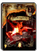</td><td class="col-meta">ファイターコンボカード #065/126/067/136/233/537/140/291/412 · 0-2243最大6枚 (+5)</td><td class="col-name">
ＶラッシュⅠ
</td><td class="col-id"><code>SKILL_SK163_FIGHTER_COMB01</code><button type="button" class="copy-id" data-copy="SKILL_SK163_FIGHTER_COMB01" title="ID SKILL_SK163_FIGHTER_COMB01 をコピー" aria-label="ID SKILL_SK163_FIGHTER_COMB01 をコピー">⧉</button></td><td class="col-info">
スキル／技：片手剣専用 · カード選択後ＡＡＡで発動

スキル／素早い連係攻撃を繰り出す。３段目で敵を吹き飛ばす
</td></tr>
<tr data-id="SKILL_SK164_FIGHTER_COMB01" data-cat="FIGHTER" data-flag="BASE" data-search="ｖラッシュⅱ skill_sk164_fighter_comb01 ファイター コンボ スキル／技：片手剣専用 · カード選択後ａａａで発動 スキル／素早い連係攻撃を繰り出す。３段目で敵を吹き飛ばす"><td class="col-img">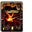</td><td class="col-meta">ファイターコンボカード #066/127/068/137/234/538/141/292/413 · 0-2244最大6枚 (+5)</td><td class="col-name">
ＶラッシュⅡ
</td><td class="col-id"><code>SKILL_SK164_FIGHTER_COMB01</code><button type="button" class="copy-id" data-copy="SKILL_SK164_FIGHTER_COMB01" title="ID SKILL_SK164_FIGHTER_COMB01 をコピー" aria-label="ID SKILL_SK164_FIGHTER_COMB01 をコピー">⧉</button></td><td class="col-info">
スキル／技：片手剣専用 · カード選択後ＡＡＡで発動

スキル／素早い連係攻撃を繰り出す。３段目で敵を吹き飛ばす
</td></tr>
<tr data-id="SKILL_SK165_FIGHTER_COMB01" data-cat="FIGHTER" data-flag="BASE" data-search="ｖラッシュⅲ skill_sk165_fighter_comb01 ファイター コンボ スキル／技：片手剣専用 · カード選択後ａａａで発動 スキル／素早い連係攻撃を繰り出す。３段目で敵を吹き飛ばす"><td class="col-img">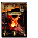</td><td class="col-meta">ファイターコンボカード #128/069/138/235/142/293/414 · 0-2245最大6枚 (+5)</td><td class="col-name">
ＶラッシュⅢ
</td><td class="col-id"><code>SKILL_SK165_FIGHTER_COMB01</code><button type="button" class="copy-id" data-copy="SKILL_SK165_FIGHTER_COMB01" title="ID SKILL_SK165_FIGHTER_COMB01 をコピー" aria-label="ID SKILL_SK165_FIGHTER_COMB01 をコピー">⧉</button></td><td class="col-info">
スキル／技：片手剣専用 · カード選択後ＡＡＡで発動

スキル／素早い連係攻撃を繰り出す。３段目で敵を吹き飛ばす
</td></tr>
<tr data-id="SKILL_SK166_FIGHTER_COMB02" data-cat="FIGHTER" data-flag="BASE" data-search="スパイラルアサルトⅰ skill_sk166_fighter_comb02 ファイター コンボ スキル／技：二刀流専用 · カード選択後ａａａａで発動 スキル／両手の武器を使用して強力な多段攻撃を繰り出す"><td class="col-img">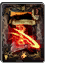</td><td class="col-meta">ファイターコンボカード #421 · 0-2672最大6枚 (+5)</td><td class="col-name">
スパイラルアサルトⅠ
</td><td class="col-id"><code>SKILL_SK166_FIGHTER_COMB02</code><button type="button" class="copy-id" data-copy="SKILL_SK166_FIGHTER_COMB02" title="ID SKILL_SK166_FIGHTER_COMB02 をコピー" aria-label="ID SKILL_SK166_FIGHTER_COMB02 をコピー">⧉</button></td><td class="col-info">
スキル／技：二刀流専用 · カード選択後ＡＡＡＡで発動

スキル／両手の武器を使用して強力な多段攻撃を繰り出す
</td></tr>
<tr data-id="SKILL_SK167_FIGHTER_COMB02" data-cat="FIGHTER" data-flag="BASE" data-search="スパイラルアサルトⅱ skill_sk167_fighter_comb02 ファイター コンボ スキル／技：二刀流専用 · カード選択後ａａａａで発動 スキル／両手の武器を使用して強力な多段攻撃を繰り出す"><td class="col-img">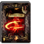</td><td class="col-meta">ファイターコンボカード #422 · 0-2673最大6枚 (+5)</td><td class="col-name">
スパイラルアサルトⅡ
</td><td class="col-id"><code>SKILL_SK167_FIGHTER_COMB02</code><button type="button" class="copy-id" data-copy="SKILL_SK167_FIGHTER_COMB02" title="ID SKILL_SK167_FIGHTER_COMB02 をコピー" aria-label="ID SKILL_SK167_FIGHTER_COMB02 をコピー">⧉</button></td><td class="col-info">
スキル／技：二刀流専用 · カード選択後ＡＡＡＡで発動

スキル／両手の武器を使用して強力な多段攻撃を繰り出す
</td></tr>
<tr data-id="SKILL_SK168_FIGHTER_COMB02" data-cat="FIGHTER" data-flag="BASE" data-search="スパイラルアサルトⅲ skill_sk168_fighter_comb02 ファイター コンボ スキル／技：二刀流専用 · カード選択後ａａａａで発動 スキル／両手の武器を使用して強力な多段攻撃を繰り出す"><td class="col-img">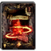</td><td class="col-meta">ファイターコンボカード #423 · 0-2674最大6枚 (+5)</td><td class="col-name">
スパイラルアサルトⅢ
</td><td class="col-id"><code>SKILL_SK168_FIGHTER_COMB02</code><button type="button" class="copy-id" data-copy="SKILL_SK168_FIGHTER_COMB02" title="ID SKILL_SK168_FIGHTER_COMB02 をコピー" aria-label="ID SKILL_SK168_FIGHTER_COMB02 をコピー">⧉</button></td><td class="col-info">
スキル／技：二刀流専用 · カード選択後ＡＡＡＡで発動

スキル／両手の武器を使用して強力な多段攻撃を繰り出す
</td></tr>
<tr data-id="SKILL_SK169_FIGHTER_COMB03" data-cat="FIGHTER" data-flag="BASE" data-search="ダブルドラゴン skill_sk169_fighter_comb03 ファイター コンボ スキル／技：二刀流専用 · カード選択後ａ＋ｇで発動 スキル／広い範囲の敵に対応できる優秀な攻撃"><td class="col-img">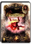</td><td class="col-meta">ファイターコンボカード #424 · 1-404最大4枚 (+3)</td><td class="col-name">
ダブルドラゴン
</td><td class="col-id"><code>SKILL_SK169_FIGHTER_COMB03</code><button type="button" class="copy-id" data-copy="SKILL_SK169_FIGHTER_COMB03" title="ID SKILL_SK169_FIGHTER_COMB03 をコピー" aria-label="ID SKILL_SK169_FIGHTER_COMB03 をコピー">⧉</button></td><td class="col-info">
スキル／技：二刀流専用 · カード選択後Ａ＋Ｇで発動

スキル／広い範囲の敵に対応できる優秀な攻撃
</td></tr>
<tr data-id="SKILL_SK170_FIGHTER_COMB04" data-cat="FIGHTER" data-flag="BASE" data-search="ハンドレッドソードⅰ skill_sk170_fighter_comb04 ファイター コンボ スキル／技：片手剣専用 · カード選択後ａ＋ｇ＋ｖで発動 スキル／剣による多段攻撃で大ダメージを与える必殺の奥義"><td class="col-img">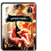</td><td class="col-meta">ファイターコンボカード #231 · 1-316最大4枚 (+3)</td><td class="col-name">
ハンドレッドソードⅠ
</td><td class="col-id"><code>SKILL_SK170_FIGHTER_COMB04</code><button type="button" class="copy-id" data-copy="SKILL_SK170_FIGHTER_COMB04" title="ID SKILL_SK170_FIGHTER_COMB04 をコピー" aria-label="ID SKILL_SK170_FIGHTER_COMB04 をコピー">⧉</button></td><td class="col-info">
スキル／技：片手剣専用 · カード選択後Ａ＋Ｇ＋Ｖで発動

スキル／剣による多段攻撃で大ダメージを与える必殺の奥義
</td></tr>
<tr data-id="SKILL_SK171_FIGHTER_COMB04" data-cat="FIGHTER" data-flag="BASE" data-search="ハンドレッドソードⅱ skill_sk171_fighter_comb04 ファイター コンボ スキル／技：片手剣専用 · カード選択後ａ＋ｇ＋ｖで発動 スキル／剣による多段攻撃で大ダメージを与える必殺の奥義"><td class="col-img">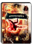</td><td class="col-meta">ファイターコンボカード #232 · 1-317最大4枚 (+3)</td><td class="col-name">
ハンドレッドソードⅡ
</td><td class="col-id"><code>SKILL_SK171_FIGHTER_COMB04</code><button type="button" class="copy-id" data-copy="SKILL_SK171_FIGHTER_COMB04" title="ID SKILL_SK171_FIGHTER_COMB04 をコピー" aria-label="ID SKILL_SK171_FIGHTER_COMB04 をコピー">⧉</button></td><td class="col-info">
スキル／技：片手剣専用 · カード選択後Ａ＋Ｇ＋Ｖで発動

スキル／剣による多段攻撃で大ダメージを与える必殺の奥義
</td></tr>
<tr data-id="SKILL_SK172_FIGHTER_COMB05" data-cat="FIGHTER" data-flag="BASE" data-search="バーバリアンラッシュⅰ skill_sk172_fighter_comb05 ファイター コンボ スキル／技：片手斧専用 · カード選択後ａａａで発動 スキル／スピードは遅いが、３段目は高い威力を誇る"><td class="col-img">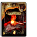</td><td class="col-meta">ファイターコンボカード #136 · 0-2277最大6枚 (+5)</td><td class="col-name">
バーバリアンラッシュⅠ
</td><td class="col-id"><code>SKILL_SK172_FIGHTER_COMB05</code><button type="button" class="copy-id" data-copy="SKILL_SK172_FIGHTER_COMB05" title="ID SKILL_SK172_FIGHTER_COMB05 をコピー" aria-label="ID SKILL_SK172_FIGHTER_COMB05 をコピー">⧉</button></td><td class="col-info">
スキル／技：片手斧専用 · カード選択後ＡＡＡで発動

スキル／スピードは遅いが、３段目は高い威力を誇る
</td></tr>
<tr data-id="SKILL_SK173_FIGHTER_COMB05" data-cat="FIGHTER" data-flag="BASE" data-search="バーバリアンラッシュⅱ skill_sk173_fighter_comb05 ファイター コンボ スキル／技：片手斧専用 · カード選択後ａａａで発動 スキル／スピードは遅いが、３段目は高い威力を誇る"><td class="col-img">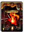</td><td class="col-meta">ファイターコンボカード #137 · 0-2278最大6枚 (+5)</td><td class="col-name">
バーバリアンラッシュⅡ
</td><td class="col-id"><code>SKILL_SK173_FIGHTER_COMB05</code><button type="button" class="copy-id" data-copy="SKILL_SK173_FIGHTER_COMB05" title="ID SKILL_SK173_FIGHTER_COMB05 をコピー" aria-label="ID SKILL_SK173_FIGHTER_COMB05 をコピー">⧉</button></td><td class="col-info">
スキル／技：片手斧専用 · カード選択後ＡＡＡで発動

スキル／スピードは遅いが、３段目は高い威力を誇る
</td></tr>
<tr data-id="SKILL_SK174_FIGHTER_COMB05" data-cat="FIGHTER" data-flag="BASE" data-search="バーバリアンラッシュⅲ skill_sk174_fighter_comb05 ファイター コンボ スキル／技：片手斧専用 · カード選択後ａａａで発動 スキル／スピードは遅いが、３段目は高い威力を誇る"><td class="col-img">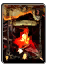</td><td class="col-meta">ファイターコンボカード #138 · 0-2279最大6枚 (+5)</td><td class="col-name">
バーバリアンラッシュⅢ
</td><td class="col-id"><code>SKILL_SK174_FIGHTER_COMB05</code><button type="button" class="copy-id" data-copy="SKILL_SK174_FIGHTER_COMB05" title="ID SKILL_SK174_FIGHTER_COMB05 をコピー" aria-label="ID SKILL_SK174_FIGHTER_COMB05 をコピー">⧉</button></td><td class="col-info">
スキル／技：片手斧専用 · カード選択後ＡＡＡで発動

スキル／スピードは遅いが、３段目は高い威力を誇る
</td></tr>
<tr data-id="SKILL_SK175_FIGHTER_COMB06" data-cat="FIGHTER" data-flag="BASE" data-search="バーサーカーラッシュⅰ skill_sk175_fighter_comb06 ファイター コンボ スキル／技：片手斧専用 · カード選択後ａａａで発動 スキル／素早い連係攻撃を繰り出す。３段目で敵を浮かせる"><td class="col-img">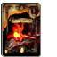</td><td class="col-meta">ファイターコンボカード #233 · 0-2280最大6枚 (+5)</td><td class="col-name">
バーサーカーラッシュⅠ
</td><td class="col-id"><code>SKILL_SK175_FIGHTER_COMB06</code><button type="button" class="copy-id" data-copy="SKILL_SK175_FIGHTER_COMB06" title="ID SKILL_SK175_FIGHTER_COMB06 をコピー" aria-label="ID SKILL_SK175_FIGHTER_COMB06 をコピー">⧉</button></td><td class="col-info">
スキル／技：片手斧専用 · カード選択後ＡＡＡで発動

スキル／素早い連係攻撃を繰り出す。３段目で敵を浮かせる
</td></tr>
<tr data-id="SKILL_SK176_FIGHTER_COMB06" data-cat="FIGHTER" data-flag="BASE" data-search="バーサーカーラッシュⅱ skill_sk176_fighter_comb06 ファイター コンボ スキル／技：片手斧専用 · カード選択後ａａａで発動 スキル／素早い連係攻撃を繰り出す。３段目で敵を浮かせる"><td class="col-img">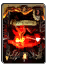</td><td class="col-meta">ファイターコンボカード #234 · 0-2281最大6枚 (+5)</td><td class="col-name">
バーサーカーラッシュⅡ
</td><td class="col-id"><code>SKILL_SK176_FIGHTER_COMB06</code><button type="button" class="copy-id" data-copy="SKILL_SK176_FIGHTER_COMB06" title="ID SKILL_SK176_FIGHTER_COMB06 をコピー" aria-label="ID SKILL_SK176_FIGHTER_COMB06 をコピー">⧉</button></td><td class="col-info">
スキル／技：片手斧専用 · カード選択後ＡＡＡで発動

スキル／素早い連係攻撃を繰り出す。３段目で敵を浮かせる
</td></tr>
<tr data-id="SKILL_SK177_FIGHTER_COMB06" data-cat="FIGHTER" data-flag="BASE" data-search="バーサーカーラッシュⅲ skill_sk177_fighter_comb06 ファイター コンボ スキル／技：片手斧専用 · カード選択後ａａａで発動 スキル／素早い連係攻撃を繰り出す。３段目で敵を浮かせる"><td class="col-img">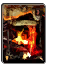</td><td class="col-meta">ファイターコンボカード #235 · 0-2282最大6枚 (+5)</td><td class="col-name">
バーサーカーラッシュⅢ
</td><td class="col-id"><code>SKILL_SK177_FIGHTER_COMB06</code><button type="button" class="copy-id" data-copy="SKILL_SK177_FIGHTER_COMB06" title="ID SKILL_SK177_FIGHTER_COMB06 をコピー" aria-label="ID SKILL_SK177_FIGHTER_COMB06 をコピー">⧉</button></td><td class="col-info">
スキル／技：片手斧専用 · カード選択後ＡＡＡで発動

スキル／素早い連係攻撃を繰り出す。３段目で敵を浮かせる
</td></tr>
<tr data-id="SKILL_SK181_FIGHTER_COMB08" data-cat="FIGHTER" data-flag="BASE" data-search="ライトニングランサー skill_sk181_fighter_comb08 ファイター コンボ スキル／技：槍専用 · カード選択後ａ＋ｇａで発動 スキル／１発目がヒットした瞬間にａを入力すると蹴りが発動"><td class="col-img">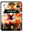</td><td class="col-meta">ファイターコンボカード #073 · 1-307最大4枚 (+3)</td><td class="col-name">
ライトニングランサー
</td><td class="col-id"><code>SKILL_SK181_FIGHTER_COMB08</code><button type="button" class="copy-id" data-copy="SKILL_SK181_FIGHTER_COMB08" title="ID SKILL_SK181_FIGHTER_COMB08 をコピー" aria-label="ID SKILL_SK181_FIGHTER_COMB08 をコピー">⧉</button></td><td class="col-info">
スキル／技：槍専用 · カード選択後Ａ＋ＧＡで発動

スキル／１発目がヒットした瞬間にＡを入力すると蹴りが発動
</td></tr>
<tr data-id="SKILL_SK182_FIGHTER_COMB08" data-cat="FIGHTER" data-flag="BASE" data-search="ホースライダースラスト skill_sk182_fighter_comb08 ファイター コンボ スキル／技：槍専用 · カード選択後ａ＋ｇａで発動 スキル／１発目がヒットした瞬間にａを入力すると蹴りが発動"><td class="col-img">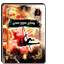</td><td class="col-meta">ファイターコンボカード #074 · 1-308最大4枚 (+3)</td><td class="col-name">
ホースライダースラスト
</td><td class="col-id"><code>SKILL_SK182_FIGHTER_COMB08</code><button type="button" class="copy-id" data-copy="SKILL_SK182_FIGHTER_COMB08" title="ID SKILL_SK182_FIGHTER_COMB08 をコピー" aria-label="ID SKILL_SK182_FIGHTER_COMB08 をコピー">⧉</button></td><td class="col-info">
スキル／技：槍専用 · カード選択後Ａ＋ＧＡで発動

スキル／１発目がヒットした瞬間にＡを入力すると蹴りが発動
</td></tr>
<tr data-id="SKILL_SK183_FIGHTER_COMB09" data-cat="FIGHTER" data-flag="BASE" data-search="ｈスラッシュⅰ skill_sk183_fighter_comb09 ファイター コンボ スキル／技：槍専用 · カード選択後ａ＋ｇ＋ｖで発動 スキル／槍による多段攻撃で大ダメージを与える必殺の奥義"><td class="col-img">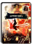</td><td class="col-meta">ファイターコンボカード #079/236 · 1-318最大4枚 (+3)</td><td class="col-name">
ＨスラッシュⅠ
</td><td class="col-id"><code>SKILL_SK183_FIGHTER_COMB09</code><button type="button" class="copy-id" data-copy="SKILL_SK183_FIGHTER_COMB09" title="ID SKILL_SK183_FIGHTER_COMB09 をコピー" aria-label="ID SKILL_SK183_FIGHTER_COMB09 をコピー">⧉</button></td><td class="col-info">
スキル／技：槍専用 · カード選択後Ａ＋Ｇ＋Ｖで発動

スキル／槍による多段攻撃で大ダメージを与える必殺の奥義
</td></tr>
<tr data-id="SKILL_SK184_FIGHTER_COMB09" data-cat="FIGHTER" data-flag="BASE" data-search="ｈスラッシュⅱ skill_sk184_fighter_comb09 ファイター コンボ スキル／技：槍専用 · カード選択後ａ＋ｇ＋ｖで発動 スキル／槍による多段攻撃で大ダメージを与える必殺の奥義"><td class="col-img">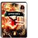</td><td class="col-meta">ファイターコンボカード #080/237 · 1-319最大4枚 (+3)</td><td class="col-name">
ＨスラッシュⅡ
</td><td class="col-id"><code>SKILL_SK184_FIGHTER_COMB09</code><button type="button" class="copy-id" data-copy="SKILL_SK184_FIGHTER_COMB09" title="ID SKILL_SK184_FIGHTER_COMB09 をコピー" aria-label="ID SKILL_SK184_FIGHTER_COMB09 をコピー">⧉</button></td><td class="col-info">
スキル／技：槍専用 · カード選択後Ａ＋Ｇ＋Ｖで発動

スキル／槍による多段攻撃で大ダメージを与える必殺の奥義
</td></tr>
<tr data-id="SKILL_SK187_FIGHTER_COMB11" data-cat="FIGHTER" data-flag="BASE" data-search="ピアシングオールⅰ skill_sk187_fighter_comb11 ファイター コンボ スキル／技：槍専用 · カード選択後ａａａで発動 スキル／なぎ払いから２連の突きへとつなぐ３段攻撃"><td class="col-img">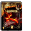</td><td class="col-meta">ファイターコンボカード #299 · 0-2549最大6枚 (+5)</td><td class="col-name">
ピアシングオールⅠ
</td><td class="col-id"><code>SKILL_SK187_FIGHTER_COMB11</code><button type="button" class="copy-id" data-copy="SKILL_SK187_FIGHTER_COMB11" title="ID SKILL_SK187_FIGHTER_COMB11 をコピー" aria-label="ID SKILL_SK187_FIGHTER_COMB11 をコピー">⧉</button></td><td class="col-info">
スキル／技：槍専用 · カード選択後ＡＡＡで発動

スキル／なぎ払いから２連の突きへとつなぐ３段攻撃
</td></tr>
<tr data-id="SKILL_SK188_FIGHTER_COMB11" data-cat="FIGHTER" data-flag="BASE" data-search="ピアシングオールⅱ skill_sk188_fighter_comb11 ファイター コンボ スキル／技：槍専用 · カード選択後ａａａで発動 スキル／なぎ払いから２連の突きへとつなぐ３段攻撃"><td class="col-img">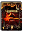</td><td class="col-meta">ファイターコンボカード #300/301 · 0-2550最大6枚 (+5)</td><td class="col-name">
ピアシングオールⅡ
</td><td class="col-id"><code>SKILL_SK188_FIGHTER_COMB11</code><button type="button" class="copy-id" data-copy="SKILL_SK188_FIGHTER_COMB11" title="ID SKILL_SK188_FIGHTER_COMB11 をコピー" aria-label="ID SKILL_SK188_FIGHTER_COMB11 をコピー">⧉</button></td><td class="col-info">
スキル／技：槍専用 · カード選択後ＡＡＡで発動

スキル／なぎ払いから２連の突きへとつなぐ３段攻撃
</td></tr>
<tr data-id="SKILL_SK189_FIGHTER_COMB11" data-cat="FIGHTER" data-flag="BASE" data-search="ピアシングオールⅲ skill_sk189_fighter_comb11 ファイター コンボ スキル／技：槍専用 · カード選択後ａａａで発動 スキル／なぎ払いから２連の突きへとつなぐ３段攻撃"><td class="col-img">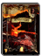</td><td class="col-meta">ファイターコンボカード #299 · 0-2551最大6枚 (+5)</td><td class="col-name">
ピアシングオールⅢ
</td><td class="col-id"><code>SKILL_SK189_FIGHTER_COMB11</code><button type="button" class="copy-id" data-copy="SKILL_SK189_FIGHTER_COMB11" title="ID SKILL_SK189_FIGHTER_COMB11 をコピー" aria-label="ID SKILL_SK189_FIGHTER_COMB11 をコピー">⧉</button></td><td class="col-info">
スキル／技：槍専用 · カード選択後ＡＡＡで発動

スキル／なぎ払いから２連の突きへとつなぐ３段攻撃
</td></tr>
<tr data-id="SKILL_SK190_FIGHTER_COMB12" data-cat="FIGHTER" data-flag="BASE" data-search="ミラージュインパクトⅰ skill_sk190_fighter_comb12 ファイター コンボ スキル／技：両手剣専用 · カード選択後ａａａで発動 スキル／威力の高い４段の連係攻撃を繰り出す"><td class="col-img">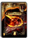</td><td class="col-meta">ファイターコンボカード #363 · 0-2601最大6枚 (+5)</td><td class="col-name">
ミラージュインパクトⅠ
</td><td class="col-id"><code>SKILL_SK190_FIGHTER_COMB12</code><button type="button" class="copy-id" data-copy="SKILL_SK190_FIGHTER_COMB12" title="ID SKILL_SK190_FIGHTER_COMB12 をコピー" aria-label="ID SKILL_SK190_FIGHTER_COMB12 をコピー">⧉</button></td><td class="col-info">
スキル／技：両手剣専用 · カード選択後ＡＡＡで発動

スキル／威力の高い４段の連係攻撃を繰り出す
</td></tr>
<tr data-id="SKILL_SK191_FIGHTER_COMB12" data-cat="FIGHTER" data-flag="BASE" data-search="ミラージュインパクトⅱ skill_sk191_fighter_comb12 ファイター コンボ スキル／技：両手剣専用 · カード選択後ａａａで発動 スキル／威力の高い４段の連係攻撃を繰り出す"><td class="col-img">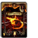</td><td class="col-meta">ファイターコンボカード #364 · 0-2602最大6枚 (+5)</td><td class="col-name">
ミラージュインパクトⅡ
</td><td class="col-id"><code>SKILL_SK191_FIGHTER_COMB12</code><button type="button" class="copy-id" data-copy="SKILL_SK191_FIGHTER_COMB12" title="ID SKILL_SK191_FIGHTER_COMB12 をコピー" aria-label="ID SKILL_SK191_FIGHTER_COMB12 をコピー">⧉</button></td><td class="col-info">
スキル／技：両手剣専用 · カード選択後ＡＡＡで発動

スキル／威力の高い４段の連係攻撃を繰り出す
</td></tr>
<tr data-id="SKILL_SK192_FIGHTER_COMB12" data-cat="FIGHTER" data-flag="BASE" data-search="ミラージュインパクトⅲ skill_sk192_fighter_comb12 ファイター コンボ スキル／技：両手剣専用 · カード選択後ａａａで発動 スキル／威力の高い４段の連係攻撃を繰り出す"><td class="col-img">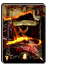</td><td class="col-meta">ファイターコンボカード #365 · 0-2603最大6枚 (+5)</td><td class="col-name">
ミラージュインパクトⅢ
</td><td class="col-id"><code>SKILL_SK192_FIGHTER_COMB12</code><button type="button" class="copy-id" data-copy="SKILL_SK192_FIGHTER_COMB12" title="ID SKILL_SK192_FIGHTER_COMB12 をコピー" aria-label="ID SKILL_SK192_FIGHTER_COMB12 をコピー">⧉</button></td><td class="col-info">
スキル／技：両手剣専用 · カード選択後ＡＡＡで発動

スキル／威力の高い４段の連係攻撃を繰り出す
</td></tr>
<tr data-id="SKILL_SK196_FIGHTER_COMB14" data-cat="FIGHTER" data-flag="BASE" data-search="ハードスラッシュ skill_sk196_fighter_comb14 ファイター コンボ スキル／技：両手剣専用 · カード選択後ａ＋ｇで発動 スキル／強力な横斬り攻撃。溜めることで威力がアップする"><td class="col-img">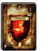</td><td class="col-meta">ファイターコンボカード #139 · 0-2283最大11枚 (+10)</td><td class="col-name">
ハードスラッシュ
</td><td class="col-id"><code>SKILL_SK196_FIGHTER_COMB14</code><button type="button" class="copy-id" data-copy="SKILL_SK196_FIGHTER_COMB14" title="ID SKILL_SK196_FIGHTER_COMB14 をコピー" aria-label="ID SKILL_SK196_FIGHTER_COMB14 をコピー">⧉</button></td><td class="col-info">
スキル／技：両手剣専用 · カード選択後Ａ＋Ｇで発動

スキル／強力な横斬り攻撃。溜めることで威力がアップする
</td></tr>
<tr data-id="SKILL_SK197_FIGHTER_COMB15" data-cat="FIGHTER" data-flag="BASE" data-search="グランドブレイカー skill_sk197_fighter_comb15 ファイター コンボ スキル／技：両手剣専用 · カード選択後ａ＋ｇで発動 スキル／強力な縦斬り攻撃。溜めることで威力がアップする"><td class="col-img">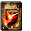</td><td class="col-meta">ファイターコンボカード #194 · 0-2284最大6枚 (+5)</td><td class="col-name">
グランドブレイカー
</td><td class="col-id"><code>SKILL_SK197_FIGHTER_COMB15</code><button type="button" class="copy-id" data-copy="SKILL_SK197_FIGHTER_COMB15" title="ID SKILL_SK197_FIGHTER_COMB15 をコピー" aria-label="ID SKILL_SK197_FIGHTER_COMB15 をコピー">⧉</button></td><td class="col-info">
スキル／技：両手剣専用 · カード選択後Ａ＋Ｇで発動

スキル／強力な縦斬り攻撃。溜めることで威力がアップする
</td></tr>
<tr data-id="SKILL_SK198_FIGHTER_COMB16" data-cat="FIGHTER" data-flag="BASE" data-search="アーマーブレイカーⅰ skill_sk198_fighter_comb16 ファイター コンボ スキル／技：両手斧専用 · カード選択後ａａａで発動 スキル／流れるような連係から５段目の広範囲攻撃へとつなぐ"><td class="col-img">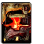</td><td class="col-meta">ファイターコンボカード #195 · 0-2359最大6枚 (+5)</td><td class="col-name">
アーマーブレイカーⅠ
</td><td class="col-id"><code>SKILL_SK198_FIGHTER_COMB16</code><button type="button" class="copy-id" data-copy="SKILL_SK198_FIGHTER_COMB16" title="ID SKILL_SK198_FIGHTER_COMB16 をコピー" aria-label="ID SKILL_SK198_FIGHTER_COMB16 をコピー">⧉</button></td><td class="col-info">
スキル／技：両手斧専用 · カード選択後ＡＡＡで発動

スキル／流れるような連係から５段目の広範囲攻撃へとつなぐ
</td></tr>
<tr data-id="SKILL_SK199_FIGHTER_COMB16" data-cat="FIGHTER" data-flag="BASE" data-search="アーマーブレイカーⅱ skill_sk199_fighter_comb16 ファイター コンボ スキル／技：両手斧専用 · カード選択後ａａａで発動 スキル／流れるような連係から５段目の広範囲攻撃へとつなぐ"><td class="col-img">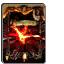</td><td class="col-meta">ファイターコンボカード #196 · 0-2360最大6枚 (+5)</td><td class="col-name">
アーマーブレイカーⅡ
</td><td class="col-id"><code>SKILL_SK199_FIGHTER_COMB16</code><button type="button" class="copy-id" data-copy="SKILL_SK199_FIGHTER_COMB16" title="ID SKILL_SK199_FIGHTER_COMB16 をコピー" aria-label="ID SKILL_SK199_FIGHTER_COMB16 をコピー">⧉</button></td><td class="col-info">
スキル／技：両手斧専用 · カード選択後ＡＡＡで発動

スキル／流れるような連係から５段目の広範囲攻撃へとつなぐ
</td></tr>
<tr data-id="SKILL_SK200_FIGHTER_COMB16" data-cat="FIGHTER" data-flag="BASE" data-search="アーマーブレイカーⅲ skill_sk200_fighter_comb16 ファイター コンボ スキル／技：両手斧専用 · カード選択後ａａａで発動 スキル／流れるような連係から５段目の広範囲攻撃へとつなぐ"><td class="col-img">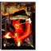</td><td class="col-meta">ファイターコンボカード #197 · 0-2361最大6枚 (+5)</td><td class="col-name">
アーマーブレイカーⅢ
</td><td class="col-id"><code>SKILL_SK200_FIGHTER_COMB16</code><button type="button" class="copy-id" data-copy="SKILL_SK200_FIGHTER_COMB16" title="ID SKILL_SK200_FIGHTER_COMB16 をコピー" aria-label="ID SKILL_SK200_FIGHTER_COMB16 をコピー">⧉</button></td><td class="col-info">
スキル／技：両手斧専用 · カード選択後ＡＡＡで発動

スキル／流れるような連係から５段目の広範囲攻撃へとつなぐ
</td></tr>
<tr data-id="SKILL_SK204_FIGHTER_COMB18" data-cat="FIGHTER" data-flag="BASE" data-search="デッドエンド skill_sk204_fighter_comb18 ファイター コンボ スキル／技：両手斧専用 · カード選択後ａ＋ｇで発動 スキル／大きく振りかぶり、範囲の広い強烈な一撃を繰り出す"><td class="col-img">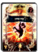</td><td class="col-meta">ファイターコンボカード #078 · 1-309最大4枚 (+3)</td><td class="col-name">
デッドエンド
</td><td class="col-id"><code>SKILL_SK204_FIGHTER_COMB18</code><button type="button" class="copy-id" data-copy="SKILL_SK204_FIGHTER_COMB18" title="ID SKILL_SK204_FIGHTER_COMB18 をコピー" aria-label="ID SKILL_SK204_FIGHTER_COMB18 をコピー">⧉</button></td><td class="col-info">
スキル／技：両手斧専用 · カード選択後Ａ＋Ｇで発動

スキル／大きく振りかぶり、範囲の広い強烈な一撃を繰り出す
</td></tr>
<tr data-id="SKILL_SK281_FIGHTER_COMB21" data-cat="FIGHTER" data-flag="BASE" data-search="ワイルドスマッシュⅰ skill_sk281_fighter_comb21 ファイター コンボ スキル／技：片手剣専用 · カード選択後ａ＋ｇで発動 スキル／高威力の突きから蹴りへとつなぎ、敵を吹き飛ばす"><td class="col-img">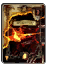</td><td class="col-meta">ファイターコンボカード #297 · 0-2547最大6枚 (+5)</td><td class="col-name">
ワイルドスマッシュⅠ
</td><td class="col-id"><code>SKILL_SK281_FIGHTER_COMB21</code><button type="button" class="copy-id" data-copy="SKILL_SK281_FIGHTER_COMB21" title="ID SKILL_SK281_FIGHTER_COMB21 をコピー" aria-label="ID SKILL_SK281_FIGHTER_COMB21 をコピー">⧉</button></td><td class="col-info">
スキル／技：片手剣専用 · カード選択後Ａ＋Ｇで発動

スキル／高威力の突きから蹴りへとつなぎ、敵を吹き飛ばす
</td></tr>
<tr data-id="SKILL_SK282_FIGHTER_COMB21" data-cat="FIGHTER" data-flag="BASE" data-search="ワイルドスマッシュⅱ skill_sk282_fighter_comb21 ファイター コンボ スキル／技：片手剣専用 · カード選択後ａ＋ｇで発動 スキル／高威力の突きから蹴りへとつなぎ、敵を吹き飛ばす"><td class="col-img">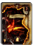</td><td class="col-meta">ファイターコンボカード #298 · 0-2548最大6枚 (+5)</td><td class="col-name">
ワイルドスマッシュⅡ
</td><td class="col-id"><code>SKILL_SK282_FIGHTER_COMB21</code><button type="button" class="copy-id" data-copy="SKILL_SK282_FIGHTER_COMB21" title="ID SKILL_SK282_FIGHTER_COMB21 をコピー" aria-label="ID SKILL_SK282_FIGHTER_COMB21 をコピー">⧉</button></td><td class="col-info">
スキル／技：片手剣専用 · カード選択後Ａ＋Ｇで発動

スキル／高威力の突きから蹴りへとつなぎ、敵を吹き飛ばす
</td></tr>
<tr data-id="SKILL_SK284_FIGHTER_COMB22" data-cat="FIGHTER" data-flag="BASE" data-search="ソニックブラスト skill_sk284_fighter_comb22 ファイター コンボ スキル／技：両手剣専用 · カード選択後ａ＋ｇで発動 スキル／攻撃速度が非常に速く回転力に優れた一撃"><td class="col-img">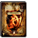</td><td class="col-meta">ファイターコンボカード #482 · 0-2641最大6枚 (+5)</td><td class="col-name">
ソニックブラスト
</td><td class="col-id"><code>SKILL_SK284_FIGHTER_COMB22</code><button type="button" class="copy-id" data-copy="SKILL_SK284_FIGHTER_COMB22" title="ID SKILL_SK284_FIGHTER_COMB22 をコピー" aria-label="ID SKILL_SK284_FIGHTER_COMB22 をコピー">⧉</button></td><td class="col-info">
スキル／技：両手剣専用 · カード選択後Ａ＋Ｇで発動

スキル／攻撃速度が非常に速く回転力に優れた一撃
</td></tr>
<tr data-id="SKILL_SK285_FIGHTER_COMB23" data-cat="FIGHTER" data-flag="BASE" data-search="ウィンドブレイク skill_sk285_fighter_comb23 ファイター コンボ スキル／技：両手剣専用 · カード選択後ａ＋ｇで発動 スキル／なぎ払い攻撃で、敵を吹き飛ばす突風を発生させる"><td class="col-img">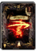</td><td class="col-meta">ファイターコンボカード #420 · 0-2671最大11枚 (+10)</td><td class="col-name">
ウィンドブレイク
</td><td class="col-id"><code>SKILL_SK285_FIGHTER_COMB23</code><button type="button" class="copy-id" data-copy="SKILL_SK285_FIGHTER_COMB23" title="ID SKILL_SK285_FIGHTER_COMB23 をコピー" aria-label="ID SKILL_SK285_FIGHTER_COMB23 をコピー">⧉</button></td><td class="col-info">
スキル／技：両手剣専用 · カード選択後Ａ＋Ｇで発動

スキル／なぎ払い攻撃で、敵を吹き飛ばす突風を発生させる
</td></tr>
<tr data-id="SKILL_SK299_FIGHTER_COMB19" data-cat="FIGHTER" data-flag="BASE" data-search="ロックブレイカー skill_sk299_fighter_comb19 ファイター コンボ スキル／技：片手斧専用 · カード選択後ａ＋ｇで発動 スキル／体を１回転させ、攻撃範囲の広い強力な一撃を放つ"><td class="col-img">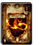</td><td class="col-meta">ファイターコンボカード #366 · 0-2604最大6枚 (+5)</td><td class="col-name">
ロックブレイカー
</td><td class="col-id"><code>SKILL_SK299_FIGHTER_COMB19</code><button type="button" class="copy-id" data-copy="SKILL_SK299_FIGHTER_COMB19" title="ID SKILL_SK299_FIGHTER_COMB19 をコピー" aria-label="ID SKILL_SK299_FIGHTER_COMB19 をコピー">⧉</button></td><td class="col-info">
スキル／技：片手斧専用 · カード選択後Ａ＋Ｇで発動

スキル／体を１回転させ、攻撃範囲の広い強力な一撃を放つ
</td></tr>
<tr data-id="SKILL_SK300_FIGHTER_COMB20" data-cat="FIGHTER" data-flag="BASE" data-search="ビートダウン skill_sk300_fighter_comb20 ファイター コンボ スキル／技：両手斧専用 · カード選択後ａ＋ｇで発動 スキル／広い範囲の敵に対応できる２段攻撃"><td class="col-img">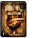</td><td class="col-meta">ファイターコンボカード #396 · 0-2640最大6枚 (+5)</td><td class="col-name">
ビートダウン
</td><td class="col-id"><code>SKILL_SK300_FIGHTER_COMB20</code><button type="button" class="copy-id" data-copy="SKILL_SK300_FIGHTER_COMB20" title="ID SKILL_SK300_FIGHTER_COMB20 をコピー" aria-label="ID SKILL_SK300_FIGHTER_COMB20 をコピー">⧉</button></td><td class="col-info">
スキル／技：両手斧専用 · カード選択後Ａ＋Ｇで発動

スキル／広い範囲の敵に対応できる２段攻撃
</td></tr>
<tr data-id="SKILL_SK318_FIGHTER_COMB24" data-cat="FIGHTER" data-flag="BASE" data-search="ｂスラッシュ skill_sk318_fighter_comb24 ファイター コンボ スキル／技：片手剣専用 · カード選択後ａ＋ｇで発動 スキル／素早く敵を斬り付け、出血状態にさせる"><td class="col-img">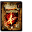</td><td class="col-meta">ファイターコンボカード #416/520/139 · 0-2720最大11枚 (+10)</td><td class="col-name">
Ｂスラッシュ
</td><td class="col-id"><code>SKILL_SK318_FIGHTER_COMB24</code><button type="button" class="copy-id" data-copy="SKILL_SK318_FIGHTER_COMB24" title="ID SKILL_SK318_FIGHTER_COMB24 をコピー" aria-label="ID SKILL_SK318_FIGHTER_COMB24 をコピー">⧉</button></td><td class="col-info">
スキル／技：片手剣専用 · カード選択後Ａ＋Ｇで発動

スキル／素早く敵を斬り付け、出血状態にさせる
</td></tr>
<tr data-id="SKILL_SK319_FIGHTER_COMB25" data-cat="FIGHTER" data-flag="BASE" data-search="カラミティエッジⅰ skill_sk319_fighter_comb25 ファイター コンボ スキル／技：両手剣専用 · カード選択後ａａで発動 スキル／広範囲に攻撃できる強力な２段攻撃を繰り出す"><td class="col-img">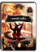</td><td class="col-meta">ファイターコンボカード #521 · 1-459最大4枚 (+3)</td><td class="col-name">
カラミティエッジⅠ
</td><td class="col-id"><code>SKILL_SK319_FIGHTER_COMB25</code><button type="button" class="copy-id" data-copy="SKILL_SK319_FIGHTER_COMB25" title="ID SKILL_SK319_FIGHTER_COMB25 をコピー" aria-label="ID SKILL_SK319_FIGHTER_COMB25 をコピー">⧉</button></td><td class="col-info">
スキル／技：両手剣専用 · カード選択後ＡＡで発動

スキル／広範囲に攻撃できる強力な２段攻撃を繰り出す
</td></tr>
<tr data-id="SKILL_SK320_FIGHTER_COMB25" data-cat="FIGHTER" data-flag="BASE" data-search="カラミティエッジⅱ skill_sk320_fighter_comb25 ファイター コンボ スキル／技：両手剣専用 · カード選択後ａａで発動 スキル／広範囲に攻撃できる強力な２段攻撃を繰り出す"><td class="col-img">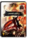</td><td class="col-meta">ファイターコンボカード #522 · 1-460最大4枚 (+3)</td><td class="col-name">
カラミティエッジⅡ
</td><td class="col-id"><code>SKILL_SK320_FIGHTER_COMB25</code><button type="button" class="copy-id" data-copy="SKILL_SK320_FIGHTER_COMB25" title="ID SKILL_SK320_FIGHTER_COMB25 をコピー" aria-label="ID SKILL_SK320_FIGHTER_COMB25 をコピー">⧉</button></td><td class="col-info">
スキル／技：両手剣専用 · カード選択後ＡＡで発動

スキル／広範囲に攻撃できる強力な２段攻撃を繰り出す
</td></tr>
<tr data-id="SKILL_SK321_FIGHTER_SPEC01" data-cat="FIGHTER" data-flag="BASE" data-search="ストームチェイサー skill_sk321_fighter_spec01 ファイター 特殊 スキル／技：能力変化 · ウィンドウで選択すると発動 スキル／全能力を低下させ、移動速度を最大限に高める"><td class="col-img">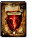</td><td class="col-meta">ファイター特殊カード #574 · 0-2722最大6枚 (+5)</td><td class="col-name">
ストームチェイサー
</td><td class="col-id"><code>SKILL_SK321_FIGHTER_SPEC01</code><button type="button" class="copy-id" data-copy="SKILL_SK321_FIGHTER_SPEC01" title="ID SKILL_SK321_FIGHTER_SPEC01 をコピー" aria-label="ID SKILL_SK321_FIGHTER_SPEC01 をコピー">⧉</button></td><td class="col-info">
スキル／技：能力変化 · ウィンドウで選択すると発動

スキル／全能力を低下させ、移動速度を最大限に高める
</td></tr>
<tr data-id="SKILL_SK341_FIGHTER_COMB28" data-cat="FIGHTER" data-flag="BASE" data-search="ツインスティング skill_sk341_fighter_comb28 ファイター コンボ スキル／技：二刀流専用 · カード選択後ダッシュａで発動 スキル／素早く敵に接近し、強力な突きで敵を吹き飛ばす"><td class="col-img">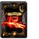</td><td class="col-meta">ファイターコンボカード #536 · 0-2743最大11枚 (+10)</td><td class="col-name">
ツインスティング
</td><td class="col-id"><code>SKILL_SK341_FIGHTER_COMB28</code><button type="button" class="copy-id" data-copy="SKILL_SK341_FIGHTER_COMB28" title="ID SKILL_SK341_FIGHTER_COMB28 をコピー" aria-label="ID SKILL_SK341_FIGHTER_COMB28 をコピー">⧉</button></td><td class="col-info">
スキル／技：二刀流専用 · カード選択後ダッシュＡで発動

スキル／素早く敵に接近し、強力な突きで敵を吹き飛ばす
</td></tr>
<tr data-id="SKILL_SK342_FIGHTER_COMB29" data-cat="FIGHTER" data-flag="BASE" data-search="レイズラッシュⅰ skill_sk342_fighter_comb29 ファイター コンボ スキル／技：二刀流専用 · カード選択後ａａで発動 スキル／両手の武器を使用して強力な連係攻撃を繰り出す"><td class="col-img">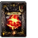</td><td class="col-meta">ファイターコンボカード #537 · 0-2744最大6枚 (+5)</td><td class="col-name">
レイズラッシュⅠ
</td><td class="col-id"><code>SKILL_SK342_FIGHTER_COMB29</code><button type="button" class="copy-id" data-copy="SKILL_SK342_FIGHTER_COMB29" title="ID SKILL_SK342_FIGHTER_COMB29 をコピー" aria-label="ID SKILL_SK342_FIGHTER_COMB29 をコピー">⧉</button></td><td class="col-info">
スキル／技：二刀流専用 · カード選択後ＡＡで発動

スキル／両手の武器を使用して強力な連係攻撃を繰り出す
</td></tr>
<tr data-id="SKILL_SK343_FIGHTER_COMB29" data-cat="FIGHTER" data-flag="BASE" data-search="レイズラッシュⅱ skill_sk343_fighter_comb29 ファイター コンボ スキル／技：二刀流専用 · カード選択後ａａで発動 スキル／両手の武器を使用して強力な連係攻撃を繰り出す"><td class="col-img">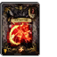</td><td class="col-meta">ファイターコンボカード #538 · 0-2745最大6枚 (+5)</td><td class="col-name">
レイズラッシュⅡ
</td><td class="col-id"><code>SKILL_SK343_FIGHTER_COMB29</code><button type="button" class="copy-id" data-copy="SKILL_SK343_FIGHTER_COMB29" title="ID SKILL_SK343_FIGHTER_COMB29 をコピー" aria-label="ID SKILL_SK343_FIGHTER_COMB29 をコピー">⧉</button></td><td class="col-info">
スキル／技：二刀流専用 · カード選択後ＡＡで発動

スキル／両手の武器を使用して強力な連係攻撃を繰り出す
</td></tr>
<tr data-id="SKILL_SK345_FIGHTER_COMB32" data-cat="FIGHTER" data-flag="BASE" data-search="ムーンスラッシュ skill_sk345_fighter_comb32 ファイター コンボ スキル／技：槍専用 · カード選択後ａ＋ｇａで発動 スキル／攻撃範囲の広いなぎ払いから叩き付け攻撃へとつなぐ"><td class="col-img">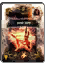</td><td class="col-meta">ファイターコンボカード #564 · 1-472最大4枚 (+3)</td><td class="col-name">
ムーンスラッシュ
</td><td class="col-id"><code>SKILL_SK345_FIGHTER_COMB32</code><button type="button" class="copy-id" data-copy="SKILL_SK345_FIGHTER_COMB32" title="ID SKILL_SK345_FIGHTER_COMB32 をコピー" aria-label="ID SKILL_SK345_FIGHTER_COMB32 をコピー">⧉</button></td><td class="col-info">
スキル／技：槍専用 · カード選択後Ａ＋ＧＡで発動

スキル／攻撃範囲の広いなぎ払いから叩き付け攻撃へとつなぐ
</td></tr>
<tr data-id="SKILL_SK346_FIGHTER_COMB32" data-cat="FIGHTER" data-flag="BASE" data-search="クレセントインパクト skill_sk346_fighter_comb32 ファイター コンボ スキル／技：槍専用 · カード選択後ａ＋ｇａで発動 スキル／攻撃範囲の広いなぎ払いから叩き付け攻撃へとつなぐ"><td class="col-img">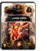</td><td class="col-meta">ファイターコンボカード #565 · 1-473最大4枚 (+3)</td><td class="col-name">
クレセントインパクト
</td><td class="col-id"><code>SKILL_SK346_FIGHTER_COMB32</code><button type="button" class="copy-id" data-copy="SKILL_SK346_FIGHTER_COMB32" title="ID SKILL_SK346_FIGHTER_COMB32 をコピー" aria-label="ID SKILL_SK346_FIGHTER_COMB32 をコピー">⧉</button></td><td class="col-info">
スキル／技：槍専用 · カード選択後Ａ＋ＧＡで発動

スキル／攻撃範囲の広いなぎ払いから叩き付け攻撃へとつなぐ
</td></tr>
<tr data-id="SKILL_SK347_FIGHTER_COMB30" data-cat="FIGHTER" data-flag="BASE" data-search="ヴァリアントブレイブ skill_sk347_fighter_comb30 ファイター コンボ スキル／技：二刀流専用 · カード選択後ａ＋ｇａで発動 スキル／敵を高く打ち上げ、強力な叩き付け攻撃へとつなぐ"><td class="col-img">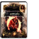</td><td class="col-meta">ファイターコンボカード #562 · 1-469最大4枚 (+3)</td><td class="col-name">
ヴァリアントブレイブ
</td><td class="col-id"><code>SKILL_SK347_FIGHTER_COMB30</code><button type="button" class="copy-id" data-copy="SKILL_SK347_FIGHTER_COMB30" title="ID SKILL_SK347_FIGHTER_COMB30 をコピー" aria-label="ID SKILL_SK347_FIGHTER_COMB30 をコピー">⧉</button></td><td class="col-info">
スキル／技：二刀流専用 · カード選択後Ａ＋ＧＡで発動

スキル／敵を高く打ち上げ、強力な叩き付け攻撃へとつなぐ
</td></tr>
<tr data-id="SKILL_SK348_FIGHTER_COMB30" data-cat="FIGHTER" data-flag="BASE" data-search="メテオストライク skill_sk348_fighter_comb30 ファイター コンボ スキル／技：二刀流専用 · カード選択後ａ＋ｇａで発動 スキル／敵を高く打ち上げ、強力な叩き付け攻撃へとつなぐ"><td class="col-img">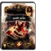</td><td class="col-meta">ファイターコンボカード #563 · 1-470最大4枚 (+3)</td><td class="col-name">
メテオストライク
</td><td class="col-id"><code>SKILL_SK348_FIGHTER_COMB30</code><button type="button" class="copy-id" data-copy="SKILL_SK348_FIGHTER_COMB30" title="ID SKILL_SK348_FIGHTER_COMB30 をコピー" aria-label="ID SKILL_SK348_FIGHTER_COMB30 をコピー">⧉</button></td><td class="col-info">
スキル／技：二刀流専用 · カード選択後Ａ＋ＧＡで発動

スキル／敵を高く打ち上げ、強力な叩き付け攻撃へとつなぐ
</td></tr>
<tr data-id="SKILL_SK349_FIGHTER_COMB31" data-cat="FIGHTER" data-flag="BASE" data-search="オーガデストラクション skill_sk349_fighter_comb31 ファイター コンボ スキル／技：両手斧専用 · カード選択後ａ＋ｇで発動 スキル／敵の頭上に力強く斧を振り下ろし、出血させる"><td class="col-img">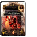</td><td class="col-meta">ファイターコンボカード #539 · 1-471最大4枚 (+3)</td><td class="col-name">
オーガデストラクション
</td><td class="col-id"><code>SKILL_SK349_FIGHTER_COMB31</code><button type="button" class="copy-id" data-copy="SKILL_SK349_FIGHTER_COMB31" title="ID SKILL_SK349_FIGHTER_COMB31 をコピー" aria-label="ID SKILL_SK349_FIGHTER_COMB31 をコピー">⧉</button></td><td class="col-info">
スキル／技：両手斧専用 · カード選択後Ａ＋Ｇで発動

スキル／敵の頭上に力強く斧を振り下ろし、出血させる
</td></tr>
<tr data-id="SKILL_SK350_FIGHTER_COMB27" data-cat="FIGHTER" data-flag="BASE" data-search="アトミックスマッシュ skill_sk350_fighter_comb27 ファイター コンボ スキル／技：片手斧専用 · カード選択後ａ＋ｇで発動 スキル／強力な縦斬り攻撃。溜めることで威力がアップする"><td class="col-img">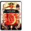</td><td class="col-meta">ファイターコンボカード #573 · 1-461最大4枚 (+3)</td><td class="col-name">
アトミックスマッシュ
</td><td class="col-id"><code>SKILL_SK350_FIGHTER_COMB27</code><button type="button" class="copy-id" data-copy="SKILL_SK350_FIGHTER_COMB27" title="ID SKILL_SK350_FIGHTER_COMB27 をコピー" aria-label="ID SKILL_SK350_FIGHTER_COMB27 をコピー">⧉</button></td><td class="col-info">
スキル／技：片手斧専用 · カード選択後Ａ＋Ｇで発動

スキル／強力な縦斬り攻撃。溜めることで威力がアップする
</td></tr>
<tr data-id="SKILL_SK365_FIGHTER_COMB26" data-cat="FIGHTER" data-flag="BASE" data-search="ヘルディバイド skill_sk365_fighter_comb26 ファイター コンボ スキル／技：片手斧専用 · カード選択後ａ＋ｇで発動 スキル／素早く敵を斬り付け、出血状態にさせる"><td class="col-img"></td><td class="col-meta">ファイターコンボカード #572 · 0-2721最大11枚 (+10)</td><td class="col-name">
ヘルディバイド
</td><td class="col-id"><code>SKILL_SK365_FIGHTER_COMB26</code><button type="button" class="copy-id" data-copy="SKILL_SK365_FIGHTER_COMB26" title="ID SKILL_SK365_FIGHTER_COMB26 をコピー" aria-label="ID SKILL_SK365_FIGHTER_COMB26 をコピー">⧉</button></td><td class="col-info">
スキル／技：片手斧専用 · カード選択後Ａ＋Ｇで発動

スキル／素早く敵を斬り付け、出血状態にさせる
</td></tr>
<tr data-id="SKILL_SK456_FIGHTER_SPEC02" data-cat="FIGHTER" data-flag="BASE" data-search="クロノストライフ skill_sk456_fighter_spec02 ファイター 特殊 スキル／技：攻撃強化 · ウィンドウで選択すると発動 スキル／攻撃時にｍｐを消費し攻撃力を高める"><td class="col-img"></td><td class="col-meta">ファイター特殊カード #394 · 1-391最大4枚 (+3)</td><td class="col-name">
クロノストライフ
</td><td class="col-id"><code>SKILL_SK456_FIGHTER_SPEC02</code><button type="button" class="copy-id" data-copy="SKILL_SK456_FIGHTER_SPEC02" title="ID SKILL_SK456_FIGHTER_SPEC02 をコピー" aria-label="ID SKILL_SK456_FIGHTER_SPEC02 をコピー">⧉</button></td><td class="col-info">
スキル／技：攻撃強化 · ウィンドウで選択すると発動

スキル／攻撃時にＭＰを消費し攻撃力を高める
</td></tr>
<tr data-id="SKILL_SK376_FIGHTER_COMB01_EX" data-cat="FIGHTER" data-flag="EX" data-search="ｖラッシュｅｘ skill_sk376_fighter_comb01_ex ファイター コンボ スキル／技：片手剣専用 · カード選択後ａａａで発動 スキル／素早い連係攻撃を繰り出す。３段目で敵を吹き飛ばす"><td class="col-img"></td><td class="col-meta">ファイターコンボEX</td><td class="col-name">
ＶラッシュＥＸ
</td><td class="col-id"><code>SKILL_SK376_FIGHTER_COMB01_EX</code><button type="button" class="copy-id" data-copy="SKILL_SK376_FIGHTER_COMB01_EX" title="ID SKILL_SK376_FIGHTER_COMB01_EX をコピー" aria-label="ID SKILL_SK376_FIGHTER_COMB01_EX をコピー">⧉</button></td><td class="col-info">
スキル／技：片手剣専用 · カード選択後ＡＡＡで発動

スキル／素早い連係攻撃を繰り出す。３段目で敵を吹き飛ばす
</td></tr>
<tr data-id="SKILL_SK378_FIGHTER_COMB15_EX" data-cat="FIGHTER" data-flag="EX" data-search="グランドブレイカーｅｘ skill_sk378_fighter_comb15_ex ファイター コンボ スキル／技：両手剣専用 · カード選択後ａ＋ｇで発動 スキル／強力な縦斬り攻撃。溜めることで威力がアップする"><td class="col-img"></td><td class="col-meta">ファイターコンボEX</td><td class="col-name">
グランドブレイカーＥＸ
</td><td class="col-id"><code>SKILL_SK378_FIGHTER_COMB15_EX</code><button type="button" class="copy-id" data-copy="SKILL_SK378_FIGHTER_COMB15_EX" title="ID SKILL_SK378_FIGHTER_COMB15_EX をコピー" aria-label="ID SKILL_SK378_FIGHTER_COMB15_EX をコピー">⧉</button></td><td class="col-info">
スキル／技：両手剣専用 · カード選択後Ａ＋Ｇで発動

スキル／強力な縦斬り攻撃。溜めることで威力がアップする
</td></tr>
<tr data-id="SKILL_SK379_FIGHTER_COMB04_EX" data-cat="FIGHTER" data-flag="EX" data-search="ハンドレットソードｅｘ skill_sk379_fighter_comb04_ex ファイター コンボ スキル／技：片手剣専用 · カード選択後ａ＋ｇ＋ｖで発動 スキル／剣による多段攻撃で大ダメージを与える必殺の奥義"><td class="col-img"></td><td class="col-meta">ファイターコンボEX</td><td class="col-name">
ハンドレットソードＥＸ
</td><td class="col-id"><code>SKILL_SK379_FIGHTER_COMB04_EX</code><button type="button" class="copy-id" data-copy="SKILL_SK379_FIGHTER_COMB04_EX" title="ID SKILL_SK379_FIGHTER_COMB04_EX をコピー" aria-label="ID SKILL_SK379_FIGHTER_COMB04_EX をコピー">⧉</button></td><td class="col-info">
スキル／技：片手剣専用 · カード選択後Ａ＋Ｇ＋Ｖで発動

スキル／剣による多段攻撃で大ダメージを与える必殺の奥義
</td></tr>
<tr data-id="SKILL_SK380_FIGHTER_COMB06_EX" data-cat="FIGHTER" data-flag="EX" data-search="バーサーカーラッシュｅｘ skill_sk380_fighter_comb06_ex ファイター コンボ スキル／技：片手斧専用 · カード選択後ａａａで発動 スキル／素早い連係攻撃を繰り出す。３段目で敵を浮かせる"><td class="col-img"></td><td class="col-meta">ファイターコンボEX</td><td class="col-name">
バーサーカーラッシュＥＸ
</td><td class="col-id"><code>SKILL_SK380_FIGHTER_COMB06_EX</code><button type="button" class="copy-id" data-copy="SKILL_SK380_FIGHTER_COMB06_EX" title="ID SKILL_SK380_FIGHTER_COMB06_EX をコピー" aria-label="ID SKILL_SK380_FIGHTER_COMB06_EX をコピー">⧉</button></td><td class="col-info">
スキル／技：片手斧専用 · カード選択後ＡＡＡで発動

スキル／素早い連係攻撃を繰り出す。３段目で敵を浮かせる
</td></tr>
<tr data-id="SKILL_SK381_FIGHTER_COMB19_EX" data-cat="FIGHTER" data-flag="EX" data-search="ロックブレイカーｅｘ skill_sk381_fighter_comb19_ex ファイター コンボ スキル／技：片手斧専用 · カード選択後ａ＋ｇで発動 スキル／体を１回転させ、攻撃範囲の広い強力な一撃を放つ"><td class="col-img"></td><td class="col-meta">ファイターコンボEX</td><td class="col-name">
ロックブレイカーＥＸ
</td><td class="col-id"><code>SKILL_SK381_FIGHTER_COMB19_EX</code><button type="button" class="copy-id" data-copy="SKILL_SK381_FIGHTER_COMB19_EX" title="ID SKILL_SK381_FIGHTER_COMB19_EX をコピー" aria-label="ID SKILL_SK381_FIGHTER_COMB19_EX をコピー">⧉</button></td><td class="col-info">
スキル／技：片手斧専用 · カード選択後Ａ＋Ｇで発動

スキル／体を１回転させ、攻撃範囲の広い強力な一撃を放つ
</td></tr>
<tr data-id="SKILL_SK383_FIGHTER_COMB18_EX" data-cat="FIGHTER" data-flag="EX" data-search="デッドエンドｅｘ skill_sk383_fighter_comb18_ex ファイター コンボ スキル／技：両手斧専用 · カード選択後ａ＋ｇで発動 スキル／大きく振りかぶり、範囲の広い強烈な一撃を繰り出す"><td class="col-img"></td><td class="col-meta">ファイターコンボEX</td><td class="col-name">
デッドエンドＥＸ
</td><td class="col-id"><code>SKILL_SK383_FIGHTER_COMB18_EX</code><button type="button" class="copy-id" data-copy="SKILL_SK383_FIGHTER_COMB18_EX" title="ID SKILL_SK383_FIGHTER_COMB18_EX をコピー" aria-label="ID SKILL_SK383_FIGHTER_COMB18_EX をコピー">⧉</button></td><td class="col-info">
スキル／技：両手斧専用 · カード選択後Ａ＋Ｇで発動

スキル／大きく振りかぶり、範囲の広い強烈な一撃を繰り出す
</td></tr>
<tr data-id="SKILL_SK384_FIGHTER_COMB11_EX" data-cat="FIGHTER" data-flag="EX" data-search="ピアシングオールｅｘ skill_sk384_fighter_comb11_ex ファイター コンボ スキル／技：槍専用 · カード選択後ａａａで発動 スキル／なぎ払いから２連の突きへとつなぐ３段攻撃"><td class="col-img"></td><td class="col-meta">ファイターコンボEX</td><td class="col-name">
ピアシングオールＥＸ
</td><td class="col-id"><code>SKILL_SK384_FIGHTER_COMB11_EX</code><button type="button" class="copy-id" data-copy="SKILL_SK384_FIGHTER_COMB11_EX" title="ID SKILL_SK384_FIGHTER_COMB11_EX をコピー" aria-label="ID SKILL_SK384_FIGHTER_COMB11_EX をコピー">⧉</button></td><td class="col-info">
スキル／技：槍専用 · カード選択後ＡＡＡで発動

スキル／なぎ払いから２連の突きへとつなぐ３段攻撃
</td></tr>
<tr data-id="SKILL_SK386_FIGHTER_COMB08_EX" data-cat="FIGHTER" data-flag="EX" data-search="ホースライダースラストｅｘ skill_sk386_fighter_comb08_ex ファイター コンボ スキル／技：槍専用 · カード選択後ａ＋ｇａで発動 スキル／１発目がヒットした瞬間にａを入力すると蹴りが発動"><td class="col-img"></td><td class="col-meta">ファイターコンボEX</td><td class="col-name">
ホースライダースラストＥＸ
</td><td class="col-id"><code>SKILL_SK386_FIGHTER_COMB08_EX</code><button type="button" class="copy-id" data-copy="SKILL_SK386_FIGHTER_COMB08_EX" title="ID SKILL_SK386_FIGHTER_COMB08_EX をコピー" aria-label="ID SKILL_SK386_FIGHTER_COMB08_EX をコピー">⧉</button></td><td class="col-info">
スキル／技：槍専用 · カード選択後Ａ＋ＧＡで発動

スキル／１発目がヒットした瞬間にＡを入力すると蹴りが発動
</td></tr>
<tr data-id="SKILL_SK387_FIGHTER_COMB09_EX" data-cat="FIGHTER" data-flag="EX" data-search="ｈスラッシュｅｘ skill_sk387_fighter_comb09_ex ファイター コンボ スキル／技：槍専用 · カード選択後ａ＋ｇ＋ｖで発動 スキル／槍による多段攻撃で大ダメージを与える必殺の奥義"><td class="col-img"></td><td class="col-meta">ファイターコンボEX</td><td class="col-name">
ＨスラッシュＥＸ
</td><td class="col-id"><code>SKILL_SK387_FIGHTER_COMB09_EX</code><button type="button" class="copy-id" data-copy="SKILL_SK387_FIGHTER_COMB09_EX" title="ID SKILL_SK387_FIGHTER_COMB09_EX をコピー" aria-label="ID SKILL_SK387_FIGHTER_COMB09_EX をコピー">⧉</button></td><td class="col-info">
スキル／技：槍専用 · カード選択後Ａ＋Ｇ＋Ｖで発動

スキル／槍による多段攻撃で大ダメージを与える必殺の奥義
</td></tr>
<tr data-id="SKILL_SK391_FIGHTER_SPEC02_EX" data-cat="FIGHTER" data-flag="EX" data-search="クロノストライフｅｘ skill_sk391_fighter_spec02_ex ファイター 特殊 スキル／技：攻撃強化 · ウィンドウで選択すると発動 スキル／攻撃時にｍｐを消費し攻撃力を高める"><td class="col-img"></td><td class="col-meta">ファイター特殊EX</td><td class="col-name">
クロノストライフＥＸ
</td><td class="col-id"><code>SKILL_SK391_FIGHTER_SPEC02_EX</code><button type="button" class="copy-id" data-copy="SKILL_SK391_FIGHTER_SPEC02_EX" title="ID SKILL_SK391_FIGHTER_SPEC02_EX をコピー" aria-label="ID SKILL_SK391_FIGHTER_SPEC02_EX をコピー">⧉</button></td><td class="col-info">
スキル／技：攻撃強化 · ウィンドウで選択すると発動

スキル／攻撃時にＭＰを消費し攻撃力を高める
</td></tr>
</tbody></table>

<h2 class="cat-title">シーフ (31)</h2>

<table class="wiki-table"><thead><tr><th>アイコン</th><th>職業 / 分類</th><th>名称</th><th>ID</th><th>発動条件・効果</th></tr></thead><tbody>
<tr data-id="SKILL_SK249_THIEF_COMB05" data-cat="THIEF" data-flag="BASE" data-search="バックロール skill_sk249_thief_comb05 シーフ コンボ スキル／技：回避行動 · ユーズボタンなどで発動 スキル／身をひるがえし、敵の攻撃を避けることができる"><td class="col-img"></td><td class="col-meta">シーフコンボカード #345 · 0-2584最大11枚 (+10)</td><td class="col-name">
バックロール
</td><td class="col-id"><code>SKILL_SK249_THIEF_COMB05</code><button type="button" class="copy-id" data-copy="SKILL_SK249_THIEF_COMB05" title="ID SKILL_SK249_THIEF_COMB05 をコピー" aria-label="ID SKILL_SK249_THIEF_COMB05 をコピー">⧉</button></td><td class="col-info">
スキル／技：回避行動 · ユーズボタンなどで発動

スキル／身をひるがえし、敵の攻撃を避けることができる
</td></tr>
<tr data-id="SKILL_SK250_THIEF_COMB06" data-cat="THIEF" data-flag="BASE" data-search="ｌスラッシュⅰ skill_sk250_thief_comb06 シーフ コンボ スキル／技：ナイフ専用 · カード選択後ａａａで発動 スキル／素早い連係攻撃を繰り出す。３段目でダウンを奪う"><td class="col-img"></td><td class="col-meta">シーフコンボカード #065/291/412 · 0-2541最大6枚 (+5)</td><td class="col-name">
ＬスラッシュⅠ
</td><td class="col-id"><code>SKILL_SK250_THIEF_COMB06</code><button type="button" class="copy-id" data-copy="SKILL_SK250_THIEF_COMB06" title="ID SKILL_SK250_THIEF_COMB06 をコピー" aria-label="ID SKILL_SK250_THIEF_COMB06 をコピー">⧉</button></td><td class="col-info">
スキル／技：ナイフ専用 · カード選択後ＡＡＡで発動

スキル／素早い連係攻撃を繰り出す。３段目でダウンを奪う
</td></tr>
<tr data-id="SKILL_SK251_THIEF_COMB06" data-cat="THIEF" data-flag="BASE" data-search="ｌスラッシュⅱ skill_sk251_thief_comb06 シーフ コンボ スキル／技：ナイフ専用 · カード選択後ａａａで発動 スキル／素早い連係攻撃を繰り出す。３段目でダウンを奪う"><td class="col-img"></td><td class="col-meta">シーフコンボカード #066/292/413 · 0-2542最大6枚 (+5)</td><td class="col-name">
ＬスラッシュⅡ
</td><td class="col-id"><code>SKILL_SK251_THIEF_COMB06</code><button type="button" class="copy-id" data-copy="SKILL_SK251_THIEF_COMB06" title="ID SKILL_SK251_THIEF_COMB06 をコピー" aria-label="ID SKILL_SK251_THIEF_COMB06 をコピー">⧉</button></td><td class="col-info">
スキル／技：ナイフ専用 · カード選択後ＡＡＡで発動

スキル／素早い連係攻撃を繰り出す。３段目でダウンを奪う
</td></tr>
<tr data-id="SKILL_SK252_THIEF_COMB06" data-cat="THIEF" data-flag="BASE" data-search="ｌスラッシュⅲ skill_sk252_thief_comb06 シーフ コンボ スキル／技：ナイフ専用 · カード選択後ａａａで発動 スキル／素早い連係攻撃を繰り出す。３段目でダウンを奪う"><td class="col-img"></td><td class="col-meta">シーフコンボカード #293/414 · 0-2543最大6枚 (+5)</td><td class="col-name">
ＬスラッシュⅢ
</td><td class="col-id"><code>SKILL_SK252_THIEF_COMB06</code><button type="button" class="copy-id" data-copy="SKILL_SK252_THIEF_COMB06" title="ID SKILL_SK252_THIEF_COMB06 をコピー" aria-label="ID SKILL_SK252_THIEF_COMB06 をコピー">⧉</button></td><td class="col-info">
スキル／技：ナイフ専用 · カード選択後ＡＡＡで発動

スキル／素早い連係攻撃を繰り出す。３段目でダウンを奪う
</td></tr>
<tr data-id="SKILL_SK253_THIEF_COMB07" data-cat="THIEF" data-flag="BASE" data-search="ｋスラッシュⅰ skill_sk253_thief_comb07 シーフ コンボ スキル／技：ナイフ専用 · カード選択後ａａａで発動 スキル／２段の突き攻撃から攻撃範囲の広い横斬りへとつなぐ"><td class="col-img"></td><td class="col-meta">シーフコンボカード #065/291/412 · 0-2659最大6枚 (+5)</td><td class="col-name">
ＫスラッシュⅠ
</td><td class="col-id"><code>SKILL_SK253_THIEF_COMB07</code><button type="button" class="copy-id" data-copy="SKILL_SK253_THIEF_COMB07" title="ID SKILL_SK253_THIEF_COMB07 をコピー" aria-label="ID SKILL_SK253_THIEF_COMB07 をコピー">⧉</button></td><td class="col-info">
スキル／技：ナイフ専用 · カード選択後ＡＡＡで発動

スキル／２段の突き攻撃から攻撃範囲の広い横斬りへとつなぐ
</td></tr>
<tr data-id="SKILL_SK254_THIEF_COMB07" data-cat="THIEF" data-flag="BASE" data-search="ｋスラッシュⅱ skill_sk254_thief_comb07 シーフ コンボ スキル／技：ナイフ専用 · カード選択後ａａａで発動 スキル／２段の突き攻撃から攻撃範囲の広い横斬りへとつなぐ"><td class="col-img"></td><td class="col-meta">シーフコンボカード #066/292/413 · 0-2660最大6枚 (+5)</td><td class="col-name">
ＫスラッシュⅡ
</td><td class="col-id"><code>SKILL_SK254_THIEF_COMB07</code><button type="button" class="copy-id" data-copy="SKILL_SK254_THIEF_COMB07" title="ID SKILL_SK254_THIEF_COMB07 をコピー" aria-label="ID SKILL_SK254_THIEF_COMB07 をコピー">⧉</button></td><td class="col-info">
スキル／技：ナイフ専用 · カード選択後ＡＡＡで発動

スキル／２段の突き攻撃から攻撃範囲の広い横斬りへとつなぐ
</td></tr>
<tr data-id="SKILL_SK255_THIEF_COMB07" data-cat="THIEF" data-flag="BASE" data-search="ｋスラッシュⅲ skill_sk255_thief_comb07 シーフ コンボ スキル／技：ナイフ専用 · カード選択後ａａａで発動 スキル／２段の突き攻撃から攻撃範囲の広い横斬りへとつなぐ"><td class="col-img"></td><td class="col-meta">シーフコンボカード #293/414 · 0-2661最大6枚 (+5)</td><td class="col-name">
ＫスラッシュⅢ
</td><td class="col-id"><code>SKILL_SK255_THIEF_COMB07</code><button type="button" class="copy-id" data-copy="SKILL_SK255_THIEF_COMB07" title="ID SKILL_SK255_THIEF_COMB07 をコピー" aria-label="ID SKILL_SK255_THIEF_COMB07 をコピー">⧉</button></td><td class="col-info">
スキル／技：ナイフ専用 · カード選択後ＡＡＡで発動

スキル／２段の突き攻撃から攻撃範囲の広い横斬りへとつなぐ
</td></tr>
<tr data-id="SKILL_SK262_THIEF_COMB11" data-cat="THIEF" data-flag="BASE" data-search="ヘビースタッブ skill_sk262_thief_comb11 シーフ コンボ スキル／技：ナイフ専用 · カード選択後ａ＋ｇで発動 スキル／力を溜め、敵の急所に強烈な突きを叩き込む"><td class="col-img"></td><td class="col-meta">シーフコンボカード #294 · 0-2544最大6枚 (+5)</td><td class="col-name">
ヘビースタッブ
</td><td class="col-id"><code>SKILL_SK262_THIEF_COMB11</code><button type="button" class="copy-id" data-copy="SKILL_SK262_THIEF_COMB11" title="ID SKILL_SK262_THIEF_COMB11 をコピー" aria-label="ID SKILL_SK262_THIEF_COMB11 をコピー">⧉</button></td><td class="col-info">
スキル／技：ナイフ専用 · カード選択後Ａ＋Ｇで発動

スキル／力を溜め、敵の急所に強烈な突きを叩き込む
</td></tr>
<tr data-id="SKILL_SK265_THIEF_COMB14" data-cat="THIEF" data-flag="BASE" data-search="エクステンシブショット skill_sk265_thief_comb14 シーフ コンボ スキル／技：弓矢専用 · カード選択後ａ＋ｇで発動 スキル／３本の矢を同時に射出する。広範囲に攻撃可能"><td class="col-img"></td><td class="col-meta">シーフコンボカード #411 · 0-2658最大6枚 (+5)</td><td class="col-name">
エクステンシブショット
</td><td class="col-id"><code>SKILL_SK265_THIEF_COMB14</code><button type="button" class="copy-id" data-copy="SKILL_SK265_THIEF_COMB14" title="ID SKILL_SK265_THIEF_COMB14 をコピー" aria-label="ID SKILL_SK265_THIEF_COMB14 をコピー">⧉</button></td><td class="col-info">
スキル／技：弓矢専用 · カード選択後Ａ＋Ｇで発動

スキル／３本の矢を同時に射出する。広範囲に攻撃可能
</td></tr>
<tr data-id="SKILL_SK266_THIEF_MEGACRUSH" data-cat="THIEF" data-flag="BASE" data-search="ブラッディレイン skill_sk266_thief_megacrush シーフ メガクラッシュ スキル／技：全方位 · カード選択後ａ＋ｇ＋ｖで発動 スキル／複数の爆弾を投げ、大ダメージを与える必殺の奥義"><td class="col-img"></td><td class="col-meta">シーフメガクラッシュカード #486 · 1-403最大4枚 (+3)</td><td class="col-name">
ブラッディレイン
</td><td class="col-id"><code>SKILL_SK266_THIEF_MEGACRUSH</code><button type="button" class="copy-id" data-copy="SKILL_SK266_THIEF_MEGACRUSH" title="ID SKILL_SK266_THIEF_MEGACRUSH をコピー" aria-label="ID SKILL_SK266_THIEF_MEGACRUSH をコピー">⧉</button></td><td class="col-info">
スキル／技：全方位 · カード選択後Ａ＋Ｇ＋Ｖで発動

スキル／複数の爆弾を投げ、大ダメージを与える必殺の奥義
</td></tr>
<tr data-id="SKILL_SK267_THIEF_COMB16" data-cat="THIEF" data-flag="BASE" data-search="イマジナリーアロー skill_sk267_thief_comb16 シーフ コンボ スキル／技：弓矢専用 · ユーズボタンなどで発動 スキル／一時的に、矢を消費せずに射出できるようになる"><td class="col-img"></td><td class="col-meta">シーフコンボカード #431 · 0-2679最大11枚 (+10)</td><td class="col-name">
イマジナリーアロー
</td><td class="col-id"><code>SKILL_SK267_THIEF_COMB16</code><button type="button" class="copy-id" data-copy="SKILL_SK267_THIEF_COMB16" title="ID SKILL_SK267_THIEF_COMB16 をコピー" aria-label="ID SKILL_SK267_THIEF_COMB16 をコピー">⧉</button></td><td class="col-info">
スキル／技：弓矢専用 · ユーズボタンなどで発動

スキル／一時的に、矢を消費せずに射出できるようになる
</td></tr>
<tr data-id="SKILL_SK269_THIEF_COMB18" data-cat="THIEF" data-flag="BASE" data-search="チャージショット skill_sk269_thief_comb18 シーフ コンボ スキル／技：弓矢専用 · カード選択後ａ＋ｇで発動 スキル／力を溜め、敵の急所を狙って高威力の矢を発射する"><td class="col-img"></td><td class="col-meta">シーフコンボカード #342 · 0-2581最大11枚 (+10)</td><td class="col-name">
チャージショット
</td><td class="col-id"><code>SKILL_SK269_THIEF_COMB18</code><button type="button" class="copy-id" data-copy="SKILL_SK269_THIEF_COMB18" title="ID SKILL_SK269_THIEF_COMB18 をコピー" aria-label="ID SKILL_SK269_THIEF_COMB18 をコピー">⧉</button></td><td class="col-info">
スキル／技：弓矢専用 · カード選択後Ａ＋Ｇで発動

スキル／力を溜め、敵の急所を狙って高威力の矢を発射する
</td></tr>
<tr data-id="SKILL_SK336_THIEF_SPEC03" data-cat="THIEF" data-flag="BASE" data-search="サイレントフラッシュ skill_sk336_thief_spec03 シーフ 特殊 スキル／技：攻撃強化 · ウィンドウで選択すると発動 スキル／クリティカルヒット時にｍｐを消費し攻撃力を高める"><td class="col-img"></td><td class="col-meta">シーフ特殊カード #583 · 1-465最大4枚 (+3)</td><td class="col-name">
サイレントフラッシュ
</td><td class="col-id"><code>SKILL_SK336_THIEF_SPEC03</code><button type="button" class="copy-id" data-copy="SKILL_SK336_THIEF_SPEC03" title="ID SKILL_SK336_THIEF_SPEC03 をコピー" aria-label="ID SKILL_SK336_THIEF_SPEC03 をコピー">⧉</button></td><td class="col-info">
スキル／技：攻撃強化 · ウィンドウで選択すると発動

スキル／クリティカルヒット時にＭＰを消費し攻撃力を高める
</td></tr>
<tr data-id="SKILL_SK337_THIEF_COMB19" data-cat="THIEF" data-flag="BASE" data-search="デッドリーロンドⅰ skill_sk337_thief_comb19 シーフ コンボ スキル／技：ナイフ専用 · カード選択後ａａａで発動 スキル／短剣による連続攻撃から爆弾へとつなぐ"><td class="col-img"></td><td class="col-meta">シーフコンボカード #585 · 0-2733最大6枚 (+5)</td><td class="col-name">
デッドリーロンドⅠ
</td><td class="col-id"><code>SKILL_SK337_THIEF_COMB19</code><button type="button" class="copy-id" data-copy="SKILL_SK337_THIEF_COMB19" title="ID SKILL_SK337_THIEF_COMB19 をコピー" aria-label="ID SKILL_SK337_THIEF_COMB19 をコピー">⧉</button></td><td class="col-info">
スキル／技：ナイフ専用 · カード選択後ＡＡＡで発動

スキル／短剣による連続攻撃から爆弾へとつなぐ
</td></tr>
<tr data-id="SKILL_SK338_THIEF_COMB19" data-cat="THIEF" data-flag="BASE" data-search="デッドリーロンドⅱ skill_sk338_thief_comb19 シーフ コンボ スキル／技：ナイフ専用 · カード選択後ａａａで発動 スキル／短剣による連続攻撃から爆弾へとつなぐ"><td class="col-img"></td><td class="col-meta">シーフコンボカード #586 · 0-2734最大6枚 (+5)</td><td class="col-name">
デッドリーロンドⅡ
</td><td class="col-id"><code>SKILL_SK338_THIEF_COMB19</code><button type="button" class="copy-id" data-copy="SKILL_SK338_THIEF_COMB19" title="ID SKILL_SK338_THIEF_COMB19 をコピー" aria-label="ID SKILL_SK338_THIEF_COMB19 をコピー">⧉</button></td><td class="col-info">
スキル／技：ナイフ専用 · カード選択後ＡＡＡで発動

スキル／短剣による連続攻撃から爆弾へとつなぐ
</td></tr>
<tr data-id="SKILL_SK339_THIEF_COMB19" data-cat="THIEF" data-flag="BASE" data-search="デッドリーロンドⅲ skill_sk339_thief_comb19 シーフ コンボ スキル／技：ナイフ専用 · カード選択後ａａａで発動 スキル／短剣による連続攻撃から爆弾へとつなぐ"><td class="col-img"></td><td class="col-meta">シーフコンボカード #587 · 0-2735最大6枚 (+5)</td><td class="col-name">
デッドリーロンドⅢ
</td><td class="col-id"><code>SKILL_SK339_THIEF_COMB19</code><button type="button" class="copy-id" data-copy="SKILL_SK339_THIEF_COMB19" title="ID SKILL_SK339_THIEF_COMB19 をコピー" aria-label="ID SKILL_SK339_THIEF_COMB19 をコピー">⧉</button></td><td class="col-info">
スキル／技：ナイフ専用 · カード選択後ＡＡＡで発動

スキル／短剣による連続攻撃から爆弾へとつなぐ
</td></tr>
<tr data-id="SKILL_SK358_THIEF_COMB22" data-cat="THIEF" data-flag="BASE" data-search="デュアルスタッブ skill_sk358_thief_comb22 シーフ コンボ スキル／技：ナイフ専用 · カード選択後ａ＋ｇで発動 スキル／装備した短剣で、素早い連続突きを繰り出す"><td class="col-img"></td><td class="col-meta">シーフコンボカード #570 · 1-482最大4枚 (+3)</td><td class="col-name">
デュアルスタッブ
</td><td class="col-id"><code>SKILL_SK358_THIEF_COMB22</code><button type="button" class="copy-id" data-copy="SKILL_SK358_THIEF_COMB22" title="ID SKILL_SK358_THIEF_COMB22 をコピー" aria-label="ID SKILL_SK358_THIEF_COMB22 をコピー">⧉</button></td><td class="col-info">
スキル／技：ナイフ専用 · カード選択後Ａ＋Ｇで発動

スキル／装備した短剣で、素早い連続突きを繰り出す
</td></tr>
<tr data-id="SKILL_SK364_THIEF_COMB21" data-cat="THIEF" data-flag="BASE" data-search="シャイニングアロー skill_sk364_thief_comb21 シーフ コンボ スキル／技：弓矢専用 · カード選択後ａ＋ｇで発動 スキル／発動中にロックオンした敵全てに矢を放つ"><td class="col-img"></td><td class="col-meta">シーフコンボカード #547 · 1-480最大4枚 (+3)</td><td class="col-name">
シャイニングアロー
</td><td class="col-id"><code>SKILL_SK364_THIEF_COMB21</code><button type="button" class="copy-id" data-copy="SKILL_SK364_THIEF_COMB21" title="ID SKILL_SK364_THIEF_COMB21 をコピー" aria-label="ID SKILL_SK364_THIEF_COMB21 をコピー">⧉</button></td><td class="col-info">
スキル／技：弓矢専用 · カード選択後Ａ＋Ｇで発動

スキル／発動中にロックオンした敵全てに矢を放つ
</td></tr>
<tr data-id="SKILL_SK366_THIEF_SPEC02" data-cat="THIEF" data-flag="BASE" data-search="ハンターズアイ skill_sk366_thief_spec02 シーフ 特殊 スキル／技：攻撃強化 · ウィンドウで選択すると発動 スキル／弓矢の飛距離を犠牲にし、威力を最大限に高める"><td class="col-img"></td><td class="col-meta">シーフ特殊カード #548 · 0-2751最大6枚 (+5)</td><td class="col-name">
ハンターズアイ
</td><td class="col-id"><code>SKILL_SK366_THIEF_SPEC02</code><button type="button" class="copy-id" data-copy="SKILL_SK366_THIEF_SPEC02" title="ID SKILL_SK366_THIEF_SPEC02 をコピー" aria-label="ID SKILL_SK366_THIEF_SPEC02 をコピー">⧉</button></td><td class="col-info">
スキル／技：攻撃強化 · ウィンドウで選択すると発動

スキル／弓矢の飛距離を犠牲にし、威力を最大限に高める
</td></tr>
<tr data-id="SKILL_SK368_THIEF_SPEC01" data-cat="THIEF" data-flag="BASE" data-search="ヴァイパーバイト skill_sk368_thief_spec01 シーフ 特殊 スキル／技：能力変化 · ウィンドウで選択すると発動 スキル／毒状態の相手にのみ、致命的な一撃を与える"><td class="col-img"></td><td class="col-meta">シーフ特殊カード #529 · 0-2737最大6枚 (+5)</td><td class="col-name">
ヴァイパーバイト
</td><td class="col-id"><code>SKILL_SK368_THIEF_SPEC01</code><button type="button" class="copy-id" data-copy="SKILL_SK368_THIEF_SPEC01" title="ID SKILL_SK368_THIEF_SPEC01 をコピー" aria-label="ID SKILL_SK368_THIEF_SPEC01 をコピー">⧉</button></td><td class="col-info">
スキル／技：能力変化 · ウィンドウで選択すると発動

スキル／毒状態の相手にのみ、致命的な一撃を与える
</td></tr>
<tr data-id="SKILL_SK371_THIEF_COMB23" data-cat="THIEF" data-flag="BASE" data-search="ライトニングブラスト skill_sk371_thief_comb23 シーフ コンボ スキル／技：弓矢専用 · カード選択後ａ＋ｇで発動 スキル／天空に向かって矢を放ち、落雷でダメージを与える"><td class="col-img"></td><td class="col-meta">シーフコンボカード #531 · 1-467最大4枚 (+3)</td><td class="col-name">
ライトニングブラスト
</td><td class="col-id"><code>SKILL_SK371_THIEF_COMB23</code><button type="button" class="copy-id" data-copy="SKILL_SK371_THIEF_COMB23" title="ID SKILL_SK371_THIEF_COMB23 をコピー" aria-label="ID SKILL_SK371_THIEF_COMB23 をコピー">⧉</button></td><td class="col-info">
スキル／技：弓矢専用 · カード選択後Ａ＋Ｇで発動

スキル／天空に向かって矢を放ち、落雷でダメージを与える
</td></tr>
<tr data-id="SKILL_SK372_THIEF_COMB20" data-cat="THIEF" data-flag="BASE" data-search="リストレインショット skill_sk372_thief_comb20 シーフ コンボ スキル／技：弓矢専用 · カード選択後ａで発動 スキル／敵をダウンさせる効果のある弓矢攻撃"><td class="col-img"></td><td class="col-meta">シーフコンボカード #532 · 0-2739最大11枚 (+10)</td><td class="col-name">
リストレインショット
</td><td class="col-id"><code>SKILL_SK372_THIEF_COMB20</code><button type="button" class="copy-id" data-copy="SKILL_SK372_THIEF_COMB20" title="ID SKILL_SK372_THIEF_COMB20 をコピー" aria-label="ID SKILL_SK372_THIEF_COMB20 をコピー">⧉</button></td><td class="col-info">
スキル／技：弓矢専用 · カード選択後Ａで発動

スキル／敵をダウンさせる効果のある弓矢攻撃
</td></tr>
<tr data-id="SKILL_SK525_THIEF_COMB06_EX" data-cat="THIEF" data-flag="EX" data-search="ｌスラッシュｅｘ skill_sk525_thief_comb06_ex シーフ コンボ スキル／技：ナイフ専用 · カード選択後ａａａで発動 スキル／素早い連係攻撃を繰り出す。３段目でダウンを奪う"><td class="col-img"></td><td class="col-meta">シーフコンボEX</td><td class="col-name">
ＬスラッシュＥＸ
</td><td class="col-id"><code>SKILL_SK525_THIEF_COMB06_EX</code><button type="button" class="copy-id" data-copy="SKILL_SK525_THIEF_COMB06_EX" title="ID SKILL_SK525_THIEF_COMB06_EX をコピー" aria-label="ID SKILL_SK525_THIEF_COMB06_EX をコピー">⧉</button></td><td class="col-info">
スキル／技：ナイフ専用 · カード選択後ＡＡＡで発動

スキル／素早い連係攻撃を繰り出す。３段目でダウンを奪う
</td></tr>
<tr data-id="SKILL_SK527_THIEF_COMB07_EX" data-cat="THIEF" data-flag="EX" data-search="ｋスラッシュｅｘ skill_sk527_thief_comb07_ex シーフ コンボ スキル／技：ナイフ専用 · カード選択後ａａａで発動 スキル／２段の突き攻撃から攻撃範囲の広い横斬りへとつなぐ"><td class="col-img"></td><td class="col-meta">シーフコンボEX</td><td class="col-name">
ＫスラッシュＥＸ
</td><td class="col-id"><code>SKILL_SK527_THIEF_COMB07_EX</code><button type="button" class="copy-id" data-copy="SKILL_SK527_THIEF_COMB07_EX" title="ID SKILL_SK527_THIEF_COMB07_EX をコピー" aria-label="ID SKILL_SK527_THIEF_COMB07_EX をコピー">⧉</button></td><td class="col-info">
スキル／技：ナイフ専用 · カード選択後ＡＡＡで発動

スキル／２段の突き攻撃から攻撃範囲の広い横斬りへとつなぐ
</td></tr>
<tr data-id="SKILL_SK528_THIEF_COMB11_EX" data-cat="THIEF" data-flag="EX" data-search="ヘビースタッブｅｘ skill_sk528_thief_comb11_ex シーフ コンボ スキル／技：ナイフ専用 · カード選択後ａ＋ｇで発動 スキル／力を溜め、敵の急所に強烈な突きを叩き込む"><td class="col-img"></td><td class="col-meta">シーフコンボEX</td><td class="col-name">
ヘビースタッブＥＸ
</td><td class="col-id"><code>SKILL_SK528_THIEF_COMB11_EX</code><button type="button" class="copy-id" data-copy="SKILL_SK528_THIEF_COMB11_EX" title="ID SKILL_SK528_THIEF_COMB11_EX をコピー" aria-label="ID SKILL_SK528_THIEF_COMB11_EX をコピー">⧉</button></td><td class="col-info">
スキル／技：ナイフ専用 · カード選択後Ａ＋Ｇで発動

スキル／力を溜め、敵の急所に強烈な突きを叩き込む
</td></tr>
<tr data-id="SKILL_SK529_THIEF_COMB18_EX" data-cat="THIEF" data-flag="EX" data-search="チャージショットｅｘ skill_sk529_thief_comb18_ex シーフ コンボ スキル／技：弓矢専用 · カード選択後ａ＋ｇで発動 スキル／攻撃に時間を要するが強力な一撃が繰り出せる"><td class="col-img"></td><td class="col-meta">シーフコンボEX</td><td class="col-name">
チャージショットＥＸ
</td><td class="col-id"><code>SKILL_SK529_THIEF_COMB18_EX</code><button type="button" class="copy-id" data-copy="SKILL_SK529_THIEF_COMB18_EX" title="ID SKILL_SK529_THIEF_COMB18_EX をコピー" aria-label="ID SKILL_SK529_THIEF_COMB18_EX をコピー">⧉</button></td><td class="col-info">
スキル／技：弓矢専用 · カード選択後Ａ＋Ｇで発動

スキル／攻撃に時間を要するが強力な一撃が繰り出せる
</td></tr>
<tr data-id="SKILL_SK530_THIEF_COMB20_EX" data-cat="THIEF" data-flag="EX" data-search="リストレインショットｅｘ skill_sk530_thief_comb20_ex シーフ コンボ スキル／技：弓矢専用 · カード選択後ａで発動 スキル／敵をダウンさせる効果のある弓矢攻撃"><td class="col-img"></td><td class="col-meta">シーフコンボEX</td><td class="col-name">
リストレインショットＥＸ
</td><td class="col-id"><code>SKILL_SK530_THIEF_COMB20_EX</code><button type="button" class="copy-id" data-copy="SKILL_SK530_THIEF_COMB20_EX" title="ID SKILL_SK530_THIEF_COMB20_EX をコピー" aria-label="ID SKILL_SK530_THIEF_COMB20_EX をコピー">⧉</button></td><td class="col-info">
スキル／技：弓矢専用 · カード選択後Ａで発動

スキル／敵をダウンさせる効果のある弓矢攻撃
</td></tr>
<tr data-id="SKILL_SK531_THIEF_COMB14_EX" data-cat="THIEF" data-flag="EX" data-search="エクステンシブショットｅｘ skill_sk531_thief_comb14_ex シーフ コンボ スキル／技：弓矢専用 · カード選択後ａ＋ｇで発動 スキル／３本の矢を同時に射出する。広範囲に攻撃可能"><td class="col-img"></td><td class="col-meta">シーフコンボEX</td><td class="col-name">
エクステンシブショットＥＸ
</td><td class="col-id"><code>SKILL_SK531_THIEF_COMB14_EX</code><button type="button" class="copy-id" data-copy="SKILL_SK531_THIEF_COMB14_EX" title="ID SKILL_SK531_THIEF_COMB14_EX をコピー" aria-label="ID SKILL_SK531_THIEF_COMB14_EX をコピー">⧉</button></td><td class="col-info">
スキル／技：弓矢専用 · カード選択後Ａ＋Ｇで発動

スキル／３本の矢を同時に射出する。広範囲に攻撃可能
</td></tr>
<tr data-id="SKILL_SK532_THIEF_COMB23_EX" data-cat="THIEF" data-flag="EX" data-search="ライトニングブラストｅｘ skill_sk532_thief_comb23_ex シーフ コンボ スキル／技：弓矢専用 · カード選択後ａ＋ｇで発動 スキル／天空に向かって矢を放ち、落雷でダメージを与える"><td class="col-img"></td><td class="col-meta">シーフコンボEX</td><td class="col-name">
ライトニングブラストＥＸ
</td><td class="col-id"><code>SKILL_SK532_THIEF_COMB23_EX</code><button type="button" class="copy-id" data-copy="SKILL_SK532_THIEF_COMB23_EX" title="ID SKILL_SK532_THIEF_COMB23_EX をコピー" aria-label="ID SKILL_SK532_THIEF_COMB23_EX をコピー">⧉</button></td><td class="col-info">
スキル／技：弓矢専用 · カード選択後Ａ＋Ｇで発動

スキル／天空に向かって矢を放ち、落雷でダメージを与える
</td></tr>
<tr data-id="SKILL_SK536_THIEF_MEGACRUSH_EX" data-cat="THIEF" data-flag="EX" data-search="ブラッディレインｅｘ skill_sk536_thief_megacrush_ex シーフ メガクラッシュ スキル／技：全方位 · カード選択後ａ＋ｇ＋ｖで発動 スキル／複数の爆弾を投げ、大ダメージを与える必殺の奥義"><td class="col-img"></td><td class="col-meta">シーフメガクラッシュEX</td><td class="col-name">
ブラッディレインＥＸ
</td><td class="col-id"><code>SKILL_SK536_THIEF_MEGACRUSH_EX</code><button type="button" class="copy-id" data-copy="SKILL_SK536_THIEF_MEGACRUSH_EX" title="ID SKILL_SK536_THIEF_MEGACRUSH_EX をコピー" aria-label="ID SKILL_SK536_THIEF_MEGACRUSH_EX をコピー">⧉</button></td><td class="col-info">
スキル／技：全方位 · カード選択後Ａ＋Ｇ＋Ｖで発動

スキル／複数の爆弾を投げ、大ダメージを与える必殺の奥義
</td></tr>
<tr data-id="SKILL_SK542_THIEF_SPEC03_EX" data-cat="THIEF" data-flag="EX" data-search="サイレントフラッシュｅｘ skill_sk542_thief_spec03_ex シーフ 特殊 スキル／技：攻撃強化 · ウィンドウで選択すると発動 スキル／クリティカルヒット時にｍｐを消費し攻撃力を高める"><td class="col-img"></td><td class="col-meta">シーフ特殊EX</td><td class="col-name">
サイレントフラッシュＥＸ
</td><td class="col-id"><code>SKILL_SK542_THIEF_SPEC03_EX</code><button type="button" class="copy-id" data-copy="SKILL_SK542_THIEF_SPEC03_EX" title="ID SKILL_SK542_THIEF_SPEC03_EX をコピー" aria-label="ID SKILL_SK542_THIEF_SPEC03_EX をコピー">⧉</button></td><td class="col-info">
スキル／技：攻撃強化 · ウィンドウで選択すると発動

スキル／クリティカルヒット時にＭＰを消費し攻撃力を高める
</td></tr>
</tbody></table>

<h2 class="cat-title">プリースト (22)</h2>

<table class="wiki-table"><thead><tr><th>アイコン</th><th>職業 / 分類</th><th>名称</th><th>ID</th><th>発動条件・効果</th></tr></thead><tbody>
<tr data-id="SKILL_SK093_PRIEST_SPEC02" data-cat="PRIEST" data-flag="BASE" data-search="ロードオブファランクス skill_sk093_priest_spec02 プリースト 特殊 スキル／技：特殊防御 · ウィンドウで選択すると発動 スキル／受けたダメージをｍｐで吸収するシールドをまとう"><td class="col-img"></td><td class="col-meta">プリースト特殊カード #395 · 1-392最大4枚 (+3)</td><td class="col-name">
ロードオブファランクス
</td><td class="col-id"><code>SKILL_SK093_PRIEST_SPEC02</code><button type="button" class="copy-id" data-copy="SKILL_SK093_PRIEST_SPEC02" title="ID SKILL_SK093_PRIEST_SPEC02 をコピー" aria-label="ID SKILL_SK093_PRIEST_SPEC02 をコピー">⧉</button></td><td class="col-info">
スキル／技：特殊防御 · ウィンドウで選択すると発動

スキル／受けたダメージをＭＰで吸収するシールドをまとう
</td></tr>
<tr data-id="SKILL_SK156_PRIEST_COMB01" data-cat="PRIEST" data-flag="BASE" data-search="粛正ⅰ skill_sk156_priest_comb01 プリースト コンボ スキル／技：棍棒専用 · カード選択後ａａａで発動 スキル／素早い連係攻撃を繰り出す。３段目には気絶効果あり"><td class="col-img"></td><td class="col-meta">プリーストコンボカード #153 · 0-2303最大6枚 (+5)</td><td class="col-name">
粛正Ⅰ
</td><td class="col-id"><code>SKILL_SK156_PRIEST_COMB01</code><button type="button" class="copy-id" data-copy="SKILL_SK156_PRIEST_COMB01" title="ID SKILL_SK156_PRIEST_COMB01 をコピー" aria-label="ID SKILL_SK156_PRIEST_COMB01 をコピー">⧉</button></td><td class="col-info">
スキル／技：棍棒専用 · カード選択後ＡＡＡで発動

スキル／素早い連係攻撃を繰り出す。３段目には気絶効果あり
</td></tr>
<tr data-id="SKILL_SK157_PRIEST_COMB01" data-cat="PRIEST" data-flag="BASE" data-search="粛正ⅱ skill_sk157_priest_comb01 プリースト コンボ スキル／技：棍棒専用 · カード選択後ａａａで発動 スキル／素早い連係攻撃を繰り出す。３段目には気絶効果あり"><td class="col-img"></td><td class="col-meta">プリーストコンボカード #154 · 0-2304最大6枚 (+5)</td><td class="col-name">
粛正Ⅱ
</td><td class="col-id"><code>SKILL_SK157_PRIEST_COMB01</code><button type="button" class="copy-id" data-copy="SKILL_SK157_PRIEST_COMB01" title="ID SKILL_SK157_PRIEST_COMB01 をコピー" aria-label="ID SKILL_SK157_PRIEST_COMB01 をコピー">⧉</button></td><td class="col-info">
スキル／技：棍棒専用 · カード選択後ＡＡＡで発動

スキル／素早い連係攻撃を繰り出す。３段目には気絶効果あり
</td></tr>
<tr data-id="SKILL_SK158_PRIEST_COMB01" data-cat="PRIEST" data-flag="BASE" data-search="粛正ⅲ skill_sk158_priest_comb01 プリースト コンボ スキル／技：棍棒専用 · カード選択後ａａａで発動 スキル／素早い連係攻撃を繰り出す。３段目には気絶効果あり"><td class="col-img"></td><td class="col-meta">プリーストコンボカード #155 · 0-2305最大6枚 (+5)</td><td class="col-name">
粛正Ⅲ
</td><td class="col-id"><code>SKILL_SK158_PRIEST_COMB01</code><button type="button" class="copy-id" data-copy="SKILL_SK158_PRIEST_COMB01" title="ID SKILL_SK158_PRIEST_COMB01 をコピー" aria-label="ID SKILL_SK158_PRIEST_COMB01 をコピー">⧉</button></td><td class="col-info">
スキル／技：棍棒専用 · カード選択後ＡＡＡで発動

スキル／素早い連係攻撃を繰り出す。３段目には気絶効果あり
</td></tr>
<tr data-id="SKILL_SK159_PRIEST_COMB02" data-cat="PRIEST" data-flag="BASE" data-search="神罰ⅰ skill_sk159_priest_comb02 プリースト コンボ スキル／技：棍棒専用 · カード選択後ａａａで発動 スキル／素早い連係攻撃を繰り出す。３段目で敵を浮かせる"><td class="col-img"></td><td class="col-meta">プリーストコンボカード #200 · 0-2306最大6枚 (+5)</td><td class="col-name">
神罰Ⅰ
</td><td class="col-id"><code>SKILL_SK159_PRIEST_COMB02</code><button type="button" class="copy-id" data-copy="SKILL_SK159_PRIEST_COMB02" title="ID SKILL_SK159_PRIEST_COMB02 をコピー" aria-label="ID SKILL_SK159_PRIEST_COMB02 をコピー">⧉</button></td><td class="col-info">
スキル／技：棍棒専用 · カード選択後ＡＡＡで発動

スキル／素早い連係攻撃を繰り出す。３段目で敵を浮かせる
</td></tr>
<tr data-id="SKILL_SK160_PRIEST_COMB02" data-cat="PRIEST" data-flag="BASE" data-search="神罰ⅱ skill_sk160_priest_comb02 プリースト コンボ スキル／技：棍棒専用 · カード選択後ａａａで発動 スキル／素早い連係攻撃を繰り出す。３段目で敵を浮かせる"><td class="col-img"></td><td class="col-meta">プリーストコンボカード #201 · 0-2307最大6枚 (+5)</td><td class="col-name">
神罰Ⅱ
</td><td class="col-id"><code>SKILL_SK160_PRIEST_COMB02</code><button type="button" class="copy-id" data-copy="SKILL_SK160_PRIEST_COMB02" title="ID SKILL_SK160_PRIEST_COMB02 をコピー" aria-label="ID SKILL_SK160_PRIEST_COMB02 をコピー">⧉</button></td><td class="col-info">
スキル／技：棍棒専用 · カード選択後ＡＡＡで発動

スキル／素早い連係攻撃を繰り出す。３段目で敵を浮かせる
</td></tr>
<tr data-id="SKILL_SK161_PRIEST_COMB02" data-cat="PRIEST" data-flag="BASE" data-search="神罰ⅲ skill_sk161_priest_comb02 プリースト コンボ スキル／技：棍棒専用 · カード選択後ａａａで発動 スキル／素早い連係攻撃を繰り出す。３段目で敵を浮かせる"><td class="col-img"></td><td class="col-meta">プリーストコンボカード #202 · 0-2308最大6枚 (+5)</td><td class="col-name">
神罰Ⅲ
</td><td class="col-id"><code>SKILL_SK161_PRIEST_COMB02</code><button type="button" class="copy-id" data-copy="SKILL_SK161_PRIEST_COMB02" title="ID SKILL_SK161_PRIEST_COMB02 をコピー" aria-label="ID SKILL_SK161_PRIEST_COMB02 をコピー">⧉</button></td><td class="col-info">
スキル／技：棍棒専用 · カード選択後ＡＡＡで発動

スキル／素早い連係攻撃を繰り出す。３段目で敵を浮かせる
</td></tr>
<tr data-id="SKILL_SK162_PRIEST_COMB03" data-cat="PRIEST" data-flag="BASE" data-search="スパイトブレイカー skill_sk162_priest_comb03 プリースト コンボ スキル／技：棍棒専用 · カード選択後ａ＋ｇで発動 スキル／攻撃速度が非常に速く回転力に優れた一撃"><td class="col-img"></td><td class="col-meta">プリーストコンボカード #410 · 0-2656最大6枚 (+5)</td><td class="col-name">
スパイトブレイカー
</td><td class="col-id"><code>SKILL_SK162_PRIEST_COMB03</code><button type="button" class="copy-id" data-copy="SKILL_SK162_PRIEST_COMB03" title="ID SKILL_SK162_PRIEST_COMB03 をコピー" aria-label="ID SKILL_SK162_PRIEST_COMB03 をコピー">⧉</button></td><td class="col-info">
スキル／技：棍棒専用 · カード選択後Ａ＋Ｇで発動

スキル／攻撃速度が非常に速く回転力に優れた一撃
</td></tr>
<tr data-id="SKILL_SK271_PRIEST_MEGACRUSH" data-cat="PRIEST" data-flag="BASE" data-search="エターナルサンライズ skill_sk271_priest_megacrush プリースト メガクラッシュ スキル／光：全方位 · カード選択後ａ＋ｇ＋ｖで発動 スキル／聖なる波動で大ダメージを与える必殺の奥義"><td class="col-img"></td><td class="col-meta">プリーストメガクラッシュカード #485 · 1-402最大4枚 (+3)</td><td class="col-name">
エターナルサンライズ
</td><td class="col-id"><code>SKILL_SK271_PRIEST_MEGACRUSH</code><button type="button" class="copy-id" data-copy="SKILL_SK271_PRIEST_MEGACRUSH" title="ID SKILL_SK271_PRIEST_MEGACRUSH をコピー" aria-label="ID SKILL_SK271_PRIEST_MEGACRUSH をコピー">⧉</button></td><td class="col-info">
スキル／光：全方位 · カード選択後Ａ＋Ｇ＋Ｖで発動

スキル／聖なる波動で大ダメージを与える必殺の奥義
</td></tr>
<tr data-id="SKILL_SK275_PRIEST_COMB04" data-cat="PRIEST" data-flag="BASE" data-search="神の鉄槌ⅰ skill_sk275_priest_comb04 プリースト コンボ スキル／技：棍棒専用 · カード選択後ａａａで発動 スキル／棍棒による攻撃から浴びせ蹴りへとつなぐ４段攻撃"><td class="col-img"></td><td class="col-meta">プリーストコンボカード #308 · 0-2558最大6枚 (+5)</td><td class="col-name">
神の鉄槌Ⅰ
</td><td class="col-id"><code>SKILL_SK275_PRIEST_COMB04</code><button type="button" class="copy-id" data-copy="SKILL_SK275_PRIEST_COMB04" title="ID SKILL_SK275_PRIEST_COMB04 をコピー" aria-label="ID SKILL_SK275_PRIEST_COMB04 をコピー">⧉</button></td><td class="col-info">
スキル／技：棍棒専用 · カード選択後ＡＡＡで発動

スキル／棍棒による攻撃から浴びせ蹴りへとつなぐ４段攻撃
</td></tr>
<tr data-id="SKILL_SK276_PRIEST_COMB04" data-cat="PRIEST" data-flag="BASE" data-search="神の鉄槌ⅱ skill_sk276_priest_comb04 プリースト コンボ スキル／技：棍棒専用 · カード選択後ａａａで発動 スキル／棍棒による攻撃から浴びせ蹴りへとつなぐ４段攻撃"><td class="col-img"></td><td class="col-meta">プリーストコンボカード #309 · 0-2559最大6枚 (+5)</td><td class="col-name">
神の鉄槌Ⅱ
</td><td class="col-id"><code>SKILL_SK276_PRIEST_COMB04</code><button type="button" class="copy-id" data-copy="SKILL_SK276_PRIEST_COMB04" title="ID SKILL_SK276_PRIEST_COMB04 をコピー" aria-label="ID SKILL_SK276_PRIEST_COMB04 をコピー">⧉</button></td><td class="col-info">
スキル／技：棍棒専用 · カード選択後ＡＡＡで発動

スキル／棍棒による攻撃から浴びせ蹴りへとつなぐ４段攻撃
</td></tr>
<tr data-id="SKILL_SK277_PRIEST_COMB04" data-cat="PRIEST" data-flag="BASE" data-search="神の鉄槌ⅲ skill_sk277_priest_comb04 プリースト コンボ スキル／技：棍棒専用 · カード選択後ａａａで発動 スキル／棍棒による攻撃から浴びせ蹴りへとつなぐ４段攻撃"><td class="col-img"></td><td class="col-meta">プリーストコンボカード #310 · 0-2560最大6枚 (+5)</td><td class="col-name">
神の鉄槌Ⅲ
</td><td class="col-id"><code>SKILL_SK277_PRIEST_COMB04</code><button type="button" class="copy-id" data-copy="SKILL_SK277_PRIEST_COMB04" title="ID SKILL_SK277_PRIEST_COMB04 をコピー" aria-label="ID SKILL_SK277_PRIEST_COMB04 をコピー">⧉</button></td><td class="col-info">
スキル／技：棍棒専用 · カード選択後ＡＡＡで発動

スキル／棍棒による攻撃から浴びせ蹴りへとつなぐ４段攻撃
</td></tr>
<tr data-id="SKILL_SK334_PRIEST_COMB05" data-cat="PRIEST" data-flag="BASE" data-search="ブレインシェイカー skill_sk334_priest_comb05 プリースト コンボ スキル／技：棍棒専用 · カード選択後ａ＋ｇで発動 スキル／素早く敵を殴り付け、気絶状態にさせる"><td class="col-img"></td><td class="col-meta">プリーストコンボカード #527 · 0-2730最大11枚 (+10)</td><td class="col-name">
ブレインシェイカー
</td><td class="col-id"><code>SKILL_SK334_PRIEST_COMB05</code><button type="button" class="copy-id" data-copy="SKILL_SK334_PRIEST_COMB05" title="ID SKILL_SK334_PRIEST_COMB05 をコピー" aria-label="ID SKILL_SK334_PRIEST_COMB05 をコピー">⧉</button></td><td class="col-info">
スキル／技：棍棒専用 · カード選択後Ａ＋Ｇで発動

スキル／素早く敵を殴り付け、気絶状態にさせる
</td></tr>
<tr data-id="SKILL_SK356_PRIEST_COMB06" data-cat="PRIEST" data-flag="BASE" data-search="ヘブンズドーン skill_sk356_priest_comb06 プリースト コンボ スキル／技：杖専用 · カード選択後ａ＋ｇで発動 スキル／小さく跳び上がり、範囲の広い強烈な一撃を繰り出す"><td class="col-img"></td><td class="col-meta">プリーストコンボカード #543 · 1-477最大4枚 (+3)</td><td class="col-name">
ヘブンズドーン
</td><td class="col-id"><code>SKILL_SK356_PRIEST_COMB06</code><button type="button" class="copy-id" data-copy="SKILL_SK356_PRIEST_COMB06" title="ID SKILL_SK356_PRIEST_COMB06 をコピー" aria-label="ID SKILL_SK356_PRIEST_COMB06 をコピー">⧉</button></td><td class="col-info">
スキル／技：杖専用 · カード選択後Ａ＋Ｇで発動

スキル／小さく跳び上がり、範囲の広い強烈な一撃を繰り出す
</td></tr>
<tr data-id="SKILL_SK357_PRIEST_COMB07" data-cat="PRIEST" data-flag="BASE" data-search="ホーリーガイザー skill_sk357_priest_comb07 プリースト コンボ スキル／技：ナックル専用 · カード選択後ａ＋ｇで発動 スキル／拳を地面に向かって振り下ろし、衝撃波を出す"><td class="col-img"></td><td class="col-meta">プリーストコンボカード #568 · 1-478最大4枚 (+3)</td><td class="col-name">
ホーリーガイザー
</td><td class="col-id"><code>SKILL_SK357_PRIEST_COMB07</code><button type="button" class="copy-id" data-copy="SKILL_SK357_PRIEST_COMB07" title="ID SKILL_SK357_PRIEST_COMB07 をコピー" aria-label="ID SKILL_SK357_PRIEST_COMB07 をコピー">⧉</button></td><td class="col-info">
スキル／技：ナックル専用 · カード選択後Ａ＋Ｇで発動

スキル／拳を地面に向かって振り下ろし、衝撃波を出す
</td></tr>
<tr data-id="SKILL_SK361_PRIEST_COMB08" data-cat="PRIEST" data-flag="BASE" data-search="ジャッジメントブロウ skill_sk361_priest_comb08 プリースト コンボ スキル／技：棍棒専用 · カード選択後ａ＋ｇで発動 スキル／棍棒を素早く叩き付け広範囲の敵にダメージを与える"><td class="col-img"></td><td class="col-meta">プリーストコンボカード #569 · 1-479最大4枚 (+3)</td><td class="col-name">
ジャッジメントブロウ
</td><td class="col-id"><code>SKILL_SK361_PRIEST_COMB08</code><button type="button" class="copy-id" data-copy="SKILL_SK361_PRIEST_COMB08" title="ID SKILL_SK361_PRIEST_COMB08 をコピー" aria-label="ID SKILL_SK361_PRIEST_COMB08 をコピー">⧉</button></td><td class="col-info">
スキル／技：棍棒専用 · カード選択後Ａ＋Ｇで発動

スキル／棍棒を素早く叩き付け広範囲の敵にダメージを与える
</td></tr>
<tr data-id="SKILL_SK375_PRIEST_SPEC01" data-cat="PRIEST" data-flag="BASE" data-search="シンセリティー skill_sk375_priest_spec01 プリースト 特殊 スキル／技：能力変化 · ウィンドウで選択すると発動 スキル／防御力を低下させ、精神力を最大限に高める"><td class="col-img"></td><td class="col-meta">プリースト特殊カード #581 · 0-2732最大6枚 (+5)</td><td class="col-name">
シンセリティー
</td><td class="col-id"><code>SKILL_SK375_PRIEST_SPEC01</code><button type="button" class="copy-id" data-copy="SKILL_SK375_PRIEST_SPEC01" title="ID SKILL_SK375_PRIEST_SPEC01 をコピー" aria-label="ID SKILL_SK375_PRIEST_SPEC01 をコピー">⧉</button></td><td class="col-info">
スキル／技：能力変化 · ウィンドウで選択すると発動

スキル／防御力を低下させ、精神力を最大限に高める
</td></tr>
<tr data-id="SKILL_SK509_PRIEST_COMB01_EX" data-cat="PRIEST" data-flag="EX" data-search="粛正ｅｘ skill_sk509_priest_comb01_ex プリースト コンボ スキル／技：棍棒専用 · カード選択後ａａａで発動 スキル／素早い連係攻撃を繰り出す。３段目には気絶効果あり"><td class="col-img"></td><td class="col-meta">プリーストコンボEX</td><td class="col-name">
粛正ＥＸ
</td><td class="col-id"><code>SKILL_SK509_PRIEST_COMB01_EX</code><button type="button" class="copy-id" data-copy="SKILL_SK509_PRIEST_COMB01_EX" title="ID SKILL_SK509_PRIEST_COMB01_EX をコピー" aria-label="ID SKILL_SK509_PRIEST_COMB01_EX をコピー">⧉</button></td><td class="col-info">
スキル／技：棍棒専用 · カード選択後ＡＡＡで発動

スキル／素早い連係攻撃を繰り出す。３段目には気絶効果あり
</td></tr>
<tr data-id="SKILL_SK510_PRIEST_COMB03_EX" data-cat="PRIEST" data-flag="EX" data-search="スパイトブレイカーｅｘ skill_sk510_priest_comb03_ex プリースト コンボ スキル／技：棍棒専用 · カード選択後ａ＋ｇで発動 スキル／攻撃速度が非常に速く回転力に優れた一撃"><td class="col-img"></td><td class="col-meta">プリーストコンボEX</td><td class="col-name">
スパイトブレイカーＥＸ
</td><td class="col-id"><code>SKILL_SK510_PRIEST_COMB03_EX</code><button type="button" class="copy-id" data-copy="SKILL_SK510_PRIEST_COMB03_EX" title="ID SKILL_SK510_PRIEST_COMB03_EX をコピー" aria-label="ID SKILL_SK510_PRIEST_COMB03_EX をコピー">⧉</button></td><td class="col-info">
スキル／技：棍棒専用 · カード選択後Ａ＋Ｇで発動

スキル／攻撃速度が非常に速く回転力に優れた一撃
</td></tr>
<tr data-id="SKILL_SK511_PRIEST_COMB02_EX" data-cat="PRIEST" data-flag="EX" data-search="神罰ｅｘ skill_sk511_priest_comb02_ex プリースト コンボ スキル／技：棍棒専用 · カード選択後ａａａで発動 スキル／素早い連係攻撃を繰り出す。３段目で敵を浮かせる"><td class="col-img"></td><td class="col-meta">プリーストコンボEX</td><td class="col-name">
神罰ＥＸ
</td><td class="col-id"><code>SKILL_SK511_PRIEST_COMB02_EX</code><button type="button" class="copy-id" data-copy="SKILL_SK511_PRIEST_COMB02_EX" title="ID SKILL_SK511_PRIEST_COMB02_EX をコピー" aria-label="ID SKILL_SK511_PRIEST_COMB02_EX をコピー">⧉</button></td><td class="col-info">
スキル／技：棍棒専用 · カード選択後ＡＡＡで発動

スキル／素早い連係攻撃を繰り出す。３段目で敵を浮かせる
</td></tr>
<tr data-id="SKILL_SK516_PRIEST_MEGACRUSH_EX" data-cat="PRIEST" data-flag="EX" data-search="エターナルサンライズｅｘ skill_sk516_priest_megacrush_ex プリースト メガクラッシュ スキル／光：全方位 · カード選択後ａ＋ｇ＋ｖで発動 スキル／聖なる波動で大ダメージを与える必殺の奥義"><td class="col-img"></td><td class="col-meta">プリーストメガクラッシュEX</td><td class="col-name">
エターナルサンライズＥＸ
</td><td class="col-id"><code>SKILL_SK516_PRIEST_MEGACRUSH_EX</code><button type="button" class="copy-id" data-copy="SKILL_SK516_PRIEST_MEGACRUSH_EX" title="ID SKILL_SK516_PRIEST_MEGACRUSH_EX をコピー" aria-label="ID SKILL_SK516_PRIEST_MEGACRUSH_EX をコピー">⧉</button></td><td class="col-info">
スキル／光：全方位 · カード選択後Ａ＋Ｇ＋Ｖで発動

スキル／聖なる波動で大ダメージを与える必殺の奥義
</td></tr>
<tr data-id="SKILL_SK524_PRIEST_SPEC02_EX" data-cat="PRIEST" data-flag="EX" data-search="ロードオブファランクスｅｘ skill_sk524_priest_spec02_ex プリースト 特殊 スキル／技：特殊防御 · ウィンドウで選択すると発動 スキル／受けたダメージをｍｐで吸収するシールドをまとう"><td class="col-img"></td><td class="col-meta">プリースト特殊EX</td><td class="col-name">
ロードオブファランクスＥＸ
</td><td class="col-id"><code>SKILL_SK524_PRIEST_SPEC02_EX</code><button type="button" class="copy-id" data-copy="SKILL_SK524_PRIEST_SPEC02_EX" title="ID SKILL_SK524_PRIEST_SPEC02_EX をコピー" aria-label="ID SKILL_SK524_PRIEST_SPEC02_EX をコピー">⧉</button></td><td class="col-info">
スキル／技：特殊防御 · ウィンドウで選択すると発動

スキル／受けたダメージをＭＰで吸収するシールドをまとう
</td></tr>
</tbody></table>

<h2 class="cat-title">ウィザード (12)</h2>

<table class="wiki-table"><thead><tr><th>アイコン</th><th>職業 / 分類</th><th>名称</th><th>ID</th><th>発動条件・効果</th></tr></thead><tbody>
<tr data-id="SKILL_SK151_WIZARD_COMB01" data-cat="WIZARD" data-flag="BASE" data-search="ｓｆラッシュⅰ skill_sk151_wizard_comb01 ウィザード コンボ スキル／技：杖専用 · カード選択後ａａａで発動 スキル／素早い連係攻撃を繰り出す。３段目は攻撃範囲が広い"><td class="col-img"></td><td class="col-meta">ウィザードコンボカード #065/126/067/136/233/537/140/291/412 · 0-2288最大6枚 (+5)</td><td class="col-name">
ＳＦラッシュⅠ
</td><td class="col-id"><code>SKILL_SK151_WIZARD_COMB01</code><button type="button" class="copy-id" data-copy="SKILL_SK151_WIZARD_COMB01" title="ID SKILL_SK151_WIZARD_COMB01 をコピー" aria-label="ID SKILL_SK151_WIZARD_COMB01 をコピー">⧉</button></td><td class="col-info">
スキル／技：杖専用 · カード選択後ＡＡＡで発動

スキル／素早い連係攻撃を繰り出す。３段目は攻撃範囲が広い
</td></tr>
<tr data-id="SKILL_SK152_WIZARD_COMB01" data-cat="WIZARD" data-flag="BASE" data-search="ｓｆラッシュⅱ skill_sk152_wizard_comb01 ウィザード コンボ スキル／技：杖専用 · カード選択後ａａａで発動 スキル／素早い連係攻撃を繰り出す。３段目は攻撃範囲が広い"><td class="col-img"></td><td class="col-meta">ウィザードコンボカード #066/127/068/137/234/538/141/292/413 · 0-2289最大6枚 (+5)</td><td class="col-name">
ＳＦラッシュⅡ
</td><td class="col-id"><code>SKILL_SK152_WIZARD_COMB01</code><button type="button" class="copy-id" data-copy="SKILL_SK152_WIZARD_COMB01" title="ID SKILL_SK152_WIZARD_COMB01 をコピー" aria-label="ID SKILL_SK152_WIZARD_COMB01 をコピー">⧉</button></td><td class="col-info">
スキル／技：杖専用 · カード選択後ＡＡＡで発動

スキル／素早い連係攻撃を繰り出す。３段目は攻撃範囲が広い
</td></tr>
<tr data-id="SKILL_SK153_WIZARD_COMB01" data-cat="WIZARD" data-flag="BASE" data-search="ｓｆラッシュⅲ skill_sk153_wizard_comb01 ウィザード コンボ スキル／技：杖専用 · カード選択後ａａａで発動 スキル／素早い連係攻撃を繰り出す。３段目は攻撃範囲が広い"><td class="col-img"></td><td class="col-meta">ウィザードコンボカード #128/069/138/235/142/293/414 · 0-2290最大6枚 (+5)</td><td class="col-name">
ＳＦラッシュⅢ
</td><td class="col-id"><code>SKILL_SK153_WIZARD_COMB01</code><button type="button" class="copy-id" data-copy="SKILL_SK153_WIZARD_COMB01" title="ID SKILL_SK153_WIZARD_COMB01 をコピー" aria-label="ID SKILL_SK153_WIZARD_COMB01 をコピー">⧉</button></td><td class="col-info">
スキル／技：杖専用 · カード選択後ＡＡＡで発動

スキル／素早い連係攻撃を繰り出す。３段目は攻撃範囲が広い
</td></tr>
<tr data-id="SKILL_SK270_WIZARD_MEGACRUSH" data-cat="WIZARD" data-flag="BASE" data-search="メテオストーム skill_sk270_wizard_megacrush ウィザード メガクラッシュ スキル／魔：全方位 · カード選択後ａ＋ｇ＋ｖで発動 スキル／多数の隕石を降らせ、大ダメージを与える必殺の奥義"><td class="col-img"></td><td class="col-meta">ウィザードメガクラッシュカード #484 · 1-399最大4枚 (+3)</td><td class="col-name">
メテオストーム
</td><td class="col-id"><code>SKILL_SK270_WIZARD_MEGACRUSH</code><button type="button" class="copy-id" data-copy="SKILL_SK270_WIZARD_MEGACRUSH" title="ID SKILL_SK270_WIZARD_MEGACRUSH をコピー" aria-label="ID SKILL_SK270_WIZARD_MEGACRUSH をコピー">⧉</button></td><td class="col-info">
スキル／魔：全方位 · カード選択後Ａ＋Ｇ＋Ｖで発動

スキル／多数の隕石を降らせ、大ダメージを与える必殺の奥義
</td></tr>
<tr data-id="SKILL_SK283_WIZARD_COMB03" data-cat="WIZARD" data-flag="BASE" data-search="ファントムインパルス skill_sk283_wizard_comb03 ウィザード コンボ スキル／技：杖専用 · カード選択後ａ＋ｇで発動 スキル／広い範囲の敵に対応できる素早い一撃"><td class="col-img"></td><td class="col-meta">ウィザードコンボカード #403 · 0-2647最大6枚 (+5)</td><td class="col-name">
ファントムインパルス
</td><td class="col-id"><code>SKILL_SK283_WIZARD_COMB03</code><button type="button" class="copy-id" data-copy="SKILL_SK283_WIZARD_COMB03" title="ID SKILL_SK283_WIZARD_COMB03 をコピー" aria-label="ID SKILL_SK283_WIZARD_COMB03 をコピー">⧉</button></td><td class="col-info">
スキル／技：杖専用 · カード選択後Ａ＋Ｇで発動

スキル／広い範囲の敵に対応できる素早い一撃
</td></tr>
<tr data-id="SKILL_SK324_WIZARD_SPEC02" data-cat="WIZARD" data-flag="BASE" data-search="エンハンスマジック skill_sk324_wizard_spec02 ウィザード 特殊 スキル／技：攻撃強化 · ウィンドウで選択すると発動 スキル／魔法攻撃時にｍｐを消費し、攻撃力を高める"><td class="col-img"></td><td class="col-meta">ウィザード特殊カード #576 · 1-462最大4枚 (+3)</td><td class="col-name">
エンハンスマジック
</td><td class="col-id"><code>SKILL_SK324_WIZARD_SPEC02</code><button type="button" class="copy-id" data-copy="SKILL_SK324_WIZARD_SPEC02" title="ID SKILL_SK324_WIZARD_SPEC02 をコピー" aria-label="ID SKILL_SK324_WIZARD_SPEC02 をコピー">⧉</button></td><td class="col-info">
スキル／技：攻撃強化 · ウィンドウで選択すると発動

スキル／魔法攻撃時にＭＰを消費し、攻撃力を高める
</td></tr>
<tr data-id="SKILL_SK325_WIZARD_COMB04" data-cat="WIZARD" data-flag="BASE" data-search="ウィルオブユニバースⅰ skill_sk325_wizard_comb04 ウィザード コンボ スキル／技：杖専用 · カード選択後ａａａで発動 スキル／杖による連続攻撃から魔法へとつなぐ"><td class="col-img"></td><td class="col-meta">ウィザードコンボカード #577 · 0-2725最大6枚 (+5)</td><td class="col-name">
ウィルオブユニバースⅠ
</td><td class="col-id"><code>SKILL_SK325_WIZARD_COMB04</code><button type="button" class="copy-id" data-copy="SKILL_SK325_WIZARD_COMB04" title="ID SKILL_SK325_WIZARD_COMB04 をコピー" aria-label="ID SKILL_SK325_WIZARD_COMB04 をコピー">⧉</button></td><td class="col-info">
スキル／技：杖専用 · カード選択後ＡＡＡで発動

スキル／杖による連続攻撃から魔法へとつなぐ
</td></tr>
<tr data-id="SKILL_SK326_WIZARD_COMB04" data-cat="WIZARD" data-flag="BASE" data-search="ウィルオブユニバースⅱ skill_sk326_wizard_comb04 ウィザード コンボ スキル／技：杖専用 · カード選択後ａａａで発動 スキル／杖による連続攻撃から魔法へとつなぐ"><td class="col-img"></td><td class="col-meta">ウィザードコンボカード #578 · 0-2726最大6枚 (+5)</td><td class="col-name">
ウィルオブユニバースⅡ
</td><td class="col-id"><code>SKILL_SK326_WIZARD_COMB04</code><button type="button" class="copy-id" data-copy="SKILL_SK326_WIZARD_COMB04" title="ID SKILL_SK326_WIZARD_COMB04 をコピー" aria-label="ID SKILL_SK326_WIZARD_COMB04 をコピー">⧉</button></td><td class="col-info">
スキル／技：杖専用 · カード選択後ＡＡＡで発動

スキル／杖による連続攻撃から魔法へとつなぐ
</td></tr>
<tr data-id="SKILL_SK327_WIZARD_COMB04" data-cat="WIZARD" data-flag="BASE" data-search="ウィルオブユニバースⅲ skill_sk327_wizard_comb04 ウィザード コンボ スキル／技：杖専用 · カード選択後ａａａで発動 スキル／杖による連続攻撃から魔法へとつなぐ"><td class="col-img"></td><td class="col-meta">ウィザードコンボカード #579 · 0-2727最大6枚 (+5)</td><td class="col-name">
ウィルオブユニバースⅢ
</td><td class="col-id"><code>SKILL_SK327_WIZARD_COMB04</code><button type="button" class="copy-id" data-copy="SKILL_SK327_WIZARD_COMB04" title="ID SKILL_SK327_WIZARD_COMB04 をコピー" aria-label="ID SKILL_SK327_WIZARD_COMB04 をコピー">⧉</button></td><td class="col-info">
スキル／技：杖専用 · カード選択後ＡＡＡで発動

スキル／杖による連続攻撃から魔法へとつなぐ
</td></tr>
<tr data-id="SKILL_SK370_WIZARD_SPEC01" data-cat="WIZARD" data-flag="BASE" data-search="ワールウィンド skill_sk370_wizard_spec01 ウィザード 特殊 スキル／技：能力変化 · ウィンドウで選択すると発動 スキル／知力を低下させ、腕力を最大限に高める"><td class="col-img"></td><td class="col-meta">ウィザード特殊カード #524 · 0-2728最大6枚 (+5)</td><td class="col-name">
ワールウィンド
</td><td class="col-id"><code>SKILL_SK370_WIZARD_SPEC01</code><button type="button" class="copy-id" data-copy="SKILL_SK370_WIZARD_SPEC01" title="ID SKILL_SK370_WIZARD_SPEC01 をコピー" aria-label="ID SKILL_SK370_WIZARD_SPEC01 をコピー">⧉</button></td><td class="col-info">
スキル／技：能力変化 · ウィンドウで選択すると発動

スキル／知力を低下させ、腕力を最大限に高める
</td></tr>
<tr data-id="SKILL_SK508_WIZARD_MEGACRUSH_EX" data-cat="WIZARD" data-flag="EX" data-search="メテオストームｅｘ skill_sk508_wizard_megacrush_ex ウィザード メガクラッシュ スキル／魔：全方位 · カード選択後ａ＋ｇ＋ｖで発動 スキル／多数の隕石を降らせ、大ダメージを与える必殺の奥義"><td class="col-img"></td><td class="col-meta">ウィザードメガクラッシュEX</td><td class="col-name">
メテオストームＥＸ
</td><td class="col-id"><code>SKILL_SK508_WIZARD_MEGACRUSH_EX</code><button type="button" class="copy-id" data-copy="SKILL_SK508_WIZARD_MEGACRUSH_EX" title="ID SKILL_SK508_WIZARD_MEGACRUSH_EX をコピー" aria-label="ID SKILL_SK508_WIZARD_MEGACRUSH_EX をコピー">⧉</button></td><td class="col-info">
スキル／魔：全方位 · カード選択後Ａ＋Ｇ＋Ｖで発動

スキル／多数の隕石を降らせ、大ダメージを与える必殺の奥義
</td></tr>
<tr data-id="SKILL_SK541_WIZARD_SPEC02_EX" data-cat="WIZARD" data-flag="EX" data-search="エンハンスマジックｅｘ skill_sk541_wizard_spec02_ex ウィザード 特殊 スキル／技：攻撃強化 · ウィンドウで選択すると発動 スキル／魔法攻撃時にｍｐを消費し、攻撃力を高める"><td class="col-img"></td><td class="col-meta">ウィザード特殊EX</td><td class="col-name">
エンハンスマジックＥＸ
</td><td class="col-id"><code>SKILL_SK541_WIZARD_SPEC02_EX</code><button type="button" class="copy-id" data-copy="SKILL_SK541_WIZARD_SPEC02_EX" title="ID SKILL_SK541_WIZARD_SPEC02_EX をコピー" aria-label="ID SKILL_SK541_WIZARD_SPEC02_EX をコピー">⧉</button></td><td class="col-info">
スキル／技：攻撃強化 · ウィンドウで選択すると発動

スキル／魔法攻撃時にＭＰを消費し、攻撃力を高める
</td></tr>
</tbody></table>

<h2 class="cat-title">武器専用スキル (44)</h2>

<table class="wiki-table"><thead><tr><th>アイコン</th><th>職業 / 分類</th><th>名称</th><th>ID</th><th>発動条件・効果</th></tr></thead><tbody>
<tr data-id="SKILL_SK216_KA_COMB01" data-cat="WEAPON" data-flag="BASE" data-search="オーガラッシュⅰ skill_sk216_ka_comb01 片手斧 コンボ スキル／技：片手斧専用 · カード選択後ａａａで発動 スキル／素早い連係攻撃を繰り出す。３段目でダウンを奪う"><td class="col-img"></td><td class="col-meta">片手斧コンボカード #126 · 0-2268最大6枚 (+5)</td><td class="col-name">
オーガラッシュⅠ
</td><td class="col-id"><code>SKILL_SK216_KA_COMB01</code><button type="button" class="copy-id" data-copy="SKILL_SK216_KA_COMB01" title="ID SKILL_SK216_KA_COMB01 をコピー" aria-label="ID SKILL_SK216_KA_COMB01 をコピー">⧉</button></td><td class="col-info">
スキル／技：片手斧専用 · カード選択後ＡＡＡで発動

スキル／素早い連係攻撃を繰り出す。３段目でダウンを奪う
</td></tr>
<tr data-id="SKILL_SK217_KA_COMB01" data-cat="WEAPON" data-flag="BASE" data-search="オーガラッシュⅱ skill_sk217_ka_comb01 片手斧 コンボ スキル／技：片手斧専用 · カード選択後ａａａで発動 スキル／素早い連係攻撃を繰り出す。３段目でダウンを奪う"><td class="col-img"></td><td class="col-meta">片手斧コンボカード #127 · 0-2269最大6枚 (+5)</td><td class="col-name">
オーガラッシュⅡ
</td><td class="col-id"><code>SKILL_SK217_KA_COMB01</code><button type="button" class="copy-id" data-copy="SKILL_SK217_KA_COMB01" title="ID SKILL_SK217_KA_COMB01 をコピー" aria-label="ID SKILL_SK217_KA_COMB01 をコピー">⧉</button></td><td class="col-info">
スキル／技：片手斧専用 · カード選択後ＡＡＡで発動

スキル／素早い連係攻撃を繰り出す。３段目でダウンを奪う
</td></tr>
<tr data-id="SKILL_SK218_KA_COMB01" data-cat="WEAPON" data-flag="BASE" data-search="オーガラッシュⅲ skill_sk218_ka_comb01 片手斧 コンボ スキル／技：片手斧専用 · カード選択後ａａａで発動 スキル／素早い連係攻撃を繰り出す。３段目でダウンを奪う"><td class="col-img"></td><td class="col-meta">片手斧コンボカード #128 · 0-2270最大6枚 (+5)</td><td class="col-name">
オーガラッシュⅢ
</td><td class="col-id"><code>SKILL_SK218_KA_COMB01</code><button type="button" class="copy-id" data-copy="SKILL_SK218_KA_COMB01" title="ID SKILL_SK218_KA_COMB01 をコピー" aria-label="ID SKILL_SK218_KA_COMB01 をコピー">⧉</button></td><td class="col-info">
スキル／技：片手斧専用 · カード選択後ＡＡＡで発動

スキル／素早い連係攻撃を繰り出す。３段目でダウンを奪う
</td></tr>
<tr data-id="SKILL_SK219_KA_COMB02" data-cat="WEAPON" data-flag="BASE" data-search="ブロウダウン skill_sk219_ka_comb02 片手斧 コンボ スキル／技：片手斧専用 · カード選択後ダッシュａで発動 スキル／素早く敵に接近し、斧を振り下ろしてダウンを奪う"><td class="col-img"></td><td class="col-meta">片手斧コンボカード #473 · 0-2664最大11枚 (+10)</td><td class="col-name">
ブロウダウン
</td><td class="col-id"><code>SKILL_SK219_KA_COMB02</code><button type="button" class="copy-id" data-copy="SKILL_SK219_KA_COMB02" title="ID SKILL_SK219_KA_COMB02 をコピー" aria-label="ID SKILL_SK219_KA_COMB02 をコピー">⧉</button></td><td class="col-info">
スキル／技：片手斧専用 · カード選択後ダッシュＡで発動

スキル／素早く敵に接近し、斧を振り下ろしてダウンを奪う
</td></tr>
<tr data-id="SKILL_SK213_KS_COMB01" data-cat="WEAPON" data-flag="BASE" data-search="ライジングスラッシュⅰ skill_sk213_ks_comb01 片手剣 コンボ スキル／技：片手剣専用 · カード選択後ａａで発動 スキル／素早い２段攻撃。戦士のみ２段目をためることが可能"><td class="col-img"></td><td class="col-meta">片手剣コンボカード #065 · 0-2241最大6枚 (+5)</td><td class="col-name">
ライジングスラッシュⅠ
</td><td class="col-id"><code>SKILL_SK213_KS_COMB01</code><button type="button" class="copy-id" data-copy="SKILL_SK213_KS_COMB01" title="ID SKILL_SK213_KS_COMB01 をコピー" aria-label="ID SKILL_SK213_KS_COMB01 をコピー">⧉</button></td><td class="col-info">
スキル／技：片手剣専用 · カード選択後ＡＡで発動

スキル／素早い２段攻撃。戦士のみ２段目をためることが可能
</td></tr>
<tr data-id="SKILL_SK214_KS_COMB01" data-cat="WEAPON" data-flag="BASE" data-search="ライジングスラッシュⅱ skill_sk214_ks_comb01 片手剣 コンボ スキル／技：片手剣専用 · カード選択後ａａで発動 スキル／素早い２段攻撃。戦士のみ２段目をためることが可能"><td class="col-img"></td><td class="col-meta">片手剣コンボカード #066 · 0-2242最大6枚 (+5)</td><td class="col-name">
ライジングスラッシュⅡ
</td><td class="col-id"><code>SKILL_SK214_KS_COMB01</code><button type="button" class="copy-id" data-copy="SKILL_SK214_KS_COMB01" title="ID SKILL_SK214_KS_COMB01 をコピー" aria-label="ID SKILL_SK214_KS_COMB01 をコピー">⧉</button></td><td class="col-info">
スキル／技：片手剣専用 · カード選択後ＡＡで発動

スキル／素早い２段攻撃。戦士のみ２段目をためることが可能
</td></tr>
<tr data-id="SKILL_SK215_KS_COMB02" data-cat="WEAPON" data-flag="BASE" data-search="スレッシャーテイル skill_sk215_ks_comb02 片手剣 コンボ スキル／技：片手剣専用 · カード選択後ａ＋ｇで発動 スキル／広い範囲の敵に対応できる素早い一撃"><td class="col-img"></td><td class="col-meta">片手剣コンボカード #070 · 0-2246最大6枚 (+5)</td><td class="col-name">
スレッシャーテイル
</td><td class="col-id"><code>SKILL_SK215_KS_COMB02</code><button type="button" class="copy-id" data-copy="SKILL_SK215_KS_COMB02" title="ID SKILL_SK215_KS_COMB02 をコピー" aria-label="ID SKILL_SK215_KS_COMB02 をコピー">⧉</button></td><td class="col-info">
スキル／技：片手剣専用 · カード選択後Ａ＋Ｇで発動

スキル／広い範囲の敵に対応できる素早い一撃
</td></tr>
<tr data-id="SKILL_SK278_KS_COMB03" data-cat="WEAPON" data-flag="BASE" data-search="ヴァルキリーストライク skill_sk278_ks_comb03 片手剣 コンボ スキル／技：片手剣専用 · カード選択後ダッシュａで発動 スキル／素早く敵に接近し、高く打ち上げる攻撃"><td class="col-img"></td><td class="col-meta">片手剣コンボカード #415 · 0-2666最大11枚 (+10)</td><td class="col-name">
ヴァルキリーストライク
</td><td class="col-id"><code>SKILL_SK278_KS_COMB03</code><button type="button" class="copy-id" data-copy="SKILL_SK278_KS_COMB03" title="ID SKILL_SK278_KS_COMB03 をコピー" aria-label="ID SKILL_SK278_KS_COMB03 をコピー">⧉</button></td><td class="col-info">
スキル／技：片手剣専用 · カード選択後ダッシュＡで発動

スキル／素早く敵に接近し、高く打ち上げる攻撃
</td></tr>
<tr data-id="SKILL_SK377_KS_COMB02_EX" data-cat="WEAPON" data-flag="EX" data-search="スレッシャーテイルｅｘ skill_sk377_ks_comb02_ex 片手剣 コンボ スキル／技：片手剣専用 · カード選択後ａ＋ｇで発動 スキル／広い範囲の敵に対応できる素早い一撃"><td class="col-img"></td><td class="col-meta">片手剣コンボEX</td><td class="col-name">
スレッシャーテイルＥＸ
</td><td class="col-id"><code>SKILL_SK377_KS_COMB02_EX</code><button type="button" class="copy-id" data-copy="SKILL_SK377_KS_COMB02_EX" title="ID SKILL_SK377_KS_COMB02_EX をコピー" aria-label="ID SKILL_SK377_KS_COMB02_EX をコピー">⧉</button></td><td class="col-info">
スキル／技：片手剣専用 · カード選択後Ａ＋Ｇで発動

スキル／広い範囲の敵に対応できる素早い一撃
</td></tr>
<tr data-id="SKILL_SK220_MA_COMB01" data-cat="WEAPON" data-flag="BASE" data-search="ロッククラッシャーⅰ skill_sk220_ma_comb01 棍棒・メイス コンボ スキル／技：棍棒専用 · カード選択後ａａａａで発動 スキル／流れるような４段の連係攻撃を繰り出す"><td class="col-img"></td><td class="col-meta">棍棒・メイスコンボカード #129 · 0-2271最大6枚 (+5)</td><td class="col-name">
ロッククラッシャーⅠ
</td><td class="col-id"><code>SKILL_SK220_MA_COMB01</code><button type="button" class="copy-id" data-copy="SKILL_SK220_MA_COMB01" title="ID SKILL_SK220_MA_COMB01 をコピー" aria-label="ID SKILL_SK220_MA_COMB01 をコピー">⧉</button></td><td class="col-info">
スキル／技：棍棒専用 · カード選択後ＡＡＡＡで発動

スキル／流れるような４段の連係攻撃を繰り出す
</td></tr>
<tr data-id="SKILL_SK221_MA_COMB01" data-cat="WEAPON" data-flag="BASE" data-search="ロッククラッシャーⅱ skill_sk221_ma_comb01 棍棒・メイス コンボ スキル／技：棍棒専用 · カード選択後ａａａａで発動 スキル／流れるような４段の連係攻撃を繰り出す"><td class="col-img"></td><td class="col-meta">棍棒・メイスコンボカード #130 · 0-2272最大6枚 (+5)</td><td class="col-name">
ロッククラッシャーⅡ
</td><td class="col-id"><code>SKILL_SK221_MA_COMB01</code><button type="button" class="copy-id" data-copy="SKILL_SK221_MA_COMB01" title="ID SKILL_SK221_MA_COMB01 をコピー" aria-label="ID SKILL_SK221_MA_COMB01 をコピー">⧉</button></td><td class="col-info">
スキル／技：棍棒専用 · カード選択後ＡＡＡＡで発動

スキル／流れるような４段の連係攻撃を繰り出す
</td></tr>
<tr data-id="SKILL_SK222_MA_COMB01" data-cat="WEAPON" data-flag="BASE" data-search="ロッククラッシャーⅲ skill_sk222_ma_comb01 棍棒・メイス コンボ スキル／技：棍棒専用 · カード選択後ａａａａで発動 スキル／流れるような４段の連係攻撃を繰り出す"><td class="col-img"></td><td class="col-meta">棍棒・メイスコンボカード #131 · 0-2273最大6枚 (+5)</td><td class="col-name">
ロッククラッシャーⅢ
</td><td class="col-id"><code>SKILL_SK222_MA_COMB01</code><button type="button" class="copy-id" data-copy="SKILL_SK222_MA_COMB01" title="ID SKILL_SK222_MA_COMB01 をコピー" aria-label="ID SKILL_SK222_MA_COMB01 をコピー">⧉</button></td><td class="col-info">
スキル／技：棍棒専用 · カード選択後ＡＡＡＡで発動

スキル／流れるような４段の連係攻撃を繰り出す
</td></tr>
<tr data-id="SKILL_SK223_MA_COMB02" data-cat="WEAPON" data-flag="BASE" data-search="ハードブレイカー skill_sk223_ma_comb02 棍棒・メイス コンボ スキル／技：棍棒専用 · カード選択後ａ＋ｇで発動 スキル／力を溜め、敵の頭上に強烈な一撃を打ち下ろす"><td class="col-img"></td><td class="col-meta">棍棒・メイスコンボカード #071 · 0-2247最大6枚 (+5)</td><td class="col-name">
ハードブレイカー
</td><td class="col-id"><code>SKILL_SK223_MA_COMB02</code><button type="button" class="copy-id" data-copy="SKILL_SK223_MA_COMB02" title="ID SKILL_SK223_MA_COMB02 をコピー" aria-label="ID SKILL_SK223_MA_COMB02 をコピー">⧉</button></td><td class="col-info">
スキル／技：棍棒専用 · カード選択後Ａ＋Ｇで発動

スキル／力を溜め、敵の頭上に強烈な一撃を打ち下ろす
</td></tr>
<tr data-id="SKILL_SK279_MA_COMB03" data-cat="WEAPON" data-flag="BASE" data-search="バニシングブロー skill_sk279_ma_comb03 棍棒・メイス コンボ スキル／技：棍棒専用 · カード選択後ダッシュａで発動 スキル／素早く敵に接近し、広範囲の横斬りでダウンを奪う"><td class="col-img"></td><td class="col-meta">棍棒・メイスコンボカード #417 · 0-2668最大11枚 (+10)</td><td class="col-name">
バニシングブロー
</td><td class="col-id"><code>SKILL_SK279_MA_COMB03</code><button type="button" class="copy-id" data-copy="SKILL_SK279_MA_COMB03" title="ID SKILL_SK279_MA_COMB03 をコピー" aria-label="ID SKILL_SK279_MA_COMB03 をコピー">⧉</button></td><td class="col-info">
スキル／技：棍棒専用 · カード選択後ダッシュＡで発動

スキル／素早く敵に接近し、広範囲の横斬りでダウンを奪う
</td></tr>
<tr data-id="SKILL_SK512_MA_COMB02_EX" data-cat="WEAPON" data-flag="EX" data-search="ハードブレイカーｅｘ skill_sk512_ma_comb02_ex 棍棒・メイス コンボ スキル／技：棍棒専用 · カード選択後ａ＋ｇで発動 スキル／力を溜め、敵の頭上に強烈な一撃を打ち下ろす"><td class="col-img"></td><td class="col-meta">棍棒・メイスコンボEX</td><td class="col-name">
ハードブレイカーＥＸ
</td><td class="col-id"><code>SKILL_SK512_MA_COMB02_EX</code><button type="button" class="copy-id" data-copy="SKILL_SK512_MA_COMB02_EX" title="ID SKILL_SK512_MA_COMB02_EX をコピー" aria-label="ID SKILL_SK512_MA_COMB02_EX をコピー">⧉</button></td><td class="col-info">
スキル／技：棍棒専用 · カード選択後Ａ＋Ｇで発動

スキル／力を溜め、敵の頭上に強烈な一撃を打ち下ろす
</td></tr>
<tr data-id="SKILL_SK239_NC_COMB01" data-cat="WEAPON" data-flag="BASE" data-search="ダンスオブザドラゴンⅰ skill_sk239_nc_comb01 ナックル コンボ スキル／技：ナックル専用 · カード選択後ａａａａで発動 スキル／素早い４段攻撃を繰り出す。４段目で敵を浮かせる"><td class="col-img"></td><td class="col-meta">ナックルコンボカード #360 · 0-2598最大6枚 (+5)</td><td class="col-name">
ダンスオブザドラゴンⅠ
</td><td class="col-id"><code>SKILL_SK239_NC_COMB01</code><button type="button" class="copy-id" data-copy="SKILL_SK239_NC_COMB01" title="ID SKILL_SK239_NC_COMB01 をコピー" aria-label="ID SKILL_SK239_NC_COMB01 をコピー">⧉</button></td><td class="col-info">
スキル／技：ナックル専用 · カード選択後ＡＡＡＡで発動

スキル／素早い４段攻撃を繰り出す。４段目で敵を浮かせる
</td></tr>
<tr data-id="SKILL_SK240_NC_COMB01" data-cat="WEAPON" data-flag="BASE" data-search="ダンスオブザドラゴンⅱ skill_sk240_nc_comb01 ナックル コンボ スキル／技：ナックル専用 · カード選択後ａａａａで発動 スキル／素早い４段攻撃を繰り出す。４段目で敵を浮かせる"><td class="col-img"></td><td class="col-meta">ナックルコンボカード #361 · 0-2599最大6枚 (+5)</td><td class="col-name">
ダンスオブザドラゴンⅡ
</td><td class="col-id"><code>SKILL_SK240_NC_COMB01</code><button type="button" class="copy-id" data-copy="SKILL_SK240_NC_COMB01" title="ID SKILL_SK240_NC_COMB01 をコピー" aria-label="ID SKILL_SK240_NC_COMB01 をコピー">⧉</button></td><td class="col-info">
スキル／技：ナックル専用 · カード選択後ＡＡＡＡで発動

スキル／素早い４段攻撃を繰り出す。４段目で敵を浮かせる
</td></tr>
<tr data-id="SKILL_SK241_NC_COMB01" data-cat="WEAPON" data-flag="BASE" data-search="ダンスオブザドラゴンⅲ skill_sk241_nc_comb01 ナックル コンボ スキル／技：ナックル専用 · カード選択後ａａａａで発動 スキル／素早い４段攻撃を繰り出す。４段目で敵を浮かせる"><td class="col-img"></td><td class="col-meta">ナックルコンボカード #362 · 0-2600最大6枚 (+5)</td><td class="col-name">
ダンスオブザドラゴンⅢ
</td><td class="col-id"><code>SKILL_SK241_NC_COMB01</code><button type="button" class="copy-id" data-copy="SKILL_SK241_NC_COMB01" title="ID SKILL_SK241_NC_COMB01 をコピー" aria-label="ID SKILL_SK241_NC_COMB01 をコピー">⧉</button></td><td class="col-info">
スキル／技：ナックル専用 · カード選択後ＡＡＡＡで発動

スキル／素早い４段攻撃を繰り出す。４段目で敵を浮かせる
</td></tr>
<tr data-id="SKILL_SK245_NC_COMB03" data-cat="WEAPON" data-flag="BASE" data-search="トルネードパンチ skill_sk245_nc_comb03 ナックル コンボ スキル／技：ナックル専用 · カード選択後ａ＋ｇで発動 スキル／拳による強烈な一撃。溜めることで威力がアップする"><td class="col-img"></td><td class="col-meta">ナックルコンボカード #075 · 1-358最大6枚 (+5)</td><td class="col-name">
トルネードパンチ
</td><td class="col-id"><code>SKILL_SK245_NC_COMB03</code><button type="button" class="copy-id" data-copy="SKILL_SK245_NC_COMB03" title="ID SKILL_SK245_NC_COMB03 をコピー" aria-label="ID SKILL_SK245_NC_COMB03 をコピー">⧉</button></td><td class="col-info">
スキル／技：ナックル専用 · カード選択後Ａ＋Ｇで発動

スキル／拳による強烈な一撃。溜めることで威力がアップする
</td></tr>
<tr data-id="SKILL_SK247_NC_COMB05" data-cat="WEAPON" data-flag="BASE" data-search="裡門頂肘 skill_sk247_nc_comb05 ナックル コンボ スキル／技：ナックル専用 · カード選択後ダッシュａ スキル／素早く敵に接近し、強烈な肘を敵の急所に叩き込む"><td class="col-img"></td><td class="col-meta">ナックルコンボカード #— · 1-359最大6枚 (+5)</td><td class="col-name">
裡門頂肘
</td><td class="col-id"><code>SKILL_SK247_NC_COMB05</code><button type="button" class="copy-id" data-copy="SKILL_SK247_NC_COMB05" title="ID SKILL_SK247_NC_COMB05 をコピー" aria-label="ID SKILL_SK247_NC_COMB05 をコピー">⧉</button></td><td class="col-info">
スキル／技：ナックル専用 · カード選択後ダッシュＡ

スキル／素早く敵に接近し、強烈な肘を敵の急所に叩き込む
</td></tr>
<tr data-id="SKILL_SK328_NC_COMB07" data-cat="WEAPON" data-flag="BASE" data-search="ドラゴンスマッシュ skill_sk328_nc_comb07 ナックル コンボ スキル／技：ナックル専用 · カード選択後ダッシュａで発動 スキル／素早く敵に接近し、敵を打ち上げる"><td class="col-img"></td><td class="col-meta">ナックルコンボカード #534 · 0-2741最大11枚 (+10)</td><td class="col-name">
ドラゴンスマッシュ
</td><td class="col-id"><code>SKILL_SK328_NC_COMB07</code><button type="button" class="copy-id" data-copy="SKILL_SK328_NC_COMB07" title="ID SKILL_SK328_NC_COMB07 をコピー" aria-label="ID SKILL_SK328_NC_COMB07 をコピー">⧉</button></td><td class="col-info">
スキル／技：ナックル専用 · カード選択後ダッシュＡで発動

スキル／素早く敵に接近し、敵を打ち上げる
</td></tr>
<tr data-id="SKILL_SK344_NC_COMB06" data-cat="WEAPON" data-flag="BASE" data-search="ファルコンブロウ skill_sk344_nc_comb06 ナックル コンボ スキル／技：ナックル専用 · カード選択後ａ＋ｇで発動 スキル／攻撃速度が非常に速く回転力に優れた一撃"><td class="col-img"></td><td class="col-meta">ナックルコンボカード #533 · 0-2740最大6枚 (+5)</td><td class="col-name">
ファルコンブロウ
</td><td class="col-id"><code>SKILL_SK344_NC_COMB06</code><button type="button" class="copy-id" data-copy="SKILL_SK344_NC_COMB06" title="ID SKILL_SK344_NC_COMB06 をコピー" aria-label="ID SKILL_SK344_NC_COMB06 をコピー">⧉</button></td><td class="col-info">
スキル／技：ナックル専用 · カード選択後Ａ＋Ｇで発動

スキル／攻撃速度が非常に速く回転力に優れた一撃
</td></tr>
<tr data-id="SKILL_SK273_NI_COMB01" data-cat="WEAPON" data-flag="BASE" data-search="ブロードビート skill_sk273_ni_comb01 短剣 コンボ スキル／技：ナイフ専用 · カード選択後ａ＋ｇで発動 スキル／広い範囲の敵に対応できる素早い一撃"><td class="col-img"></td><td class="col-meta">短剣コンボカード #419 · 0-2670最大6枚 (+5)</td><td class="col-name">
ブロードビート
</td><td class="col-id"><code>SKILL_SK273_NI_COMB01</code><button type="button" class="copy-id" data-copy="SKILL_SK273_NI_COMB01" title="ID SKILL_SK273_NI_COMB01 をコピー" aria-label="ID SKILL_SK273_NI_COMB01 をコピー">⧉</button></td><td class="col-info">
スキル／技：ナイフ専用 · カード選択後Ａ＋Ｇで発動

スキル／広い範囲の敵に対応できる素早い一撃
</td></tr>
<tr data-id="SKILL_SK274_NI_COMB02" data-cat="WEAPON" data-flag="BASE" data-search="ｓリッパー skill_sk274_ni_comb02 短剣 コンボ スキル／技：ナイフ専用 · カード選択後ダッシュａで発動 スキル／素早く敵に接近し、敵を打ち上げる"><td class="col-img"></td><td class="col-meta">短剣コンボカード #471 · 0-2662最大11枚 (+10)</td><td class="col-name">
Ｓリッパー
</td><td class="col-id"><code>SKILL_SK274_NI_COMB02</code><button type="button" class="copy-id" data-copy="SKILL_SK274_NI_COMB02" title="ID SKILL_SK274_NI_COMB02 をコピー" aria-label="ID SKILL_SK274_NI_COMB02 をコピー">⧉</button></td><td class="col-info">
スキル／技：ナイフ専用 · カード選択後ダッシュＡで発動

スキル／素早く敵に接近し、敵を打ち上げる
</td></tr>
<tr data-id="SKILL_SK526_NI_COMB01_EX" data-cat="WEAPON" data-flag="EX" data-search="ブロードビートｅｘ skill_sk526_ni_comb01_ex 短剣 コンボ スキル／技：ナイフ専用 · カード選択後ａ＋ｇで発動 スキル／広い範囲の敵に対応できる素早い一撃"><td class="col-img"></td><td class="col-meta">短剣コンボEX</td><td class="col-name">
ブロードビートＥＸ
</td><td class="col-id"><code>SKILL_SK526_NI_COMB01_EX</code><button type="button" class="copy-id" data-copy="SKILL_SK526_NI_COMB01_EX" title="ID SKILL_SK526_NI_COMB01_EX をコピー" aria-label="ID SKILL_SK526_NI_COMB01_EX をコピー">⧉</button></td><td class="col-info">
スキル／技：ナイフ専用 · カード選択後Ａ＋Ｇで発動

スキル／広い範囲の敵に対応できる素早い一撃
</td></tr>
<tr data-id="SKILL_SK234_RA_COMB01" data-cat="WEAPON" data-flag="BASE" data-search="トルネードスパイクⅰ skill_sk234_ra_comb01 両手斧 コンボ スキル／技：両手斧専用 · カード選択後ａａａで発動 スキル／攻撃範囲の広い３段攻撃。戦士のみ攻撃方法が変化"><td class="col-img"></td><td class="col-meta">両手斧コンボカード #075 · 0-2251最大6枚 (+5)</td><td class="col-name">
トルネードスパイクⅠ
</td><td class="col-id"><code>SKILL_SK234_RA_COMB01</code><button type="button" class="copy-id" data-copy="SKILL_SK234_RA_COMB01" title="ID SKILL_SK234_RA_COMB01 をコピー" aria-label="ID SKILL_SK234_RA_COMB01 をコピー">⧉</button></td><td class="col-info">
スキル／技：両手斧専用 · カード選択後ＡＡＡで発動

スキル／攻撃範囲の広い３段攻撃。戦士のみ攻撃方法が変化
</td></tr>
<tr data-id="SKILL_SK235_RA_COMB01" data-cat="WEAPON" data-flag="BASE" data-search="トルネードスパイクⅱ skill_sk235_ra_comb01 両手斧 コンボ スキル／技：両手斧専用 · カード選択後ａａａで発動 スキル／攻撃範囲の広い３段攻撃。戦士のみ攻撃方法が変化"><td class="col-img"></td><td class="col-meta">両手斧コンボカード #076 · 0-2252最大6枚 (+5)</td><td class="col-name">
トルネードスパイクⅡ
</td><td class="col-id"><code>SKILL_SK235_RA_COMB01</code><button type="button" class="copy-id" data-copy="SKILL_SK235_RA_COMB01" title="ID SKILL_SK235_RA_COMB01 をコピー" aria-label="ID SKILL_SK235_RA_COMB01 をコピー">⧉</button></td><td class="col-info">
スキル／技：両手斧専用 · カード選択後ＡＡＡで発動

スキル／攻撃範囲の広い３段攻撃。戦士のみ攻撃方法が変化
</td></tr>
<tr data-id="SKILL_SK236_RA_COMB01" data-cat="WEAPON" data-flag="BASE" data-search="トルネードスパイクⅲ skill_sk236_ra_comb01 両手斧 コンボ スキル／技：両手斧専用 · カード選択後ａａａで発動 スキル／攻撃範囲の広い３段攻撃。戦士のみ攻撃方法が変化"><td class="col-img"></td><td class="col-meta">両手斧コンボカード #077 · 0-2253最大6枚 (+5)</td><td class="col-name">
トルネードスパイクⅢ
</td><td class="col-id"><code>SKILL_SK236_RA_COMB01</code><button type="button" class="copy-id" data-copy="SKILL_SK236_RA_COMB01" title="ID SKILL_SK236_RA_COMB01 をコピー" aria-label="ID SKILL_SK236_RA_COMB01 をコピー">⧉</button></td><td class="col-info">
スキル／技：両手斧専用 · カード選択後ＡＡＡで発動

スキル／攻撃範囲の広い３段攻撃。戦士のみ攻撃方法が変化
</td></tr>
<tr data-id="SKILL_SK237_RA_COMB02" data-cat="WEAPON" data-flag="BASE" data-search="ビーストアタック skill_sk237_ra_comb02 両手斧 コンボ スキル／技：両手斧専用 · カード選択後ダッシュａで発動 スキル／素早く敵に接近し、斧の柄で敵を吹き飛ばす"><td class="col-img"></td><td class="col-meta">両手斧コンボカード #474 · 0-2665最大11枚 (+10)</td><td class="col-name">
ビーストアタック
</td><td class="col-id"><code>SKILL_SK237_RA_COMB02</code><button type="button" class="copy-id" data-copy="SKILL_SK237_RA_COMB02" title="ID SKILL_SK237_RA_COMB02 をコピー" aria-label="ID SKILL_SK237_RA_COMB02 をコピー">⧉</button></td><td class="col-info">
スキル／技：両手斧専用 · カード選択後ダッシュＡで発動

スキル／素早く敵に接近し、斧の柄で敵を吹き飛ばす
</td></tr>
<tr data-id="SKILL_SK382_RA_COMB01_EX" data-cat="WEAPON" data-flag="EX" data-search="トルネードスパイクｅｘ skill_sk382_ra_comb01_ex 両手斧 コンボ スキル／技：両手斧専用 · カード選択後ａａａで発動 スキル／攻撃範囲の広い３段攻撃。戦士のみ攻撃方法が変化"><td class="col-img"></td><td class="col-meta">両手斧コンボEX</td><td class="col-name">
トルネードスパイクＥＸ
</td><td class="col-id"><code>SKILL_SK382_RA_COMB01_EX</code><button type="button" class="copy-id" data-copy="SKILL_SK382_RA_COMB01_EX" title="ID SKILL_SK382_RA_COMB01_EX をコピー" aria-label="ID SKILL_SK382_RA_COMB01_EX をコピー">⧉</button></td><td class="col-info">
スキル／技：両手斧専用 · カード選択後ＡＡＡで発動

スキル／攻撃範囲の広い３段攻撃。戦士のみ攻撃方法が変化
</td></tr>
<tr data-id="SKILL_SK231_RS_COMB01" data-cat="WEAPON" data-flag="BASE" data-search="バスタースラッシュⅰ skill_sk231_rs_comb01 両手剣 コンボ スキル／技：両手剣専用 · カード選択後ａａで発動 スキル／素早い２段攻撃。戦士のみａａａで３段目を出せる"><td class="col-img"></td><td class="col-meta">両手剣コンボカード #079 · 1-310最大4枚 (+3)</td><td class="col-name">
バスタースラッシュⅠ
</td><td class="col-id"><code>SKILL_SK231_RS_COMB01</code><button type="button" class="copy-id" data-copy="SKILL_SK231_RS_COMB01" title="ID SKILL_SK231_RS_COMB01 をコピー" aria-label="ID SKILL_SK231_RS_COMB01 をコピー">⧉</button></td><td class="col-info">
スキル／技：両手剣専用 · カード選択後ＡＡで発動

スキル／素早い２段攻撃。戦士のみＡＡＡで３段目を出せる
</td></tr>
<tr data-id="SKILL_SK232_RS_COMB01" data-cat="WEAPON" data-flag="BASE" data-search="バスタースラッシュⅱ skill_sk232_rs_comb01 両手剣 コンボ スキル／技：両手剣専用 · カード選択後ａａで発動 スキル／素早い２段攻撃。戦士のみａａａで３段目を出せる"><td class="col-img"></td><td class="col-meta">両手剣コンボカード #080 · 1-311最大4枚 (+3)</td><td class="col-name">
バスタースラッシュⅡ
</td><td class="col-id"><code>SKILL_SK232_RS_COMB01</code><button type="button" class="copy-id" data-copy="SKILL_SK232_RS_COMB01" title="ID SKILL_SK232_RS_COMB01 をコピー" aria-label="ID SKILL_SK232_RS_COMB01 をコピー">⧉</button></td><td class="col-info">
スキル／技：両手剣専用 · カード選択後ＡＡで発動

スキル／素早い２段攻撃。戦士のみＡＡＡで３段目を出せる
</td></tr>
<tr data-id="SKILL_SK233_RS_COMB02" data-cat="WEAPON" data-flag="BASE" data-search="バイオレントスラッシュ skill_sk233_rs_comb02 両手剣 コンボ スキル／技：両手剣専用 · カード選択後ダッシュａで発動 スキル／素早く敵に接近し、広範囲の横斬りでダウンを奪う"><td class="col-img"></td><td class="col-meta">両手剣コンボカード #416 · 0-2667最大11枚 (+10)</td><td class="col-name">
バイオレントスラッシュ
</td><td class="col-id"><code>SKILL_SK233_RS_COMB02</code><button type="button" class="copy-id" data-copy="SKILL_SK233_RS_COMB02" title="ID SKILL_SK233_RS_COMB02 をコピー" aria-label="ID SKILL_SK233_RS_COMB02 をコピー">⧉</button></td><td class="col-info">
スキル／技：両手剣専用 · カード選択後ダッシュＡで発動

スキル／素早く敵に接近し、広範囲の横斬りでダウンを奪う
</td></tr>
<tr data-id="SKILL_SK224_SP_COMB01" data-cat="WEAPON" data-flag="BASE" data-search="スピアージャブⅰ skill_sk224_sp_comb01 槍 コンボ スキル／技：槍専用 · カード選択後ａａａで発動 スキル／素早い突きを連続で繰り出す３段の連係攻撃"><td class="col-img"></td><td class="col-meta">槍コンボカード #132 · 0-2274最大6枚 (+5)</td><td class="col-name">
スピアージャブⅠ
</td><td class="col-id"><code>SKILL_SK224_SP_COMB01</code><button type="button" class="copy-id" data-copy="SKILL_SK224_SP_COMB01" title="ID SKILL_SK224_SP_COMB01 をコピー" aria-label="ID SKILL_SK224_SP_COMB01 をコピー">⧉</button></td><td class="col-info">
スキル／技：槍専用 · カード選択後ＡＡＡで発動

スキル／素早い突きを連続で繰り出す３段の連係攻撃
</td></tr>
<tr data-id="SKILL_SK225_SP_COMB01" data-cat="WEAPON" data-flag="BASE" data-search="スピアージャブⅱ skill_sk225_sp_comb01 槍 コンボ スキル／技：槍専用 · カード選択後ａａａで発動 スキル／素早い突きを連続で繰り出す３段の連係攻撃"><td class="col-img"></td><td class="col-meta">槍コンボカード #133 · 0-2275最大6枚 (+5)</td><td class="col-name">
スピアージャブⅡ
</td><td class="col-id"><code>SKILL_SK225_SP_COMB01</code><button type="button" class="copy-id" data-copy="SKILL_SK225_SP_COMB01" title="ID SKILL_SK225_SP_COMB01 をコピー" aria-label="ID SKILL_SK225_SP_COMB01 をコピー">⧉</button></td><td class="col-info">
スキル／技：槍専用 · カード選択後ＡＡＡで発動

スキル／素早い突きを連続で繰り出す３段の連係攻撃
</td></tr>
<tr data-id="SKILL_SK226_SP_COMB01" data-cat="WEAPON" data-flag="BASE" data-search="スピアージャブⅲ skill_sk226_sp_comb01 槍 コンボ スキル／技：槍専用 · カード選択後ａａａで発動 スキル／素早い突きを連続で繰り出す３段の連係攻撃"><td class="col-img"></td><td class="col-meta">槍コンボカード #134 · 0-2276最大6枚 (+5)</td><td class="col-name">
スピアージャブⅢ
</td><td class="col-id"><code>SKILL_SK226_SP_COMB01</code><button type="button" class="copy-id" data-copy="SKILL_SK226_SP_COMB01" title="ID SKILL_SK226_SP_COMB01 をコピー" aria-label="ID SKILL_SK226_SP_COMB01 をコピー">⧉</button></td><td class="col-info">
スキル／技：槍専用 · カード選択後ＡＡＡで発動

スキル／素早い突きを連続で繰り出す３段の連係攻撃
</td></tr>
<tr data-id="SKILL_SK227_SP_COMB02" data-cat="WEAPON" data-flag="BASE" data-search="クラウドブレイカー skill_sk227_sp_comb02 槍 コンボ スキル／技：槍専用 · カード選択後ａ＋ｇで発動 スキル／リーチが長く、攻撃速度にも優れた打ち上げ攻撃"><td class="col-img"></td><td class="col-meta">槍コンボカード #072 · 0-2250最大6枚 (+5)</td><td class="col-name">
クラウドブレイカー
</td><td class="col-id"><code>SKILL_SK227_SP_COMB02</code><button type="button" class="copy-id" data-copy="SKILL_SK227_SP_COMB02" title="ID SKILL_SK227_SP_COMB02 をコピー" aria-label="ID SKILL_SK227_SP_COMB02 をコピー">⧉</button></td><td class="col-info">
スキル／技：槍専用 · カード選択後Ａ＋Ｇで発動

スキル／リーチが長く、攻撃速度にも優れた打ち上げ攻撃
</td></tr>
<tr data-id="SKILL_SK280_SP_COMB03" data-cat="WEAPON" data-flag="BASE" data-search="ブレイジングブラスト skill_sk280_sp_comb03 槍 コンボ スキル／技：槍専用 · カード選択後ダッシュａで発動 スキル／素早く敵に接近し、広範囲の横斬りでダウンを奪う"><td class="col-img"></td><td class="col-meta">槍コンボカード #472 · 0-2663最大11枚 (+10)</td><td class="col-name">
ブレイジングブラスト
</td><td class="col-id"><code>SKILL_SK280_SP_COMB03</code><button type="button" class="copy-id" data-copy="SKILL_SK280_SP_COMB03" title="ID SKILL_SK280_SP_COMB03 をコピー" aria-label="ID SKILL_SK280_SP_COMB03 をコピー">⧉</button></td><td class="col-info">
スキル／技：槍専用 · カード選択後ダッシュＡで発動

スキル／素早く敵に接近し、広範囲の横斬りでダウンを奪う
</td></tr>
<tr data-id="SKILL_SK385_SP_COMB02_EX" data-cat="WEAPON" data-flag="EX" data-search="クラウドブレイカーｅｘ skill_sk385_sp_comb02_ex 槍 コンボ スキル／技：槍専用 · カード選択後ａ＋ｇで発動 スキル／リーチが長く、攻撃速度にも優れた打ち上げ攻撃"><td class="col-img"></td><td class="col-meta">槍コンボEX</td><td class="col-name">
クラウドブレイカーＥＸ
</td><td class="col-id"><code>SKILL_SK385_SP_COMB02_EX</code><button type="button" class="copy-id" data-copy="SKILL_SK385_SP_COMB02_EX" title="ID SKILL_SK385_SP_COMB02_EX をコピー" aria-label="ID SKILL_SK385_SP_COMB02_EX をコピー">⧉</button></td><td class="col-info">
スキル／技：槍専用 · カード選択後Ａ＋Ｇで発動

スキル／リーチが長く、攻撃速度にも優れた打ち上げ攻撃
</td></tr>
<tr data-id="SKILL_SK228_ST_COMB01" data-cat="WEAPON" data-flag="BASE" data-search="ｗオブチャリオットⅰ skill_sk228_st_comb01 杖 コンボ スキル／技：杖専用 · カード選択後ａａａａで発動 スキル／前進しながら素早い４段の連係攻撃を繰り出す"><td class="col-img"></td><td class="col-meta">杖コンボカード #228 · 1-312最大6枚 (+5)</td><td class="col-name">
ＷオブチャリオットⅠ
</td><td class="col-id"><code>SKILL_SK228_ST_COMB01</code><button type="button" class="copy-id" data-copy="SKILL_SK228_ST_COMB01" title="ID SKILL_SK228_ST_COMB01 をコピー" aria-label="ID SKILL_SK228_ST_COMB01 をコピー">⧉</button></td><td class="col-info">
スキル／技：杖専用 · カード選択後ＡＡＡＡで発動

スキル／前進しながら素早い４段の連係攻撃を繰り出す
</td></tr>
<tr data-id="SKILL_SK229_ST_COMB01" data-cat="WEAPON" data-flag="BASE" data-search="ｗオブチャリオットⅱ skill_sk229_st_comb01 杖 コンボ スキル／技：杖専用 · カード選択後ａａａａで発動 スキル／前進しながら素早い４段の連係攻撃を繰り出す"><td class="col-img"></td><td class="col-meta">杖コンボカード #229 · 1-313最大6枚 (+5)</td><td class="col-name">
ＷオブチャリオットⅡ
</td><td class="col-id"><code>SKILL_SK229_ST_COMB01</code><button type="button" class="copy-id" data-copy="SKILL_SK229_ST_COMB01" title="ID SKILL_SK229_ST_COMB01 をコピー" aria-label="ID SKILL_SK229_ST_COMB01 をコピー">⧉</button></td><td class="col-info">
スキル／技：杖専用 · カード選択後ＡＡＡＡで発動

スキル／前進しながら素早い４段の連係攻撃を繰り出す
</td></tr>
<tr data-id="SKILL_SK230_ST_COMB01" data-cat="WEAPON" data-flag="BASE" data-search="ｗオブチャリオットⅲ skill_sk230_st_comb01 杖 コンボ スキル／技：杖専用 · カード選択後ａａａａで発動 スキル／前進しながら素早い４段の連係攻撃を繰り出す"><td class="col-img"></td><td class="col-meta">杖コンボカード #230 · 1-314最大6枚 (+5)</td><td class="col-name">
ＷオブチャリオットⅢ
</td><td class="col-id"><code>SKILL_SK230_ST_COMB01</code><button type="button" class="copy-id" data-copy="SKILL_SK230_ST_COMB01" title="ID SKILL_SK230_ST_COMB01 をコピー" aria-label="ID SKILL_SK230_ST_COMB01 をコピー">⧉</button></td><td class="col-info">
スキル／技：杖専用 · カード選択後ＡＡＡＡで発動

スキル／前進しながら素早い４段の連係攻撃を繰り出す
</td></tr>
<tr data-id="SKILL_SK272_ST_COMB02" data-cat="WEAPON" data-flag="BASE" data-search="ヘブンズゲート skill_sk272_st_comb02 杖 コンボ スキル／技：杖専用 · カード選択後ダッシュａで発動 スキル／素早く敵に接近し、敵を打ち上げる"><td class="col-img"></td><td class="col-meta">杖コンボカード #418 · 0-2669最大11枚 (+10)</td><td class="col-name">
ヘブンズゲート
</td><td class="col-id"><code>SKILL_SK272_ST_COMB02</code><button type="button" class="copy-id" data-copy="SKILL_SK272_ST_COMB02" title="ID SKILL_SK272_ST_COMB02 をコピー" aria-label="ID SKILL_SK272_ST_COMB02 をコピー">⧉</button></td><td class="col-info">
スキル／技：杖専用 · カード選択後ダッシュＡで発動

スキル／素早く敵に接近し、敵を打ち上げる
</td></tr>
<tr data-id="SKILL_SK369_YZ_COMB02" data-cat="WEAPON" data-flag="BASE" data-search="ソニッククレイドル skill_sk369_yz_comb02 弓 コンボ スキル／技：弓矢専用 · カード選択後ダッシュａ スキル／装備した弓で敵を殴りダウンを奪う"><td class="col-img"></td><td class="col-meta">弓コンボカード #588 · 0-2742最大11枚 (+10)</td><td class="col-name">
ソニッククレイドル
</td><td class="col-id"><code>SKILL_SK369_YZ_COMB02</code><button type="button" class="copy-id" data-copy="SKILL_SK369_YZ_COMB02" title="ID SKILL_SK369_YZ_COMB02 をコピー" aria-label="ID SKILL_SK369_YZ_COMB02 をコピー">⧉</button></td><td class="col-info">
スキル／技：弓矢専用 · カード選択後ダッシュＡ

スキル／装備した弓で敵を殴りダウンを奪う
</td></tr>
</tbody></table>

<h2 class="cat-title">バリア・共通 (6)</h2>

<table class="wiki-table"><thead><tr><th>アイコン</th><th>職業 / 分類</th><th>名称</th><th>ID</th><th>発動条件・効果</th></tr></thead><tbody>
<tr data-id="SKILL_SK373_ALL_ESCAPE" data-cat="GENERAL" data-flag="BASE" data-search="アドバンスドシフト skill_sk373_all_escape 全職業 逃走 スキル／技：回避 · カード選択後ａ＋ｖで発動 スキル／側転で素早く移動し、敵の攻撃を回避する"><td class="col-img"></td><td class="col-meta">全職業逃走カード #— · 1-487最大6枚 (+5)</td><td class="col-name">
アドバンスドシフト
</td><td class="col-id"><code>SKILL_SK373_ALL_ESCAPE</code><button type="button" class="copy-id" data-copy="SKILL_SK373_ALL_ESCAPE" title="ID SKILL_SK373_ALL_ESCAPE をコピー" aria-label="ID SKILL_SK373_ALL_ESCAPE をコピー">⧉</button></td><td class="col-info">
スキル／技：回避 · カード選択後Ａ＋Ｖで発動

スキル／側転で素早く移動し、敵の攻撃を回避する
</td></tr>
<tr data-id="SKILL_SK374_ALL_MEGACRUSH" data-cat="GENERAL" data-flag="BASE" data-search="ラディカルバースト skill_sk374_all_megacrush 全職業 メガクラッシュ スキル／技：全方位 · カード選択後ａ＋ｇ＋ｖで発動 スキル／生命力を放出してダメージを与える必殺の奥義"><td class="col-img"></td><td class="col-meta">全職業メガクラッシュカード #— · 1-488最大6枚 (+5)</td><td class="col-name">
ラディカルバースト
</td><td class="col-id"><code>SKILL_SK374_ALL_MEGACRUSH</code><button type="button" class="copy-id" data-copy="SKILL_SK374_ALL_MEGACRUSH" title="ID SKILL_SK374_ALL_MEGACRUSH をコピー" aria-label="ID SKILL_SK374_ALL_MEGACRUSH をコピー">⧉</button></td><td class="col-info">
スキル／技：全方位 · カード選択後Ａ＋Ｇ＋Ｖで発動

スキル／生命力を放出してダメージを与える必殺の奥義
</td></tr>
<tr data-id="SKILL_SK205_BARRIER01" data-cat="GENERAL" data-flag="BASE" data-search="プロテクトアロー skill_sk205_barrier01 バリア バリア スキル／光：物理障壁 · ユーズボタンなどで発動 スキル／自分の目の前に、矢を遮断する光の壁を作り出す"><td class="col-img"></td><td class="col-meta">バリアバリアカード #088 · 0-2263最大11枚 (+10)</td><td class="col-name">
プロテクトアロー
</td><td class="col-id"><code>SKILL_SK205_BARRIER01</code><button type="button" class="copy-id" data-copy="SKILL_SK205_BARRIER01" title="ID SKILL_SK205_BARRIER01 をコピー" aria-label="ID SKILL_SK205_BARRIER01 をコピー">⧉</button></td><td class="col-info">
スキル／光：物理障壁 · ユーズボタンなどで発動

スキル／自分の目の前に、矢を遮断する光の壁を作り出す
</td></tr>
<tr data-id="SKILL_SK206_BARRIER02" data-cat="GENERAL" data-flag="BASE" data-search="リフレクトアロー skill_sk206_barrier02 バリア バリア スキル／光：物理反射障壁 · ユーズボタンなどで発動 スキル／自分の目の前に、矢を反射する光の壁を作り出す"><td class="col-img"></td><td class="col-meta">バリアバリアカード #244 · 0-2320最大6枚 (+5)</td><td class="col-name">
リフレクトアロー
</td><td class="col-id"><code>SKILL_SK206_BARRIER02</code><button type="button" class="copy-id" data-copy="SKILL_SK206_BARRIER02" title="ID SKILL_SK206_BARRIER02 をコピー" aria-label="ID SKILL_SK206_BARRIER02 をコピー">⧉</button></td><td class="col-info">
スキル／光：物理反射障壁 · ユーズボタンなどで発動

スキル／自分の目の前に、矢を反射する光の壁を作り出す
</td></tr>
<tr data-id="SKILL_SK207_BARRIER03" data-cat="GENERAL" data-flag="BASE" data-search="プロテクトマジック skill_sk207_barrier03 バリア バリア スキル／光：魔法障壁 · ユーズボタンなどで発動 スキル／自分の目の前に、魔法を遮断する光の壁を作り出す"><td class="col-img"></td><td class="col-meta">バリアバリアカード #089 · 0-2264最大6枚 (+5)</td><td class="col-name">
プロテクトマジック
</td><td class="col-id"><code>SKILL_SK207_BARRIER03</code><button type="button" class="copy-id" data-copy="SKILL_SK207_BARRIER03" title="ID SKILL_SK207_BARRIER03 をコピー" aria-label="ID SKILL_SK207_BARRIER03 をコピー">⧉</button></td><td class="col-info">
スキル／光：魔法障壁 · ユーズボタンなどで発動

スキル／自分の目の前に、魔法を遮断する光の壁を作り出す
</td></tr>
<tr data-id="SKILL_SK208_BARRIER04" data-cat="GENERAL" data-flag="BASE" data-search="リフレクトマジック skill_sk208_barrier04 バリア バリア スキル／光：魔法反射障壁 · ユーズボタンなどで発動 スキル／自分の目の前に、魔法を反射する光の壁を作り出す"><td class="col-img"></td><td class="col-meta">バリアバリアカード #245 · 1-328最大4枚 (+3)</td><td class="col-name">
リフレクトマジック
</td><td class="col-id"><code>SKILL_SK208_BARRIER04</code><button type="button" class="copy-id" data-copy="SKILL_SK208_BARRIER04" title="ID SKILL_SK208_BARRIER04 をコピー" aria-label="ID SKILL_SK208_BARRIER04 をコピー">⧉</button></td><td class="col-info">
スキル／光：魔法反射障壁 · ユーズボタンなどで発動

スキル／自分の目の前に、魔法を反射する光の壁を作り出す
</td></tr>
</tbody></table>

