

  <h1>Cartas D-Force 628</h1>
  
Catálogo completo das 628 cartas físicas D-Force de Quest of D 4.0 com número da coleção, código de barras, raridade, FLv, 301 scans verificados em tamanho ampliado e IDs exatos preservados.

  

    <input id="wiki-search" class="wiki-search" type="search" placeholder="Buscar por nome, japonês, No. (ex: 021), código (ex: 0-2126), ID ou efeito... (tecla /)">
    Mostrando 628 de 628
    <button type="button" id="wiki-clear" class="clear-btn">Limpar</button>
  

  
Categoria:<button type="button" class="pill active" data-filter="cat" data-val="ALL">Todas (628)</button><button type="button" class="pill" data-filter="cat" data-val="WEAPON">Armas (97)</button><button type="button" class="pill" data-filter="cat" data-val="DEFENSE">Armaduras, Escudos, Elmos &amp; Botas (109)</button><button type="button" class="pill" data-filter="cat" data-val="ACCES">Acessórios (13)</button><button type="button" class="pill" data-filter="cat" data-val="CONSUMABLE">Consumíveis (Poções &amp; Comidas) (24)</button><button type="button" class="pill" data-filter="cat" data-val="BOOK">Livros &amp; Magias (160)</button><button type="button" class="pill" data-filter="cat" data-val="SKILL">Habilidades (146)</button><button type="button" class="pill" data-filter="cat" data-val="SUMMON">Cartas de Invocação (79)</button>

  
Raridade:<button type="button" class="pill active" data-filter="rarity" data-val="ALL">Todas</button><button type="button" class="pill" data-filter="rarity" data-val="C">C (Comum)</button><button type="button" class="pill" data-filter="rarity" data-val="UC">UC (Incomum)</button><button type="button" class="pill" data-filter="rarity" data-val="R">R (Rara)</button>

  
FLv / Qualidade:<button type="button" class="pill active" data-filter="flag" data-val="ALL">Todos</button><button type="button" class="pill" data-filter="flag" data-val="FLV1">FLv 1</button><button type="button" class="pill" data-filter="flag" data-val="FLV2">FLv 2</button><button type="button" class="pill" data-filter="flag" data-val="FLV3">FLv 3</button><button type="button" class="pill" data-filter="flag" data-val="FLV4">FLv 4</button><button type="button" class="pill pill-hd" data-filter="flag" data-val="HD">Cartas HD (301)</button>

Nenhuma carta encontrada com os filtros atuais.

<h2 class="cat-title">Armas (97)</h2>

<table class="wiki-table wiki-table-cards"><thead><tr><th>Carta</th><th>No. / Código</th><th>Raridade</th><th>Nome</th><th>ID</th><th>Efeito e Descrição</th></tr></thead><tbody>
<tr data-id="WEAPON2_KS01_SHORTSWORD" data-cat="WEAPON" data-rarity="C" data-flag="FLV2,HD" data-search="018 0-2108 espada curta ショートソード weapon2_ks01_shortsword espada 1m · atq: 24 · str mín.: 5 espada para aventureiros novatos"><td class="col-img">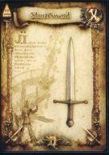</td><td class="col-no">
No. 018

<code>0-2108</code>
</td><td class="col-rarity">CFLv 2HD</td><td class="col-name">
Espada Curta

ショートソード
</td><td class="col-id"><code>WEAPON2_KS01_SHORTSWORD</code><button type="button" class="copy-id" data-copy="WEAPON2_KS01_SHORTSWORD" title="Copiar ID WEAPON2_KS01_SHORTSWORD" aria-label="Copiar ID WEAPON2_KS01_SHORTSWORD">⧉</button></td><td class="col-info">
Espada 1M · Atq: 24 · STR mín.: 5

Espada para aventureiros novatos
</td></tr>
<tr data-id="WEAPON2_KS06_GLADIUS" data-cat="WEAPON" data-rarity="UC" data-flag="FLV2,HD" data-search="019 0-2113 gládio グラディウス weapon2_ks06_gladius espada 1m · atq: 45 · str mín.: 10 espada fácil de usar, favorita dos gladiadores"><td class="col-img">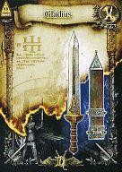</td><td class="col-no">
No. 019

<code>0-2113</code>
</td><td class="col-rarity">UCFLv 2HD</td><td class="col-name">
Gládio

グラディウス
</td><td class="col-id"><code>WEAPON2_KS06_GLADIUS</code><button type="button" class="copy-id" data-copy="WEAPON2_KS06_GLADIUS" title="Copiar ID WEAPON2_KS06_GLADIUS" aria-label="Copiar ID WEAPON2_KS06_GLADIUS">⧉</button></td><td class="col-info">
Espada 1M · Atq: 45 · STR mín.: 10

Espada fácil de usar, favorita dos gladiadores
</td></tr>
<tr data-id="WEAPON2_RS01_BASTARDSWORD" data-cat="WEAPON" data-rarity="C" data-flag="FLV2,HD" data-search="020 0-2120 espada bastarda バスタードソード weapon2_rs01_bastardsword espada 2m · atq: 30 · str mín.: 10 espadão para guerreiros novatos"><td class="col-img">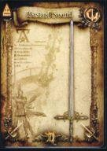</td><td class="col-no">
No. 020

<code>0-2120</code>
</td><td class="col-rarity">CFLv 2HD</td><td class="col-name">
Espada Bastarda

バスタードソード
</td><td class="col-id"><code>WEAPON2_RS01_BASTARDSWORD</code><button type="button" class="copy-id" data-copy="WEAPON2_RS01_BASTARDSWORD" title="Copiar ID WEAPON2_RS01_BASTARDSWORD" aria-label="Copiar ID WEAPON2_RS01_BASTARDSWORD">⧉</button></td><td class="col-info">
Espada 2M · Atq: 30 · STR mín.: 10

Espadão para guerreiros novatos
</td></tr>
<tr data-id="WEAPON2_KA01_HANDAXE" data-cat="WEAPON" data-rarity="C" data-flag="FLV2,HD" data-search="021 0-2126 machadinha ハンドアックス weapon2_ka01_handaxe machado 1m · atq: 30 · str mín.: 5 machado simples e comum"><td class="col-img">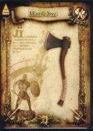</td><td class="col-no">
No. 021

<code>0-2126</code>
</td><td class="col-rarity">CFLv 2HD</td><td class="col-name">
Machadinha

ハンドアックス
</td><td class="col-id"><code>WEAPON2_KA01_HANDAXE</code><button type="button" class="copy-id" data-copy="WEAPON2_KA01_HANDAXE" title="Copiar ID WEAPON2_KA01_HANDAXE" aria-label="Copiar ID WEAPON2_KA01_HANDAXE">⧉</button></td><td class="col-info">
Machado 1M · Atq: 30 · STR mín.: 5

Machado simples e comum
</td></tr>
<tr data-id="WEAPON2_RA01_BROADAXE" data-cat="WEAPON" data-rarity="C" data-flag="FLV2,HD" data-search="022 0-2132 machado largo ブロードアックス weapon2_ra01_broadaxe machado 2m · atq: 31 · str mín.: 10 machado de duas mãos para guerreiros novatos"><td class="col-img">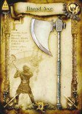</td><td class="col-no">
No. 022

<code>0-2132</code>
</td><td class="col-rarity">CFLv 2HD</td><td class="col-name">
Machado Largo

ブロードアックス
</td><td class="col-id"><code>WEAPON2_RA01_BROADAXE</code><button type="button" class="copy-id" data-copy="WEAPON2_RA01_BROADAXE" title="Copiar ID WEAPON2_RA01_BROADAXE" aria-label="Copiar ID WEAPON2_RA01_BROADAXE">⧉</button></td><td class="col-info">
Machado 2M · Atq: 31 · STR mín.: 10

Machado de duas mãos para guerreiros novatos
</td></tr>
<tr data-id="WEAPON2_SP01_SHORTSPEAR" data-cat="WEAPON" data-rarity="C" data-flag="FLV2,HD" data-search="023 0-2136 lança curta ショートスピア weapon2_sp01_shortspear lança · atq: 24 · str mín.: 5 lança simples para treino de combate"><td class="col-img">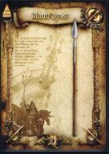</td><td class="col-no">
No. 023

<code>0-2136</code>
</td><td class="col-rarity">CFLv 2HD</td><td class="col-name">
Lança Curta

ショートスピア
</td><td class="col-id"><code>WEAPON2_SP01_SHORTSPEAR</code><button type="button" class="copy-id" data-copy="WEAPON2_SP01_SHORTSPEAR" title="Copiar ID WEAPON2_SP01_SHORTSPEAR" aria-label="Copiar ID WEAPON2_SP01_SHORTSPEAR">⧉</button></td><td class="col-info">
Lança · Atq: 24 · STR mín.: 5

Lança simples para treino de combate
</td></tr>
<tr data-id="WEAPON2_SP03_PARTIZAN" data-cat="WEAPON" data-rarity="UC" data-flag="FLV2,HD" data-search="024 0-2138 partisana パルチザン weapon2_sp03_partizan lança · atq: 36 · str mín.: 5 lança de ponta reforçada, mais letal"><td class="col-img">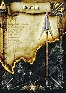</td><td class="col-no">
No. 024

<code>0-2138</code>
</td><td class="col-rarity">UCFLv 2HD</td><td class="col-name">
Partisana

パルチザン
</td><td class="col-id"><code>WEAPON2_SP03_PARTIZAN</code><button type="button" class="copy-id" data-copy="WEAPON2_SP03_PARTIZAN" title="Copiar ID WEAPON2_SP03_PARTIZAN" aria-label="Copiar ID WEAPON2_SP03_PARTIZAN">⧉</button></td><td class="col-info">
Lança · Atq: 36 · STR mín.: 5

Lança de ponta reforçada, mais letal
</td></tr>
<tr data-id="WEAPON2_MA01_CLUB" data-cat="WEAPON" data-rarity="C" data-flag="FLV2,HD" data-search="025 0-2141 porrete クラブ weapon2_ma01_club clava · atq: 21 · str mín.: 5 a arma de impacto mais simples e primitiva"><td class="col-img">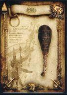</td><td class="col-no">
No. 025

<code>0-2141</code>
</td><td class="col-rarity">CFLv 2HD</td><td class="col-name">
Porrete

クラブ
</td><td class="col-id"><code>WEAPON2_MA01_CLUB</code><button type="button" class="copy-id" data-copy="WEAPON2_MA01_CLUB" title="Copiar ID WEAPON2_MA01_CLUB" aria-label="Copiar ID WEAPON2_MA01_CLUB">⧉</button></td><td class="col-info">
Clava · Atq: 21 · STR mín.: 5

A arma de impacto mais simples e primitiva
</td></tr>
<tr data-id="WEAPON2_NI01_DAGGER" data-cat="WEAPON" data-rarity="C" data-flag="FLV2,HD" data-search="026 0-2147 adaga ダガー weapon2_ni01_dagger faca · atq: 18 · str mín.: - faca pequena e simples"><td class="col-img">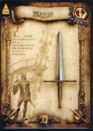</td><td class="col-no">
No. 026

<code>0-2147</code>
</td><td class="col-rarity">CFLv 2HD</td><td class="col-name">
Adaga

ダガー
</td><td class="col-id"><code>WEAPON2_NI01_DAGGER</code><button type="button" class="copy-id" data-copy="WEAPON2_NI01_DAGGER" title="Copiar ID WEAPON2_NI01_DAGGER" aria-label="Copiar ID WEAPON2_NI01_DAGGER">⧉</button></td><td class="col-info">
Faca · Atq: 18 · STR mín.: -

Faca pequena e simples
</td></tr>
<tr data-id="WEAPON2_YU01_WOODBOW" data-cat="WEAPON" data-rarity="C" data-flag="FLV2,HD" data-search="027 0-2157 arco de madeira ウッドボウ weapon2_yu01_woodbow arco · atq: 3 · str mín.: - arco simples de madeira"><td class="col-img">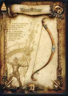</td><td class="col-no">
No. 027

<code>0-2157</code>
</td><td class="col-rarity">CFLv 2HD</td><td class="col-name">
Arco de Madeira

ウッドボウ
</td><td class="col-id"><code>WEAPON2_YU01_WOODBOW</code><button type="button" class="copy-id" data-copy="WEAPON2_YU01_WOODBOW" title="Copiar ID WEAPON2_YU01_WOODBOW" aria-label="Copiar ID WEAPON2_YU01_WOODBOW">⧉</button></td><td class="col-info">
Arco · Atq: 3 · STR mín.: -

Arco simples de madeira
</td></tr>
<tr data-id="WEAPON2_QI01_ARROW" data-cat="WEAPON" data-rarity="C" data-flag="FLV1,HD" data-search="028 0-2161 flecha アロー weapon2_qi01_arrow aljava · ataque: 5+ · str necessária: nenhuma flecha barata e fraca, mas fácil de usar"><td class="col-img">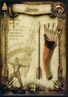</td><td class="col-no">
No. 028

<code>0-2161</code>
</td><td class="col-rarity">CFLv 1HD</td><td class="col-name">
Flecha

アロー
</td><td class="col-id"><code>WEAPON2_QI01_ARROW</code><button type="button" class="copy-id" data-copy="WEAPON2_QI01_ARROW" title="Copiar ID WEAPON2_QI01_ARROW" aria-label="Copiar ID WEAPON2_QI01_ARROW">⧉</button></td><td class="col-info">
Aljava · Ataque: 5+ · STR necessária: nenhuma

Flecha barata e fraca, mas fácil de usar
</td></tr>
<tr data-id="WEAPON2_QI02_FIREARROW" data-cat="WEAPON" data-rarity="UC" data-flag="FLV1,HD" data-search="029 0-2162 flecha de fogo ファイアーアロー weapon2_qi02_firearrow aljava · ataque: 4+ · str necessária: nenhuma flecha mágica com a ponta em chamas"><td class="col-img">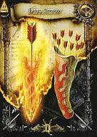</td><td class="col-no">
No. 029

<code>0-2162</code>
</td><td class="col-rarity">UCFLv 1HD</td><td class="col-name">
Flecha de Fogo

ファイアーアロー
</td><td class="col-id"><code>WEAPON2_QI02_FIREARROW</code><button type="button" class="copy-id" data-copy="WEAPON2_QI02_FIREARROW" title="Copiar ID WEAPON2_QI02_FIREARROW" aria-label="Copiar ID WEAPON2_QI02_FIREARROW">⧉</button></td><td class="col-info">
Aljava · Ataque: 4+ · STR necessária: nenhuma

Flecha mágica com a ponta em chamas
</td></tr>
<tr data-id="WEAPON2_QI03_COLDARROW" data-cat="WEAPON" data-rarity="UC" data-flag="FLV1,HD" data-search="030 0-2163 flecha de gelo コールドアロー weapon2_qi03_coldarrow aljava · ataque: 4+ · str necessária: nenhuma flecha mágica com frio selado na ponta"><td class="col-img">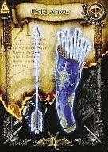</td><td class="col-no">
No. 030

<code>0-2163</code>
</td><td class="col-rarity">UCFLv 1HD</td><td class="col-name">
Flecha de Gelo

コールドアロー
</td><td class="col-id"><code>WEAPON2_QI03_COLDARROW</code><button type="button" class="copy-id" data-copy="WEAPON2_QI03_COLDARROW" title="Copiar ID WEAPON2_QI03_COLDARROW" aria-label="Copiar ID WEAPON2_QI03_COLDARROW">⧉</button></td><td class="col-info">
Aljava · Ataque: 4+ · STR necessária: nenhuma

Flecha mágica com frio selado na ponta
</td></tr>
<tr data-id="WEAPON2_QI04_SPARKARROW" data-cat="WEAPON" data-rarity="UC" data-flag="FLV1" data-search="031 0-2164 flecha do trovão サンダーアロー weapon2_qi04_sparkarrow aljava · ataque: 4+ · str necessária: nenhuma flecha mágica com o poder do raio na ponta"><td class="col-img">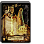</td><td class="col-no">
No. 031

<code>0-2164</code>
</td><td class="col-rarity">UCFLv 1</td><td class="col-name">
Flecha do Trovão

サンダーアロー
</td><td class="col-id"><code>WEAPON2_QI04_SPARKARROW</code><button type="button" class="copy-id" data-copy="WEAPON2_QI04_SPARKARROW" title="Copiar ID WEAPON2_QI04_SPARKARROW" aria-label="Copiar ID WEAPON2_QI04_SPARKARROW">⧉</button></td><td class="col-info">
Aljava · Ataque: 4+ · STR necessária: nenhuma

Flecha mágica com o poder do raio na ponta
</td></tr>
<tr data-id="WEAPON2_KS03_LONGSWORD" data-cat="WEAPON" data-rarity="C" data-flag="FLV2,HD" data-search="099 0-2110 espada longa ロングソード weapon2_ks03_longsword espada 1m · atq: 34 · str mín.: 5 longa o bastante para golpear do alto do cavalo"><td class="col-img">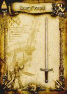</td><td class="col-no">
No. 099

<code>0-2110</code>
</td><td class="col-rarity">CFLv 2HD</td><td class="col-name">
Espada Longa

ロングソード
</td><td class="col-id"><code>WEAPON2_KS03_LONGSWORD</code><button type="button" class="copy-id" data-copy="WEAPON2_KS03_LONGSWORD" title="Copiar ID WEAPON2_KS03_LONGSWORD" aria-label="Copiar ID WEAPON2_KS03_LONGSWORD">⧉</button></td><td class="col-info">
Espada 1M · Atq: 34 · STR mín.: 5

Longa o bastante para golpear do alto do cavalo
</td></tr>
<tr data-id="WEAPON2_RS03_ZWEIHANDER" data-cat="WEAPON" data-rarity="UC" data-flag="FLV2,HD" data-search="100 0-2122 espada de duas mãos トゥハンドソード weapon2_rs03_zweihander espada 2m · atq: 48 · str mín.: 10 espadão mais longo do que quem o usa"><td class="col-img">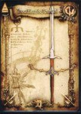</td><td class="col-no">
No. 100

<code>0-2122</code>
</td><td class="col-rarity">UCFLv 2HD</td><td class="col-name">
Espada de Duas Mãos

トゥハンドソード
</td><td class="col-id"><code>WEAPON2_RS03_ZWEIHANDER</code><button type="button" class="copy-id" data-copy="WEAPON2_RS03_ZWEIHANDER" title="Copiar ID WEAPON2_RS03_ZWEIHANDER" aria-label="Copiar ID WEAPON2_RS03_ZWEIHANDER">⧉</button></td><td class="col-info">
Espada 2M · Atq: 48 · STR mín.: 10

Espadão mais longo do que quem o usa
</td></tr>
<tr data-id="WEAPON2_RS06_DRAGONKILLER" data-cat="WEAPON" data-rarity="R" data-flag="FLV4" data-search="101 1-250 mata-dragões ドラゴンキラー weapon2_rs06_dragonkiller espada 2m · atq: 69 · str mín.: 20 feita para cortar a pele dura dos dragões"><td class="col-img">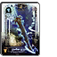</td><td class="col-no">
No. 101

<code>1-250</code>
</td><td class="col-rarity">RFLv 4</td><td class="col-name">
Mata-Dragões

ドラゴンキラー
</td><td class="col-id"><code>WEAPON2_RS06_DRAGONKILLER</code><button type="button" class="copy-id" data-copy="WEAPON2_RS06_DRAGONKILLER" title="Copiar ID WEAPON2_RS06_DRAGONKILLER" aria-label="Copiar ID WEAPON2_RS06_DRAGONKILLER">⧉</button></td><td class="col-info">
Espada 2M · Atq: 69 · STR mín.: 20

Feita para cortar a pele dura dos dragões
</td></tr>
<tr data-id="WEAPON2_KA03_WARAXE" data-cat="WEAPON" data-rarity="C" data-flag="FLV2,HD" data-search="102 0-2128 machado de guerra ウォーアックス weapon2_ka03_waraxe machado 1m · atq: 36 · str mín.: 10 machado de combate que evoluiu da ferramenta"><td class="col-img">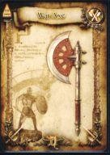</td><td class="col-no">
No. 102

<code>0-2128</code>
</td><td class="col-rarity">CFLv 2HD</td><td class="col-name">
Machado de Guerra

ウォーアックス
</td><td class="col-id"><code>WEAPON2_KA03_WARAXE</code><button type="button" class="copy-id" data-copy="WEAPON2_KA03_WARAXE" title="Copiar ID WEAPON2_KA03_WARAXE" aria-label="Copiar ID WEAPON2_KA03_WARAXE">⧉</button></td><td class="col-info">
Machado 1M · Atq: 36 · STR mín.: 10

Machado de combate que evoluiu da ferramenta
</td></tr>
<tr data-id="WEAPON2_KA04_BATTLEAXE" data-cat="WEAPON" data-rarity="UC" data-flag="FLV3,HD" data-search="103 0-2129 machado de batalha バトルアックス weapon2_ka04_battleaxe machado 1m · atq: 57 · str mín.: 15 machado de guerra ainda mais feito para o combate"><td class="col-img">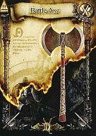</td><td class="col-no">
No. 103

<code>0-2129</code>
</td><td class="col-rarity">UCFLv 3HD</td><td class="col-name">
Machado de Batalha

バトルアックス
</td><td class="col-id"><code>WEAPON2_KA04_BATTLEAXE</code><button type="button" class="copy-id" data-copy="WEAPON2_KA04_BATTLEAXE" title="Copiar ID WEAPON2_KA04_BATTLEAXE" aria-label="Copiar ID WEAPON2_KA04_BATTLEAXE">⧉</button></td><td class="col-info">
Machado 1M · Atq: 57 · STR mín.: 15

Machado de guerra ainda mais feito para o combate
</td></tr>
<tr data-id="WEAPON2_MA02_MACE" data-cat="WEAPON" data-rarity="C" data-flag="FLV2,HD" data-search="104 0-2142 maça メイス weapon2_ma02_mace clava · atq: 34 · str mín.: 5 arma de ferro feita para golpear"><td class="col-img">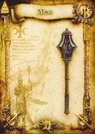</td><td class="col-no">
No. 104

<code>0-2142</code>
</td><td class="col-rarity">CFLv 2HD</td><td class="col-name">
Maça

メイス
</td><td class="col-id"><code>WEAPON2_MA02_MACE</code><button type="button" class="copy-id" data-copy="WEAPON2_MA02_MACE" title="Copiar ID WEAPON2_MA02_MACE" aria-label="Copiar ID WEAPON2_MA02_MACE">⧉</button></td><td class="col-info">
Clava · Atq: 34 · STR mín.: 5

Arma de ferro feita para golpear
</td></tr>
<tr data-id="WEAPON2_NI02_DIRK" data-cat="WEAPON" data-rarity="C" data-flag="FLV2,HD" data-search="105 0-2148 dirk ダーク weapon2_ni02_dirk faca · atq: 25 · str mín.: - faca favorita de uma tribo valente das montanhas"><td class="col-img">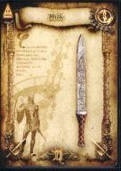</td><td class="col-no">
No. 105

<code>0-2148</code>
</td><td class="col-rarity">CFLv 2HD</td><td class="col-name">
Dirk

ダーク
</td><td class="col-id"><code>WEAPON2_NI02_DIRK</code><button type="button" class="copy-id" data-copy="WEAPON2_NI02_DIRK" title="Copiar ID WEAPON2_NI02_DIRK" aria-label="Copiar ID WEAPON2_NI02_DIRK">⧉</button></td><td class="col-info">
Faca · Atq: 25 · STR mín.: -

Faca favorita de uma tribo valente das montanhas
</td></tr>
<tr data-id="WEAPON2_NI03_POISONDAGGER" data-cat="WEAPON" data-rarity="UC" data-flag="FLV2,HD" data-search="106 0-2149 adaga venenosa ポイズンダガー weapon2_ni03_poisondagger faca · atq: 33 · str mín.: - faca de assassino com veneno na lâmina"><td class="col-img">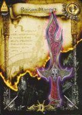</td><td class="col-no">
No. 106

<code>0-2149</code>
</td><td class="col-rarity">UCFLv 2HD</td><td class="col-name">
Adaga Venenosa

ポイズンダガー
</td><td class="col-id"><code>WEAPON2_NI03_POISONDAGGER</code><button type="button" class="copy-id" data-copy="WEAPON2_NI03_POISONDAGGER" title="Copiar ID WEAPON2_NI03_POISONDAGGER" aria-label="Copiar ID WEAPON2_NI03_POISONDAGGER">⧉</button></td><td class="col-info">
Faca · Atq: 33 · STR mín.: -

Faca de assassino com veneno na lâmina
</td></tr>
<tr data-id="WEAPON2_YU04_GREATBOW" data-cat="WEAPON" data-rarity="UC" data-flag="FLV2" data-search="107 0-2160 grande arco グレートボウ weapon2_yu04_greatbow arco · atq: 17 · str mín.: - arco de combate preferido dos franco-atiradores"><td class="col-img">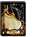</td><td class="col-no">
No. 107

<code>0-2160</code>
</td><td class="col-rarity">UCFLv 2</td><td class="col-name">
Grande Arco

グレートボウ
</td><td class="col-id"><code>WEAPON2_YU04_GREATBOW</code><button type="button" class="copy-id" data-copy="WEAPON2_YU04_GREATBOW" title="Copiar ID WEAPON2_YU04_GREATBOW" aria-label="Copiar ID WEAPON2_YU04_GREATBOW">⧉</button></td><td class="col-info">
Arco · Atq: 17 · STR mín.: -

Arco de combate preferido dos franco-atiradores
</td></tr>
<tr data-id="WEAPON2_ST01_QUARTERSTAFF" data-cat="WEAPON" data-rarity="C" data-flag="FLV2,HD" data-search="165 0-2152 bastão クォータースタッフ weapon2_st01_quarterstaff cajado · atq: 20 · str mín.: - cajado simples para magos"><td class="col-img">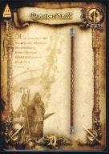</td><td class="col-no">
No. 165

<code>0-2152</code>
</td><td class="col-rarity">CFLv 2HD</td><td class="col-name">
Bastão

クォータースタッフ
</td><td class="col-id"><code>WEAPON2_ST01_QUARTERSTAFF</code><button type="button" class="copy-id" data-copy="WEAPON2_ST01_QUARTERSTAFF" title="Copiar ID WEAPON2_ST01_QUARTERSTAFF" aria-label="Copiar ID WEAPON2_ST01_QUARTERSTAFF">⧉</button></td><td class="col-info">
Cajado · Atq: 20 · STR mín.: -

Cajado simples para magos
</td></tr>
<tr data-id="WEAPON2_ST02_SCEPTER" data-cat="WEAPON" data-rarity="C" data-flag="FLV2,HD" data-search="166 0-2153 cetro セプター weapon2_st02_scepter cajado · atq: 25 · str mín.: - cetro real de madeira enfeitada"><td class="col-img">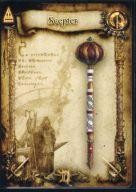</td><td class="col-no">
No. 166

<code>0-2153</code>
</td><td class="col-rarity">CFLv 2HD</td><td class="col-name">
Cetro

セプター
</td><td class="col-id"><code>WEAPON2_ST02_SCEPTER</code><button type="button" class="copy-id" data-copy="WEAPON2_ST02_SCEPTER" title="Copiar ID WEAPON2_ST02_SCEPTER" aria-label="Copiar ID WEAPON2_ST02_SCEPTER">⧉</button></td><td class="col-info">
Cajado · Atq: 25 · STR mín.: -

Cetro real de madeira enfeitada
</td></tr>
<tr data-id="WEAPON2_KS07_MITHRILBLADE" data-cat="WEAPON" data-rarity="R" data-flag="FLV4" data-search="173 1-248 espada de mithril ミスリルソード weapon2_ks07_mithrilblade espada 1m · atq: 65 · str mín.: 10 espada dura e leve feita de mithril, metal mágico"><td class="col-img">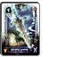</td><td class="col-no">
No. 173

<code>1-248</code>
</td><td class="col-rarity">RFLv 4</td><td class="col-name">
Espada de Mithril

ミスリルソード
</td><td class="col-id"><code>WEAPON2_KS07_MITHRILBLADE</code><button type="button" class="copy-id" data-copy="WEAPON2_KS07_MITHRILBLADE" title="Copiar ID WEAPON2_KS07_MITHRILBLADE" aria-label="Copiar ID WEAPON2_KS07_MITHRILBLADE">⧉</button></td><td class="col-info">
Espada 1M · Atq: 65 · STR mín.: 10

Espada dura e leve feita de mithril, metal mágico
</td></tr>
<tr data-id="WEAPON2_RA02_GREATAXE" data-cat="WEAPON" data-rarity="UC" data-flag="FLV3,HD" data-search="174 0-2133 grande machado グレートアックス weapon2_ra02_greataxe machado 2m · atq: 54 · str mín.: 10 machadão de dois gumes, mais destrutivo"><td class="col-img">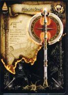</td><td class="col-no">
No. 174

<code>0-2133</code>
</td><td class="col-rarity">UCFLv 3HD</td><td class="col-name">
Grande Machado

グレートアックス
</td><td class="col-id"><code>WEAPON2_RA02_GREATAXE</code><button type="button" class="copy-id" data-copy="WEAPON2_RA02_GREATAXE" title="Copiar ID WEAPON2_RA02_GREATAXE" aria-label="Copiar ID WEAPON2_RA02_GREATAXE">⧉</button></td><td class="col-info">
Machado 2M · Atq: 54 · STR mín.: 10

Machadão de dois gumes, mais destrutivo
</td></tr>
<tr data-id="WEAPON2_ST03_WIZARDSSTAFF" data-cat="WEAPON" data-rarity="UC" data-flag="FLV2" data-search="207 0-2154 cajado de feiticeiro ウィザードスタッフ weapon2_st03_wizardsstaff cajado · atq: 33 · str mín.: - cajado que aumenta a magia, favorito de grandes magos"><td class="col-img">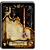</td><td class="col-no">
No. 207

<code>0-2154</code>
</td><td class="col-rarity">UCFLv 2</td><td class="col-name">
Cajado de Feiticeiro

ウィザードスタッフ
</td><td class="col-id"><code>WEAPON2_ST03_WIZARDSSTAFF</code><button type="button" class="copy-id" data-copy="WEAPON2_ST03_WIZARDSSTAFF" title="Copiar ID WEAPON2_ST03_WIZARDSSTAFF" aria-label="Copiar ID WEAPON2_ST03_WIZARDSSTAFF">⧉</button></td><td class="col-info">
Cajado · Atq: 33 · STR mín.: -

Cajado que aumenta a magia, favorito de grandes magos
</td></tr>
<tr data-id="WEAPON2_SP04_TRIDENT" data-cat="WEAPON" data-rarity="UC" data-flag="FLV3,HD" data-search="214 0-2139 tridente トライデント weapon2_sp04_trident lança · atq: 46 · str mín.: 5 símbolo do deus do mar. guarda o poder do raio"><td class="col-img">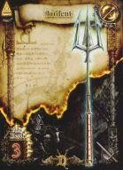</td><td class="col-no">
No. 214

<code>0-2139</code>
</td><td class="col-rarity">UCFLv 3HD</td><td class="col-name">
Tridente

トライデント
</td><td class="col-id"><code>WEAPON2_SP04_TRIDENT</code><button type="button" class="copy-id" data-copy="WEAPON2_SP04_TRIDENT" title="Copiar ID WEAPON2_SP04_TRIDENT" aria-label="Copiar ID WEAPON2_SP04_TRIDENT">⧉</button></td><td class="col-info">
Lança · Atq: 46 · STR mín.: 5

Símbolo do deus do mar. Guarda o poder do raio
</td></tr>
<tr data-id="WEAPON2_SP06_ICELANCE" data-cat="WEAPON" data-rarity="R" data-flag="FLV3,HD" data-search="215 1-257 lança de gelo アイススピア weapon2_sp06_icelance lança · atq: 12 · str mín.: 10 lança cuja ponta foi feita com o poder do gelo"><td class="col-img">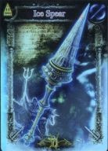</td><td class="col-no">
No. 215

<code>1-257</code>
</td><td class="col-rarity">RFLv 3HD</td><td class="col-name">
Lança de Gelo

アイススピア
</td><td class="col-id"><code>WEAPON2_SP06_ICELANCE</code><button type="button" class="copy-id" data-copy="WEAPON2_SP06_ICELANCE" title="Copiar ID WEAPON2_SP06_ICELANCE" aria-label="Copiar ID WEAPON2_SP06_ICELANCE">⧉</button></td><td class="col-info">
Lança · Atq: 12 · STR mín.: 10

Lança cuja ponta foi feita com o poder do gelo
</td></tr>
<tr data-id="WEAPON2_MA03_WARHAMMER" data-cat="WEAPON" data-rarity="UC" data-flag="FLV3" data-search="249 0-2364 martelo de guerra ウォーハンマー weapon2_ma03_warhammer clava · atq: 51 · str mín.: 10 martelo transformado em arma de guerra"><td class="col-img">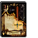</td><td class="col-no">
No. 249

<code>0-2364</code>
</td><td class="col-rarity">UCFLv 3</td><td class="col-name">
Martelo de Guerra

ウォーハンマー
</td><td class="col-id"><code>WEAPON2_MA03_WARHAMMER</code><button type="button" class="copy-id" data-copy="WEAPON2_MA03_WARHAMMER" title="Copiar ID WEAPON2_MA03_WARHAMMER" aria-label="Copiar ID WEAPON2_MA03_WARHAMMER">⧉</button></td><td class="col-info">
Clava · Atq: 51 · STR mín.: 10

Martelo transformado em arma de guerra
</td></tr>
<tr data-id="WEAPON2_KS05_FALCHION" data-cat="WEAPON" data-rarity="UC" data-flag="FLV3" data-search="250 0-2365 falchion ファルシオン weapon2_ks05_falchion espada 1m · atq: 54 · str mín.: 10 sabre pesado de um só gume, favorito do povo do deserto"><td class="col-img">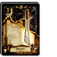</td><td class="col-no">
No. 250

<code>0-2365</code>
</td><td class="col-rarity">UCFLv 3</td><td class="col-name">
Falchion

ファルシオン
</td><td class="col-id"><code>WEAPON2_KS05_FALCHION</code><button type="button" class="copy-id" data-copy="WEAPON2_KS05_FALCHION" title="Copiar ID WEAPON2_KS05_FALCHION" aria-label="Copiar ID WEAPON2_KS05_FALCHION">⧉</button></td><td class="col-info">
Espada 1M · Atq: 54 · STR mín.: 10

Sabre pesado de um só gume, favorito do povo do deserto
</td></tr>
<tr data-id="WEAPON2_KS04_VIKINGSWORD" data-cat="WEAPON" data-rarity="UC" data-flag="FLV2" data-search="253 0-2501 espada viking ヴァイキングソード weapon2_ks04_vikingsword espada 1m · atq: 30 · str mín.: 5 espada de ferro grossa e larga usada pelos vikings"><td class="col-img">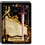</td><td class="col-no">
No. 253

<code>0-2501</code>
</td><td class="col-rarity">UCFLv 2</td><td class="col-name">
Espada Viking

ヴァイキングソード
</td><td class="col-id"><code>WEAPON2_KS04_VIKINGSWORD</code><button type="button" class="copy-id" data-copy="WEAPON2_KS04_VIKINGSWORD" title="Copiar ID WEAPON2_KS04_VIKINGSWORD" aria-label="Copiar ID WEAPON2_KS04_VIKINGSWORD">⧉</button></td><td class="col-info">
Espada 1M · Atq: 30 · STR mín.: 5

Espada de ferro grossa e larga usada pelos vikings
</td></tr>
<tr data-id="WEAPON2_NI08_ROUND" data-cat="WEAPON" data-rarity="UC" data-flag="FLV2" data-search="254 0-2502 faca redonda ラウンドナイフ weapon2_ni08_round faca · atq: 14 · str mín.: - fere pouco, mas solta golpes fortes com facilidade"><td class="col-img">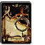</td><td class="col-no">
No. 254

<code>0-2502</code>
</td><td class="col-rarity">UCFLv 2</td><td class="col-name">
Faca Redonda

ラウンドナイフ
</td><td class="col-id"><code>WEAPON2_NI08_ROUND</code><button type="button" class="copy-id" data-copy="WEAPON2_NI08_ROUND" title="Copiar ID WEAPON2_NI08_ROUND" aria-label="Copiar ID WEAPON2_NI08_ROUND">⧉</button></td><td class="col-info">
Faca · Atq: 14 · STR mín.: -

Fere pouco, mas solta golpes fortes com facilidade
</td></tr>
<tr data-id="WEAPON2_NI09_STUNDAGGER" data-cat="WEAPON" data-rarity="UC" data-flag="FLV2,HD" data-search="255 0-2503 adaga atordoante スタンダガー weapon2_ni09_stundagger faca · atq: 30 · str mín.: - faca especial com toxina nervosa na lâmina"><td class="col-img">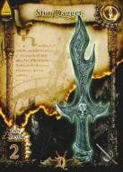</td><td class="col-no">
No. 255

<code>0-2503</code>
</td><td class="col-rarity">UCFLv 2HD</td><td class="col-name">
Adaga Atordoante

スタンダガー
</td><td class="col-id"><code>WEAPON2_NI09_STUNDAGGER</code><button type="button" class="copy-id" data-copy="WEAPON2_NI09_STUNDAGGER" title="Copiar ID WEAPON2_NI09_STUNDAGGER" aria-label="Copiar ID WEAPON2_NI09_STUNDAGGER">⧉</button></td><td class="col-info">
Faca · Atq: 30 · STR mín.: -

Faca especial com toxina nervosa na lâmina
</td></tr>
<tr data-id="WEAPON2_KS18_VIPERFUNG" data-cat="WEAPON" data-rarity="UC" data-flag="FLV2" data-search="256 0-2504 presa de víbora バイパーファング weapon2_ks18_viperfung espada 1m · atq: 50 · str mín.: 10 espada com ponta afiada como presa de cobra"><td class="col-img">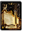</td><td class="col-no">
No. 256

<code>0-2504</code>
</td><td class="col-rarity">UCFLv 2</td><td class="col-name">
Presa de Víbora

バイパーファング
</td><td class="col-id"><code>WEAPON2_KS18_VIPERFUNG</code><button type="button" class="copy-id" data-copy="WEAPON2_KS18_VIPERFUNG" title="Copiar ID WEAPON2_KS18_VIPERFUNG" aria-label="Copiar ID WEAPON2_KS18_VIPERFUNG">⧉</button></td><td class="col-info">
Espada 1M · Atq: 50 · STR mín.: 10

Espada com ponta afiada como presa de cobra
</td></tr>
<tr data-id="WEAPON2_RS11_SQUARETHRUST" data-cat="WEAPON" data-rarity="UC" data-flag="FLV2,HD" data-search="257 0-2505 cortador quadrado スクエアスラッシャー weapon2_rs11_squarethrust espada 2m · atq: 45 · str mín.: 10 espadão que perfura e arremessa o inimigo"><td class="col-img">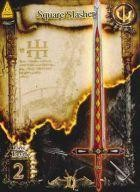</td><td class="col-no">
No. 257

<code>0-2505</code>
</td><td class="col-rarity">UCFLv 2HD</td><td class="col-name">
Cortador Quadrado

スクエアスラッシャー
</td><td class="col-id"><code>WEAPON2_RS11_SQUARETHRUST</code><button type="button" class="copy-id" data-copy="WEAPON2_RS11_SQUARETHRUST" title="Copiar ID WEAPON2_RS11_SQUARETHRUST" aria-label="Copiar ID WEAPON2_RS11_SQUARETHRUST">⧉</button></td><td class="col-info">
Espada 2M · Atq: 45 · STR mín.: 10

Espadão que perfura e arremessa o inimigo
</td></tr>
<tr data-id="WEAPON2_KA09_SILVERAXE" data-cat="WEAPON" data-rarity="UC" data-flag="FLV2" data-search="258 0-2506 machado de prata シルバーアックス weapon2_ka09_silveraxe machado 1m · atq: 30 · str mín.: 5 lindo machado de batalha de prata pura"><td class="col-img">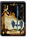</td><td class="col-no">
No. 258

<code>0-2506</code>
</td><td class="col-rarity">UCFLv 2</td><td class="col-name">
Machado de Prata

シルバーアックス
</td><td class="col-id"><code>WEAPON2_KA09_SILVERAXE</code><button type="button" class="copy-id" data-copy="WEAPON2_KA09_SILVERAXE" title="Copiar ID WEAPON2_KA09_SILVERAXE" aria-label="Copiar ID WEAPON2_KA09_SILVERAXE">⧉</button></td><td class="col-info">
Machado 1M · Atq: 30 · STR mín.: 5

Lindo machado de batalha de prata pura
</td></tr>
<tr data-id="WEAPON2_KA06_SHIELDAXE" data-cat="WEAPON" data-rarity="UC" data-flag="FLV2,HD" data-search="259 0-2507 machado-escudo シールドアックス weapon2_ka06_shieldaxe machado 1m · atq: 52 · str mín.: 10 machado com um escudo de ferro no cabo"><td class="col-img">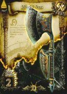</td><td class="col-no">
No. 259

<code>0-2507</code>
</td><td class="col-rarity">UCFLv 2HD</td><td class="col-name">
Machado-escudo

シールドアックス
</td><td class="col-id"><code>WEAPON2_KA06_SHIELDAXE</code><button type="button" class="copy-id" data-copy="WEAPON2_KA06_SHIELDAXE" title="Copiar ID WEAPON2_KA06_SHIELDAXE" aria-label="Copiar ID WEAPON2_KA06_SHIELDAXE">⧉</button></td><td class="col-info">
Machado 1M · Atq: 52 · STR mín.: 10

Machado com um escudo de ferro no cabo
</td></tr>
<tr data-id="WEAPON2_RA09_STEELAXE" data-cat="WEAPON" data-rarity="UC" data-flag="FLV2,HD" data-search="260 0-2508 machado de aço スチールアックス weapon2_ra09_steelaxe machado 2m · atq: 33 · str mín.: - lâmina enorme, mas leve até para os mais fracos"><td class="col-img">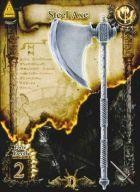</td><td class="col-no">
No. 260

<code>0-2508</code>
</td><td class="col-rarity">UCFLv 2HD</td><td class="col-name">
Machado de Aço

スチールアックス
</td><td class="col-id"><code>WEAPON2_RA09_STEELAXE</code><button type="button" class="copy-id" data-copy="WEAPON2_RA09_STEELAXE" title="Copiar ID WEAPON2_RA09_STEELAXE" aria-label="Copiar ID WEAPON2_RA09_STEELAXE">⧉</button></td><td class="col-info">
Machado 2M · Atq: 33 · STR mín.: -

Lâmina enorme, mas leve até para os mais fracos
</td></tr>
<tr data-id="WEAPON2_RA10_GREAT_EX1" data-cat="WEAPON" data-rarity="UC" data-flag="FLV2,HD" data-search="261 0-2509 machado impulsor ブーストアックス weapon2_ra10_great_ex1 machado 2m · atq: 48 · str mín.: 5 machado leve que acompanha movimentos rápidos"><td class="col-img">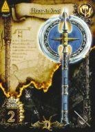</td><td class="col-no">
No. 261

<code>0-2509</code>
</td><td class="col-rarity">UCFLv 2HD</td><td class="col-name">
Machado Impulsor

ブーストアックス
</td><td class="col-id"><code>WEAPON2_RA10_GREAT_EX1</code><button type="button" class="copy-id" data-copy="WEAPON2_RA10_GREAT_EX1" title="Copiar ID WEAPON2_RA10_GREAT_EX1" aria-label="Copiar ID WEAPON2_RA10_GREAT_EX1">⧉</button></td><td class="col-info">
Machado 2M · Atq: 48 · STR mín.: 5

Machado leve que acompanha movimentos rápidos
</td></tr>
<tr data-id="WEAPON2_MA09_HOLYMACE" data-cat="WEAPON" data-rarity="UC" data-flag="FLV3" data-search="262 0-2510 maça sagrada ホーリーメイス weapon2_ma09_holymace clava · atq: 34 · str mín.: 5 arma de ferro coberta por um poder sagrado"><td class="col-img">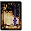</td><td class="col-no">
No. 262

<code>0-2510</code>
</td><td class="col-rarity">UCFLv 3</td><td class="col-name">
Maça Sagrada

ホーリーメイス
</td><td class="col-id"><code>WEAPON2_MA09_HOLYMACE</code><button type="button" class="copy-id" data-copy="WEAPON2_MA09_HOLYMACE" title="Copiar ID WEAPON2_MA09_HOLYMACE" aria-label="Copiar ID WEAPON2_MA09_HOLYMACE">⧉</button></td><td class="col-info">
Clava · Atq: 34 · STR mín.: 5

Arma de ferro coberta por um poder sagrado
</td></tr>
<tr data-id="WEAPON2_KA02_FRANCISCA" data-cat="WEAPON" data-rarity="UC" data-flag="FLV2,HD" data-search="263 0-2513 francisca フランキスカ weapon2_ka02_francisca machado 1m · atq: 51 · str mín.: 10 machado de um povo valente do mediterrâneo"><td class="col-img">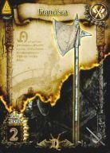</td><td class="col-no">
No. 263

<code>0-2513</code>
</td><td class="col-rarity">UCFLv 2HD</td><td class="col-name">
Francisca

フランキスカ
</td><td class="col-id"><code>WEAPON2_KA02_FRANCISCA</code><button type="button" class="copy-id" data-copy="WEAPON2_KA02_FRANCISCA" title="Copiar ID WEAPON2_KA02_FRANCISCA" aria-label="Copiar ID WEAPON2_KA02_FRANCISCA">⧉</button></td><td class="col-info">
Machado 1M · Atq: 51 · STR mín.: 10

Machado de um povo valente do Mediterrâneo
</td></tr>
<tr data-id="WEAPON2_NI04_SWORDBRAKER" data-cat="WEAPON" data-rarity="UC" data-flag="FLV2,HD" data-search="264 0-2514 quebra-espadas ソードブレイカー weapon2_ni04_swordbraker faca · atq: 36 · str mín.: - adaga feita para aparar e quebrar espadas"><td class="col-img">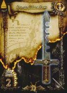</td><td class="col-no">
No. 264

<code>0-2514</code>
</td><td class="col-rarity">UCFLv 2HD</td><td class="col-name">
Quebra-Espadas

ソードブレイカー
</td><td class="col-id"><code>WEAPON2_NI04_SWORDBRAKER</code><button type="button" class="copy-id" data-copy="WEAPON2_NI04_SWORDBRAKER" title="Copiar ID WEAPON2_NI04_SWORDBRAKER" aria-label="Copiar ID WEAPON2_NI04_SWORDBRAKER">⧉</button></td><td class="col-info">
Faca · Atq: 36 · STR mín.: -

Adaga feita para aparar e quebrar espadas
</td></tr>
<tr data-id="WEAPON2_YU09_IRONBOW" data-cat="WEAPON" data-rarity="UC" data-flag="FLV2,HD" data-search="265 0-2515 arco de ferro アイアンボウ weapon2_yu09_ironbow arco · atq: 9 · str mín.: - arco pesado de aço com grande poder"><td class="col-img">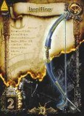</td><td class="col-no">
No. 265

<code>0-2515</code>
</td><td class="col-rarity">UCFLv 2HD</td><td class="col-name">
Arco de Ferro

アイアンボウ
</td><td class="col-id"><code>WEAPON2_YU09_IRONBOW</code><button type="button" class="copy-id" data-copy="WEAPON2_YU09_IRONBOW" title="Copiar ID WEAPON2_YU09_IRONBOW" aria-label="Copiar ID WEAPON2_YU09_IRONBOW">⧉</button></td><td class="col-info">
Arco · Atq: 9 · STR mín.: -

Arco pesado de aço com grande poder
</td></tr>
<tr data-id="WEAPON2_YU03_LONGBOW" data-cat="WEAPON" data-rarity="UC" data-flag="FLV2" data-search="266 0-2516 arco longo ロングボウ weapon2_yu03_longbow arco · atq: 12 · str mín.: - arco longo reforçado para o combate"><td class="col-img">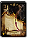</td><td class="col-no">
No. 266

<code>0-2516</code>
</td><td class="col-rarity">UCFLv 2</td><td class="col-name">
Arco Longo

ロングボウ
</td><td class="col-id"><code>WEAPON2_YU03_LONGBOW</code><button type="button" class="copy-id" data-copy="WEAPON2_YU03_LONGBOW" title="Copiar ID WEAPON2_YU03_LONGBOW" aria-label="Copiar ID WEAPON2_YU03_LONGBOW">⧉</button></td><td class="col-info">
Arco · Atq: 12 · STR mín.: -

Arco longo reforçado para o combate
</td></tr>
<tr data-id="WEAPON2_QI05_MITHRILARROW" data-cat="WEAPON" data-rarity="UC" data-flag="FLV1,HD" data-search="267 0-2517 flecha sombria ダークアロー weapon2_qi05_mithrilarrow aljava · ataque: 4+ · str necessária: nenhuma graças às trevas, atinge o alvo sem fazer barulho"><td class="col-img">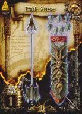</td><td class="col-no">
No. 267

<code>0-2517</code>
</td><td class="col-rarity">UCFLv 1HD</td><td class="col-name">
Flecha Sombria

ダークアロー
</td><td class="col-id"><code>WEAPON2_QI05_MITHRILARROW</code><button type="button" class="copy-id" data-copy="WEAPON2_QI05_MITHRILARROW" title="Copiar ID WEAPON2_QI05_MITHRILARROW" aria-label="Copiar ID WEAPON2_QI05_MITHRILARROW">⧉</button></td><td class="col-info">
Aljava · Ataque: 4+ · STR necessária: nenhuma

Graças às trevas, atinge o alvo sem fazer barulho
</td></tr>
<tr data-id="WEAPON2_ST11_WIZARD_EX1" data-cat="WEAPON" data-rarity="UC" data-flag="FLV2" data-search="320 0-2571 cajado flamejante フレイムスタッフ weapon2_st11_wizard_ex1 cajado · atq: 8 · str mín.: - cajado mágico que lança fogo pela ponta"><td class="col-img">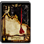</td><td class="col-no">
No. 320

<code>0-2571</code>
</td><td class="col-rarity">UCFLv 2</td><td class="col-name">
Cajado Flamejante

フレイムスタッフ
</td><td class="col-id"><code>WEAPON2_ST11_WIZARD_EX1</code><button type="button" class="copy-id" data-copy="WEAPON2_ST11_WIZARD_EX1" title="Copiar ID WEAPON2_ST11_WIZARD_EX1" aria-label="Copiar ID WEAPON2_ST11_WIZARD_EX1">⧉</button></td><td class="col-info">
Cajado · Atq: 8 · STR mín.: -

Cajado mágico que lança fogo pela ponta
</td></tr>
<tr data-id="WEAPON2_ST12_WIZARD_EX2" data-cat="WEAPON" data-rarity="UC" data-flag="FLV2,HD" data-search="321 0-2572 cajado de gelo アイススタッフ weapon2_st12_wizard_ex2 cajado · atq: 8 · str mín.: - cajado mágico que lança frio pela ponta"><td class="col-img">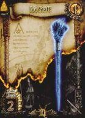</td><td class="col-no">
No. 321

<code>0-2572</code>
</td><td class="col-rarity">UCFLv 2HD</td><td class="col-name">
Cajado de Gelo

アイススタッフ
</td><td class="col-id"><code>WEAPON2_ST12_WIZARD_EX2</code><button type="button" class="copy-id" data-copy="WEAPON2_ST12_WIZARD_EX2" title="Copiar ID WEAPON2_ST12_WIZARD_EX2" aria-label="Copiar ID WEAPON2_ST12_WIZARD_EX2">⧉</button></td><td class="col-info">
Cajado · Atq: 8 · STR mín.: -

Cajado mágico que lança frio pela ponta
</td></tr>
<tr data-id="WEAPON2_ST13_WIZARD_EX3" data-cat="WEAPON" data-rarity="UC" data-flag="FLV2" data-search="322 0-2573 cajado do trovão サンダースタッフ weapon2_st13_wizard_ex3 cajado · atq: 8 · str mín.: - cajado mágico que lança raios pela ponta"><td class="col-img">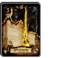</td><td class="col-no">
No. 322

<code>0-2573</code>
</td><td class="col-rarity">UCFLv 2</td><td class="col-name">
Cajado do Trovão

サンダースタッフ
</td><td class="col-id"><code>WEAPON2_ST13_WIZARD_EX3</code><button type="button" class="copy-id" data-copy="WEAPON2_ST13_WIZARD_EX3" title="Copiar ID WEAPON2_ST13_WIZARD_EX3" aria-label="Copiar ID WEAPON2_ST13_WIZARD_EX3">⧉</button></td><td class="col-info">
Cajado · Atq: 8 · STR mín.: -

Cajado mágico que lança raios pela ponta
</td></tr>
<tr data-id="WEAPON2_SP09_FRAME" data-cat="WEAPON" data-rarity="R" data-flag="FLV3,HD" data-search="323 1-344 lança flamejante フレイムスピア weapon2_sp09_frame lança · atq: 12 · str mín.: 10 lança mágica com fogo selado na ponta"><td class="col-img"></td><td class="col-no">
No. 323

<code>1-344</code>
</td><td class="col-rarity">RFLv 3HD</td><td class="col-name">
Lança Flamejante

フレイムスピア
</td><td class="col-id"><code>WEAPON2_SP09_FRAME</code><button type="button" class="copy-id" data-copy="WEAPON2_SP09_FRAME" title="Copiar ID WEAPON2_SP09_FRAME" aria-label="Copiar ID WEAPON2_SP09_FRAME">⧉</button></td><td class="col-info">
Lança · Atq: 12 · STR mín.: 10

Lança mágica com fogo selado na ponta
</td></tr>
<tr data-id="WEAPON2_SP10_THUNDER" data-cat="WEAPON" data-rarity="R" data-flag="FLV3" data-search="324 1-345 lança do trovão サンダースピア weapon2_sp10_thunder lança · atq: 12 · str mín.: 10 lança mágica com a força do raio, para qualquer um"><td class="col-img"></td><td class="col-no">
No. 324

<code>1-345</code>
</td><td class="col-rarity">RFLv 3</td><td class="col-name">
Lança do Trovão

サンダースピア
</td><td class="col-id"><code>WEAPON2_SP10_THUNDER</code><button type="button" class="copy-id" data-copy="WEAPON2_SP10_THUNDER" title="Copiar ID WEAPON2_SP10_THUNDER" aria-label="Copiar ID WEAPON2_SP10_THUNDER">⧉</button></td><td class="col-info">
Lança · Atq: 12 · STR mín.: 10

Lança mágica com a força do raio, para qualquer um
</td></tr>
<tr data-id="WEAPON2_NC03_MASSU" data-cat="WEAPON" data-rarity="UC" data-flag="FLV2" data-search="367 0-2605 cravo de ferro アイアンスパイク weapon2_nc03_massu soqueira · atq: 42 · str mín.: - soqueira de aço com três espinhos"><td class="col-img"></td><td class="col-no">
No. 367

<code>0-2605</code>
</td><td class="col-rarity">UCFLv 2</td><td class="col-name">
Cravo de Ferro

アイアンスパイク
</td><td class="col-id"><code>WEAPON2_NC03_MASSU</code><button type="button" class="copy-id" data-copy="WEAPON2_NC03_MASSU" title="Copiar ID WEAPON2_NC03_MASSU" aria-label="Copiar ID WEAPON2_NC03_MASSU">⧉</button></td><td class="col-info">
Soqueira · Atq: 42 · STR mín.: -

Soqueira de aço com três espinhos
</td></tr>
<tr data-id="WEAPON2_MA11_WARHAMMER_EX" data-cat="WEAPON" data-rarity="UC" data-flag="FLV2" data-search="368 0-2610 martelo brilhante ブライトハンマー weapon2_ma11_warhammer_ex clava · atq: 43 · str mín.: 5 martelo que bate e também perfura"><td class="col-img"></td><td class="col-no">
No. 368

<code>0-2610</code>
</td><td class="col-rarity">UCFLv 2</td><td class="col-name">
Martelo Brilhante

ブライトハンマー
</td><td class="col-id"><code>WEAPON2_MA11_WARHAMMER_EX</code><button type="button" class="copy-id" data-copy="WEAPON2_MA11_WARHAMMER_EX" title="Copiar ID WEAPON2_MA11_WARHAMMER_EX" aria-label="Copiar ID WEAPON2_MA11_WARHAMMER_EX">⧉</button></td><td class="col-info">
Clava · Atq: 43 · STR mín.: 5

Martelo que bate e também perfura
</td></tr>
<tr data-id="WEAPON2_KA10_EGRET" data-cat="WEAPON" data-rarity="UC" data-flag="FLV2" data-search="369 0-2611 garça イーグレット weapon2_ka10_egret machado 1m · atq: 46 · str mín.: 10 machado de uma mão que pode ser arremessado"><td class="col-img"></td><td class="col-no">
No. 369

<code>0-2611</code>
</td><td class="col-rarity">UCFLv 2</td><td class="col-name">
Garça

イーグレット
</td><td class="col-id"><code>WEAPON2_KA10_EGRET</code><button type="button" class="copy-id" data-copy="WEAPON2_KA10_EGRET" title="Copiar ID WEAPON2_KA10_EGRET" aria-label="Copiar ID WEAPON2_KA10_EGRET">⧉</button></td><td class="col-info">
Machado 1M · Atq: 46 · STR mín.: 10

Machado de uma mão que pode ser arremessado
</td></tr>
<tr data-id="WEAPON2_SP02_AWLPIKE" data-cat="WEAPON" data-rarity="UC" data-flag="FLV2" data-search="370 0-2612 pique leve オウルパイク weapon2_sp02_awlpike lança · atq: 50 · str mín.: 5 lança leve que pode ser arremessada"><td class="col-img"></td><td class="col-no">
No. 370

<code>0-2612</code>
</td><td class="col-rarity">UCFLv 2</td><td class="col-name">
Pique Leve

オウルパイク
</td><td class="col-id"><code>WEAPON2_SP02_AWLPIKE</code><button type="button" class="copy-id" data-copy="WEAPON2_SP02_AWLPIKE" title="Copiar ID WEAPON2_SP02_AWLPIKE" aria-label="Copiar ID WEAPON2_SP02_AWLPIKE">⧉</button></td><td class="col-info">
Lança · Atq: 50 · STR mín.: 5

Lança leve que pode ser arremessada
</td></tr>
<tr data-id="WEAPON2_NI13_KERIS" data-cat="WEAPON" data-rarity="UC" data-flag="FLV2" data-search="371 0-2613 kris クリス weapon2_ni13_keris faca · atq: 47 · str mín.: - adaga de lâmina peculiar usada como amuleto"><td class="col-img"></td><td class="col-no">
No. 371

<code>0-2613</code>
</td><td class="col-rarity">UCFLv 2</td><td class="col-name">
Kris

クリス
</td><td class="col-id"><code>WEAPON2_NI13_KERIS</code><button type="button" class="copy-id" data-copy="WEAPON2_NI13_KERIS" title="Copiar ID WEAPON2_NI13_KERIS" aria-label="Copiar ID WEAPON2_NI13_KERIS">⧉</button></td><td class="col-info">
Faca · Atq: 47 · STR mín.: -

Adaga de lâmina peculiar usada como amuleto
</td></tr>
<tr data-id="WEAPON2_KA19_TAMECHAN2" data-cat="WEAPON" data-rarity="UC" data-flag="FLV3" data-search="372 0-2614 machado de espinho スパイクアックス weapon2_ka19_tamechan2 machado 1m · atq: 61 · str mín.: 15 machado com uma ponta afiada em vez de gume"><td class="col-img"></td><td class="col-no">
No. 372

<code>0-2614</code>
</td><td class="col-rarity">UCFLv 3</td><td class="col-name">
Machado de Espinho

スパイクアックス
</td><td class="col-id"><code>WEAPON2_KA19_TAMECHAN2</code><button type="button" class="copy-id" data-copy="WEAPON2_KA19_TAMECHAN2" title="Copiar ID WEAPON2_KA19_TAMECHAN2" aria-label="Copiar ID WEAPON2_KA19_TAMECHAN2">⧉</button></td><td class="col-info">
Machado 1M · Atq: 61 · STR mín.: 15

Machado com uma ponta afiada em vez de gume
</td></tr>
<tr data-id="WEAPON2_ST05_MAGICALSTAFF" data-cat="WEAPON" data-rarity="UC" data-flag="FLV2" data-search="373 0-2618 varinha de cristal クリスタルワンド weapon2_st05_magicalstaff cajado · atq: 35 · str mín.: - a joia na ponta aumenta a magia do dono"><td class="col-img"></td><td class="col-no">
No. 373

<code>0-2618</code>
</td><td class="col-rarity">UCFLv 2</td><td class="col-name">
Varinha de Cristal

クリスタルワンド
</td><td class="col-id"><code>WEAPON2_ST05_MAGICALSTAFF</code><button type="button" class="copy-id" data-copy="WEAPON2_ST05_MAGICALSTAFF" title="Copiar ID WEAPON2_ST05_MAGICALSTAFF" aria-label="Copiar ID WEAPON2_ST05_MAGICALSTAFF">⧉</button></td><td class="col-info">
Cajado · Atq: 35 · STR mín.: -

A joia na ponta aumenta a magia do dono
</td></tr>
<tr data-id="WEAPON2_RA08_DIVINEAXE" data-cat="WEAPON" data-rarity="R" data-flag="FLV3" data-search="374 1-370 machado divino ディバインアックス weapon2_ra08_divineaxe machado 2m · atq: 47 · str mín.: 15 a estátua da deusa abriga um poder protetor"><td class="col-img"></td><td class="col-no">
No. 374

<code>1-370</code>
</td><td class="col-rarity">RFLv 3</td><td class="col-name">
Machado Divino

ディバインアックス
</td><td class="col-id"><code>WEAPON2_RA08_DIVINEAXE</code><button type="button" class="copy-id" data-copy="WEAPON2_RA08_DIVINEAXE" title="Copiar ID WEAPON2_RA08_DIVINEAXE" aria-label="Copiar ID WEAPON2_RA08_DIVINEAXE">⧉</button></td><td class="col-info">
Machado 2M · Atq: 47 · STR mín.: 15

A estátua da deusa abriga um poder protetor
</td></tr>
<tr data-id="WEAPON2_KS08_MAGICSWORD" data-cat="WEAPON" data-rarity="R" data-flag="FLV4" data-search="375 1-371 espada mágica マジックソード weapon2_ks08_magicsword espada 1m · atq: 12 · str mín.: - objeto de rituais mágicos que permite usar magia"><td class="col-img"></td><td class="col-no">
No. 375

<code>1-371</code>
</td><td class="col-rarity">RFLv 4</td><td class="col-name">
Espada Mágica

マジックソード
</td><td class="col-id"><code>WEAPON2_KS08_MAGICSWORD</code><button type="button" class="copy-id" data-copy="WEAPON2_KS08_MAGICSWORD" title="Copiar ID WEAPON2_KS08_MAGICSWORD" aria-label="Copiar ID WEAPON2_KS08_MAGICSWORD">⧉</button></td><td class="col-info">
Espada 1M · Atq: 12 · STR mín.: -

Objeto de rituais mágicos que permite usar magia
</td></tr>
<tr data-id="WEAPON2_YU05_YUMI" data-cat="WEAPON" data-rarity="R" data-flag="FLV3" data-search="376 1-372 cerejeira rubra 紅桜 weapon2_yu05_yumi arco · atq: 25 · str mín.: - arco japonês dos tempos dos samurais"><td class="col-img"></td><td class="col-no">
No. 376

<code>1-372</code>
</td><td class="col-rarity">RFLv 3</td><td class="col-name">
Cerejeira Rubra

紅桜
</td><td class="col-id"><code>WEAPON2_YU05_YUMI</code><button type="button" class="copy-id" data-copy="WEAPON2_YU05_YUMI" title="Copiar ID WEAPON2_YU05_YUMI" aria-label="Copiar ID WEAPON2_YU05_YUMI">⧉</button></td><td class="col-info">
Arco · Atq: 25 · STR mín.: -

Arco japonês dos tempos dos samurais
</td></tr>
<tr data-id="WEAPON2_RA04_MITHRILAXE" data-cat="WEAPON" data-rarity="R" data-flag="FLV4" data-search="377 1-416 machado de mithril ミスリルアックス weapon2_ra04_mithrilaxe machado 2m · atq: 70 · str mín.: 10 machado leve feito de mithril, metal mágico"><td class="col-img"></td><td class="col-no">
No. 377

<code>1-416</code>
</td><td class="col-rarity">RFLv 4</td><td class="col-name">
Machado de Mithril

ミスリルアックス
</td><td class="col-id"><code>WEAPON2_RA04_MITHRILAXE</code><button type="button" class="copy-id" data-copy="WEAPON2_RA04_MITHRILAXE" title="Copiar ID WEAPON2_RA04_MITHRILAXE" aria-label="Copiar ID WEAPON2_RA04_MITHRILAXE">⧉</button></td><td class="col-info">
Machado 2M · Atq: 70 · STR mín.: 10

Machado leve feito de mithril, metal mágico
</td></tr>
<tr data-id="WEAPON2_YU06_MITHRILBOW" data-cat="WEAPON" data-rarity="R" data-flag="FLV4" data-search="378 1-421 arco de mithril ミスリルボウ weapon2_yu06_mithrilbow arco · atq: 30 · str mín.: - arco leve e preciso feito de mithril, metal mágico"><td class="col-img"></td><td class="col-no">
No. 378

<code>1-421</code>
</td><td class="col-rarity">RFLv 4</td><td class="col-name">
Arco de Mithril

ミスリルボウ
</td><td class="col-id"><code>WEAPON2_YU06_MITHRILBOW</code><button type="button" class="copy-id" data-copy="WEAPON2_YU06_MITHRILBOW" title="Copiar ID WEAPON2_YU06_MITHRILBOW" aria-label="Copiar ID WEAPON2_YU06_MITHRILBOW">⧉</button></td><td class="col-info">
Arco · Atq: 30 · STR mín.: -

Arco leve e preciso feito de mithril, metal mágico
</td></tr>
<tr data-id="WEAPON2_MA15_TAMECHAN1" data-cat="WEAPON" data-rarity="UC" data-flag="FLV3,HD" data-search="444 0-2615 maça quadrada スクエアメイス weapon2_ma15_tamechan1 clava · atq: 57 · str mín.: 10 a cabeça quadrada e pesada acelera o golpe"><td class="col-img"></td><td class="col-no">
No. 444

<code>0-2615</code>
</td><td class="col-rarity">UCFLv 3HD</td><td class="col-name">
Maça Quadrada

スクエアメイス
</td><td class="col-id"><code>WEAPON2_MA15_TAMECHAN1</code><button type="button" class="copy-id" data-copy="WEAPON2_MA15_TAMECHAN1" title="Copiar ID WEAPON2_MA15_TAMECHAN1" aria-label="Copiar ID WEAPON2_MA15_TAMECHAN1">⧉</button></td><td class="col-info">
Clava · Atq: 57 · STR mín.: 10

A cabeça quadrada e pesada acelera o golpe
</td></tr>
<tr data-id="WEAPON2_NI14_TAMECHAN2" data-cat="WEAPON" data-rarity="UC" data-flag="FLV2,HD" data-search="445 0-2616 faca podre ロットナイフ weapon2_ni14_tamechan2 faca · atq: 42 · str mín.: - faca terrível impregnada de todo tipo de veneno"><td class="col-img"></td><td class="col-no">
No. 445

<code>0-2616</code>
</td><td class="col-rarity">UCFLv 2HD</td><td class="col-name">
Faca Podre

ロットナイフ
</td><td class="col-id"><code>WEAPON2_NI14_TAMECHAN2</code><button type="button" class="copy-id" data-copy="WEAPON2_NI14_TAMECHAN2" title="Copiar ID WEAPON2_NI14_TAMECHAN2" aria-label="Copiar ID WEAPON2_NI14_TAMECHAN2">⧉</button></td><td class="col-info">
Faca · Atq: 42 · STR mín.: -

Faca terrível impregnada de todo tipo de veneno
</td></tr>
<tr data-id="WEAPON2_NC05_THRUST" data-cat="WEAPON" data-rarity="UC" data-flag="FLV2,HD" data-search="446 0-2617 soqueira perfurante スラストナックル weapon2_nc05_thrust soqueira · atq: 54 · str mín.: - luva de chifre de fera, dura e inquebrável"><td class="col-img"></td><td class="col-no">
No. 446

<code>0-2617</code>
</td><td class="col-rarity">UCFLv 2HD</td><td class="col-name">
Soqueira Perfurante

スラストナックル
</td><td class="col-id"><code>WEAPON2_NC05_THRUST</code><button type="button" class="copy-id" data-copy="WEAPON2_NC05_THRUST" title="Copiar ID WEAPON2_NC05_THRUST" aria-label="Copiar ID WEAPON2_NC05_THRUST">⧉</button></td><td class="col-info">
Soqueira · Atq: 54 · STR mín.: -

Luva de chifre de fera, dura e inquebrável
</td></tr>
<tr data-id="WEAPON2_SP18_MUSSU" data-cat="WEAPON" data-rarity="R" data-flag="FLV3" data-search="447 1-376 glaive グレイブ weapon2_sp18_mussu lança · atq: 67 · str mín.: 10 lança fácil de usar com uma grande lâmina peculiar"><td class="col-img"></td><td class="col-no">
No. 447

<code>1-376</code>
</td><td class="col-rarity">RFLv 3</td><td class="col-name">
Glaive

グレイブ
</td><td class="col-id"><code>WEAPON2_SP18_MUSSU</code><button type="button" class="copy-id" data-copy="WEAPON2_SP18_MUSSU" title="Copiar ID WEAPON2_SP18_MUSSU" aria-label="Copiar ID WEAPON2_SP18_MUSSU">⧉</button></td><td class="col-info">
Lança · Atq: 67 · STR mín.: 10

Lança fácil de usar com uma grande lâmina peculiar
</td></tr>
<tr data-id="WEAPON2_KS13_BLACKSWORD" data-cat="WEAPON" data-rarity="R" data-flag="FLV3" data-search="448 1-373 espada grande グレートソード weapon2_ks13_blacksword espada 1m · atq: 65 · str mín.: 15 espada bela e afiada, só para os melhores"><td class="col-img"></td><td class="col-no">
No. 448

<code>1-373</code>
</td><td class="col-rarity">RFLv 3</td><td class="col-name">
Espada Grande

グレートソード
</td><td class="col-id"><code>WEAPON2_KS13_BLACKSWORD</code><button type="button" class="copy-id" data-copy="WEAPON2_KS13_BLACKSWORD" title="Copiar ID WEAPON2_KS13_BLACKSWORD" aria-label="Copiar ID WEAPON2_KS13_BLACKSWORD">⧉</button></td><td class="col-info">
Espada 1M · Atq: 65 · STR mín.: 15

Espada bela e afiada, só para os melhores
</td></tr>
<tr data-id="WEAPON2_KA18_CRESCENT" data-cat="WEAPON" data-rarity="R" data-flag="FLV3" data-search="449 1-374 machado crescente クレセントアックス weapon2_ka18_crescent machado 1m · atq: 67 · str mín.: 15 lâmina curva em meia-lua, muito popular"><td class="col-img"></td><td class="col-no">
No. 449

<code>1-374</code>
</td><td class="col-rarity">RFLv 3</td><td class="col-name">
Machado Crescente

クレセントアックス
</td><td class="col-id"><code>WEAPON2_KA18_CRESCENT</code><button type="button" class="copy-id" data-copy="WEAPON2_KA18_CRESCENT" title="Copiar ID WEAPON2_KA18_CRESCENT" aria-label="Copiar ID WEAPON2_KA18_CRESCENT">⧉</button></td><td class="col-info">
Machado 1M · Atq: 67 · STR mín.: 15

Lâmina curva em meia-lua, muito popular
</td></tr>
<tr data-id="WEAPON2_RA22_RUIN" data-cat="WEAPON" data-rarity="R" data-flag="FLV3,HD" data-search="450 1-375 machado da ruína ルーインアックス weapon2_ra22_ruin machado 2m · atq: 72 · str mín.: 20 machado sombrio capaz de tornar a luz em trevas"><td class="col-img"></td><td class="col-no">
No. 450

<code>1-375</code>
</td><td class="col-rarity">RFLv 3HD</td><td class="col-name">
Machado da Ruína

ルーインアックス
</td><td class="col-id"><code>WEAPON2_RA22_RUIN</code><button type="button" class="copy-id" data-copy="WEAPON2_RA22_RUIN" title="Copiar ID WEAPON2_RA22_RUIN" aria-label="Copiar ID WEAPON2_RA22_RUIN">⧉</button></td><td class="col-info">
Machado 2M · Atq: 72 · STR mín.: 20

Machado sombrio capaz de tornar a luz em trevas
</td></tr>
<tr data-id="WEAPON2_NC06_BLADE" data-cat="WEAPON" data-rarity="R" data-flag="FLV3" data-search="451 1-378 soqueira de lâmina ブレイドナックル weapon2_nc06_blade soqueira · atq: 58 · str mín.: - luva com uma faca de aço que maximiza o poder"><td class="col-img"></td><td class="col-no">
No. 451

<code>1-378</code>
</td><td class="col-rarity">RFLv 3</td><td class="col-name">
Soqueira de Lâmina

ブレイドナックル
</td><td class="col-id"><code>WEAPON2_NC06_BLADE</code><button type="button" class="copy-id" data-copy="WEAPON2_NC06_BLADE" title="Copiar ID WEAPON2_NC06_BLADE" aria-label="Copiar ID WEAPON2_NC06_BLADE">⧉</button></td><td class="col-info">
Soqueira · Atq: 58 · STR mín.: -

Luva com uma faca de aço que maximiza o poder
</td></tr>
<tr data-id="WEAPON2_ST23_TAMECHAN1" data-cat="WEAPON" data-rarity="R" data-flag="FLV3" data-search="452 1-377 vara da maldição カースロッド weapon2_st23_tamechan1 cajado · atq: 39 · str mín.: - cajado amaldiçoado e sinistro com grande magia"><td class="col-img"></td><td class="col-no">
No. 452

<code>1-377</code>
</td><td class="col-rarity">RFLv 3</td><td class="col-name">
Vara da Maldição

カースロッド
</td><td class="col-id"><code>WEAPON2_ST23_TAMECHAN1</code><button type="button" class="copy-id" data-copy="WEAPON2_ST23_TAMECHAN1" title="Copiar ID WEAPON2_ST23_TAMECHAN1" aria-label="Copiar ID WEAPON2_ST23_TAMECHAN1">⧉</button></td><td class="col-info">
Cajado · Atq: 39 · STR mín.: -

Cajado amaldiçoado e sinistro com grande magia
</td></tr>
<tr data-id="WEAPON2_SP05_MITHRILSPEAR" data-cat="WEAPON" data-rarity="R" data-flag="FLV4" data-search="453 1-419 lança de mithril ミスリルスピア weapon2_sp05_mithrilspear lança · atq: 67 · str mín.: 10 lança leve e afiada feita de mithril, metal mágico"><td class="col-img"></td><td class="col-no">
No. 453

<code>1-419</code>
</td><td class="col-rarity">RFLv 4</td><td class="col-name">
Lança de Mithril

ミスリルスピア
</td><td class="col-id"><code>WEAPON2_SP05_MITHRILSPEAR</code><button type="button" class="copy-id" data-copy="WEAPON2_SP05_MITHRILSPEAR" title="Copiar ID WEAPON2_SP05_MITHRILSPEAR" aria-label="Copiar ID WEAPON2_SP05_MITHRILSPEAR">⧉</button></td><td class="col-info">
Lança · Atq: 67 · STR mín.: 10

Lança leve e afiada feita de mithril, metal mágico
</td></tr>
<tr data-id="WEAPON2_MA05_MITHRILHAMMER" data-cat="WEAPON" data-rarity="R" data-flag="FLV4" data-search="454 1-420 martelo de mithril ミスリルハンマー weapon2_ma05_mithrilhammer clava · atq: 63 · str mín.: 10 martelo feito de mithril, metal mágico"><td class="col-img"></td><td class="col-no">
No. 454

<code>1-420</code>
</td><td class="col-rarity">RFLv 4</td><td class="col-name">
Martelo de Mithril

ミスリルハンマー
</td><td class="col-id"><code>WEAPON2_MA05_MITHRILHAMMER</code><button type="button" class="copy-id" data-copy="WEAPON2_MA05_MITHRILHAMMER" title="Copiar ID WEAPON2_MA05_MITHRILHAMMER" aria-label="Copiar ID WEAPON2_MA05_MITHRILHAMMER">⧉</button></td><td class="col-info">
Clava · Atq: 63 · STR mín.: 10

Martelo feito de mithril, metal mágico
</td></tr>
<tr data-id="WEAPON2_ST32_SHINKI" data-cat="WEAPON" data-rarity="R" data-flag="FLV4" data-search="464 1-379 varinha astral アストラルワンド weapon2_st32_shinki cajado · atq: 55 · str mín.: - cajado do deus que dominou a força branca e a negra"><td class="col-img"></td><td class="col-no">
No. 464

<code>1-379</code>
</td><td class="col-rarity">RFLv 4</td><td class="col-name">
Varinha Astral

アストラルワンド
</td><td class="col-id"><code>WEAPON2_ST32_SHINKI</code><button type="button" class="copy-id" data-copy="WEAPON2_ST32_SHINKI" title="Copiar ID WEAPON2_ST32_SHINKI" aria-label="Copiar ID WEAPON2_ST32_SHINKI">⧉</button></td><td class="col-info">
Cajado · Atq: 55 · STR mín.: -

Cajado do deus que dominou a força branca e a negra
</td></tr>
<tr data-id="WEAPON2_KS02_RAPIER" data-cat="WEAPON" data-rarity="C" data-flag="FLV2" data-search="494 0-2700 rapieira レイピア weapon2_ks02_rapier espada 1m · atq: 33 · str mín.: 5 espada feita para cortar inimigos de armadura leve"><td class="col-img"></td><td class="col-no">
No. 494

<code>0-2700</code>
</td><td class="col-rarity">CFLv 2</td><td class="col-name">
Rapieira

レイピア
</td><td class="col-id"><code>WEAPON2_KS02_RAPIER</code><button type="button" class="copy-id" data-copy="WEAPON2_KS02_RAPIER" title="Copiar ID WEAPON2_KS02_RAPIER" aria-label="Copiar ID WEAPON2_KS02_RAPIER">⧉</button></td><td class="col-info">
Espada 1M · Atq: 33 · STR mín.: 5

Espada feita para cortar inimigos de armadura leve
</td></tr>
<tr data-id="WEAPON2_KS10_FAKESWORD" data-cat="WEAPON" data-rarity="C" data-flag="FLV2" data-search="495 0-2701 espada falsa フェイクソード weapon2_ks10_fakesword espada 1m · atq: 35 · str mín.: 5 espada longa decorativa, toda enfeitada"><td class="col-img"></td><td class="col-no">
No. 495

<code>0-2701</code>
</td><td class="col-rarity">CFLv 2</td><td class="col-name">
Espada Falsa

フェイクソード
</td><td class="col-id"><code>WEAPON2_KS10_FAKESWORD</code><button type="button" class="copy-id" data-copy="WEAPON2_KS10_FAKESWORD" title="Copiar ID WEAPON2_KS10_FAKESWORD" aria-label="Copiar ID WEAPON2_KS10_FAKESWORD">⧉</button></td><td class="col-info">
Espada 1M · Atq: 35 · STR mín.: 5

Espada longa decorativa, toda enfeitada
</td></tr>
<tr data-id="WEAPON2_KS39_SEIRYUTOU" data-cat="WEAPON" data-rarity="UC" data-flag="FLV2,HD" data-search="496 0-2702 espada do dragão azul 青龍刀 weapon2_ks39_seiryutou espada 1m · atq: 52 · str mín.: 10 grande espada antiga de ponta larga"><td class="col-img"></td><td class="col-no">
No. 496

<code>0-2702</code>
</td><td class="col-rarity">UCFLv 2HD</td><td class="col-name">
Espada do Dragão Azul

青龍刀
</td><td class="col-id"><code>WEAPON2_KS39_SEIRYUTOU</code><button type="button" class="copy-id" data-copy="WEAPON2_KS39_SEIRYUTOU" title="Copiar ID WEAPON2_KS39_SEIRYUTOU" aria-label="Copiar ID WEAPON2_KS39_SEIRYUTOU">⧉</button></td><td class="col-info">
Espada 1M · Atq: 52 · STR mín.: 10

Grande espada antiga de ponta larga
</td></tr>
<tr data-id="WEAPON2_NC07_TETSUTUME" data-cat="WEAPON" data-rarity="UC" data-flag="FLV2,HD" data-search="497 0-2705 garra do assassino アサシンネイル weapon2_nc07_tetsutume soqueira · atq: 45 · str mín.: - luva de forma única com quatro garras longas"><td class="col-img"></td><td class="col-no">
No. 497

<code>0-2705</code>
</td><td class="col-rarity">UCFLv 2HD</td><td class="col-name">
Garra do Assassino

アサシンネイル
</td><td class="col-id"><code>WEAPON2_NC07_TETSUTUME</code><button type="button" class="copy-id" data-copy="WEAPON2_NC07_TETSUTUME" title="Copiar ID WEAPON2_NC07_TETSUTUME" aria-label="Copiar ID WEAPON2_NC07_TETSUTUME">⧉</button></td><td class="col-info">
Soqueira · Atq: 45 · STR mín.: -

Luva de forma única com quatro garras longas
</td></tr>
<tr data-id="WEAPON2_RS05_EXECUTIONERSSWORD" data-cat="WEAPON" data-rarity="R" data-flag="FLV3" data-search="498 1-434 espada da condenação 断罪の剣 weapon2_rs05_executionerssword espada 2m · atq: 53 · str mín.: 10 usada pelo carrasco para decapitar condenados"><td class="col-img"></td><td class="col-no">
No. 498

<code>1-434</code>
</td><td class="col-rarity">RFLv 3</td><td class="col-name">
Espada da Condenação

断罪の剣
</td><td class="col-id"><code>WEAPON2_RS05_EXECUTIONERSSWORD</code><button type="button" class="copy-id" data-copy="WEAPON2_RS05_EXECUTIONERSSWORD" title="Copiar ID WEAPON2_RS05_EXECUTIONERSSWORD" aria-label="Copiar ID WEAPON2_RS05_EXECUTIONERSSWORD">⧉</button></td><td class="col-info">
Espada 2M · Atq: 53 · STR mín.: 10

Usada pelo carrasco para decapitar condenados
</td></tr>
<tr data-id="WEAPON2_NI05_KOTETSU" data-cat="WEAPON" data-rarity="R" data-flag="FLV3" data-search="499 1-436 ferro antigo 古鉄 weapon2_ni05_kotetsu faca · atq: 54 · str mín.: - faca famosa de um ferreiro do oriente"><td class="col-img"></td><td class="col-no">
No. 499

<code>1-436</code>
</td><td class="col-rarity">RFLv 3</td><td class="col-name">
Ferro Antigo

古鉄
</td><td class="col-id"><code>WEAPON2_NI05_KOTETSU</code><button type="button" class="copy-id" data-copy="WEAPON2_NI05_KOTETSU" title="Copiar ID WEAPON2_NI05_KOTETSU" aria-label="Copiar ID WEAPON2_NI05_KOTETSU">⧉</button></td><td class="col-info">
Faca · Atq: 54 · STR mín.: -

Faca famosa de um ferreiro do Oriente
</td></tr>
<tr data-id="WEAPON2_NI25_MOULIN" data-cat="WEAPON" data-rarity="R" data-flag="FLV4" data-search="500 1-493 moulin ムーラン weapon2_ni25_moulin faca · atq: 63 · str mín.: - adaga de assassino com forma de cata-vento"><td class="col-img"></td><td class="col-no">
No. 500

<code>1-493</code>
</td><td class="col-rarity">RFLv 4</td><td class="col-name">
Moulin

ムーラン
</td><td class="col-id"><code>WEAPON2_NI25_MOULIN</code><button type="button" class="copy-id" data-copy="WEAPON2_NI25_MOULIN" title="Copiar ID WEAPON2_NI25_MOULIN" aria-label="Copiar ID WEAPON2_NI25_MOULIN">⧉</button></td><td class="col-info">
Faca · Atq: 63 · STR mín.: -

Adaga de assassino com forma de cata-vento
</td></tr>
<tr data-id="WEAPON2_KS12_WHITESWORD" data-cat="WEAPON" data-rarity="R" data-flag="FLV4" data-search="501 1-430 espada demoníaca デモンズソード weapon2_ks12_whitesword espada 1m · atq: 40 · str mín.: 10 espada longa que guarda uma força negra sinistra"><td class="col-img"></td><td class="col-no">
No. 501

<code>1-430</code>
</td><td class="col-rarity">RFLv 4</td><td class="col-name">
Espada Demoníaca

デモンズソード
</td><td class="col-id"><code>WEAPON2_KS12_WHITESWORD</code><button type="button" class="copy-id" data-copy="WEAPON2_KS12_WHITESWORD" title="Copiar ID WEAPON2_KS12_WHITESWORD" aria-label="Copiar ID WEAPON2_KS12_WHITESWORD">⧉</button></td><td class="col-info">
Espada 1M · Atq: 40 · STR mín.: 10

Espada longa que guarda uma força negra sinistra
</td></tr>
<tr data-id="WEAPON2_KS19_ROYAL" data-cat="WEAPON" data-rarity="R" data-flag="FLV4" data-search="502 1-431 espada sagrada ホーリーソード weapon2_ks19_royal espada 1m · atq: 35 · str mín.: 5 espada longa e ágil protegida pela força branca"><td class="col-img"></td><td class="col-no">
No. 502

<code>1-431</code>
</td><td class="col-rarity">RFLv 4</td><td class="col-name">
Espada Sagrada

ホーリーソード
</td><td class="col-id"><code>WEAPON2_KS19_ROYAL</code><button type="button" class="copy-id" data-copy="WEAPON2_KS19_ROYAL" title="Copiar ID WEAPON2_KS19_ROYAL" aria-label="Copiar ID WEAPON2_KS19_ROYAL">⧉</button></td><td class="col-info">
Espada 1M · Atq: 35 · STR mín.: 5

Espada longa e ágil protegida pela força branca
</td></tr>
<tr data-id="WEAPON2_MA04_MORNINGSTAR" data-cat="WEAPON" data-rarity="R" data-flag="FLV3" data-search="503 1-437 estrela da manhã モーニングスター weapon2_ma04_morningstar clava · atq: 64 · str mín.: 10 maça com uma bola de ferro cheia de espinhos"><td class="col-img"></td><td class="col-no">
No. 503

<code>1-437</code>
</td><td class="col-rarity">RFLv 3</td><td class="col-name">
Estrela da Manhã

モーニングスター
</td><td class="col-id"><code>WEAPON2_MA04_MORNINGSTAR</code><button type="button" class="copy-id" data-copy="WEAPON2_MA04_MORNINGSTAR" title="Copiar ID WEAPON2_MA04_MORNINGSTAR" aria-label="Copiar ID WEAPON2_MA04_MORNINGSTAR">⧉</button></td><td class="col-info">
Clava · Atq: 64 · STR mín.: 10

Maça com uma bola de ferro cheia de espinhos
</td></tr>
<tr data-id="WEAPON2_NC17_SONIC" data-cat="WEAPON" data-rarity="R" data-flag="FLV4" data-search="504 1-491 soqueira sônica ソニックナックル weapon2_nc17_sonic soqueira · atq: 60 · str mín.: - luva de metal com uma magia especial"><td class="col-img"></td><td class="col-no">
No. 504

<code>1-491</code>
</td><td class="col-rarity">RFLv 4</td><td class="col-name">
Soqueira Sônica

ソニックナックル
</td><td class="col-id"><code>WEAPON2_NC17_SONIC</code><button type="button" class="copy-id" data-copy="WEAPON2_NC17_SONIC" title="Copiar ID WEAPON2_NC17_SONIC" aria-label="Copiar ID WEAPON2_NC17_SONIC">⧉</button></td><td class="col-info">
Soqueira · Atq: 60 · STR mín.: -

Luva de metal com uma magia especial
</td></tr>
<tr data-id="WEAPON2_RS22_SAIJYOUI" data-cat="WEAPON" data-rarity="R" data-flag="FLV4" data-search="505 1-492 espada suprema アルティマソード weapon2_rs22_saijyoui espada 2m · atq: 72 · str mín.: 15 espadão de poder destrutivo sem igual"><td class="col-img"></td><td class="col-no">
No. 505

<code>1-492</code>
</td><td class="col-rarity">RFLv 4</td><td class="col-name">
Espada Suprema

アルティマソード
</td><td class="col-id"><code>WEAPON2_RS22_SAIJYOUI</code><button type="button" class="copy-id" data-copy="WEAPON2_RS22_SAIJYOUI" title="Copiar ID WEAPON2_RS22_SAIJYOUI" aria-label="Copiar ID WEAPON2_RS22_SAIJYOUI">⧉</button></td><td class="col-info">
Espada 2M · Atq: 72 · STR mín.: 15

Espadão de poder destrutivo sem igual
</td></tr>
<tr data-id="WEAPON2_KA26_CRIMSON" data-cat="WEAPON" data-rarity="R" data-flag="FLV4" data-search="506 1-494 linha carmesim クリムゾンライン weapon2_ka26_crimson machado 1m · atq: 68 · str mín.: 15 dá poder destrutivo em troca do sangue de quem usa"><td class="col-img"></td><td class="col-no">
No. 506

<code>1-494</code>
</td><td class="col-rarity">RFLv 4</td><td class="col-name">
Linha Carmesim

クリムゾンライン
</td><td class="col-id"><code>WEAPON2_KA26_CRIMSON</code><button type="button" class="copy-id" data-copy="WEAPON2_KA26_CRIMSON" title="Copiar ID WEAPON2_KA26_CRIMSON" aria-label="Copiar ID WEAPON2_KA26_CRIMSON">⧉</button></td><td class="col-info">
Machado 1M · Atq: 68 · STR mín.: 15

Dá poder destrutivo em troca do sangue de quem usa
</td></tr>
<tr data-id="WEAPON2_RS09_FLAMESWORD" data-cat="WEAPON" data-rarity="R" data-flag="FLV3" data-search="554 1-435 espada flamejante フレイムソード weapon2_rs09_flamesword espada 2m · atq: 41 · str mín.: 15 queima quem é cortado num fogo infernal"><td class="col-img"></td><td class="col-no">
No. 554

<code>1-435</code>
</td><td class="col-rarity">RFLv 3</td><td class="col-name">
Espada Flamejante

フレイムソード
</td><td class="col-id"><code>WEAPON2_RS09_FLAMESWORD</code><button type="button" class="copy-id" data-copy="WEAPON2_RS09_FLAMESWORD" title="Copiar ID WEAPON2_RS09_FLAMESWORD" aria-label="Copiar ID WEAPON2_RS09_FLAMESWORD">⧉</button></td><td class="col-info">
Espada 2M · Atq: 41 · STR mín.: 15

Queima quem é cortado num fogo infernal
</td></tr>
<tr data-id="WEAPON2_RS25_THUNDERBLADE" data-cat="WEAPON" data-rarity="R" data-flag="FLV3" data-search="555 1-433 lâmina do trovão サンダーブレード weapon2_rs25_thunderblade espada 2m · atq: 41 · str mín.: 15 espada rara com o poder do relâmpago"><td class="col-img"></td><td class="col-no">
No. 555

<code>1-433</code>
</td><td class="col-rarity">RFLv 3</td><td class="col-name">
Lâmina do Trovão

サンダーブレード
</td><td class="col-id"><code>WEAPON2_RS25_THUNDERBLADE</code><button type="button" class="copy-id" data-copy="WEAPON2_RS25_THUNDERBLADE" title="Copiar ID WEAPON2_RS25_THUNDERBLADE" aria-label="Copiar ID WEAPON2_RS25_THUNDERBLADE">⧉</button></td><td class="col-info">
Espada 2M · Atq: 41 · STR mín.: 15

Espada rara com o poder do relâmpago
</td></tr>
<tr data-id="WEAPON2_RS24_ICEBRAND" data-cat="WEAPON" data-rarity="R" data-flag="FLV3" data-search="556 1-432 marca de gelo アイスブランド weapon2_rs24_icebrand espada 2m · atq: 41 · str mín.: 15 espadão de gelo que não derrete nem no calor"><td class="col-img"></td><td class="col-no">
No. 556

<code>1-432</code>
</td><td class="col-rarity">RFLv 3</td><td class="col-name">
Marca de Gelo

アイスブランド
</td><td class="col-id"><code>WEAPON2_RS24_ICEBRAND</code><button type="button" class="copy-id" data-copy="WEAPON2_RS24_ICEBRAND" title="Copiar ID WEAPON2_RS24_ICEBRAND" aria-label="Copiar ID WEAPON2_RS24_ICEBRAND">⧉</button></td><td class="col-info">
Espada 2M · Atq: 41 · STR mín.: 15

Espadão de gelo que não derrete nem no calor
</td></tr>
<tr data-id="WEAPON2_KS17_CULANNSWORD" data-cat="WEAPON" data-rarity="UC" data-flag="FLV1" data-search="— 0-2350 espada curta de klan クランのショートソード weapon2_ks17_culannsword espada 1m · atq: 32 · str mín.: - espada para iniciantes forjada pelo mestre klan"><td class="col-img"></td><td class="col-no">
No. —

<code>0-2350</code>
</td><td class="col-rarity">UCFLv 1</td><td class="col-name">
Espada Curta de Klan

クランのショートソード
</td><td class="col-id"><code>WEAPON2_KS17_CULANNSWORD</code><button type="button" class="copy-id" data-copy="WEAPON2_KS17_CULANNSWORD" title="Copiar ID WEAPON2_KS17_CULANNSWORD" aria-label="Copiar ID WEAPON2_KS17_CULANNSWORD">⧉</button></td><td class="col-info">
Espada 1M · Atq: 32 · STR mín.: -

Espada para iniciantes forjada pelo mestre Klan
</td></tr>
<tr data-id="WEAPON2_MA10_OAKCLUB" data-cat="WEAPON" data-rarity="UC" data-flag="FLV1" data-search="— 0-2351 porrete de carvalho 樫のクラブ weapon2_ma10_oakclub clava · atq: 30 · str mín.: - arma pequena e resistente, fácil de manejar"><td class="col-img"></td><td class="col-no">
No. —

<code>0-2351</code>
</td><td class="col-rarity">UCFLv 1</td><td class="col-name">
Porrete de Carvalho

樫のクラブ
</td><td class="col-id"><code>WEAPON2_MA10_OAKCLUB</code><button type="button" class="copy-id" data-copy="WEAPON2_MA10_OAKCLUB" title="Copiar ID WEAPON2_MA10_OAKCLUB" aria-label="Copiar ID WEAPON2_MA10_OAKCLUB">⧉</button></td><td class="col-info">
Clava · Atq: 30 · STR mín.: -

Arma pequena e resistente, fácil de manejar
</td></tr>
<tr data-id="WEAPON2_ST10_MAGESTAFF" data-cat="WEAPON" data-rarity="UC" data-flag="FLV1" data-search="— 0-2352 cajado de mago メイジスタッフ weapon2_st10_magestaff cajado · atq: 26 · str mín.: - cajado leve com belos entalhes"><td class="col-img"></td><td class="col-no">
No. —

<code>0-2352</code>
</td><td class="col-rarity">UCFLv 1</td><td class="col-name">
Cajado de Mago

メイジスタッフ
</td><td class="col-id"><code>WEAPON2_ST10_MAGESTAFF</code><button type="button" class="copy-id" data-copy="WEAPON2_ST10_MAGESTAFF" title="Copiar ID WEAPON2_ST10_MAGESTAFF" aria-label="Copiar ID WEAPON2_ST10_MAGESTAFF">⧉</button></td><td class="col-info">
Cajado · Atq: 26 · STR mín.: -

Cajado leve com belos entalhes
</td></tr>
<tr data-id="WEAPON2_QI06_HOLYARROW" data-cat="WEAPON" data-rarity="UC" data-flag="FLV1,HD" data-search="268/156 0-2518 flecha sagrada ホーリーアロー weapon2_qi06_holyarrow aljava · ataque: 4+ · str necessária: nenhuma flecha com um poder sagrado na ponta"><td class="col-img"></td><td class="col-no">
No. 268/156

<code>0-2518</code>
</td><td class="col-rarity">UCFLv 1HD</td><td class="col-name">
Flecha Sagrada

ホーリーアロー
</td><td class="col-id"><code>WEAPON2_QI06_HOLYARROW</code><button type="button" class="copy-id" data-copy="WEAPON2_QI06_HOLYARROW" title="Copiar ID WEAPON2_QI06_HOLYARROW" aria-label="Copiar ID WEAPON2_QI06_HOLYARROW">⧉</button></td><td class="col-info">
Aljava · Ataque: 4+ · STR necessária: nenhuma

Flecha com um poder sagrado na ponta
</td></tr>
<tr data-id="WEAPON2_RA03_BERDYSH" data-cat="WEAPON" data-rarity="UC" data-flag="FLV3" data-search="— 0-2704 bardiche バルディッシュ weapon2_ra03_berdysh machado 2m · atq: 60 · str mín.: 15 machado longo que também perfura como lança"><td class="col-img"></td><td class="col-no">
No. —

<code>0-2704</code>
</td><td class="col-rarity">UCFLv 3</td><td class="col-name">
Bardiche

バルディッシュ
</td><td class="col-id"><code>WEAPON2_RA03_BERDYSH</code><button type="button" class="copy-id" data-copy="WEAPON2_RA03_BERDYSH" title="Copiar ID WEAPON2_RA03_BERDYSH" aria-label="Copiar ID WEAPON2_RA03_BERDYSH">⧉</button></td><td class="col-info">
Machado 2M · Atq: 60 · STR mín.: 15

Machado longo que também perfura como lança
</td></tr>
</tbody></table>

<h2 class="cat-title">Armaduras, Escudos, Elmos &amp; Botas (109)</h2>

<table class="wiki-table wiki-table-cards"><thead><tr><th>Carta</th><th>No. / Código</th><th>Raridade</th><th>Nome</th><th>ID</th><th>Efeito e Descrição</th></tr></thead><tbody>
<tr data-id="ARMOR2_AM24_DEFAULT" data-cat="DEFENSE" data-rarity="C" data-flag="FLV2,HD" data-search="032 0-2169 couraça de lutador ファイタークロス armor2_am24_default armadura · def: 8 · str mín.: 10 proteção leve feita para se mover bem"><td class="col-img"></td><td class="col-no">
No. 032

<code>0-2169</code>
</td><td class="col-rarity">CFLv 2HD</td><td class="col-name">
Couraça de Lutador

ファイタークロス
</td><td class="col-id"><code>ARMOR2_AM24_DEFAULT</code><button type="button" class="copy-id" data-copy="ARMOR2_AM24_DEFAULT" title="Copiar ID ARMOR2_AM24_DEFAULT" aria-label="Copiar ID ARMOR2_AM24_DEFAULT">⧉</button></td><td class="col-info">
Armadura · Def: 8 · STR mín.: 10

Proteção leve feita para se mover bem
</td></tr>
<tr data-id="ARMOR2_AM03_CHAINMAIL" data-cat="DEFENSE" data-rarity="C" data-flag="FLV2,HD" data-search="033 0-2170 cota de malha チェインメイル armor2_am03_chainmail armadura · def: 19 · str mín.: 10 armadura feita de anéis de corrente entrelaçados"><td class="col-img"></td><td class="col-no">
No. 033

<code>0-2170</code>
</td><td class="col-rarity">CFLv 2HD</td><td class="col-name">
Cota de Malha

チェインメイル
</td><td class="col-id"><code>ARMOR2_AM03_CHAINMAIL</code><button type="button" class="copy-id" data-copy="ARMOR2_AM03_CHAINMAIL" title="Copiar ID ARMOR2_AM03_CHAINMAIL" aria-label="Copiar ID ARMOR2_AM03_CHAINMAIL">⧉</button></td><td class="col-info">
Armadura · Def: 19 · STR mín.: 10

Armadura feita de anéis de corrente entrelaçados
</td></tr>
<tr data-id="ARMOR2_RO07_DALMATICA" data-cat="DEFENSE" data-rarity="C" data-flag="FLV2,HD" data-search="034 0-2176 dalmática ダルマティカ armor2_ro07_dalmatica roupa · def: 8 · str mín.: 5 veste sagrada usada por clérigos em rituais"><td class="col-img"></td><td class="col-no">
No. 034

<code>0-2176</code>
</td><td class="col-rarity">CFLv 2HD</td><td class="col-name">
Dalmática

ダルマティカ
</td><td class="col-id"><code>ARMOR2_RO07_DALMATICA</code><button type="button" class="copy-id" data-copy="ARMOR2_RO07_DALMATICA" title="Copiar ID ARMOR2_RO07_DALMATICA" aria-label="Copiar ID ARMOR2_RO07_DALMATICA">⧉</button></td><td class="col-info">
Roupa · Def: 8 · STR mín.: 5

Veste sagrada usada por clérigos em rituais
</td></tr>
<tr data-id="ARMOR2_AM23_CROTH" data-cat="DEFENSE" data-rarity="C" data-flag="FLV2,HD" data-search="035 0-2177 armadura de pano クロスアーマー armor2_am23_croth armadura · def: 9 · str mín.: - feita de pano grosso, fácil de enfeitar"><td class="col-img"></td><td class="col-no">
No. 035

<code>0-2177</code>
</td><td class="col-rarity">CFLv 2HD</td><td class="col-name">
Armadura de Pano

クロスアーマー
</td><td class="col-id"><code>ARMOR2_AM23_CROTH</code><button type="button" class="copy-id" data-copy="ARMOR2_AM23_CROTH" title="Copiar ID ARMOR2_AM23_CROTH" aria-label="Copiar ID ARMOR2_AM23_CROTH">⧉</button></td><td class="col-info">
Armadura · Def: 9 · STR mín.: -

Feita de pano grosso, fácil de enfeitar
</td></tr>
<tr data-id="SHIELD2_SH01_WOOD" data-cat="DEFENSE" data-rarity="C" data-flag="FLV2,HD" data-search="036 0-2187 escudo de madeira ウッドシールド shield2_sh01_wood escudo · def: 1 · str mín.: - escudo de madeira com borda reforçada"><td class="col-img"></td><td class="col-no">
No. 036

<code>0-2187</code>
</td><td class="col-rarity">CFLv 2HD</td><td class="col-name">
Escudo de Madeira

ウッドシールド
</td><td class="col-id"><code>SHIELD2_SH01_WOOD</code><button type="button" class="copy-id" data-copy="SHIELD2_SH01_WOOD" title="Copiar ID SHIELD2_SH01_WOOD" aria-label="Copiar ID SHIELD2_SH01_WOOD">⧉</button></td><td class="col-info">
Escudo · Def: 1 · STR mín.: -

Escudo de madeira com borda reforçada
</td></tr>
<tr data-id="SHIELD2_SH02_BUCKLER" data-cat="DEFENSE" data-rarity="C" data-flag="FLV1,HD" data-search="037 0-2188 broquel バックラー shield2_sh02_buckler escudo · def: 2 · str mín.: - escudo simples para aventureiros novatos"><td class="col-img"></td><td class="col-no">
No. 037

<code>0-2188</code>
</td><td class="col-rarity">CFLv 1HD</td><td class="col-name">
Broquel

バックラー
</td><td class="col-id"><code>SHIELD2_SH02_BUCKLER</code><button type="button" class="copy-id" data-copy="SHIELD2_SH02_BUCKLER" title="Copiar ID SHIELD2_SH02_BUCKLER" aria-label="Copiar ID SHIELD2_SH02_BUCKLER">⧉</button></td><td class="col-info">
Escudo · Def: 2 · STR mín.: -

Escudo simples para aventureiros novatos
</td></tr>
<tr data-id="SHIELD2_SH03_ROUND" data-cat="DEFENSE" data-rarity="C" data-flag="FLV1,HD" data-search="038 0-2189 escudo redondo ラウンドシールド shield2_sh03_round escudo · def: 3 · str mín.: - escudo de metal bom para desviar golpes"><td class="col-img"></td><td class="col-no">
No. 038

<code>0-2189</code>
</td><td class="col-rarity">CFLv 1HD</td><td class="col-name">
Escudo Redondo

ラウンドシールド
</td><td class="col-id"><code>SHIELD2_SH03_ROUND</code><button type="button" class="copy-id" data-copy="SHIELD2_SH03_ROUND" title="Copiar ID SHIELD2_SH03_ROUND" aria-label="Copiar ID SHIELD2_SH03_ROUND">⧉</button></td><td class="col-info">
Escudo · Def: 3 · STR mín.: -

Escudo de metal bom para desviar golpes
</td></tr>
<tr data-id="HELM2_HM01_HALF" data-cat="DEFENSE" data-rarity="C" data-flag="FLV2,HD" data-search="039 0-2201 meio elmo ハーフヘルム helm2_hm01_half elmo · def: 5 · str mín.: 10 elmo simples feito de placas finas de metal"><td class="col-img"></td><td class="col-no">
No. 039

<code>0-2201</code>
</td><td class="col-rarity">CFLv 2HD</td><td class="col-name">
Meio Elmo

ハーフヘルム
</td><td class="col-id"><code>HELM2_HM01_HALF</code><button type="button" class="copy-id" data-copy="HELM2_HM01_HALF" title="Copiar ID HELM2_HM01_HALF" aria-label="Copiar ID HELM2_HM01_HALF">⧉</button></td><td class="col-info">
Elmo · Def: 5 · STR mín.: 10

Elmo simples feito de placas finas de metal
</td></tr>
<tr data-id="HELM2_HM02_IRON" data-cat="DEFENSE" data-rarity="UC" data-flag="FLV2,HD" data-search="040 0-2202 elmo de ferro アイアンヘルム helm2_hm02_iron elmo · def: 9 · str mín.: 10 elmo de verdade que envolve a cabeça em ferro grosso"><td class="col-img"></td><td class="col-no">
No. 040

<code>0-2202</code>
</td><td class="col-rarity">UCFLv 2HD</td><td class="col-name">
Elmo de Ferro

アイアンヘルム
</td><td class="col-id"><code>HELM2_HM02_IRON</code><button type="button" class="copy-id" data-copy="HELM2_HM02_IRON" title="Copiar ID HELM2_HM02_IRON" aria-label="Copiar ID HELM2_HM02_IRON">⧉</button></td><td class="col-info">
Elmo · Def: 9 · STR mín.: 10

Elmo de verdade que envolve a cabeça em ferro grosso
</td></tr>
<tr data-id="HELM2_HM15_WARLOCKCAP" data-cat="DEFENSE" data-rarity="UC" data-flag="FLV2,HD" data-search="041 0-2211 gorro de bruxo ウォーロックキャップ helm2_hm15_warlockcap chapéu · def: 3 · str mín.: - gorro de pano preferido dos magos"><td class="col-img"></td><td class="col-no">
No. 041

<code>0-2211</code>
</td><td class="col-rarity">UCFLv 2HD</td><td class="col-name">
Gorro de Bruxo

ウォーロックキャップ
</td><td class="col-id"><code>HELM2_HM15_WARLOCKCAP</code><button type="button" class="copy-id" data-copy="HELM2_HM15_WARLOCKCAP" title="Copiar ID HELM2_HM15_WARLOCKCAP" aria-label="Copiar ID HELM2_HM15_WARLOCKCAP">⧉</button></td><td class="col-info">
Chapéu · Def: 3 · STR mín.: -

Gorro de pano preferido dos magos
</td></tr>
<tr data-id="ARMOR2_RO17_WARLOCKROBE" data-cat="DEFENSE" data-rarity="UC" data-flag="FLV2" data-search="041 0-2354 manto de bruxo ウォーロックローブ armor2_ro17_warlockrobe roupa · def: 4 · str mín.: - manto mágico usado por aprendizes de mago"><td class="col-img"></td><td class="col-no">
No. 041

<code>0-2354</code>
</td><td class="col-rarity">UCFLv 2</td><td class="col-name">
Manto de Bruxo

ウォーロックローブ
</td><td class="col-id"><code>ARMOR2_RO17_WARLOCKROBE</code><button type="button" class="copy-id" data-copy="ARMOR2_RO17_WARLOCKROBE" title="Copiar ID ARMOR2_RO17_WARLOCKROBE" aria-label="Copiar ID ARMOR2_RO17_WARLOCKROBE">⧉</button></td><td class="col-info">
Roupa · Def: 4 · STR mín.: -

Manto mágico usado por aprendizes de mago
</td></tr>
<tr data-id="HELM2_HM17_CLERICCAP" data-cat="DEFENSE" data-rarity="UC" data-flag="FLV2" data-search="042 0-2213 gorro de clérigo クレリックキャップ helm2_hm17_clericcap chapéu · def: 4 · str mín.: 5 gorro popular entre as sacerdotisas"><td class="col-img"></td><td class="col-no">
No. 042

<code>0-2213</code>
</td><td class="col-rarity">UCFLv 2</td><td class="col-name">
Gorro de Clérigo

クレリックキャップ
</td><td class="col-id"><code>HELM2_HM17_CLERICCAP</code><button type="button" class="copy-id" data-copy="HELM2_HM17_CLERICCAP" title="Copiar ID HELM2_HM17_CLERICCAP" aria-label="Copiar ID HELM2_HM17_CLERICCAP">⧉</button></td><td class="col-info">
Chapéu · Def: 4 · STR mín.: 5

Gorro popular entre as sacerdotisas
</td></tr>
<tr data-id="BOOTS2_BT04_PLATE" data-cat="DEFENSE" data-rarity="UC" data-flag="FLV2,HD" data-search="043 0-2221 botas de ferro アイアンブーツ boots2_bt04_plate botas · def: 7 · str mín.: 10 botas de metal feitas de placas de ferro"><td class="col-img"></td><td class="col-no">
No. 043

<code>0-2221</code>
</td><td class="col-rarity">UCFLv 2HD</td><td class="col-name">
Botas de Ferro

アイアンブーツ
</td><td class="col-id"><code>BOOTS2_BT04_PLATE</code><button type="button" class="copy-id" data-copy="BOOTS2_BT04_PLATE" title="Copiar ID BOOTS2_BT04_PLATE" aria-label="Copiar ID BOOTS2_BT04_PLATE">⧉</button></td><td class="col-info">
Botas · Def: 7 · STR mín.: 10

Botas de metal feitas de placas de ferro
</td></tr>
<tr data-id="ARMOR2_AM05_LAMELLAR" data-cat="DEFENSE" data-rarity="C" data-flag="FLV2,HD" data-search="108 0-2171 armadura lamelar ラメラアーマー armor2_am05_lamellar armadura · def: 21 · str mín.: 10 grossas placas de ferro que protegem bem o corpo"><td class="col-img"></td><td class="col-no">
No. 108

<code>0-2171</code>
</td><td class="col-rarity">CFLv 2HD</td><td class="col-name">
Armadura Lamelar

ラメラアーマー
</td><td class="col-id"><code>ARMOR2_AM05_LAMELLAR</code><button type="button" class="copy-id" data-copy="ARMOR2_AM05_LAMELLAR" title="Copiar ID ARMOR2_AM05_LAMELLAR" aria-label="Copiar ID ARMOR2_AM05_LAMELLAR">⧉</button></td><td class="col-info">
Armadura · Def: 21 · STR mín.: 10

Grossas placas de ferro que protegem bem o corpo
</td></tr>
<tr data-id="ARMOR2_AM06_IRON" data-cat="DEFENSE" data-rarity="UC" data-flag="FLV2,HD" data-search="109 0-2172 armadura de ferro アイアンアーマー armor2_am06_iron armadura · def: 26 · str mín.: 10 robusta e coberta de ferro. defende bem, mas é pesada"><td class="col-img"></td><td class="col-no">
No. 109

<code>0-2172</code>
</td><td class="col-rarity">UCFLv 2HD</td><td class="col-name">
Armadura de Ferro

アイアンアーマー
</td><td class="col-id"><code>ARMOR2_AM06_IRON</code><button type="button" class="copy-id" data-copy="ARMOR2_AM06_IRON" title="Copiar ID ARMOR2_AM06_IRON" aria-label="Copiar ID ARMOR2_AM06_IRON">⧉</button></td><td class="col-info">
Armadura · Def: 26 · STR mín.: 10

Robusta e coberta de ferro. Defende bem, mas é pesada
</td></tr>
<tr data-id="ARMOR2_RO03_MAGEROBE" data-cat="DEFENSE" data-rarity="C" data-flag="FLV2,HD" data-search="110 0-2180 manto de mago メイジローブ armor2_ro03_magerobe roupa · def: 4 · str mín.: - manto mágico muito usado por magos"><td class="col-img"></td><td class="col-no">
No. 110

<code>0-2180</code>
</td><td class="col-rarity">CFLv 2HD</td><td class="col-name">
Manto de Mago

メイジローブ
</td><td class="col-id"><code>ARMOR2_RO03_MAGEROBE</code><button type="button" class="copy-id" data-copy="ARMOR2_RO03_MAGEROBE" title="Copiar ID ARMOR2_RO03_MAGEROBE" aria-label="Copiar ID ARMOR2_RO03_MAGEROBE">⧉</button></td><td class="col-info">
Roupa · Def: 4 · STR mín.: -

Manto mágico muito usado por magos
</td></tr>
<tr data-id="ARMOR2_RO04_HOODROBE" data-cat="DEFENSE" data-rarity="UC" data-flag="FLV2,HD" data-search="111 0-2181 manto com capuz フードローブ armor2_ro04_hoodrobe roupa · def: 5 · str mín.: - manto curioso que parece uma armadura de longe"><td class="col-img"></td><td class="col-no">
No. 111

<code>0-2181</code>
</td><td class="col-rarity">UCFLv 2HD</td><td class="col-name">
Manto com Capuz

フードローブ
</td><td class="col-id"><code>ARMOR2_RO04_HOODROBE</code><button type="button" class="copy-id" data-copy="ARMOR2_RO04_HOODROBE" title="Copiar ID ARMOR2_RO04_HOODROBE" aria-label="Copiar ID ARMOR2_RO04_HOODROBE">⧉</button></td><td class="col-info">
Roupa · Def: 5 · STR mín.: -

Manto curioso que parece uma armadura de longe
</td></tr>
<tr data-id="SHIELD2_SH04_LARGE" data-cat="DEFENSE" data-rarity="UC" data-flag="FLV2,HD" data-search="112 0-2190 escudo grande ラージシールド shield2_sh04_large escudo · def: 5 · str mín.: - escudo enorme, com mais de um metro de altura"><td class="col-img"></td><td class="col-no">
No. 112

<code>0-2190</code>
</td><td class="col-rarity">UCFLv 2HD</td><td class="col-name">
Escudo Grande

ラージシールド
</td><td class="col-id"><code>SHIELD2_SH04_LARGE</code><button type="button" class="copy-id" data-copy="SHIELD2_SH04_LARGE" title="Copiar ID SHIELD2_SH04_LARGE" aria-label="Copiar ID SHIELD2_SH04_LARGE">⧉</button></td><td class="col-info">
Escudo · Def: 5 · STR mín.: -

Escudo enorme, com mais de um metro de altura
</td></tr>
<tr data-id="HELM2_HM12_KETTLEHAT" data-cat="DEFENSE" data-rarity="C" data-flag="FLV2" data-search="113 0-2209 chapéu chaleira ケトルハット helm2_hm12_kettlehat chapéu · def: 3 · str mín.: - chapéu com cara de chaleira"><td class="col-img"></td><td class="col-no">
No. 113

<code>0-2209</code>
</td><td class="col-rarity">CFLv 2</td><td class="col-name">
Chapéu Chaleira

ケトルハット
</td><td class="col-id"><code>HELM2_HM12_KETTLEHAT</code><button type="button" class="copy-id" data-copy="HELM2_HM12_KETTLEHAT" title="Copiar ID HELM2_HM12_KETTLEHAT" aria-label="Copiar ID HELM2_HM12_KETTLEHAT">⧉</button></td><td class="col-info">
Chapéu · Def: 3 · STR mín.: -

Chapéu com cara de chaleira
</td></tr>
<tr data-id="HELM2_HM16_SORCERERCAP" data-cat="DEFENSE" data-rarity="UC" data-flag="FLV2,HD" data-search="114 0-2212 gorro de feiticeiro ソーサラーキャップ helm2_hm16_sorcerercap chapéu · def: 5 · str mín.: - mais parece uma coroa do que um chapéu"><td class="col-img"></td><td class="col-no">
No. 114

<code>0-2212</code>
</td><td class="col-rarity">UCFLv 2HD</td><td class="col-name">
Gorro de Feiticeiro

ソーサラーキャップ
</td><td class="col-id"><code>HELM2_HM16_SORCERERCAP</code><button type="button" class="copy-id" data-copy="HELM2_HM16_SORCERERCAP" title="Copiar ID HELM2_HM16_SORCERERCAP" aria-label="Copiar ID HELM2_HM16_SORCERERCAP">⧉</button></td><td class="col-info">
Chapéu · Def: 5 · STR mín.: -

Mais parece uma coroa do que um chapéu
</td></tr>
<tr data-id="HELM2_HM13_MAGICIANHAT" data-cat="DEFENSE" data-rarity="C" data-flag="FLV2,HD" data-search="115 0-2215 chapéu de mágico マジシャンハット helm2_hm13_magicianhat chapéu · def: 2 · str mín.: - chapéu de aba larga, clássico dos magos"><td class="col-img"></td><td class="col-no">
No. 115

<code>0-2215</code>
</td><td class="col-rarity">CFLv 2HD</td><td class="col-name">
Chapéu de Mágico

マジシャンハット
</td><td class="col-id"><code>HELM2_HM13_MAGICIANHAT</code><button type="button" class="copy-id" data-copy="HELM2_HM13_MAGICIANHAT" title="Copiar ID HELM2_HM13_MAGICIANHAT" aria-label="Copiar ID HELM2_HM13_MAGICIANHAT">⧉</button></td><td class="col-info">
Chapéu · Def: 2 · STR mín.: -

Chapéu de aba larga, clássico dos magos
</td></tr>
<tr data-id="BOOTS2_BT12_WARRIOR" data-cat="DEFENSE" data-rarity="C" data-flag="FLV2,HD" data-search="116 0-2220 botas enferrujadas ラスティブーツ boots2_bt12_warrior botas · def: 5 · str mín.: 10 pé direito de ferro, pé esquerdo de couro"><td class="col-img"></td><td class="col-no">
No. 116

<code>0-2220</code>
</td><td class="col-rarity">CFLv 2HD</td><td class="col-name">
Botas Enferrujadas

ラスティブーツ
</td><td class="col-id"><code>BOOTS2_BT12_WARRIOR</code><button type="button" class="copy-id" data-copy="BOOTS2_BT12_WARRIOR" title="Copiar ID BOOTS2_BT12_WARRIOR" aria-label="Copiar ID BOOTS2_BT12_WARRIOR">⧉</button></td><td class="col-info">
Botas · Def: 5 · STR mín.: 10

Pé direito de ferro, pé esquerdo de couro
</td></tr>
<tr data-id="BOOTS2_BT07_MAGICIANSHOES" data-cat="DEFENSE" data-rarity="C" data-flag="FLV2,HD" data-search="117 1-297 sapatos de mágico マジシャンシューズ boots2_bt07_magicianshoes botas · def: 3 · str mín.: - couro e pano com magia oculta que dá poder"><td class="col-img"></td><td class="col-no">
No. 117

<code>1-297</code>
</td><td class="col-rarity">CFLv 2HD</td><td class="col-name">
Sapatos de Mágico

マジシャンシューズ
</td><td class="col-id"><code>BOOTS2_BT07_MAGICIANSHOES</code><button type="button" class="copy-id" data-copy="BOOTS2_BT07_MAGICIANSHOES" title="Copiar ID BOOTS2_BT07_MAGICIANSHOES" aria-label="Copiar ID BOOTS2_BT07_MAGICIANSHOES">⧉</button></td><td class="col-info">
Botas · Def: 3 · STR mín.: -

Couro e pano com magia oculta que dá poder
</td></tr>
<tr data-id="BOOTS2_BT11_PRIEST" data-cat="DEFENSE" data-rarity="C" data-flag="FLV2,HD" data-search="118 0-2225 botas de sacerdote プリーストブーツ boots2_bt11_priest botas · def: 3 · str mín.: 5 sapatos de pano purificados com orações sagradas"><td class="col-img"></td><td class="col-no">
No. 118

<code>0-2225</code>
</td><td class="col-rarity">CFLv 2HD</td><td class="col-name">
Botas de Sacerdote

プリーストブーツ
</td><td class="col-id"><code>BOOTS2_BT11_PRIEST</code><button type="button" class="copy-id" data-copy="BOOTS2_BT11_PRIEST" title="Copiar ID BOOTS2_BT11_PRIEST" aria-label="Copiar ID BOOTS2_BT11_PRIEST">⧉</button></td><td class="col-info">
Botas · Def: 3 · STR mín.: 5

Sapatos de pano purificados com orações sagradas
</td></tr>
<tr data-id="SHIELD2_SH11_ICE" data-cat="DEFENSE" data-rarity="UC" data-flag="FLV2,HD" data-search="175 0-2197 escudo de gelo アイスシールド shield2_sh11_ice escudo · def: 1 · str mín.: 5 escudo de visual ousado com forma de cristal de gelo"><td class="col-img"></td><td class="col-no">
No. 175

<code>0-2197</code>
</td><td class="col-rarity">UCFLv 2HD</td><td class="col-name">
Escudo de Gelo

アイスシールド
</td><td class="col-id"><code>SHIELD2_SH11_ICE</code><button type="button" class="copy-id" data-copy="SHIELD2_SH11_ICE" title="Copiar ID SHIELD2_SH11_ICE" aria-label="Copiar ID SHIELD2_SH11_ICE">⧉</button></td><td class="col-info">
Escudo · Def: 1 · STR mín.: 5

Escudo de visual ousado com forma de cristal de gelo
</td></tr>
<tr data-id="SHIELD2_SH15_MITHRIL" data-cat="DEFENSE" data-rarity="R" data-flag="FLV4" data-search="176 1-281 escudo de mithril ミスリルシールド shield2_sh15_mithril escudo · def: 7 · str mín.: 5 escudo leve de mithril, mais duro que o aço"><td class="col-img"></td><td class="col-no">
No. 176

<code>1-281</code>
</td><td class="col-rarity">RFLv 4</td><td class="col-name">
Escudo de Mithril

ミスリルシールド
</td><td class="col-id"><code>SHIELD2_SH15_MITHRIL</code><button type="button" class="copy-id" data-copy="SHIELD2_SH15_MITHRIL" title="Copiar ID SHIELD2_SH15_MITHRIL" aria-label="Copiar ID SHIELD2_SH15_MITHRIL">⧉</button></td><td class="col-info">
Escudo · Def: 7 · STR mín.: 5

Escudo leve de mithril, mais duro que o aço
</td></tr>
<tr data-id="HELM2_HM05_GREAT" data-cat="DEFENSE" data-rarity="R" data-flag="FLV3,HD" data-search="177 1-283 grande elmo グレートヘルム helm2_hm05_great elmo · def: 10 · str mín.: 15 elmo com enormes chifres apontando para o céu"><td class="col-img"></td><td class="col-no">
No. 177

<code>1-283</code>
</td><td class="col-rarity">RFLv 3HD</td><td class="col-name">
Grande Elmo

グレートヘルム
</td><td class="col-id"><code>HELM2_HM05_GREAT</code><button type="button" class="copy-id" data-copy="HELM2_HM05_GREAT" title="Copiar ID HELM2_HM05_GREAT" aria-label="Copiar ID HELM2_HM05_GREAT">⧉</button></td><td class="col-info">
Elmo · Def: 10 · STR mín.: 15

Elmo com enormes chifres apontando para o céu
</td></tr>
<tr data-id="HELM2_HM14_MITLA" data-cat="DEFENSE" data-rarity="C" data-flag="FLV2,HD" data-search="178 0-2210 mitra ミトラ helm2_hm14_mitla chapéu · def: 2 · str mín.: 5 coroa usada pelos bispos em ritos sagrados"><td class="col-img"></td><td class="col-no">
No. 178

<code>0-2210</code>
</td><td class="col-rarity">CFLv 2HD</td><td class="col-name">
Mitra

ミトラ
</td><td class="col-id"><code>HELM2_HM14_MITLA</code><button type="button" class="copy-id" data-copy="HELM2_HM14_MITLA" title="Copiar ID HELM2_HM14_MITLA" aria-label="Copiar ID HELM2_HM14_MITLA">⧉</button></td><td class="col-info">
Chapéu · Def: 2 · STR mín.: 5

Coroa usada pelos bispos em ritos sagrados
</td></tr>
<tr data-id="HELM2_HM21_TIARA" data-cat="DEFENSE" data-rarity="R" data-flag="FLV3,HD" data-search="179 1-288 tiara ティアラ helm2_hm21_tiara chapéu · def: 1 · str mín.: - lindo adorno de cabelo com belas joias"><td class="col-img"></td><td class="col-no">
No. 179

<code>1-288</code>
</td><td class="col-rarity">RFLv 3HD</td><td class="col-name">
Tiara

ティアラ
</td><td class="col-id"><code>HELM2_HM21_TIARA</code><button type="button" class="copy-id" data-copy="HELM2_HM21_TIARA" title="Copiar ID HELM2_HM21_TIARA" aria-label="Copiar ID HELM2_HM21_TIARA">⧉</button></td><td class="col-info">
Chapéu · Def: 1 · STR mín.: -

Lindo adorno de cabelo com belas joias
</td></tr>
<tr data-id="HELM2_HM28_KINGCROWN" data-cat="DEFENSE" data-rarity="R" data-flag="FLV3" data-search="180 1-294 coroa do rei キングクラウン helm2_hm28_kingcrown chapéu · def: 4 · str mín.: 5 elmo de cerimônia de um famoso rei triunfante"><td class="col-img"></td><td class="col-no">
No. 180

<code>1-294</code>
</td><td class="col-rarity">RFLv 3</td><td class="col-name">
Coroa do Rei

キングクラウン
</td><td class="col-id"><code>HELM2_HM28_KINGCROWN</code><button type="button" class="copy-id" data-copy="HELM2_HM28_KINGCROWN" title="Copiar ID HELM2_HM28_KINGCROWN" aria-label="Copiar ID HELM2_HM28_KINGCROWN">⧉</button></td><td class="col-info">
Chapéu · Def: 4 · STR mín.: 5

Elmo de cerimônia de um famoso rei triunfante
</td></tr>
<tr data-id="BOOTS2_BT22_KING" data-cat="DEFENSE" data-rarity="R" data-flag="FLV3,HD" data-search="181 1-299 botas do rei キングブーツ boots2_bt22_king botas · def: 6 · str mín.: 5 botas nobres de pano e couro para sacerdotes"><td class="col-img"></td><td class="col-no">
No. 181

<code>1-299</code>
</td><td class="col-rarity">RFLv 3HD</td><td class="col-name">
Botas do Rei

キングブーツ
</td><td class="col-id"><code>BOOTS2_BT22_KING</code><button type="button" class="copy-id" data-copy="BOOTS2_BT22_KING" title="Copiar ID BOOTS2_BT22_KING" aria-label="Copiar ID BOOTS2_BT22_KING">⧉</button></td><td class="col-info">
Botas · Def: 6 · STR mín.: 5

Botas nobres de pano e couro para sacerdotes
</td></tr>
<tr data-id="ARMOR2_AM16_DRAGON" data-cat="DEFENSE" data-rarity="R" data-flag="FLV3" data-search="216 1-265 armadura de dragão ドラゴンアーマー armor2_am16_dragon armadura · def: 31 · str mín.: 15 feita de pele de dragão, dura como o aço"><td class="col-img"></td><td class="col-no">
No. 216

<code>1-265</code>
</td><td class="col-rarity">RFLv 3</td><td class="col-name">
Armadura de Dragão

ドラゴンアーマー
</td><td class="col-id"><code>ARMOR2_AM16_DRAGON</code><button type="button" class="copy-id" data-copy="ARMOR2_AM16_DRAGON" title="Copiar ID ARMOR2_AM16_DRAGON" aria-label="Copiar ID ARMOR2_AM16_DRAGON">⧉</button></td><td class="col-info">
Armadura · Def: 31 · STR mín.: 15

Feita de pele de dragão, dura como o aço
</td></tr>
<tr data-id="ARMOR2_RO11_WIZARDROBE" data-cat="DEFENSE" data-rarity="R" data-flag="FLV3" data-search="217 1-271 manto de feiticeiro ウィザードローブ armor2_ro11_wizardrobe roupa · def: 8 · str mín.: - manto mágico com alta defesa graças à magia"><td class="col-img"></td><td class="col-no">
No. 217

<code>1-271</code>
</td><td class="col-rarity">RFLv 3</td><td class="col-name">
Manto de Feiticeiro

ウィザードローブ
</td><td class="col-id"><code>ARMOR2_RO11_WIZARDROBE</code><button type="button" class="copy-id" data-copy="ARMOR2_RO11_WIZARDROBE" title="Copiar ID ARMOR2_RO11_WIZARDROBE" aria-label="Copiar ID ARMOR2_RO11_WIZARDROBE">⧉</button></td><td class="col-info">
Roupa · Def: 8 · STR mín.: -

Manto mágico com alta defesa graças à magia
</td></tr>
<tr data-id="ARMOR2_AM15_MITHRIL" data-cat="DEFENSE" data-rarity="R" data-flag="FLV4" data-search="218 1-278 armadura de mithril ミスリルアーマー armor2_am15_mithril armadura · def: 33 · str mín.: 10 armadura prateada feita de mithril, metal mágico"><td class="col-img"></td><td class="col-no">
No. 218

<code>1-278</code>
</td><td class="col-rarity">RFLv 4</td><td class="col-name">
Armadura de Mithril

ミスリルアーマー
</td><td class="col-id"><code>ARMOR2_AM15_MITHRIL</code><button type="button" class="copy-id" data-copy="ARMOR2_AM15_MITHRIL" title="Copiar ID ARMOR2_AM15_MITHRIL" aria-label="Copiar ID ARMOR2_AM15_MITHRIL">⧉</button></td><td class="col-info">
Armadura · Def: 33 · STR mín.: 10

Armadura prateada feita de mithril, metal mágico
</td></tr>
<tr data-id="SHIELD2_SH14_DRAGON" data-cat="DEFENSE" data-rarity="R" data-flag="FLV3" data-search="219 1-280 escudo de dragão ドラゴンシールド shield2_sh14_dragon escudo · def: 8 · str mín.: 10 pele de dragão enfeitada com presas e metal"><td class="col-img"></td><td class="col-no">
No. 219

<code>1-280</code>
</td><td class="col-rarity">RFLv 3</td><td class="col-name">
Escudo de Dragão

ドラゴンシールド
</td><td class="col-id"><code>SHIELD2_SH14_DRAGON</code><button type="button" class="copy-id" data-copy="SHIELD2_SH14_DRAGON" title="Copiar ID SHIELD2_SH14_DRAGON" aria-label="Copiar ID SHIELD2_SH14_DRAGON">⧉</button></td><td class="col-info">
Escudo · Def: 8 · STR mín.: 10

Pele de dragão enfeitada com presas e metal
</td></tr>
<tr data-id="HELM2_HM06_MITHRIL" data-cat="DEFENSE" data-rarity="R" data-flag="FLV4" data-search="220 1-284 elmo de mithril ミスリルヘルム helm2_hm06_mithril elmo · def: 15 · str mín.: 5 de mithril: mais duro que o aço, mais leve que o ferro"><td class="col-img"></td><td class="col-no">
No. 220

<code>1-284</code>
</td><td class="col-rarity">RFLv 4</td><td class="col-name">
Elmo de Mithril

ミスリルヘルム
</td><td class="col-id"><code>HELM2_HM06_MITHRIL</code><button type="button" class="copy-id" data-copy="HELM2_HM06_MITHRIL" title="Copiar ID HELM2_HM06_MITHRIL" aria-label="Copiar ID HELM2_HM06_MITHRIL">⧉</button></td><td class="col-info">
Elmo · Def: 15 · STR mín.: 5

De mithril: mais duro que o aço, mais leve que o ferro
</td></tr>
<tr data-id="BOOTS2_BT06_MITHRIL" data-cat="DEFENSE" data-rarity="R" data-flag="FLV4" data-search="221 1-296 botas de mithril ミスリルブーツ boots2_bt06_mithril botas · def: 14 · str mín.: 5 de mithril: mais leve que o ferro e mais duro que o aço"><td class="col-img"></td><td class="col-no">
No. 221

<code>1-296</code>
</td><td class="col-rarity">RFLv 4</td><td class="col-name">
Botas de Mithril

ミスリルブーツ
</td><td class="col-id"><code>BOOTS2_BT06_MITHRIL</code><button type="button" class="copy-id" data-copy="BOOTS2_BT06_MITHRIL" title="Copiar ID BOOTS2_BT06_MITHRIL" aria-label="Copiar ID BOOTS2_BT06_MITHRIL">⧉</button></td><td class="col-info">
Botas · Def: 14 · STR mín.: 5

De mithril: mais leve que o ferro e mais duro que o aço
</td></tr>
<tr data-id="BOOTS2_BT23_SOUL" data-cat="DEFENSE" data-rarity="R" data-flag="FLV3" data-search="222 1-300 botas de feiticeiro ウィザードブーツ boots2_bt23_soul botas · def: 4 · str mín.: - botas de couro com um cristal de brilho estranho"><td class="col-img"></td><td class="col-no">
No. 222

<code>1-300</code>
</td><td class="col-rarity">RFLv 3</td><td class="col-name">
Botas de Feiticeiro

ウィザードブーツ
</td><td class="col-id"><code>BOOTS2_BT23_SOUL</code><button type="button" class="copy-id" data-copy="BOOTS2_BT23_SOUL" title="Copiar ID BOOTS2_BT23_SOUL" aria-label="Copiar ID BOOTS2_BT23_SOUL">⧉</button></td><td class="col-info">
Botas · Def: 4 · STR mín.: -

Botas de couro com um cristal de brilho estranho
</td></tr>
<tr data-id="ARMOR2_RO09_KINGROBE" data-cat="DEFENSE" data-rarity="R" data-flag="FLV3" data-search="248 1-329 manto do rei キングローブ armor2_ro09_kingrobe roupa · def: 11 · str mín.: 5 dizem que quem o veste se torna um rei"><td class="col-img"></td><td class="col-no">
No. 248

<code>1-329</code>
</td><td class="col-rarity">RFLv 3</td><td class="col-name">
Manto do Rei

キングローブ
</td><td class="col-id"><code>ARMOR2_RO09_KINGROBE</code><button type="button" class="copy-id" data-copy="ARMOR2_RO09_KINGROBE" title="Copiar ID ARMOR2_RO09_KINGROBE" aria-label="Copiar ID ARMOR2_RO09_KINGROBE">⧉</button></td><td class="col-info">
Roupa · Def: 11 · STR mín.: 5

Dizem que quem o veste se torna um rei
</td></tr>
<tr data-id="HELM2_HM56_IRONMASK" data-cat="DEFENSE" data-rarity="UC" data-flag="FLV2" data-search="265 0-2709 máscara de ferro アイアンマスク helm2_hm56_ironmask máscara · def: 2 · str mín.: - máscara de aço resistente que cobre o rosto"><td class="col-img"></td><td class="col-no">
No. 265

<code>0-2709</code>
</td><td class="col-rarity">UCFLv 2</td><td class="col-name">
Máscara de Ferro

アイアンマスク
</td><td class="col-id"><code>HELM2_HM56_IRONMASK</code><button type="button" class="copy-id" data-copy="HELM2_HM56_IRONMASK" title="Copiar ID HELM2_HM56_IRONMASK" aria-label="Copiar ID HELM2_HM56_IRONMASK">⧉</button></td><td class="col-info">
Máscara · Def: 2 · STR mín.: -

Máscara de aço resistente que cobre o rosto
</td></tr>
<tr data-id="HELM2_HM10_LEATHERHAT" data-cat="DEFENSE" data-rarity="C" data-flag="FLV1" data-search="269 0-2519 gorro de couro レザーキャップ helm2_hm10_leatherhat chapéu · def: 2 · str mín.: - gorro de couro curtido que cobre a cabeça toda"><td class="col-img"></td><td class="col-no">
No. 269

<code>0-2519</code>
</td><td class="col-rarity">CFLv 1</td><td class="col-name">
Gorro de Couro

レザーキャップ
</td><td class="col-id"><code>HELM2_HM10_LEATHERHAT</code><button type="button" class="copy-id" data-copy="HELM2_HM10_LEATHERHAT" title="Copiar ID HELM2_HM10_LEATHERHAT" aria-label="Copiar ID HELM2_HM10_LEATHERHAT">⧉</button></td><td class="col-info">
Chapéu · Def: 2 · STR mín.: -

Gorro de couro curtido que cobre a cabeça toda
</td></tr>
<tr data-id="HELM2_HM03_VIKING" data-cat="DEFENSE" data-rarity="UC" data-flag="FLV2,HD" data-search="270 0-2520 elmo viking ヴァイキングヘルム helm2_hm03_viking elmo · def: 7 · str mín.: 10 dizem que era usado pelos vikings, povo do mar"><td class="col-img"></td><td class="col-no">
No. 270

<code>0-2520</code>
</td><td class="col-rarity">UCFLv 2HD</td><td class="col-name">
Elmo Viking

ヴァイキングヘルム
</td><td class="col-id"><code>HELM2_HM03_VIKING</code><button type="button" class="copy-id" data-copy="HELM2_HM03_VIKING" title="Copiar ID HELM2_HM03_VIKING" aria-label="Copiar ID HELM2_HM03_VIKING">⧉</button></td><td class="col-info">
Elmo · Def: 7 · STR mín.: 10

Dizem que era usado pelos vikings, povo do mar
</td></tr>
<tr data-id="HELM2_HM34_SCALE" data-cat="DEFENSE" data-rarity="UC" data-flag="FLV2" data-search="271 0-2521 elmo de escamas スケイルヘルム helm2_hm34_scale chapéu · def: 5 · str mín.: - placas de metal dispostas como escamas de peixe"><td class="col-img"></td><td class="col-no">
No. 271

<code>0-2521</code>
</td><td class="col-rarity">UCFLv 2</td><td class="col-name">
Elmo de Escamas

スケイルヘルム
</td><td class="col-id"><code>HELM2_HM34_SCALE</code><button type="button" class="copy-id" data-copy="HELM2_HM34_SCALE" title="Copiar ID HELM2_HM34_SCALE" aria-label="Copiar ID HELM2_HM34_SCALE">⧉</button></td><td class="col-info">
Chapéu · Def: 5 · STR mín.: -

Placas de metal dispostas como escamas de peixe
</td></tr>
<tr data-id="ARMOR2_AM04_SCALE" data-cat="DEFENSE" data-rarity="UC" data-flag="FLV2,HD" data-search="272 0-2522 cota de escamas スケイルメイル armor2_am04_scale armadura · def: 20 · str mín.: 10 placas de metal dispostas como escamas de peixe"><td class="col-img"></td><td class="col-no">
No. 272

<code>0-2522</code>
</td><td class="col-rarity">UCFLv 2HD</td><td class="col-name">
Cota de Escamas

スケイルメイル
</td><td class="col-id"><code>ARMOR2_AM04_SCALE</code><button type="button" class="copy-id" data-copy="ARMOR2_AM04_SCALE" title="Copiar ID ARMOR2_AM04_SCALE" aria-label="Copiar ID ARMOR2_AM04_SCALE">⧉</button></td><td class="col-info">
Armadura · Def: 20 · STR mín.: 10

Placas de metal dispostas como escamas de peixe
</td></tr>
<tr data-id="ARMOR2_AM02_JACKET" data-cat="DEFENSE" data-rarity="C" data-flag="FLV1" data-search="273 0-2523 jaqueta de couro レザージャケット armor2_am02_jacket armadura · def: 6 · str mín.: - casaco leve e prático feito de couro curtido"><td class="col-img"></td><td class="col-no">
No. 273

<code>0-2523</code>
</td><td class="col-rarity">CFLv 1</td><td class="col-name">
Jaqueta de Couro

レザージャケット
</td><td class="col-id"><code>ARMOR2_AM02_JACKET</code><button type="button" class="copy-id" data-copy="ARMOR2_AM02_JACKET" title="Copiar ID ARMOR2_AM02_JACKET" aria-label="Copiar ID ARMOR2_AM02_JACKET">⧉</button></td><td class="col-info">
Armadura · Def: 6 · STR mín.: -

Casaco leve e prático feito de couro curtido
</td></tr>
<tr data-id="ARMOR2_AM01_LEATHER" data-cat="DEFENSE" data-rarity="UC" data-flag="FLV2,HD" data-search="274 0-2524 armadura de couro レザーアーマー armor2_am01_leather armadura · def: 13 · str mín.: 5 armadura leve feita de couro curtido"><td class="col-img"></td><td class="col-no">
No. 274

<code>0-2524</code>
</td><td class="col-rarity">UCFLv 2HD</td><td class="col-name">
Armadura de Couro

レザーアーマー
</td><td class="col-id"><code>ARMOR2_AM01_LEATHER</code><button type="button" class="copy-id" data-copy="ARMOR2_AM01_LEATHER" title="Copiar ID ARMOR2_AM01_LEATHER" aria-label="Copiar ID ARMOR2_AM01_LEATHER">⧉</button></td><td class="col-info">
Armadura · Def: 13 · STR mín.: 5

Armadura leve feita de couro curtido
</td></tr>
<tr data-id="ARMOR2_AM17_LEATHER" data-cat="DEFENSE" data-rarity="UC" data-flag="FLV2,HD" data-search="275 0-2525 couraça de couro レザークロス armor2_am17_leather armadura · def: 12 · str mín.: 5 couro duro com ótima defesa"><td class="col-img"></td><td class="col-no">
No. 275

<code>0-2525</code>
</td><td class="col-rarity">UCFLv 2HD</td><td class="col-name">
Couraça de Couro

レザークロス
</td><td class="col-id"><code>ARMOR2_AM17_LEATHER</code><button type="button" class="copy-id" data-copy="ARMOR2_AM17_LEATHER" title="Copiar ID ARMOR2_AM17_LEATHER" aria-label="Copiar ID ARMOR2_AM17_LEATHER">⧉</button></td><td class="col-info">
Armadura · Def: 12 · STR mín.: 5

Couro duro com ótima defesa
</td></tr>
<tr data-id="SHIELD2_SH07_WING" data-cat="DEFENSE" data-rarity="UC" data-flag="FLV2" data-search="276 0-2526 escudo alado ウィングシールド shield2_sh07_wing escudo · def: 1 · str mín.: - escudo de metal com o relevo de uma ave"><td class="col-img"></td><td class="col-no">
No. 276

<code>0-2526</code>
</td><td class="col-rarity">UCFLv 2</td><td class="col-name">
Escudo Alado

ウィングシールド
</td><td class="col-id"><code>SHIELD2_SH07_WING</code><button type="button" class="copy-id" data-copy="SHIELD2_SH07_WING" title="Copiar ID SHIELD2_SH07_WING" aria-label="Copiar ID SHIELD2_SH07_WING">⧉</button></td><td class="col-info">
Escudo · Def: 1 · STR mín.: -

Escudo de metal com o relevo de uma ave
</td></tr>
<tr data-id="SHIELD2_SH22_PALISADE" data-cat="DEFENSE" data-rarity="UC" data-flag="FLV2" data-search="277 0-2527 escudo paliçada パリセイドシールド shield2_sh22_palisade escudo · def: 4 · str mín.: - escudo resistente de barras de aço em grade"><td class="col-img"></td><td class="col-no">
No. 277

<code>0-2527</code>
</td><td class="col-rarity">UCFLv 2</td><td class="col-name">
Escudo Paliçada

パリセイドシールド
</td><td class="col-id"><code>SHIELD2_SH22_PALISADE</code><button type="button" class="copy-id" data-copy="SHIELD2_SH22_PALISADE" title="Copiar ID SHIELD2_SH22_PALISADE" aria-label="Copiar ID SHIELD2_SH22_PALISADE">⧉</button></td><td class="col-info">
Escudo · Def: 4 · STR mín.: -

Escudo resistente de barras de aço em grade
</td></tr>
<tr data-id="BOOTS2_BT29_SCALE" data-cat="DEFENSE" data-rarity="UC" data-flag="FLV2" data-search="278 0-2528 botas de escamas スケイルブーツ boots2_bt29_scale botas · def: 5 · str mín.: - placas de metal dispostas como escamas de peixe"><td class="col-img"></td><td class="col-no">
No. 278

<code>0-2528</code>
</td><td class="col-rarity">UCFLv 2</td><td class="col-name">
Botas de Escamas

スケイルブーツ
</td><td class="col-id"><code>BOOTS2_BT29_SCALE</code><button type="button" class="copy-id" data-copy="BOOTS2_BT29_SCALE" title="Copiar ID BOOTS2_BT29_SCALE" aria-label="Copiar ID BOOTS2_BT29_SCALE">⧉</button></td><td class="col-info">
Botas · Def: 5 · STR mín.: -

Placas de metal dispostas como escamas de peixe
</td></tr>
<tr data-id="BOOTS2_BT21_CROTH" data-cat="DEFENSE" data-rarity="UC" data-flag="FLV2,HD" data-search="279 0-2529 botas cruzadas クロスブーツ boots2_bt21_croth botas · def: 4 · str mín.: - botas de couro com sobrebotas por cima"><td class="col-img"></td><td class="col-no">
No. 279

<code>0-2529</code>
</td><td class="col-rarity">UCFLv 2HD</td><td class="col-name">
Botas Cruzadas

クロスブーツ
</td><td class="col-id"><code>BOOTS2_BT21_CROTH</code><button type="button" class="copy-id" data-copy="BOOTS2_BT21_CROTH" title="Copiar ID BOOTS2_BT21_CROTH" aria-label="Copiar ID BOOTS2_BT21_CROTH">⧉</button></td><td class="col-info">
Botas · Def: 4 · STR mín.: -

Botas de couro com sobrebotas por cima
</td></tr>
<tr data-id="BOOTS2_BT30_MANA" data-cat="DEFENSE" data-rarity="UC" data-flag="FLV2,HD" data-search="280 0-2530 botas de mana マナブーツ boots2_bt30_mana botas · def: 3 · str mín.: - botas longas protegidas por magia, não cansam"><td class="col-img"></td><td class="col-no">
No. 280

<code>0-2530</code>
</td><td class="col-rarity">UCFLv 2HD</td><td class="col-name">
Botas de Mana

マナブーツ
</td><td class="col-id"><code>BOOTS2_BT30_MANA</code><button type="button" class="copy-id" data-copy="BOOTS2_BT30_MANA" title="Copiar ID BOOTS2_BT30_MANA" aria-label="Copiar ID BOOTS2_BT30_MANA">⧉</button></td><td class="col-info">
Botas · Def: 3 · STR mín.: -

Botas longas protegidas por magia, não cansam
</td></tr>
<tr data-id="BOOTS2_BT01_LONG" data-cat="DEFENSE" data-rarity="UC" data-flag="FLV2,HD" data-search="281 0-2531 botas longas ロングブーツ boots2_bt01_long botas · def: 4 · str mín.: - botas longas de couro que protegem até acima do joelho"><td class="col-img"></td><td class="col-no">
No. 281

<code>0-2531</code>
</td><td class="col-rarity">UCFLv 2HD</td><td class="col-name">
Botas Longas

ロングブーツ
</td><td class="col-id"><code>BOOTS2_BT01_LONG</code><button type="button" class="copy-id" data-copy="BOOTS2_BT01_LONG" title="Copiar ID BOOTS2_BT01_LONG" aria-label="Copiar ID BOOTS2_BT01_LONG">⧉</button></td><td class="col-info">
Botas · Def: 4 · STR mín.: -

Botas longas de couro que protegem até acima do joelho
</td></tr>
<tr data-id="BOOTS2_BT02_LEATHER" data-cat="DEFENSE" data-rarity="C" data-flag="FLV2,HD" data-search="282 0-2532 botas de couro レザーブーツ boots2_bt02_leather botas · def: 2 · str mín.: - botas de couro feitas para serem leves e práticas"><td class="col-img"></td><td class="col-no">
No. 282

<code>0-2532</code>
</td><td class="col-rarity">CFLv 2HD</td><td class="col-name">
Botas de Couro

レザーブーツ
</td><td class="col-id"><code>BOOTS2_BT02_LEATHER</code><button type="button" class="copy-id" data-copy="BOOTS2_BT02_LEATHER" title="Copiar ID BOOTS2_BT02_LEATHER" aria-label="Copiar ID BOOTS2_BT02_LEATHER">⧉</button></td><td class="col-info">
Botas · Def: 2 · STR mín.: -

Botas de couro feitas para serem leves e práticas
</td></tr>
<tr data-id="HELM2_HM25_WIZARDHAT" data-cat="DEFENSE" data-rarity="R" data-flag="FLV3" data-search="325 1-346 chapéu de feiticeiro ウィザードハット helm2_hm25_wizardhat chapéu · def: 3 · str mín.: - chapéu pontudo com magia de um famoso mago"><td class="col-img"></td><td class="col-no">
No. 325

<code>1-346</code>
</td><td class="col-rarity">RFLv 3</td><td class="col-name">
Chapéu de Feiticeiro

ウィザードハット
</td><td class="col-id"><code>HELM2_HM25_WIZARDHAT</code><button type="button" class="copy-id" data-copy="HELM2_HM25_WIZARDHAT" title="Copiar ID HELM2_HM25_WIZARDHAT" aria-label="Copiar ID HELM2_HM25_WIZARDHAT">⧉</button></td><td class="col-info">
Chapéu · Def: 3 · STR mín.: -

Chapéu pontudo com magia de um famoso mago
</td></tr>
<tr data-id="HELM2_HM22_CIRCLET" data-cat="DEFENSE" data-rarity="R" data-flag="FLV3,HD" data-search="326 1-347 diadema サークレット helm2_hm22_circlet chapéu · def: 1 · str mín.: - adorno de cabeça com uma grande joia"><td class="col-img"></td><td class="col-no">
No. 326

<code>1-347</code>
</td><td class="col-rarity">RFLv 3HD</td><td class="col-name">
Diadema

サークレット
</td><td class="col-id"><code>HELM2_HM22_CIRCLET</code><button type="button" class="copy-id" data-copy="HELM2_HM22_CIRCLET" title="Copiar ID HELM2_HM22_CIRCLET" aria-label="Copiar ID HELM2_HM22_CIRCLET">⧉</button></td><td class="col-info">
Chapéu · Def: 1 · STR mín.: -

Adorno de cabeça com uma grande joia
</td></tr>
<tr data-id="ARMOR2_AM07_PLATE" data-cat="DEFENSE" data-rarity="UC" data-flag="FLV3" data-search="327 0-2574 armadura de placas プレートメイル armor2_am07_plate armadura · def: 26 · str mín.: 10 feita de grandes placas de metal unidas"><td class="col-img"></td><td class="col-no">
No. 327

<code>0-2574</code>
</td><td class="col-rarity">UCFLv 3</td><td class="col-name">
Armadura de Placas

プレートメイル
</td><td class="col-id"><code>ARMOR2_AM07_PLATE</code><button type="button" class="copy-id" data-copy="ARMOR2_AM07_PLATE" title="Copiar ID ARMOR2_AM07_PLATE" aria-label="Copiar ID ARMOR2_AM07_PLATE">⧉</button></td><td class="col-info">
Armadura · Def: 26 · STR mín.: 10

Feita de grandes placas de metal unidas
</td></tr>
<tr data-id="ARMOR2_RO06_CHASUBLE" data-cat="DEFENSE" data-rarity="UC" data-flag="FLV2" data-search="329 0-2576 casula カズラ armor2_ro06_chasuble roupa · def: 17 · str mín.: - veste de sacerdote para rituais, de material nobre"><td class="col-img"></td><td class="col-no">
No. 329

<code>0-2576</code>
</td><td class="col-rarity">UCFLv 2</td><td class="col-name">
Casula

カズラ
</td><td class="col-id"><code>ARMOR2_RO06_CHASUBLE</code><button type="button" class="copy-id" data-copy="ARMOR2_RO06_CHASUBLE" title="Copiar ID ARMOR2_RO06_CHASUBLE" aria-label="Copiar ID ARMOR2_RO06_CHASUBLE">⧉</button></td><td class="col-info">
Roupa · Def: 17 · STR mín.: -

Veste de sacerdote para rituais, de material nobre
</td></tr>
<tr data-id="HELM2_HM07_MAGIC" data-cat="DEFENSE" data-rarity="R" data-flag="FLV4,HD" data-search="330 1-348 elmo mágico マジックヘルム helm2_hm07_magic elmo · def: 7 · str mín.: - guarda uma magia que reduz o dano recebido"><td class="col-img"></td><td class="col-no">
No. 330

<code>1-348</code>
</td><td class="col-rarity">RFLv 4HD</td><td class="col-name">
Elmo Mágico

マジックヘルム
</td><td class="col-id"><code>HELM2_HM07_MAGIC</code><button type="button" class="copy-id" data-copy="HELM2_HM07_MAGIC" title="Copiar ID HELM2_HM07_MAGIC" aria-label="Copiar ID HELM2_HM07_MAGIC">⧉</button></td><td class="col-info">
Elmo · Def: 7 · STR mín.: -

Guarda uma magia que reduz o dano recebido
</td></tr>
<tr data-id="BOOTS2_BT08_MAGIC" data-cat="DEFENSE" data-rarity="R" data-flag="FLV4" data-search="331 1-349 botas mágicas マジックブーツ boots2_bt08_magic botas · def: 7 · str mín.: - guardam uma magia que reduz o dano recebido"><td class="col-img"></td><td class="col-no">
No. 331

<code>1-349</code>
</td><td class="col-rarity">RFLv 4</td><td class="col-name">
Botas Mágicas

マジックブーツ
</td><td class="col-id"><code>BOOTS2_BT08_MAGIC</code><button type="button" class="copy-id" data-copy="BOOTS2_BT08_MAGIC" title="Copiar ID BOOTS2_BT08_MAGIC" aria-label="Copiar ID BOOTS2_BT08_MAGIC">⧉</button></td><td class="col-info">
Botas · Def: 7 · STR mín.: -

Guardam uma magia que reduz o dano recebido
</td></tr>
<tr data-id="ARMOR2_AM33_CHAINMALE_EX" data-cat="DEFENSE" data-rarity="C" data-flag="FLV1,HD" data-search="379 0-2619 corrente carmesim クリムゾンチェイン armor2_am33_chainmale_ex armadura · def: 19 · str mín.: 10 correntes grossas entrelaçadas, bem resistente"><td class="col-img"></td><td class="col-no">
No. 379

<code>0-2619</code>
</td><td class="col-rarity">CFLv 1HD</td><td class="col-name">
Corrente Carmesim

クリムゾンチェイン
</td><td class="col-id"><code>ARMOR2_AM33_CHAINMALE_EX</code><button type="button" class="copy-id" data-copy="ARMOR2_AM33_CHAINMALE_EX" title="Copiar ID ARMOR2_AM33_CHAINMALE_EX" aria-label="Copiar ID ARMOR2_AM33_CHAINMALE_EX">⧉</button></td><td class="col-info">
Armadura · Def: 19 · STR mín.: 10

Correntes grossas entrelaçadas, bem resistente
</td></tr>
<tr data-id="ARMOR2_RO21_TAMECHAN1" data-cat="DEFENSE" data-rarity="UC" data-flag="FLV2" data-search="380 0-2637 hábito de monge モンクフロック armor2_ro21_tamechan1 roupa · def: 11 · str mín.: 5 roupa ágil usada por monges lutadores"><td class="col-img"></td><td class="col-no">
No. 380

<code>0-2637</code>
</td><td class="col-rarity">UCFLv 2</td><td class="col-name">
Hábito de Monge

モンクフロック
</td><td class="col-id"><code>ARMOR2_RO21_TAMECHAN1</code><button type="button" class="copy-id" data-copy="ARMOR2_RO21_TAMECHAN1" title="Copiar ID ARMOR2_RO21_TAMECHAN1" aria-label="Copiar ID ARMOR2_RO21_TAMECHAN1">⧉</button></td><td class="col-info">
Roupa · Def: 11 · STR mín.: 5

Roupa ágil usada por monges lutadores
</td></tr>
<tr data-id="ARMOR2_AM34_CLOTH_EX" data-cat="DEFENSE" data-rarity="C" data-flag="FLV1,HD" data-search="381 0-2620 manto do raio レイクロス armor2_am34_cloth_ex roupa · def: 10 · str mín.: - veste sacerdotal com poder que resiste a raios"><td class="col-img"></td><td class="col-no">
No. 381

<code>0-2620</code>
</td><td class="col-rarity">CFLv 1HD</td><td class="col-name">
Manto do Raio

レイクロス
</td><td class="col-id"><code>ARMOR2_AM34_CLOTH_EX</code><button type="button" class="copy-id" data-copy="ARMOR2_AM34_CLOTH_EX" title="Copiar ID ARMOR2_AM34_CLOTH_EX" aria-label="Copiar ID ARMOR2_AM34_CLOTH_EX">⧉</button></td><td class="col-info">
Roupa · Def: 10 · STR mín.: -

Veste sacerdotal com poder que resiste a raios
</td></tr>
<tr data-id="SHIELD2_SH08_TOWER" data-cat="DEFENSE" data-rarity="UC" data-flag="FLV2" data-search="382 0-2622 escudo torre タワーシールド shield2_sh08_tower escudo · def: 6 · str mín.: 10 escudo alto e pesado que cobre uma área grande"><td class="col-img"></td><td class="col-no">
No. 382

<code>0-2622</code>
</td><td class="col-rarity">UCFLv 2</td><td class="col-name">
Escudo Torre

タワーシールド
</td><td class="col-id"><code>SHIELD2_SH08_TOWER</code><button type="button" class="copy-id" data-copy="SHIELD2_SH08_TOWER" title="Copiar ID SHIELD2_SH08_TOWER" aria-label="Copiar ID SHIELD2_SH08_TOWER">⧉</button></td><td class="col-info">
Escudo · Def: 6 · STR mín.: 10

Escudo alto e pesado que cobre uma área grande
</td></tr>
<tr data-id="HELM2_HM41_UNICORNHEAD" data-cat="DEFENSE" data-rarity="UC" data-flag="FLV2" data-search="383 0-2630 cabeça de unicórnio ユニコーンヘッド helm2_hm41_unicornhead chapéu · def: 1 · str mín.: - adorno de cabelo com chifre de unicórnio"><td class="col-img"></td><td class="col-no">
No. 383

<code>0-2630</code>
</td><td class="col-rarity">UCFLv 2</td><td class="col-name">
Cabeça de Unicórnio

ユニコーンヘッド
</td><td class="col-id"><code>HELM2_HM41_UNICORNHEAD</code><button type="button" class="copy-id" data-copy="HELM2_HM41_UNICORNHEAD" title="Copiar ID HELM2_HM41_UNICORNHEAD" aria-label="Copiar ID HELM2_HM41_UNICORNHEAD">⧉</button></td><td class="col-info">
Chapéu · Def: 1 · STR mín.: -

Adorno de cabelo com chifre de unicórnio
</td></tr>
<tr data-id="ARMOR2_RO08_SHADOWROBE" data-cat="DEFENSE" data-rarity="UC" data-flag="FLV2" data-search="384 0-2575 manto sombrio シャドウローブ armor2_ro08_shadowrobe roupa · def: 11 · str mín.: - manto mágico reforçado pelo poder das trevas"><td class="col-img"></td><td class="col-no">
No. 384

<code>0-2575</code>
</td><td class="col-rarity">UCFLv 2</td><td class="col-name">
Manto Sombrio

シャドウローブ
</td><td class="col-id"><code>ARMOR2_RO08_SHADOWROBE</code><button type="button" class="copy-id" data-copy="ARMOR2_RO08_SHADOWROBE" title="Copiar ID ARMOR2_RO08_SHADOWROBE" aria-label="Copiar ID ARMOR2_RO08_SHADOWROBE">⧉</button></td><td class="col-info">
Roupa · Def: 11 · STR mín.: -

Manto mágico reforçado pelo poder das trevas
</td></tr>
<tr data-id="HELM2_HM43_SHADOWHAT" data-cat="DEFENSE" data-rarity="UC" data-flag="FLV2,HD" data-search="384 0-2631 chapéu sombrio シャドウハット helm2_hm43_shadowhat chapéu · def: 5 · str mín.: - reforçado pelas trevas, concede poder mágico"><td class="col-img"></td><td class="col-no">
No. 384

<code>0-2631</code>
</td><td class="col-rarity">UCFLv 2HD</td><td class="col-name">
Chapéu Sombrio

シャドウハット
</td><td class="col-id"><code>HELM2_HM43_SHADOWHAT</code><button type="button" class="copy-id" data-copy="HELM2_HM43_SHADOWHAT" title="Copiar ID HELM2_HM43_SHADOWHAT" aria-label="Copiar ID HELM2_HM43_SHADOWHAT">⧉</button></td><td class="col-info">
Chapéu · Def: 5 · STR mín.: -

Reforçado pelas trevas, concede poder mágico
</td></tr>
<tr data-id="HELM2_HM44_NISOUZUKIN" data-cat="DEFENSE" data-rarity="UC" data-flag="FLV2" data-search="385 0-2632 véu de frade フライアベール helm2_hm44_nisouzukin chapéu · def: 7 · str mín.: - chapéu de monge com pedra protetora na testa"><td class="col-img"></td><td class="col-no">
No. 385

<code>0-2632</code>
</td><td class="col-rarity">UCFLv 2</td><td class="col-name">
Véu de Frade

フライアベール
</td><td class="col-id"><code>HELM2_HM44_NISOUZUKIN</code><button type="button" class="copy-id" data-copy="HELM2_HM44_NISOUZUKIN" title="Copiar ID HELM2_HM44_NISOUZUKIN" aria-label="Copiar ID HELM2_HM44_NISOUZUKIN">⧉</button></td><td class="col-info">
Chapéu · Def: 7 · STR mín.: -

Chapéu de monge com pedra protetora na testa
</td></tr>
<tr data-id="HELM2_HM04_BARREL" data-cat="DEFENSE" data-rarity="UC" data-flag="FLV2" data-search="386 0-2623 elmo barril バレルヘルム helm2_hm04_barrel elmo · def: 7 · str mín.: 10 elmo que cobre a cabeça e o rosto inteiros"><td class="col-img"></td><td class="col-no">
No. 386

<code>0-2623</code>
</td><td class="col-rarity">UCFLv 2</td><td class="col-name">
Elmo Barril

バレルヘルム
</td><td class="col-id"><code>HELM2_HM04_BARREL</code><button type="button" class="copy-id" data-copy="HELM2_HM04_BARREL" title="Copiar ID HELM2_HM04_BARREL" aria-label="Copiar ID HELM2_HM04_BARREL">⧉</button></td><td class="col-info">
Elmo · Def: 7 · STR mín.: 10

Elmo que cobre a cabeça e o rosto inteiros
</td></tr>
<tr data-id="HELM2_HM36_WARLOCKCAP_EX" data-cat="DEFENSE" data-rarity="UC" data-flag="FLV2" data-search="387 0-2625 gorro encantado チャームキャップ helm2_hm36_warlockcap_ex chapéu · def: 4 · str mín.: - gorro fofo reforçado por magia protetora"><td class="col-img"></td><td class="col-no">
No. 387

<code>0-2625</code>
</td><td class="col-rarity">UCFLv 2</td><td class="col-name">
Gorro Encantado

チャームキャップ
</td><td class="col-id"><code>HELM2_HM36_WARLOCKCAP_EX</code><button type="button" class="copy-id" data-copy="HELM2_HM36_WARLOCKCAP_EX" title="Copiar ID HELM2_HM36_WARLOCKCAP_EX" aria-label="Copiar ID HELM2_HM36_WARLOCKCAP_EX">⧉</button></td><td class="col-info">
Chapéu · Def: 4 · STR mín.: -

Gorro fofo reforçado por magia protetora
</td></tr>
<tr data-id="HELM2_HM37_CLERICCAP_EX" data-cat="DEFENSE" data-rarity="UC" data-flag="FLV2,HD" data-search="388 0-2626 boina índigo インディゴバニット helm2_hm37_clericcap_ex chapéu · def: 5 · str mín.: 5 fica mais forte com a força do seu espírito"><td class="col-img"></td><td class="col-no">
No. 388

<code>0-2626</code>
</td><td class="col-rarity">UCFLv 2HD</td><td class="col-name">
Boina Índigo

インディゴバニット
</td><td class="col-id"><code>HELM2_HM37_CLERICCAP_EX</code><button type="button" class="copy-id" data-copy="HELM2_HM37_CLERICCAP_EX" title="Copiar ID HELM2_HM37_CLERICCAP_EX" aria-label="Copiar ID HELM2_HM37_CLERICCAP_EX">⧉</button></td><td class="col-info">
Chapéu · Def: 5 · STR mín.: 5

Fica mais forte com a força do seu espírito
</td></tr>
<tr data-id="HELM2_HM18_BISHOPCAP" data-cat="DEFENSE" data-rarity="UC" data-flag="FLV2" data-search="389 0-2627 gorro de bispo ビショップキャップ helm2_hm18_bishopcap chapéu · def: 6 · str mín.: 5 usado por monges e bispos em rituais"><td class="col-img"></td><td class="col-no">
No. 389

<code>0-2627</code>
</td><td class="col-rarity">UCFLv 2</td><td class="col-name">
Gorro de Bispo

ビショップキャップ
</td><td class="col-id"><code>HELM2_HM18_BISHOPCAP</code><button type="button" class="copy-id" data-copy="HELM2_HM18_BISHOPCAP" title="Copiar ID HELM2_HM18_BISHOPCAP" aria-label="Copiar ID HELM2_HM18_BISHOPCAP">⧉</button></td><td class="col-info">
Chapéu · Def: 6 · STR mín.: 5

Usado por monges e bispos em rituais
</td></tr>
<tr data-id="BOOTS2_BT32_PRIEST_EX" data-cat="DEFENSE" data-rarity="UC" data-flag="FLV2" data-search="390 0-2628 botas orientais オリエントブーツ boots2_bt32_priest_ex botas · def: 4 · str mín.: 5 sapatos místicos que dizem vir do distante oriente"><td class="col-img"></td><td class="col-no">
No. 390

<code>0-2628</code>
</td><td class="col-rarity">UCFLv 2</td><td class="col-name">
Botas Orientais

オリエントブーツ
</td><td class="col-id"><code>BOOTS2_BT32_PRIEST_EX</code><button type="button" class="copy-id" data-copy="BOOTS2_BT32_PRIEST_EX" title="Copiar ID BOOTS2_BT32_PRIEST_EX" aria-label="Copiar ID BOOTS2_BT32_PRIEST_EX">⧉</button></td><td class="col-info">
Botas · Def: 4 · STR mín.: 5

Sapatos místicos que dizem vir do distante Oriente
</td></tr>
<tr data-id="BOOTS2_BT33_SOUL_EX" data-cat="DEFENSE" data-rarity="UC" data-flag="FLV2" data-search="391 0-2629 botas nobres ノーブルブーツ boots2_bt33_soul_ex botas · def: 5 · str mín.: - sapatos finos preferidos pelos nobres"><td class="col-img"></td><td class="col-no">
No. 391

<code>0-2629</code>
</td><td class="col-rarity">UCFLv 2</td><td class="col-name">
Botas Nobres

ノーブルブーツ
</td><td class="col-id"><code>BOOTS2_BT33_SOUL_EX</code><button type="button" class="copy-id" data-copy="BOOTS2_BT33_SOUL_EX" title="Copiar ID BOOTS2_BT33_SOUL_EX" aria-label="Copiar ID BOOTS2_BT33_SOUL_EX">⧉</button></td><td class="col-info">
Botas · Def: 5 · STR mín.: -

Sapatos finos preferidos pelos nobres
</td></tr>
<tr data-id="BOOTS2_BT37_BISHOP" data-cat="DEFENSE" data-rarity="UC" data-flag="FLV2" data-search="392 0-2633 botas de monge モンクブーツ boots2_bt37_bishop botas · def: 2 · str mín.: 5 botas belamente decoradas de monges lutadores"><td class="col-img"></td><td class="col-no">
No. 392

<code>0-2633</code>
</td><td class="col-rarity">UCFLv 2</td><td class="col-name">
Botas de Monge

モンクブーツ
</td><td class="col-id"><code>BOOTS2_BT37_BISHOP</code><button type="button" class="copy-id" data-copy="BOOTS2_BT37_BISHOP" title="Copiar ID BOOTS2_BT37_BISHOP" aria-label="Copiar ID BOOTS2_BT37_BISHOP">⧉</button></td><td class="col-info">
Botas · Def: 2 · STR mín.: 5

Botas belamente decoradas de monges lutadores
</td></tr>
<tr data-id="ARMOR2_AM12_MAGIC" data-cat="DEFENSE" data-rarity="R" data-flag="FLV4,HD" data-search="393 1-380 armadura mágica マジックアーマー armor2_am12_magic armadura · def: 18 · str mín.: - a magia selada nela reduz o dano recebido"><td class="col-img"></td><td class="col-no">
No. 393

<code>1-380</code>
</td><td class="col-rarity">RFLv 4HD</td><td class="col-name">
Armadura Mágica

マジックアーマー
</td><td class="col-id"><code>ARMOR2_AM12_MAGIC</code><button type="button" class="copy-id" data-copy="ARMOR2_AM12_MAGIC" title="Copiar ID ARMOR2_AM12_MAGIC" aria-label="Copiar ID ARMOR2_AM12_MAGIC">⧉</button></td><td class="col-info">
Armadura · Def: 18 · STR mín.: -

A magia selada nela reduz o dano recebido
</td></tr>
<tr data-id="ARMOR2_RO24_HOOD_EX" data-cat="DEFENSE" data-rarity="UC" data-flag="FLV2" data-search="455 0-2621 manto reforçado エンハンスローブ armor2_ro24_hood_ex roupa · def: 9 · str mín.: 5 manto preferido dos clérigos, aumenta o espírito"><td class="col-img"></td><td class="col-no">
No. 455

<code>0-2621</code>
</td><td class="col-rarity">UCFLv 2</td><td class="col-name">
Manto Reforçado

エンハンスローブ
</td><td class="col-id"><code>ARMOR2_RO24_HOOD_EX</code><button type="button" class="copy-id" data-copy="ARMOR2_RO24_HOOD_EX" title="Copiar ID ARMOR2_RO24_HOOD_EX" aria-label="Copiar ID ARMOR2_RO24_HOOD_EX">⧉</button></td><td class="col-info">
Roupa · Def: 9 · STR mín.: 5

Manto preferido dos clérigos, aumenta o espírito
</td></tr>
<tr data-id="HELM2_HM29_SNAKEHEAD" data-cat="DEFENSE" data-rarity="UC" data-flag="FLV2,HD" data-search="456 0-2624 cabeça de serpente スネークヘッド helm2_hm29_snakehead chapéu · def: 5 · str mín.: - chapéu feito com a ponta da cauda de uma serpente gigante"><td class="col-img"></td><td class="col-no">
No. 456

<code>0-2624</code>
</td><td class="col-rarity">UCFLv 2HD</td><td class="col-name">
Cabeça de Serpente

スネークヘッド
</td><td class="col-id"><code>HELM2_HM29_SNAKEHEAD</code><button type="button" class="copy-id" data-copy="HELM2_HM29_SNAKEHEAD" title="Copiar ID HELM2_HM29_SNAKEHEAD" aria-label="Copiar ID HELM2_HM29_SNAKEHEAD">⧉</button></td><td class="col-info">
Chapéu · Def: 5 · STR mín.: -

Chapéu feito com a ponta da cauda de uma serpente gigante
</td></tr>
<tr data-id="BOOTS2_BT38_SHADOW" data-cat="DEFENSE" data-rarity="UC" data-flag="FLV2,HD" data-search="457 0-2634 botas sombrias シャドウブーツ boots2_bt38_shadow botas · def: 5 · str mín.: - botas confortáveis reforçadas pelas trevas"><td class="col-img"></td><td class="col-no">
No. 457

<code>0-2634</code>
</td><td class="col-rarity">UCFLv 2HD</td><td class="col-name">
Botas Sombrias

シャドウブーツ
</td><td class="col-id"><code>BOOTS2_BT38_SHADOW</code><button type="button" class="copy-id" data-copy="BOOTS2_BT38_SHADOW" title="Copiar ID BOOTS2_BT38_SHADOW" aria-label="Copiar ID BOOTS2_BT38_SHADOW">⧉</button></td><td class="col-info">
Botas · Def: 5 · STR mín.: -

Botas confortáveis reforçadas pelas trevas
</td></tr>
<tr data-id="BOOTS2_BT39_MAGE" data-cat="DEFENSE" data-rarity="UC" data-flag="FLV2" data-search="458 0-2635 botas atadas バインドブーツ boots2_bt39_mage botas · def: 2 · str mín.: - botas amarradas com cordões mágicos"><td class="col-img"></td><td class="col-no">
No. 458

<code>0-2635</code>
</td><td class="col-rarity">UCFLv 2</td><td class="col-name">
Botas Atadas

バインドブーツ
</td><td class="col-id"><code>BOOTS2_BT39_MAGE</code><button type="button" class="copy-id" data-copy="BOOTS2_BT39_MAGE" title="Copiar ID BOOTS2_BT39_MAGE" aria-label="Copiar ID BOOTS2_BT39_MAGE">⧉</button></td><td class="col-info">
Botas · Def: 2 · STR mín.: -

Botas amarradas com cordões mágicos
</td></tr>
<tr data-id="HELM2_HM38_HANNYA" data-cat="DEFENSE" data-rarity="R" data-flag="FLV4" data-search="459 1-381 elmo do demônio branco 白鬼の兜 helm2_hm38_hannya elmo · def: 5 · str mín.: 5 símbolo da força e sabedoria de um deus demônio"><td class="col-img"></td><td class="col-no">
No. 459

<code>1-381</code>
</td><td class="col-rarity">RFLv 4</td><td class="col-name">
Elmo do Demônio Branco

白鬼の兜
</td><td class="col-id"><code>HELM2_HM38_HANNYA</code><button type="button" class="copy-id" data-copy="HELM2_HM38_HANNYA" title="Copiar ID HELM2_HM38_HANNYA" aria-label="Copiar ID HELM2_HM38_HANNYA">⧉</button></td><td class="col-info">
Elmo · Def: 5 · STR mín.: 5

Símbolo da força e sabedoria de um deus demônio
</td></tr>
<tr data-id="HELM2_HM39_DIVINECIRCLET" data-cat="DEFENSE" data-rarity="R" data-flag="FLV4" data-search="460 1-382 diadema divino ディバインサークレット helm2_hm39_divinecirclet chapéu · def: 1 · str mín.: - adorno sagrado com uma deusa que purifica almas"><td class="col-img"></td><td class="col-no">
No. 460

<code>1-382</code>
</td><td class="col-rarity">RFLv 4</td><td class="col-name">
Diadema Divino

ディバインサークレット
</td><td class="col-id"><code>HELM2_HM39_DIVINECIRCLET</code><button type="button" class="copy-id" data-copy="HELM2_HM39_DIVINECIRCLET" title="Copiar ID HELM2_HM39_DIVINECIRCLET" aria-label="Copiar ID HELM2_HM39_DIVINECIRCLET">⧉</button></td><td class="col-info">
Chapéu · Def: 1 · STR mín.: -

Adorno sagrado com uma deusa que purifica almas
</td></tr>
<tr data-id="HELM2_HM40_QUEENTIARA" data-cat="DEFENSE" data-rarity="R" data-flag="FLV4" data-search="461 1-383 tiara da rainha クイーンティアラ helm2_hm40_queentiara chapéu · def: 1 · str mín.: - adorno simples com uma enorme magia oculta"><td class="col-img"></td><td class="col-no">
No. 461

<code>1-383</code>
</td><td class="col-rarity">RFLv 4</td><td class="col-name">
Tiara da Rainha

クイーンティアラ
</td><td class="col-id"><code>HELM2_HM40_QUEENTIARA</code><button type="button" class="copy-id" data-copy="HELM2_HM40_QUEENTIARA" title="Copiar ID HELM2_HM40_QUEENTIARA" aria-label="Copiar ID HELM2_HM40_QUEENTIARA">⧉</button></td><td class="col-info">
Chapéu · Def: 1 · STR mín.: -

Adorno simples com uma enorme magia oculta
</td></tr>
<tr data-id="BOOTS2_BT34_DAIGUSOKU" data-cat="DEFENSE" data-rarity="R" data-flag="FLV4" data-search="462 1-384 caneleira negra 黒紋の脛当 boots2_bt34_daigusoku botas · def: 6 · str mín.: 10 caneleira tradicional do oriente em tempos de guerra"><td class="col-img"></td><td class="col-no">
No. 462

<code>1-384</code>
</td><td class="col-rarity">RFLv 4</td><td class="col-name">
Caneleira Negra

黒紋の脛当
</td><td class="col-id"><code>BOOTS2_BT34_DAIGUSOKU</code><button type="button" class="copy-id" data-copy="BOOTS2_BT34_DAIGUSOKU" title="Copiar ID BOOTS2_BT34_DAIGUSOKU" aria-label="Copiar ID BOOTS2_BT34_DAIGUSOKU">⧉</button></td><td class="col-info">
Botas · Def: 6 · STR mín.: 10

Caneleira tradicional do Oriente em tempos de guerra
</td></tr>
<tr data-id="BOOTS2_BT36_PROTECT" data-cat="DEFENSE" data-rarity="R" data-flag="FLV4" data-search="463 1-385 botas protetoras プロテクトブーツ boots2_bt36_protect botas · def: 6 · str mín.: 5 placas de metal sobrepostas reforçam a proteção"><td class="col-img"></td><td class="col-no">
No. 463

<code>1-385</code>
</td><td class="col-rarity">RFLv 4</td><td class="col-name">
Botas Protetoras

プロテクトブーツ
</td><td class="col-id"><code>BOOTS2_BT36_PROTECT</code><button type="button" class="copy-id" data-copy="BOOTS2_BT36_PROTECT" title="Copiar ID BOOTS2_BT36_PROTECT" aria-label="Copiar ID BOOTS2_BT36_PROTECT">⧉</button></td><td class="col-info">
Botas · Def: 6 · STR mín.: 5

Placas de metal sobrepostas reforçam a proteção
</td></tr>
<tr data-id="ARMOR2_RO29_SHINKI" data-cat="DEFENSE" data-rarity="R" data-flag="FLV4" data-search="465 1-388 manto astral アストラルローブ armor2_ro29_shinki roupa · def: 13 · str mín.: - manto do deus que dominou a força branca e a negra"><td class="col-img"></td><td class="col-no">
No. 465

<code>1-388</code>
</td><td class="col-rarity">RFLv 4</td><td class="col-name">
Manto Astral

アストラルローブ
</td><td class="col-id"><code>ARMOR2_RO29_SHINKI</code><button type="button" class="copy-id" data-copy="ARMOR2_RO29_SHINKI" title="Copiar ID ARMOR2_RO29_SHINKI" aria-label="Copiar ID ARMOR2_RO29_SHINKI">⧉</button></td><td class="col-info">
Roupa · Def: 13 · STR mín.: -

Manto do deus que dominou a força branca e a negra
</td></tr>
<tr data-id="BOOTS2_BT50_SHINKI" data-cat="DEFENSE" data-rarity="R" data-flag="FLV4" data-search="466 1-389 botas astrais アストラルブーツ boots2_bt50_shinki botas · def: 6 · str mín.: - sapatos do deus que dominou a força branca e a negra"><td class="col-img"></td><td class="col-no">
No. 466

<code>1-389</code>
</td><td class="col-rarity">RFLv 4</td><td class="col-name">
Botas Astrais

アストラルブーツ
</td><td class="col-id"><code>BOOTS2_BT50_SHINKI</code><button type="button" class="copy-id" data-copy="BOOTS2_BT50_SHINKI" title="Copiar ID BOOTS2_BT50_SHINKI" aria-label="Copiar ID BOOTS2_BT50_SHINKI">⧉</button></td><td class="col-info">
Botas · Def: 6 · STR mín.: -

Sapatos do deus que dominou a força branca e a negra
</td></tr>
<tr data-id="HELM2_HM72_SHINKI" data-cat="DEFENSE" data-rarity="R" data-flag="FLV4,HD" data-search="467 1-390 chapéu astral アストラルハット helm2_hm72_shinki chapéu · def: 5 · str mín.: - chapéu do deus que dominou a força branca e a negra"><td class="col-img"></td><td class="col-no">
No. 467

<code>1-390</code>
</td><td class="col-rarity">RFLv 4HD</td><td class="col-name">
Chapéu Astral

アストラルハット
</td><td class="col-id"><code>HELM2_HM72_SHINKI</code><button type="button" class="copy-id" data-copy="HELM2_HM72_SHINKI" title="Copiar ID HELM2_HM72_SHINKI" aria-label="Copiar ID HELM2_HM72_SHINKI">⧉</button></td><td class="col-info">
Chapéu · Def: 5 · STR mín.: -

Chapéu do deus que dominou a força branca e a negra
</td></tr>
<tr data-id="ARMOR2_AM19_SPIKE" data-cat="DEFENSE" data-rarity="UC" data-flag="FLV2" data-search="507 0-2706 couraça de espinhos スパイククロス armor2_am19_spike armadura · def: 16 · str mín.: 10 armadura de ferro com espinhos no ombro direito"><td class="col-img"></td><td class="col-no">
No. 507

<code>0-2706</code>
</td><td class="col-rarity">UCFLv 2</td><td class="col-name">
Couraça de Espinhos

スパイククロス
</td><td class="col-id"><code>ARMOR2_AM19_SPIKE</code><button type="button" class="copy-id" data-copy="ARMOR2_AM19_SPIKE" title="Copiar ID ARMOR2_AM19_SPIKE" aria-label="Copiar ID ARMOR2_AM19_SPIKE">⧉</button></td><td class="col-info">
Armadura · Def: 16 · STR mín.: 10

Armadura de ferro com espinhos no ombro direito
</td></tr>
<tr data-id="ARMOR2_RO12_BURGLARJACKET" data-cat="DEFENSE" data-rarity="R" data-flag="FLV3" data-search="508 1-438 jaqueta do ladrão バーグラージャケット armor2_ro12_burglarjacket roupa · def: 18 · str mín.: 5 jaqueta selvagem com muita pele de animal"><td class="col-img"></td><td class="col-no">
No. 508

<code>1-438</code>
</td><td class="col-rarity">RFLv 3</td><td class="col-name">
Jaqueta do Ladrão

バーグラージャケット
</td><td class="col-id"><code>ARMOR2_RO12_BURGLARJACKET</code><button type="button" class="copy-id" data-copy="ARMOR2_RO12_BURGLARJACKET" title="Copiar ID ARMOR2_RO12_BURGLARJACKET" aria-label="Copiar ID ARMOR2_RO12_BURGLARJACKET">⧉</button></td><td class="col-info">
Roupa · Def: 18 · STR mín.: 5

Jaqueta selvagem com muita pele de animal
</td></tr>
<tr data-id="HELM2_HM11_WINGHAT" data-cat="DEFENSE" data-rarity="UC" data-flag="FLV2,HD" data-search="509 0-2708 elmo alado ウィングヘルム helm2_hm11_winghat elmo · def: 4 · str mín.: - elmo elegante enfeitado com penas"><td class="col-img"></td><td class="col-no">
No. 509

<code>0-2708</code>
</td><td class="col-rarity">UCFLv 2HD</td><td class="col-name">
Elmo Alado

ウィングヘルム
</td><td class="col-id"><code>HELM2_HM11_WINGHAT</code><button type="button" class="copy-id" data-copy="HELM2_HM11_WINGHAT" title="Copiar ID HELM2_HM11_WINGHAT" aria-label="Copiar ID HELM2_HM11_WINGHAT">⧉</button></td><td class="col-info">
Elmo · Def: 4 · STR mín.: -

Elmo elegante enfeitado com penas
</td></tr>
<tr data-id="HELM2_HM09_BANDANNA" data-cat="DEFENSE" data-rarity="UC" data-flag="FLV2,HD" data-search="510 0-2707 bandana バンダナ helm2_hm09_bandanna chapéu · def: 1 · str mín.: - pano grande na cabeça. quase não defende"><td class="col-img"></td><td class="col-no">
No. 510

<code>0-2707</code>
</td><td class="col-rarity">UCFLv 2HD</td><td class="col-name">
Bandana

バンダナ
</td><td class="col-id"><code>HELM2_HM09_BANDANNA</code><button type="button" class="copy-id" data-copy="HELM2_HM09_BANDANNA" title="Copiar ID HELM2_HM09_BANDANNA" aria-label="Copiar ID HELM2_HM09_BANDANNA">⧉</button></td><td class="col-info">
Chapéu · Def: 1 · STR mín.: -

Pano grande na cabeça. Quase não defende
</td></tr>
<tr data-id="HELM2_HM47_GLASS" data-cat="DEFENSE" data-rarity="UC" data-flag="FLV2" data-search="511 0-2710 óculos メガネ helm2_hm47_glass acessório · def: 1 · str mín.: - óculos de lentes especiais com poder misterioso"><td class="col-img"></td><td class="col-no">
No. 511

<code>0-2710</code>
</td><td class="col-rarity">UCFLv 2</td><td class="col-name">
Óculos

メガネ
</td><td class="col-id"><code>HELM2_HM47_GLASS</code><button type="button" class="copy-id" data-copy="HELM2_HM47_GLASS" title="Copiar ID HELM2_HM47_GLASS" aria-label="Copiar ID HELM2_HM47_GLASS">⧉</button></td><td class="col-info">
Acessório · Def: 1 · STR mín.: -

Óculos de lentes especiais com poder misterioso
</td></tr>
<tr data-id="HELM2_HM52_EVILEYE" data-cat="DEFENSE" data-rarity="UC" data-flag="FLV2" data-search="512 0-2711 olho maligno イービルアイ helm2_hm52_evileye máscara · def: 1 · str mín.: - máscara de poder terrível chamada olho do demônio"><td class="col-img"></td><td class="col-no">
No. 512

<code>0-2711</code>
</td><td class="col-rarity">UCFLv 2</td><td class="col-name">
Olho Maligno

イービルアイ
</td><td class="col-id"><code>HELM2_HM52_EVILEYE</code><button type="button" class="copy-id" data-copy="HELM2_HM52_EVILEYE" title="Copiar ID HELM2_HM52_EVILEYE" aria-label="Copiar ID HELM2_HM52_EVILEYE">⧉</button></td><td class="col-info">
Máscara · Def: 1 · STR mín.: -

Máscara de poder terrível chamada olho do demônio
</td></tr>
<tr data-id="HELM2_HM55_VALKYRIE" data-cat="DEFENSE" data-rarity="R" data-flag="FLV3" data-search="513 1-445 valquíria ヴァルキリエ helm2_hm55_valkyrie chapéu · def: 1 · str mín.: - adorno que dizem ser da deusa da morte e da guerra"><td class="col-img"></td><td class="col-no">
No. 513

<code>1-445</code>
</td><td class="col-rarity">RFLv 3</td><td class="col-name">
Valquíria

ヴァルキリエ
</td><td class="col-id"><code>HELM2_HM55_VALKYRIE</code><button type="button" class="copy-id" data-copy="HELM2_HM55_VALKYRIE" title="Copiar ID HELM2_HM55_VALKYRIE" aria-label="Copiar ID HELM2_HM55_VALKYRIE">⧉</button></td><td class="col-info">
Chapéu · Def: 1 · STR mín.: -

Adorno que dizem ser da deusa da morte e da guerra
</td></tr>
<tr data-id="HELM2_HM58_BARRETTE" data-cat="DEFENSE" data-rarity="R" data-flag="FLV3" data-search="514 1-444 presilha do falcão ファルコンバレッタ helm2_hm58_barrette chapéu · def: 1 · str mín.: - adorno inspirado no falcão, símbolo da rapidez"><td class="col-img"></td><td class="col-no">
No. 514

<code>1-444</code>
</td><td class="col-rarity">RFLv 3</td><td class="col-name">
Presilha do Falcão

ファルコンバレッタ
</td><td class="col-id"><code>HELM2_HM58_BARRETTE</code><button type="button" class="copy-id" data-copy="HELM2_HM58_BARRETTE" title="Copiar ID HELM2_HM58_BARRETTE" aria-label="Copiar ID HELM2_HM58_BARRETTE">⧉</button></td><td class="col-info">
Chapéu · Def: 1 · STR mín.: -

Adorno inspirado no falcão, símbolo da rapidez
</td></tr>
<tr data-id="BOOTS2_BT16_ROGUE" data-cat="DEFENSE" data-rarity="C" data-flag="FLV2,HD" data-search="515 0-2713 botas de malandro ローグブーツ boots2_bt16_rogue botas · def: 4 · str mín.: - botas de ladrão mais leves e práticas"><td class="col-img"></td><td class="col-no">
No. 515

<code>0-2713</code>
</td><td class="col-rarity">CFLv 2HD</td><td class="col-name">
Botas de Malandro

ローグブーツ
</td><td class="col-id"><code>BOOTS2_BT16_ROGUE</code><button type="button" class="copy-id" data-copy="BOOTS2_BT16_ROGUE" title="Copiar ID BOOTS2_BT16_ROGUE" aria-label="Copiar ID BOOTS2_BT16_ROGUE">⧉</button></td><td class="col-info">
Botas · Def: 4 · STR mín.: -

Botas de ladrão mais leves e práticas
</td></tr>
<tr data-id="SHIELD2_SH13_MAGIC" data-cat="DEFENSE" data-rarity="R" data-flag="FLV4,HD" data-search="516 1-443 escudo mágico マジックシールド shield2_sh13_magic escudo · def: 5 · str mín.: - escudo mágico com magia selada"><td class="col-img"></td><td class="col-no">
No. 516

<code>1-443</code>
</td><td class="col-rarity">RFLv 4HD</td><td class="col-name">
Escudo Mágico

マジックシールド
</td><td class="col-id"><code>SHIELD2_SH13_MAGIC</code><button type="button" class="copy-id" data-copy="SHIELD2_SH13_MAGIC" title="Copiar ID SHIELD2_SH13_MAGIC" aria-label="Copiar ID SHIELD2_SH13_MAGIC">⧉</button></td><td class="col-info">
Escudo · Def: 5 · STR mín.: -

Escudo mágico com magia selada
</td></tr>
<tr data-id="ARMOR2_AM18_CUCHULAIN" data-cat="DEFENSE" data-rarity="R" data-flag="FLV4" data-search="557 1-439 armadura sólida ソリッドアーマー armor2_am18_cuchulain armadura · def: 23 · str mín.: 10 camadas de aço sobrepostas com alta defesa"><td class="col-img"></td><td class="col-no">
No. 557

<code>1-439</code>
</td><td class="col-rarity">RFLv 4</td><td class="col-name">
Armadura Sólida

ソリッドアーマー
</td><td class="col-id"><code>ARMOR2_AM18_CUCHULAIN</code><button type="button" class="copy-id" data-copy="ARMOR2_AM18_CUCHULAIN" title="Copiar ID ARMOR2_AM18_CUCHULAIN" aria-label="Copiar ID ARMOR2_AM18_CUCHULAIN">⧉</button></td><td class="col-info">
Armadura · Def: 23 · STR mín.: 10

Camadas de aço sobrepostas com alta defesa
</td></tr>
<tr data-id="ARMOR2_RO23_SHAMANQUILT" data-cat="DEFENSE" data-rarity="R" data-flag="FLV4" data-search="558 1-440 kilt de xamã シャーマンキルト armor2_ro23_shamanquilt roupa · def: 9 · str mín.: - traje curioso com tatuagens que aumentam a magia"><td class="col-img"></td><td class="col-no">
No. 558

<code>1-440</code>
</td><td class="col-rarity">RFLv 4</td><td class="col-name">
Kilt de Xamã

シャーマンキルト
</td><td class="col-id"><code>ARMOR2_RO23_SHAMANQUILT</code><button type="button" class="copy-id" data-copy="ARMOR2_RO23_SHAMANQUILT" title="Copiar ID ARMOR2_RO23_SHAMANQUILT" aria-label="Copiar ID ARMOR2_RO23_SHAMANQUILT">⧉</button></td><td class="col-info">
Roupa · Def: 9 · STR mín.: -

Traje curioso com tatuagens que aumentam a magia
</td></tr>
<tr data-id="ARMOR2_RO19_MUSSU1" data-cat="DEFENSE" data-rarity="R" data-flag="FLV4" data-search="559 1-441 manto anelado リンガーローブ armor2_ro19_mussu1 roupa · def: 19 · str mín.: - manto valioso decorado com muito ouro puro"><td class="col-img"></td><td class="col-no">
No. 559

<code>1-441</code>
</td><td class="col-rarity">RFLv 4</td><td class="col-name">
Manto Anelado

リンガーローブ
</td><td class="col-id"><code>ARMOR2_RO19_MUSSU1</code><button type="button" class="copy-id" data-copy="ARMOR2_RO19_MUSSU1" title="Copiar ID ARMOR2_RO19_MUSSU1" aria-label="Copiar ID ARMOR2_RO19_MUSSU1">⧉</button></td><td class="col-info">
Roupa · Def: 19 · STR mín.: -

Manto valioso decorado com muito ouro puro
</td></tr>
<tr data-id="ARMOR2_RO31_SHINKI" data-cat="DEFENSE" data-rarity="R" data-flag="FLV4" data-search="560 1-442 malha de bandido バンデットメイル armor2_ro31_shinki armadura · def: 19 · str mín.: 5 usada por bandidos: leve e quente"><td class="col-img"></td><td class="col-no">
No. 560

<code>1-442</code>
</td><td class="col-rarity">RFLv 4</td><td class="col-name">
Malha de Bandido

バンデットメイル
</td><td class="col-id"><code>ARMOR2_RO31_SHINKI</code><button type="button" class="copy-id" data-copy="ARMOR2_RO31_SHINKI" title="Copiar ID ARMOR2_RO31_SHINKI" aria-label="Copiar ID ARMOR2_RO31_SHINKI">⧉</button></td><td class="col-info">
Armadura · Def: 19 · STR mín.: 5

Usada por bandidos: leve e quente
</td></tr>
<tr data-id="ARMOR2_AM31_COPPERCLOTH" data-cat="DEFENSE" data-rarity="UC" data-flag="FLV2" data-search="— 0-2353 couraça de cobre カッパークロス armor2_am31_coppercloth armadura · def: 14 · str mín.: - armadura de treino de cobre: defende pouco, mas é leve"><td class="col-img"></td><td class="col-no">
No. —

<code>0-2353</code>
</td><td class="col-rarity">UCFLv 2</td><td class="col-name">
Couraça de Cobre

カッパークロス
</td><td class="col-id"><code>ARMOR2_AM31_COPPERCLOTH</code><button type="button" class="copy-id" data-copy="ARMOR2_AM31_COPPERCLOTH" title="Copiar ID ARMOR2_AM31_COPPERCLOTH" aria-label="Copiar ID ARMOR2_AM31_COPPERCLOTH">⧉</button></td><td class="col-info">
Armadura · Def: 14 · STR mín.: -

Armadura de treino de cobre: defende pouco, mas é leve
</td></tr>
<tr data-id="ARMOR2_RO18_DEGRATICA" data-cat="DEFENSE" data-rarity="UC" data-flag="FLV2" data-search="— 0-2355 degratica ディグラティカ armor2_ro18_degratica roupa · def: 7 · str mín.: - veste de trabalho feita para monges novatos"><td class="col-img"></td><td class="col-no">
No. —

<code>0-2355</code>
</td><td class="col-rarity">UCFLv 2</td><td class="col-name">
Degratica

ディグラティカ
</td><td class="col-id"><code>ARMOR2_RO18_DEGRATICA</code><button type="button" class="copy-id" data-copy="ARMOR2_RO18_DEGRATICA" title="Copiar ID ARMOR2_RO18_DEGRATICA" aria-label="Copiar ID ARMOR2_RO18_DEGRATICA">⧉</button></td><td class="col-info">
Roupa · Def: 7 · STR mín.: -

Veste de trabalho feita para monges novatos
</td></tr>
<tr data-id="SHIELD2_SH23_CHARCOAL" data-cat="DEFENSE" data-rarity="UC" data-flag="FLV2" data-search="— 0-2356 escudo de carvão チャコールシールド shield2_sh23_charcoal escudo · def: 2 · str mín.: - escudo pequeno feito com carvão"><td class="col-img"></td><td class="col-no">
No. —

<code>0-2356</code>
</td><td class="col-rarity">UCFLv 2</td><td class="col-name">
Escudo de Carvão

チャコールシールド
</td><td class="col-id"><code>SHIELD2_SH23_CHARCOAL</code><button type="button" class="copy-id" data-copy="SHIELD2_SH23_CHARCOAL" title="Copiar ID SHIELD2_SH23_CHARCOAL" aria-label="Copiar ID SHIELD2_SH23_CHARCOAL">⧉</button></td><td class="col-info">
Escudo · Def: 2 · STR mín.: -

Escudo pequeno feito com carvão
</td></tr>
<tr data-id="HELM2_HM35_RUSTYHAT" data-cat="DEFENSE" data-rarity="UC" data-flag="FLV1" data-search="— 0-2357 chapéu enferrujado ラスティハット helm2_hm35_rustyhat chapéu · def: 4 · str mín.: - velho chapéu de combate muito usado"><td class="col-img"></td><td class="col-no">
No. —

<code>0-2357</code>
</td><td class="col-rarity">UCFLv 1</td><td class="col-name">
Chapéu Enferrujado

ラスティハット
</td><td class="col-id"><code>HELM2_HM35_RUSTYHAT</code><button type="button" class="copy-id" data-copy="HELM2_HM35_RUSTYHAT" title="Copiar ID HELM2_HM35_RUSTYHAT" aria-label="Copiar ID HELM2_HM35_RUSTYHAT">⧉</button></td><td class="col-info">
Chapéu · Def: 4 · STR mín.: -

Velho chapéu de combate muito usado
</td></tr>
<tr data-id="BOOTS2_BT31_CROWNSHOES" data-cat="DEFENSE" data-rarity="UC" data-flag="FLV1" data-search="— 0-2358 sapatos de palhaço クラウンシューズ boots2_bt31_crownshoes botas · def: 3 · str mín.: - sapatos vistosos de palhaços e aprendizes de mago"><td class="col-img"></td><td class="col-no">
No. —

<code>0-2358</code>
</td><td class="col-rarity">UCFLv 1</td><td class="col-name">
Sapatos de Palhaço

クラウンシューズ
</td><td class="col-id"><code>BOOTS2_BT31_CROWNSHOES</code><button type="button" class="copy-id" data-copy="BOOTS2_BT31_CROWNSHOES" title="Copiar ID BOOTS2_BT31_CROWNSHOES" aria-label="Copiar ID BOOTS2_BT31_CROWNSHOES">⧉</button></td><td class="col-info">
Botas · Def: 3 · STR mín.: -

Sapatos vistosos de palhaços e aprendizes de mago
</td></tr>
<tr data-id="HELM2_HM60_MASQUERADE" data-cat="DEFENSE" data-rarity="UC" data-flag="FLV2,HD" data-search="— 0-2712 máscara de baile マスカレイドマスク helm2_hm60_masquerade máscara · def: 1 · str mín.: - máscara de fantasia comum com ar misterioso"><td class="col-img"></td><td class="col-no">
No. —

<code>0-2712</code>
</td><td class="col-rarity">UCFLv 2HD</td><td class="col-name">
Máscara de Baile

マスカレイドマスク
</td><td class="col-id"><code>HELM2_HM60_MASQUERADE</code><button type="button" class="copy-id" data-copy="HELM2_HM60_MASQUERADE" title="Copiar ID HELM2_HM60_MASQUERADE" aria-label="Copiar ID HELM2_HM60_MASQUERADE">⧉</button></td><td class="col-info">
Máscara · Def: 1 · STR mín.: -

Máscara de fantasia comum com ar misterioso
</td></tr>
<tr data-id="HELM2_HM48_GOBLINMASK" data-cat="DEFENSE" data-rarity="UC" data-flag="FLV2" data-search="— 1-360 máscara de goblin ゴブリンマスク helm2_hm48_goblinmask máscara · def: 1 · str mín.: - máscara de madeira que dizem afastar o mal"><td class="col-img"></td><td class="col-no">
No. —

<code>1-360</code>
</td><td class="col-rarity">UCFLv 2</td><td class="col-name">
Máscara de Goblin

ゴブリンマスク
</td><td class="col-id"><code>HELM2_HM48_GOBLINMASK</code><button type="button" class="copy-id" data-copy="HELM2_HM48_GOBLINMASK" title="Copiar ID HELM2_HM48_GOBLINMASK" aria-label="Copiar ID HELM2_HM48_GOBLINMASK">⧉</button></td><td class="col-info">
Máscara · Def: 1 · STR mín.: -

Máscara de madeira que dizem afastar o mal
</td></tr>
</tbody></table>

<h2 class="cat-title">Acessórios (13)</h2>

<table class="wiki-table wiki-table-cards"><thead><tr><th>Carta</th><th>No. / Código</th><th>Raridade</th><th>Nome</th><th>ID</th><th>Efeito e Descrição</th></tr></thead><tbody>
<tr data-id="ACCES2_AL01_FIREAMULET" data-cat="ACCES" data-rarity="UC" data-flag="FLV1,HD" data-search="044 0-2232 amuleto de fogo ファイアーアミュレット acces2_al01_fireamulet amuleto · def: 1 · str mín.: - colar que guarda o poder das chamas"><td class="col-img"></td><td class="col-no">
No. 044

<code>0-2232</code>
</td><td class="col-rarity">UCFLv 1HD</td><td class="col-name">
Amuleto de Fogo

ファイアーアミュレット
</td><td class="col-id"><code>ACCES2_AL01_FIREAMULET</code><button type="button" class="copy-id" data-copy="ACCES2_AL01_FIREAMULET" title="Copiar ID ACCES2_AL01_FIREAMULET" aria-label="Copiar ID ACCES2_AL01_FIREAMULET">⧉</button></td><td class="col-info">
Amuleto · Def: 1 · STR mín.: -

Colar que guarda o poder das chamas
</td></tr>
<tr data-id="ACCES2_RI03_POWERRING" data-cat="ACCES" data-rarity="UC" data-flag="FLV2,HD" data-search="045 0-2237 anel do poder パワーリング acces2_ri03_powerring anel · def: 1 · str mín.: - a magia da joia aumenta a força do corpo inteiro"><td class="col-img"></td><td class="col-no">
No. 045

<code>0-2237</code>
</td><td class="col-rarity">UCFLv 2HD</td><td class="col-name">
Anel do Poder

パワーリング
</td><td class="col-id"><code>ACCES2_RI03_POWERRING</code><button type="button" class="copy-id" data-copy="ACCES2_RI03_POWERRING" title="Copiar ID ACCES2_RI03_POWERRING" aria-label="Copiar ID ACCES2_RI03_POWERRING">⧉</button></td><td class="col-info">
Anel · Def: 1 · STR mín.: -

A magia da joia aumenta a força do corpo inteiro
</td></tr>
<tr data-id="ACCES2_AL02_ICEAMULET" data-cat="ACCES" data-rarity="UC" data-flag="FLV1,HD" data-search="182 0-2233 amuleto de gelo アイスアミュレット acces2_al02_iceamulet amuleto · def: 1 · str mín.: - colar que guarda o poder do gelo"><td class="col-img"></td><td class="col-no">
No. 182

<code>0-2233</code>
</td><td class="col-rarity">UCFLv 1HD</td><td class="col-name">
Amuleto de Gelo

アイスアミュレット
</td><td class="col-id"><code>ACCES2_AL02_ICEAMULET</code><button type="button" class="copy-id" data-copy="ACCES2_AL02_ICEAMULET" title="Copiar ID ACCES2_AL02_ICEAMULET" aria-label="Copiar ID ACCES2_AL02_ICEAMULET">⧉</button></td><td class="col-info">
Amuleto · Def: 1 · STR mín.: -

Colar que guarda o poder do gelo
</td></tr>
<tr data-id="ACCES2_AL03_THUNDERAMULET" data-cat="ACCES" data-rarity="UC" data-flag="FLV1,HD" data-search="183 0-2234 amuleto do trovão サンダーアミュレット acces2_al03_thunderamulet amuleto · def: 1 · str mín.: - colar dourado e reluzente que guarda o poder do raio"><td class="col-img"></td><td class="col-no">
No. 183

<code>0-2234</code>
</td><td class="col-rarity">UCFLv 1HD</td><td class="col-name">
Amuleto do Trovão

サンダーアミュレット
</td><td class="col-id"><code>ACCES2_AL03_THUNDERAMULET</code><button type="button" class="copy-id" data-copy="ACCES2_AL03_THUNDERAMULET" title="Copiar ID ACCES2_AL03_THUNDERAMULET" aria-label="Copiar ID ACCES2_AL03_THUNDERAMULET">⧉</button></td><td class="col-info">
Amuleto · Def: 1 · STR mín.: -

Colar dourado e reluzente que guarda o poder do raio
</td></tr>
<tr data-id="ACCES2_RI05_MAGICIANRING" data-cat="ACCES" data-rarity="UC" data-flag="FLV2,HD" data-search="184 0-2239 anel mágico マジックリング acces2_ri05_magicianring anel · def: 1 · str mín.: - esconde um poder que aumenta a força da magia"><td class="col-img"></td><td class="col-no">
No. 184

<code>0-2239</code>
</td><td class="col-rarity">UCFLv 2HD</td><td class="col-name">
Anel Mágico

マジックリング
</td><td class="col-id"><code>ACCES2_RI05_MAGICIANRING</code><button type="button" class="copy-id" data-copy="ACCES2_RI05_MAGICIANRING" title="Copiar ID ACCES2_RI05_MAGICIANRING" aria-label="Copiar ID ACCES2_RI05_MAGICIANRING">⧉</button></td><td class="col-info">
Anel · Def: 1 · STR mín.: -

Esconde um poder que aumenta a força da magia
</td></tr>
<tr data-id="ACCES2_RI02_TOUGHNESSRING" data-cat="ACCES" data-rarity="UC" data-flag="FLV2,HD" data-search="223 0-2236 anel da resistência タフネスリング acces2_ri02_toughnessring anel · def: 1 · str mín.: - gravado com um símbolo mágico que desperta o vigor"><td class="col-img"></td><td class="col-no">
No. 223

<code>0-2236</code>
</td><td class="col-rarity">UCFLv 2HD</td><td class="col-name">
Anel da Resistência

タフネスリング
</td><td class="col-id"><code>ACCES2_RI02_TOUGHNESSRING</code><button type="button" class="copy-id" data-copy="ACCES2_RI02_TOUGHNESSRING" title="Copiar ID ACCES2_RI02_TOUGHNESSRING" aria-label="Copiar ID ACCES2_RI02_TOUGHNESSRING">⧉</button></td><td class="col-info">
Anel · Def: 1 · STR mín.: -

Gravado com um símbolo mágico que desperta o vigor
</td></tr>
<tr data-id="ACCES2_RI04_SPEEDRING" data-cat="ACCES" data-rarity="UC" data-flag="FLV2,HD" data-search="224 0-2238 anel da velocidade スピードリング acces2_ri04_speedring anel · def: 1 · str mín.: - guarda uma magia que deixa seu dono mais ágil"><td class="col-img"></td><td class="col-no">
No. 224

<code>0-2238</code>
</td><td class="col-rarity">UCFLv 2HD</td><td class="col-name">
Anel da Velocidade

スピードリング
</td><td class="col-id"><code>ACCES2_RI04_SPEEDRING</code><button type="button" class="copy-id" data-copy="ACCES2_RI04_SPEEDRING" title="Copiar ID ACCES2_RI04_SPEEDRING" aria-label="Copiar ID ACCES2_RI04_SPEEDRING">⧉</button></td><td class="col-info">
Anel · Def: 1 · STR mín.: -

Guarda uma magia que deixa seu dono mais ágil
</td></tr>
<tr data-id="ACCES2_RI06_SIGHTRING" data-cat="ACCES" data-rarity="UC" data-flag="FLV2,HD" data-search="246 0-2362 anel do vendaval ゲイルリング acces2_ri06_sightring anel · def: 1 · str mín.: - letras mágicas aumentam a agilidade de quem o usa"><td class="col-img"></td><td class="col-no">
No. 246

<code>0-2362</code>
</td><td class="col-rarity">UCFLv 2HD</td><td class="col-name">
Anel do Vendaval

ゲイルリング
</td><td class="col-id"><code>ACCES2_RI06_SIGHTRING</code><button type="button" class="copy-id" data-copy="ACCES2_RI06_SIGHTRING" title="Copiar ID ACCES2_RI06_SIGHTRING" aria-label="Copiar ID ACCES2_RI06_SIGHTRING">⧉</button></td><td class="col-info">
Anel · Def: 1 · STR mín.: -

Letras mágicas aumentam a agilidade de quem o usa
</td></tr>
<tr data-id="ACCES2_RI01_SPELLRING" data-cat="ACCES" data-rarity="UC" data-flag="FLV2,HD" data-search="247 0-2363 anel da mente マインドリング acces2_ri01_spellring anel · def: 1 · str mín.: - o poder puro do espírito aumenta a magia sagrada"><td class="col-img"></td><td class="col-no">
No. 247

<code>0-2363</code>
</td><td class="col-rarity">UCFLv 2HD</td><td class="col-name">
Anel da Mente

マインドリング
</td><td class="col-id"><code>ACCES2_RI01_SPELLRING</code><button type="button" class="copy-id" data-copy="ACCES2_RI01_SPELLRING" title="Copiar ID ACCES2_RI01_SPELLRING" aria-label="Copiar ID ACCES2_RI01_SPELLRING">⧉</button></td><td class="col-info">
Anel · Def: 1 · STR mín.: -

O poder puro do espírito aumenta a magia sagrada
</td></tr>
<tr data-id="ACCES2_AL05_DARKAMULET" data-cat="ACCES" data-rarity="UC" data-flag="FLV1,HD" data-search="251 1-330 amuleto sombrio ダークアミュレット acces2_al05_darkamulet amuleto · def: 1 · str mín.: - colar que aprisiona o poder das trevas"><td class="col-img"></td><td class="col-no">
No. 251

<code>1-330</code>
</td><td class="col-rarity">UCFLv 1HD</td><td class="col-name">
Amuleto Sombrio

ダークアミュレット
</td><td class="col-id"><code>ACCES2_AL05_DARKAMULET</code><button type="button" class="copy-id" data-copy="ACCES2_AL05_DARKAMULET" title="Copiar ID ACCES2_AL05_DARKAMULET" aria-label="Copiar ID ACCES2_AL05_DARKAMULET">⧉</button></td><td class="col-info">
Amuleto · Def: 1 · STR mín.: -

Colar que aprisiona o poder das trevas
</td></tr>
<tr data-id="ACCES2_AL04_HOLYAMULET" data-cat="ACCES" data-rarity="UC" data-flag="FLV1" data-search="252 1-331 amuleto sagrado ホーリーアミュレット acces2_al04_holyamulet amuleto · def: 1 · str mín.: - colar com medalhão que guarda um poder sagrado"><td class="col-img"></td><td class="col-no">
No. 252

<code>1-331</code>
</td><td class="col-rarity">UCFLv 1</td><td class="col-name">
Amuleto Sagrado

ホーリーアミュレット
</td><td class="col-id"><code>ACCES2_AL04_HOLYAMULET</code><button type="button" class="copy-id" data-copy="ACCES2_AL04_HOLYAMULET" title="Copiar ID ACCES2_AL04_HOLYAMULET" aria-label="Copiar ID ACCES2_AL04_HOLYAMULET">⧉</button></td><td class="col-info">
Amuleto · Def: 1 · STR mín.: -

Colar com medalhão que guarda um poder sagrado
</td></tr>
<tr data-id="ACCES2_RI28_TECH" data-cat="ACCES" data-rarity="R" data-flag="FLV3" data-search="517 1-489 anel técnico テックリング acces2_ri28_tech anel · def: 1 · str mín.: - melhora a técnica de luta e elimina brechas no ataque"><td class="col-img"></td><td class="col-no">
No. 517

<code>1-489</code>
</td><td class="col-rarity">RFLv 3</td><td class="col-name">
Anel Técnico

テックリング
</td><td class="col-id"><code>ACCES2_RI28_TECH</code><button type="button" class="copy-id" data-copy="ACCES2_RI28_TECH" title="Copiar ID ACCES2_RI28_TECH" aria-label="Copiar ID ACCES2_RI28_TECH">⧉</button></td><td class="col-info">
Anel · Def: 1 · STR mín.: -

Melhora a técnica de luta e elimina brechas no ataque
</td></tr>
<tr data-id="ACCES2_RI31_LIBERAL" data-cat="ACCES" data-rarity="R" data-flag="FLV3" data-search="518 1-490 anel liberal リベラルリング acces2_ri31_liberal anel · def: 1 · str mín.: - permite atingir vários inimigos de um só golpe"><td class="col-img"></td><td class="col-no">
No. 518

<code>1-490</code>
</td><td class="col-rarity">RFLv 3</td><td class="col-name">
Anel Liberal

リベラルリング
</td><td class="col-id"><code>ACCES2_RI31_LIBERAL</code><button type="button" class="copy-id" data-copy="ACCES2_RI31_LIBERAL" title="Copiar ID ACCES2_RI31_LIBERAL" aria-label="Copiar ID ACCES2_RI31_LIBERAL">⧉</button></td><td class="col-info">
Anel · Def: 1 · STR mín.: -

Permite atingir vários inimigos de um só golpe
</td></tr>
</tbody></table>

<h2 class="cat-title">Consumíveis (Poções &amp; Comidas) (24)</h2>

<table class="wiki-table wiki-table-cards"><thead><tr><th>Carta</th><th>No. / Código</th><th>Raridade</th><th>Nome</th><th>ID</th><th>Efeito e Descrição</th></tr></thead><tbody>
<tr data-id="FOOD2_FD01_MEAT" data-cat="CONSUMABLE" data-rarity="UC" data-flag="FLV4" data-search="046 0-2059 carne 肉 food2_fd01_meat comida · energia: média · não pode ser fundida comida que recupera energia. essencial na dungeon"><td class="col-img"></td><td class="col-no">
No. 046

<code>0-2059</code>
</td><td class="col-rarity">UCFLv 4</td><td class="col-name">
Carne

肉
</td><td class="col-id"><code>FOOD2_FD01_MEAT</code><button type="button" class="copy-id" data-copy="FOOD2_FD01_MEAT" title="Copiar ID FOOD2_FD01_MEAT" aria-label="Copiar ID FOOD2_FD01_MEAT">⧉</button></td><td class="col-info">
Comida · Energia: média · Não pode ser fundida

Comida que recupera energia. Essencial na dungeon
</td></tr>
<tr data-id="POTION2_PO01_HEAL1" data-cat="CONSUMABLE" data-rarity="UC" data-flag="FLV3" data-search="047 0-2066 poção ポーション potion2_po01_heal1 poção · hp: pequeno · não fundível remédio azul que recupera o vigor perdido"><td class="col-img"></td><td class="col-no">
No. 047

<code>0-2066</code>
</td><td class="col-rarity">UCFLv 3</td><td class="col-name">
Poção

ポーション
</td><td class="col-id"><code>POTION2_PO01_HEAL1</code><button type="button" class="copy-id" data-copy="POTION2_PO01_HEAL1" title="Copiar ID POTION2_PO01_HEAL1" aria-label="Copiar ID POTION2_PO01_HEAL1">⧉</button></td><td class="col-info">
Poção · HP: pequeno · Não fundível

Remédio azul que recupera o vigor perdido
</td></tr>
<tr data-id="POTION2_PO02_HEAL2" data-cat="CONSUMABLE" data-rarity="R" data-flag="FLV4" data-search="048 1-232 superpoção ハイポーション potion2_po02_heal2 poção · hp: grande · não fundível remédio bem mais eficaz que a poção"><td class="col-img"></td><td class="col-no">
No. 048

<code>1-232</code>
</td><td class="col-rarity">RFLv 4</td><td class="col-name">
Superpoção

ハイポーション
</td><td class="col-id"><code>POTION2_PO02_HEAL2</code><button type="button" class="copy-id" data-copy="POTION2_PO02_HEAL2" title="Copiar ID POTION2_PO02_HEAL2" aria-label="Copiar ID POTION2_PO02_HEAL2">⧉</button></td><td class="col-info">
Poção · HP: grande · Não fundível

Remédio bem mais eficaz que a poção
</td></tr>
<tr data-id="FOOD2_FD09_MUSH" data-cat="CONSUMABLE" data-rarity="UC" data-flag="FLV2" data-search="119 0-2063 cogumelo きのこ food2_fd09_mush comida · energia: pequena · não pode ser fundida cogumelo de cor venenosa, visto até nas dungeons"><td class="col-img"></td><td class="col-no">
No. 119

<code>0-2063</code>
</td><td class="col-rarity">UCFLv 2</td><td class="col-name">
Cogumelo

きのこ
</td><td class="col-id"><code>FOOD2_FD09_MUSH</code><button type="button" class="copy-id" data-copy="FOOD2_FD09_MUSH" title="Copiar ID FOOD2_FD09_MUSH" aria-label="Copiar ID FOOD2_FD09_MUSH">⧉</button></td><td class="col-info">
Comida · Energia: pequena · Não pode ser fundida

Cogumelo de cor venenosa, visto até nas dungeons
</td></tr>
<tr data-id="FOOD2_FD11_CHIKEN" data-cat="CONSUMABLE" data-rarity="UC" data-flag="FLV4" data-search="120 0-2065 frango 鶏肉 food2_fd11_chiken comida · energia: média · não pode ser fundida carne de galinha que já não punha ovos"><td class="col-img"></td><td class="col-no">
No. 120

<code>0-2065</code>
</td><td class="col-rarity">UCFLv 4</td><td class="col-name">
Frango

鶏肉
</td><td class="col-id"><code>FOOD2_FD11_CHIKEN</code><button type="button" class="copy-id" data-copy="FOOD2_FD11_CHIKEN" title="Copiar ID FOOD2_FD11_CHIKEN" aria-label="Copiar ID FOOD2_FD11_CHIKEN">⧉</button></td><td class="col-info">
Comida · Energia: média · Não pode ser fundida

Carne de galinha que já não punha ovos
</td></tr>
<tr data-id="POTION2_PO10_C_SLEEP" data-cat="CONSUMABLE" data-rarity="C" data-flag="FLV1,HD" data-search="121 0-2072 despertador 目覚まし薬 potion2_po10_c_sleep use com o botão usar · cura o sono acorda quem dormiu por magia ou remédio"><td class="col-img"></td><td class="col-no">
No. 121

<code>0-2072</code>
</td><td class="col-rarity">CFLv 1HD</td><td class="col-name">
Despertador

目覚まし薬
</td><td class="col-id"><code>POTION2_PO10_C_SLEEP</code><button type="button" class="copy-id" data-copy="POTION2_PO10_C_SLEEP" title="Copiar ID POTION2_PO10_C_SLEEP" aria-label="Copiar ID POTION2_PO10_C_SLEEP">⧉</button></td><td class="col-info">
Use com o botão Usar · Cura o sono

Acorda quem dormiu por magia ou remédio
</td></tr>
<tr data-id="POTION2_PO12_C_PANIC" data-cat="CONSUMABLE" data-rarity="C" data-flag="FLV1,HD" data-search="122 0-2074 sais revigorantes きつけ薬 potion2_po12_c_panic use com o botão usar · cura a confusão devolve a razão a quem ficou confuso por ilusões"><td class="col-img"></td><td class="col-no">
No. 122

<code>0-2074</code>
</td><td class="col-rarity">CFLv 1HD</td><td class="col-name">
Sais Revigorantes

きつけ薬
</td><td class="col-id"><code>POTION2_PO12_C_PANIC</code><button type="button" class="copy-id" data-copy="POTION2_PO12_C_PANIC" title="Copiar ID POTION2_PO12_C_PANIC" aria-label="Copiar ID POTION2_PO12_C_PANIC">⧉</button></td><td class="col-info">
Use com o botão Usar · Cura a confusão

Devolve a razão a quem ficou confuso por ilusões
</td></tr>
<tr data-id="FOOD2_FD05_BREAD" data-cat="CONSUMABLE" data-rarity="UC" data-flag="FLV3" data-search="185 0-2061 pão パン food2_fd05_bread comida · energia: pequena · não pode ser fundida pão um pouco seco e duro para durar mais"><td class="col-img"></td><td class="col-no">
No. 185

<code>0-2061</code>
</td><td class="col-rarity">UCFLv 3</td><td class="col-name">
Pão

パン
</td><td class="col-id"><code>FOOD2_FD05_BREAD</code><button type="button" class="copy-id" data-copy="FOOD2_FD05_BREAD" title="Copiar ID FOOD2_FD05_BREAD" aria-label="Copiar ID FOOD2_FD05_BREAD">⧉</button></td><td class="col-info">
Comida · Energia: pequena · Não pode ser fundida

Pão um pouco seco e duro para durar mais
</td></tr>
<tr data-id="FOOD2_FD10_CHEESE" data-cat="CONSUMABLE" data-rarity="UC" data-flag="FLV3" data-search="186 0-2064 queijo チーズ food2_fd10_cheese comida · energia: pequena · não pode ser fundida queijo nutritivo de leite de vaca ou de cabra"><td class="col-img"></td><td class="col-no">
No. 186

<code>0-2064</code>
</td><td class="col-rarity">UCFLv 3</td><td class="col-name">
Queijo

チーズ
</td><td class="col-id"><code>FOOD2_FD10_CHEESE</code><button type="button" class="copy-id" data-copy="FOOD2_FD10_CHEESE" title="Copiar ID FOOD2_FD10_CHEESE" aria-label="Copiar ID FOOD2_FD10_CHEESE">⧉</button></td><td class="col-info">
Comida · Energia: pequena · Não pode ser fundida

Queijo nutritivo de leite de vaca ou de cabra
</td></tr>
<tr data-id="POTION2_PO05_POISON1" data-cat="CONSUMABLE" data-rarity="C" data-flag="FLV1" data-search="187 0-2067 veneno 毒薬 potion2_po05_poison1 arraste e solte para usar · causa envenenamento frasco com líquido venenoso"><td class="col-img"></td><td class="col-no">
No. 187

<code>0-2067</code>
</td><td class="col-rarity">CFLv 1</td><td class="col-name">
Veneno

毒薬
</td><td class="col-id"><code>POTION2_PO05_POISON1</code><button type="button" class="copy-id" data-copy="POTION2_PO05_POISON1" title="Copiar ID POTION2_PO05_POISON1" aria-label="Copiar ID POTION2_PO05_POISON1">⧉</button></td><td class="col-info">
Arraste e solte para usar · Causa envenenamento

Frasco com líquido venenoso
</td></tr>
<tr data-id="POTION2_PO06_SLEEP1" data-cat="CONSUMABLE" data-rarity="C" data-flag="FLV1" data-search="188 0-2068 sonífero 眠り薬 potion2_po06_sleep1 arraste e solte para usar · causa sono frasco com sonífero roxo"><td class="col-img"></td><td class="col-no">
No. 188

<code>0-2068</code>
</td><td class="col-rarity">CFLv 1</td><td class="col-name">
Sonífero

眠り薬
</td><td class="col-id"><code>POTION2_PO06_SLEEP1</code><button type="button" class="copy-id" data-copy="POTION2_PO06_SLEEP1" title="Copiar ID POTION2_PO06_SLEEP1" aria-label="Copiar ID POTION2_PO06_SLEEP1">⧉</button></td><td class="col-info">
Arraste e solte para usar · Causa sono

Frasco com sonífero roxo
</td></tr>
<tr data-id="POTION2_PO07_SILENCE1" data-cat="CONSUMABLE" data-rarity="C" data-flag="FLV1" data-search="189 0-2069 remédio do silêncio 沈黙薬 potion2_po07_silence1 arraste e solte para usar · causa selo mágico frasco com líquido que sela a magia"><td class="col-img"></td><td class="col-no">
No. 189

<code>0-2069</code>
</td><td class="col-rarity">CFLv 1</td><td class="col-name">
Remédio do Silêncio

沈黙薬
</td><td class="col-id"><code>POTION2_PO07_SILENCE1</code><button type="button" class="copy-id" data-copy="POTION2_PO07_SILENCE1" title="Copiar ID POTION2_PO07_SILENCE1" aria-label="Copiar ID POTION2_PO07_SILENCE1">⧉</button></td><td class="col-info">
Arraste e solte para usar · Causa selo mágico

Frasco com líquido que sela a magia
</td></tr>
<tr data-id="POTION2_PO08_PANIC1" data-cat="CONSUMABLE" data-rarity="C" data-flag="FLV1" data-search="190 0-2070 remédio da confusão 混乱薬 potion2_po08_panic1 arraste e solte para usar · causa confusão frasco com alucinógeno vermelho"><td class="col-img"></td><td class="col-no">
No. 190

<code>0-2070</code>
</td><td class="col-rarity">CFLv 1</td><td class="col-name">
Remédio da Confusão

混乱薬
</td><td class="col-id"><code>POTION2_PO08_PANIC1</code><button type="button" class="copy-id" data-copy="POTION2_PO08_PANIC1" title="Copiar ID POTION2_PO08_PANIC1" aria-label="Copiar ID POTION2_PO08_PANIC1">⧉</button></td><td class="col-info">
Arraste e solte para usar · Causa confusão

Frasco com alucinógeno vermelho
</td></tr>
<tr data-id="POTION2_PO09_C_POISON" data-cat="CONSUMABLE" data-rarity="C" data-flag="FLV1" data-search="191 0-2071 antídoto 解毒薬 potion2_po09_c_poison use com o botão usar · cura o envenenamento frasco com remédio que neutraliza venenos"><td class="col-img"></td><td class="col-no">
No. 191

<code>0-2071</code>
</td><td class="col-rarity">CFLv 1</td><td class="col-name">
Antídoto

解毒薬
</td><td class="col-id"><code>POTION2_PO09_C_POISON</code><button type="button" class="copy-id" data-copy="POTION2_PO09_C_POISON" title="Copiar ID POTION2_PO09_C_POISON" aria-label="Copiar ID POTION2_PO09_C_POISON">⧉</button></td><td class="col-info">
Use com o botão Usar · Cura o envenenamento

Frasco com remédio que neutraliza venenos
</td></tr>
<tr data-id="POTION2_PO11_C_SILENT" data-cat="CONSUMABLE" data-rarity="C" data-flag="FLV1,HD" data-search="192 0-2073 remédio antisselo 封印解除薬 potion2_po11_c_silent use com o botão usar · cura o selo mágico para quando a névoa do selo impede o uso de magia"><td class="col-img"></td><td class="col-no">
No. 192

<code>0-2073</code>
</td><td class="col-rarity">CFLv 1HD</td><td class="col-name">
Remédio Antisselo

封印解除薬
</td><td class="col-id"><code>POTION2_PO11_C_SILENT</code><button type="button" class="copy-id" data-copy="POTION2_PO11_C_SILENT" title="Copiar ID POTION2_PO11_C_SILENT" aria-label="Copiar ID POTION2_PO11_C_SILENT">⧉</button></td><td class="col-info">
Use com o botão Usar · Cura o selo mágico

Para quando a névoa do selo impede o uso de magia
</td></tr>
<tr data-id="POTION2_PO16_INVISIBLE1" data-cat="CONSUMABLE" data-rarity="C" data-flag="FLV1,HD" data-search="340 0-2579 remédio da invisibilidade 透明薬 potion2_po16_invisible1 use com o botão usar · fica invisível por um tempo seu corpo fica transparente e os inimigos não o notam"><td class="col-img"></td><td class="col-no">
No. 340

<code>0-2579</code>
</td><td class="col-rarity">CFLv 1HD</td><td class="col-name">
Remédio da Invisibilidade

透明薬
</td><td class="col-id"><code>POTION2_PO16_INVISIBLE1</code><button type="button" class="copy-id" data-copy="POTION2_PO16_INVISIBLE1" title="Copiar ID POTION2_PO16_INVISIBLE1" aria-label="Copiar ID POTION2_PO16_INVISIBLE1">⧉</button></td><td class="col-info">
Use com o botão Usar · Fica invisível por um tempo

Seu corpo fica transparente e os inimigos não o notam
</td></tr>
<tr data-id="POTION2_PO18_STRIKE" data-cat="CONSUMABLE" data-rarity="C" data-flag="FLV1" data-search="341 0-2580 erva do golpe 打撃草 potion2_po18_strike use com o botão usar · um golpe físico mais forte erva que aumenta muito um único ataque físico"><td class="col-img"></td><td class="col-no">
No. 341

<code>0-2580</code>
</td><td class="col-rarity">CFLv 1</td><td class="col-name">
Erva do Golpe

打撃草
</td><td class="col-id"><code>POTION2_PO18_STRIKE</code><button type="button" class="copy-id" data-copy="POTION2_PO18_STRIKE" title="Copiar ID POTION2_PO18_STRIKE" aria-label="Copiar ID POTION2_PO18_STRIKE">⧉</button></td><td class="col-info">
Use com o botão Usar · Um golpe físico mais forte

Erva que aumenta muito um único ataque físico
</td></tr>
<tr data-id="FOOD2_FD14_FIREWORKS" data-cat="CONSUMABLE" data-rarity="C" data-flag="FLV1" data-search="436 0-2684 fogos de artifício 花火 food2_fd14_fireworks ao usar, solta fogos sobre a sua cabeça belos fogos para comemorações"><td class="col-img"></td><td class="col-no">
No. 436

<code>0-2684</code>
</td><td class="col-rarity">CFLv 1</td><td class="col-name">
Fogos de Artifício

花火
</td><td class="col-id"><code>FOOD2_FD14_FIREWORKS</code><button type="button" class="copy-id" data-copy="FOOD2_FD14_FIREWORKS" title="Copiar ID FOOD2_FD14_FIREWORKS" aria-label="Copiar ID FOOD2_FD14_FIREWORKS">⧉</button></td><td class="col-info">
Ao usar, solta fogos sobre a sua cabeça

Belos fogos para comemorações
</td></tr>
<tr data-id="POTION2_PO13_C_ALL" data-cat="CONSUMABLE" data-rarity="R" data-flag="FLV2" data-search="487 1-408 panaceia 万能薬 potion2_po13_c_all use com o botão usar · cura todos os status cura na hora qualquer status negativo"><td class="col-img"></td><td class="col-no">
No. 487

<code>1-408</code>
</td><td class="col-rarity">RFLv 2</td><td class="col-name">
Panaceia

万能薬
</td><td class="col-id"><code>POTION2_PO13_C_ALL</code><button type="button" class="copy-id" data-copy="POTION2_PO13_C_ALL" title="Copiar ID POTION2_PO13_C_ALL" aria-label="Copiar ID POTION2_PO13_C_ALL">⧉</button></td><td class="col-info">
Use com o botão Usar · Cura todos os status

Cura na hora qualquer status negativo
</td></tr>
<tr data-id="POTION2_PO17_BLUSTER" data-cat="CONSUMABLE" data-rarity="C" data-flag="FLV1" data-search="488 0-2681 erva da investida 特攻草 potion2_po17_bluster use com o botão usar · trombadas arremessam inimigos erva que dá força para arremessar inimigos"><td class="col-img"></td><td class="col-no">
No. 488

<code>0-2681</code>
</td><td class="col-rarity">CFLv 1</td><td class="col-name">
Erva da Investida

特攻草
</td><td class="col-id"><code>POTION2_PO17_BLUSTER</code><button type="button" class="copy-id" data-copy="POTION2_PO17_BLUSTER" title="Copiar ID POTION2_PO17_BLUSTER" aria-label="Copiar ID POTION2_PO17_BLUSTER">⧉</button></td><td class="col-info">
Use com o botão Usar · Trombadas arremessam inimigos

Erva que dá força para arremessar inimigos
</td></tr>
<tr data-id="FOOD2_FD15_CHOCOLATE" data-cat="CONSUMABLE" data-rarity="UC" data-flag="FLV3" data-search="— 1-356 chocolate チョコレート food2_fd15_chocolate comida · energia: pequena · não pode ser fundida doce que deixa você feliz ao comer"><td class="col-img"></td><td class="col-no">
No. —

<code>1-356</code>
</td><td class="col-rarity">UCFLv 3</td><td class="col-name">
Chocolate

チョコレート
</td><td class="col-id"><code>FOOD2_FD15_CHOCOLATE</code><button type="button" class="copy-id" data-copy="FOOD2_FD15_CHOCOLATE" title="Copiar ID FOOD2_FD15_CHOCOLATE" aria-label="Copiar ID FOOD2_FD15_CHOCOLATE">⧉</button></td><td class="col-info">
Comida · Energia: pequena · Não pode ser fundida

Doce que deixa você feliz ao comer
</td></tr>
<tr data-id="FOOD2_FD16_PERSIMMON" data-cat="CONSUMABLE" data-rarity="UC" data-flag="FLV3" data-search="— 1-357 caqui 柿 food2_fd16_persimmon comida · mp: média · não pode ser fundida fruta misteriosa com poder mágico sagrado"><td class="col-img"></td><td class="col-no">
No. —

<code>1-357</code>
</td><td class="col-rarity">UCFLv 3</td><td class="col-name">
Caqui

柿
</td><td class="col-id"><code>FOOD2_FD16_PERSIMMON</code><button type="button" class="copy-id" data-copy="FOOD2_FD16_PERSIMMON" title="Copiar ID FOOD2_FD16_PERSIMMON" aria-label="Copiar ID FOOD2_FD16_PERSIMMON">⧉</button></td><td class="col-info">
Comida · MP: média · Não pode ser fundida

Fruta misteriosa com poder mágico sagrado
</td></tr>
<tr data-id="FOOD2_FD22_D4FIREWORKS02" data-cat="CONSUMABLE" data-rarity="UC" data-flag="FLV1" data-search="— 1-483 fogos de sapo 蛙花火 food2_fd22_d4fireworks02 ao usar, solta fogos sobre a sua cabeça feitos por um fogueteiro fã de sapos blindados"><td class="col-img"></td><td class="col-no">
No. —

<code>1-483</code>
</td><td class="col-rarity">UCFLv 1</td><td class="col-name">
Fogos de Sapo

蛙花火
</td><td class="col-id"><code>FOOD2_FD22_D4FIREWORKS02</code><button type="button" class="copy-id" data-copy="FOOD2_FD22_D4FIREWORKS02" title="Copiar ID FOOD2_FD22_D4FIREWORKS02" aria-label="Copiar ID FOOD2_FD22_D4FIREWORKS02">⧉</button></td><td class="col-info">
Ao usar, solta fogos sobre a sua cabeça

Feitos por um fogueteiro fã de Sapos Blindados
</td></tr>
<tr data-id="FOOD2_FD23_D4FIREWORKS03" data-cat="CONSUMABLE" data-rarity="UC" data-flag="FLV1" data-search="— 1-484 fogos (estrela) 花火（飛星） food2_fd23_d4fireworks03 ao usar, solta fogos sobre a sua cabeça fogos feitos para desejar prosperidade a ulster"><td class="col-img"></td><td class="col-no">
No. —

<code>1-484</code>
</td><td class="col-rarity">UCFLv 1</td><td class="col-name">
Fogos (Estrela)

花火（飛星）
</td><td class="col-id"><code>FOOD2_FD23_D4FIREWORKS03</code><button type="button" class="copy-id" data-copy="FOOD2_FD23_D4FIREWORKS03" title="Copiar ID FOOD2_FD23_D4FIREWORKS03" aria-label="Copiar ID FOOD2_FD23_D4FIREWORKS03">⧉</button></td><td class="col-info">
Ao usar, solta fogos sobre a sua cabeça

Fogos feitos para desejar prosperidade a Ulster
</td></tr>
</tbody></table>

<h2 class="cat-title">Livros &amp; Magias (160)</h2>

<table class="wiki-table wiki-table-cards"><thead><tr><th>Carta</th><th>No. / Código</th><th>Raridade</th><th>Nome</th><th>ID</th><th>Efeito e Descrição</th></tr></thead><tbody>
<tr data-id="BOOK2_SC22_HEAL1" data-cat="BOOK" data-rarity="C" data-flag="FLV2,HD" data-search="058 0-2084 cura menor マイナーヒール book2_sc22_heal1 lança cura menor. sem mirar, cura você mesmo pergaminho que guarda cura menor"><td class="col-img"></td><td class="col-no">
No. 058

<code>0-2084</code>
</td><td class="col-rarity">CFLv 2HD</td><td class="col-name">
Cura Menor

マイナーヒール
</td><td class="col-id"><code>BOOK2_SC22_HEAL1</code><button type="button" class="copy-id" data-copy="BOOK2_SC22_HEAL1" title="Copiar ID BOOK2_SC22_HEAL1" aria-label="Copiar ID BOOK2_SC22_HEAL1">⧉</button></td><td class="col-info">
Lança Cura Menor. Sem mirar, cura você mesmo

Pergaminho que guarda Cura Menor
</td></tr>
<tr data-id="BOOK2_SC23_HEAL2" data-cat="BOOK" data-rarity="UC" data-flag="FLV3,HD" data-search="059 0-2085 cura ヒール book2_sc23_heal2 lança cura. sem mirar, cura você mesmo pergaminho que guarda cura"><td class="col-img"></td><td class="col-no">
No. 059

<code>0-2085</code>
</td><td class="col-rarity">UCFLv 3HD</td><td class="col-name">
Cura

ヒール
</td><td class="col-id"><code>BOOK2_SC23_HEAL2</code><button type="button" class="copy-id" data-copy="BOOK2_SC23_HEAL2" title="Copiar ID BOOK2_SC23_HEAL2" aria-label="Copiar ID BOOK2_SC23_HEAL2">⧉</button></td><td class="col-info">
Lança Cura. Sem mirar, cura você mesmo

Pergaminho que guarda Cura
</td></tr>
<tr data-id="BOOK2_SC24_HEAL3" data-cat="BOOK" data-rarity="R" data-flag="FLV4,HD" data-search="060 1-238 supercura スーパーヒール book2_sc24_heal3 lança supercura. sem mirar, cura você mesmo pergaminho que guarda supercura"><td class="col-img"></td><td class="col-no">
No. 060

<code>1-238</code>
</td><td class="col-rarity">RFLv 4HD</td><td class="col-name">
Supercura

スーパーヒール
</td><td class="col-id"><code>BOOK2_SC24_HEAL3</code><button type="button" class="copy-id" data-copy="BOOK2_SC24_HEAL3" title="Copiar ID BOOK2_SC24_HEAL3" aria-label="Copiar ID BOOK2_SC24_HEAL3">⧉</button></td><td class="col-info">
Lança Supercura. Sem mirar, cura você mesmo

Pergaminho que guarda Supercura
</td></tr>
<tr data-id="BOOK2_SK212_ATKUP01" data-cat="BOOK" data-rarity="UC" data-flag="FLV3,HD" data-search="081 0-2256 concentração コンセントレーション book2_sk212_atkup01 técnica: aumenta ataque — botão usar aumenta seu ataque por um tempo"><td class="col-img"></td><td class="col-no">
No. 081

<code>0-2256</code>
</td><td class="col-rarity">UCFLv 3HD</td><td class="col-name">
Concentração

コンセントレーション
</td><td class="col-id"><code>BOOK2_SK212_ATKUP01</code><button type="button" class="copy-id" data-copy="BOOK2_SK212_ATKUP01" title="Copiar ID BOOK2_SK212_ATKUP01" aria-label="Copiar ID BOOK2_SK212_ATKUP01">⧉</button></td><td class="col-info">
Técnica: aumenta ataque — botão Usar

Aumenta seu ataque por um tempo
</td></tr>
<tr data-id="BOOK2_SK060_FIRE10" data-cat="BOOK" data-rarity="C" data-flag="FLV2,HD" data-search="082 0-2257 explosão エクスプロージョン book2_sk060_fire10 fogo: em área nv1 — botão usar onda de fogo ao seu redor. dano pequeno"><td class="col-img"></td><td class="col-no">
No. 082

<code>0-2257</code>
</td><td class="col-rarity">CFLv 2HD</td><td class="col-name">
Explosão

エクスプロージョン
</td><td class="col-id"><code>BOOK2_SK060_FIRE10</code><button type="button" class="copy-id" data-copy="BOOK2_SK060_FIRE10" title="Copiar ID BOOK2_SK060_FIRE10" aria-label="Copiar ID BOOK2_SK060_FIRE10">⧉</button></td><td class="col-info">
Fogo: em área Nv1 — botão Usar

Onda de fogo ao seu redor. Dano pequeno
</td></tr>
<tr data-id="BOOK2_SK057_FIRE07" data-cat="BOOK" data-rarity="C" data-flag="FLV2,HD" data-search="083 0-2258 espírito do fogo ファイアースピリット book2_sk057_fire07 fogo: guiada perfura nv1 — botão usar fogo teleguiado de vários golpes. dano pequeno"><td class="col-img"></td><td class="col-no">
No. 083

<code>0-2258</code>
</td><td class="col-rarity">CFLv 2HD</td><td class="col-name">
Espírito do Fogo

ファイアースピリット
</td><td class="col-id"><code>BOOK2_SK057_FIRE07</code><button type="button" class="copy-id" data-copy="BOOK2_SK057_FIRE07" title="Copiar ID BOOK2_SK057_FIRE07" aria-label="Copiar ID BOOK2_SK057_FIRE07">⧉</button></td><td class="col-info">
Fogo: guiada perfura Nv1 — botão Usar

Fogo teleguiado de vários golpes. Dano pequeno
</td></tr>
<tr data-id="BOOK2_SK069_ICE07" data-cat="BOOK" data-rarity="C" data-flag="FLV2,HD" data-search="084 0-2259 vento gélido アイスウインド book2_sk069_ice07 gelo: em área nv1 — botão usar onda de gelo ao seu redor. dano pequeno"><td class="col-img"></td><td class="col-no">
No. 084

<code>0-2259</code>
</td><td class="col-rarity">CFLv 2HD</td><td class="col-name">
Vento Gélido

アイスウインド
</td><td class="col-id"><code>BOOK2_SK069_ICE07</code><button type="button" class="copy-id" data-copy="BOOK2_SK069_ICE07" title="Copiar ID BOOK2_SK069_ICE07" aria-label="Copiar ID BOOK2_SK069_ICE07">⧉</button></td><td class="col-info">
Gelo: em área Nv1 — botão Usar

Onda de gelo ao seu redor. Dano pequeno
</td></tr>
<tr data-id="BOOK2_SK072_ICE10" data-cat="BOOK" data-rarity="C" data-flag="FLV2,HD" data-search="085 0-2260 impacto tempestuoso ｓストームインパクト book2_sk072_ice10 gelo: área no impacto nv1 — botão usar magia de gelo que explode onde cai. dano pequeno"><td class="col-img"></td><td class="col-no">
No. 085

<code>0-2260</code>
</td><td class="col-rarity">CFLv 2HD</td><td class="col-name">
Impacto Tempestuoso

Ｓストームインパクト
</td><td class="col-id"><code>BOOK2_SK072_ICE10</code><button type="button" class="copy-id" data-copy="BOOK2_SK072_ICE10" title="Copiar ID BOOK2_SK072_ICE10" aria-label="Copiar ID BOOK2_SK072_ICE10">⧉</button></td><td class="col-info">
Gelo: área no impacto Nv1 — botão Usar

Magia de gelo que explode onde cai. Dano pequeno
</td></tr>
<tr data-id="BOOK2_SK078_THUNDER04" data-cat="BOOK" data-rarity="C" data-flag="FLV2" data-search="086 0-2261 corrente de relâmpagos ライトニングチェイン book2_sk078_thunder04 raio: guiada perfura nv1 — botão usar raio teleguiado de vários golpes. dano pequeno"><td class="col-img"></td><td class="col-no">
No. 086

<code>0-2261</code>
</td><td class="col-rarity">CFLv 2</td><td class="col-name">
Corrente de Relâmpagos

ライトニングチェイン
</td><td class="col-id"><code>BOOK2_SK078_THUNDER04</code><button type="button" class="copy-id" data-copy="BOOK2_SK078_THUNDER04" title="Copiar ID BOOK2_SK078_THUNDER04" aria-label="Copiar ID BOOK2_SK078_THUNDER04">⧉</button></td><td class="col-info">
Raio: guiada perfura Nv1 — botão Usar

Raio teleguiado de vários golpes. Dano pequeno
</td></tr>
<tr data-id="BOOK2_SK081_THUNDER07" data-cat="BOOK" data-rarity="C" data-flag="FLV2,HD" data-search="087 0-2262 tempestade elétrica ライトニングストーム book2_sk081_thunder07 raio: área no impacto nv1 — botão usar magia de raio que explode onde cai. dano pequeno"><td class="col-img"></td><td class="col-no">
No. 087

<code>0-2262</code>
</td><td class="col-rarity">CFLv 2HD</td><td class="col-name">
Tempestade Elétrica

ライトニングストーム
</td><td class="col-id"><code>BOOK2_SK081_THUNDER07</code><button type="button" class="copy-id" data-copy="BOOK2_SK081_THUNDER07" title="Copiar ID BOOK2_SK081_THUNDER07" aria-label="Copiar ID BOOK2_SK081_THUNDER07">⧉</button></td><td class="col-info">
Raio: área no impacto Nv1 — botão Usar

Magia de raio que explode onde cai. Dano pequeno
</td></tr>
<tr data-id="BOOK2_JW01_RUBY_ORE" data-cat="BOOK" data-rarity="UC" data-flag="FLV2" data-search="123 0-2094 rubi bruto ルビーの原石 book2_jw01_ruby_ore faz efeito só de carregar. e-item não pode ser fundido carregá-lo aumenta um pouco a str"><td class="col-img"></td><td class="col-no">
No. 123

<code>0-2094</code>
</td><td class="col-rarity">UCFLv 2</td><td class="col-name">
Rubi Bruto

ルビーの原石
</td><td class="col-id"><code>BOOK2_JW01_RUBY_ORE</code><button type="button" class="copy-id" data-copy="BOOK2_JW01_RUBY_ORE" title="Copiar ID BOOK2_JW01_RUBY_ORE" aria-label="Copiar ID BOOK2_JW01_RUBY_ORE">⧉</button></td><td class="col-info">
Faz efeito só de carregar. E-item não pode ser fundido

Carregá-lo aumenta um pouco a STR
</td></tr>
<tr data-id="BOOK2_JW05_AQUAMARINE_ORE" data-cat="BOOK" data-rarity="UC" data-flag="FLV2,HD" data-search="124 0-2098 água-marinha bruta アクアマリンの原石 book2_jw05_aquamarine_ore faz efeito só de carregar. e-item não pode ser fundido carregá-la aumenta um pouco a int"><td class="col-img"></td><td class="col-no">
No. 124

<code>0-2098</code>
</td><td class="col-rarity">UCFLv 2HD</td><td class="col-name">
Água-marinha Bruta

アクアマリンの原石
</td><td class="col-id"><code>BOOK2_JW05_AQUAMARINE_ORE</code><button type="button" class="copy-id" data-copy="BOOK2_JW05_AQUAMARINE_ORE" title="Copiar ID BOOK2_JW05_AQUAMARINE_ORE" aria-label="Copiar ID BOOK2_JW05_AQUAMARINE_ORE">⧉</button></td><td class="col-info">
Faz efeito só de carregar. E-item não pode ser fundido

Carregá-la aumenta um pouco a INT
</td></tr>
<tr data-id="BOOK2_JW06_AMETHYST_ORE" data-cat="BOOK" data-rarity="UC" data-flag="FLV2,HD" data-search="125 0-2099 ametista bruta アメジストの原石 book2_jw06_amethyst_ore faz efeito só de carregar. e-item não pode ser fundido carregá-la aumenta um pouco a min"><td class="col-img"></td><td class="col-no">
No. 125

<code>0-2099</code>
</td><td class="col-rarity">UCFLv 2HD</td><td class="col-name">
Ametista Bruta

アメジストの原石
</td><td class="col-id"><code>BOOK2_JW06_AMETHYST_ORE</code><button type="button" class="copy-id" data-copy="BOOK2_JW06_AMETHYST_ORE" title="Copiar ID BOOK2_JW06_AMETHYST_ORE" aria-label="Copiar ID BOOK2_JW06_AMETHYST_ORE">⧉</button></td><td class="col-info">
Faz efeito só de carregar. E-item não pode ser fundido

Carregá-la aumenta um pouco a MIN
</td></tr>
<tr data-id="BOOK2_SK211_SPEEDUP" data-cat="BOOK" data-rarity="R" data-flag="FLV3,HD" data-search="135 1-315 acelerar スピードアップ book2_sk211_speedup técnica: ataque rápido — botão usar aumenta sua velocidade de ataque por um tempo"><td class="col-img"></td><td class="col-no">
No. 135

<code>1-315</code>
</td><td class="col-rarity">RFLv 3HD</td><td class="col-name">
Acelerar

スピードアップ
</td><td class="col-id"><code>BOOK2_SK211_SPEEDUP</code><button type="button" class="copy-id" data-copy="BOOK2_SK211_SPEEDUP" title="Copiar ID BOOK2_SK211_SPEEDUP" aria-label="Copiar ID BOOK2_SK211_SPEEDUP">⧉</button></td><td class="col-info">
Técnica: ataque rápido — botão Usar

Aumenta sua velocidade de ataque por um tempo
</td></tr>
<tr data-id="BOOK2_SK058_FIRE08" data-cat="BOOK" data-rarity="UC" data-flag="FLV3,HD" data-search="145 0-2293 espírito da chama フレイムスピリット book2_sk058_fire08 fogo: guiada perfura nv2 — botão usar fogo teleguiado de vários golpes. dano médio"><td class="col-img"></td><td class="col-no">
No. 145

<code>0-2293</code>
</td><td class="col-rarity">UCFLv 3HD</td><td class="col-name">
Espírito da Chama

フレイムスピリット
</td><td class="col-id"><code>BOOK2_SK058_FIRE08</code><button type="button" class="copy-id" data-copy="BOOK2_SK058_FIRE08" title="Copiar ID BOOK2_SK058_FIRE08" aria-label="Copiar ID BOOK2_SK058_FIRE08">⧉</button></td><td class="col-info">
Fogo: guiada perfura Nv2 — botão Usar

Fogo teleguiado de vários golpes. Dano médio
</td></tr>
<tr data-id="BOOK2_SK070_ICE08" data-cat="BOOK" data-rarity="UC" data-flag="FLV2,HD" data-search="148 0-2296 tempestade de gelo アイスストーム book2_sk070_ice08 gelo: em área nv2 — botão usar onda de gelo ao seu redor. dano médio"><td class="col-img"></td><td class="col-no">
No. 148

<code>0-2296</code>
</td><td class="col-rarity">UCFLv 2HD</td><td class="col-name">
Tempestade de Gelo

アイスストーム
</td><td class="col-id"><code>BOOK2_SK070_ICE08</code><button type="button" class="copy-id" data-copy="BOOK2_SK070_ICE08" title="Copiar ID BOOK2_SK070_ICE08" aria-label="Copiar ID BOOK2_SK070_ICE08">⧉</button></td><td class="col-info">
Gelo: em área Nv2 — botão Usar

Onda de gelo ao seu redor. Dano médio
</td></tr>
<tr data-id="BOOK2_SK087_POISON01" data-cat="BOOK" data-rarity="UC" data-flag="FLV1,HD" data-search="151 0-2300 veneno ポイズン book2_sk087_poison01 trevas: veneno — botão usar envenena o inimigo atingido"><td class="col-img"></td><td class="col-no">
No. 151

<code>0-2300</code>
</td><td class="col-rarity">UCFLv 1HD</td><td class="col-name">
Veneno

ポイズン
</td><td class="col-id"><code>BOOK2_SK087_POISON01</code><button type="button" class="copy-id" data-copy="BOOK2_SK087_POISON01" title="Copiar ID BOOK2_SK087_POISON01" aria-label="Copiar ID BOOK2_SK087_POISON01">⧉</button></td><td class="col-info">
Trevas: veneno — botão Usar

Envenena o inimigo atingido
</td></tr>
<tr data-id="BOOK2_SK089_PANIC01" data-cat="BOOK" data-rarity="UC" data-flag="FLV1,HD" data-search="152 0-2302 confusão コンフューズ book2_sk089_panic01 trevas: confusão — botão usar confunde o inimigo atingido"><td class="col-img"></td><td class="col-no">
No. 152

<code>0-2302</code>
</td><td class="col-rarity">UCFLv 1HD</td><td class="col-name">
Confusão

コンフューズ
</td><td class="col-id"><code>BOOK2_SK089_PANIC01</code><button type="button" class="copy-id" data-copy="BOOK2_SK089_PANIC01" title="Copiar ID BOOK2_SK089_PANIC01" aria-label="Copiar ID BOOK2_SK089_PANIC01">⧉</button></td><td class="col-info">
Trevas: confusão — botão Usar

Confunde o inimigo atingido
</td></tr>
<tr data-id="BOOK2_SK095_HOLY02" data-cat="BOOK" data-rarity="UC" data-flag="FLV2,HD" data-search="157 0-2310 relâmpago sagrado ホーリーライトニング book2_sk095_holy02 luz: reta nv2 — botão usar lança magia de luz em linha reta. dano médio"><td class="col-img"></td><td class="col-no">
No. 157

<code>0-2310</code>
</td><td class="col-rarity">UCFLv 2HD</td><td class="col-name">
Relâmpago Sagrado

ホーリーライトニング
</td><td class="col-id"><code>BOOK2_SK095_HOLY02</code><button type="button" class="copy-id" data-copy="BOOK2_SK095_HOLY02" title="Copiar ID BOOK2_SK095_HOLY02" aria-label="Copiar ID BOOK2_SK095_HOLY02">⧉</button></td><td class="col-info">
Luz: reta Nv2 — botão Usar

Lança magia de luz em linha reta. Dano médio
</td></tr>
<tr data-id="BOOK2_SK097_HEAL01" data-cat="BOOK" data-rarity="C" data-flag="FLV2,HD" data-search="158 0-2311 cura leve マイナーヒーリング book2_sk097_heal01 luz: cura teleguiada nv1 — botão usar recupera o hp do aliado atingido. cura pequena"><td class="col-img"></td><td class="col-no">
No. 158

<code>0-2311</code>
</td><td class="col-rarity">CFLv 2HD</td><td class="col-name">
Cura Leve

マイナーヒーリング
</td><td class="col-id"><code>BOOK2_SK097_HEAL01</code><button type="button" class="copy-id" data-copy="BOOK2_SK097_HEAL01" title="Copiar ID BOOK2_SK097_HEAL01" aria-label="Copiar ID BOOK2_SK097_HEAL01">⧉</button></td><td class="col-info">
Luz: cura teleguiada Nv1 — botão Usar

Recupera o HP do aliado atingido. Cura pequena
</td></tr>
<tr data-id="BOOK2_SK098_HEAL02" data-cat="BOOK" data-rarity="UC" data-flag="FLV3,HD" data-search="159 0-2312 curar ヒーリング book2_sk098_heal02 luz: cura teleguiada nv2 — botão usar recupera o hp do aliado atingido. cura média"><td class="col-img"></td><td class="col-no">
No. 159

<code>0-2312</code>
</td><td class="col-rarity">UCFLv 3HD</td><td class="col-name">
Curar

ヒーリング
</td><td class="col-id"><code>BOOK2_SK098_HEAL02</code><button type="button" class="copy-id" data-copy="BOOK2_SK098_HEAL02" title="Copiar ID BOOK2_SK098_HEAL02" aria-label="Copiar ID BOOK2_SK098_HEAL02">⧉</button></td><td class="col-info">
Luz: cura teleguiada Nv2 — botão Usar

Recupera o HP do aliado atingido. Cura média
</td></tr>
<tr data-id="BOOK2_SK100_HEAL04" data-cat="BOOK" data-rarity="C" data-flag="FLV2,HD" data-search="160 0-2313 nova curativa menor マイナーヒールノヴァ book2_sk100_heal04 luz: cura em área nv1 — botão usar magia de cura que se espalha ao seu redor. cura pequena"><td class="col-img"></td><td class="col-no">
No. 160

<code>0-2313</code>
</td><td class="col-rarity">CFLv 2HD</td><td class="col-name">
Nova Curativa Menor

マイナーヒールノヴァ
</td><td class="col-id"><code>BOOK2_SK100_HEAL04</code><button type="button" class="copy-id" data-copy="BOOK2_SK100_HEAL04" title="Copiar ID BOOK2_SK100_HEAL04" aria-label="Copiar ID BOOK2_SK100_HEAL04">⧉</button></td><td class="col-info">
Luz: cura em área Nv1 — botão Usar

Magia de cura que se espalha ao seu redor. Cura pequena
</td></tr>
<tr data-id="BOOK2_SK103_HEAL07" data-cat="BOOK" data-rarity="C" data-flag="FLV2" data-search="161 0-2315 impacto curativo m ｍヒールインパクト book2_sk103_heal07 luz: cura no impacto nv1 — botão usar cura que se espalha onde acerta. cura pequena"><td class="col-img"></td><td class="col-no">
No. 161

<code>0-2315</code>
</td><td class="col-rarity">CFLv 2</td><td class="col-name">
Impacto Curativo M

Ｍヒールインパクト
</td><td class="col-id"><code>BOOK2_SK103_HEAL07</code><button type="button" class="copy-id" data-copy="BOOK2_SK103_HEAL07" title="Copiar ID BOOK2_SK103_HEAL07" aria-label="Copiar ID BOOK2_SK103_HEAL07">⧉</button></td><td class="col-info">
Luz: cura no impacto Nv1 — botão Usar

Cura que se espalha onde acerta. Cura pequena
</td></tr>
<tr data-id="BOOK2_SK112_STRUP01" data-cat="BOOK" data-rarity="C" data-flag="FLV1,HD" data-search="163 0-2318 canção do poder ソングオブパワー book2_sk112_strup01 luz: aumenta ataque nv1 — botão usar aumenta o ataque do aliado atingido. aumento pequeno"><td class="col-img"></td><td class="col-no">
No. 163

<code>0-2318</code>
</td><td class="col-rarity">CFLv 1HD</td><td class="col-name">
Canção do Poder

ソングオブパワー
</td><td class="col-id"><code>BOOK2_SK112_STRUP01</code><button type="button" class="copy-id" data-copy="BOOK2_SK112_STRUP01" title="Copiar ID BOOK2_SK112_STRUP01" aria-label="Copiar ID BOOK2_SK112_STRUP01">⧉</button></td><td class="col-info">
Luz: aumenta ataque Nv1 — botão Usar

Aumenta o ataque do aliado atingido. Aumento pequeno
</td></tr>
<tr data-id="BOOK2_SK115_DEFUP01" data-cat="BOOK" data-rarity="C" data-flag="FLV1,HD" data-search="164 0-2319 escudo シールド book2_sk115_defup01 luz: aumenta defesa nv1 — botão usar aumenta a defesa do aliado atingido. aumento pequeno"><td class="col-img"></td><td class="col-no">
No. 164

<code>0-2319</code>
</td><td class="col-rarity">CFLv 1HD</td><td class="col-name">
Escudo

シールド
</td><td class="col-id"><code>BOOK2_SK115_DEFUP01</code><button type="button" class="copy-id" data-copy="BOOK2_SK115_DEFUP01" title="Copiar ID BOOK2_SK115_DEFUP01" aria-label="Copiar ID BOOK2_SK115_DEFUP01">⧉</button></td><td class="col-info">
Luz: aumenta defesa Nv1 — botão Usar

Aumenta a defesa do aliado atingido. Aumento pequeno
</td></tr>
<tr data-id="BOOK2_JW02_DIAMOND_ORE" data-cat="BOOK" data-rarity="UC" data-flag="FLV2,HD" data-search="193 0-2095 diamante bruto ダイヤモンドの原石 book2_jw02_diamond_ore faz efeito só de carregar. e-item não pode ser fundido carregá-lo aumenta um pouco a vit"><td class="col-img"></td><td class="col-no">
No. 193

<code>0-2095</code>
</td><td class="col-rarity">UCFLv 2HD</td><td class="col-name">
Diamante Bruto

ダイヤモンドの原石
</td><td class="col-id"><code>BOOK2_JW02_DIAMOND_ORE</code><button type="button" class="copy-id" data-copy="BOOK2_JW02_DIAMOND_ORE" title="Copiar ID BOOK2_JW02_DIAMOND_ORE" aria-label="Copiar ID BOOK2_JW02_DIAMOND_ORE">⧉</button></td><td class="col-info">
Faz efeito só de carregar. E-item não pode ser fundido

Carregá-lo aumenta um pouco a VIT
</td></tr>
<tr data-id="BOOK2_SK088_SLEEP01" data-cat="BOOK" data-rarity="UC" data-flag="FLV1,HD" data-search="199 0-2301 sono スリープ book2_sk088_sleep01 trevas: sono — botão usar faz o inimigo atingido dormir"><td class="col-img"></td><td class="col-no">
No. 199

<code>0-2301</code>
</td><td class="col-rarity">UCFLv 1HD</td><td class="col-name">
Sono

スリープ
</td><td class="col-id"><code>BOOK2_SK088_SLEEP01</code><button type="button" class="copy-id" data-copy="BOOK2_SK088_SLEEP01" title="Copiar ID BOOK2_SK088_SLEEP01" aria-label="Copiar ID BOOK2_SK088_SLEEP01">⧉</button></td><td class="col-info">
Trevas: sono — botão Usar

Faz o inimigo atingido dormir
</td></tr>
<tr data-id="BOOK2_SK096_HOLY03" data-cat="BOOK" data-rarity="R" data-flag="FLV3,HD" data-search="203 1-325 raio sagrado ホーリーボルト book2_sk096_holy03 luz: reta nv3 — botão usar lança magia de luz em linha reta. dano grande"><td class="col-img"></td><td class="col-no">
No. 203

<code>1-325</code>
</td><td class="col-rarity">RFLv 3HD</td><td class="col-name">
Raio Sagrado

ホーリーボルト
</td><td class="col-id"><code>BOOK2_SK096_HOLY03</code><button type="button" class="copy-id" data-copy="BOOK2_SK096_HOLY03" title="Copiar ID BOOK2_SK096_HOLY03" aria-label="Copiar ID BOOK2_SK096_HOLY03">⧉</button></td><td class="col-info">
Luz: reta Nv3 — botão Usar

Lança magia de luz em linha reta. Dano grande
</td></tr>
<tr data-id="BOOK2_SK101_HEAL05" data-cat="BOOK" data-rarity="UC" data-flag="FLV3,HD" data-search="204 0-2314 nova curativa ヒールノヴァ book2_sk101_heal05 luz: cura em área nv2 — botão usar magia de cura que se espalha ao seu redor. cura média"><td class="col-img"></td><td class="col-no">
No. 204

<code>0-2314</code>
</td><td class="col-rarity">UCFLv 3HD</td><td class="col-name">
Nova Curativa

ヒールノヴァ
</td><td class="col-id"><code>BOOK2_SK101_HEAL05</code><button type="button" class="copy-id" data-copy="BOOK2_SK101_HEAL05" title="Copiar ID BOOK2_SK101_HEAL05" aria-label="Copiar ID BOOK2_SK101_HEAL05">⧉</button></td><td class="col-info">
Luz: cura em área Nv2 — botão Usar

Magia de cura que se espalha ao seu redor. Cura média
</td></tr>
<tr data-id="BOOK2_SK104_HEAL08" data-cat="BOOK" data-rarity="UC" data-flag="FLV3,HD" data-search="205 0-2316 impacto curativo ヒールインパクト book2_sk104_heal08 luz: cura no impacto nv2 — botão usar cura que se espalha onde acerta. cura média"><td class="col-img"></td><td class="col-no">
No. 205

<code>0-2316</code>
</td><td class="col-rarity">UCFLv 3HD</td><td class="col-name">
Impacto Curativo

ヒールインパクト
</td><td class="col-id"><code>BOOK2_SK104_HEAL08</code><button type="button" class="copy-id" data-copy="BOOK2_SK104_HEAL08" title="Copiar ID BOOK2_SK104_HEAL08" aria-label="Copiar ID BOOK2_SK104_HEAL08">⧉</button></td><td class="col-info">
Luz: cura no impacto Nv2 — botão Usar

Cura que se espalha onde acerta. Cura média
</td></tr>
<tr data-id="BOOK2_SK106_SILENT01" data-cat="BOOK" data-rarity="R" data-flag="FLV2" data-search="206 1-326 silêncio サイレンス book2_sk106_silent01 luz: selo mágico — botão usar sela a magia do inimigo atingido"><td class="col-img"></td><td class="col-no">
No. 206

<code>1-326</code>
</td><td class="col-rarity">RFLv 2</td><td class="col-name">
Silêncio

サイレンス
</td><td class="col-id"><code>BOOK2_SK106_SILENT01</code><button type="button" class="copy-id" data-copy="BOOK2_SK106_SILENT01" title="Copiar ID BOOK2_SK106_SILENT01" aria-label="Copiar ID BOOK2_SK106_SILENT01">⧉</button></td><td class="col-info">
Luz: selo mágico — botão Usar

Sela a magia do inimigo atingido
</td></tr>
<tr data-id="BOOK2_JW03_TOPAZ_ORE" data-cat="BOOK" data-rarity="UC" data-flag="FLV2" data-search="225 0-2096 topázio bruto トパーズの原石 book2_jw03_topaz_ore faz efeito só de carregar. e-item não pode ser fundido carregá-lo aumenta um pouco a agi"><td class="col-img"></td><td class="col-no">
No. 225

<code>0-2096</code>
</td><td class="col-rarity">UCFLv 2</td><td class="col-name">
Topázio Bruto

トパーズの原石
</td><td class="col-id"><code>BOOK2_JW03_TOPAZ_ORE</code><button type="button" class="copy-id" data-copy="BOOK2_JW03_TOPAZ_ORE" title="Copiar ID BOOK2_JW03_TOPAZ_ORE" aria-label="Copiar ID BOOK2_JW03_TOPAZ_ORE">⧉</button></td><td class="col-info">
Faz efeito só de carregar. E-item não pode ser fundido

Carregá-lo aumenta um pouco a AGI
</td></tr>
<tr data-id="BOOK2_JW04_SAPPHIA_ORE" data-cat="BOOK" data-rarity="UC" data-flag="FLV2,HD" data-search="226 0-2097 safira bruta サファイアの原石 book2_jw04_sapphia_ore faz efeito só de carregar. e-item não pode ser fundido carregá-la aumenta um pouco a dex"><td class="col-img"></td><td class="col-no">
No. 226

<code>0-2097</code>
</td><td class="col-rarity">UCFLv 2HD</td><td class="col-name">
Safira Bruta

サファイアの原石
</td><td class="col-id"><code>BOOK2_JW04_SAPPHIA_ORE</code><button type="button" class="copy-id" data-copy="BOOK2_JW04_SAPPHIA_ORE" title="Copiar ID BOOK2_JW04_SAPPHIA_ORE" aria-label="Copiar ID BOOK2_JW04_SAPPHIA_ORE">⧉</button></td><td class="col-info">
Faz efeito só de carregar. E-item não pode ser fundido

Carregá-la aumenta um pouco a DEX
</td></tr>
<tr data-id="BOOK2_JW07_EMERALD_ORE" data-cat="BOOK" data-rarity="UC" data-flag="FLV2,HD" data-search="227 0-2100 esmeralda bruta エメラルドの原石 book2_jw07_emerald_ore faz efeito só de carregar. e-item não pode ser fundido carregá-la aumenta um pouco a luc"><td class="col-img"></td><td class="col-no">
No. 227

<code>0-2100</code>
</td><td class="col-rarity">UCFLv 2HD</td><td class="col-name">
Esmeralda Bruta

エメラルドの原石
</td><td class="col-id"><code>BOOK2_JW07_EMERALD_ORE</code><button type="button" class="copy-id" data-copy="BOOK2_JW07_EMERALD_ORE" title="Copiar ID BOOK2_JW07_EMERALD_ORE" aria-label="Copiar ID BOOK2_JW07_EMERALD_ORE">⧉</button></td><td class="col-info">
Faz efeito só de carregar. E-item não pode ser fundido

Carregá-la aumenta um pouco a LUC
</td></tr>
<tr data-id="BOOK2_SK059_FIRE09" data-cat="BOOK" data-rarity="R" data-flag="FLV3,HD" data-search="239 1-321 espírito da salamandra サラマンダースピリット book2_sk059_fire09 fogo: guiada perfura nv3 — botão usar fogo teleguiado de vários golpes. dano grande"><td class="col-img"></td><td class="col-no">
No. 239

<code>1-321</code>
</td><td class="col-rarity">RFLv 3HD</td><td class="col-name">
Espírito da Salamandra

サラマンダースピリット
</td><td class="col-id"><code>BOOK2_SK059_FIRE09</code><button type="button" class="copy-id" data-copy="BOOK2_SK059_FIRE09" title="Copiar ID BOOK2_SK059_FIRE09" aria-label="Copiar ID BOOK2_SK059_FIRE09">⧉</button></td><td class="col-info">
Fogo: guiada perfura Nv3 — botão Usar

Fogo teleguiado de vários golpes. Dano grande
</td></tr>
<tr data-id="BOOK2_SK079_THUNDER05" data-cat="BOOK" data-rarity="UC" data-flag="FLV3,HD" data-search="241 0-2299 corrente de trovões サンダーチェイン book2_sk079_thunder05 raio: guiada perfura nv2 — botão usar raio teleguiado de vários golpes. dano médio"><td class="col-img"></td><td class="col-no">
No. 241

<code>0-2299</code>
</td><td class="col-rarity">UCFLv 3HD</td><td class="col-name">
Corrente de Trovões

サンダーチェイン
</td><td class="col-id"><code>BOOK2_SK079_THUNDER05</code><button type="button" class="copy-id" data-copy="BOOK2_SK079_THUNDER05" title="Copiar ID BOOK2_SK079_THUNDER05" aria-label="Copiar ID BOOK2_SK079_THUNDER05">⧉</button></td><td class="col-info">
Raio: guiada perfura Nv2 — botão Usar

Raio teleguiado de vários golpes. Dano médio
</td></tr>
<tr data-id="BOOK2_SK080_THUNDER06" data-cat="BOOK" data-rarity="R" data-flag="FLV3,HD" data-search="242 1-324 corrente de trovões t ｔサンダーチェイン book2_sk080_thunder06 raio: guiada perfura nv3 — botão usar raio teleguiado de vários golpes. dano grande"><td class="col-img"></td><td class="col-no">
No. 242

<code>1-324</code>
</td><td class="col-rarity">RFLv 3HD</td><td class="col-name">
Corrente de Trovões T

Ｔサンダーチェイン
</td><td class="col-id"><code>BOOK2_SK080_THUNDER06</code><button type="button" class="copy-id" data-copy="BOOK2_SK080_THUNDER06" title="Copiar ID BOOK2_SK080_THUNDER06" aria-label="Copiar ID BOOK2_SK080_THUNDER06">⧉</button></td><td class="col-info">
Raio: guiada perfura Nv3 — botão Usar

Raio teleguiado de vários golpes. Dano grande
</td></tr>
<tr data-id="BOOK2_SK111_C_ALL01" data-cat="BOOK" data-rarity="R" data-flag="FLV2,HD" data-search="243 1-327 cura total キュアオール book2_sk111_c_all01 luz: cura todos os status — botão usar cura todos os status negativos do aliado atingido"><td class="col-img"></td><td class="col-no">
No. 243

<code>1-327</code>
</td><td class="col-rarity">RFLv 2HD</td><td class="col-name">
Cura Total

キュアオール
</td><td class="col-id"><code>BOOK2_SK111_C_ALL01</code><button type="button" class="copy-id" data-copy="BOOK2_SK111_C_ALL01" title="Copiar ID BOOK2_SK111_C_ALL01" aria-label="Copiar ID BOOK2_SK111_C_ALL01">⧉</button></td><td class="col-info">
Luz: cura todos os status — botão Usar

Cura todos os status negativos do aliado atingido
</td></tr>
<tr data-id="BOOK2_SK128_BOMB" data-cat="BOOK" data-rarity="C" data-flag="FLV2,HD" data-search="295 0-2545 bomba ボム book2_sk128_bomb técnica: bomba — botão usar lança uma bomba que explode após um tempo"><td class="col-img"></td><td class="col-no">
No. 295

<code>0-2545</code>
</td><td class="col-rarity">CFLv 2HD</td><td class="col-name">
Bomba

ボム
</td><td class="col-id"><code>BOOK2_SK128_BOMB</code><button type="button" class="copy-id" data-copy="BOOK2_SK128_BOMB" title="Copiar ID BOOK2_SK128_BOMB" aria-label="Copiar ID BOOK2_SK128_BOMB">⧉</button></td><td class="col-info">
Técnica: bomba — botão Usar

Lança uma bomba que explode após um tempo
</td></tr>
<tr data-id="BOOK2_SK134_INVISIBLE" data-cat="BOOK" data-rarity="UC" data-flag="FLV3,HD" data-search="296 0-2546 invisível インビジブル book2_sk134_invisible técnica: muda status — botão usar seu corpo fica transparente e os inimigos não o notam"><td class="col-img"></td><td class="col-no">
No. 296

<code>0-2546</code>
</td><td class="col-rarity">UCFLv 3HD</td><td class="col-name">
Invisível

インビジブル
</td><td class="col-id"><code>BOOK2_SK134_INVISIBLE</code><button type="button" class="copy-id" data-copy="BOOK2_SK134_INVISIBLE" title="Copiar ID BOOK2_SK134_INVISIBLE" aria-label="Copiar ID BOOK2_SK134_INVISIBLE">⧉</button></td><td class="col-info">
Técnica: muda status — botão Usar

Seu corpo fica transparente e os inimigos não o notam
</td></tr>
<tr data-id="BOOK2_SK124_BODY01" data-cat="BOOK" data-rarity="C" data-flag="FLV1,HD" data-search="302 0-2552 corpo ardente ヒートボディ book2_sk124_body01 técnica: muda status — botão usar envolve você numa aura que arremessa os inimigos"><td class="col-img"></td><td class="col-no">
No. 302

<code>0-2552</code>
</td><td class="col-rarity">CFLv 1HD</td><td class="col-name">
Corpo Ardente

ヒートボディ
</td><td class="col-id"><code>BOOK2_SK124_BODY01</code><button type="button" class="copy-id" data-copy="BOOK2_SK124_BODY01" title="Copiar ID BOOK2_SK124_BODY01" aria-label="Copiar ID BOOK2_SK124_BODY01">⧉</button></td><td class="col-info">
Técnica: muda status — botão Usar

Envolve você numa aura que arremessa os inimigos
</td></tr>
<tr data-id="BOOK2_SK137_QUAKE1" data-cat="BOOK" data-rarity="C" data-flag="FLV1,HD" data-search="303 0-2553 sacudir o solo グランドシェイカー book2_sk137_quake1 trevas: terremoto nv1 — botão usar causa um terremoto que derruba os inimigos próximos"><td class="col-img"></td><td class="col-no">
No. 303

<code>0-2553</code>
</td><td class="col-rarity">CFLv 1HD</td><td class="col-name">
Sacudir o Solo

グランドシェイカー
</td><td class="col-id"><code>BOOK2_SK137_QUAKE1</code><button type="button" class="copy-id" data-copy="BOOK2_SK137_QUAKE1" title="Copiar ID BOOK2_SK137_QUAKE1" aria-label="Copiar ID BOOK2_SK137_QUAKE1">⧉</button></td><td class="col-info">
Trevas: terremoto Nv1 — botão Usar

Causa um terremoto que derruba os inimigos próximos
</td></tr>
<tr data-id="BOOK2_SK054_FIRE04" data-cat="BOOK" data-rarity="C" data-flag="FLV2,HD" data-search="304 0-2554 fogo convergente コンバージファイアー book2_sk054_fire04 fogo: reta nv1 — botão usar lança magia de fogo de vários golpes. dano pequeno"><td class="col-img"></td><td class="col-no">
No. 304

<code>0-2554</code>
</td><td class="col-rarity">CFLv 2HD</td><td class="col-name">
Fogo Convergente

コンバージファイアー
</td><td class="col-id"><code>BOOK2_SK054_FIRE04</code><button type="button" class="copy-id" data-copy="BOOK2_SK054_FIRE04" title="Copiar ID BOOK2_SK054_FIRE04" aria-label="Copiar ID BOOK2_SK054_FIRE04">⧉</button></td><td class="col-info">
Fogo: reta Nv1 — botão Usar

Lança magia de fogo de vários golpes. Dano pequeno
</td></tr>
<tr data-id="BOOK2_SK071_ICE09" data-cat="BOOK" data-rarity="R" data-flag="FLV3,HD" data-search="305 0-2555 nevasca de gelo アイスブリザード book2_sk071_ice09 gelo: em área nv3 — botão usar onda de gelo ao seu redor. dano grande"><td class="col-img"></td><td class="col-no">
No. 305

<code>0-2555</code>
</td><td class="col-rarity">RFLv 3HD</td><td class="col-name">
Nevasca de Gelo

アイスブリザード
</td><td class="col-id"><code>BOOK2_SK071_ICE09</code><button type="button" class="copy-id" data-copy="BOOK2_SK071_ICE09" title="Copiar ID BOOK2_SK071_ICE09" aria-label="Copiar ID BOOK2_SK071_ICE09">⧉</button></td><td class="col-info">
Gelo: em área Nv3 — botão Usar

Onda de gelo ao seu redor. Dano grande
</td></tr>
<tr data-id="BOOK2_SK082_THUNDER08" data-cat="BOOK" data-rarity="UC" data-flag="FLV2" data-search="306 0-2556 tornado elétrico ライトニングトルネード book2_sk082_thunder08 raio: área no impacto nv2 — botão usar magia de raio que explode onde cai. dano médio"><td class="col-img"></td><td class="col-no">
No. 306

<code>0-2556</code>
</td><td class="col-rarity">UCFLv 2</td><td class="col-name">
Tornado Elétrico

ライトニングトルネード
</td><td class="col-id"><code>BOOK2_SK082_THUNDER08</code><button type="button" class="copy-id" data-copy="BOOK2_SK082_THUNDER08" title="Copiar ID BOOK2_SK082_THUNDER08" aria-label="Copiar ID BOOK2_SK082_THUNDER08">⧉</button></td><td class="col-info">
Raio: área no impacto Nv2 — botão Usar

Magia de raio que explode onde cai. Dano médio
</td></tr>
<tr data-id="BOOK2_SK148_INTUP01" data-cat="BOOK" data-rarity="UC" data-flag="FLV2,HD" data-search="307 0-2557 aura オーラ book2_sk148_intup01 técnica: aumenta int — botão usar aumenta sua inteligência por um tempo"><td class="col-img"></td><td class="col-no">
No. 307

<code>0-2557</code>
</td><td class="col-rarity">UCFLv 2HD</td><td class="col-name">
Aura

オーラ
</td><td class="col-id"><code>BOOK2_SK148_INTUP01</code><button type="button" class="copy-id" data-copy="BOOK2_SK148_INTUP01" title="Copiar ID BOOK2_SK148_INTUP01" aria-label="Copiar ID BOOK2_SK148_INTUP01">⧉</button></td><td class="col-info">
Técnica: aumenta INT — botão Usar

Aumenta sua inteligência por um tempo
</td></tr>
<tr data-id="BOOK2_SK401_TORNADO01" data-cat="BOOK" data-rarity="C" data-flag="FLV1,HD" data-search="311 0-2561 vento sagrado ホーリーウィンド book2_sk401_tornado01 luz: teleguiada lenta nv1 — botão usar luz que persegue o inimigo devagar. dano pequeno"><td class="col-img"></td><td class="col-no">
No. 311

<code>0-2561</code>
</td><td class="col-rarity">CFLv 1HD</td><td class="col-name">
Vento Sagrado

ホーリーウィンド
</td><td class="col-id"><code>BOOK2_SK401_TORNADO01</code><button type="button" class="copy-id" data-copy="BOOK2_SK401_TORNADO01" title="Copiar ID BOOK2_SK401_TORNADO01" aria-label="Copiar ID BOOK2_SK401_TORNADO01">⧉</button></td><td class="col-info">
Luz: teleguiada lenta Nv1 — botão Usar

Luz que persegue o inimigo devagar. Dano pequeno
</td></tr>
<tr data-id="BOOK2_SK118_STRDW01" data-cat="BOOK" data-rarity="C" data-flag="FLV2,HD" data-search="312 0-2562 enfraquecer パワーダウン book2_sk118_strdw01 luz: reduz ataque — botão usar reduz o ataque do inimigo atingido"><td class="col-img"></td><td class="col-no">
No. 312

<code>0-2562</code>
</td><td class="col-rarity">CFLv 2HD</td><td class="col-name">
Enfraquecer

パワーダウン
</td><td class="col-id"><code>BOOK2_SK118_STRDW01</code><button type="button" class="copy-id" data-copy="BOOK2_SK118_STRDW01" title="Copiar ID BOOK2_SK118_STRDW01" aria-label="Copiar ID BOOK2_SK118_STRDW01">⧉</button></td><td class="col-info">
Luz: reduz ataque — botão Usar

Reduz o ataque do inimigo atingido
</td></tr>
<tr data-id="BOOK2_SK121_DEFDW01" data-cat="BOOK" data-rarity="C" data-flag="FLV2,HD" data-search="313 0-2563 fraqueza ウィークネス book2_sk121_defdw01 luz: reduz defesa — botão usar reduz a defesa do inimigo atingido"><td class="col-img"></td><td class="col-no">
No. 313

<code>0-2563</code>
</td><td class="col-rarity">CFLv 2HD</td><td class="col-name">
Fraqueza

ウィークネス
</td><td class="col-id"><code>BOOK2_SK121_DEFDW01</code><button type="button" class="copy-id" data-copy="BOOK2_SK121_DEFDW01" title="Copiar ID BOOK2_SK121_DEFDW01" aria-label="Copiar ID BOOK2_SK121_DEFDW01">⧉</button></td><td class="col-info">
Luz: reduz defesa — botão Usar

Reduz a defesa do inimigo atingido
</td></tr>
<tr data-id="BOOK2_SK099_HEAL03" data-cat="BOOK" data-rarity="R" data-flag="FLV4,HD" data-search="314 1-341 supercurar スーパーヒーリング book2_sk099_heal03 luz: cura teleguiada nv3 — botão usar recupera o hp do aliado atingido. cura grande"><td class="col-img"></td><td class="col-no">
No. 314

<code>1-341</code>
</td><td class="col-rarity">RFLv 4HD</td><td class="col-name">
Supercurar

スーパーヒーリング
</td><td class="col-id"><code>BOOK2_SK099_HEAL03</code><button type="button" class="copy-id" data-copy="BOOK2_SK099_HEAL03" title="Copiar ID BOOK2_SK099_HEAL03" aria-label="Copiar ID BOOK2_SK099_HEAL03">⧉</button></td><td class="col-info">
Luz: cura teleguiada Nv3 — botão Usar

Recupera o HP do aliado atingido. Cura grande
</td></tr>
<tr data-id="BOOK2_SK116_DEFUP02" data-cat="BOOK" data-rarity="UC" data-flag="FLV2,HD" data-search="315 0-2565 proteção プロテクション book2_sk116_defup02 luz: aumenta defesa nv2 — botão usar aumenta a defesa do aliado atingido. aumento médio"><td class="col-img"></td><td class="col-no">
No. 315

<code>0-2565</code>
</td><td class="col-rarity">UCFLv 2HD</td><td class="col-name">
Proteção

プロテクション
</td><td class="col-id"><code>BOOK2_SK116_DEFUP02</code><button type="button" class="copy-id" data-copy="BOOK2_SK116_DEFUP02" title="Copiar ID BOOK2_SK116_DEFUP02" aria-label="Copiar ID BOOK2_SK116_DEFUP02">⧉</button></td><td class="col-info">
Luz: aumenta defesa Nv2 — botão Usar

Aumenta a defesa do aliado atingido. Aumento médio
</td></tr>
<tr data-id="BOOK2_SK105_HEAL09" data-cat="BOOK" data-rarity="R" data-flag="FLV4" data-search="316 1-342 impacto curativo s ｓヒールインパクト book2_sk105_heal09 luz: cura no impacto nv3 — botão usar cura que se espalha onde acerta. cura grande"><td class="col-img"></td><td class="col-no">
No. 316

<code>1-342</code>
</td><td class="col-rarity">RFLv 4</td><td class="col-name">
Impacto Curativo S

Ｓヒールインパクト
</td><td class="col-id"><code>BOOK2_SK105_HEAL09</code><button type="button" class="copy-id" data-copy="BOOK2_SK105_HEAL09" title="Copiar ID BOOK2_SK105_HEAL09" aria-label="Copiar ID BOOK2_SK105_HEAL09">⧉</button></td><td class="col-info">
Luz: cura no impacto Nv3 — botão Usar

Cura que se espalha onde acerta. Cura grande
</td></tr>
<tr data-id="BOOK2_SK451_REGIST_FIRE" data-cat="BOOK" data-rarity="C" data-flag="FLV1,HD" data-search="317 0-2567 resistir ao fogo レジストファイアー book2_sk451_regist_fire técnica: aumenta defesa mágica — botão usar aumenta por um tempo a defesa do aliado contra fogo"><td class="col-img"></td><td class="col-no">
No. 317

<code>0-2567</code>
</td><td class="col-rarity">CFLv 1HD</td><td class="col-name">
Resistir ao Fogo

レジストファイアー
</td><td class="col-id"><code>BOOK2_SK451_REGIST_FIRE</code><button type="button" class="copy-id" data-copy="BOOK2_SK451_REGIST_FIRE" title="Copiar ID BOOK2_SK451_REGIST_FIRE" aria-label="Copiar ID BOOK2_SK451_REGIST_FIRE">⧉</button></td><td class="col-info">
Técnica: aumenta defesa mágica — botão Usar

Aumenta por um tempo a defesa do aliado contra fogo
</td></tr>
<tr data-id="BOOK2_SK452_REGIST_ICE" data-cat="BOOK" data-rarity="C" data-flag="FLV1,HD" data-search="318 0-2568 resistir ao gelo レジストアイス book2_sk452_regist_ice técnica: aumenta defesa mágica — botão usar aumenta por um tempo a defesa do aliado contra gelo"><td class="col-img"></td><td class="col-no">
No. 318

<code>0-2568</code>
</td><td class="col-rarity">CFLv 1HD</td><td class="col-name">
Resistir ao Gelo

レジストアイス
</td><td class="col-id"><code>BOOK2_SK452_REGIST_ICE</code><button type="button" class="copy-id" data-copy="BOOK2_SK452_REGIST_ICE" title="Copiar ID BOOK2_SK452_REGIST_ICE" aria-label="Copiar ID BOOK2_SK452_REGIST_ICE">⧉</button></td><td class="col-info">
Técnica: aumenta defesa mágica — botão Usar

Aumenta por um tempo a defesa do aliado contra gelo
</td></tr>
<tr data-id="BOOK2_SK453_REGIST_THUNDER" data-cat="BOOK" data-rarity="C" data-flag="FLV1,HD" data-search="319 0-2569 resistir ao trovão レジストサンダー book2_sk453_regist_thunder técnica: aumenta defesa mágica — botão usar aumenta por um tempo a defesa do aliado contra raio"><td class="col-img"></td><td class="col-no">
No. 319

<code>0-2569</code>
</td><td class="col-rarity">CFLv 1HD</td><td class="col-name">
Resistir ao Trovão

レジストサンダー
</td><td class="col-id"><code>BOOK2_SK453_REGIST_THUNDER</code><button type="button" class="copy-id" data-copy="BOOK2_SK453_REGIST_THUNDER" title="Copiar ID BOOK2_SK453_REGIST_THUNDER" aria-label="Copiar ID BOOK2_SK453_REGIST_THUNDER">⧉</button></td><td class="col-info">
Técnica: aumenta defesa mágica — botão Usar

Aumenta por um tempo a defesa do aliado contra raio
</td></tr>
<tr data-id="BOOK2_GG15_MAP" data-cat="BOOK" data-rarity="C" data-flag="FLV1" data-search="339 0-2578 mapa 地図 book2_gg15_map mapa com o formato da dungeon ao usar, mostra o mapa inteiro do andar atual"><td class="col-img"></td><td class="col-no">
No. 339

<code>0-2578</code>
</td><td class="col-rarity">CFLv 1</td><td class="col-name">
Mapa

地図
</td><td class="col-id"><code>BOOK2_GG15_MAP</code><button type="button" class="copy-id" data-copy="BOOK2_GG15_MAP" title="Copiar ID BOOK2_GG15_MAP" aria-label="Copiar ID BOOK2_GG15_MAP">⧉</button></td><td class="col-info">
Mapa com o formato da dungeon

Ao usar, mostra o mapa inteiro do andar atual
</td></tr>
<tr data-id="BOOK2_SK129_BOMB_STUN" data-cat="BOOK" data-rarity="UC" data-flag="FLV2,HD" data-search="343 0-2582 bomba atordoante スタンボム book2_sk129_bomb_stun técnica: bomba — botão usar lança uma bomba que atordoa o inimigo atingido"><td class="col-img"></td><td class="col-no">
No. 343

<code>0-2582</code>
</td><td class="col-rarity">UCFLv 2HD</td><td class="col-name">
Bomba Atordoante

スタンボム
</td><td class="col-id"><code>BOOK2_SK129_BOMB_STUN</code><button type="button" class="copy-id" data-copy="BOOK2_SK129_BOMB_STUN" title="Copiar ID BOOK2_SK129_BOMB_STUN" aria-label="Copiar ID BOOK2_SK129_BOMB_STUN">⧉</button></td><td class="col-info">
Técnica: bomba — botão Usar

Lança uma bomba que atordoa o inimigo atingido
</td></tr>
<tr data-id="BOOK2_SK131_MINE01" data-cat="BOOK" data-rarity="UC" data-flag="FLV2,HD" data-search="344 0-2583 mina マイン book2_sk131_mine01 técnica: armadilha — botão usar instala uma mina que explode quando um inimigo passa"><td class="col-img"></td><td class="col-no">
No. 344

<code>0-2583</code>
</td><td class="col-rarity">UCFLv 2HD</td><td class="col-name">
Mina

マイン
</td><td class="col-id"><code>BOOK2_SK131_MINE01</code><button type="button" class="copy-id" data-copy="BOOK2_SK131_MINE01" title="Copiar ID BOOK2_SK131_MINE01" aria-label="Copiar ID BOOK2_SK131_MINE01">⧉</button></td><td class="col-info">
Técnica: armadilha — botão Usar

Instala uma mina que explode quando um inimigo passa
</td></tr>
<tr data-id="BOOK2_SK136_IMPASSE" data-cat="BOOK" data-rarity="C" data-flag="FLV2,HD" data-search="346 0-2585 detectar ディティクト book2_sk136_impasse técnica: detecção — botão usar revela baús e inimigos do andar atual"><td class="col-img"></td><td class="col-no">
No. 346

<code>0-2585</code>
</td><td class="col-rarity">CFLv 2HD</td><td class="col-name">
Detectar

ディティクト
</td><td class="col-id"><code>BOOK2_SK136_IMPASSE</code><button type="button" class="copy-id" data-copy="BOOK2_SK136_IMPASSE" title="Copiar ID BOOK2_SK136_IMPASSE" aria-label="Copiar ID BOOK2_SK136_IMPASSE">⧉</button></td><td class="col-info">
Técnica: detecção — botão Usar

Revela baús e inimigos do andar atual
</td></tr>
<tr data-id="BOOK2_SK125_BODY02" data-cat="BOOK" data-rarity="UC" data-flag="FLV3,HD" data-search="347 0-2586 permanência パーマネンス book2_sk125_body02 técnica: aumenta defesa — botão usar aumenta sua defesa por um tempo"><td class="col-img"></td><td class="col-no">
No. 347

<code>0-2586</code>
</td><td class="col-rarity">UCFLv 3HD</td><td class="col-name">
Permanência

パーマネンス
</td><td class="col-id"><code>BOOK2_SK125_BODY02</code><button type="button" class="copy-id" data-copy="BOOK2_SK125_BODY02" title="Copiar ID BOOK2_SK125_BODY02" aria-label="Copiar ID BOOK2_SK125_BODY02">⧉</button></td><td class="col-info">
Técnica: aumenta defesa — botão Usar

Aumenta sua defesa por um tempo
</td></tr>
<tr data-id="BOOK2_SK140_FIREWALL1" data-cat="BOOK" data-rarity="C" data-flag="FLV1" data-search="348 0-2587 muro de fogo ファイアーウォール book2_sk140_firewall1 fogo: muro de fogo — botão usar cria um muro de fogo à frente que bloqueia o inimigo"><td class="col-img"></td><td class="col-no">
No. 348

<code>0-2587</code>
</td><td class="col-rarity">CFLv 1</td><td class="col-name">
Muro de Fogo

ファイアーウォール
</td><td class="col-id"><code>BOOK2_SK140_FIREWALL1</code><button type="button" class="copy-id" data-copy="BOOK2_SK140_FIREWALL1" title="Copiar ID BOOK2_SK140_FIREWALL1" aria-label="Copiar ID BOOK2_SK140_FIREWALL1">⧉</button></td><td class="col-info">
Fogo: muro de fogo — botão Usar

Cria um muro de fogo à frente que bloqueia o inimigo
</td></tr>
<tr data-id="BOOK2_SK091_POISON02" data-cat="BOOK" data-rarity="C" data-flag="FLV1,HD" data-search="349 0-2588 chuva ácida アシッドレイン book2_sk091_poison02 trevas: veneno — botão usar faz chover veneno em uma grande área ao seu redor"><td class="col-img"></td><td class="col-no">
No. 349

<code>0-2588</code>
</td><td class="col-rarity">CFLv 1HD</td><td class="col-name">
Chuva Ácida

アシッドレイン
</td><td class="col-id"><code>BOOK2_SK091_POISON02</code><button type="button" class="copy-id" data-copy="BOOK2_SK091_POISON02" title="Copiar ID BOOK2_SK091_POISON02" aria-label="Copiar ID BOOK2_SK091_POISON02">⧉</button></td><td class="col-info">
Trevas: veneno — botão Usar

Faz chover veneno em uma grande área ao seu redor
</td></tr>
<tr data-id="BOOK2_SK061_FIRE11" data-cat="BOOK" data-rarity="UC" data-flag="FLV2" data-search="350 0-2589 inferno de chamas フレイムインフェルノ book2_sk061_fire11 fogo: em área nv2 — botão usar onda de fogo ao seu redor. dano médio"><td class="col-img"></td><td class="col-no">
No. 350

<code>0-2589</code>
</td><td class="col-rarity">UCFLv 2</td><td class="col-name">
Inferno de Chamas

フレイムインフェルノ
</td><td class="col-id"><code>BOOK2_SK061_FIRE11</code><button type="button" class="copy-id" data-copy="BOOK2_SK061_FIRE11" title="Copiar ID BOOK2_SK061_FIRE11" aria-label="Copiar ID BOOK2_SK061_FIRE11">⧉</button></td><td class="col-info">
Fogo: em área Nv2 — botão Usar

Onda de fogo ao seu redor. Dano médio
</td></tr>
<tr data-id="BOOK2_SK113_STRUP02" data-cat="BOOK" data-rarity="UC" data-flag="FLV2,HD" data-search="351 0-2590 canção da batalha ソングオブバトル book2_sk113_strup02 luz: aumenta ataque nv2 — botão usar aumenta o ataque do aliado atingido. aumento médio"><td class="col-img"></td><td class="col-no">
No. 351

<code>0-2590</code>
</td><td class="col-rarity">UCFLv 2HD</td><td class="col-name">
Canção da Batalha

ソングオブバトル
</td><td class="col-id"><code>BOOK2_SK113_STRUP02</code><button type="button" class="copy-id" data-copy="BOOK2_SK113_STRUP02" title="Copiar ID BOOK2_SK113_STRUP02" aria-label="Copiar ID BOOK2_SK113_STRUP02">⧉</button></td><td class="col-info">
Luz: aumenta ataque Nv2 — botão Usar

Aumenta o ataque do aliado atingido. Aumento médio
</td></tr>
<tr data-id="BOOK2_SK454_REGIST_HOLY" data-cat="BOOK" data-rarity="C" data-flag="FLV1,HD" data-search="352 0-2591 resistir à luz レジストホーリー book2_sk454_regist_holy técnica: aumenta defesa mágica — botão usar aumenta por um tempo a defesa do aliado contra luz"><td class="col-img"></td><td class="col-no">
No. 352

<code>0-2591</code>
</td><td class="col-rarity">CFLv 1HD</td><td class="col-name">
Resistir à Luz

レジストホーリー
</td><td class="col-id"><code>BOOK2_SK454_REGIST_HOLY</code><button type="button" class="copy-id" data-copy="BOOK2_SK454_REGIST_HOLY" title="Copiar ID BOOK2_SK454_REGIST_HOLY" aria-label="Copiar ID BOOK2_SK454_REGIST_HOLY">⧉</button></td><td class="col-info">
Técnica: aumenta defesa mágica — botão Usar

Aumenta por um tempo a defesa do aliado contra luz
</td></tr>
<tr data-id="BOOK2_SK455_REGIST_DARK" data-cat="BOOK" data-rarity="C" data-flag="FLV1,HD" data-search="353 0-2592 resistir às trevas レジストダーク book2_sk455_regist_dark técnica: aumenta defesa mágica — botão usar aumenta por um tempo a defesa do aliado contra trevas"><td class="col-img"></td><td class="col-no">
No. 353

<code>0-2592</code>
</td><td class="col-rarity">CFLv 1HD</td><td class="col-name">
Resistir às Trevas

レジストダーク
</td><td class="col-id"><code>BOOK2_SK455_REGIST_DARK</code><button type="button" class="copy-id" data-copy="BOOK2_SK455_REGIST_DARK" title="Copiar ID BOOK2_SK455_REGIST_DARK" aria-label="Copiar ID BOOK2_SK455_REGIST_DARK">⧉</button></td><td class="col-info">
Técnica: aumenta defesa mágica — botão Usar

Aumenta por um tempo a defesa do aliado contra trevas
</td></tr>
<tr data-id="BOOK2_SK149_MNDUP01" data-cat="BOOK" data-rarity="UC" data-flag="FLV2,HD" data-search="354 0-2593 graça グレイス book2_sk149_mndup01 técnica: aumenta min — botão usar aumenta seu espírito por um tempo"><td class="col-img"></td><td class="col-no">
No. 354

<code>0-2593</code>
</td><td class="col-rarity">UCFLv 2HD</td><td class="col-name">
Graça

グレイス
</td><td class="col-id"><code>BOOK2_SK149_MNDUP01</code><button type="button" class="copy-id" data-copy="BOOK2_SK149_MNDUP01" title="Copiar ID BOOK2_SK149_MNDUP01" aria-label="Copiar ID BOOK2_SK149_MNDUP01">⧉</button></td><td class="col-info">
Técnica: aumenta MIN — botão Usar

Aumenta seu espírito por um tempo
</td></tr>
<tr data-id="BOOK2_SK090_STONE01" data-cat="BOOK" data-rarity="C" data-flag="FLV2,HD" data-search="355 0-2594 pedra ストーン book2_sk090_stone01 trevas: petrificação — botão usar petrifica o inimigo atingido"><td class="col-img"></td><td class="col-no">
No. 355

<code>0-2594</code>
</td><td class="col-rarity">CFLv 2HD</td><td class="col-name">
Pedra

ストーン
</td><td class="col-id"><code>BOOK2_SK090_STONE01</code><button type="button" class="copy-id" data-copy="BOOK2_SK090_STONE01" title="Copiar ID BOOK2_SK090_STONE01" aria-label="Copiar ID BOOK2_SK090_STONE01">⧉</button></td><td class="col-info">
Trevas: petrificação — botão Usar

Petrifica o inimigo atingido
</td></tr>
<tr data-id="BOOK2_SK073_ICE11" data-cat="BOOK" data-rarity="UC" data-flag="FLV2,HD" data-search="356 0-2595 impacto congelante フリーズインパクト book2_sk073_ice11 gelo: área no impacto nv2 — botão usar magia de gelo que explode onde cai. dano médio"><td class="col-img"></td><td class="col-no">
No. 356

<code>0-2595</code>
</td><td class="col-rarity">UCFLv 2HD</td><td class="col-name">
Impacto Congelante

フリーズインパクト
</td><td class="col-id"><code>BOOK2_SK073_ICE11</code><button type="button" class="copy-id" data-copy="BOOK2_SK073_ICE11" title="Copiar ID BOOK2_SK073_ICE11" aria-label="Copiar ID BOOK2_SK073_ICE11">⧉</button></td><td class="col-info">
Gelo: área no impacto Nv2 — botão Usar

Magia de gelo que explode onde cai. Dano médio
</td></tr>
<tr data-id="BOOK2_SK404_HOLY04" data-cat="BOOK" data-rarity="C" data-flag="FLV2,HD" data-search="357 0-2596 força sagrada セイクレッドフォース book2_sk404_holy04 luz: em área nv1 — botão usar onda de luz ao seu redor. dano pequeno"><td class="col-img"></td><td class="col-no">
No. 357

<code>0-2596</code>
</td><td class="col-rarity">CFLv 2HD</td><td class="col-name">
Força Sagrada

セイクレッドフォース
</td><td class="col-id"><code>BOOK2_SK404_HOLY04</code><button type="button" class="copy-id" data-copy="BOOK2_SK404_HOLY04" title="Copiar ID BOOK2_SK404_HOLY04" aria-label="Copiar ID BOOK2_SK404_HOLY04">⧉</button></td><td class="col-info">
Luz: em área Nv1 — botão Usar

Onda de luz ao seu redor. Dano pequeno
</td></tr>
<tr data-id="BOOK2_SK407_SAINT01" data-cat="BOOK" data-rarity="C" data-flag="FLV2,HD" data-search="358 0-2597 luz santa セイントライト book2_sk407_saint01 luz: reta nv1 — botão usar só afeta mortos-vivos e demônios. dano pequeno"><td class="col-img"></td><td class="col-no">
No. 358

<code>0-2597</code>
</td><td class="col-rarity">CFLv 2HD</td><td class="col-name">
Luz Santa

セイントライト
</td><td class="col-id"><code>BOOK2_SK407_SAINT01</code><button type="button" class="copy-id" data-copy="BOOK2_SK407_SAINT01" title="Copiar ID BOOK2_SK407_SAINT01" aria-label="Copiar ID BOOK2_SK407_SAINT01">⧉</button></td><td class="col-info">
Luz: reta Nv1 — botão Usar

Só afeta mortos-vivos e demônios. Dano pequeno
</td></tr>
<tr data-id="BOOK2_SK150_LUCUP01" data-cat="BOOK" data-rarity="UC" data-flag="FLV2,HD" data-search="359 1-361 sorte ラック book2_sk150_lucup01 técnica: aumenta sorte — botão usar aumenta sua sorte por um tempo"><td class="col-img"></td><td class="col-no">
No. 359

<code>1-361</code>
</td><td class="col-rarity">UCFLv 2HD</td><td class="col-name">
Sorte

ラック
</td><td class="col-id"><code>BOOK2_SK150_LUCUP01</code><button type="button" class="copy-id" data-copy="BOOK2_SK150_LUCUP01" title="Copiar ID BOOK2_SK150_LUCUP01" aria-label="Copiar ID BOOK2_SK150_LUCUP01">⧉</button></td><td class="col-info">
Técnica: aumenta sorte — botão Usar

Aumenta sua sorte por um tempo
</td></tr>
<tr data-id="BOOK2_SK084_THUNDER10" data-cat="BOOK" data-rarity="UC" data-flag="FLV2" data-search="397 0-2642 martelo do deus do trovão 雷神の鉄槌 book2_sk084_thunder10 raio: teleguiada — botão usar raio cai sobre o inimigo mirado durante o encantamento"><td class="col-img"></td><td class="col-no">
No. 397

<code>0-2642</code>
</td><td class="col-rarity">UCFLv 2</td><td class="col-name">
Martelo do Deus do Trovão

雷神の鉄槌
</td><td class="col-id"><code>BOOK2_SK084_THUNDER10</code><button type="button" class="copy-id" data-copy="BOOK2_SK084_THUNDER10" title="Copiar ID BOOK2_SK084_THUNDER10" aria-label="Copiar ID BOOK2_SK084_THUNDER10">⧉</button></td><td class="col-info">
Raio: teleguiada — botão Usar

Raio cai sobre o inimigo mirado durante o encantamento
</td></tr>
<tr data-id="BOOK2_SK062_FIRE12" data-cat="BOOK" data-rarity="R" data-flag="FLV3" data-search="398 1-394 vulcão ボルケーノ book2_sk062_fire12 fogo: em área nv3 — botão usar onda de fogo ao seu redor. dano grande"><td class="col-img"></td><td class="col-no">
No. 398

<code>1-394</code>
</td><td class="col-rarity">RFLv 3</td><td class="col-name">
Vulcão

ボルケーノ
</td><td class="col-id"><code>BOOK2_SK062_FIRE12</code><button type="button" class="copy-id" data-copy="BOOK2_SK062_FIRE12" title="Copiar ID BOOK2_SK062_FIRE12" aria-label="Copiar ID BOOK2_SK062_FIRE12">⧉</button></td><td class="col-info">
Fogo: em área Nv3 — botão Usar

Onda de fogo ao seu redor. Dano grande
</td></tr>
<tr data-id="BOOK2_SK055_FIRE05" data-cat="BOOK" data-rarity="UC" data-flag="FLV2" data-search="399 0-2643 chama convergente コンバージフレイム book2_sk055_fire05 fogo: reta nv2 — botão usar lança magia de fogo de vários golpes. dano médio"><td class="col-img"></td><td class="col-no">
No. 399

<code>0-2643</code>
</td><td class="col-rarity">UCFLv 2</td><td class="col-name">
Chama Convergente

コンバージフレイム
</td><td class="col-id"><code>BOOK2_SK055_FIRE05</code><button type="button" class="copy-id" data-copy="BOOK2_SK055_FIRE05" title="Copiar ID BOOK2_SK055_FIRE05" aria-label="Copiar ID BOOK2_SK055_FIRE05">⧉</button></td><td class="col-info">
Fogo: reta Nv2 — botão Usar

Lança magia de fogo de vários golpes. Dano médio
</td></tr>
<tr data-id="BOOK2_SK066_ICE04" data-cat="BOOK" data-rarity="C" data-flag="FLV1" data-search="400 0-2644 corte de gelo アイススラッシュ book2_sk066_ice04 gelo: reta perfurante nv1 — botão usar magia de gelo que atravessa inimigos. dano pequeno"><td class="col-img"></td><td class="col-no">
No. 400

<code>0-2644</code>
</td><td class="col-rarity">CFLv 1</td><td class="col-name">
Corte de Gelo

アイススラッシュ
</td><td class="col-id"><code>BOOK2_SK066_ICE04</code><button type="button" class="copy-id" data-copy="BOOK2_SK066_ICE04" title="Copiar ID BOOK2_SK066_ICE04" aria-label="Copiar ID BOOK2_SK066_ICE04">⧉</button></td><td class="col-info">
Gelo: reta perfurante Nv1 — botão Usar

Magia de gelo que atravessa inimigos. Dano pequeno
</td></tr>
<tr data-id="BOOK2_SK074_ICE12" data-cat="BOOK" data-rarity="R" data-flag="FLV3" data-search="401 1-397 impacto da nevasca ブリザードインパクト book2_sk074_ice12 gelo: área no impacto nv3 — botão usar magia de gelo que explode onde cai. dano grande"><td class="col-img"></td><td class="col-no">
No. 401

<code>1-397</code>
</td><td class="col-rarity">RFLv 3</td><td class="col-name">
Impacto da Nevasca

ブリザードインパクト
</td><td class="col-id"><code>BOOK2_SK074_ICE12</code><button type="button" class="copy-id" data-copy="BOOK2_SK074_ICE12" title="Copiar ID BOOK2_SK074_ICE12" aria-label="Copiar ID BOOK2_SK074_ICE12">⧉</button></td><td class="col-info">
Gelo: área no impacto Nv3 — botão Usar

Magia de gelo que explode onde cai. Dano grande
</td></tr>
<tr data-id="BOOK2_SK138_QUAKE2" data-cat="BOOK" data-rarity="UC" data-flag="FLV2" data-search="402 0-2646 terremoto アースクェイク book2_sk138_quake2 trevas: terremoto nv2 — botão usar causa um terremoto que derruba os inimigos próximos"><td class="col-img"></td><td class="col-no">
No. 402

<code>0-2646</code>
</td><td class="col-rarity">UCFLv 2</td><td class="col-name">
Terremoto

アースクェイク
</td><td class="col-id"><code>BOOK2_SK138_QUAKE2</code><button type="button" class="copy-id" data-copy="BOOK2_SK138_QUAKE2" title="Copiar ID BOOK2_SK138_QUAKE2" aria-label="Copiar ID BOOK2_SK138_QUAKE2">⧉</button></td><td class="col-info">
Trevas: terremoto Nv2 — botão Usar

Causa um terremoto que derruba os inimigos próximos
</td></tr>
<tr data-id="BOOK2_SK457_MPRATIO" data-cat="BOOK" data-rarity="UC" data-flag="FLV2,HD" data-search="404 0-2648 ressurreição da alma ソウルリザレクション book2_sk457_mpratio técnica: cura reforçada — botão usar acelera por um tempo a recuperação de mp"><td class="col-img"></td><td class="col-no">
No. 404

<code>0-2648</code>
</td><td class="col-rarity">UCFLv 2HD</td><td class="col-name">
Ressurreição da Alma

ソウルリザレクション
</td><td class="col-id"><code>BOOK2_SK457_MPRATIO</code><button type="button" class="copy-id" data-copy="BOOK2_SK457_MPRATIO" title="Copiar ID BOOK2_SK457_MPRATIO" aria-label="Copiar ID BOOK2_SK457_MPRATIO">⧉</button></td><td class="col-info">
Técnica: cura reforçada — botão Usar

Acelera por um tempo a recuperação de MP
</td></tr>
<tr data-id="BOOK2_SK092_STUN01" data-cat="BOOK" data-rarity="C" data-flag="FLV1" data-search="405 0-2649 onda de choque ショックウェーブ book2_sk092_stun01 luz: atordoar — botão usar onda ao seu redor que atordoa os inimigos"><td class="col-img"></td><td class="col-no">
No. 405

<code>0-2649</code>
</td><td class="col-rarity">CFLv 1</td><td class="col-name">
Onda de Choque

ショックウェーブ
</td><td class="col-id"><code>BOOK2_SK092_STUN01</code><button type="button" class="copy-id" data-copy="BOOK2_SK092_STUN01" title="Copiar ID BOOK2_SK092_STUN01" aria-label="Copiar ID BOOK2_SK092_STUN01">⧉</button></td><td class="col-info">
Luz: atordoar — botão Usar

Onda ao seu redor que atordoa os inimigos
</td></tr>
<tr data-id="BOOK2_SK146_DEXUP01" data-cat="BOOK" data-rarity="UC" data-flag="FLV2" data-search="406 0-2650 rapidez クイックネス book2_sk146_dexup01 luz: ataque rápido — botão usar aumenta por um tempo a velocidade de ataque do aliado"><td class="col-img"></td><td class="col-no">
No. 406

<code>0-2650</code>
</td><td class="col-rarity">UCFLv 2</td><td class="col-name">
Rapidez

クイックネス
</td><td class="col-id"><code>BOOK2_SK146_DEXUP01</code><button type="button" class="copy-id" data-copy="BOOK2_SK146_DEXUP01" title="Copiar ID BOOK2_SK146_DEXUP01" aria-label="Copiar ID BOOK2_SK146_DEXUP01">⧉</button></td><td class="col-info">
Luz: ataque rápido — botão Usar

Aumenta por um tempo a velocidade de ataque do aliado
</td></tr>
<tr data-id="BOOK2_SK144_LVLDOWN" data-cat="BOOK" data-rarity="C" data-flag="FLV1" data-search="407 0-2652 rebaixar nível レベルダウン book2_sk144_lvldown luz: regressão — botão usar reduz o nível do inimigo atingido"><td class="col-img"></td><td class="col-no">
No. 407

<code>0-2652</code>
</td><td class="col-rarity">CFLv 1</td><td class="col-name">
Rebaixar Nível

レベルダウン
</td><td class="col-id"><code>BOOK2_SK144_LVLDOWN</code><button type="button" class="copy-id" data-copy="BOOK2_SK144_LVLDOWN" title="Copiar ID BOOK2_SK144_LVLDOWN" aria-label="Copiar ID BOOK2_SK144_LVLDOWN">⧉</button></td><td class="col-info">
Luz: regressão — botão Usar

Reduz o nível do inimigo atingido
</td></tr>
<tr data-id="BOOK2_SK408_SAINT02" data-cat="BOOK" data-rarity="UC" data-flag="FLV2" data-search="408 0-2654 sopro santo セイントブレス book2_sk408_saint02 luz: reta nv2 — botão usar só afeta mortos-vivos e demônios. dano médio"><td class="col-img"></td><td class="col-no">
No. 408

<code>0-2654</code>
</td><td class="col-rarity">UCFLv 2</td><td class="col-name">
Sopro Santo

セイントブレス
</td><td class="col-id"><code>BOOK2_SK408_SAINT02</code><button type="button" class="copy-id" data-copy="BOOK2_SK408_SAINT02" title="Copiar ID BOOK2_SK408_SAINT02" aria-label="Copiar ID BOOK2_SK408_SAINT02">⧉</button></td><td class="col-info">
Luz: reta Nv2 — botão Usar

Só afeta mortos-vivos e demônios. Dano médio
</td></tr>
<tr data-id="BOOK2_SK402_TORNADO02" data-cat="BOOK" data-rarity="UC" data-flag="FLV2" data-search="409 0-2655 tornado sagrado ホーリートルネード book2_sk402_tornado02 luz: teleguiada lenta nv2 — botão usar luz que persegue o inimigo devagar. dano médio"><td class="col-img"></td><td class="col-no">
No. 409

<code>0-2655</code>
</td><td class="col-rarity">UCFLv 2</td><td class="col-name">
Tornado Sagrado

ホーリートルネード
</td><td class="col-id"><code>BOOK2_SK402_TORNADO02</code><button type="button" class="copy-id" data-copy="BOOK2_SK402_TORNADO02" title="Copiar ID BOOK2_SK402_TORNADO02" aria-label="Copiar ID BOOK2_SK402_TORNADO02">⧉</button></td><td class="col-info">
Luz: teleguiada lenta Nv2 — botão Usar

Luz que persegue o inimigo devagar. Dano médio
</td></tr>
<tr data-id="BOOK2_SK472_MAGE03" data-cat="BOOK" data-rarity="C" data-flag="FLV2" data-search="425 0-2675 dor genocida ジェノサイドペイン book2_sk472_mage03 trevas: reta — botão usar lança magia de trevas em linha reta"><td class="col-img"></td><td class="col-no">
No. 425

<code>0-2675</code>
</td><td class="col-rarity">CFLv 2</td><td class="col-name">
Dor Genocida

ジェノサイドペイン
</td><td class="col-id"><code>BOOK2_SK472_MAGE03</code><button type="button" class="copy-id" data-copy="BOOK2_SK472_MAGE03" title="Copiar ID BOOK2_SK472_MAGE03" aria-label="Copiar ID BOOK2_SK472_MAGE03">⧉</button></td><td class="col-info">
Trevas: reta — botão Usar

Lança magia de trevas em linha reta
</td></tr>
<tr data-id="BOOK2_SK471_MAGE02" data-cat="BOOK" data-rarity="UC" data-flag="FLV3" data-search="426 0-2676 zero absoluto アブソリュートゼロ book2_sk471_mage02 gelo: reta em área — botão usar vento gelado que congela qualquer inimigo"><td class="col-img"></td><td class="col-no">
No. 426

<code>0-2676</code>
</td><td class="col-rarity">UCFLv 3</td><td class="col-name">
Zero Absoluto

アブソリュートゼロ
</td><td class="col-id"><code>BOOK2_SK471_MAGE02</code><button type="button" class="copy-id" data-copy="BOOK2_SK471_MAGE02" title="Copiar ID BOOK2_SK471_MAGE02" aria-label="Copiar ID BOOK2_SK471_MAGE02">⧉</button></td><td class="col-info">
Gelo: reta em área — botão Usar

Vento gelado que congela qualquer inimigo
</td></tr>
<tr data-id="BOOK2_SK470_MAGE01" data-cat="BOOK" data-rarity="R" data-flag="FLV4" data-search="427 1-405 última lembrança ラストメモリー book2_sk470_mage01 magia: área no impacto — botão usar gasta todo o mp restante numa magia poderosa"><td class="col-img"></td><td class="col-no">
No. 427

<code>1-405</code>
</td><td class="col-rarity">RFLv 4</td><td class="col-name">
Última Lembrança

ラストメモリー
</td><td class="col-id"><code>BOOK2_SK470_MAGE01</code><button type="button" class="copy-id" data-copy="BOOK2_SK470_MAGE01" title="Copiar ID BOOK2_SK470_MAGE01" aria-label="Copiar ID BOOK2_SK470_MAGE01">⧉</button></td><td class="col-info">
Magia: área no impacto — botão Usar

Gasta todo o MP restante numa magia poderosa
</td></tr>
<tr data-id="BOOK2_SK481_BISHOP02" data-cat="BOOK" data-rarity="C" data-flag="FLV2" data-search="428 0-2677 onda da vitória ビクトリーサージ book2_sk481_bishop02 luz: aumenta ataque — botão usar onda ao seu redor que aumenta o ataque"><td class="col-img"></td><td class="col-no">
No. 428

<code>0-2677</code>
</td><td class="col-rarity">CFLv 2</td><td class="col-name">
Onda da Vitória

ビクトリーサージ
</td><td class="col-id"><code>BOOK2_SK481_BISHOP02</code><button type="button" class="copy-id" data-copy="BOOK2_SK481_BISHOP02" title="Copiar ID BOOK2_SK481_BISHOP02" aria-label="Copiar ID BOOK2_SK481_BISHOP02">⧉</button></td><td class="col-info">
Luz: aumenta ataque — botão Usar

Onda ao seu redor que aumenta o ataque
</td></tr>
<tr data-id="BOOK2_SK482_BISHOP03" data-cat="BOOK" data-rarity="UC" data-flag="FLV3" data-search="429 0-2678 proteção d ｄプロテクション book2_sk482_bishop03 luz: previne status — botão usar previne status negativos no aliado atingido"><td class="col-img"></td><td class="col-no">
No. 429

<code>0-2678</code>
</td><td class="col-rarity">UCFLv 3</td><td class="col-name">
Proteção D

Ｄプロテクション
</td><td class="col-id"><code>BOOK2_SK482_BISHOP03</code><button type="button" class="copy-id" data-copy="BOOK2_SK482_BISHOP03" title="Copiar ID BOOK2_SK482_BISHOP03" aria-label="Copiar ID BOOK2_SK482_BISHOP03">⧉</button></td><td class="col-info">
Luz: previne status — botão Usar

Previne status negativos no aliado atingido
</td></tr>
<tr data-id="BOOK2_SK480_BISHOP01" data-cat="BOOK" data-rarity="R" data-flag="FLV4" data-search="430 1-406 força elemental エレメンタルフォース book2_sk480_bishop01 luz: aumenta atributos — botão usar aumenta por um tempo todos os atributos do aliado"><td class="col-img"></td><td class="col-no">
No. 430

<code>1-406</code>
</td><td class="col-rarity">RFLv 4</td><td class="col-name">
Força Elemental

エレメンタルフォース
</td><td class="col-id"><code>BOOK2_SK480_BISHOP01</code><button type="button" class="copy-id" data-copy="BOOK2_SK480_BISHOP01" title="Copiar ID BOOK2_SK480_BISHOP01" aria-label="Copiar ID BOOK2_SK480_BISHOP01">⧉</button></td><td class="col-info">
Luz: aumenta atributos — botão Usar

Aumenta por um tempo todos os atributos do aliado
</td></tr>
<tr data-id="BOOK2_SK490_BANDIT01" data-cat="BOOK" data-rarity="UC" data-flag="FLV3" data-search="432 0-2680 tornado de ouro ゴールドツイスター book2_sk490_bandit01 técnica: arremesso — botão usar arremessa ouro e fere o inimigo"><td class="col-img"></td><td class="col-no">
No. 432

<code>0-2680</code>
</td><td class="col-rarity">UCFLv 3</td><td class="col-name">
Tornado de Ouro

ゴールドツイスター
</td><td class="col-id"><code>BOOK2_SK490_BANDIT01</code><button type="button" class="copy-id" data-copy="BOOK2_SK490_BANDIT01" title="Copiar ID BOOK2_SK490_BANDIT01" aria-label="Copiar ID BOOK2_SK490_BANDIT01">⧉</button></td><td class="col-info">
Técnica: arremesso — botão Usar

Arremessa ouro e fere o inimigo
</td></tr>
<tr data-id="BOOK2_GG16_COMPASS" data-cat="BOOK" data-rarity="C" data-flag="FLV1" data-search="434 0-2682 cristal 水晶 book2_gg16_compass cristal que revela baús e inimigos da dungeon ao usar, mostra baús e inimigos do andar"><td class="col-img"></td><td class="col-no">
No. 434

<code>0-2682</code>
</td><td class="col-rarity">CFLv 1</td><td class="col-name">
Cristal

水晶
</td><td class="col-id"><code>BOOK2_GG16_COMPASS</code><button type="button" class="copy-id" data-copy="BOOK2_GG16_COMPASS" title="Copiar ID BOOK2_GG16_COMPASS" aria-label="Copiar ID BOOK2_GG16_COMPASS">⧉</button></td><td class="col-info">
Cristal que revela baús e inimigos da dungeon

Ao usar, mostra baús e inimigos do andar
</td></tr>
<tr data-id="BOOK2_GG07_OCARINA" data-cat="BOOK" data-rarity="C" data-flag="FLV1,HD" data-search="435 0-2683 ocarina オカリナ book2_gg07_ocarina ocarina de som estranho que encanta monstros ao usar, um inimigo vira aliado por um tempo"><td class="col-img"></td><td class="col-no">
No. 435

<code>0-2683</code>
</td><td class="col-rarity">CFLv 1HD</td><td class="col-name">
Ocarina

オカリナ
</td><td class="col-id"><code>BOOK2_GG07_OCARINA</code><button type="button" class="copy-id" data-copy="BOOK2_GG07_OCARINA" title="Copiar ID BOOK2_GG07_OCARINA" aria-label="Copiar ID BOOK2_GG07_OCARINA">⧉</button></td><td class="col-info">
Ocarina de som estranho que encanta monstros

Ao usar, um inimigo vira aliado por um tempo
</td></tr>
<tr data-id="BOOK2_SK068_ICE06" data-cat="BOOK" data-rarity="R" data-flag="FLV3" data-search="468 1-396 corte da nevasca ブリザードスラッシュ book2_sk068_ice06 gelo: reta perfurante nv3 — botão usar magia de gelo que atravessa inimigos. dano grande"><td class="col-img"></td><td class="col-no">
No. 468

<code>1-396</code>
</td><td class="col-rarity">RFLv 3</td><td class="col-name">
Corte da Nevasca

ブリザードスラッシュ
</td><td class="col-id"><code>BOOK2_SK068_ICE06</code><button type="button" class="copy-id" data-copy="BOOK2_SK068_ICE06" title="Copiar ID BOOK2_SK068_ICE06" aria-label="Copiar ID BOOK2_SK068_ICE06">⧉</button></td><td class="col-info">
Gelo: reta perfurante Nv3 — botão Usar

Magia de gelo que atravessa inimigos. Dano grande
</td></tr>
<tr data-id="BOOK2_SK139_QUAKE3" data-cat="BOOK" data-rarity="R" data-flag="FLV3" data-search="469 1-398 fúria de gaia レイジングガイア book2_sk139_quake3 trevas: terremoto nv3 — botão usar causa um terremoto que derruba os inimigos próximos"><td class="col-img"></td><td class="col-no">
No. 469

<code>1-398</code>
</td><td class="col-rarity">RFLv 3</td><td class="col-name">
Fúria de Gaia

レイジングガイア
</td><td class="col-id"><code>BOOK2_SK139_QUAKE3</code><button type="button" class="copy-id" data-copy="BOOK2_SK139_QUAKE3" title="Copiar ID BOOK2_SK139_QUAKE3" aria-label="Copiar ID BOOK2_SK139_QUAKE3">⧉</button></td><td class="col-info">
Trevas: terremoto Nv3 — botão Usar

Causa um terremoto que derruba os inimigos próximos
</td></tr>
<tr data-id="BOOK2_SK056_FIRE06" data-cat="BOOK" data-rarity="R" data-flag="FLV3" data-search="470 1-395 inferno convergente コンバージインフェルノ book2_sk056_fire06 fogo: reta nv3 — botão usar lança magia de fogo de vários golpes. dano grande"><td class="col-img"></td><td class="col-no">
No. 470

<code>1-395</code>
</td><td class="col-rarity">RFLv 3</td><td class="col-name">
Inferno Convergente

コンバージインフェルノ
</td><td class="col-id"><code>BOOK2_SK056_FIRE06</code><button type="button" class="copy-id" data-copy="BOOK2_SK056_FIRE06" title="Copiar ID BOOK2_SK056_FIRE06" aria-label="Copiar ID BOOK2_SK056_FIRE06">⧉</button></td><td class="col-info">
Fogo: reta Nv3 — botão Usar

Lança magia de fogo de vários golpes. Dano grande
</td></tr>
<tr data-id="BOOK2_SK147_AGIUP01" data-cat="BOOK" data-rarity="UC" data-flag="FLV2" data-search="475 0-2651 ligeireza スウィットネス book2_sk147_agiup01 luz: passo rápido — botão usar acelera por um tempo o movimento do aliado"><td class="col-img"></td><td class="col-no">
No. 475

<code>0-2651</code>
</td><td class="col-rarity">UCFLv 2</td><td class="col-name">
Ligeireza

スウィットネス
</td><td class="col-id"><code>BOOK2_SK147_AGIUP01</code><button type="button" class="copy-id" data-copy="BOOK2_SK147_AGIUP01" title="Copiar ID BOOK2_SK147_AGIUP01" aria-label="Copiar ID BOOK2_SK147_AGIUP01">⧉</button></td><td class="col-info">
Luz: passo rápido — botão Usar

Acelera por um tempo o movimento do aliado
</td></tr>
<tr data-id="BOOK2_SK143_NOATTACK" data-cat="BOOK" data-rarity="C" data-flag="FLV1" data-search="476 0-2653 solidão ソリチュード book2_sk143_noattack luz: sela ataques — botão usar impede o inimigo atingido de atacar por um tempo"><td class="col-img"></td><td class="col-no">
No. 476

<code>0-2653</code>
</td><td class="col-rarity">CFLv 1</td><td class="col-name">
Solidão

ソリチュード
</td><td class="col-id"><code>BOOK2_SK143_NOATTACK</code><button type="button" class="copy-id" data-copy="BOOK2_SK143_NOATTACK" title="Copiar ID BOOK2_SK143_NOATTACK" aria-label="Copiar ID BOOK2_SK143_NOATTACK">⧉</button></td><td class="col-info">
Luz: sela ataques — botão Usar

Impede o inimigo atingido de atacar por um tempo
</td></tr>
<tr data-id="BOOK2_SK409_SAINT03" data-cat="BOOK" data-rarity="R" data-flag="FLV3" data-search="477 1-400 lágrima santa セイントティアー book2_sk409_saint03 luz: reta nv3 — botão usar só afeta mortos-vivos e demônios. dano grande"><td class="col-img"></td><td class="col-no">
No. 477

<code>1-400</code>
</td><td class="col-rarity">RFLv 3</td><td class="col-name">
Lágrima Santa

セイントティアー
</td><td class="col-id"><code>BOOK2_SK409_SAINT03</code><button type="button" class="copy-id" data-copy="BOOK2_SK409_SAINT03" title="Copiar ID BOOK2_SK409_SAINT03" aria-label="Copiar ID BOOK2_SK409_SAINT03">⧉</button></td><td class="col-info">
Luz: reta Nv3 — botão Usar

Só afeta mortos-vivos e demônios. Dano grande
</td></tr>
<tr data-id="BOOK2_SK403_TORNADO03" data-cat="BOOK" data-rarity="R" data-flag="FLV3" data-search="478 1-401 tempestade sagrada ホーリーストーム book2_sk403_tornado03 luz: teleguiada lenta nv3 — botão usar luz que persegue o inimigo devagar. dano grande"><td class="col-img"></td><td class="col-no">
No. 478

<code>1-401</code>
</td><td class="col-rarity">RFLv 3</td><td class="col-name">
Tempestade Sagrada

ホーリーストーム
</td><td class="col-id"><code>BOOK2_SK403_TORNADO03</code><button type="button" class="copy-id" data-copy="BOOK2_SK403_TORNADO03" title="Copiar ID BOOK2_SK403_TORNADO03" aria-label="Copiar ID BOOK2_SK403_TORNADO03">⧉</button></td><td class="col-info">
Luz: teleguiada lenta Nv3 — botão Usar

Luz que persegue o inimigo devagar. Dano grande
</td></tr>
<tr data-id="BOOK2_SK083_THUNDER09" data-cat="BOOK" data-rarity="R" data-flag="FLV3" data-search="479 1-393 tormenta elétrica ライトニングテンペスト book2_sk083_thunder09 raio: área no impacto nv3 — botão usar magia de raio que explode onde cai. dano grande"><td class="col-img"></td><td class="col-no">
No. 479

<code>1-393</code>
</td><td class="col-rarity">RFLv 3</td><td class="col-name">
Tormenta Elétrica

ライトニングテンペスト
</td><td class="col-id"><code>BOOK2_SK083_THUNDER09</code><button type="button" class="copy-id" data-copy="BOOK2_SK083_THUNDER09" title="Copiar ID BOOK2_SK083_THUNDER09" aria-label="Copiar ID BOOK2_SK083_THUNDER09">⧉</button></td><td class="col-info">
Raio: área no impacto Nv3 — botão Usar

Magia de raio que explode onde cai. Dano grande
</td></tr>
<tr data-id="BOOK2_SK420_SHIELDBASH" data-cat="BOOK" data-rarity="C" data-flag="FLV3" data-search="480 0-2639 golpe de escudo シールドバッシュ book2_sk420_shieldbash técnica: só para escudo — botão usar arremessa o inimigo com o escudo e o atordoa"><td class="col-img"></td><td class="col-no">
No. 480

<code>0-2639</code>
</td><td class="col-rarity">CFLv 3</td><td class="col-name">
Golpe de Escudo

シールドバッシュ
</td><td class="col-id"><code>BOOK2_SK420_SHIELDBASH</code><button type="button" class="copy-id" data-copy="BOOK2_SK420_SHIELDBASH" title="Copiar ID BOOK2_SK420_SHIELDBASH" aria-label="Copiar ID BOOK2_SK420_SHIELDBASH">⧉</button></td><td class="col-info">
Técnica: só para escudo — botão Usar

Arremessa o inimigo com o escudo e o atordoa
</td></tr>
<tr data-id="BOOK2_SK135_STONE_COVER" data-cat="BOOK" data-rarity="C" data-flag="FLV1" data-search="481 0-2657 prever プレディクト book2_sk135_stone_cover técnica: detecção — botão usar sela a armadilha do chão à sua frente"><td class="col-img"></td><td class="col-no">
No. 481

<code>0-2657</code>
</td><td class="col-rarity">CFLv 1</td><td class="col-name">
Prever

プレディクト
</td><td class="col-id"><code>BOOK2_SK135_STONE_COVER</code><button type="button" class="copy-id" data-copy="BOOK2_SK135_STONE_COVER" title="Copiar ID BOOK2_SK135_STONE_COVER" aria-label="Copiar ID BOOK2_SK135_STONE_COVER">⧉</button></td><td class="col-info">
Técnica: detecção — botão Usar

Sela a armadilha do chão à sua frente
</td></tr>
<tr data-id="BOOK2_SK067_ICE05" data-cat="BOOK" data-rarity="UC" data-flag="FLV2" data-search="483 0-2645 corte gélido フロストスラッシュ book2_sk067_ice05 gelo: reta perfurante nv2 — botão usar magia de gelo que atravessa inimigos. dano médio"><td class="col-img"></td><td class="col-no">
No. 483

<code>0-2645</code>
</td><td class="col-rarity">UCFLv 2</td><td class="col-name">
Corte Gélido

フロストスラッシュ
</td><td class="col-id"><code>BOOK2_SK067_ICE05</code><button type="button" class="copy-id" data-copy="BOOK2_SK067_ICE05" title="Copiar ID BOOK2_SK067_ICE05" aria-label="Copiar ID BOOK2_SK067_ICE05">⧉</button></td><td class="col-info">
Gelo: reta perfurante Nv2 — botão Usar

Magia de gelo que atravessa inimigos. Dano médio
</td></tr>
<tr data-id="BOOK2_SK317_GRAPPLE" data-cat="BOOK" data-rarity="C" data-flag="FLV1" data-search="519 0-2719 agarrão グラップル book2_sk317_grapple técnica: artes marciais — botão usar chute poderoso que arremessa qualquer inimigo"><td class="col-img"></td><td class="col-no">
No. 519

<code>0-2719</code>
</td><td class="col-rarity">CFLv 1</td><td class="col-name">
Agarrão

グラップル
</td><td class="col-id"><code>BOOK2_SK317_GRAPPLE</code><button type="button" class="copy-id" data-copy="BOOK2_SK317_GRAPPLE" title="Copiar ID BOOK2_SK317_GRAPPLE" aria-label="Copiar ID BOOK2_SK317_GRAPPLE">⧉</button></td><td class="col-info">
Técnica: artes marciais — botão Usar

Chute poderoso que arremessa qualquer inimigo
</td></tr>
<tr data-id="BOOK2_SK322_MANADRAIN" data-cat="BOOK" data-rarity="UC" data-flag="FLV2" data-search="523 0-2723 dreno de mana マナドレイン book2_sk322_manadrain trevas: absorção — botão usar absorve mp do inimigo atingido"><td class="col-img"></td><td class="col-no">
No. 523

<code>0-2723</code>
</td><td class="col-rarity">UCFLv 2</td><td class="col-name">
Dreno de Mana

マナドレイン
</td><td class="col-id"><code>BOOK2_SK322_MANADRAIN</code><button type="button" class="copy-id" data-copy="BOOK2_SK322_MANADRAIN" title="Copiar ID BOOK2_SK322_MANADRAIN" aria-label="Copiar ID BOOK2_SK322_MANADRAIN">⧉</button></td><td class="col-info">
Trevas: absorção — botão Usar

Absorve MP do inimigo atingido
</td></tr>
<tr data-id="BOOK2_SK329_HEAL06" data-cat="BOOK" data-rarity="R" data-flag="FLV4" data-search="525 1-463 supernova curativa スーパーヒールノヴァ book2_sk329_heal06 luz: cura em área nv3 — botão usar magia de cura que se espalha ao seu redor. cura grande"><td class="col-img"></td><td class="col-no">
No. 525

<code>1-463</code>
</td><td class="col-rarity">RFLv 4</td><td class="col-name">
Supernova Curativa

スーパーヒールノヴァ
</td><td class="col-id"><code>BOOK2_SK329_HEAL06</code><button type="button" class="copy-id" data-copy="BOOK2_SK329_HEAL06" title="Copiar ID BOOK2_SK329_HEAL06" aria-label="Copiar ID BOOK2_SK329_HEAL06">⧉</button></td><td class="col-info">
Luz: cura em área Nv3 — botão Usar

Magia de cura que se espalha ao seu redor. Cura grande
</td></tr>
<tr data-id="BOOK2_SK332_HOLY05" data-cat="BOOK" data-rarity="UC" data-flag="FLV2" data-search="526 0-2729 círculo sagrado セイクレッドサークル book2_sk332_holy05 luz: em área nv2 — botão usar onda de luz ao seu redor. dano médio"><td class="col-img"></td><td class="col-no">
No. 526

<code>0-2729</code>
</td><td class="col-rarity">UCFLv 2</td><td class="col-name">
Círculo Sagrado

セイクレッドサークル
</td><td class="col-id"><code>BOOK2_SK332_HOLY05</code><button type="button" class="copy-id" data-copy="BOOK2_SK332_HOLY05" title="Copiar ID BOOK2_SK332_HOLY05" aria-label="Copiar ID BOOK2_SK332_HOLY05">⧉</button></td><td class="col-info">
Luz: em área Nv2 — botão Usar

Onda de luz ao seu redor. Dano médio
</td></tr>
<tr data-id="BOOK2_SK367_POISON_EN" data-cat="BOOK" data-rarity="C" data-flag="FLV1" data-search="528 0-2736 encantar veneno エンチャントポイズン book2_sk367_poison_en técnica: ataque reforçado — botão usar dá efeito de veneno aos ataques com arma"><td class="col-img"></td><td class="col-no">
No. 528

<code>0-2736</code>
</td><td class="col-rarity">CFLv 1</td><td class="col-name">
Encantar Veneno

エンチャントポイズン
</td><td class="col-id"><code>BOOK2_SK367_POISON_EN</code><button type="button" class="copy-id" data-copy="BOOK2_SK367_POISON_EN" title="Copiar ID BOOK2_SK367_POISON_EN" aria-label="Copiar ID BOOK2_SK367_POISON_EN">⧉</button></td><td class="col-info">
Técnica: ataque reforçado — botão Usar

Dá efeito de veneno aos ataques com arma
</td></tr>
<tr data-id="BOOK2_SK340_ARMS" data-cat="BOOK" data-rarity="R" data-flag="FLV3" data-search="530 1-466 armas アームズ book2_sk340_arms técnica: bomba — botão usar lança uma bomba que explode após um tempo"><td class="col-img"></td><td class="col-no">
No. 530

<code>1-466</code>
</td><td class="col-rarity">RFLv 3</td><td class="col-name">
Armas

アームズ
</td><td class="col-id"><code>BOOK2_SK340_ARMS</code><button type="button" class="copy-id" data-copy="BOOK2_SK340_ARMS" title="Copiar ID BOOK2_SK340_ARMS" aria-label="Copiar ID BOOK2_SK340_ARMS">⧉</button></td><td class="col-info">
Técnica: bomba — botão Usar

Lança uma bomba que explode após um tempo
</td></tr>
<tr data-id="BOOK2_SK330_RAPID" data-cat="BOOK" data-rarity="R" data-flag="FLV3,HD" data-search="535 1-468 movimento rápido ラピッドムーブ book2_sk330_rapid técnica: ação — botão usar usado após atacar, reduz a brecha do golpe"><td class="col-img"></td><td class="col-no">
No. 535

<code>1-468</code>
</td><td class="col-rarity">RFLv 3HD</td><td class="col-name">
Movimento Rápido

ラピッドムーブ
</td><td class="col-id"><code>BOOK2_SK330_RAPID</code><button type="button" class="copy-id" data-copy="BOOK2_SK330_RAPID" title="Copiar ID BOOK2_SK330_RAPID" aria-label="Copiar ID BOOK2_SK330_RAPID">⧉</button></td><td class="col-info">
Técnica: ação — botão Usar

Usado após atacar, reduz a brecha do golpe
</td></tr>
<tr data-id="BOOK2_SK352_GRAVITY" data-cat="BOOK" data-rarity="UC" data-flag="FLV3" data-search="540 0-2746 campo gravitacional グラビティフィールド book2_sk352_gravity trevas: reta que para — botão usar ao acertar, uma onda de gravidade deixa o inimigo lento"><td class="col-img"></td><td class="col-no">
No. 540

<code>0-2746</code>
</td><td class="col-rarity">UCFLv 3</td><td class="col-name">
Campo Gravitacional

グラビティフィールド
</td><td class="col-id"><code>BOOK2_SK352_GRAVITY</code><button type="button" class="copy-id" data-copy="BOOK2_SK352_GRAVITY" title="Copiar ID BOOK2_SK352_GRAVITY" aria-label="Copiar ID BOOK2_SK352_GRAVITY">⧉</button></td><td class="col-info">
Trevas: reta que para — botão Usar

Ao acertar, uma onda de gravidade deixa o inimigo lento
</td></tr>
<tr data-id="BOOK2_SK353_VENOM" data-cat="BOOK" data-rarity="C" data-flag="FLV2" data-search="541 0-2747 peçonha ベノム book2_sk353_venom trevas: teleguiada lenta — botão usar magia de veneno que persegue o inimigo devagar"><td class="col-img"></td><td class="col-no">
No. 541

<code>0-2747</code>
</td><td class="col-rarity">CFLv 2</td><td class="col-name">
Peçonha

ベノム
</td><td class="col-id"><code>BOOK2_SK353_VENOM</code><button type="button" class="copy-id" data-copy="BOOK2_SK353_VENOM" title="Copiar ID BOOK2_SK353_VENOM" aria-label="Copiar ID BOOK2_SK353_VENOM">⧉</button></td><td class="col-info">
Trevas: teleguiada lenta — botão Usar

Magia de veneno que persegue o inimigo devagar
</td></tr>
<tr data-id="BOOK2_SK355_JAVELIN" data-cat="BOOK" data-rarity="R" data-flag="FLV4,HD" data-search="542 1-476 dardo de gelo アイスジャベリン book2_sk355_javelin gelo: linha à frente — botão usar cria uma lança de gelo à frente que fere o inimigo"><td class="col-img"></td><td class="col-no">
No. 542

<code>1-476</code>
</td><td class="col-rarity">RFLv 4HD</td><td class="col-name">
Dardo de Gelo

アイスジャベリン
</td><td class="col-id"><code>BOOK2_SK355_JAVELIN</code><button type="button" class="copy-id" data-copy="BOOK2_SK355_JAVELIN" title="Copiar ID BOOK2_SK355_JAVELIN" aria-label="Copiar ID BOOK2_SK355_JAVELIN">⧉</button></td><td class="col-info">
Gelo: linha à frente — botão Usar

Cria uma lança de gelo à frente que fere o inimigo
</td></tr>
<tr data-id="BOOK2_SK359_HOLYSTREAM" data-cat="BOOK" data-rarity="C" data-flag="FLV2" data-search="544 0-2748 fluxo sagrado ホーリーストリーム book2_sk359_holystream luz: linha à frente — botão usar onda de choque à frente que derruba os inimigos"><td class="col-img"></td><td class="col-no">
No. 544

<code>0-2748</code>
</td><td class="col-rarity">CFLv 2</td><td class="col-name">
Fluxo Sagrado

ホーリーストリーム
</td><td class="col-id"><code>BOOK2_SK359_HOLYSTREAM</code><button type="button" class="copy-id" data-copy="BOOK2_SK359_HOLYSTREAM" title="Copiar ID BOOK2_SK359_HOLYSTREAM" aria-label="Copiar ID BOOK2_SK359_HOLYSTREAM">⧉</button></td><td class="col-info">
Luz: linha à frente — botão Usar

Onda de choque à frente que derruba os inimigos
</td></tr>
<tr data-id="BOOK2_SK360_DESIRE" data-cat="BOOK" data-rarity="UC" data-flag="FLV3" data-search="545 0-2749 canção do desejo ソングオブデザイア book2_sk360_desire técnica: golpe fatal — botão usar aumenta muito o dano do seu próximo ataque"><td class="col-img"></td><td class="col-no">
No. 545

<code>0-2749</code>
</td><td class="col-rarity">UCFLv 3</td><td class="col-name">
Canção do Desejo

ソングオブデザイア
</td><td class="col-id"><code>BOOK2_SK360_DESIRE</code><button type="button" class="copy-id" data-copy="BOOK2_SK360_DESIRE" title="Copiar ID BOOK2_SK360_DESIRE" aria-label="Copiar ID BOOK2_SK360_DESIRE">⧉</button></td><td class="col-info">
Técnica: golpe fatal — botão Usar

Aumenta muito o dano do seu próximo ataque
</td></tr>
<tr data-id="BOOK2_SK363_BLASTARROW" data-cat="BOOK" data-rarity="C" data-flag="FLV2" data-search="546 0-2750 flecha explosiva ブラストアロー book2_sk363_blastarrow técnica: ataque reforçado — botão usar dá efeito explosivo aos ataques com arco"><td class="col-img"></td><td class="col-no">
No. 546

<code>0-2750</code>
</td><td class="col-rarity">CFLv 2</td><td class="col-name">
Flecha Explosiva

ブラストアロー
</td><td class="col-id"><code>BOOK2_SK363_BLASTARROW</code><button type="button" class="copy-id" data-copy="BOOK2_SK363_BLASTARROW" title="Copiar ID BOOK2_SK363_BLASTARROW" aria-label="Copiar ID BOOK2_SK363_BLASTARROW">⧉</button></td><td class="col-info">
Técnica: ataque reforçado — botão Usar

Dá efeito explosivo aos ataques com arco
</td></tr>
<tr data-id="BOOK2_SK354_DARKFLARE" data-cat="BOOK" data-rarity="R" data-flag="FLV4" data-search="566 1-475 chama sombria ダークフレア book2_sk354_darkflare trevas: em área — botão usar libera uma onda de trevas ao seu redor"><td class="col-img"></td><td class="col-no">
No. 566

<code>1-475</code>
</td><td class="col-rarity">RFLv 4</td><td class="col-name">
Chama Sombria

ダークフレア
</td><td class="col-id"><code>BOOK2_SK354_DARKFLARE</code><button type="button" class="copy-id" data-copy="BOOK2_SK354_DARKFLARE" title="Copiar ID BOOK2_SK354_DARKFLARE" aria-label="Copiar ID BOOK2_SK354_DARKFLARE">⧉</button></td><td class="col-info">
Trevas: em área — botão Usar

Libera uma onda de trevas ao seu redor
</td></tr>
<tr data-id="BOOK2_SK351_DEMONIC" data-cat="BOOK" data-rarity="R" data-flag="FLV4,HD" data-search="567 1-474 ataque demoníaco デモニックレイド book2_sk351_demonic trevas: área à frente — botão usar lança 5 magias de curto alcance ao mesmo tempo"><td class="col-img"></td><td class="col-no">
No. 567

<code>1-474</code>
</td><td class="col-rarity">RFLv 4HD</td><td class="col-name">
Ataque Demoníaco

デモニックレイド
</td><td class="col-id"><code>BOOK2_SK351_DEMONIC</code><button type="button" class="copy-id" data-copy="BOOK2_SK351_DEMONIC" title="Copiar ID BOOK2_SK351_DEMONIC" aria-label="Copiar ID BOOK2_SK351_DEMONIC">⧉</button></td><td class="col-info">
Trevas: área à frente — botão Usar

Lança 5 magias de curto alcance ao mesmo tempo
</td></tr>
<tr data-id="BOOK2_SK335_SNARE" data-cat="BOOK" data-rarity="R" data-flag="FLV4" data-search="571 1-481 laço sombrio シャドウスネア book2_sk335_snare técnica: arremesso — botão usar lança uma kunai que paralisa o inimigo atingido"><td class="col-img"></td><td class="col-no">
No. 571

<code>1-481</code>
</td><td class="col-rarity">RFLv 4</td><td class="col-name">
Laço Sombrio

シャドウスネア
</td><td class="col-id"><code>BOOK2_SK335_SNARE</code><button type="button" class="copy-id" data-copy="BOOK2_SK335_SNARE" title="Copiar ID BOOK2_SK335_SNARE" aria-label="Copiar ID BOOK2_SK335_SNARE">⧉</button></td><td class="col-info">
Técnica: arremesso — botão Usar

Lança uma kunai que paralisa o inimigo atingido
</td></tr>
<tr data-id="BOOK2_SK323_ENFEEBLE" data-cat="BOOK" data-rarity="C" data-flag="FLV2,HD" data-search="575 0-2724 debilitar エンフィーブル book2_sk323_enfeeble trevas: reduz defesa — botão usar onda ao seu redor que reduz a defesa mágica"><td class="col-img"></td><td class="col-no">
No. 575

<code>0-2724</code>
</td><td class="col-rarity">CFLv 2HD</td><td class="col-name">
Debilitar

エンフィーブル
</td><td class="col-id"><code>BOOK2_SK323_ENFEEBLE</code><button type="button" class="copy-id" data-copy="BOOK2_SK323_ENFEEBLE" title="Copiar ID BOOK2_SK323_ENFEEBLE" aria-label="Copiar ID BOOK2_SK323_ENFEEBLE">⧉</button></td><td class="col-info">
Trevas: reduz defesa — botão Usar

Onda ao seu redor que reduz a defesa mágica
</td></tr>
<tr data-id="BOOK2_SK333_DULLNESS" data-cat="BOOK" data-rarity="C" data-flag="FLV2,HD" data-search="580 0-2731 lerdeza ダルネス book2_sk333_dullness luz: reduz movimento — botão usar reduz a velocidade de movimento do inimigo atingido"><td class="col-img"></td><td class="col-no">
No. 580

<code>0-2731</code>
</td><td class="col-rarity">CFLv 2HD</td><td class="col-name">
Lerdeza

ダルネス
</td><td class="col-id"><code>BOOK2_SK333_DULLNESS</code><button type="button" class="copy-id" data-copy="BOOK2_SK333_DULLNESS" title="Copiar ID BOOK2_SK333_DULLNESS" aria-label="Copiar ID BOOK2_SK333_DULLNESS">⧉</button></td><td class="col-info">
Luz: reduz movimento — botão Usar

Reduz a velocidade de movimento do inimigo atingido
</td></tr>
<tr data-id="BOOK2_SK331_HOLY06" data-cat="BOOK" data-rarity="R" data-flag="FLV3,HD" data-search="582 1-464 aglomerado sagrado セイクレッドクラスター book2_sk331_holy06 luz: em área nv3 — botão usar onda de luz ao seu redor. dano grande"><td class="col-img"></td><td class="col-no">
No. 582

<code>1-464</code>
</td><td class="col-rarity">RFLv 3HD</td><td class="col-name">
Aglomerado Sagrado

セイクレッドクラスター
</td><td class="col-id"><code>BOOK2_SK331_HOLY06</code><button type="button" class="copy-id" data-copy="BOOK2_SK331_HOLY06" title="Copiar ID BOOK2_SK331_HOLY06" aria-label="Copiar ID BOOK2_SK331_HOLY06">⧉</button></td><td class="col-info">
Luz: em área Nv3 — botão Usar

Onda de luz ao seu redor. Dano grande
</td></tr>
<tr data-id="BOOK2_SK362_FANG" data-cat="BOOK" data-rarity="UC" data-flag="FLV3,HD" data-search="584 0-2738 presa do tigre タイガーファング book2_sk362_fang técnica: armadilha — botão usar instala uma armadilha que dispara quando o inimigo passa"><td class="col-img"></td><td class="col-no">
No. 584

<code>0-2738</code>
</td><td class="col-rarity">UCFLv 3HD</td><td class="col-name">
Presa do Tigre

タイガーファング
</td><td class="col-id"><code>BOOK2_SK362_FANG</code><button type="button" class="copy-id" data-copy="BOOK2_SK362_FANG" title="Copiar ID BOOK2_SK362_FANG" aria-label="Copiar ID BOOK2_SK362_FANG">⧉</button></td><td class="col-info">
Técnica: armadilha — botão Usar

Instala uma armadilha que dispara quando o inimigo passa
</td></tr>
<tr data-id="BOOK2_JW08_RUBY" data-cat="BOOK" data-rarity="R" data-flag="FLV3" data-search="589 1-446 rubi lapidado ルビーの宝石 book2_jw08_ruby faz efeito só de carregar. e-item não pode ser fundido carregá-lo aumenta a str"><td class="col-img"></td><td class="col-no">
No. 589

<code>1-446</code>
</td><td class="col-rarity">RFLv 3</td><td class="col-name">
Rubi Lapidado

ルビーの宝石
</td><td class="col-id"><code>BOOK2_JW08_RUBY</code><button type="button" class="copy-id" data-copy="BOOK2_JW08_RUBY" title="Copiar ID BOOK2_JW08_RUBY" aria-label="Copiar ID BOOK2_JW08_RUBY">⧉</button></td><td class="col-info">
Faz efeito só de carregar. E-item não pode ser fundido

Carregá-lo aumenta a STR
</td></tr>
<tr data-id="BOOK2_JW12_AQUAMARINE" data-cat="BOOK" data-rarity="R" data-flag="FLV3" data-search="590 1-447 água-marinha lapidada アクアマリンの宝石 book2_jw12_aquamarine faz efeito só de carregar. e-item não pode ser fundido carregá-la aumenta a int"><td class="col-img"></td><td class="col-no">
No. 590

<code>1-447</code>
</td><td class="col-rarity">RFLv 3</td><td class="col-name">
Água-marinha Lapidada

アクアマリンの宝石
</td><td class="col-id"><code>BOOK2_JW12_AQUAMARINE</code><button type="button" class="copy-id" data-copy="BOOK2_JW12_AQUAMARINE" title="Copiar ID BOOK2_JW12_AQUAMARINE" aria-label="Copiar ID BOOK2_JW12_AQUAMARINE">⧉</button></td><td class="col-info">
Faz efeito só de carregar. E-item não pode ser fundido

Carregá-la aumenta a INT
</td></tr>
<tr data-id="BOOK2_JW13_AMETHYST" data-cat="BOOK" data-rarity="R" data-flag="FLV3" data-search="591 1-448 ametista lapidada アメジストの宝石 book2_jw13_amethyst faz efeito só de carregar. e-item não pode ser fundido carregá-la aumenta a min"><td class="col-img"></td><td class="col-no">
No. 591

<code>1-448</code>
</td><td class="col-rarity">RFLv 3</td><td class="col-name">
Ametista Lapidada

アメジストの宝石
</td><td class="col-id"><code>BOOK2_JW13_AMETHYST</code><button type="button" class="copy-id" data-copy="BOOK2_JW13_AMETHYST" title="Copiar ID BOOK2_JW13_AMETHYST" aria-label="Copiar ID BOOK2_JW13_AMETHYST">⧉</button></td><td class="col-info">
Faz efeito só de carregar. E-item não pode ser fundido

Carregá-la aumenta a MIN
</td></tr>
<tr data-id="BOOK2_JW11_SAPPHIA" data-cat="BOOK" data-rarity="R" data-flag="FLV3" data-search="592 1-449 safira lapidada サファイアの宝石 book2_jw11_sapphia faz efeito só de carregar. e-item não pode ser fundido carregá-la aumenta a dex"><td class="col-img"></td><td class="col-no">
No. 592

<code>1-449</code>
</td><td class="col-rarity">RFLv 3</td><td class="col-name">
Safira Lapidada

サファイアの宝石
</td><td class="col-id"><code>BOOK2_JW11_SAPPHIA</code><button type="button" class="copy-id" data-copy="BOOK2_JW11_SAPPHIA" title="Copiar ID BOOK2_JW11_SAPPHIA" aria-label="Copiar ID BOOK2_JW11_SAPPHIA">⧉</button></td><td class="col-info">
Faz efeito só de carregar. E-item não pode ser fundido

Carregá-la aumenta a DEX
</td></tr>
<tr data-id="BOOK2_JW10_TOPAZ" data-cat="BOOK" data-rarity="R" data-flag="FLV3" data-search="593 1-450 topázio lapidado トパーズの宝石 book2_jw10_topaz faz efeito só de carregar. e-item não pode ser fundido carregá-lo aumenta a agi"><td class="col-img"></td><td class="col-no">
No. 593

<code>1-450</code>
</td><td class="col-rarity">RFLv 3</td><td class="col-name">
Topázio Lapidado

トパーズの宝石
</td><td class="col-id"><code>BOOK2_JW10_TOPAZ</code><button type="button" class="copy-id" data-copy="BOOK2_JW10_TOPAZ" title="Copiar ID BOOK2_JW10_TOPAZ" aria-label="Copiar ID BOOK2_JW10_TOPAZ">⧉</button></td><td class="col-info">
Faz efeito só de carregar. E-item não pode ser fundido

Carregá-lo aumenta a AGI
</td></tr>
<tr data-id="BOOK2_JW14_EMERALD" data-cat="BOOK" data-rarity="R" data-flag="FLV3" data-search="594 1-451 esmeralda lapidada エメラルドの宝石 book2_jw14_emerald faz efeito só de carregar. e-item não pode ser fundido carregá-la aumenta a luc"><td class="col-img"></td><td class="col-no">
No. 594

<code>1-451</code>
</td><td class="col-rarity">RFLv 3</td><td class="col-name">
Esmeralda Lapidada

エメラルドの宝石
</td><td class="col-id"><code>BOOK2_JW14_EMERALD</code><button type="button" class="copy-id" data-copy="BOOK2_JW14_EMERALD" title="Copiar ID BOOK2_JW14_EMERALD" aria-label="Copiar ID BOOK2_JW14_EMERALD">⧉</button></td><td class="col-info">
Faz efeito só de carregar. E-item não pode ser fundido

Carregá-la aumenta a LUC
</td></tr>
<tr data-id="BOOK2_JW09_DIAMOND" data-cat="BOOK" data-rarity="R" data-flag="FLV3" data-search="595 1-452 diamante lapidado ダイヤモンドの宝石 book2_jw09_diamond faz efeito só de carregar. e-item não pode ser fundido carregá-lo aumenta a vit"><td class="col-img"></td><td class="col-no">
No. 595

<code>1-452</code>
</td><td class="col-rarity">RFLv 3</td><td class="col-name">
Diamante Lapidado

ダイヤモンドの宝石
</td><td class="col-id"><code>BOOK2_JW09_DIAMOND</code><button type="button" class="copy-id" data-copy="BOOK2_JW09_DIAMOND" title="Copiar ID BOOK2_JW09_DIAMOND" aria-label="Copiar ID BOOK2_JW09_DIAMOND">⧉</button></td><td class="col-info">
Faz efeito só de carregar. E-item não pode ser fundido

Carregá-lo aumenta a VIT
</td></tr>
<tr data-id="BOOK2_SC01_FIRE1" data-cat="BOOK" data-rarity="C" data-flag="FLV1,HD" data-search="049/143 0-2077 bola de fogo ファイアーボール book2_sc01_fire1 lança bola de fogo, magia de fogo reta nv1 pergaminho que guarda bola de fogo"><td class="col-img"></td><td class="col-no">
No. 049/143

<code>0-2077</code>
</td><td class="col-rarity">CFLv 1HD</td><td class="col-name">
Bola de Fogo

ファイアーボール
</td><td class="col-id"><code>BOOK2_SC01_FIRE1</code><button type="button" class="copy-id" data-copy="BOOK2_SC01_FIRE1" title="Copiar ID BOOK2_SC01_FIRE1" aria-label="Copiar ID BOOK2_SC01_FIRE1">⧉</button></td><td class="col-info">
Lança Bola de Fogo, magia de fogo reta Nv1

Pergaminho que guarda Bola de Fogo
</td></tr>
<tr data-id="BOOK2_SC02_FIRE2" data-cat="BOOK" data-rarity="UC" data-flag="FLV1" data-search="050/144 0-2078 explosão flamejante フレアバースト book2_sc02_fire2 lança explosão flamejante, fogo reto nv2 pergaminho que guarda explosão flamejante"><td class="col-img"></td><td class="col-no">
No. 050/144

<code>0-2078</code>
</td><td class="col-rarity">UCFLv 1</td><td class="col-name">
Explosão Flamejante

フレアバースト
</td><td class="col-id"><code>BOOK2_SC02_FIRE2</code><button type="button" class="copy-id" data-copy="BOOK2_SC02_FIRE2" title="Copiar ID BOOK2_SC02_FIRE2" aria-label="Copiar ID BOOK2_SC02_FIRE2">⧉</button></td><td class="col-info">
Lança Explosão Flamejante, fogo reto Nv2

Pergaminho que guarda Explosão Flamejante
</td></tr>
<tr data-id="BOOK2_SC10_ICE1" data-cat="BOOK" data-rarity="C" data-flag="FLV1,HD" data-search="052/146 0-2080 rajada de gelo アイスブラスト book2_sc10_ice1 lança rajada de gelo, magia de gelo reta nv1 pergaminho que guarda rajada de gelo"><td class="col-img"></td><td class="col-no">
No. 052/146

<code>0-2080</code>
</td><td class="col-rarity">CFLv 1HD</td><td class="col-name">
Rajada de Gelo

アイスブラスト
</td><td class="col-id"><code>BOOK2_SC10_ICE1</code><button type="button" class="copy-id" data-copy="BOOK2_SC10_ICE1" title="Copiar ID BOOK2_SC10_ICE1" aria-label="Copiar ID BOOK2_SC10_ICE1">⧉</button></td><td class="col-info">
Lança Rajada de Gelo, magia de gelo reta Nv1

Pergaminho que guarda Rajada de Gelo
</td></tr>
<tr data-id="BOOK2_SC11_ICE2" data-cat="BOOK" data-rarity="UC" data-flag="FLV1,HD" data-search="053/147 0-2081 queimadura de gelo フロストバイト book2_sc11_ice2 lança queimadura de gelo, gelo reto nv2 pergaminho que guarda queimadura de gelo"><td class="col-img"></td><td class="col-no">
No. 053/147

<code>0-2081</code>
</td><td class="col-rarity">UCFLv 1HD</td><td class="col-name">
Queimadura de Gelo

フロストバイト
</td><td class="col-id"><code>BOOK2_SC11_ICE2</code><button type="button" class="copy-id" data-copy="BOOK2_SC11_ICE2" title="Copiar ID BOOK2_SC11_ICE2" aria-label="Copiar ID BOOK2_SC11_ICE2">⧉</button></td><td class="col-info">
Lança Queimadura de Gelo, gelo reto Nv2

Pergaminho que guarda Queimadura de Gelo
</td></tr>
<tr data-id="BOOK2_SC16_THUNDER1" data-cat="BOOK" data-rarity="C" data-flag="FLV1,HD" data-search="055/149 0-2082 bola de trovão サンダーボール book2_sc16_thunder1 lança bola de trovão, magia de raio reta nv1 pergaminho que guarda bola de trovão"><td class="col-img"></td><td class="col-no">
No. 055/149

<code>0-2082</code>
</td><td class="col-rarity">CFLv 1HD</td><td class="col-name">
Bola de Trovão

サンダーボール
</td><td class="col-id"><code>BOOK2_SC16_THUNDER1</code><button type="button" class="copy-id" data-copy="BOOK2_SC16_THUNDER1" title="Copiar ID BOOK2_SC16_THUNDER1" aria-label="Copiar ID BOOK2_SC16_THUNDER1">⧉</button></td><td class="col-info">
Lança Bola de Trovão, magia de raio reta Nv1

Pergaminho que guarda Bola de Trovão
</td></tr>
<tr data-id="BOOK2_SC17_THUNDER2" data-cat="BOOK" data-rarity="UC" data-flag="FLV1,HD" data-search="056/150 0-2083 relâmpago ライトニングボルト book2_sc17_thunder2 lança relâmpago, magia de raio reta nv2 pergaminho que guarda relâmpago"><td class="col-img"></td><td class="col-no">
No. 056/150

<code>0-2083</code>
</td><td class="col-rarity">UCFLv 1HD</td><td class="col-name">
Relâmpago

ライトニングボルト
</td><td class="col-id"><code>BOOK2_SC17_THUNDER2</code><button type="button" class="copy-id" data-copy="BOOK2_SC17_THUNDER2" title="Copiar ID BOOK2_SC17_THUNDER2" aria-label="Copiar ID BOOK2_SC17_THUNDER2">⧉</button></td><td class="col-info">
Lança Relâmpago, magia de raio reta Nv2

Pergaminho que guarda Relâmpago
</td></tr>
<tr data-id="BOOK2_SC41_C_POISON" data-cat="BOOK" data-rarity="C" data-flag="FLV1,HD" data-search="061/090 0-2089 curar veneno キュアポイズン book2_sc41_c_poison use com o botão usar. emite uma onda que cura veneno pó que cura veneno. também cura aliados próximos"><td class="col-img"></td><td class="col-no">
No. 061/090

<code>0-2089</code>
</td><td class="col-rarity">CFLv 1HD</td><td class="col-name">
Curar Veneno

キュアポイズン
</td><td class="col-id"><code>BOOK2_SC41_C_POISON</code><button type="button" class="copy-id" data-copy="BOOK2_SC41_C_POISON" title="Copiar ID BOOK2_SC41_C_POISON" aria-label="Copiar ID BOOK2_SC41_C_POISON">⧉</button></td><td class="col-info">
Use com o botão Usar. Emite uma onda que cura veneno

Pó que cura veneno. Também cura aliados próximos
</td></tr>
<tr data-id="BOOK2_SC42_C_SLEEP" data-cat="BOOK" data-rarity="C" data-flag="FLV1,HD" data-search="062/091 0-2090 despertar アレイズ book2_sc42_c_sleep use com o botão usar. emite uma onda que cura sono pó que cura sono. também cura aliados próximos"><td class="col-img"></td><td class="col-no">
No. 062/091

<code>0-2090</code>
</td><td class="col-rarity">CFLv 1HD</td><td class="col-name">
Despertar

アレイズ
</td><td class="col-id"><code>BOOK2_SC42_C_SLEEP</code><button type="button" class="copy-id" data-copy="BOOK2_SC42_C_SLEEP" title="Copiar ID BOOK2_SC42_C_SLEEP" aria-label="Copiar ID BOOK2_SC42_C_SLEEP">⧉</button></td><td class="col-info">
Use com o botão Usar. Emite uma onda que cura sono

Pó que cura sono. Também cura aliados próximos
</td></tr>
<tr data-id="BOOK2_SC43_C_SILENCE" data-cat="BOOK" data-rarity="C" data-flag="FLV1,HD" data-search="063/162 0-2091 antissilêncio アンチサイレンス book2_sc43_c_silence use com o botão usar. onda que cura selo mágico pó que cura o selo mágico. também cura aliados próximos"><td class="col-img"></td><td class="col-no">
No. 063/162

<code>0-2091</code>
</td><td class="col-rarity">CFLv 1HD</td><td class="col-name">
Antissilêncio

アンチサイレンス
</td><td class="col-id"><code>BOOK2_SC43_C_SILENCE</code><button type="button" class="copy-id" data-copy="BOOK2_SC43_C_SILENCE" title="Copiar ID BOOK2_SC43_C_SILENCE" aria-label="Copiar ID BOOK2_SC43_C_SILENCE">⧉</button></td><td class="col-info">
Use com o botão Usar. Onda que cura selo mágico

Pó que cura o selo mágico. Também cura aliados próximos
</td></tr>
<tr data-id="BOOK2_SC44_C_PANIC" data-cat="BOOK" data-rarity="C" data-flag="FLV1" data-search="064/092 0-2092 curar confusão キュアコンフューズ book2_sc44_c_panic use com o botão usar. emite uma onda que cura confusão pó que cura confusão. também cura aliados próximos"><td class="col-img"></td><td class="col-no">
No. 064/092

<code>0-2092</code>
</td><td class="col-rarity">CFLv 1</td><td class="col-name">
Curar Confusão

キュアコンフューズ
</td><td class="col-id"><code>BOOK2_SC44_C_PANIC</code><button type="button" class="copy-id" data-copy="BOOK2_SC44_C_PANIC" title="Copiar ID BOOK2_SC44_C_PANIC" aria-label="Copiar ID BOOK2_SC44_C_PANIC">⧉</button></td><td class="col-info">
Use com o botão Usar. Emite uma onda que cura confusão

Pó que cura confusão. Também cura aliados próximos
</td></tr>
<tr data-id="BOOK2_SK107_C_POISON01" data-cat="BOOK" data-rarity="C" data-flag="FLV1,HD" data-search="061/090 0-2265 curar veneno キュアポイズン book2_sk107_c_poison01 luz: cura veneno — botão usar cura o veneno do aliado atingido"><td class="col-img"></td><td class="col-no">
No. 061/090

<code>0-2265</code>
</td><td class="col-rarity">CFLv 1HD</td><td class="col-name">
Curar Veneno

キュアポイズン
</td><td class="col-id"><code>BOOK2_SK107_C_POISON01</code><button type="button" class="copy-id" data-copy="BOOK2_SK107_C_POISON01" title="Copiar ID BOOK2_SK107_C_POISON01" aria-label="Copiar ID BOOK2_SK107_C_POISON01">⧉</button></td><td class="col-info">
Luz: cura veneno — botão Usar

Cura o veneno do aliado atingido
</td></tr>
<tr data-id="BOOK2_SK108_C_SLEEP01" data-cat="BOOK" data-rarity="C" data-flag="FLV1,HD" data-search="062/091 0-2266 despertar アレイズ book2_sk108_c_sleep01 luz: cura sono — botão usar cura o sono do aliado atingido"><td class="col-img"></td><td class="col-no">
No. 062/091

<code>0-2266</code>
</td><td class="col-rarity">CFLv 1HD</td><td class="col-name">
Despertar

アレイズ
</td><td class="col-id"><code>BOOK2_SK108_C_SLEEP01</code><button type="button" class="copy-id" data-copy="BOOK2_SK108_C_SLEEP01" title="Copiar ID BOOK2_SK108_C_SLEEP01" aria-label="Copiar ID BOOK2_SK108_C_SLEEP01">⧉</button></td><td class="col-info">
Luz: cura sono — botão Usar

Cura o sono do aliado atingido
</td></tr>
<tr data-id="BOOK2_SK110_C_PANIC01" data-cat="BOOK" data-rarity="C" data-flag="FLV1" data-search="064/092 0-2267 curar confusão キュアコンフューズ book2_sk110_c_panic01 luz: cura confusão — botão usar cura a confusão do aliado atingido"><td class="col-img"></td><td class="col-no">
No. 064/092

<code>0-2267</code>
</td><td class="col-rarity">CFLv 1</td><td class="col-name">
Curar Confusão

キュアコンフューズ
</td><td class="col-id"><code>BOOK2_SK110_C_PANIC01</code><button type="button" class="copy-id" data-copy="BOOK2_SK110_C_PANIC01" title="Copiar ID BOOK2_SK110_C_PANIC01" aria-label="Copiar ID BOOK2_SK110_C_PANIC01">⧉</button></td><td class="col-info">
Luz: cura confusão — botão Usar

Cura a confusão do aliado atingido
</td></tr>
<tr data-id="BOOK2_SK051_FIRE01" data-cat="BOOK" data-rarity="C" data-flag="FLV1,HD" data-search="049/143 0-2291 bola de fogo ファイアーボール book2_sk051_fire01 fogo: reta nv1 — botão usar lança magia de fogo em linha reta. dano pequeno"><td class="col-img"></td><td class="col-no">
No. 049/143

<code>0-2291</code>
</td><td class="col-rarity">CFLv 1HD</td><td class="col-name">
Bola de Fogo

ファイアーボール
</td><td class="col-id"><code>BOOK2_SK051_FIRE01</code><button type="button" class="copy-id" data-copy="BOOK2_SK051_FIRE01" title="Copiar ID BOOK2_SK051_FIRE01" aria-label="Copiar ID BOOK2_SK051_FIRE01">⧉</button></td><td class="col-info">
Fogo: reta Nv1 — botão Usar

Lança magia de fogo em linha reta. Dano pequeno
</td></tr>
<tr data-id="BOOK2_SK052_FIRE02" data-cat="BOOK" data-rarity="UC" data-flag="FLV2,HD" data-search="050/144 0-2292 explosão flamejante フレアバースト book2_sk052_fire02 fogo: reta nv2 — botão usar lança magia de fogo em linha reta. dano médio"><td class="col-img"></td><td class="col-no">
No. 050/144

<code>0-2292</code>
</td><td class="col-rarity">UCFLv 2HD</td><td class="col-name">
Explosão Flamejante

フレアバースト
</td><td class="col-id"><code>BOOK2_SK052_FIRE02</code><button type="button" class="copy-id" data-copy="BOOK2_SK052_FIRE02" title="Copiar ID BOOK2_SK052_FIRE02" aria-label="Copiar ID BOOK2_SK052_FIRE02">⧉</button></td><td class="col-info">
Fogo: reta Nv2 — botão Usar

Lança magia de fogo em linha reta. Dano médio
</td></tr>
<tr data-id="BOOK2_SK063_ICE01" data-cat="BOOK" data-rarity="C" data-flag="FLV1,HD" data-search="052/146 0-2294 rajada de gelo アイスブラスト book2_sk063_ice01 gelo: reta nv1 — botão usar lança magia de gelo em linha reta. dano pequeno"><td class="col-img"></td><td class="col-no">
No. 052/146

<code>0-2294</code>
</td><td class="col-rarity">CFLv 1HD</td><td class="col-name">
Rajada de Gelo

アイスブラスト
</td><td class="col-id"><code>BOOK2_SK063_ICE01</code><button type="button" class="copy-id" data-copy="BOOK2_SK063_ICE01" title="Copiar ID BOOK2_SK063_ICE01" aria-label="Copiar ID BOOK2_SK063_ICE01">⧉</button></td><td class="col-info">
Gelo: reta Nv1 — botão Usar

Lança magia de gelo em linha reta. Dano pequeno
</td></tr>
<tr data-id="BOOK2_SK064_ICE02" data-cat="BOOK" data-rarity="UC" data-flag="FLV2,HD" data-search="053/147 0-2295 queimadura de gelo フロストバイト book2_sk064_ice02 gelo: reta nv2 — botão usar lança magia de gelo em linha reta. dano médio"><td class="col-img"></td><td class="col-no">
No. 053/147

<code>0-2295</code>
</td><td class="col-rarity">UCFLv 2HD</td><td class="col-name">
Queimadura de Gelo

フロストバイト
</td><td class="col-id"><code>BOOK2_SK064_ICE02</code><button type="button" class="copy-id" data-copy="BOOK2_SK064_ICE02" title="Copiar ID BOOK2_SK064_ICE02" aria-label="Copiar ID BOOK2_SK064_ICE02">⧉</button></td><td class="col-info">
Gelo: reta Nv2 — botão Usar

Lança magia de gelo em linha reta. Dano médio
</td></tr>
<tr data-id="BOOK2_SK075_THUNDER01" data-cat="BOOK" data-rarity="C" data-flag="FLV1,HD" data-search="055/149 0-2297 bola de trovão サンダーボール book2_sk075_thunder01 raio: reta nv1 — botão usar lança magia de raio em linha reta. dano pequeno"><td class="col-img"></td><td class="col-no">
No. 055/149

<code>0-2297</code>
</td><td class="col-rarity">CFLv 1HD</td><td class="col-name">
Bola de Trovão

サンダーボール
</td><td class="col-id"><code>BOOK2_SK075_THUNDER01</code><button type="button" class="copy-id" data-copy="BOOK2_SK075_THUNDER01" title="Copiar ID BOOK2_SK075_THUNDER01" aria-label="Copiar ID BOOK2_SK075_THUNDER01">⧉</button></td><td class="col-info">
Raio: reta Nv1 — botão Usar

Lança magia de raio em linha reta. Dano pequeno
</td></tr>
<tr data-id="BOOK2_SK076_THUNDER02" data-cat="BOOK" data-rarity="UC" data-flag="FLV2" data-search="056/150 0-2298 relâmpago ライトニングボルト book2_sk076_thunder02 raio: reta nv2 — botão usar lança magia de raio em linha reta. dano médio"><td class="col-img"></td><td class="col-no">
No. 056/150

<code>0-2298</code>
</td><td class="col-rarity">UCFLv 2</td><td class="col-name">
Relâmpago

ライトニングボルト
</td><td class="col-id"><code>BOOK2_SK076_THUNDER02</code><button type="button" class="copy-id" data-copy="BOOK2_SK076_THUNDER02" title="Copiar ID BOOK2_SK076_THUNDER02" aria-label="Copiar ID BOOK2_SK076_THUNDER02">⧉</button></td><td class="col-info">
Raio: reta Nv2 — botão Usar

Lança magia de raio em linha reta. Dano médio
</td></tr>
<tr data-id="BOOK2_SK094_HOLY01" data-cat="BOOK" data-rarity="C" data-flag="FLV1,HD" data-search="268/156 0-2309 flecha sagrada ホーリーアロー book2_sk094_holy01 luz: reta nv1 — botão usar lança magia de luz em linha reta. dano pequeno"><td class="col-img"></td><td class="col-no">
No. 268/156

<code>0-2309</code>
</td><td class="col-rarity">CFLv 1HD</td><td class="col-name">
Flecha Sagrada

ホーリーアロー
</td><td class="col-id"><code>BOOK2_SK094_HOLY01</code><button type="button" class="copy-id" data-copy="BOOK2_SK094_HOLY01" title="Copiar ID BOOK2_SK094_HOLY01" aria-label="Copiar ID BOOK2_SK094_HOLY01">⧉</button></td><td class="col-info">
Luz: reta Nv1 — botão Usar

Lança magia de luz em linha reta. Dano pequeno
</td></tr>
<tr data-id="BOOK2_SK109_C_SILENT01" data-cat="BOOK" data-rarity="C" data-flag="FLV1,HD" data-search="063/162 0-2317 antissilêncio アンチサイレンス book2_sk109_c_silent01 luz: cura selo mágico — botão usar cura o selo mágico do aliado atingido"><td class="col-img"></td><td class="col-no">
No. 063/162

<code>0-2317</code>
</td><td class="col-rarity">CFLv 1HD</td><td class="col-name">
Antissilêncio

アンチサイレンス
</td><td class="col-id"><code>BOOK2_SK109_C_SILENT01</code><button type="button" class="copy-id" data-copy="BOOK2_SK109_C_SILENT01" title="Copiar ID BOOK2_SK109_C_SILENT01" aria-label="Copiar ID BOOK2_SK109_C_SILENT01">⧉</button></td><td class="col-info">
Luz: cura selo mágico — botão Usar

Cura o selo mágico do aliado atingido
</td></tr>
<tr data-id="BOOK2_SC03_FIRE3" data-cat="BOOK" data-rarity="R" data-flag="FLV2" data-search="051/238 1-235 inferno feroz ハードインフェルノ book2_sc03_fire3 lança inferno feroz, magia de fogo reta nv3 pergaminho que guarda inferno feroz"><td class="col-img"></td><td class="col-no">
No. 051/238

<code>1-235</code>
</td><td class="col-rarity">RFLv 2</td><td class="col-name">
Inferno Feroz

ハードインフェルノ
</td><td class="col-id"><code>BOOK2_SC03_FIRE3</code><button type="button" class="copy-id" data-copy="BOOK2_SC03_FIRE3" title="Copiar ID BOOK2_SC03_FIRE3" aria-label="Copiar ID BOOK2_SC03_FIRE3">⧉</button></td><td class="col-info">
Lança Inferno Feroz, magia de fogo reta Nv3

Pergaminho que guarda Inferno Feroz
</td></tr>
<tr data-id="BOOK2_SC12_ICE3" data-cat="BOOK" data-rarity="R" data-flag="FLV2" data-search="054/198 1-236 nevasca ブリザード book2_sc12_ice3 lança nevasca, magia de gelo reta nv3 pergaminho que guarda nevasca"><td class="col-img"></td><td class="col-no">
No. 054/198

<code>1-236</code>
</td><td class="col-rarity">RFLv 2</td><td class="col-name">
Nevasca

ブリザード
</td><td class="col-id"><code>BOOK2_SC12_ICE3</code><button type="button" class="copy-id" data-copy="BOOK2_SC12_ICE3" title="Copiar ID BOOK2_SC12_ICE3" aria-label="Copiar ID BOOK2_SC12_ICE3">⧉</button></td><td class="col-info">
Lança Nevasca, magia de gelo reta Nv3

Pergaminho que guarda Nevasca
</td></tr>
<tr data-id="BOOK2_SC18_THUNDER3" data-cat="BOOK" data-rarity="R" data-flag="FLV2" data-search="057/240 1-237 tempestade de raios サンダーストーム book2_sc18_thunder3 lança tempestade de raios, raio reto nv3 pergaminho que guarda tempestade de raios"><td class="col-img"></td><td class="col-no">
No. 057/240

<code>1-237</code>
</td><td class="col-rarity">RFLv 2</td><td class="col-name">
Tempestade de Raios

サンダーストーム
</td><td class="col-id"><code>BOOK2_SC18_THUNDER3</code><button type="button" class="copy-id" data-copy="BOOK2_SC18_THUNDER3" title="Copiar ID BOOK2_SC18_THUNDER3" aria-label="Copiar ID BOOK2_SC18_THUNDER3">⧉</button></td><td class="col-info">
Lança Tempestade de Raios, raio reto Nv3

Pergaminho que guarda Tempestade de Raios
</td></tr>
<tr data-id="BOOK2_SK053_FIRE03" data-cat="BOOK" data-rarity="R" data-flag="FLV3" data-search="051/238 1-320 inferno feroz ハードインフェルノ book2_sk053_fire03 fogo: reta nv3 — botão usar lança magia de fogo em linha reta. dano grande"><td class="col-img"></td><td class="col-no">
No. 051/238

<code>1-320</code>
</td><td class="col-rarity">RFLv 3</td><td class="col-name">
Inferno Feroz

ハードインフェルノ
</td><td class="col-id"><code>BOOK2_SK053_FIRE03</code><button type="button" class="copy-id" data-copy="BOOK2_SK053_FIRE03" title="Copiar ID BOOK2_SK053_FIRE03" aria-label="Copiar ID BOOK2_SK053_FIRE03">⧉</button></td><td class="col-info">
Fogo: reta Nv3 — botão Usar

Lança magia de fogo em linha reta. Dano grande
</td></tr>
<tr data-id="BOOK2_SK065_ICE03" data-cat="BOOK" data-rarity="R" data-flag="FLV3" data-search="054/198 1-322 nevasca ブリザード book2_sk065_ice03 gelo: reta nv3 — botão usar lança magia de gelo em linha reta. dano grande"><td class="col-img"></td><td class="col-no">
No. 054/198

<code>1-322</code>
</td><td class="col-rarity">RFLv 3</td><td class="col-name">
Nevasca

ブリザード
</td><td class="col-id"><code>BOOK2_SK065_ICE03</code><button type="button" class="copy-id" data-copy="BOOK2_SK065_ICE03" title="Copiar ID BOOK2_SK065_ICE03" aria-label="Copiar ID BOOK2_SK065_ICE03">⧉</button></td><td class="col-info">
Gelo: reta Nv3 — botão Usar

Lança magia de gelo em linha reta. Dano grande
</td></tr>
<tr data-id="BOOK2_SK077_THUNDER03" data-cat="BOOK" data-rarity="R" data-flag="FLV3" data-search="057/240 1-323 tempestade de raios サンダーストーム book2_sk077_thunder03 raio: reta nv3 — botão usar lança magia de raio em linha reta. dano grande"><td class="col-img"></td><td class="col-no">
No. 057/240

<code>1-323</code>
</td><td class="col-rarity">RFLv 3</td><td class="col-name">
Tempestade de Raios

サンダーストーム
</td><td class="col-id"><code>BOOK2_SK077_THUNDER03</code><button type="button" class="copy-id" data-copy="BOOK2_SK077_THUNDER03" title="Copiar ID BOOK2_SK077_THUNDER03" aria-label="Copiar ID BOOK2_SK077_THUNDER03">⧉</button></td><td class="col-info">
Raio: reta Nv3 — botão Usar

Lança magia de raio em linha reta. Dano grande
</td></tr>
<tr data-id="BOOK2_SK458_PROVOKE1" data-cat="BOOK" data-rarity="UC" data-flag="FLV1" data-search="— 1-414 isca ルアー book2_sk458_provoke1 técnica: provocação — botão usar atrai a atenção dos inimigos numa área"><td class="col-img"></td><td class="col-no">
No. —

<code>1-414</code>
</td><td class="col-rarity">UCFLv 1</td><td class="col-name">
Isca

ルアー
</td><td class="col-id"><code>BOOK2_SK458_PROVOKE1</code><button type="button" class="copy-id" data-copy="BOOK2_SK458_PROVOKE1" title="Copiar ID BOOK2_SK458_PROVOKE1" aria-label="Copiar ID BOOK2_SK458_PROVOKE1">⧉</button></td><td class="col-info">
Técnica: provocação — botão Usar

Atrai a atenção dos inimigos numa área
</td></tr>
<tr data-id="BOOK2_SK459_PROVOKE2" data-cat="BOOK" data-rarity="UC" data-flag="FLV1" data-search="— 1-415 provocar プロボーク book2_sk459_provoke2 técnica: provocação — botão usar atrai a atenção dos inimigos numa área"><td class="col-img"></td><td class="col-no">
No. —

<code>1-415</code>
</td><td class="col-rarity">UCFLv 1</td><td class="col-name">
Provocar

プロボーク
</td><td class="col-id"><code>BOOK2_SK459_PROVOKE2</code><button type="button" class="copy-id" data-copy="BOOK2_SK459_PROVOKE2" title="Copiar ID BOOK2_SK459_PROVOKE2" aria-label="Copiar ID BOOK2_SK459_PROVOKE2">⧉</button></td><td class="col-info">
Técnica: provocação — botão Usar

Atrai a atenção dos inimigos numa área
</td></tr>
</tbody></table>

<h2 class="cat-title">Habilidades (146)</h2>

<table class="wiki-table wiki-table-cards"><thead><tr><th>Carta</th><th>No. / Código</th><th>Raridade</th><th>Nome</th><th>ID</th><th>Efeito e Descrição</th></tr></thead><tbody>
<tr data-id="SKILL_SK213_KS_COMB01" data-cat="SKILL" data-rarity="UC" data-flag="FLV3,HD" data-search="065 0-2241 corte ascendente i ライジングスラッシュⅰ skill_sk213_ks_comb01 técnica: só espada 1m · carta, depois aa 2 golpes rápidos. só o guerreiro carrega o 2º"><td class="col-img"></td><td class="col-no">
No. 065

<code>0-2241</code>
</td><td class="col-rarity">UCFLv 3HD</td><td class="col-name">
Corte Ascendente I

ライジングスラッシュⅠ
</td><td class="col-id"><code>SKILL_SK213_KS_COMB01</code><button type="button" class="copy-id" data-copy="SKILL_SK213_KS_COMB01" title="Copiar ID SKILL_SK213_KS_COMB01" aria-label="Copiar ID SKILL_SK213_KS_COMB01">⧉</button></td><td class="col-info">
Técnica: só espada 1M · Carta, depois AA

2 golpes rápidos. Só o guerreiro carrega o 2º
</td></tr>
<tr data-id="SKILL_SK214_KS_COMB01" data-cat="SKILL" data-rarity="UC" data-flag="FLV3,HD" data-search="066 0-2242 corte ascendente ii ライジングスラッシュⅱ skill_sk214_ks_comb01 técnica: só espada 1m · carta, depois aa 2 golpes rápidos. só o guerreiro carrega o 2º"><td class="col-img"></td><td class="col-no">
No. 066

<code>0-2242</code>
</td><td class="col-rarity">UCFLv 3HD</td><td class="col-name">
Corte Ascendente II

ライジングスラッシュⅡ
</td><td class="col-id"><code>SKILL_SK214_KS_COMB01</code><button type="button" class="copy-id" data-copy="SKILL_SK214_KS_COMB01" title="Copiar ID SKILL_SK214_KS_COMB01" aria-label="Copiar ID SKILL_SK214_KS_COMB01">⧉</button></td><td class="col-info">
Técnica: só espada 1M · Carta, depois AA

2 golpes rápidos. Só o guerreiro carrega o 2º
</td></tr>
<tr data-id="SKILL_SK215_KS_COMB02" data-cat="SKILL" data-rarity="UC" data-flag="FLV3,HD" data-search="070 0-2246 cauda debulhadora スレッシャーテイル skill_sk215_ks_comb02 técnica: só espada 1m · carta, depois a+g golpe rápido contra inimigos numa grande área"><td class="col-img"></td><td class="col-no">
No. 070

<code>0-2246</code>
</td><td class="col-rarity">UCFLv 3HD</td><td class="col-name">
Cauda Debulhadora

スレッシャーテイル
</td><td class="col-id"><code>SKILL_SK215_KS_COMB02</code><button type="button" class="copy-id" data-copy="SKILL_SK215_KS_COMB02" title="Copiar ID SKILL_SK215_KS_COMB02" aria-label="Copiar ID SKILL_SK215_KS_COMB02">⧉</button></td><td class="col-info">
Técnica: só espada 1M · Carta, depois A+G

Golpe rápido contra inimigos numa grande área
</td></tr>
<tr data-id="SKILL_SK223_MA_COMB02" data-cat="SKILL" data-rarity="UC" data-flag="FLV3,HD" data-search="071 0-2247 quebra-pesada ハードブレイカー skill_sk223_ma_comb02 técnica: só clava · carta, depois a+g concentra força e desce um golpe na cabeça"><td class="col-img"></td><td class="col-no">
No. 071

<code>0-2247</code>
</td><td class="col-rarity">UCFLv 3HD</td><td class="col-name">
Quebra-Pesada

ハードブレイカー
</td><td class="col-id"><code>SKILL_SK223_MA_COMB02</code><button type="button" class="copy-id" data-copy="SKILL_SK223_MA_COMB02" title="Copiar ID SKILL_SK223_MA_COMB02" aria-label="Copiar ID SKILL_SK223_MA_COMB02">⧉</button></td><td class="col-info">
Técnica: só clava · Carta, depois A+G

Concentra força e desce um golpe na cabeça
</td></tr>
<tr data-id="SKILL_SK227_SP_COMB02" data-cat="SKILL" data-rarity="UC" data-flag="FLV3,HD" data-search="072 0-2250 quebra-nuvens クラウドブレイカー skill_sk227_sp_comb02 técnica: só lança · carta, depois a+g golpe para cima de longo alcance e rápido"><td class="col-img"></td><td class="col-no">
No. 072

<code>0-2250</code>
</td><td class="col-rarity">UCFLv 3HD</td><td class="col-name">
Quebra-Nuvens

クラウドブレイカー
</td><td class="col-id"><code>SKILL_SK227_SP_COMB02</code><button type="button" class="copy-id" data-copy="SKILL_SK227_SP_COMB02" title="Copiar ID SKILL_SK227_SP_COMB02" aria-label="Copiar ID SKILL_SK227_SP_COMB02">⧉</button></td><td class="col-info">
Técnica: só lança · Carta, depois A+G

Golpe para cima de longo alcance e rápido
</td></tr>
<tr data-id="SKILL_SK181_FIGHTER_COMB08" data-cat="SKILL" data-rarity="R" data-flag="FLV3,HD" data-search="073 1-307 lanceiro relâmpago ライトニングランサー skill_sk181_fighter_comb08 técnica: só lança · carta, depois a+ga aperte a quando o 1º golpe acertar para chutar"><td class="col-img"></td><td class="col-no">
No. 073

<code>1-307</code>
</td><td class="col-rarity">RFLv 3HD</td><td class="col-name">
Lanceiro Relâmpago

ライトニングランサー
</td><td class="col-id"><code>SKILL_SK181_FIGHTER_COMB08</code><button type="button" class="copy-id" data-copy="SKILL_SK181_FIGHTER_COMB08" title="Copiar ID SKILL_SK181_FIGHTER_COMB08" aria-label="Copiar ID SKILL_SK181_FIGHTER_COMB08">⧉</button></td><td class="col-info">
Técnica: só lança · Carta, depois A+GA

Aperte A quando o 1º golpe acertar para chutar
</td></tr>
<tr data-id="SKILL_SK182_FIGHTER_COMB08" data-cat="SKILL" data-rarity="R" data-flag="FLV3" data-search="074 1-308 estocada do cavaleiro ホースライダースラスト skill_sk182_fighter_comb08 técnica: só lança · carta, depois a+ga aperte a quando o 1º golpe acertar para chutar"><td class="col-img"></td><td class="col-no">
No. 074

<code>1-308</code>
</td><td class="col-rarity">RFLv 3</td><td class="col-name">
Estocada do Cavaleiro

ホースライダースラスト
</td><td class="col-id"><code>SKILL_SK182_FIGHTER_COMB08</code><button type="button" class="copy-id" data-copy="SKILL_SK182_FIGHTER_COMB08" title="Copiar ID SKILL_SK182_FIGHTER_COMB08" aria-label="Copiar ID SKILL_SK182_FIGHTER_COMB08">⧉</button></td><td class="col-info">
Técnica: só lança · Carta, depois A+GA

Aperte A quando o 1º golpe acertar para chutar
</td></tr>
<tr data-id="SKILL_SK234_RA_COMB01" data-cat="SKILL" data-rarity="UC" data-flag="FLV3" data-search="075 0-2251 espinho tornado i トルネードスパイクⅰ skill_sk234_ra_comb01 técnica: só machado 2m · carta, depois aaa 3 golpes de grande alcance. muda para o guerreiro"><td class="col-img"></td><td class="col-no">
No. 075

<code>0-2251</code>
</td><td class="col-rarity">UCFLv 3</td><td class="col-name">
Espinho Tornado I

トルネードスパイクⅠ
</td><td class="col-id"><code>SKILL_SK234_RA_COMB01</code><button type="button" class="copy-id" data-copy="SKILL_SK234_RA_COMB01" title="Copiar ID SKILL_SK234_RA_COMB01" aria-label="Copiar ID SKILL_SK234_RA_COMB01">⧉</button></td><td class="col-info">
Técnica: só machado 2M · Carta, depois AAA

3 golpes de grande alcance. Muda para o guerreiro
</td></tr>
<tr data-id="SKILL_SK245_NC_COMB03" data-cat="SKILL" data-rarity="UC" data-flag="FLV3" data-search="075 1-358 soco tornado トルネードパンチ skill_sk245_nc_comb03 técnica: só soqueira · carta, depois a+g soco brutal. segure para mais poder"><td class="col-img"></td><td class="col-no">
No. 075

<code>1-358</code>
</td><td class="col-rarity">UCFLv 3</td><td class="col-name">
Soco Tornado

トルネードパンチ
</td><td class="col-id"><code>SKILL_SK245_NC_COMB03</code><button type="button" class="copy-id" data-copy="SKILL_SK245_NC_COMB03" title="Copiar ID SKILL_SK245_NC_COMB03" aria-label="Copiar ID SKILL_SK245_NC_COMB03">⧉</button></td><td class="col-info">
Técnica: só soqueira · Carta, depois A+G

Soco brutal. Segure para mais poder
</td></tr>
<tr data-id="SKILL_SK235_RA_COMB01" data-cat="SKILL" data-rarity="UC" data-flag="FLV3,HD" data-search="076 0-2252 espinho tornado ii トルネードスパイクⅱ skill_sk235_ra_comb01 técnica: só machado 2m · carta, depois aaa 3 golpes de grande alcance. muda para o guerreiro"><td class="col-img"></td><td class="col-no">
No. 076

<code>0-2252</code>
</td><td class="col-rarity">UCFLv 3HD</td><td class="col-name">
Espinho Tornado II

トルネードスパイクⅡ
</td><td class="col-id"><code>SKILL_SK235_RA_COMB01</code><button type="button" class="copy-id" data-copy="SKILL_SK235_RA_COMB01" title="Copiar ID SKILL_SK235_RA_COMB01" aria-label="Copiar ID SKILL_SK235_RA_COMB01">⧉</button></td><td class="col-info">
Técnica: só machado 2M · Carta, depois AAA

3 golpes de grande alcance. Muda para o guerreiro
</td></tr>
<tr data-id="SKILL_SK236_RA_COMB01" data-cat="SKILL" data-rarity="UC" data-flag="FLV3" data-search="077 0-2253 espinho tornado iii トルネードスパイクⅲ skill_sk236_ra_comb01 técnica: só machado 2m · carta, depois aaa 3 golpes de grande alcance. muda para o guerreiro"><td class="col-img"></td><td class="col-no">
No. 077

<code>0-2253</code>
</td><td class="col-rarity">UCFLv 3</td><td class="col-name">
Espinho Tornado III

トルネードスパイクⅢ
</td><td class="col-id"><code>SKILL_SK236_RA_COMB01</code><button type="button" class="copy-id" data-copy="SKILL_SK236_RA_COMB01" title="Copiar ID SKILL_SK236_RA_COMB01" aria-label="Copiar ID SKILL_SK236_RA_COMB01">⧉</button></td><td class="col-info">
Técnica: só machado 2M · Carta, depois AAA

3 golpes de grande alcance. Muda para o guerreiro
</td></tr>
<tr data-id="SKILL_SK204_FIGHTER_COMB18" data-cat="SKILL" data-rarity="R" data-flag="FLV3,HD" data-search="078 1-309 beco sem saída デッドエンド skill_sk204_fighter_comb18 técnica: só machado 2m · carta, depois a+g golpe largo e brutal, com grande impulso"><td class="col-img"></td><td class="col-no">
No. 078

<code>1-309</code>
</td><td class="col-rarity">RFLv 3HD</td><td class="col-name">
Beco sem Saída

デッドエンド
</td><td class="col-id"><code>SKILL_SK204_FIGHTER_COMB18</code><button type="button" class="copy-id" data-copy="SKILL_SK204_FIGHTER_COMB18" title="Copiar ID SKILL_SK204_FIGHTER_COMB18" aria-label="Copiar ID SKILL_SK204_FIGHTER_COMB18">⧉</button></td><td class="col-info">
Técnica: só machado 2M · Carta, depois A+G

Golpe largo e brutal, com grande impulso
</td></tr>
<tr data-id="SKILL_SK231_RS_COMB01" data-cat="SKILL" data-rarity="R" data-flag="FLV3,HD" data-search="079 1-310 corte destruidor i バスタースラッシュⅰ skill_sk231_rs_comb01 técnica: só espada 2m · carta, depois aa 2 golpes rápidos. só o guerreiro faz o 3º com aaa"><td class="col-img"></td><td class="col-no">
No. 079

<code>1-310</code>
</td><td class="col-rarity">RFLv 3HD</td><td class="col-name">
Corte Destruidor I

バスタースラッシュⅠ
</td><td class="col-id"><code>SKILL_SK231_RS_COMB01</code><button type="button" class="copy-id" data-copy="SKILL_SK231_RS_COMB01" title="Copiar ID SKILL_SK231_RS_COMB01" aria-label="Copiar ID SKILL_SK231_RS_COMB01">⧉</button></td><td class="col-info">
Técnica: só espada 2M · Carta, depois AA

2 golpes rápidos. Só o guerreiro faz o 3º com AAA
</td></tr>
<tr data-id="SKILL_SK232_RS_COMB01" data-cat="SKILL" data-rarity="R" data-flag="FLV3,HD" data-search="080 1-311 corte destruidor ii バスタースラッシュⅱ skill_sk232_rs_comb01 técnica: só espada 2m · carta, depois aa 2 golpes rápidos. só o guerreiro faz o 3º com aaa"><td class="col-img"></td><td class="col-no">
No. 080

<code>1-311</code>
</td><td class="col-rarity">RFLv 3HD</td><td class="col-name">
Corte Destruidor II

バスタースラッシュⅡ
</td><td class="col-id"><code>SKILL_SK232_RS_COMB01</code><button type="button" class="copy-id" data-copy="SKILL_SK232_RS_COMB01" title="Copiar ID SKILL_SK232_RS_COMB01" aria-label="Copiar ID SKILL_SK232_RS_COMB01">⧉</button></td><td class="col-info">
Técnica: só espada 2M · Carta, depois AA

2 golpes rápidos. Só o guerreiro faz o 3º com AAA
</td></tr>
<tr data-id="SKILL_SK205_BARRIER01" data-cat="SKILL" data-rarity="C" data-flag="FLV2,HD" data-search="088 0-2263 proteção contra flechas プロテクトアロー skill_sk205_barrier01 luz: barreira física — botão usar cria à sua frente uma parede de luz que bloqueia flechas"><td class="col-img"></td><td class="col-no">
No. 088

<code>0-2263</code>
</td><td class="col-rarity">CFLv 2HD</td><td class="col-name">
Proteção contra Flechas

プロテクトアロー
</td><td class="col-id"><code>SKILL_SK205_BARRIER01</code><button type="button" class="copy-id" data-copy="SKILL_SK205_BARRIER01" title="Copiar ID SKILL_SK205_BARRIER01" aria-label="Copiar ID SKILL_SK205_BARRIER01">⧉</button></td><td class="col-info">
Luz: barreira física — botão Usar

Cria à sua frente uma parede de luz que bloqueia flechas
</td></tr>
<tr data-id="SKILL_SK207_BARRIER03" data-cat="SKILL" data-rarity="UC" data-flag="FLV2,HD" data-search="089 0-2264 proteção mágica プロテクトマジック skill_sk207_barrier03 luz: barreira mágica — botão usar cria à sua frente uma parede de luz que bloqueia magias"><td class="col-img"></td><td class="col-no">
No. 089

<code>0-2264</code>
</td><td class="col-rarity">UCFLv 2HD</td><td class="col-name">
Proteção Mágica

プロテクトマジック
</td><td class="col-id"><code>SKILL_SK207_BARRIER03</code><button type="button" class="copy-id" data-copy="SKILL_SK207_BARRIER03" title="Copiar ID SKILL_SK207_BARRIER03" aria-label="Copiar ID SKILL_SK207_BARRIER03">⧉</button></td><td class="col-info">
Luz: barreira mágica — botão Usar

Cria à sua frente uma parede de luz que bloqueia magias
</td></tr>
<tr data-id="SKILL_SK216_KA_COMB01" data-cat="SKILL" data-rarity="UC" data-flag="FLV3,HD" data-search="126 0-2268 investida do ogro i オーガラッシュⅰ skill_sk216_ka_comb01 técnica: só machado 1m · carta, depois aaa combo rápido. o 3º golpe derruba o inimigo"><td class="col-img"></td><td class="col-no">
No. 126

<code>0-2268</code>
</td><td class="col-rarity">UCFLv 3HD</td><td class="col-name">
Investida do Ogro I

オーガラッシュⅠ
</td><td class="col-id"><code>SKILL_SK216_KA_COMB01</code><button type="button" class="copy-id" data-copy="SKILL_SK216_KA_COMB01" title="Copiar ID SKILL_SK216_KA_COMB01" aria-label="Copiar ID SKILL_SK216_KA_COMB01">⧉</button></td><td class="col-info">
Técnica: só machado 1M · Carta, depois AAA

Combo rápido. O 3º golpe derruba o inimigo
</td></tr>
<tr data-id="SKILL_SK217_KA_COMB01" data-cat="SKILL" data-rarity="UC" data-flag="FLV3,HD" data-search="127 0-2269 investida do ogro ii オーガラッシュⅱ skill_sk217_ka_comb01 técnica: só machado 1m · carta, depois aaa combo rápido. o 3º golpe derruba o inimigo"><td class="col-img"></td><td class="col-no">
No. 127

<code>0-2269</code>
</td><td class="col-rarity">UCFLv 3HD</td><td class="col-name">
Investida do Ogro II

オーガラッシュⅡ
</td><td class="col-id"><code>SKILL_SK217_KA_COMB01</code><button type="button" class="copy-id" data-copy="SKILL_SK217_KA_COMB01" title="Copiar ID SKILL_SK217_KA_COMB01" aria-label="Copiar ID SKILL_SK217_KA_COMB01">⧉</button></td><td class="col-info">
Técnica: só machado 1M · Carta, depois AAA

Combo rápido. O 3º golpe derruba o inimigo
</td></tr>
<tr data-id="SKILL_SK218_KA_COMB01" data-cat="SKILL" data-rarity="UC" data-flag="FLV3,HD" data-search="128 0-2270 investida do ogro iii オーガラッシュⅲ skill_sk218_ka_comb01 técnica: só machado 1m · carta, depois aaa combo rápido. o 3º golpe derruba o inimigo"><td class="col-img"></td><td class="col-no">
No. 128

<code>0-2270</code>
</td><td class="col-rarity">UCFLv 3HD</td><td class="col-name">
Investida do Ogro III

オーガラッシュⅢ
</td><td class="col-id"><code>SKILL_SK218_KA_COMB01</code><button type="button" class="copy-id" data-copy="SKILL_SK218_KA_COMB01" title="Copiar ID SKILL_SK218_KA_COMB01" aria-label="Copiar ID SKILL_SK218_KA_COMB01">⧉</button></td><td class="col-info">
Técnica: só machado 1M · Carta, depois AAA

Combo rápido. O 3º golpe derruba o inimigo
</td></tr>
<tr data-id="SKILL_SK220_MA_COMB01" data-cat="SKILL" data-rarity="UC" data-flag="FLV3,HD" data-search="129 0-2271 esmaga-rochas i ロッククラッシャーⅰ skill_sk220_ma_comb01 técnica: só clava · carta, depois aaaa combo fluido de 4 golpes"><td class="col-img"></td><td class="col-no">
No. 129

<code>0-2271</code>
</td><td class="col-rarity">UCFLv 3HD</td><td class="col-name">
Esmaga-Rochas I

ロッククラッシャーⅠ
</td><td class="col-id"><code>SKILL_SK220_MA_COMB01</code><button type="button" class="copy-id" data-copy="SKILL_SK220_MA_COMB01" title="Copiar ID SKILL_SK220_MA_COMB01" aria-label="Copiar ID SKILL_SK220_MA_COMB01">⧉</button></td><td class="col-info">
Técnica: só clava · Carta, depois AAAA

Combo fluido de 4 golpes
</td></tr>
<tr data-id="SKILL_SK221_MA_COMB01" data-cat="SKILL" data-rarity="UC" data-flag="FLV3,HD" data-search="130 0-2272 esmaga-rochas ii ロッククラッシャーⅱ skill_sk221_ma_comb01 técnica: só clava · carta, depois aaaa combo fluido de 4 golpes"><td class="col-img"></td><td class="col-no">
No. 130

<code>0-2272</code>
</td><td class="col-rarity">UCFLv 3HD</td><td class="col-name">
Esmaga-Rochas II

ロッククラッシャーⅡ
</td><td class="col-id"><code>SKILL_SK221_MA_COMB01</code><button type="button" class="copy-id" data-copy="SKILL_SK221_MA_COMB01" title="Copiar ID SKILL_SK221_MA_COMB01" aria-label="Copiar ID SKILL_SK221_MA_COMB01">⧉</button></td><td class="col-info">
Técnica: só clava · Carta, depois AAAA

Combo fluido de 4 golpes
</td></tr>
<tr data-id="SKILL_SK222_MA_COMB01" data-cat="SKILL" data-rarity="UC" data-flag="FLV3,HD" data-search="131 0-2273 esmaga-rochas iii ロッククラッシャーⅲ skill_sk222_ma_comb01 técnica: só clava · carta, depois aaaa combo fluido de 4 golpes"><td class="col-img"></td><td class="col-no">
No. 131

<code>0-2273</code>
</td><td class="col-rarity">UCFLv 3HD</td><td class="col-name">
Esmaga-Rochas III

ロッククラッシャーⅢ
</td><td class="col-id"><code>SKILL_SK222_MA_COMB01</code><button type="button" class="copy-id" data-copy="SKILL_SK222_MA_COMB01" title="Copiar ID SKILL_SK222_MA_COMB01" aria-label="Copiar ID SKILL_SK222_MA_COMB01">⧉</button></td><td class="col-info">
Técnica: só clava · Carta, depois AAAA

Combo fluido de 4 golpes
</td></tr>
<tr data-id="SKILL_SK224_SP_COMB01" data-cat="SKILL" data-rarity="UC" data-flag="FLV3,HD" data-search="132 0-2274 estocada de lança i スピアージャブⅰ skill_sk224_sp_comb01 técnica: só lança · carta, depois aaa combo de 3 estocadas rápidas seguidas"><td class="col-img"></td><td class="col-no">
No. 132

<code>0-2274</code>
</td><td class="col-rarity">UCFLv 3HD</td><td class="col-name">
Estocada de Lança I

スピアージャブⅠ
</td><td class="col-id"><code>SKILL_SK224_SP_COMB01</code><button type="button" class="copy-id" data-copy="SKILL_SK224_SP_COMB01" title="Copiar ID SKILL_SK224_SP_COMB01" aria-label="Copiar ID SKILL_SK224_SP_COMB01">⧉</button></td><td class="col-info">
Técnica: só lança · Carta, depois AAA

Combo de 3 estocadas rápidas seguidas
</td></tr>
<tr data-id="SKILL_SK225_SP_COMB01" data-cat="SKILL" data-rarity="UC" data-flag="FLV3,HD" data-search="133 0-2275 estocada de lança ii スピアージャブⅱ skill_sk225_sp_comb01 técnica: só lança · carta, depois aaa combo de 3 estocadas rápidas seguidas"><td class="col-img"></td><td class="col-no">
No. 133

<code>0-2275</code>
</td><td class="col-rarity">UCFLv 3HD</td><td class="col-name">
Estocada de Lança II

スピアージャブⅡ
</td><td class="col-id"><code>SKILL_SK225_SP_COMB01</code><button type="button" class="copy-id" data-copy="SKILL_SK225_SP_COMB01" title="Copiar ID SKILL_SK225_SP_COMB01" aria-label="Copiar ID SKILL_SK225_SP_COMB01">⧉</button></td><td class="col-info">
Técnica: só lança · Carta, depois AAA

Combo de 3 estocadas rápidas seguidas
</td></tr>
<tr data-id="SKILL_SK226_SP_COMB01" data-cat="SKILL" data-rarity="UC" data-flag="FLV3,HD" data-search="134 0-2276 estocada de lança iii スピアージャブⅲ skill_sk226_sp_comb01 técnica: só lança · carta, depois aaa combo de 3 estocadas rápidas seguidas"><td class="col-img"></td><td class="col-no">
No. 134

<code>0-2276</code>
</td><td class="col-rarity">UCFLv 3HD</td><td class="col-name">
Estocada de Lança III

スピアージャブⅢ
</td><td class="col-id"><code>SKILL_SK226_SP_COMB01</code><button type="button" class="copy-id" data-copy="SKILL_SK226_SP_COMB01" title="Copiar ID SKILL_SK226_SP_COMB01" aria-label="Copiar ID SKILL_SK226_SP_COMB01">⧉</button></td><td class="col-info">
Técnica: só lança · Carta, depois AAA

Combo de 3 estocadas rápidas seguidas
</td></tr>
<tr data-id="SKILL_SK172_FIGHTER_COMB05" data-cat="SKILL" data-rarity="UC" data-flag="FLV3,HD" data-search="136 0-2277 investida bárbara i バーバリアンラッシュⅰ skill_sk172_fighter_comb05 técnica: só machado 1m · carta, depois aaa lento, mas o 3º golpe é muito forte"><td class="col-img"></td><td class="col-no">
No. 136

<code>0-2277</code>
</td><td class="col-rarity">UCFLv 3HD</td><td class="col-name">
Investida Bárbara I

バーバリアンラッシュⅠ
</td><td class="col-id"><code>SKILL_SK172_FIGHTER_COMB05</code><button type="button" class="copy-id" data-copy="SKILL_SK172_FIGHTER_COMB05" title="Copiar ID SKILL_SK172_FIGHTER_COMB05" aria-label="Copiar ID SKILL_SK172_FIGHTER_COMB05">⧉</button></td><td class="col-info">
Técnica: só machado 1M · Carta, depois AAA

Lento, mas o 3º golpe é muito forte
</td></tr>
<tr data-id="SKILL_SK173_FIGHTER_COMB05" data-cat="SKILL" data-rarity="UC" data-flag="FLV3,HD" data-search="137 0-2278 investida bárbara ii バーバリアンラッシュⅱ skill_sk173_fighter_comb05 técnica: só machado 1m · carta, depois aaa lento, mas o 3º golpe é muito forte"><td class="col-img"></td><td class="col-no">
No. 137

<code>0-2278</code>
</td><td class="col-rarity">UCFLv 3HD</td><td class="col-name">
Investida Bárbara II

バーバリアンラッシュⅡ
</td><td class="col-id"><code>SKILL_SK173_FIGHTER_COMB05</code><button type="button" class="copy-id" data-copy="SKILL_SK173_FIGHTER_COMB05" title="Copiar ID SKILL_SK173_FIGHTER_COMB05" aria-label="Copiar ID SKILL_SK173_FIGHTER_COMB05">⧉</button></td><td class="col-info">
Técnica: só machado 1M · Carta, depois AAA

Lento, mas o 3º golpe é muito forte
</td></tr>
<tr data-id="SKILL_SK174_FIGHTER_COMB05" data-cat="SKILL" data-rarity="UC" data-flag="FLV3,HD" data-search="138 0-2279 investida bárbara iii バーバリアンラッシュⅲ skill_sk174_fighter_comb05 técnica: só machado 1m · carta, depois aaa lento, mas o 3º golpe é muito forte"><td class="col-img"></td><td class="col-no">
No. 138

<code>0-2279</code>
</td><td class="col-rarity">UCFLv 3HD</td><td class="col-name">
Investida Bárbara III

バーバリアンラッシュⅢ
</td><td class="col-id"><code>SKILL_SK174_FIGHTER_COMB05</code><button type="button" class="copy-id" data-copy="SKILL_SK174_FIGHTER_COMB05" title="Copiar ID SKILL_SK174_FIGHTER_COMB05" aria-label="Copiar ID SKILL_SK174_FIGHTER_COMB05">⧉</button></td><td class="col-info">
Técnica: só machado 1M · Carta, depois AAA

Lento, mas o 3º golpe é muito forte
</td></tr>
<tr data-id="SKILL_SK196_FIGHTER_COMB14" data-cat="SKILL" data-rarity="C" data-flag="FLV3,HD" data-search="139 0-2283 corte pesado ハードスラッシュ skill_sk196_fighter_comb14 técnica: só espada 2m · carta, depois a+g corte horizontal forte. segure para mais poder"><td class="col-img"></td><td class="col-no">
No. 139

<code>0-2283</code>
</td><td class="col-rarity">CFLv 3HD</td><td class="col-name">
Corte Pesado

ハードスラッシュ
</td><td class="col-id"><code>SKILL_SK196_FIGHTER_COMB14</code><button type="button" class="copy-id" data-copy="SKILL_SK196_FIGHTER_COMB14" title="Copiar ID SKILL_SK196_FIGHTER_COMB14" aria-label="Copiar ID SKILL_SK196_FIGHTER_COMB14">⧉</button></td><td class="col-info">
Técnica: só espada 2M · Carta, depois A+G

Corte horizontal forte. Segure para mais poder
</td></tr>
<tr data-id="SKILL_SK156_PRIEST_COMB01" data-cat="SKILL" data-rarity="UC" data-flag="FLV3,HD" data-search="153 0-2303 expurgo i 粛正ⅰ skill_sk156_priest_comb01 técnica: só clava · carta, depois aaa combo rápido. o 3º golpe atordoa"><td class="col-img"></td><td class="col-no">
No. 153

<code>0-2303</code>
</td><td class="col-rarity">UCFLv 3HD</td><td class="col-name">
Expurgo I

粛正Ⅰ
</td><td class="col-id"><code>SKILL_SK156_PRIEST_COMB01</code><button type="button" class="copy-id" data-copy="SKILL_SK156_PRIEST_COMB01" title="Copiar ID SKILL_SK156_PRIEST_COMB01" aria-label="Copiar ID SKILL_SK156_PRIEST_COMB01">⧉</button></td><td class="col-info">
Técnica: só clava · Carta, depois AAA

Combo rápido. O 3º golpe atordoa
</td></tr>
<tr data-id="SKILL_SK157_PRIEST_COMB01" data-cat="SKILL" data-rarity="UC" data-flag="FLV3,HD" data-search="154 0-2304 expurgo ii 粛正ⅱ skill_sk157_priest_comb01 técnica: só clava · carta, depois aaa combo rápido. o 3º golpe atordoa"><td class="col-img"></td><td class="col-no">
No. 154

<code>0-2304</code>
</td><td class="col-rarity">UCFLv 3HD</td><td class="col-name">
Expurgo II

粛正Ⅱ
</td><td class="col-id"><code>SKILL_SK157_PRIEST_COMB01</code><button type="button" class="copy-id" data-copy="SKILL_SK157_PRIEST_COMB01" title="Copiar ID SKILL_SK157_PRIEST_COMB01" aria-label="Copiar ID SKILL_SK157_PRIEST_COMB01">⧉</button></td><td class="col-info">
Técnica: só clava · Carta, depois AAA

Combo rápido. O 3º golpe atordoa
</td></tr>
<tr data-id="SKILL_SK158_PRIEST_COMB01" data-cat="SKILL" data-rarity="UC" data-flag="FLV3,HD" data-search="155 0-2305 expurgo iii 粛正ⅲ skill_sk158_priest_comb01 técnica: só clava · carta, depois aaa combo rápido. o 3º golpe atordoa"><td class="col-img"></td><td class="col-no">
No. 155

<code>0-2305</code>
</td><td class="col-rarity">UCFLv 3HD</td><td class="col-name">
Expurgo III

粛正Ⅲ
</td><td class="col-id"><code>SKILL_SK158_PRIEST_COMB01</code><button type="button" class="copy-id" data-copy="SKILL_SK158_PRIEST_COMB01" title="Copiar ID SKILL_SK158_PRIEST_COMB01" aria-label="Copiar ID SKILL_SK158_PRIEST_COMB01">⧉</button></td><td class="col-info">
Técnica: só clava · Carta, depois AAA

Combo rápido. O 3º golpe atordoa
</td></tr>
<tr data-id="SKILL_SK197_FIGHTER_COMB15" data-cat="SKILL" data-rarity="UC" data-flag="FLV3,HD" data-search="194 0-2284 quebra-terra グランドブレイカー skill_sk197_fighter_comb15 técnica: só espada 2m · carta, depois a+g corte vertical forte. segure para mais poder"><td class="col-img"></td><td class="col-no">
No. 194

<code>0-2284</code>
</td><td class="col-rarity">UCFLv 3HD</td><td class="col-name">
Quebra-Terra

グランドブレイカー
</td><td class="col-id"><code>SKILL_SK197_FIGHTER_COMB15</code><button type="button" class="copy-id" data-copy="SKILL_SK197_FIGHTER_COMB15" title="Copiar ID SKILL_SK197_FIGHTER_COMB15" aria-label="Copiar ID SKILL_SK197_FIGHTER_COMB15">⧉</button></td><td class="col-info">
Técnica: só espada 2M · Carta, depois A+G

Corte vertical forte. Segure para mais poder
</td></tr>
<tr data-id="SKILL_SK198_FIGHTER_COMB16" data-cat="SKILL" data-rarity="UC" data-flag="FLV3,HD" data-search="195 0-2359 quebra-armadura i アーマーブレイカーⅰ skill_sk198_fighter_comb16 técnica: só machado 2m · carta, depois aaa combo fluido que termina num 5º golpe em área"><td class="col-img"></td><td class="col-no">
No. 195

<code>0-2359</code>
</td><td class="col-rarity">UCFLv 3HD</td><td class="col-name">
Quebra-Armadura I

アーマーブレイカーⅠ
</td><td class="col-id"><code>SKILL_SK198_FIGHTER_COMB16</code><button type="button" class="copy-id" data-copy="SKILL_SK198_FIGHTER_COMB16" title="Copiar ID SKILL_SK198_FIGHTER_COMB16" aria-label="Copiar ID SKILL_SK198_FIGHTER_COMB16">⧉</button></td><td class="col-info">
Técnica: só machado 2M · Carta, depois AAA

Combo fluido que termina num 5º golpe em área
</td></tr>
<tr data-id="SKILL_SK199_FIGHTER_COMB16" data-cat="SKILL" data-rarity="UC" data-flag="FLV3,HD" data-search="196 0-2360 quebra-armadura ii アーマーブレイカーⅱ skill_sk199_fighter_comb16 técnica: só machado 2m · carta, depois aaa combo fluido que termina num 5º golpe em área"><td class="col-img"></td><td class="col-no">
No. 196

<code>0-2360</code>
</td><td class="col-rarity">UCFLv 3HD</td><td class="col-name">
Quebra-Armadura II

アーマーブレイカーⅡ
</td><td class="col-id"><code>SKILL_SK199_FIGHTER_COMB16</code><button type="button" class="copy-id" data-copy="SKILL_SK199_FIGHTER_COMB16" title="Copiar ID SKILL_SK199_FIGHTER_COMB16" aria-label="Copiar ID SKILL_SK199_FIGHTER_COMB16">⧉</button></td><td class="col-info">
Técnica: só machado 2M · Carta, depois AAA

Combo fluido que termina num 5º golpe em área
</td></tr>
<tr data-id="SKILL_SK200_FIGHTER_COMB16" data-cat="SKILL" data-rarity="UC" data-flag="FLV3,HD" data-search="197 0-2361 quebra-armadura iii アーマーブレイカーⅲ skill_sk200_fighter_comb16 técnica: só machado 2m · carta, depois aaa combo fluido que termina num 5º golpe em área"><td class="col-img"></td><td class="col-no">
No. 197

<code>0-2361</code>
</td><td class="col-rarity">UCFLv 3HD</td><td class="col-name">
Quebra-Armadura III

アーマーブレイカーⅢ
</td><td class="col-id"><code>SKILL_SK200_FIGHTER_COMB16</code><button type="button" class="copy-id" data-copy="SKILL_SK200_FIGHTER_COMB16" title="Copiar ID SKILL_SK200_FIGHTER_COMB16" aria-label="Copiar ID SKILL_SK200_FIGHTER_COMB16">⧉</button></td><td class="col-info">
Técnica: só machado 2M · Carta, depois AAA

Combo fluido que termina num 5º golpe em área
</td></tr>
<tr data-id="SKILL_SK159_PRIEST_COMB02" data-cat="SKILL" data-rarity="UC" data-flag="FLV3" data-search="200 0-2306 castigo divino i 神罰ⅰ skill_sk159_priest_comb02 técnica: só clava · carta, depois aaa combo rápido. o 3º golpe ergue o inimigo"><td class="col-img"></td><td class="col-no">
No. 200

<code>0-2306</code>
</td><td class="col-rarity">UCFLv 3</td><td class="col-name">
Castigo Divino I

神罰Ⅰ
</td><td class="col-id"><code>SKILL_SK159_PRIEST_COMB02</code><button type="button" class="copy-id" data-copy="SKILL_SK159_PRIEST_COMB02" title="Copiar ID SKILL_SK159_PRIEST_COMB02" aria-label="Copiar ID SKILL_SK159_PRIEST_COMB02">⧉</button></td><td class="col-info">
Técnica: só clava · Carta, depois AAA

Combo rápido. O 3º golpe ergue o inimigo
</td></tr>
<tr data-id="SKILL_SK160_PRIEST_COMB02" data-cat="SKILL" data-rarity="UC" data-flag="FLV3,HD" data-search="201 0-2307 castigo divino ii 神罰ⅱ skill_sk160_priest_comb02 técnica: só clava · carta, depois aaa combo rápido. o 3º golpe ergue o inimigo"><td class="col-img"></td><td class="col-no">
No. 201

<code>0-2307</code>
</td><td class="col-rarity">UCFLv 3HD</td><td class="col-name">
Castigo Divino II

神罰Ⅱ
</td><td class="col-id"><code>SKILL_SK160_PRIEST_COMB02</code><button type="button" class="copy-id" data-copy="SKILL_SK160_PRIEST_COMB02" title="Copiar ID SKILL_SK160_PRIEST_COMB02" aria-label="Copiar ID SKILL_SK160_PRIEST_COMB02">⧉</button></td><td class="col-info">
Técnica: só clava · Carta, depois AAA

Combo rápido. O 3º golpe ergue o inimigo
</td></tr>
<tr data-id="SKILL_SK161_PRIEST_COMB02" data-cat="SKILL" data-rarity="UC" data-flag="FLV3,HD" data-search="202 0-2308 castigo divino iii 神罰ⅲ skill_sk161_priest_comb02 técnica: só clava · carta, depois aaa combo rápido. o 3º golpe ergue o inimigo"><td class="col-img"></td><td class="col-no">
No. 202

<code>0-2308</code>
</td><td class="col-rarity">UCFLv 3HD</td><td class="col-name">
Castigo Divino III

神罰Ⅲ
</td><td class="col-id"><code>SKILL_SK161_PRIEST_COMB02</code><button type="button" class="copy-id" data-copy="SKILL_SK161_PRIEST_COMB02" title="Copiar ID SKILL_SK161_PRIEST_COMB02" aria-label="Copiar ID SKILL_SK161_PRIEST_COMB02">⧉</button></td><td class="col-info">
Técnica: só clava · Carta, depois AAA

Combo rápido. O 3º golpe ergue o inimigo
</td></tr>
<tr data-id="SKILL_SK228_ST_COMB01" data-cat="SKILL" data-rarity="UC" data-flag="FLV3" data-search="228 1-312 roda da carruagem i ｗオブチャリオットⅰ skill_sk228_st_comb01 técnica: só cajado · carta, depois aaaa avança com um combo rápido de 4 golpes"><td class="col-img"></td><td class="col-no">
No. 228

<code>1-312</code>
</td><td class="col-rarity">UCFLv 3</td><td class="col-name">
Roda da Carruagem I

ＷオブチャリオットⅠ
</td><td class="col-id"><code>SKILL_SK228_ST_COMB01</code><button type="button" class="copy-id" data-copy="SKILL_SK228_ST_COMB01" title="Copiar ID SKILL_SK228_ST_COMB01" aria-label="Copiar ID SKILL_SK228_ST_COMB01">⧉</button></td><td class="col-info">
Técnica: só cajado · Carta, depois AAAA

Avança com um combo rápido de 4 golpes
</td></tr>
<tr data-id="SKILL_SK229_ST_COMB01" data-cat="SKILL" data-rarity="UC" data-flag="FLV3,HD" data-search="229 1-313 roda da carruagem ii ｗオブチャリオットⅱ skill_sk229_st_comb01 técnica: só cajado · carta, depois aaaa avança com um combo rápido de 4 golpes"><td class="col-img"></td><td class="col-no">
No. 229

<code>1-313</code>
</td><td class="col-rarity">UCFLv 3HD</td><td class="col-name">
Roda da Carruagem II

ＷオブチャリオットⅡ
</td><td class="col-id"><code>SKILL_SK229_ST_COMB01</code><button type="button" class="copy-id" data-copy="SKILL_SK229_ST_COMB01" title="Copiar ID SKILL_SK229_ST_COMB01" aria-label="Copiar ID SKILL_SK229_ST_COMB01">⧉</button></td><td class="col-info">
Técnica: só cajado · Carta, depois AAAA

Avança com um combo rápido de 4 golpes
</td></tr>
<tr data-id="SKILL_SK230_ST_COMB01" data-cat="SKILL" data-rarity="UC" data-flag="FLV3,HD" data-search="230 1-314 roda da carruagem iii ｗオブチャリオットⅲ skill_sk230_st_comb01 técnica: só cajado · carta, depois aaaa avança com um combo rápido de 4 golpes"><td class="col-img"></td><td class="col-no">
No. 230

<code>1-314</code>
</td><td class="col-rarity">UCFLv 3HD</td><td class="col-name">
Roda da Carruagem III

ＷオブチャリオットⅢ
</td><td class="col-id"><code>SKILL_SK230_ST_COMB01</code><button type="button" class="copy-id" data-copy="SKILL_SK230_ST_COMB01" title="Copiar ID SKILL_SK230_ST_COMB01" aria-label="Copiar ID SKILL_SK230_ST_COMB01">⧉</button></td><td class="col-info">
Técnica: só cajado · Carta, depois AAAA

Avança com um combo rápido de 4 golpes
</td></tr>
<tr data-id="SKILL_SK170_FIGHTER_COMB04" data-cat="SKILL" data-rarity="R" data-flag="FLV3,HD" data-search="231 1-316 cem espadas i ハンドレッドソードⅰ skill_sk170_fighter_comb04 técnica: só espada 1m · carta, depois a+g+v golpe final: vários cortes de espada com grande dano"><td class="col-img"></td><td class="col-no">
No. 231

<code>1-316</code>
</td><td class="col-rarity">RFLv 3HD</td><td class="col-name">
Cem Espadas I

ハンドレッドソードⅠ
</td><td class="col-id"><code>SKILL_SK170_FIGHTER_COMB04</code><button type="button" class="copy-id" data-copy="SKILL_SK170_FIGHTER_COMB04" title="Copiar ID SKILL_SK170_FIGHTER_COMB04" aria-label="Copiar ID SKILL_SK170_FIGHTER_COMB04">⧉</button></td><td class="col-info">
Técnica: só espada 1M · Carta, depois A+G+V

Golpe final: vários cortes de espada com grande dano
</td></tr>
<tr data-id="SKILL_SK171_FIGHTER_COMB04" data-cat="SKILL" data-rarity="R" data-flag="FLV3" data-search="232 1-317 cem espadas ii ハンドレッドソードⅱ skill_sk171_fighter_comb04 técnica: só espada 1m · carta, depois a+g+v golpe final: vários cortes de espada com grande dano"><td class="col-img"></td><td class="col-no">
No. 232

<code>1-317</code>
</td><td class="col-rarity">RFLv 3</td><td class="col-name">
Cem Espadas II

ハンドレッドソードⅡ
</td><td class="col-id"><code>SKILL_SK171_FIGHTER_COMB04</code><button type="button" class="copy-id" data-copy="SKILL_SK171_FIGHTER_COMB04" title="Copiar ID SKILL_SK171_FIGHTER_COMB04" aria-label="Copiar ID SKILL_SK171_FIGHTER_COMB04">⧉</button></td><td class="col-info">
Técnica: só espada 1M · Carta, depois A+G+V

Golpe final: vários cortes de espada com grande dano
</td></tr>
<tr data-id="SKILL_SK175_FIGHTER_COMB06" data-cat="SKILL" data-rarity="UC" data-flag="FLV3,HD" data-search="233 0-2280 investida berserker i バーサーカーラッシュⅰ skill_sk175_fighter_comb06 técnica: só machado 1m · carta, depois aaa combo rápido. o 3º golpe ergue o inimigo"><td class="col-img"></td><td class="col-no">
No. 233

<code>0-2280</code>
</td><td class="col-rarity">UCFLv 3HD</td><td class="col-name">
Investida Berserker I

バーサーカーラッシュⅠ
</td><td class="col-id"><code>SKILL_SK175_FIGHTER_COMB06</code><button type="button" class="copy-id" data-copy="SKILL_SK175_FIGHTER_COMB06" title="Copiar ID SKILL_SK175_FIGHTER_COMB06" aria-label="Copiar ID SKILL_SK175_FIGHTER_COMB06">⧉</button></td><td class="col-info">
Técnica: só machado 1M · Carta, depois AAA

Combo rápido. O 3º golpe ergue o inimigo
</td></tr>
<tr data-id="SKILL_SK176_FIGHTER_COMB06" data-cat="SKILL" data-rarity="UC" data-flag="FLV3" data-search="234 0-2281 investida berserker ii バーサーカーラッシュⅱ skill_sk176_fighter_comb06 técnica: só machado 1m · carta, depois aaa combo rápido. o 3º golpe ergue o inimigo"><td class="col-img"></td><td class="col-no">
No. 234

<code>0-2281</code>
</td><td class="col-rarity">UCFLv 3</td><td class="col-name">
Investida Berserker II

バーサーカーラッシュⅡ
</td><td class="col-id"><code>SKILL_SK176_FIGHTER_COMB06</code><button type="button" class="copy-id" data-copy="SKILL_SK176_FIGHTER_COMB06" title="Copiar ID SKILL_SK176_FIGHTER_COMB06" aria-label="Copiar ID SKILL_SK176_FIGHTER_COMB06">⧉</button></td><td class="col-info">
Técnica: só machado 1M · Carta, depois AAA

Combo rápido. O 3º golpe ergue o inimigo
</td></tr>
<tr data-id="SKILL_SK177_FIGHTER_COMB06" data-cat="SKILL" data-rarity="UC" data-flag="FLV3,HD" data-search="235 0-2282 investida berserker iii バーサーカーラッシュⅲ skill_sk177_fighter_comb06 técnica: só machado 1m · carta, depois aaa combo rápido. o 3º golpe ergue o inimigo"><td class="col-img"></td><td class="col-no">
No. 235

<code>0-2282</code>
</td><td class="col-rarity">UCFLv 3HD</td><td class="col-name">
Investida Berserker III

バーサーカーラッシュⅢ
</td><td class="col-id"><code>SKILL_SK177_FIGHTER_COMB06</code><button type="button" class="copy-id" data-copy="SKILL_SK177_FIGHTER_COMB06" title="Copiar ID SKILL_SK177_FIGHTER_COMB06" aria-label="Copiar ID SKILL_SK177_FIGHTER_COMB06">⧉</button></td><td class="col-info">
Técnica: só machado 1M · Carta, depois AAA

Combo rápido. O 3º golpe ergue o inimigo
</td></tr>
<tr data-id="SKILL_SK206_BARRIER02" data-cat="SKILL" data-rarity="UC" data-flag="FLV2,HD" data-search="244 0-2320 reflexo de flechas リフレクトアロー skill_sk206_barrier02 luz: barreira refletora física — botão usar cria à sua frente uma parede de luz que reflete flechas"><td class="col-img"></td><td class="col-no">
No. 244

<code>0-2320</code>
</td><td class="col-rarity">UCFLv 2HD</td><td class="col-name">
Reflexo de Flechas

リフレクトアロー
</td><td class="col-id"><code>SKILL_SK206_BARRIER02</code><button type="button" class="copy-id" data-copy="SKILL_SK206_BARRIER02" title="Copiar ID SKILL_SK206_BARRIER02" aria-label="Copiar ID SKILL_SK206_BARRIER02">⧉</button></td><td class="col-info">
Luz: barreira refletora física — botão Usar

Cria à sua frente uma parede de luz que reflete flechas
</td></tr>
<tr data-id="SKILL_SK208_BARRIER04" data-cat="SKILL" data-rarity="R" data-flag="FLV2,HD" data-search="245 1-328 reflexo mágico リフレクトマジック skill_sk208_barrier04 luz: barreira refletora mágica — botão usar cria à sua frente uma parede de luz que reflete magias"><td class="col-img"></td><td class="col-no">
No. 245

<code>1-328</code>
</td><td class="col-rarity">RFLv 2HD</td><td class="col-name">
Reflexo Mágico

リフレクトマジック
</td><td class="col-id"><code>SKILL_SK208_BARRIER04</code><button type="button" class="copy-id" data-copy="SKILL_SK208_BARRIER04" title="Copiar ID SKILL_SK208_BARRIER04" aria-label="Copiar ID SKILL_SK208_BARRIER04">⧉</button></td><td class="col-info">
Luz: barreira refletora mágica — botão Usar

Cria à sua frente uma parede de luz que reflete magias
</td></tr>
<tr data-id="SKILL_SK262_THIEF_COMB11" data-cat="SKILL" data-rarity="UC" data-flag="FLV3,HD" data-search="294 0-2544 punhalada pesada ヘビースタッブ skill_sk262_thief_comb11 técnica: só faca · carta, depois a+g concentra força e crava uma estocada no ponto fraco"><td class="col-img"></td><td class="col-no">
No. 294

<code>0-2544</code>
</td><td class="col-rarity">UCFLv 3HD</td><td class="col-name">
Punhalada Pesada

ヘビースタッブ
</td><td class="col-id"><code>SKILL_SK262_THIEF_COMB11</code><button type="button" class="copy-id" data-copy="SKILL_SK262_THIEF_COMB11" title="Copiar ID SKILL_SK262_THIEF_COMB11" aria-label="Copiar ID SKILL_SK262_THIEF_COMB11">⧉</button></td><td class="col-info">
Técnica: só faca · Carta, depois A+G

Concentra força e crava uma estocada no ponto fraco
</td></tr>
<tr data-id="SKILL_SK281_FIGHTER_COMB21" data-cat="SKILL" data-rarity="UC" data-flag="FLV3" data-search="297 0-2547 pancada selvagem i ワイルドスマッシュⅰ skill_sk281_fighter_comb21 técnica: só espada 1m · carta, depois a+g estocada forte e chute que arremessa o inimigo"><td class="col-img"></td><td class="col-no">
No. 297

<code>0-2547</code>
</td><td class="col-rarity">UCFLv 3</td><td class="col-name">
Pancada Selvagem I

ワイルドスマッシュⅠ
</td><td class="col-id"><code>SKILL_SK281_FIGHTER_COMB21</code><button type="button" class="copy-id" data-copy="SKILL_SK281_FIGHTER_COMB21" title="Copiar ID SKILL_SK281_FIGHTER_COMB21" aria-label="Copiar ID SKILL_SK281_FIGHTER_COMB21">⧉</button></td><td class="col-info">
Técnica: só espada 1M · Carta, depois A+G

Estocada forte e chute que arremessa o inimigo
</td></tr>
<tr data-id="SKILL_SK282_FIGHTER_COMB21" data-cat="SKILL" data-rarity="UC" data-flag="FLV3,HD" data-search="298 0-2548 pancada selvagem ii ワイルドスマッシュⅱ skill_sk282_fighter_comb21 técnica: só espada 1m · carta, depois a+g estocada forte e chute que arremessa o inimigo"><td class="col-img"></td><td class="col-no">
No. 298

<code>0-2548</code>
</td><td class="col-rarity">UCFLv 3HD</td><td class="col-name">
Pancada Selvagem II

ワイルドスマッシュⅡ
</td><td class="col-id"><code>SKILL_SK282_FIGHTER_COMB21</code><button type="button" class="copy-id" data-copy="SKILL_SK282_FIGHTER_COMB21" title="Copiar ID SKILL_SK282_FIGHTER_COMB21" aria-label="Copiar ID SKILL_SK282_FIGHTER_COMB21">⧉</button></td><td class="col-info">
Técnica: só espada 1M · Carta, depois A+G

Estocada forte e chute que arremessa o inimigo
</td></tr>
<tr data-id="SKILL_SK187_FIGHTER_COMB11" data-cat="SKILL" data-rarity="UC" data-flag="FLV3,HD" data-search="299 0-2549 perfuração total i ピアシングオールⅰ skill_sk187_fighter_comb11 técnica: só lança · carta, depois aaa varredura seguida de duas estocadas: 3 golpes"><td class="col-img"></td><td class="col-no">
No. 299

<code>0-2549</code>
</td><td class="col-rarity">UCFLv 3HD</td><td class="col-name">
Perfuração Total I

ピアシングオールⅠ
</td><td class="col-id"><code>SKILL_SK187_FIGHTER_COMB11</code><button type="button" class="copy-id" data-copy="SKILL_SK187_FIGHTER_COMB11" title="Copiar ID SKILL_SK187_FIGHTER_COMB11" aria-label="Copiar ID SKILL_SK187_FIGHTER_COMB11">⧉</button></td><td class="col-info">
Técnica: só lança · Carta, depois AAA

Varredura seguida de duas estocadas: 3 golpes
</td></tr>
<tr data-id="SKILL_SK189_FIGHTER_COMB11" data-cat="SKILL" data-rarity="UC" data-flag="FLV3,HD" data-search="299 0-2551 perfuração total iii ピアシングオールⅲ skill_sk189_fighter_comb11 técnica: só lança · carta, depois aaa varredura seguida de duas estocadas: 3 golpes"><td class="col-img"></td><td class="col-no">
No. 299

<code>0-2551</code>
</td><td class="col-rarity">UCFLv 3HD</td><td class="col-name">
Perfuração Total III

ピアシングオールⅢ
</td><td class="col-id"><code>SKILL_SK189_FIGHTER_COMB11</code><button type="button" class="copy-id" data-copy="SKILL_SK189_FIGHTER_COMB11" title="Copiar ID SKILL_SK189_FIGHTER_COMB11" aria-label="Copiar ID SKILL_SK189_FIGHTER_COMB11">⧉</button></td><td class="col-info">
Técnica: só lança · Carta, depois AAA

Varredura seguida de duas estocadas: 3 golpes
</td></tr>
<tr data-id="SKILL_SK275_PRIEST_COMB04" data-cat="SKILL" data-rarity="UC" data-flag="FLV3,HD" data-search="308 0-2558 martelo divino i 神の鉄槌ⅰ skill_sk275_priest_comb04 técnica: só clava · carta, depois aaa 4 golpes: clava seguida de um chute"><td class="col-img"></td><td class="col-no">
No. 308

<code>0-2558</code>
</td><td class="col-rarity">UCFLv 3HD</td><td class="col-name">
Martelo Divino I

神の鉄槌Ⅰ
</td><td class="col-id"><code>SKILL_SK275_PRIEST_COMB04</code><button type="button" class="copy-id" data-copy="SKILL_SK275_PRIEST_COMB04" title="Copiar ID SKILL_SK275_PRIEST_COMB04" aria-label="Copiar ID SKILL_SK275_PRIEST_COMB04">⧉</button></td><td class="col-info">
Técnica: só clava · Carta, depois AAA

4 golpes: clava seguida de um chute
</td></tr>
<tr data-id="SKILL_SK276_PRIEST_COMB04" data-cat="SKILL" data-rarity="UC" data-flag="FLV3,HD" data-search="309 0-2559 martelo divino ii 神の鉄槌ⅱ skill_sk276_priest_comb04 técnica: só clava · carta, depois aaa 4 golpes: clava seguida de um chute"><td class="col-img"></td><td class="col-no">
No. 309

<code>0-2559</code>
</td><td class="col-rarity">UCFLv 3HD</td><td class="col-name">
Martelo Divino II

神の鉄槌Ⅱ
</td><td class="col-id"><code>SKILL_SK276_PRIEST_COMB04</code><button type="button" class="copy-id" data-copy="SKILL_SK276_PRIEST_COMB04" title="Copiar ID SKILL_SK276_PRIEST_COMB04" aria-label="Copiar ID SKILL_SK276_PRIEST_COMB04">⧉</button></td><td class="col-info">
Técnica: só clava · Carta, depois AAA

4 golpes: clava seguida de um chute
</td></tr>
<tr data-id="SKILL_SK277_PRIEST_COMB04" data-cat="SKILL" data-rarity="UC" data-flag="FLV3,HD" data-search="310 0-2560 martelo divino iii 神の鉄槌ⅲ skill_sk277_priest_comb04 técnica: só clava · carta, depois aaa 4 golpes: clava seguida de um chute"><td class="col-img"></td><td class="col-no">
No. 310

<code>0-2560</code>
</td><td class="col-rarity">UCFLv 3HD</td><td class="col-name">
Martelo Divino III

神の鉄槌Ⅲ
</td><td class="col-id"><code>SKILL_SK277_PRIEST_COMB04</code><button type="button" class="copy-id" data-copy="SKILL_SK277_PRIEST_COMB04" title="Copiar ID SKILL_SK277_PRIEST_COMB04" aria-label="Copiar ID SKILL_SK277_PRIEST_COMB04">⧉</button></td><td class="col-info">
Técnica: só clava · Carta, depois AAA

4 golpes: clava seguida de um chute
</td></tr>
<tr data-id="SKILL_SK269_THIEF_COMB18" data-cat="SKILL" data-rarity="C" data-flag="FLV2" data-search="342 0-2581 tiro carregado チャージショット skill_sk269_thief_comb18 técnica: só para arco · carta, depois a+g concentra força e atira uma flecha forte no ponto fraco"><td class="col-img"></td><td class="col-no">
No. 342

<code>0-2581</code>
</td><td class="col-rarity">CFLv 2</td><td class="col-name">
Tiro Carregado

チャージショット
</td><td class="col-id"><code>SKILL_SK269_THIEF_COMB18</code><button type="button" class="copy-id" data-copy="SKILL_SK269_THIEF_COMB18" title="Copiar ID SKILL_SK269_THIEF_COMB18" aria-label="Copiar ID SKILL_SK269_THIEF_COMB18">⧉</button></td><td class="col-info">
Técnica: só para arco · Carta, depois A+G

Concentra força e atira uma flecha forte no ponto fraco
</td></tr>
<tr data-id="SKILL_SK249_THIEF_COMB05" data-cat="SKILL" data-rarity="C" data-flag="FLV2,HD" data-search="345 0-2584 rolamento バックロール skill_sk249_thief_comb05 técnica: esquiva — botão usar gira o corpo e desvia do ataque inimigo"><td class="col-img"></td><td class="col-no">
No. 345

<code>0-2584</code>
</td><td class="col-rarity">CFLv 2HD</td><td class="col-name">
Rolamento

バックロール
</td><td class="col-id"><code>SKILL_SK249_THIEF_COMB05</code><button type="button" class="copy-id" data-copy="SKILL_SK249_THIEF_COMB05" title="Copiar ID SKILL_SK249_THIEF_COMB05" aria-label="Copiar ID SKILL_SK249_THIEF_COMB05">⧉</button></td><td class="col-info">
Técnica: esquiva — botão Usar

Gira o corpo e desvia do ataque inimigo
</td></tr>
<tr data-id="SKILL_SK239_NC_COMB01" data-cat="SKILL" data-rarity="UC" data-flag="FLV3,HD" data-search="360 0-2598 dança do dragão i ダンスオブザドラゴンⅰ skill_sk239_nc_comb01 técnica: só soqueira · carta, depois aaaa 4 golpes rápidos. o 4º ergue o inimigo"><td class="col-img"></td><td class="col-no">
No. 360

<code>0-2598</code>
</td><td class="col-rarity">UCFLv 3HD</td><td class="col-name">
Dança do Dragão I

ダンスオブザドラゴンⅠ
</td><td class="col-id"><code>SKILL_SK239_NC_COMB01</code><button type="button" class="copy-id" data-copy="SKILL_SK239_NC_COMB01" title="Copiar ID SKILL_SK239_NC_COMB01" aria-label="Copiar ID SKILL_SK239_NC_COMB01">⧉</button></td><td class="col-info">
Técnica: só soqueira · Carta, depois AAAA

4 golpes rápidos. O 4º ergue o inimigo
</td></tr>
<tr data-id="SKILL_SK240_NC_COMB01" data-cat="SKILL" data-rarity="UC" data-flag="FLV3,HD" data-search="361 0-2599 dança do dragão ii ダンスオブザドラゴンⅱ skill_sk240_nc_comb01 técnica: só soqueira · carta, depois aaaa 4 golpes rápidos. o 4º ergue o inimigo"><td class="col-img"></td><td class="col-no">
No. 361

<code>0-2599</code>
</td><td class="col-rarity">UCFLv 3HD</td><td class="col-name">
Dança do Dragão II

ダンスオブザドラゴンⅡ
</td><td class="col-id"><code>SKILL_SK240_NC_COMB01</code><button type="button" class="copy-id" data-copy="SKILL_SK240_NC_COMB01" title="Copiar ID SKILL_SK240_NC_COMB01" aria-label="Copiar ID SKILL_SK240_NC_COMB01">⧉</button></td><td class="col-info">
Técnica: só soqueira · Carta, depois AAAA

4 golpes rápidos. O 4º ergue o inimigo
</td></tr>
<tr data-id="SKILL_SK241_NC_COMB01" data-cat="SKILL" data-rarity="UC" data-flag="FLV3,HD" data-search="362 0-2600 dança do dragão iii ダンスオブザドラゴンⅲ skill_sk241_nc_comb01 técnica: só soqueira · carta, depois aaaa 4 golpes rápidos. o 4º ergue o inimigo"><td class="col-img"></td><td class="col-no">
No. 362

<code>0-2600</code>
</td><td class="col-rarity">UCFLv 3HD</td><td class="col-name">
Dança do Dragão III

ダンスオブザドラゴンⅢ
</td><td class="col-id"><code>SKILL_SK241_NC_COMB01</code><button type="button" class="copy-id" data-copy="SKILL_SK241_NC_COMB01" title="Copiar ID SKILL_SK241_NC_COMB01" aria-label="Copiar ID SKILL_SK241_NC_COMB01">⧉</button></td><td class="col-info">
Técnica: só soqueira · Carta, depois AAAA

4 golpes rápidos. O 4º ergue o inimigo
</td></tr>
<tr data-id="SKILL_SK190_FIGHTER_COMB12" data-cat="SKILL" data-rarity="UC" data-flag="FLV3,HD" data-search="363 0-2601 impacto miragem i ミラージュインパクトⅰ skill_sk190_fighter_comb12 técnica: só espada 2m · carta, depois aaa combo poderoso de 4 golpes"><td class="col-img"></td><td class="col-no">
No. 363

<code>0-2601</code>
</td><td class="col-rarity">UCFLv 3HD</td><td class="col-name">
Impacto Miragem I

ミラージュインパクトⅠ
</td><td class="col-id"><code>SKILL_SK190_FIGHTER_COMB12</code><button type="button" class="copy-id" data-copy="SKILL_SK190_FIGHTER_COMB12" title="Copiar ID SKILL_SK190_FIGHTER_COMB12" aria-label="Copiar ID SKILL_SK190_FIGHTER_COMB12">⧉</button></td><td class="col-info">
Técnica: só espada 2M · Carta, depois AAA

Combo poderoso de 4 golpes
</td></tr>
<tr data-id="SKILL_SK191_FIGHTER_COMB12" data-cat="SKILL" data-rarity="UC" data-flag="FLV3,HD" data-search="364 0-2602 impacto miragem ii ミラージュインパクトⅱ skill_sk191_fighter_comb12 técnica: só espada 2m · carta, depois aaa combo poderoso de 4 golpes"><td class="col-img"></td><td class="col-no">
No. 364

<code>0-2602</code>
</td><td class="col-rarity">UCFLv 3HD</td><td class="col-name">
Impacto Miragem II

ミラージュインパクトⅡ
</td><td class="col-id"><code>SKILL_SK191_FIGHTER_COMB12</code><button type="button" class="copy-id" data-copy="SKILL_SK191_FIGHTER_COMB12" title="Copiar ID SKILL_SK191_FIGHTER_COMB12" aria-label="Copiar ID SKILL_SK191_FIGHTER_COMB12">⧉</button></td><td class="col-info">
Técnica: só espada 2M · Carta, depois AAA

Combo poderoso de 4 golpes
</td></tr>
<tr data-id="SKILL_SK192_FIGHTER_COMB12" data-cat="SKILL" data-rarity="UC" data-flag="FLV3,HD" data-search="365 0-2603 impacto miragem iii ミラージュインパクトⅲ skill_sk192_fighter_comb12 técnica: só espada 2m · carta, depois aaa combo poderoso de 4 golpes"><td class="col-img"></td><td class="col-no">
No. 365

<code>0-2603</code>
</td><td class="col-rarity">UCFLv 3HD</td><td class="col-name">
Impacto Miragem III

ミラージュインパクトⅢ
</td><td class="col-id"><code>SKILL_SK192_FIGHTER_COMB12</code><button type="button" class="copy-id" data-copy="SKILL_SK192_FIGHTER_COMB12" title="Copiar ID SKILL_SK192_FIGHTER_COMB12" aria-label="Copiar ID SKILL_SK192_FIGHTER_COMB12">⧉</button></td><td class="col-info">
Técnica: só espada 2M · Carta, depois AAA

Combo poderoso de 4 golpes
</td></tr>
<tr data-id="SKILL_SK299_FIGHTER_COMB19" data-cat="SKILL" data-rarity="UC" data-flag="FLV3,HD" data-search="366 0-2604 quebra-pedra ロックブレイカー skill_sk299_fighter_comb19 técnica: só machado 1m · carta, depois a+g gira o corpo num golpe forte de grande alcance"><td class="col-img"></td><td class="col-no">
No. 366

<code>0-2604</code>
</td><td class="col-rarity">UCFLv 3HD</td><td class="col-name">
Quebra-Pedra

ロックブレイカー
</td><td class="col-id"><code>SKILL_SK299_FIGHTER_COMB19</code><button type="button" class="copy-id" data-copy="SKILL_SK299_FIGHTER_COMB19" title="Copiar ID SKILL_SK299_FIGHTER_COMB19" aria-label="Copiar ID SKILL_SK299_FIGHTER_COMB19">⧉</button></td><td class="col-info">
Técnica: só machado 1M · Carta, depois A+G

Gira o corpo num golpe forte de grande alcance
</td></tr>
<tr data-id="SKILL_SK456_FIGHTER_SPEC02" data-cat="SKILL" data-rarity="R" data-flag="FLV3" data-search="394 1-391 conflito de cronos クロノストライフ skill_sk456_fighter_spec02 técnica: ataque reforçado — na janela gasta mp nos ataques para aumentar o dano"><td class="col-img"></td><td class="col-no">
No. 394

<code>1-391</code>
</td><td class="col-rarity">RFLv 3</td><td class="col-name">
Conflito de Cronos

クロノストライフ
</td><td class="col-id"><code>SKILL_SK456_FIGHTER_SPEC02</code><button type="button" class="copy-id" data-copy="SKILL_SK456_FIGHTER_SPEC02" title="Copiar ID SKILL_SK456_FIGHTER_SPEC02" aria-label="Copiar ID SKILL_SK456_FIGHTER_SPEC02">⧉</button></td><td class="col-info">
Técnica: ataque reforçado — na janela

Gasta MP nos ataques para aumentar o dano
</td></tr>
<tr data-id="SKILL_SK093_PRIEST_SPEC02" data-cat="SKILL" data-rarity="R" data-flag="FLV3" data-search="395 1-392 senhor da falange ロードオブファランクス skill_sk093_priest_spec02 técnica: defesa especial — na janela escudo que absorve o dano recebido com mp"><td class="col-img"></td><td class="col-no">
No. 395

<code>1-392</code>
</td><td class="col-rarity">RFLv 3</td><td class="col-name">
Senhor da Falange

ロードオブファランクス
</td><td class="col-id"><code>SKILL_SK093_PRIEST_SPEC02</code><button type="button" class="copy-id" data-copy="SKILL_SK093_PRIEST_SPEC02" title="Copiar ID SKILL_SK093_PRIEST_SPEC02" aria-label="Copiar ID SKILL_SK093_PRIEST_SPEC02">⧉</button></td><td class="col-info">
Técnica: defesa especial — na janela

Escudo que absorve o dano recebido com MP
</td></tr>
<tr data-id="SKILL_SK300_FIGHTER_COMB20" data-cat="SKILL" data-rarity="UC" data-flag="FLV3" data-search="396 0-2640 surra ビートダウン skill_sk300_fighter_comb20 técnica: só machado 2m · carta, depois a+g 2 golpes contra inimigos numa área grande"><td class="col-img"></td><td class="col-no">
No. 396

<code>0-2640</code>
</td><td class="col-rarity">UCFLv 3</td><td class="col-name">
Surra

ビートダウン
</td><td class="col-id"><code>SKILL_SK300_FIGHTER_COMB20</code><button type="button" class="copy-id" data-copy="SKILL_SK300_FIGHTER_COMB20" title="Copiar ID SKILL_SK300_FIGHTER_COMB20" aria-label="Copiar ID SKILL_SK300_FIGHTER_COMB20">⧉</button></td><td class="col-info">
Técnica: só machado 2M · Carta, depois A+G

2 golpes contra inimigos numa área grande
</td></tr>
<tr data-id="SKILL_SK283_WIZARD_COMB03" data-cat="SKILL" data-rarity="UC" data-flag="FLV3" data-search="403 0-2647 impulso fantasma ファントムインパルス skill_sk283_wizard_comb03 técnica: só cajado · carta, depois a+g golpe rápido contra inimigos numa grande área"><td class="col-img"></td><td class="col-no">
No. 403

<code>0-2647</code>
</td><td class="col-rarity">UCFLv 3</td><td class="col-name">
Impulso Fantasma

ファントムインパルス
</td><td class="col-id"><code>SKILL_SK283_WIZARD_COMB03</code><button type="button" class="copy-id" data-copy="SKILL_SK283_WIZARD_COMB03" title="Copiar ID SKILL_SK283_WIZARD_COMB03" aria-label="Copiar ID SKILL_SK283_WIZARD_COMB03">⧉</button></td><td class="col-info">
Técnica: só cajado · Carta, depois A+G

Golpe rápido contra inimigos numa grande área
</td></tr>
<tr data-id="SKILL_SK162_PRIEST_COMB03" data-cat="SKILL" data-rarity="UC" data-flag="FLV3" data-search="410 0-2656 quebra-rancor スパイトブレイカー skill_sk162_priest_comb03 técnica: só clava · carta, depois a+g golpe giratório de velocidade altíssima"><td class="col-img"></td><td class="col-no">
No. 410

<code>0-2656</code>
</td><td class="col-rarity">UCFLv 3</td><td class="col-name">
Quebra-Rancor

スパイトブレイカー
</td><td class="col-id"><code>SKILL_SK162_PRIEST_COMB03</code><button type="button" class="copy-id" data-copy="SKILL_SK162_PRIEST_COMB03" title="Copiar ID SKILL_SK162_PRIEST_COMB03" aria-label="Copiar ID SKILL_SK162_PRIEST_COMB03">⧉</button></td><td class="col-info">
Técnica: só clava · Carta, depois A+G

Golpe giratório de velocidade altíssima
</td></tr>
<tr data-id="SKILL_SK265_THIEF_COMB14" data-cat="SKILL" data-rarity="UC" data-flag="FLV2,HD" data-search="411 0-2658 tiro amplo エクステンシブショット skill_sk265_thief_comb14 técnica: só para arco · carta, depois a+g atira 3 flechas de uma vez. atinge uma área grande"><td class="col-img"></td><td class="col-no">
No. 411

<code>0-2658</code>
</td><td class="col-rarity">UCFLv 2HD</td><td class="col-name">
Tiro Amplo

エクステンシブショット
</td><td class="col-id"><code>SKILL_SK265_THIEF_COMB14</code><button type="button" class="copy-id" data-copy="SKILL_SK265_THIEF_COMB14" title="Copiar ID SKILL_SK265_THIEF_COMB14" aria-label="Copiar ID SKILL_SK265_THIEF_COMB14">⧉</button></td><td class="col-info">
Técnica: só para arco · Carta, depois A+G

Atira 3 flechas de uma vez. Atinge uma área grande
</td></tr>
<tr data-id="SKILL_SK278_KS_COMB03" data-cat="SKILL" data-rarity="C" data-flag="FLV3" data-search="415 0-2666 golpe da valquíria ヴァルキリーストライク skill_sk278_ks_comb03 técnica: só espada 1m · carta, depois dash+a avança rápido e lança o inimigo bem alto"><td class="col-img"></td><td class="col-no">
No. 415

<code>0-2666</code>
</td><td class="col-rarity">CFLv 3</td><td class="col-name">
Golpe da Valquíria

ヴァルキリーストライク
</td><td class="col-id"><code>SKILL_SK278_KS_COMB03</code><button type="button" class="copy-id" data-copy="SKILL_SK278_KS_COMB03" title="Copiar ID SKILL_SK278_KS_COMB03" aria-label="Copiar ID SKILL_SK278_KS_COMB03">⧉</button></td><td class="col-info">
Técnica: só espada 1M · Carta, depois Dash+A

Avança rápido e lança o inimigo bem alto
</td></tr>
<tr data-id="SKILL_SK233_RS_COMB02" data-cat="SKILL" data-rarity="C" data-flag="FLV3" data-search="416 0-2667 corte violento バイオレントスラッシュ skill_sk233_rs_comb02 técnica: só espada 2m · carta, depois dash+a avança rápido e derruba com um corte largo"><td class="col-img"></td><td class="col-no">
No. 416

<code>0-2667</code>
</td><td class="col-rarity">CFLv 3</td><td class="col-name">
Corte Violento

バイオレントスラッシュ
</td><td class="col-id"><code>SKILL_SK233_RS_COMB02</code><button type="button" class="copy-id" data-copy="SKILL_SK233_RS_COMB02" title="Copiar ID SKILL_SK233_RS_COMB02" aria-label="Copiar ID SKILL_SK233_RS_COMB02">⧉</button></td><td class="col-info">
Técnica: só espada 2M · Carta, depois Dash+A

Avança rápido e derruba com um corte largo
</td></tr>
<tr data-id="SKILL_SK279_MA_COMB03" data-cat="SKILL" data-rarity="C" data-flag="FLV3" data-search="417 0-2668 golpe evanescente バニシングブロー skill_sk279_ma_comb03 técnica: só clava · carta, depois dash+a avança rápido e derruba com um corte largo"><td class="col-img"></td><td class="col-no">
No. 417

<code>0-2668</code>
</td><td class="col-rarity">CFLv 3</td><td class="col-name">
Golpe Evanescente

バニシングブロー
</td><td class="col-id"><code>SKILL_SK279_MA_COMB03</code><button type="button" class="copy-id" data-copy="SKILL_SK279_MA_COMB03" title="Copiar ID SKILL_SK279_MA_COMB03" aria-label="Copiar ID SKILL_SK279_MA_COMB03">⧉</button></td><td class="col-info">
Técnica: só clava · Carta, depois Dash+A

Avança rápido e derruba com um corte largo
</td></tr>
<tr data-id="SKILL_SK272_ST_COMB02" data-cat="SKILL" data-rarity="C" data-flag="FLV3,HD" data-search="418 0-2669 portão celestial ヘブンズゲート skill_sk272_st_comb02 técnica: só cajado · carta, depois dash+a avança rápido e lança o inimigo para cima"><td class="col-img"></td><td class="col-no">
No. 418

<code>0-2669</code>
</td><td class="col-rarity">CFLv 3HD</td><td class="col-name">
Portão Celestial

ヘブンズゲート
</td><td class="col-id"><code>SKILL_SK272_ST_COMB02</code><button type="button" class="copy-id" data-copy="SKILL_SK272_ST_COMB02" title="Copiar ID SKILL_SK272_ST_COMB02" aria-label="Copiar ID SKILL_SK272_ST_COMB02">⧉</button></td><td class="col-info">
Técnica: só cajado · Carta, depois Dash+A

Avança rápido e lança o inimigo para cima
</td></tr>
<tr data-id="SKILL_SK273_NI_COMB01" data-cat="SKILL" data-rarity="UC" data-flag="FLV3" data-search="419 0-2670 batida ampla ブロードビート skill_sk273_ni_comb01 técnica: só faca · carta, depois a+g golpe rápido contra inimigos numa grande área"><td class="col-img"></td><td class="col-no">
No. 419

<code>0-2670</code>
</td><td class="col-rarity">UCFLv 3</td><td class="col-name">
Batida Ampla

ブロードビート
</td><td class="col-id"><code>SKILL_SK273_NI_COMB01</code><button type="button" class="copy-id" data-copy="SKILL_SK273_NI_COMB01" title="Copiar ID SKILL_SK273_NI_COMB01" aria-label="Copiar ID SKILL_SK273_NI_COMB01">⧉</button></td><td class="col-info">
Técnica: só faca · Carta, depois A+G

Golpe rápido contra inimigos numa grande área
</td></tr>
<tr data-id="SKILL_SK285_FIGHTER_COMB23" data-cat="SKILL" data-rarity="C" data-flag="FLV3" data-search="420 0-2671 quebra-vento ウィンドブレイク skill_sk285_fighter_comb23 técnica: só espada 2m · carta, depois a+g varredura que cria uma rajada que arremessa inimigos"><td class="col-img"></td><td class="col-no">
No. 420

<code>0-2671</code>
</td><td class="col-rarity">CFLv 3</td><td class="col-name">
Quebra-Vento

ウィンドブレイク
</td><td class="col-id"><code>SKILL_SK285_FIGHTER_COMB23</code><button type="button" class="copy-id" data-copy="SKILL_SK285_FIGHTER_COMB23" title="Copiar ID SKILL_SK285_FIGHTER_COMB23" aria-label="Copiar ID SKILL_SK285_FIGHTER_COMB23">⧉</button></td><td class="col-info">
Técnica: só espada 2M · Carta, depois A+G

Varredura que cria uma rajada que arremessa inimigos
</td></tr>
<tr data-id="SKILL_SK166_FIGHTER_COMB02" data-cat="SKILL" data-rarity="UC" data-flag="FLV3" data-search="421 0-2672 assalto espiral i スパイラルアサルトⅰ skill_sk166_fighter_comb02 técnica: só duas armas · carta, depois aaaa ataque múltiplo poderoso com as armas das duas mãos"><td class="col-img"></td><td class="col-no">
No. 421

<code>0-2672</code>
</td><td class="col-rarity">UCFLv 3</td><td class="col-name">
Assalto Espiral I

スパイラルアサルトⅠ
</td><td class="col-id"><code>SKILL_SK166_FIGHTER_COMB02</code><button type="button" class="copy-id" data-copy="SKILL_SK166_FIGHTER_COMB02" title="Copiar ID SKILL_SK166_FIGHTER_COMB02" aria-label="Copiar ID SKILL_SK166_FIGHTER_COMB02">⧉</button></td><td class="col-info">
Técnica: só duas armas · Carta, depois AAAA

Ataque múltiplo poderoso com as armas das duas mãos
</td></tr>
<tr data-id="SKILL_SK167_FIGHTER_COMB02" data-cat="SKILL" data-rarity="UC" data-flag="FLV3" data-search="422 0-2673 assalto espiral ii スパイラルアサルトⅱ skill_sk167_fighter_comb02 técnica: só duas armas · carta, depois aaaa ataque múltiplo poderoso com as armas das duas mãos"><td class="col-img"></td><td class="col-no">
No. 422

<code>0-2673</code>
</td><td class="col-rarity">UCFLv 3</td><td class="col-name">
Assalto Espiral II

スパイラルアサルトⅡ
</td><td class="col-id"><code>SKILL_SK167_FIGHTER_COMB02</code><button type="button" class="copy-id" data-copy="SKILL_SK167_FIGHTER_COMB02" title="Copiar ID SKILL_SK167_FIGHTER_COMB02" aria-label="Copiar ID SKILL_SK167_FIGHTER_COMB02">⧉</button></td><td class="col-info">
Técnica: só duas armas · Carta, depois AAAA

Ataque múltiplo poderoso com as armas das duas mãos
</td></tr>
<tr data-id="SKILL_SK168_FIGHTER_COMB02" data-cat="SKILL" data-rarity="UC" data-flag="FLV3" data-search="423 0-2674 assalto espiral iii スパイラルアサルトⅲ skill_sk168_fighter_comb02 técnica: só duas armas · carta, depois aaaa ataque múltiplo poderoso com as armas das duas mãos"><td class="col-img"></td><td class="col-no">
No. 423

<code>0-2674</code>
</td><td class="col-rarity">UCFLv 3</td><td class="col-name">
Assalto Espiral III

スパイラルアサルトⅢ
</td><td class="col-id"><code>SKILL_SK168_FIGHTER_COMB02</code><button type="button" class="copy-id" data-copy="SKILL_SK168_FIGHTER_COMB02" title="Copiar ID SKILL_SK168_FIGHTER_COMB02" aria-label="Copiar ID SKILL_SK168_FIGHTER_COMB02">⧉</button></td><td class="col-info">
Técnica: só duas armas · Carta, depois AAAA

Ataque múltiplo poderoso com as armas das duas mãos
</td></tr>
<tr data-id="SKILL_SK169_FIGHTER_COMB03" data-cat="SKILL" data-rarity="R" data-flag="FLV4" data-search="424 1-404 dragão duplo ダブルドラゴン skill_sk169_fighter_comb03 técnica: só duas armas · carta, depois a+g ótimo ataque contra inimigos numa grande área"><td class="col-img"></td><td class="col-no">
No. 424

<code>1-404</code>
</td><td class="col-rarity">RFLv 4</td><td class="col-name">
Dragão Duplo

ダブルドラゴン
</td><td class="col-id"><code>SKILL_SK169_FIGHTER_COMB03</code><button type="button" class="copy-id" data-copy="SKILL_SK169_FIGHTER_COMB03" title="Copiar ID SKILL_SK169_FIGHTER_COMB03" aria-label="Copiar ID SKILL_SK169_FIGHTER_COMB03">⧉</button></td><td class="col-info">
Técnica: só duas armas · Carta, depois A+G

Ótimo ataque contra inimigos numa grande área
</td></tr>
<tr data-id="SKILL_SK267_THIEF_COMB16" data-cat="SKILL" data-rarity="C" data-flag="FLV3,HD" data-search="431 0-2679 flecha imaginária イマジナリーアロー skill_sk267_thief_comb16 técnica: só para arco — botão usar por um tempo, atira sem gastar flechas"><td class="col-img"></td><td class="col-no">
No. 431

<code>0-2679</code>
</td><td class="col-rarity">CFLv 3HD</td><td class="col-name">
Flecha Imaginária

イマジナリーアロー
</td><td class="col-id"><code>SKILL_SK267_THIEF_COMB16</code><button type="button" class="copy-id" data-copy="SKILL_SK267_THIEF_COMB16" title="Copiar ID SKILL_SK267_THIEF_COMB16" aria-label="Copiar ID SKILL_SK267_THIEF_COMB16">⧉</button></td><td class="col-info">
Técnica: só para arco — botão Usar

Por um tempo, atira sem gastar flechas
</td></tr>
<tr data-id="SKILL_SK274_NI_COMB02" data-cat="SKILL" data-rarity="C" data-flag="FLV3" data-search="471 0-2662 estripador s ｓリッパー skill_sk274_ni_comb02 técnica: só faca · carta, depois dash+a avança rápido e lança o inimigo para cima"><td class="col-img"></td><td class="col-no">
No. 471

<code>0-2662</code>
</td><td class="col-rarity">CFLv 3</td><td class="col-name">
Estripador S

Ｓリッパー
</td><td class="col-id"><code>SKILL_SK274_NI_COMB02</code><button type="button" class="copy-id" data-copy="SKILL_SK274_NI_COMB02" title="Copiar ID SKILL_SK274_NI_COMB02" aria-label="Copiar ID SKILL_SK274_NI_COMB02">⧉</button></td><td class="col-info">
Técnica: só faca · Carta, depois Dash+A

Avança rápido e lança o inimigo para cima
</td></tr>
<tr data-id="SKILL_SK280_SP_COMB03" data-cat="SKILL" data-rarity="C" data-flag="FLV3" data-search="472 0-2663 explosão ardente ブレイジングブラスト skill_sk280_sp_comb03 técnica: só lança · carta, depois dash+a avança rápido e derruba com um corte largo"><td class="col-img"></td><td class="col-no">
No. 472

<code>0-2663</code>
</td><td class="col-rarity">CFLv 3</td><td class="col-name">
Explosão Ardente

ブレイジングブラスト
</td><td class="col-id"><code>SKILL_SK280_SP_COMB03</code><button type="button" class="copy-id" data-copy="SKILL_SK280_SP_COMB03" title="Copiar ID SKILL_SK280_SP_COMB03" aria-label="Copiar ID SKILL_SK280_SP_COMB03">⧉</button></td><td class="col-info">
Técnica: só lança · Carta, depois Dash+A

Avança rápido e derruba com um corte largo
</td></tr>
<tr data-id="SKILL_SK219_KA_COMB02" data-cat="SKILL" data-rarity="C" data-flag="FLV3" data-search="473 0-2664 golpe derrubador ブロウダウン skill_sk219_ka_comb02 técnica: só machado 1m · carta, depois dash+a avança rápido e derruba o inimigo com o machado"><td class="col-img"></td><td class="col-no">
No. 473

<code>0-2664</code>
</td><td class="col-rarity">CFLv 3</td><td class="col-name">
Golpe Derrubador

ブロウダウン
</td><td class="col-id"><code>SKILL_SK219_KA_COMB02</code><button type="button" class="copy-id" data-copy="SKILL_SK219_KA_COMB02" title="Copiar ID SKILL_SK219_KA_COMB02" aria-label="Copiar ID SKILL_SK219_KA_COMB02">⧉</button></td><td class="col-info">
Técnica: só machado 1M · Carta, depois Dash+A

Avança rápido e derruba o inimigo com o machado
</td></tr>
<tr data-id="SKILL_SK237_RA_COMB02" data-cat="SKILL" data-rarity="C" data-flag="FLV3" data-search="474 0-2665 ataque bestial ビーストアタック skill_sk237_ra_comb02 técnica: só machado 2m · carta, depois dash+a avança rápido e arremessa com o cabo do machado"><td class="col-img"></td><td class="col-no">
No. 474

<code>0-2665</code>
</td><td class="col-rarity">CFLv 3</td><td class="col-name">
Ataque Bestial

ビーストアタック
</td><td class="col-id"><code>SKILL_SK237_RA_COMB02</code><button type="button" class="copy-id" data-copy="SKILL_SK237_RA_COMB02" title="Copiar ID SKILL_SK237_RA_COMB02" aria-label="Copiar ID SKILL_SK237_RA_COMB02">⧉</button></td><td class="col-info">
Técnica: só machado 2M · Carta, depois Dash+A

Avança rápido e arremessa com o cabo do machado
</td></tr>
<tr data-id="SKILL_SK284_FIGHTER_COMB22" data-cat="SKILL" data-rarity="UC" data-flag="FLV3" data-search="482 0-2641 explosão sônica ソニックブラスト skill_sk284_fighter_comb22 técnica: só espada 2m · carta, depois a+g golpe giratório de velocidade altíssima"><td class="col-img"></td><td class="col-no">
No. 482

<code>0-2641</code>
</td><td class="col-rarity">UCFLv 3</td><td class="col-name">
Explosão Sônica

ソニックブラスト
</td><td class="col-id"><code>SKILL_SK284_FIGHTER_COMB22</code><button type="button" class="copy-id" data-copy="SKILL_SK284_FIGHTER_COMB22" title="Copiar ID SKILL_SK284_FIGHTER_COMB22" aria-label="Copiar ID SKILL_SK284_FIGHTER_COMB22">⧉</button></td><td class="col-info">
Técnica: só espada 2M · Carta, depois A+G

Golpe giratório de velocidade altíssima
</td></tr>
<tr data-id="SKILL_SK270_WIZARD_MEGACRUSH" data-cat="SKILL" data-rarity="R" data-flag="FLV3" data-search="484 1-399 tempestade de meteoros メテオストーム skill_sk270_wizard_megacrush magia: todas as direções · carta, depois a+g+v golpe final: chuva de meteoros com dano enorme"><td class="col-img"></td><td class="col-no">
No. 484

<code>1-399</code>
</td><td class="col-rarity">RFLv 3</td><td class="col-name">
Tempestade de Meteoros

メテオストーム
</td><td class="col-id"><code>SKILL_SK270_WIZARD_MEGACRUSH</code><button type="button" class="copy-id" data-copy="SKILL_SK270_WIZARD_MEGACRUSH" title="Copiar ID SKILL_SK270_WIZARD_MEGACRUSH" aria-label="Copiar ID SKILL_SK270_WIZARD_MEGACRUSH">⧉</button></td><td class="col-info">
Magia: todas as direções · Carta, depois A+G+V

Golpe final: chuva de meteoros com dano enorme
</td></tr>
<tr data-id="SKILL_SK271_PRIEST_MEGACRUSH" data-cat="SKILL" data-rarity="R" data-flag="FLV3" data-search="485 1-402 aurora eterna エターナルサンライズ skill_sk271_priest_megacrush luz: todas as direções · carta, depois a+g+v golpe final: onda sagrada com dano enorme"><td class="col-img"></td><td class="col-no">
No. 485

<code>1-402</code>
</td><td class="col-rarity">RFLv 3</td><td class="col-name">
Aurora Eterna

エターナルサンライズ
</td><td class="col-id"><code>SKILL_SK271_PRIEST_MEGACRUSH</code><button type="button" class="copy-id" data-copy="SKILL_SK271_PRIEST_MEGACRUSH" title="Copiar ID SKILL_SK271_PRIEST_MEGACRUSH" aria-label="Copiar ID SKILL_SK271_PRIEST_MEGACRUSH">⧉</button></td><td class="col-info">
Luz: todas as direções · Carta, depois A+G+V

Golpe final: onda sagrada com dano enorme
</td></tr>
<tr data-id="SKILL_SK266_THIEF_MEGACRUSH" data-cat="SKILL" data-rarity="R" data-flag="FLV3,HD" data-search="486 1-403 chuva sangrenta ブラッディレイン skill_sk266_thief_megacrush técnica: todas as direções · carta, depois a+g+v golpe final: várias bombas com dano enorme"><td class="col-img"></td><td class="col-no">
No. 486

<code>1-403</code>
</td><td class="col-rarity">RFLv 3HD</td><td class="col-name">
Chuva Sangrenta

ブラッディレイン
</td><td class="col-id"><code>SKILL_SK266_THIEF_MEGACRUSH</code><button type="button" class="copy-id" data-copy="SKILL_SK266_THIEF_MEGACRUSH" title="Copiar ID SKILL_SK266_THIEF_MEGACRUSH" aria-label="Copiar ID SKILL_SK266_THIEF_MEGACRUSH">⧉</button></td><td class="col-info">
Técnica: todas as direções · Carta, depois A+G+V

Golpe final: várias bombas com dano enorme
</td></tr>
<tr data-id="SKILL_SK319_FIGHTER_COMB25" data-cat="SKILL" data-rarity="R" data-flag="FLV3" data-search="521 1-459 lâmina da calamidade i カラミティエッジⅰ skill_sk319_fighter_comb25 técnica: só espada 2m · carta, depois aa 2 golpes fortes que atingem uma área grande"><td class="col-img"></td><td class="col-no">
No. 521

<code>1-459</code>
</td><td class="col-rarity">RFLv 3</td><td class="col-name">
Lâmina da Calamidade I

カラミティエッジⅠ
</td><td class="col-id"><code>SKILL_SK319_FIGHTER_COMB25</code><button type="button" class="copy-id" data-copy="SKILL_SK319_FIGHTER_COMB25" title="Copiar ID SKILL_SK319_FIGHTER_COMB25" aria-label="Copiar ID SKILL_SK319_FIGHTER_COMB25">⧉</button></td><td class="col-info">
Técnica: só espada 2M · Carta, depois AA

2 golpes fortes que atingem uma área grande
</td></tr>
<tr data-id="SKILL_SK320_FIGHTER_COMB25" data-cat="SKILL" data-rarity="R" data-flag="FLV3" data-search="522 1-460 lâmina da calamidade ii カラミティエッジⅱ skill_sk320_fighter_comb25 técnica: só espada 2m · carta, depois aa 2 golpes fortes que atingem uma área grande"><td class="col-img"></td><td class="col-no">
No. 522

<code>1-460</code>
</td><td class="col-rarity">RFLv 3</td><td class="col-name">
Lâmina da Calamidade II

カラミティエッジⅡ
</td><td class="col-id"><code>SKILL_SK320_FIGHTER_COMB25</code><button type="button" class="copy-id" data-copy="SKILL_SK320_FIGHTER_COMB25" title="Copiar ID SKILL_SK320_FIGHTER_COMB25" aria-label="Copiar ID SKILL_SK320_FIGHTER_COMB25">⧉</button></td><td class="col-info">
Técnica: só espada 2M · Carta, depois AA

2 golpes fortes que atingem uma área grande
</td></tr>
<tr data-id="SKILL_SK370_WIZARD_SPEC01" data-cat="SKILL" data-rarity="UC" data-flag="FLV2" data-search="524 0-2728 redemoinho ワールウィンド skill_sk370_wizard_spec01 técnica: muda atributos — na janela reduz a inteligência e maximiza a força"><td class="col-img"></td><td class="col-no">
No. 524

<code>0-2728</code>
</td><td class="col-rarity">UCFLv 2</td><td class="col-name">
Redemoinho

ワールウィンド
</td><td class="col-id"><code>SKILL_SK370_WIZARD_SPEC01</code><button type="button" class="copy-id" data-copy="SKILL_SK370_WIZARD_SPEC01" title="Copiar ID SKILL_SK370_WIZARD_SPEC01" aria-label="Copiar ID SKILL_SK370_WIZARD_SPEC01">⧉</button></td><td class="col-info">
Técnica: muda atributos — na janela

Reduz a inteligência e maximiza a força
</td></tr>
<tr data-id="SKILL_SK334_PRIEST_COMB05" data-cat="SKILL" data-rarity="C" data-flag="FLV3" data-search="527 0-2730 sacode-cérebro ブレインシェイカー skill_sk334_priest_comb05 técnica: só clava · carta, depois a+g golpeia rápido e atordoa o inimigo"><td class="col-img"></td><td class="col-no">
No. 527

<code>0-2730</code>
</td><td class="col-rarity">CFLv 3</td><td class="col-name">
Sacode-Cérebro

ブレインシェイカー
</td><td class="col-id"><code>SKILL_SK334_PRIEST_COMB05</code><button type="button" class="copy-id" data-copy="SKILL_SK334_PRIEST_COMB05" title="Copiar ID SKILL_SK334_PRIEST_COMB05" aria-label="Copiar ID SKILL_SK334_PRIEST_COMB05">⧉</button></td><td class="col-info">
Técnica: só clava · Carta, depois A+G

Golpeia rápido e atordoa o inimigo
</td></tr>
<tr data-id="SKILL_SK368_THIEF_SPEC01" data-cat="SKILL" data-rarity="UC" data-flag="FLV3" data-search="529 0-2737 picada da víbora ヴァイパーバイト skill_sk368_thief_spec01 técnica: muda atributos — na janela golpe fatal só contra inimigos envenenados"><td class="col-img"></td><td class="col-no">
No. 529

<code>0-2737</code>
</td><td class="col-rarity">UCFLv 3</td><td class="col-name">
Picada da Víbora

ヴァイパーバイト
</td><td class="col-id"><code>SKILL_SK368_THIEF_SPEC01</code><button type="button" class="copy-id" data-copy="SKILL_SK368_THIEF_SPEC01" title="Copiar ID SKILL_SK368_THIEF_SPEC01" aria-label="Copiar ID SKILL_SK368_THIEF_SPEC01">⧉</button></td><td class="col-info">
Técnica: muda atributos — na janela

Golpe fatal só contra inimigos envenenados
</td></tr>
<tr data-id="SKILL_SK371_THIEF_COMB23" data-cat="SKILL" data-rarity="R" data-flag="FLV3,HD" data-search="531 1-467 explosão relâmpago ライトニングブラスト skill_sk371_thief_comb23 técnica: só para arco · carta, depois a+g atira uma flecha ao céu e um raio cai no inimigo"><td class="col-img"></td><td class="col-no">
No. 531

<code>1-467</code>
</td><td class="col-rarity">RFLv 3HD</td><td class="col-name">
Explosão Relâmpago

ライトニングブラスト
</td><td class="col-id"><code>SKILL_SK371_THIEF_COMB23</code><button type="button" class="copy-id" data-copy="SKILL_SK371_THIEF_COMB23" title="Copiar ID SKILL_SK371_THIEF_COMB23" aria-label="Copiar ID SKILL_SK371_THIEF_COMB23">⧉</button></td><td class="col-info">
Técnica: só para arco · Carta, depois A+G

Atira uma flecha ao céu e um raio cai no inimigo
</td></tr>
<tr data-id="SKILL_SK372_THIEF_COMB20" data-cat="SKILL" data-rarity="C" data-flag="FLV3" data-search="532 0-2739 tiro contido リストレインショット skill_sk372_thief_comb20 técnica: só para arco · carta, depois a flechada que derruba o inimigo"><td class="col-img"></td><td class="col-no">
No. 532

<code>0-2739</code>
</td><td class="col-rarity">CFLv 3</td><td class="col-name">
Tiro Contido

リストレインショット
</td><td class="col-id"><code>SKILL_SK372_THIEF_COMB20</code><button type="button" class="copy-id" data-copy="SKILL_SK372_THIEF_COMB20" title="Copiar ID SKILL_SK372_THIEF_COMB20" aria-label="Copiar ID SKILL_SK372_THIEF_COMB20">⧉</button></td><td class="col-info">
Técnica: só para arco · Carta, depois A

Flechada que derruba o inimigo
</td></tr>
<tr data-id="SKILL_SK344_NC_COMB06" data-cat="SKILL" data-rarity="UC" data-flag="FLV3" data-search="533 0-2740 golpe do falcão ファルコンブロウ skill_sk344_nc_comb06 técnica: só soqueira · carta, depois a+g golpe giratório de velocidade altíssima"><td class="col-img"></td><td class="col-no">
No. 533

<code>0-2740</code>
</td><td class="col-rarity">UCFLv 3</td><td class="col-name">
Golpe do Falcão

ファルコンブロウ
</td><td class="col-id"><code>SKILL_SK344_NC_COMB06</code><button type="button" class="copy-id" data-copy="SKILL_SK344_NC_COMB06" title="Copiar ID SKILL_SK344_NC_COMB06" aria-label="Copiar ID SKILL_SK344_NC_COMB06">⧉</button></td><td class="col-info">
Técnica: só soqueira · Carta, depois A+G

Golpe giratório de velocidade altíssima
</td></tr>
<tr data-id="SKILL_SK328_NC_COMB07" data-cat="SKILL" data-rarity="C" data-flag="FLV3" data-search="534 0-2741 pancada do dragão ドラゴンスマッシュ skill_sk328_nc_comb07 técnica: só soqueira · carta, depois dash+a avança rápido e lança o inimigo para cima"><td class="col-img"></td><td class="col-no">
No. 534

<code>0-2741</code>
</td><td class="col-rarity">CFLv 3</td><td class="col-name">
Pancada do Dragão

ドラゴンスマッシュ
</td><td class="col-id"><code>SKILL_SK328_NC_COMB07</code><button type="button" class="copy-id" data-copy="SKILL_SK328_NC_COMB07" title="Copiar ID SKILL_SK328_NC_COMB07" aria-label="Copiar ID SKILL_SK328_NC_COMB07">⧉</button></td><td class="col-info">
Técnica: só soqueira · Carta, depois Dash+A

Avança rápido e lança o inimigo para cima
</td></tr>
<tr data-id="SKILL_SK341_FIGHTER_COMB28" data-cat="SKILL" data-rarity="C" data-flag="FLV3" data-search="536 0-2743 ferroada dupla ツインスティング skill_sk341_fighter_comb28 técnica: só duas armas · carta, depois dash+a avança rápido e arremessa com uma estocada forte"><td class="col-img"></td><td class="col-no">
No. 536

<code>0-2743</code>
</td><td class="col-rarity">CFLv 3</td><td class="col-name">
Ferroada Dupla

ツインスティング
</td><td class="col-id"><code>SKILL_SK341_FIGHTER_COMB28</code><button type="button" class="copy-id" data-copy="SKILL_SK341_FIGHTER_COMB28" title="Copiar ID SKILL_SK341_FIGHTER_COMB28" aria-label="Copiar ID SKILL_SK341_FIGHTER_COMB28">⧉</button></td><td class="col-info">
Técnica: só duas armas · Carta, depois Dash+A

Avança rápido e arremessa com uma estocada forte
</td></tr>
<tr data-id="SKILL_SK342_FIGHTER_COMB29" data-cat="SKILL" data-rarity="UC" data-flag="FLV3" data-search="537 0-2744 investida ascendente i レイズラッシュⅰ skill_sk342_fighter_comb29 técnica: só duas armas · carta, depois aa combo poderoso com as armas das duas mãos"><td class="col-img"></td><td class="col-no">
No. 537

<code>0-2744</code>
</td><td class="col-rarity">UCFLv 3</td><td class="col-name">
Investida Ascendente I

レイズラッシュⅠ
</td><td class="col-id"><code>SKILL_SK342_FIGHTER_COMB29</code><button type="button" class="copy-id" data-copy="SKILL_SK342_FIGHTER_COMB29" title="Copiar ID SKILL_SK342_FIGHTER_COMB29" aria-label="Copiar ID SKILL_SK342_FIGHTER_COMB29">⧉</button></td><td class="col-info">
Técnica: só duas armas · Carta, depois AA

Combo poderoso com as armas das duas mãos
</td></tr>
<tr data-id="SKILL_SK343_FIGHTER_COMB29" data-cat="SKILL" data-rarity="UC" data-flag="FLV3" data-search="538 0-2745 investida ascendente ii レイズラッシュⅱ skill_sk343_fighter_comb29 técnica: só duas armas · carta, depois aa combo poderoso com as armas das duas mãos"><td class="col-img"></td><td class="col-no">
No. 538

<code>0-2745</code>
</td><td class="col-rarity">UCFLv 3</td><td class="col-name">
Investida Ascendente II

レイズラッシュⅡ
</td><td class="col-id"><code>SKILL_SK343_FIGHTER_COMB29</code><button type="button" class="copy-id" data-copy="SKILL_SK343_FIGHTER_COMB29" title="Copiar ID SKILL_SK343_FIGHTER_COMB29" aria-label="Copiar ID SKILL_SK343_FIGHTER_COMB29">⧉</button></td><td class="col-info">
Técnica: só duas armas · Carta, depois AA

Combo poderoso com as armas das duas mãos
</td></tr>
<tr data-id="SKILL_SK349_FIGHTER_COMB31" data-cat="SKILL" data-rarity="R" data-flag="FLV4" data-search="539 1-471 destruição do ogro オーガデストラクション skill_sk349_fighter_comb31 técnica: só machado 2m · carta, depois a+g desce o machado na cabeça do inimigo e faz sangrar"><td class="col-img"></td><td class="col-no">
No. 539

<code>1-471</code>
</td><td class="col-rarity">RFLv 4</td><td class="col-name">
Destruição do Ogro

オーガデストラクション
</td><td class="col-id"><code>SKILL_SK349_FIGHTER_COMB31</code><button type="button" class="copy-id" data-copy="SKILL_SK349_FIGHTER_COMB31" title="Copiar ID SKILL_SK349_FIGHTER_COMB31" aria-label="Copiar ID SKILL_SK349_FIGHTER_COMB31">⧉</button></td><td class="col-info">
Técnica: só machado 2M · Carta, depois A+G

Desce o machado na cabeça do inimigo e faz sangrar
</td></tr>
<tr data-id="SKILL_SK356_PRIEST_COMB06" data-cat="SKILL" data-rarity="R" data-flag="FLV4" data-search="543 1-477 alvorada celestial ヘブンズドーン skill_sk356_priest_comb06 técnica: só cajado · carta, depois a+g um pulinho e um golpe brutal de grande alcance"><td class="col-img"></td><td class="col-no">
No. 543

<code>1-477</code>
</td><td class="col-rarity">RFLv 4</td><td class="col-name">
Alvorada Celestial

ヘブンズドーン
</td><td class="col-id"><code>SKILL_SK356_PRIEST_COMB06</code><button type="button" class="copy-id" data-copy="SKILL_SK356_PRIEST_COMB06" title="Copiar ID SKILL_SK356_PRIEST_COMB06" aria-label="Copiar ID SKILL_SK356_PRIEST_COMB06">⧉</button></td><td class="col-info">
Técnica: só cajado · Carta, depois A+G

Um pulinho e um golpe brutal de grande alcance
</td></tr>
<tr data-id="SKILL_SK364_THIEF_COMB21" data-cat="SKILL" data-rarity="R" data-flag="FLV4,HD" data-search="547 1-480 flecha brilhante シャイニングアロー skill_sk364_thief_comb21 técnica: só para arco · carta, depois a+g atira em todos os inimigos mirados durante o efeito"><td class="col-img"></td><td class="col-no">
No. 547

<code>1-480</code>
</td><td class="col-rarity">RFLv 4HD</td><td class="col-name">
Flecha Brilhante

シャイニングアロー
</td><td class="col-id"><code>SKILL_SK364_THIEF_COMB21</code><button type="button" class="copy-id" data-copy="SKILL_SK364_THIEF_COMB21" title="Copiar ID SKILL_SK364_THIEF_COMB21" aria-label="Copiar ID SKILL_SK364_THIEF_COMB21">⧉</button></td><td class="col-info">
Técnica: só para arco · Carta, depois A+G

Atira em todos os inimigos mirados durante o efeito
</td></tr>
<tr data-id="SKILL_SK366_THIEF_SPEC02" data-cat="SKILL" data-rarity="UC" data-flag="FLV3" data-search="548 0-2751 olho do caçador ハンターズアイ skill_sk366_thief_spec02 técnica: ataque reforçado — na janela sacrifica o alcance do arco e maximiza o dano"><td class="col-img"></td><td class="col-no">
No. 548

<code>0-2751</code>
</td><td class="col-rarity">UCFLv 3</td><td class="col-name">
Olho do Caçador

ハンターズアイ
</td><td class="col-id"><code>SKILL_SK366_THIEF_SPEC02</code><button type="button" class="copy-id" data-copy="SKILL_SK366_THIEF_SPEC02" title="Copiar ID SKILL_SK366_THIEF_SPEC02" aria-label="Copiar ID SKILL_SK366_THIEF_SPEC02">⧉</button></td><td class="col-info">
Técnica: ataque reforçado — na janela

Sacrifica o alcance do arco e maximiza o dano
</td></tr>
<tr data-id="SKILL_SK347_FIGHTER_COMB30" data-cat="SKILL" data-rarity="R" data-flag="FLV4" data-search="562 1-469 bravura valente ヴァリアントブレイブ skill_sk347_fighter_comb30 técnica: só duas armas · carta, depois a+ga lança o inimigo bem alto e desce uma pancada forte"><td class="col-img"></td><td class="col-no">
No. 562

<code>1-469</code>
</td><td class="col-rarity">RFLv 4</td><td class="col-name">
Bravura Valente

ヴァリアントブレイブ
</td><td class="col-id"><code>SKILL_SK347_FIGHTER_COMB30</code><button type="button" class="copy-id" data-copy="SKILL_SK347_FIGHTER_COMB30" title="Copiar ID SKILL_SK347_FIGHTER_COMB30" aria-label="Copiar ID SKILL_SK347_FIGHTER_COMB30">⧉</button></td><td class="col-info">
Técnica: só duas armas · Carta, depois A+GA

Lança o inimigo bem alto e desce uma pancada forte
</td></tr>
<tr data-id="SKILL_SK348_FIGHTER_COMB30" data-cat="SKILL" data-rarity="R" data-flag="FLV4" data-search="563 1-470 golpe meteoro メテオストライク skill_sk348_fighter_comb30 técnica: só duas armas · carta, depois a+ga lança o inimigo bem alto e desce uma pancada forte"><td class="col-img"></td><td class="col-no">
No. 563

<code>1-470</code>
</td><td class="col-rarity">RFLv 4</td><td class="col-name">
Golpe Meteoro

メテオストライク
</td><td class="col-id"><code>SKILL_SK348_FIGHTER_COMB30</code><button type="button" class="copy-id" data-copy="SKILL_SK348_FIGHTER_COMB30" title="Copiar ID SKILL_SK348_FIGHTER_COMB30" aria-label="Copiar ID SKILL_SK348_FIGHTER_COMB30">⧉</button></td><td class="col-info">
Técnica: só duas armas · Carta, depois A+GA

Lança o inimigo bem alto e desce uma pancada forte
</td></tr>
<tr data-id="SKILL_SK345_FIGHTER_COMB32" data-cat="SKILL" data-rarity="R" data-flag="FLV4" data-search="564 1-472 corte lunar ムーンスラッシュ skill_sk345_fighter_comb32 técnica: só lança · carta, depois a+ga varredura larga seguida de uma pancada"><td class="col-img"></td><td class="col-no">
No. 564

<code>1-472</code>
</td><td class="col-rarity">RFLv 4</td><td class="col-name">
Corte Lunar

ムーンスラッシュ
</td><td class="col-id"><code>SKILL_SK345_FIGHTER_COMB32</code><button type="button" class="copy-id" data-copy="SKILL_SK345_FIGHTER_COMB32" title="Copiar ID SKILL_SK345_FIGHTER_COMB32" aria-label="Copiar ID SKILL_SK345_FIGHTER_COMB32">⧉</button></td><td class="col-info">
Técnica: só lança · Carta, depois A+GA

Varredura larga seguida de uma pancada
</td></tr>
<tr data-id="SKILL_SK346_FIGHTER_COMB32" data-cat="SKILL" data-rarity="R" data-flag="FLV4" data-search="565 1-473 impacto crescente クレセントインパクト skill_sk346_fighter_comb32 técnica: só lança · carta, depois a+ga varredura larga seguida de uma pancada"><td class="col-img"></td><td class="col-no">
No. 565

<code>1-473</code>
</td><td class="col-rarity">RFLv 4</td><td class="col-name">
Impacto Crescente

クレセントインパクト
</td><td class="col-id"><code>SKILL_SK346_FIGHTER_COMB32</code><button type="button" class="copy-id" data-copy="SKILL_SK346_FIGHTER_COMB32" title="Copiar ID SKILL_SK346_FIGHTER_COMB32" aria-label="Copiar ID SKILL_SK346_FIGHTER_COMB32">⧉</button></td><td class="col-info">
Técnica: só lança · Carta, depois A+GA

Varredura larga seguida de uma pancada
</td></tr>
<tr data-id="SKILL_SK357_PRIEST_COMB07" data-cat="SKILL" data-rarity="R" data-flag="FLV4" data-search="568 1-478 gêiser sagrado ホーリーガイザー skill_sk357_priest_comb07 técnica: só soqueira · carta, depois a+g soca o chão e solta uma onda de choque"><td class="col-img"></td><td class="col-no">
No. 568

<code>1-478</code>
</td><td class="col-rarity">RFLv 4</td><td class="col-name">
Gêiser Sagrado

ホーリーガイザー
</td><td class="col-id"><code>SKILL_SK357_PRIEST_COMB07</code><button type="button" class="copy-id" data-copy="SKILL_SK357_PRIEST_COMB07" title="Copiar ID SKILL_SK357_PRIEST_COMB07" aria-label="Copiar ID SKILL_SK357_PRIEST_COMB07">⧉</button></td><td class="col-info">
Técnica: só soqueira · Carta, depois A+G

Soca o chão e solta uma onda de choque
</td></tr>
<tr data-id="SKILL_SK361_PRIEST_COMB08" data-cat="SKILL" data-rarity="R" data-flag="FLV4" data-search="569 1-479 golpe do julgamento ジャッジメントブロウ skill_sk361_priest_comb08 técnica: só clava · carta, depois a+g bate a clava rápido e fere inimigos numa área grande"><td class="col-img"></td><td class="col-no">
No. 569

<code>1-479</code>
</td><td class="col-rarity">RFLv 4</td><td class="col-name">
Golpe do Julgamento

ジャッジメントブロウ
</td><td class="col-id"><code>SKILL_SK361_PRIEST_COMB08</code><button type="button" class="copy-id" data-copy="SKILL_SK361_PRIEST_COMB08" title="Copiar ID SKILL_SK361_PRIEST_COMB08" aria-label="Copiar ID SKILL_SK361_PRIEST_COMB08">⧉</button></td><td class="col-info">
Técnica: só clava · Carta, depois A+G

Bate a clava rápido e fere inimigos numa área grande
</td></tr>
<tr data-id="SKILL_SK358_THIEF_COMB22" data-cat="SKILL" data-rarity="R" data-flag="FLV4" data-search="570 1-482 punhalada dupla デュアルスタッブ skill_sk358_thief_comb22 técnica: só faca · carta, depois a+g estocadas rápidas seguidas com a adaga"><td class="col-img"></td><td class="col-no">
No. 570

<code>1-482</code>
</td><td class="col-rarity">RFLv 4</td><td class="col-name">
Punhalada Dupla

デュアルスタッブ
</td><td class="col-id"><code>SKILL_SK358_THIEF_COMB22</code><button type="button" class="copy-id" data-copy="SKILL_SK358_THIEF_COMB22" title="Copiar ID SKILL_SK358_THIEF_COMB22" aria-label="Copiar ID SKILL_SK358_THIEF_COMB22">⧉</button></td><td class="col-info">
Técnica: só faca · Carta, depois A+G

Estocadas rápidas seguidas com a adaga
</td></tr>
<tr data-id="SKILL_SK365_FIGHTER_COMB26" data-cat="SKILL" data-rarity="C" data-flag="FLV3,HD" data-search="572 0-2721 divisão infernal ヘルディバイド skill_sk365_fighter_comb26 técnica: só machado 1m · carta, depois a+g corta rápido e faz o inimigo sangrar"><td class="col-img"></td><td class="col-no">
No. 572

<code>0-2721</code>
</td><td class="col-rarity">CFLv 3HD</td><td class="col-name">
Divisão Infernal

ヘルディバイド
</td><td class="col-id"><code>SKILL_SK365_FIGHTER_COMB26</code><button type="button" class="copy-id" data-copy="SKILL_SK365_FIGHTER_COMB26" title="Copiar ID SKILL_SK365_FIGHTER_COMB26" aria-label="Copiar ID SKILL_SK365_FIGHTER_COMB26">⧉</button></td><td class="col-info">
Técnica: só machado 1M · Carta, depois A+G

Corta rápido e faz o inimigo sangrar
</td></tr>
<tr data-id="SKILL_SK350_FIGHTER_COMB27" data-cat="SKILL" data-rarity="R" data-flag="FLV3" data-search="573 1-461 pancada atômica アトミックスマッシュ skill_sk350_fighter_comb27 técnica: só machado 1m · carta, depois a+g corte vertical forte. segure para mais poder"><td class="col-img"></td><td class="col-no">
No. 573

<code>1-461</code>
</td><td class="col-rarity">RFLv 3</td><td class="col-name">
Pancada Atômica

アトミックスマッシュ
</td><td class="col-id"><code>SKILL_SK350_FIGHTER_COMB27</code><button type="button" class="copy-id" data-copy="SKILL_SK350_FIGHTER_COMB27" title="Copiar ID SKILL_SK350_FIGHTER_COMB27" aria-label="Copiar ID SKILL_SK350_FIGHTER_COMB27">⧉</button></td><td class="col-info">
Técnica: só machado 1M · Carta, depois A+G

Corte vertical forte. Segure para mais poder
</td></tr>
<tr data-id="SKILL_SK321_FIGHTER_SPEC01" data-cat="SKILL" data-rarity="UC" data-flag="FLV2,HD" data-search="574 0-2722 caçador de tempestades ストームチェイサー skill_sk321_fighter_spec01 técnica: muda atributos — na janela reduz todos os atributos e maximiza a velocidade"><td class="col-img"></td><td class="col-no">
No. 574

<code>0-2722</code>
</td><td class="col-rarity">UCFLv 2HD</td><td class="col-name">
Caçador de Tempestades

ストームチェイサー
</td><td class="col-id"><code>SKILL_SK321_FIGHTER_SPEC01</code><button type="button" class="copy-id" data-copy="SKILL_SK321_FIGHTER_SPEC01" title="Copiar ID SKILL_SK321_FIGHTER_SPEC01" aria-label="Copiar ID SKILL_SK321_FIGHTER_SPEC01">⧉</button></td><td class="col-info">
Técnica: muda atributos — na janela

Reduz todos os atributos e maximiza a velocidade
</td></tr>
<tr data-id="SKILL_SK324_WIZARD_SPEC02" data-cat="SKILL" data-rarity="R" data-flag="FLV3" data-search="576 1-462 reforçar magia エンハンスマジック skill_sk324_wizard_spec02 técnica: ataque reforçado — na janela gasta mp nos ataques mágicos para aumentar o dano"><td class="col-img"></td><td class="col-no">
No. 576

<code>1-462</code>
</td><td class="col-rarity">RFLv 3</td><td class="col-name">
Reforçar Magia

エンハンスマジック
</td><td class="col-id"><code>SKILL_SK324_WIZARD_SPEC02</code><button type="button" class="copy-id" data-copy="SKILL_SK324_WIZARD_SPEC02" title="Copiar ID SKILL_SK324_WIZARD_SPEC02" aria-label="Copiar ID SKILL_SK324_WIZARD_SPEC02">⧉</button></td><td class="col-info">
Técnica: ataque reforçado — na janela

Gasta MP nos ataques mágicos para aumentar o dano
</td></tr>
<tr data-id="SKILL_SK325_WIZARD_COMB04" data-cat="SKILL" data-rarity="UC" data-flag="FLV3,HD" data-search="577 0-2725 vontade do universo i ウィルオブユニバースⅰ skill_sk325_wizard_comb04 técnica: só cajado · carta, depois aaa golpes de cajado que terminam numa magia"><td class="col-img"></td><td class="col-no">
No. 577

<code>0-2725</code>
</td><td class="col-rarity">UCFLv 3HD</td><td class="col-name">
Vontade do Universo I

ウィルオブユニバースⅠ
</td><td class="col-id"><code>SKILL_SK325_WIZARD_COMB04</code><button type="button" class="copy-id" data-copy="SKILL_SK325_WIZARD_COMB04" title="Copiar ID SKILL_SK325_WIZARD_COMB04" aria-label="Copiar ID SKILL_SK325_WIZARD_COMB04">⧉</button></td><td class="col-info">
Técnica: só cajado · Carta, depois AAA

Golpes de cajado que terminam numa magia
</td></tr>
<tr data-id="SKILL_SK326_WIZARD_COMB04" data-cat="SKILL" data-rarity="UC" data-flag="FLV3,HD" data-search="578 0-2726 vontade do universo ii ウィルオブユニバースⅱ skill_sk326_wizard_comb04 técnica: só cajado · carta, depois aaa golpes de cajado que terminam numa magia"><td class="col-img"></td><td class="col-no">
No. 578

<code>0-2726</code>
</td><td class="col-rarity">UCFLv 3HD</td><td class="col-name">
Vontade do Universo II

ウィルオブユニバースⅡ
</td><td class="col-id"><code>SKILL_SK326_WIZARD_COMB04</code><button type="button" class="copy-id" data-copy="SKILL_SK326_WIZARD_COMB04" title="Copiar ID SKILL_SK326_WIZARD_COMB04" aria-label="Copiar ID SKILL_SK326_WIZARD_COMB04">⧉</button></td><td class="col-info">
Técnica: só cajado · Carta, depois AAA

Golpes de cajado que terminam numa magia
</td></tr>
<tr data-id="SKILL_SK327_WIZARD_COMB04" data-cat="SKILL" data-rarity="UC" data-flag="FLV3,HD" data-search="579 0-2727 vontade do universo iii ウィルオブユニバースⅲ skill_sk327_wizard_comb04 técnica: só cajado · carta, depois aaa golpes de cajado que terminam numa magia"><td class="col-img"></td><td class="col-no">
No. 579

<code>0-2727</code>
</td><td class="col-rarity">UCFLv 3HD</td><td class="col-name">
Vontade do Universo III

ウィルオブユニバースⅢ
</td><td class="col-id"><code>SKILL_SK327_WIZARD_COMB04</code><button type="button" class="copy-id" data-copy="SKILL_SK327_WIZARD_COMB04" title="Copiar ID SKILL_SK327_WIZARD_COMB04" aria-label="Copiar ID SKILL_SK327_WIZARD_COMB04">⧉</button></td><td class="col-info">
Técnica: só cajado · Carta, depois AAA

Golpes de cajado que terminam numa magia
</td></tr>
<tr data-id="SKILL_SK375_PRIEST_SPEC01" data-cat="SKILL" data-rarity="UC" data-flag="FLV2,HD" data-search="581 0-2732 sinceridade シンセリティー skill_sk375_priest_spec01 técnica: muda atributos — na janela reduz a defesa e maximiza o espírito"><td class="col-img"></td><td class="col-no">
No. 581

<code>0-2732</code>
</td><td class="col-rarity">UCFLv 2HD</td><td class="col-name">
Sinceridade

シンセリティー
</td><td class="col-id"><code>SKILL_SK375_PRIEST_SPEC01</code><button type="button" class="copy-id" data-copy="SKILL_SK375_PRIEST_SPEC01" title="Copiar ID SKILL_SK375_PRIEST_SPEC01" aria-label="Copiar ID SKILL_SK375_PRIEST_SPEC01">⧉</button></td><td class="col-info">
Técnica: muda atributos — na janela

Reduz a defesa e maximiza o espírito
</td></tr>
<tr data-id="SKILL_SK336_THIEF_SPEC03" data-cat="SKILL" data-rarity="R" data-flag="FLV3" data-search="583 1-465 clarão silencioso サイレントフラッシュ skill_sk336_thief_spec03 técnica: ataque reforçado — na janela num crítico, gasta mp para aumentar o ataque"><td class="col-img"></td><td class="col-no">
No. 583

<code>1-465</code>
</td><td class="col-rarity">RFLv 3</td><td class="col-name">
Clarão Silencioso

サイレントフラッシュ
</td><td class="col-id"><code>SKILL_SK336_THIEF_SPEC03</code><button type="button" class="copy-id" data-copy="SKILL_SK336_THIEF_SPEC03" title="Copiar ID SKILL_SK336_THIEF_SPEC03" aria-label="Copiar ID SKILL_SK336_THIEF_SPEC03">⧉</button></td><td class="col-info">
Técnica: ataque reforçado — na janela

Num crítico, gasta MP para aumentar o ataque
</td></tr>
<tr data-id="SKILL_SK337_THIEF_COMB19" data-cat="SKILL" data-rarity="UC" data-flag="FLV3,HD" data-search="585 0-2733 ronda mortal i デッドリーロンドⅰ skill_sk337_thief_comb19 técnica: só faca · carta, depois aaa golpes de adaga que terminam numa bomba"><td class="col-img"></td><td class="col-no">
No. 585

<code>0-2733</code>
</td><td class="col-rarity">UCFLv 3HD</td><td class="col-name">
Ronda Mortal I

デッドリーロンドⅠ
</td><td class="col-id"><code>SKILL_SK337_THIEF_COMB19</code><button type="button" class="copy-id" data-copy="SKILL_SK337_THIEF_COMB19" title="Copiar ID SKILL_SK337_THIEF_COMB19" aria-label="Copiar ID SKILL_SK337_THIEF_COMB19">⧉</button></td><td class="col-info">
Técnica: só faca · Carta, depois AAA

Golpes de adaga que terminam numa bomba
</td></tr>
<tr data-id="SKILL_SK338_THIEF_COMB19" data-cat="SKILL" data-rarity="UC" data-flag="FLV3,HD" data-search="586 0-2734 ronda mortal ii デッドリーロンドⅱ skill_sk338_thief_comb19 técnica: só faca · carta, depois aaa golpes de adaga que terminam numa bomba"><td class="col-img"></td><td class="col-no">
No. 586

<code>0-2734</code>
</td><td class="col-rarity">UCFLv 3HD</td><td class="col-name">
Ronda Mortal II

デッドリーロンドⅡ
</td><td class="col-id"><code>SKILL_SK338_THIEF_COMB19</code><button type="button" class="copy-id" data-copy="SKILL_SK338_THIEF_COMB19" title="Copiar ID SKILL_SK338_THIEF_COMB19" aria-label="Copiar ID SKILL_SK338_THIEF_COMB19">⧉</button></td><td class="col-info">
Técnica: só faca · Carta, depois AAA

Golpes de adaga que terminam numa bomba
</td></tr>
<tr data-id="SKILL_SK339_THIEF_COMB19" data-cat="SKILL" data-rarity="UC" data-flag="FLV3,HD" data-search="587 0-2735 ronda mortal iii デッドリーロンドⅲ skill_sk339_thief_comb19 técnica: só faca · carta, depois aaa golpes de adaga que terminam numa bomba"><td class="col-img"></td><td class="col-no">
No. 587

<code>0-2735</code>
</td><td class="col-rarity">UCFLv 3HD</td><td class="col-name">
Ronda Mortal III

デッドリーロンドⅢ
</td><td class="col-id"><code>SKILL_SK339_THIEF_COMB19</code><button type="button" class="copy-id" data-copy="SKILL_SK339_THIEF_COMB19" title="Copiar ID SKILL_SK339_THIEF_COMB19" aria-label="Copiar ID SKILL_SK339_THIEF_COMB19">⧉</button></td><td class="col-info">
Técnica: só faca · Carta, depois AAA

Golpes de adaga que terminam numa bomba
</td></tr>
<tr data-id="SKILL_SK369_YZ_COMB02" data-cat="SKILL" data-rarity="C" data-flag="FLV3" data-search="588 0-2742 berço sônico ソニッククレイドル skill_sk369_yz_comb02 técnica: só para arco · carta, depois dash+a bate com o arco e derruba o inimigo"><td class="col-img"></td><td class="col-no">
No. 588

<code>0-2742</code>
</td><td class="col-rarity">CFLv 3</td><td class="col-name">
Berço Sônico

ソニッククレイドル
</td><td class="col-id"><code>SKILL_SK369_YZ_COMB02</code><button type="button" class="copy-id" data-copy="SKILL_SK369_YZ_COMB02" title="Copiar ID SKILL_SK369_YZ_COMB02" aria-label="Copiar ID SKILL_SK369_YZ_COMB02">⧉</button></td><td class="col-info">
Técnica: só para arco · Carta, depois Dash+A

Bate com o arco e derruba o inimigo
</td></tr>
<tr data-id="SKILL_SK163_FIGHTER_COMB01" data-cat="SKILL" data-rarity="UC" data-flag="FLV3" data-search="065/126/067/136/233/537/140/291/412 0-2243 investida v i ｖラッシュⅰ skill_sk163_fighter_comb01 técnica: só espada 1m · carta, depois aaa combo rápido. o 3º golpe arremessa o inimigo"><td class="col-img"></td><td class="col-no">
No. 065/126/067/136/233/537/140/291/412

<code>0-2243</code>
</td><td class="col-rarity">UCFLv 3</td><td class="col-name">
Investida V I

ＶラッシュⅠ
</td><td class="col-id"><code>SKILL_SK163_FIGHTER_COMB01</code><button type="button" class="copy-id" data-copy="SKILL_SK163_FIGHTER_COMB01" title="Copiar ID SKILL_SK163_FIGHTER_COMB01" aria-label="Copiar ID SKILL_SK163_FIGHTER_COMB01">⧉</button></td><td class="col-info">
Técnica: só espada 1M · Carta, depois AAA

Combo rápido. O 3º golpe arremessa o inimigo
</td></tr>
<tr data-id="SKILL_SK164_FIGHTER_COMB01" data-cat="SKILL" data-rarity="UC" data-flag="FLV3" data-search="066/127/068/137/234/538/141/292/413 0-2244 investida v ii ｖラッシュⅱ skill_sk164_fighter_comb01 técnica: só espada 1m · carta, depois aaa combo rápido. o 3º golpe arremessa o inimigo"><td class="col-img"></td><td class="col-no">
No. 066/127/068/137/234/538/141/292/413

<code>0-2244</code>
</td><td class="col-rarity">UCFLv 3</td><td class="col-name">
Investida V II

ＶラッシュⅡ
</td><td class="col-id"><code>SKILL_SK164_FIGHTER_COMB01</code><button type="button" class="copy-id" data-copy="SKILL_SK164_FIGHTER_COMB01" title="Copiar ID SKILL_SK164_FIGHTER_COMB01" aria-label="Copiar ID SKILL_SK164_FIGHTER_COMB01">⧉</button></td><td class="col-info">
Técnica: só espada 1M · Carta, depois AAA

Combo rápido. O 3º golpe arremessa o inimigo
</td></tr>
<tr data-id="SKILL_SK165_FIGHTER_COMB01" data-cat="SKILL" data-rarity="UC" data-flag="FLV3" data-search="128/069/138/235/142/293/414 0-2245 investida v iii ｖラッシュⅲ skill_sk165_fighter_comb01 técnica: só espada 1m · carta, depois aaa combo rápido. o 3º golpe arremessa o inimigo"><td class="col-img"></td><td class="col-no">
No. 128/069/138/235/142/293/414

<code>0-2245</code>
</td><td class="col-rarity">UCFLv 3</td><td class="col-name">
Investida V III

ＶラッシュⅢ
</td><td class="col-id"><code>SKILL_SK165_FIGHTER_COMB01</code><button type="button" class="copy-id" data-copy="SKILL_SK165_FIGHTER_COMB01" title="Copiar ID SKILL_SK165_FIGHTER_COMB01" aria-label="Copiar ID SKILL_SK165_FIGHTER_COMB01">⧉</button></td><td class="col-info">
Técnica: só espada 1M · Carta, depois AAA

Combo rápido. O 3º golpe arremessa o inimigo
</td></tr>
<tr data-id="SKILL_SK151_WIZARD_COMB01" data-cat="SKILL" data-rarity="UC" data-flag="FLV3" data-search="065/126/067/136/233/537/140/291/412 0-2288 investida sf i ｓｆラッシュⅰ skill_sk151_wizard_comb01 técnica: só cajado · carta, depois aaa combo rápido. o 3º golpe atinge uma área maior"><td class="col-img"></td><td class="col-no">
No. 065/126/067/136/233/537/140/291/412

<code>0-2288</code>
</td><td class="col-rarity">UCFLv 3</td><td class="col-name">
Investida SF I

ＳＦラッシュⅠ
</td><td class="col-id"><code>SKILL_SK151_WIZARD_COMB01</code><button type="button" class="copy-id" data-copy="SKILL_SK151_WIZARD_COMB01" title="Copiar ID SKILL_SK151_WIZARD_COMB01" aria-label="Copiar ID SKILL_SK151_WIZARD_COMB01">⧉</button></td><td class="col-info">
Técnica: só cajado · Carta, depois AAA

Combo rápido. O 3º golpe atinge uma área maior
</td></tr>
<tr data-id="SKILL_SK152_WIZARD_COMB01" data-cat="SKILL" data-rarity="UC" data-flag="FLV3" data-search="066/127/068/137/234/538/141/292/413 0-2289 investida sf ii ｓｆラッシュⅱ skill_sk152_wizard_comb01 técnica: só cajado · carta, depois aaa combo rápido. o 3º golpe atinge uma área maior"><td class="col-img"></td><td class="col-no">
No. 066/127/068/137/234/538/141/292/413

<code>0-2289</code>
</td><td class="col-rarity">UCFLv 3</td><td class="col-name">
Investida SF II

ＳＦラッシュⅡ
</td><td class="col-id"><code>SKILL_SK152_WIZARD_COMB01</code><button type="button" class="copy-id" data-copy="SKILL_SK152_WIZARD_COMB01" title="Copiar ID SKILL_SK152_WIZARD_COMB01" aria-label="Copiar ID SKILL_SK152_WIZARD_COMB01">⧉</button></td><td class="col-info">
Técnica: só cajado · Carta, depois AAA

Combo rápido. O 3º golpe atinge uma área maior
</td></tr>
<tr data-id="SKILL_SK153_WIZARD_COMB01" data-cat="SKILL" data-rarity="UC" data-flag="FLV3" data-search="128/069/138/235/142/293/414 0-2290 investida sf iii ｓｆラッシュⅲ skill_sk153_wizard_comb01 técnica: só cajado · carta, depois aaa combo rápido. o 3º golpe atinge uma área maior"><td class="col-img"></td><td class="col-no">
No. 128/069/138/235/142/293/414

<code>0-2290</code>
</td><td class="col-rarity">UCFLv 3</td><td class="col-name">
Investida SF III

ＳＦラッシュⅢ
</td><td class="col-id"><code>SKILL_SK153_WIZARD_COMB01</code><button type="button" class="copy-id" data-copy="SKILL_SK153_WIZARD_COMB01" title="Copiar ID SKILL_SK153_WIZARD_COMB01" aria-label="Copiar ID SKILL_SK153_WIZARD_COMB01">⧉</button></td><td class="col-info">
Técnica: só cajado · Carta, depois AAA

Combo rápido. O 3º golpe atinge uma área maior
</td></tr>
<tr data-id="SKILL_SK250_THIEF_COMB06" data-cat="SKILL" data-rarity="UC" data-flag="FLV3" data-search="065/291/412 0-2541 corte l i ｌスラッシュⅰ skill_sk250_thief_comb06 técnica: só faca · carta, depois aaa combo rápido. o 3º golpe derruba o inimigo"><td class="col-img"></td><td class="col-no">
No. 065/291/412

<code>0-2541</code>
</td><td class="col-rarity">UCFLv 3</td><td class="col-name">
Corte L I

ＬスラッシュⅠ
</td><td class="col-id"><code>SKILL_SK250_THIEF_COMB06</code><button type="button" class="copy-id" data-copy="SKILL_SK250_THIEF_COMB06" title="Copiar ID SKILL_SK250_THIEF_COMB06" aria-label="Copiar ID SKILL_SK250_THIEF_COMB06">⧉</button></td><td class="col-info">
Técnica: só faca · Carta, depois AAA

Combo rápido. O 3º golpe derruba o inimigo
</td></tr>
<tr data-id="SKILL_SK251_THIEF_COMB06" data-cat="SKILL" data-rarity="UC" data-flag="FLV3" data-search="066/292/413 0-2542 corte l ii ｌスラッシュⅱ skill_sk251_thief_comb06 técnica: só faca · carta, depois aaa combo rápido. o 3º golpe derruba o inimigo"><td class="col-img"></td><td class="col-no">
No. 066/292/413

<code>0-2542</code>
</td><td class="col-rarity">UCFLv 3</td><td class="col-name">
Corte L II

ＬスラッシュⅡ
</td><td class="col-id"><code>SKILL_SK251_THIEF_COMB06</code><button type="button" class="copy-id" data-copy="SKILL_SK251_THIEF_COMB06" title="Copiar ID SKILL_SK251_THIEF_COMB06" aria-label="Copiar ID SKILL_SK251_THIEF_COMB06">⧉</button></td><td class="col-info">
Técnica: só faca · Carta, depois AAA

Combo rápido. O 3º golpe derruba o inimigo
</td></tr>
<tr data-id="SKILL_SK252_THIEF_COMB06" data-cat="SKILL" data-rarity="UC" data-flag="FLV3" data-search="293/414 0-2543 corte l iii ｌスラッシュⅲ skill_sk252_thief_comb06 técnica: só faca · carta, depois aaa combo rápido. o 3º golpe derruba o inimigo"><td class="col-img"></td><td class="col-no">
No. 293/414

<code>0-2543</code>
</td><td class="col-rarity">UCFLv 3</td><td class="col-name">
Corte L III

ＬスラッシュⅢ
</td><td class="col-id"><code>SKILL_SK252_THIEF_COMB06</code><button type="button" class="copy-id" data-copy="SKILL_SK252_THIEF_COMB06" title="Copiar ID SKILL_SK252_THIEF_COMB06" aria-label="Copiar ID SKILL_SK252_THIEF_COMB06">⧉</button></td><td class="col-info">
Técnica: só faca · Carta, depois AAA

Combo rápido. O 3º golpe derruba o inimigo
</td></tr>
<tr data-id="SKILL_SK188_FIGHTER_COMB11" data-cat="SKILL" data-rarity="UC" data-flag="FLV3,HD" data-search="300/301 0-2550 perfuração total ii ピアシングオールⅱ skill_sk188_fighter_comb11 técnica: só lança · carta, depois aaa varredura seguida de duas estocadas: 3 golpes"><td class="col-img"></td><td class="col-no">
No. 300/301

<code>0-2550</code>
</td><td class="col-rarity">UCFLv 3HD</td><td class="col-name">
Perfuração Total II

ピアシングオールⅡ
</td><td class="col-id"><code>SKILL_SK188_FIGHTER_COMB11</code><button type="button" class="copy-id" data-copy="SKILL_SK188_FIGHTER_COMB11" title="Copiar ID SKILL_SK188_FIGHTER_COMB11" aria-label="Copiar ID SKILL_SK188_FIGHTER_COMB11">⧉</button></td><td class="col-info">
Técnica: só lança · Carta, depois AAA

Varredura seguida de duas estocadas: 3 golpes
</td></tr>
<tr data-id="SKILL_SK253_THIEF_COMB07" data-cat="SKILL" data-rarity="UC" data-flag="FLV3" data-search="065/291/412 0-2659 corte k i ｋスラッシュⅰ skill_sk253_thief_comb07 técnica: só faca · carta, depois aaa 2 estocadas e um corte horizontal de grande alcance"><td class="col-img"></td><td class="col-no">
No. 065/291/412

<code>0-2659</code>
</td><td class="col-rarity">UCFLv 3</td><td class="col-name">
Corte K I

ＫスラッシュⅠ
</td><td class="col-id"><code>SKILL_SK253_THIEF_COMB07</code><button type="button" class="copy-id" data-copy="SKILL_SK253_THIEF_COMB07" title="Copiar ID SKILL_SK253_THIEF_COMB07" aria-label="Copiar ID SKILL_SK253_THIEF_COMB07">⧉</button></td><td class="col-info">
Técnica: só faca · Carta, depois AAA

2 estocadas e um corte horizontal de grande alcance
</td></tr>
<tr data-id="SKILL_SK254_THIEF_COMB07" data-cat="SKILL" data-rarity="UC" data-flag="FLV3" data-search="066/292/413 0-2660 corte k ii ｋスラッシュⅱ skill_sk254_thief_comb07 técnica: só faca · carta, depois aaa 2 estocadas e um corte horizontal de grande alcance"><td class="col-img"></td><td class="col-no">
No. 066/292/413

<code>0-2660</code>
</td><td class="col-rarity">UCFLv 3</td><td class="col-name">
Corte K II

ＫスラッシュⅡ
</td><td class="col-id"><code>SKILL_SK254_THIEF_COMB07</code><button type="button" class="copy-id" data-copy="SKILL_SK254_THIEF_COMB07" title="Copiar ID SKILL_SK254_THIEF_COMB07" aria-label="Copiar ID SKILL_SK254_THIEF_COMB07">⧉</button></td><td class="col-info">
Técnica: só faca · Carta, depois AAA

2 estocadas e um corte horizontal de grande alcance
</td></tr>
<tr data-id="SKILL_SK255_THIEF_COMB07" data-cat="SKILL" data-rarity="UC" data-flag="FLV3" data-search="293/414 0-2661 corte k iii ｋスラッシュⅲ skill_sk255_thief_comb07 técnica: só faca · carta, depois aaa 2 estocadas e um corte horizontal de grande alcance"><td class="col-img"></td><td class="col-no">
No. 293/414

<code>0-2661</code>
</td><td class="col-rarity">UCFLv 3</td><td class="col-name">
Corte K III

ＫスラッシュⅢ
</td><td class="col-id"><code>SKILL_SK255_THIEF_COMB07</code><button type="button" class="copy-id" data-copy="SKILL_SK255_THIEF_COMB07" title="Copiar ID SKILL_SK255_THIEF_COMB07" aria-label="Copiar ID SKILL_SK255_THIEF_COMB07">⧉</button></td><td class="col-info">
Técnica: só faca · Carta, depois AAA

2 estocadas e um corte horizontal de grande alcance
</td></tr>
<tr data-id="SKILL_SK318_FIGHTER_COMB24" data-cat="SKILL" data-rarity="C" data-flag="FLV3,HD" data-search="416/520/139 0-2720 corte b ｂスラッシュ skill_sk318_fighter_comb24 técnica: só espada 1m · carta, depois a+g corta rápido e faz o inimigo sangrar"><td class="col-img"></td><td class="col-no">
No. 416/520/139

<code>0-2720</code>
</td><td class="col-rarity">CFLv 3HD</td><td class="col-name">
Corte B

Ｂスラッシュ
</td><td class="col-id"><code>SKILL_SK318_FIGHTER_COMB24</code><button type="button" class="copy-id" data-copy="SKILL_SK318_FIGHTER_COMB24" title="Copiar ID SKILL_SK318_FIGHTER_COMB24" aria-label="Copiar ID SKILL_SK318_FIGHTER_COMB24">⧉</button></td><td class="col-info">
Técnica: só espada 1M · Carta, depois A+G

Corta rápido e faz o inimigo sangrar
</td></tr>
<tr data-id="SKILL_SK183_FIGHTER_COMB09" data-cat="SKILL" data-rarity="R" data-flag="FLV3" data-search="079/236 1-318 corte h i ｈスラッシュⅰ skill_sk183_fighter_comb09 técnica: só lança · carta, depois a+g+v golpe final: várias estocadas de lança com grande dano"><td class="col-img"></td><td class="col-no">
No. 079/236

<code>1-318</code>
</td><td class="col-rarity">RFLv 3</td><td class="col-name">
Corte H I

ＨスラッシュⅠ
</td><td class="col-id"><code>SKILL_SK183_FIGHTER_COMB09</code><button type="button" class="copy-id" data-copy="SKILL_SK183_FIGHTER_COMB09" title="Copiar ID SKILL_SK183_FIGHTER_COMB09" aria-label="Copiar ID SKILL_SK183_FIGHTER_COMB09">⧉</button></td><td class="col-info">
Técnica: só lança · Carta, depois A+G+V

Golpe final: várias estocadas de lança com grande dano
</td></tr>
<tr data-id="SKILL_SK184_FIGHTER_COMB09" data-cat="SKILL" data-rarity="R" data-flag="FLV3" data-search="080/237 1-319 corte h ii ｈスラッシュⅱ skill_sk184_fighter_comb09 técnica: só lança · carta, depois a+g+v golpe final: várias estocadas de lança com grande dano"><td class="col-img"></td><td class="col-no">
No. 080/237

<code>1-319</code>
</td><td class="col-rarity">RFLv 3</td><td class="col-name">
Corte H II

ＨスラッシュⅡ
</td><td class="col-id"><code>SKILL_SK184_FIGHTER_COMB09</code><button type="button" class="copy-id" data-copy="SKILL_SK184_FIGHTER_COMB09" title="Copiar ID SKILL_SK184_FIGHTER_COMB09" aria-label="Copiar ID SKILL_SK184_FIGHTER_COMB09">⧉</button></td><td class="col-info">
Técnica: só lança · Carta, depois A+G+V

Golpe final: várias estocadas de lança com grande dano
</td></tr>
<tr data-id="SKILL_SK247_NC_COMB05" data-cat="SKILL" data-rarity="UC" data-flag="FLV3" data-search="— 1-359 cotovelada rimon 裡門頂肘 skill_sk247_nc_comb05 técnica: só soqueira · carta, depois dash+a avança rápido e acerta uma cotovelada no ponto fraco"><td class="col-img"></td><td class="col-no">
No. —

<code>1-359</code>
</td><td class="col-rarity">UCFLv 3</td><td class="col-name">
Cotovelada Rimon

裡門頂肘
</td><td class="col-id"><code>SKILL_SK247_NC_COMB05</code><button type="button" class="copy-id" data-copy="SKILL_SK247_NC_COMB05" title="Copiar ID SKILL_SK247_NC_COMB05" aria-label="Copiar ID SKILL_SK247_NC_COMB05">⧉</button></td><td class="col-info">
Técnica: só soqueira · Carta, depois Dash+A

Avança rápido e acerta uma cotovelada no ponto fraco
</td></tr>
<tr data-id="SKILL_SK373_ALL_ESCAPE" data-cat="SKILL" data-rarity="UC" data-flag="FLV1" data-search="— 1-487 mudança avançada アドバンスドシフト skill_sk373_all_escape técnica: esquiva · carta, depois a+v estrela rápida para desviar dos ataques"><td class="col-img"></td><td class="col-no">
No. —

<code>1-487</code>
</td><td class="col-rarity">UCFLv 1</td><td class="col-name">
Mudança Avançada

アドバンスドシフト
</td><td class="col-id"><code>SKILL_SK373_ALL_ESCAPE</code><button type="button" class="copy-id" data-copy="SKILL_SK373_ALL_ESCAPE" title="Copiar ID SKILL_SK373_ALL_ESCAPE" aria-label="Copiar ID SKILL_SK373_ALL_ESCAPE">⧉</button></td><td class="col-info">
Técnica: esquiva · Carta, depois A+V

Estrela rápida para desviar dos ataques
</td></tr>
<tr data-id="SKILL_SK374_ALL_MEGACRUSH" data-cat="SKILL" data-rarity="UC" data-flag="FLV1" data-search="— 1-488 explosão radical ラディカルバースト skill_sk374_all_megacrush técnica: todas as direções · carta, depois a+g+v golpe final: libera a força vital com dano enorme"><td class="col-img"></td><td class="col-no">
No. —

<code>1-488</code>
</td><td class="col-rarity">UCFLv 1</td><td class="col-name">
Explosão Radical

ラディカルバースト
</td><td class="col-id"><code>SKILL_SK374_ALL_MEGACRUSH</code><button type="button" class="copy-id" data-copy="SKILL_SK374_ALL_MEGACRUSH" title="Copiar ID SKILL_SK374_ALL_MEGACRUSH" aria-label="Copiar ID SKILL_SK374_ALL_MEGACRUSH">⧉</button></td><td class="col-info">
Técnica: todas as direções · Carta, depois A+G+V

Golpe final: libera a força vital com dano enorme
</td></tr>
</tbody></table>

<h2 class="cat-title">Cartas de Invocação (79)</h2>

<table class="wiki-table wiki-table-cards"><thead><tr><th>Carta</th><th>No. / Código</th><th>Raridade</th><th>Nome</th><th>ID</th><th>Efeito e Descrição</th></tr></thead><tbody>
<tr data-id="SUMMON_MN002_DYH_NO02" data-cat="SUMMON" data-rarity="C" data-flag="FLV1,HD" data-search="001 0-2002 esqueleto スケルトン summon_mn002_dyh_no02 invoca · esqueleto para desfazer a invocação, · use a mesma carta de novo"><td class="col-img"></td><td class="col-no">
No. 001

<code>0-2002</code>
</td><td class="col-rarity">CFLv 1HD</td><td class="col-name">
Esqueleto

スケルトン
</td><td class="col-id"><code>SUMMON_MN002_DYH_NO02</code><button type="button" class="copy-id" data-copy="SUMMON_MN002_DYH_NO02" title="Copiar ID SUMMON_MN002_DYH_NO02" aria-label="Copiar ID SUMMON_MN002_DYH_NO02">⧉</button></td><td class="col-info">
Invoca · Esqueleto

Para desfazer a invocação, · use a mesma carta de novo
</td></tr>
<tr data-id="SUMMON_MN003_DYH_NO03" data-cat="SUMMON" data-rarity="C" data-flag="FLV1,HD" data-search="002 0-2003 esqueleto mago スケルトンメイジ summon_mn003_dyh_no03 invoca · esqueleto mago para desfazer a invocação, · use a mesma carta de novo"><td class="col-img"></td><td class="col-no">
No. 002

<code>0-2003</code>
</td><td class="col-rarity">CFLv 1HD</td><td class="col-name">
Esqueleto Mago

スケルトンメイジ
</td><td class="col-id"><code>SUMMON_MN003_DYH_NO03</code><button type="button" class="copy-id" data-copy="SUMMON_MN003_DYH_NO03" title="Copiar ID SUMMON_MN003_DYH_NO03" aria-label="Copiar ID SUMMON_MN003_DYH_NO03">⧉</button></td><td class="col-info">
Invoca · Esqueleto Mago

Para desfazer a invocação, · use a mesma carta de novo
</td></tr>
<tr data-id="SUMMON_MN004_DYH_NO04" data-cat="SUMMON" data-rarity="C" data-flag="FLV1,HD" data-search="003 0-2004 esqueleto arqueiro スケルトンアーチャー summon_mn004_dyh_no04 invoca · esqueleto arqueiro para desfazer a invocação, · use a mesma carta de novo"><td class="col-img"></td><td class="col-no">
No. 003

<code>0-2004</code>
</td><td class="col-rarity">CFLv 1HD</td><td class="col-name">
Esqueleto Arqueiro

スケルトンアーチャー
</td><td class="col-id"><code>SUMMON_MN004_DYH_NO04</code><button type="button" class="copy-id" data-copy="SUMMON_MN004_DYH_NO04" title="Copiar ID SUMMON_MN004_DYH_NO04" aria-label="Copiar ID SUMMON_MN004_DYH_NO04">⧉</button></td><td class="col-info">
Invoca · Esqueleto Arqueiro

Para desfazer a invocação, · use a mesma carta de novo
</td></tr>
<tr data-id="SUMMON_MN017_DYH_AN01" data-cat="SUMMON" data-rarity="C" data-flag="FLV1,HD" data-search="004 0-2008 homem-lagarto リザードマン summon_mn017_dyh_an01 invoca · homem-lagarto para desfazer a invocação, · use a mesma carta de novo"><td class="col-img"></td><td class="col-no">
No. 004

<code>0-2008</code>
</td><td class="col-rarity">CFLv 1HD</td><td class="col-name">
Homem-lagarto

リザードマン
</td><td class="col-id"><code>SUMMON_MN017_DYH_AN01</code><button type="button" class="copy-id" data-copy="SUMMON_MN017_DYH_AN01" title="Copiar ID SUMMON_MN017_DYH_AN01" aria-label="Copiar ID SUMMON_MN017_DYH_AN01">⧉</button></td><td class="col-info">
Invoca · Homem-lagarto

Para desfazer a invocação, · use a mesma carta de novo
</td></tr>
<tr data-id="SUMMON_MN018_DYH_AN02" data-cat="SUMMON" data-rarity="UC" data-flag="FLV2" data-search="005 0-2009 homem-lagarto patrulheiro リザードマンレンジャー summon_mn018_dyh_an02 invoca · homem-lagarto patrulha para desfazer a invocação, · use a mesma carta de novo"><td class="col-img"></td><td class="col-no">
No. 005

<code>0-2009</code>
</td><td class="col-rarity">UCFLv 2</td><td class="col-name">
Homem-lagarto Patrulheiro

リザードマンレンジャー
</td><td class="col-id"><code>SUMMON_MN018_DYH_AN02</code><button type="button" class="copy-id" data-copy="SUMMON_MN018_DYH_AN02" title="Copiar ID SUMMON_MN018_DYH_AN02" aria-label="Copiar ID SUMMON_MN018_DYH_AN02">⧉</button></td><td class="col-info">
Invoca · Homem-lagarto Patrulha

Para desfazer a invocação, · use a mesma carta de novo
</td></tr>
<tr data-id="SUMMON_MN020_DYH_AN04" data-cat="SUMMON" data-rarity="R" data-flag="FLV3" data-search="006 1-203 homem-lagarto g ｇリザードマン summon_mn020_dyh_an04 carta para invocar · homem-lagarto guardião para desfazer a invocação, · use a mesma carta de novo"><td class="col-img"></td><td class="col-no">
No. 006

<code>1-203</code>
</td><td class="col-rarity">RFLv 3</td><td class="col-name">
Homem-lagarto G

Ｇリザードマン
</td><td class="col-id"><code>SUMMON_MN020_DYH_AN04</code><button type="button" class="copy-id" data-copy="SUMMON_MN020_DYH_AN04" title="Copiar ID SUMMON_MN020_DYH_AN04" aria-label="Copiar ID SUMMON_MN020_DYH_AN04">⧉</button></td><td class="col-info">
Carta para invocar · Homem-lagarto Guardião

Para desfazer a invocação, · use a mesma carta de novo
</td></tr>
<tr data-id="SUMMON_MN023_DYH_NO18" data-cat="SUMMON" data-rarity="C" data-flag="FLV1" data-search="007 0-2012 goblin arqueiro ゴブリンアーチャー summon_mn023_dyh_no18 invoca · goblin arqueiro para desfazer a invocação, · use a mesma carta de novo"><td class="col-img"></td><td class="col-no">
No. 007

<code>0-2012</code>
</td><td class="col-rarity">CFLv 1</td><td class="col-name">
Goblin Arqueiro

ゴブリンアーチャー
</td><td class="col-id"><code>SUMMON_MN023_DYH_NO18</code><button type="button" class="copy-id" data-copy="SUMMON_MN023_DYH_NO18" title="Copiar ID SUMMON_MN023_DYH_NO18" aria-label="Copiar ID SUMMON_MN023_DYH_NO18">⧉</button></td><td class="col-info">
Invoca · Goblin Arqueiro

Para desfazer a invocação, · use a mesma carta de novo
</td></tr>
<tr data-id="SUMMON_MN024_DYH_NO19" data-cat="SUMMON" data-rarity="C" data-flag="FLV1" data-search="008 0-2013 goblin lutador ゴブリンファイター summon_mn024_dyh_no19 invoca · goblin lutador para desfazer a invocação, · use a mesma carta de novo"><td class="col-img"></td><td class="col-no">
No. 008

<code>0-2013</code>
</td><td class="col-rarity">CFLv 1</td><td class="col-name">
Goblin Lutador

ゴブリンファイター
</td><td class="col-id"><code>SUMMON_MN024_DYH_NO19</code><button type="button" class="copy-id" data-copy="SUMMON_MN024_DYH_NO19" title="Copiar ID SUMMON_MN024_DYH_NO19" aria-label="Copiar ID SUMMON_MN024_DYH_NO19">⧉</button></td><td class="col-info">
Invoca · Goblin Lutador

Para desfazer a invocação, · use a mesma carta de novo
</td></tr>
<tr data-id="SUMMON_MN027_DYH_AN06" data-cat="SUMMON" data-rarity="C" data-flag="FLV1,HD" data-search="009 0-2015 kobold コボルド summon_mn027_dyh_an06 invoca · kobold para desfazer a invocação, · use a mesma carta de novo"><td class="col-img"></td><td class="col-no">
No. 009

<code>0-2015</code>
</td><td class="col-rarity">CFLv 1HD</td><td class="col-name">
Kobold

コボルド
</td><td class="col-id"><code>SUMMON_MN027_DYH_AN06</code><button type="button" class="copy-id" data-copy="SUMMON_MN027_DYH_AN06" title="Copiar ID SUMMON_MN027_DYH_AN06" aria-label="Copiar ID SUMMON_MN027_DYH_AN06">⧉</button></td><td class="col-info">
Invoca · Kobold

Para desfazer a invocação, · use a mesma carta de novo
</td></tr>
<tr data-id="SUMMON_MN028_DYH_AN08" data-cat="SUMMON" data-rarity="C" data-flag="FLV1,HD" data-search="010 0-2016 kobold guerreiro コボルドウォリアー summon_mn028_dyh_an08 invoca · kobold guerreiro para desfazer a invocação, · use a mesma carta de novo"><td class="col-img"></td><td class="col-no">
No. 010

<code>0-2016</code>
</td><td class="col-rarity">CFLv 1HD</td><td class="col-name">
Kobold Guerreiro

コボルドウォリアー
</td><td class="col-id"><code>SUMMON_MN028_DYH_AN08</code><button type="button" class="copy-id" data-copy="SUMMON_MN028_DYH_AN08" title="Copiar ID SUMMON_MN028_DYH_AN08" aria-label="Copiar ID SUMMON_MN028_DYH_AN08">⧉</button></td><td class="col-info">
Invoca · Kobold Guerreiro

Para desfazer a invocação, · use a mesma carta de novo
</td></tr>
<tr data-id="SUMMON_MN035_DYH_AN16" data-cat="SUMMON" data-rarity="UC" data-flag="FLV2" data-search="011 0-2021 minotauro ミノタウロス summon_mn035_dyh_an16 invoca · minotauro para desfazer a invocação, · use a mesma carta de novo"><td class="col-img"></td><td class="col-no">
No. 011

<code>0-2021</code>
</td><td class="col-rarity">UCFLv 2</td><td class="col-name">
Minotauro

ミノタウロス
</td><td class="col-id"><code>SUMMON_MN035_DYH_AN16</code><button type="button" class="copy-id" data-copy="SUMMON_MN035_DYH_AN16" title="Copiar ID SUMMON_MN035_DYH_AN16" aria-label="Copiar ID SUMMON_MN035_DYH_AN16">⧉</button></td><td class="col-info">
Invoca · Minotauro

Para desfazer a invocação, · use a mesma carta de novo
</td></tr>
<tr data-id="SUMMON_MN039_DYF_FI01" data-cat="SUMMON" data-rarity="UC" data-flag="FLV1" data-search="012 0-2023 escorpião g ｇスコーピオン summon_mn039_dyf_fi01 carta para invocar · escorpião gigante para desfazer a invocação, · use a mesma carta de novo"><td class="col-img"></td><td class="col-no">
No. 012

<code>0-2023</code>
</td><td class="col-rarity">UCFLv 1</td><td class="col-name">
Escorpião G

Ｇスコーピオン
</td><td class="col-id"><code>SUMMON_MN039_DYF_FI01</code><button type="button" class="copy-id" data-copy="SUMMON_MN039_DYF_FI01" title="Copiar ID SUMMON_MN039_DYF_FI01" aria-label="Copiar ID SUMMON_MN039_DYF_FI01">⧉</button></td><td class="col-info">
Carta para invocar · Escorpião Gigante

Para desfazer a invocação, · use a mesma carta de novo
</td></tr>
<tr data-id="SUMMON_MN040_DYF_FI02" data-cat="SUMMON" data-rarity="UC" data-flag="FLV2,HD" data-search="013 0-2024 escorpião enorme ヒュージスコーピオン summon_mn040_dyf_fi02 invoca · escorpião enorme para desfazer a invocação, · use a mesma carta de novo"><td class="col-img"></td><td class="col-no">
No. 013

<code>0-2024</code>
</td><td class="col-rarity">UCFLv 2HD</td><td class="col-name">
Escorpião Enorme

ヒュージスコーピオン
</td><td class="col-id"><code>SUMMON_MN040_DYF_FI02</code><button type="button" class="copy-id" data-copy="SUMMON_MN040_DYF_FI02" title="Copiar ID SUMMON_MN040_DYF_FI02" aria-label="Copiar ID SUMMON_MN040_DYF_FI02">⧉</button></td><td class="col-info">
Invoca · Escorpião Enorme

Para desfazer a invocação, · use a mesma carta de novo
</td></tr>
<tr data-id="SUMMON_MN053_DYF_NO01" data-cat="SUMMON" data-rarity="C" data-flag="FLV1,HD" data-search="014 0-2033 lobo atroz ダイアーウルフ summon_mn053_dyf_no01 invoca · lobo atroz para desfazer a invocação, · use a mesma carta de novo"><td class="col-img"></td><td class="col-no">
No. 014

<code>0-2033</code>
</td><td class="col-rarity">CFLv 1HD</td><td class="col-name">
Lobo Atroz

ダイアーウルフ
</td><td class="col-id"><code>SUMMON_MN053_DYF_NO01</code><button type="button" class="copy-id" data-copy="SUMMON_MN053_DYF_NO01" title="Copiar ID SUMMON_MN053_DYF_NO01" aria-label="Copiar ID SUMMON_MN053_DYF_NO01">⧉</button></td><td class="col-info">
Invoca · Lobo Atroz

Para desfazer a invocação, · use a mesma carta de novo
</td></tr>
<tr data-id="SUMMON_MN060_DYH_WI01" data-cat="SUMMON" data-rarity="UC" data-flag="FLV2,HD" data-search="015 0-2036 demônio menor レッサーデーモン summon_mn060_dyh_wi01 invoca · demônio menor para desfazer a invocação, · use a mesma carta de novo"><td class="col-img"></td><td class="col-no">
No. 015

<code>0-2036</code>
</td><td class="col-rarity">UCFLv 2HD</td><td class="col-name">
Demônio Menor

レッサーデーモン
</td><td class="col-id"><code>SUMMON_MN060_DYH_WI01</code><button type="button" class="copy-id" data-copy="SUMMON_MN060_DYH_WI01" title="Copiar ID SUMMON_MN060_DYH_WI01" aria-label="Copiar ID SUMMON_MN060_DYH_WI01">⧉</button></td><td class="col-info">
Invoca · Demônio Menor

Para desfazer a invocação, · use a mesma carta de novo
</td></tr>
<tr data-id="SUMMON_MN065_DYH_WI06" data-cat="SUMMON" data-rarity="UC" data-flag="FLV2" data-search="016 0-2039 gárgula ガーゴイル summon_mn065_dyh_wi06 invoca · gárgula para desfazer a invocação, · use a mesma carta de novo"><td class="col-img"></td><td class="col-no">
No. 016

<code>0-2039</code>
</td><td class="col-rarity">UCFLv 2</td><td class="col-name">
Gárgula

ガーゴイル
</td><td class="col-id"><code>SUMMON_MN065_DYH_WI06</code><button type="button" class="copy-id" data-copy="SUMMON_MN065_DYH_WI06" title="Copiar ID SUMMON_MN065_DYH_WI06" aria-label="Copiar ID SUMMON_MN065_DYH_WI06">⧉</button></td><td class="col-info">
Invoca · Gárgula

Para desfazer a invocação, · use a mesma carta de novo
</td></tr>
<tr data-id="SUMMON_MN068_DYH_NO30" data-cat="SUMMON" data-rarity="C" data-flag="FLV1,HD" data-search="017 0-2040 golem de barro クレイゴーレム summon_mn068_dyh_no30 invoca · golem de barro para desfazer a invocação, · use a mesma carta de novo"><td class="col-img"></td><td class="col-no">
No. 017

<code>0-2040</code>
</td><td class="col-rarity">CFLv 1HD</td><td class="col-name">
Golem de Barro

クレイゴーレム
</td><td class="col-id"><code>SUMMON_MN068_DYH_NO30</code><button type="button" class="copy-id" data-copy="SUMMON_MN068_DYH_NO30" title="Copiar ID SUMMON_MN068_DYH_NO30" aria-label="Copiar ID SUMMON_MN068_DYH_NO30">⧉</button></td><td class="col-info">
Invoca · Golem de Barro

Para desfazer a invocação, · use a mesma carta de novo
</td></tr>
<tr data-id="SUMMON_MN006_DYH_NO06" data-cat="SUMMON" data-rarity="C" data-flag="FLV1,HD" data-search="093 0-2005 zumbi ゾンビ summon_mn006_dyh_no06 invoca · zumbi para desfazer a invocação, · use a mesma carta de novo"><td class="col-img"></td><td class="col-no">
No. 093

<code>0-2005</code>
</td><td class="col-rarity">CFLv 1HD</td><td class="col-name">
Zumbi

ゾンビ
</td><td class="col-id"><code>SUMMON_MN006_DYH_NO06</code><button type="button" class="copy-id" data-copy="SUMMON_MN006_DYH_NO06" title="Copiar ID SUMMON_MN006_DYH_NO06" aria-label="Copiar ID SUMMON_MN006_DYH_NO06">⧉</button></td><td class="col-info">
Invoca · Zumbi

Para desfazer a invocação, · use a mesma carta de novo
</td></tr>
<tr data-id="SUMMON_MN045_DYB_NO01" data-cat="SUMMON" data-rarity="C" data-flag="FLV1,HD" data-search="094 0-2025 morcego バット summon_mn045_dyb_no01 invoca · morcego para desfazer a invocação, · use a mesma carta de novo"><td class="col-img"></td><td class="col-no">
No. 094

<code>0-2025</code>
</td><td class="col-rarity">CFLv 1HD</td><td class="col-name">
Morcego

バット
</td><td class="col-id"><code>SUMMON_MN045_DYB_NO01</code><button type="button" class="copy-id" data-copy="SUMMON_MN045_DYB_NO01" title="Copiar ID SUMMON_MN045_DYB_NO01" aria-label="Copiar ID SUMMON_MN045_DYB_NO01">⧉</button></td><td class="col-info">
Invoca · Morcego

Para desfazer a invocação, · use a mesma carta de novo
</td></tr>
<tr data-id="SUMMON_MN046_DYB_NO02" data-cat="SUMMON" data-rarity="C" data-flag="FLV1,HD" data-search="095 0-2026 morcego gigante ジャイアントバット summon_mn046_dyb_no02 invoca · morcego gigante para desfazer a invocação, · use a mesma carta de novo"><td class="col-img"></td><td class="col-no">
No. 095

<code>0-2026</code>
</td><td class="col-rarity">CFLv 1HD</td><td class="col-name">
Morcego Gigante

ジャイアントバット
</td><td class="col-id"><code>SUMMON_MN046_DYB_NO02</code><button type="button" class="copy-id" data-copy="SUMMON_MN046_DYB_NO02" title="Copiar ID SUMMON_MN046_DYB_NO02" aria-label="Copiar ID SUMMON_MN046_DYB_NO02">⧉</button></td><td class="col-info">
Invoca · Morcego Gigante

Para desfazer a invocação, · use a mesma carta de novo
</td></tr>
<tr data-id="SUMMON_MN048_DYS_NO01" data-cat="SUMMON" data-rarity="C" data-flag="FLV1,HD" data-search="096 0-2028 cobra スネーク summon_mn048_dys_no01 invoca · cobra para desfazer a invocação, · use a mesma carta de novo"><td class="col-img"></td><td class="col-no">
No. 096

<code>0-2028</code>
</td><td class="col-rarity">CFLv 1HD</td><td class="col-name">
Cobra

スネーク
</td><td class="col-id"><code>SUMMON_MN048_DYS_NO01</code><button type="button" class="copy-id" data-copy="SUMMON_MN048_DYS_NO01" title="Copiar ID SUMMON_MN048_DYS_NO01" aria-label="Copiar ID SUMMON_MN048_DYS_NO01">⧉</button></td><td class="col-info">
Invoca · Cobra

Para desfazer a invocação, · use a mesma carta de novo
</td></tr>
<tr data-id="SUMMON_MN049_DYS_NO02" data-cat="SUMMON" data-rarity="C" data-flag="FLV1,HD" data-search="097 0-2029 víbora バイパー summon_mn049_dys_no02 invoca · víbora para desfazer a invocação, · use a mesma carta de novo"><td class="col-img"></td><td class="col-no">
No. 097

<code>0-2029</code>
</td><td class="col-rarity">CFLv 1HD</td><td class="col-name">
Víbora

バイパー
</td><td class="col-id"><code>SUMMON_MN049_DYS_NO02</code><button type="button" class="copy-id" data-copy="SUMMON_MN049_DYS_NO02" title="Copiar ID SUMMON_MN049_DYS_NO02" aria-label="Copiar ID SUMMON_MN049_DYS_NO02">⧉</button></td><td class="col-info">
Invoca · Víbora

Para desfazer a invocação, · use a mesma carta de novo
</td></tr>
<tr data-id="SUMMON_MN095_DYO_ST02" data-cat="SUMMON" data-rarity="UC" data-flag="FLV1,HD" data-search="098 0-2051 fungo ファンガス summon_mn095_dyo_st02 invoca · fungo para desfazer a invocação, · use a mesma carta de novo"><td class="col-img"></td><td class="col-no">
No. 098

<code>0-2051</code>
</td><td class="col-rarity">UCFLv 1HD</td><td class="col-name">
Fungo

ファンガス
</td><td class="col-id"><code>SUMMON_MN095_DYO_ST02</code><button type="button" class="copy-id" data-copy="SUMMON_MN095_DYO_ST02" title="Copiar ID SUMMON_MN095_DYO_ST02" aria-label="Copiar ID SUMMON_MN095_DYO_ST02">⧉</button></td><td class="col-info">
Invoca · Fungo

Para desfazer a invocação, · use a mesma carta de novo
</td></tr>
<tr data-id="SUMMON_MN094_DYO_ST01" data-cat="SUMMON" data-rarity="C" data-flag="FLV1,HD" data-search="167 0-2050 gritador シュリーカー summon_mn094_dyo_st01 invoca · gritador para desfazer a invocação, · use a mesma carta de novo"><td class="col-img"></td><td class="col-no">
No. 167

<code>0-2050</code>
</td><td class="col-rarity">CFLv 1HD</td><td class="col-name">
Gritador

シュリーカー
</td><td class="col-id"><code>SUMMON_MN094_DYO_ST01</code><button type="button" class="copy-id" data-copy="SUMMON_MN094_DYO_ST01" title="Copiar ID SUMMON_MN094_DYO_ST01" aria-label="Copiar ID SUMMON_MN094_DYO_ST01">⧉</button></td><td class="col-info">
Invoca · Gritador

Para desfazer a invocação, · use a mesma carta de novo
</td></tr>
<tr data-id="SUMMON_MN019_DYH_AN03" data-cat="SUMMON" data-rarity="UC" data-flag="FLV2,HD" data-search="168 0-2010 homem-lagarto lanceiro リザードマンランサー summon_mn019_dyh_an03 invoca · homem-lagarto lanceiro para desfazer a invocação, · use a mesma carta de novo"><td class="col-img"></td><td class="col-no">
No. 168

<code>0-2010</code>
</td><td class="col-rarity">UCFLv 2HD</td><td class="col-name">
Homem-lagarto Lanceiro

リザードマンランサー
</td><td class="col-id"><code>SUMMON_MN019_DYH_AN03</code><button type="button" class="copy-id" data-copy="SUMMON_MN019_DYH_AN03" title="Copiar ID SUMMON_MN019_DYH_AN03" aria-label="Copiar ID SUMMON_MN019_DYH_AN03">⧉</button></td><td class="col-info">
Invoca · Homem-lagarto Lanceiro

Para desfazer a invocação, · use a mesma carta de novo
</td></tr>
<tr data-id="SUMMON_MN032_DYH_NO23" data-cat="SUMMON" data-rarity="C" data-flag="FLV1,HD" data-search="169 0-2019 orc オーク summon_mn032_dyh_no23 invoca · orc para desfazer a invocação, · use a mesma carta de novo"><td class="col-img"></td><td class="col-no">
No. 169

<code>0-2019</code>
</td><td class="col-rarity">CFLv 1HD</td><td class="col-name">
Orc

オーク
</td><td class="col-id"><code>SUMMON_MN032_DYH_NO23</code><button type="button" class="copy-id" data-copy="SUMMON_MN032_DYH_NO23" title="Copiar ID SUMMON_MN032_DYH_NO23" aria-label="Copiar ID SUMMON_MN032_DYH_NO23">⧉</button></td><td class="col-info">
Invoca · Orc

Para desfazer a invocação, · use a mesma carta de novo
</td></tr>
<tr data-id="SUMMON_MN050_DYS_NO03" data-cat="SUMMON" data-rarity="C" data-flag="FLV1,HD" data-search="170 0-2030 naja コブラ summon_mn050_dys_no03 invoca · naja para desfazer a invocação, · use a mesma carta de novo"><td class="col-img"></td><td class="col-no">
No. 170

<code>0-2030</code>
</td><td class="col-rarity">CFLv 1HD</td><td class="col-name">
Naja

コブラ
</td><td class="col-id"><code>SUMMON_MN050_DYS_NO03</code><button type="button" class="copy-id" data-copy="SUMMON_MN050_DYS_NO03" title="Copiar ID SUMMON_MN050_DYS_NO03" aria-label="Copiar ID SUMMON_MN050_DYS_NO03">⧉</button></td><td class="col-info">
Invoca · Naja

Para desfazer a invocação, · use a mesma carta de novo
</td></tr>
<tr data-id="SUMMON_MN054_DYF_NO02" data-cat="SUMMON" data-rarity="R" data-flag="FLV3,HD" data-search="171 1-214 cão infernal ヘルハウンド summon_mn054_dyf_no02 invoca · cão infernal para desfazer a invocação, · use a mesma carta de novo"><td class="col-img"></td><td class="col-no">
No. 171

<code>1-214</code>
</td><td class="col-rarity">RFLv 3HD</td><td class="col-name">
Cão Infernal

ヘルハウンド
</td><td class="col-id"><code>SUMMON_MN054_DYF_NO02</code><button type="button" class="copy-id" data-copy="SUMMON_MN054_DYF_NO02" title="Copiar ID SUMMON_MN054_DYF_NO02" aria-label="Copiar ID SUMMON_MN054_DYF_NO02">⧉</button></td><td class="col-info">
Invoca · Cão Infernal

Para desfazer a invocação, · use a mesma carta de novo
</td></tr>
<tr data-id="SUMMON_MN063_DYH_WI04" data-cat="SUMMON" data-rarity="C" data-flag="FLV1" data-search="172 0-2037 diabrete インプ summon_mn063_dyh_wi04 invoca · imp para desfazer a invocação, · use a mesma carta de novo"><td class="col-img"></td><td class="col-no">
No. 172

<code>0-2037</code>
</td><td class="col-rarity">CFLv 1</td><td class="col-name">
Diabrete

インプ
</td><td class="col-id"><code>SUMMON_MN063_DYH_WI04</code><button type="button" class="copy-id" data-copy="SUMMON_MN063_DYH_WI04" title="Copiar ID SUMMON_MN063_DYH_WI04" aria-label="Copiar ID SUMMON_MN063_DYH_WI04">⧉</button></td><td class="col-info">
Invoca · Imp

Para desfazer a invocação, · use a mesma carta de novo
</td></tr>
<tr data-id="SUMMON_MN025_DYH_NO21" data-cat="SUMMON" data-rarity="UC" data-flag="FLV2,HD" data-search="208 0-2014 hobgoblin ホブゴブリン summon_mn025_dyh_no21 invoca · hobgoblin para desfazer a invocação, · use a mesma carta de novo"><td class="col-img"></td><td class="col-no">
No. 208

<code>0-2014</code>
</td><td class="col-rarity">UCFLv 2HD</td><td class="col-name">
Hobgoblin

ホブゴブリン
</td><td class="col-id"><code>SUMMON_MN025_DYH_NO21</code><button type="button" class="copy-id" data-copy="SUMMON_MN025_DYH_NO21" title="Copiar ID SUMMON_MN025_DYH_NO21" aria-label="Copiar ID SUMMON_MN025_DYH_NO21">⧉</button></td><td class="col-info">
Invoca · Hobgoblin

Para desfazer a invocação, · use a mesma carta de novo
</td></tr>
<tr data-id="SUMMON_MN030_DYH_AN09" data-cat="SUMMON" data-rarity="UC" data-flag="FLV2" data-search="209 0-2018 gnoll ノール summon_mn030_dyh_an09 invoca · gnoll para desfazer a invocação, · use a mesma carta de novo"><td class="col-img"></td><td class="col-no">
No. 209

<code>0-2018</code>
</td><td class="col-rarity">UCFLv 2</td><td class="col-name">
Gnoll

ノール
</td><td class="col-id"><code>SUMMON_MN030_DYH_AN09</code><button type="button" class="copy-id" data-copy="SUMMON_MN030_DYH_AN09" title="Copiar ID SUMMON_MN030_DYH_AN09" aria-label="Copiar ID SUMMON_MN030_DYH_AN09">⧉</button></td><td class="col-info">
Invoca · Gnoll

Para desfazer a invocação, · use a mesma carta de novo
</td></tr>
<tr data-id="SUMMON_MN033_DYH_NO24" data-cat="SUMMON" data-rarity="UC" data-flag="FLV2,HD" data-search="210 0-2020 orc mago オークメイジ summon_mn033_dyh_no24 invoca · orc mago para desfazer a invocação, · use a mesma carta de novo"><td class="col-img"></td><td class="col-no">
No. 210

<code>0-2020</code>
</td><td class="col-rarity">UCFLv 2HD</td><td class="col-name">
Orc Mago

オークメイジ
</td><td class="col-id"><code>SUMMON_MN033_DYH_NO24</code><button type="button" class="copy-id" data-copy="SUMMON_MN033_DYH_NO24" title="Copiar ID SUMMON_MN033_DYH_NO24" aria-label="Copiar ID SUMMON_MN033_DYH_NO24">⧉</button></td><td class="col-info">
Invoca · Orc Mago

Para desfazer a invocação, · use a mesma carta de novo
</td></tr>
<tr data-id="SUMMON_MN047_DYB_NO03" data-cat="SUMMON" data-rarity="UC" data-flag="FLV2,HD" data-search="211 0-2027 morcego vampiro バンパイアバット summon_mn047_dyb_no03 invoca · morcego vampiro para desfazer a invocação, · use a mesma carta de novo"><td class="col-img"></td><td class="col-no">
No. 211

<code>0-2027</code>
</td><td class="col-rarity">UCFLv 2HD</td><td class="col-name">
Morcego Vampiro

バンパイアバット
</td><td class="col-id"><code>SUMMON_MN047_DYB_NO03</code><button type="button" class="copy-id" data-copy="SUMMON_MN047_DYB_NO03" title="Copiar ID SUMMON_MN047_DYB_NO03" aria-label="Copiar ID SUMMON_MN047_DYB_NO03">⧉</button></td><td class="col-info">
Invoca · Morcego Vampiro

Para desfazer a invocação, · use a mesma carta de novo
</td></tr>
<tr data-id="SUMMON_MN061_DYH_WI02" data-cat="SUMMON" data-rarity="R" data-flag="FLV3" data-search="212 1-218 demônio デーモン summon_mn061_dyh_wi02 invoca · demônio para desfazer a invocação, · use a mesma carta de novo"><td class="col-img"></td><td class="col-no">
No. 212

<code>1-218</code>
</td><td class="col-rarity">RFLv 3</td><td class="col-name">
Demônio

デーモン
</td><td class="col-id"><code>SUMMON_MN061_DYH_WI02</code><button type="button" class="copy-id" data-copy="SUMMON_MN061_DYH_WI02" title="Copiar ID SUMMON_MN061_DYH_WI02" aria-label="Copiar ID SUMMON_MN061_DYH_WI02">⧉</button></td><td class="col-info">
Invoca · Demônio

Para desfazer a invocação, · use a mesma carta de novo
</td></tr>
<tr data-id="SUMMON_MN081_DYF_NO03" data-cat="SUMMON" data-rarity="C" data-flag="FLV1" data-search="213 0-2046 touro selvagem ワイルドブル summon_mn081_dyf_no03 invoca · touro bravo para desfazer a invocação, · use a mesma carta de novo"><td class="col-img"></td><td class="col-no">
No. 213

<code>0-2046</code>
</td><td class="col-rarity">CFLv 1</td><td class="col-name">
Touro Selvagem

ワイルドブル
</td><td class="col-id"><code>SUMMON_MN081_DYF_NO03</code><button type="button" class="copy-id" data-copy="SUMMON_MN081_DYF_NO03" title="Copiar ID SUMMON_MN081_DYF_NO03" aria-label="Copiar ID SUMMON_MN081_DYF_NO03">⧉</button></td><td class="col-info">
Invoca · Touro Bravo

Para desfazer a invocação, · use a mesma carta de novo
</td></tr>
<tr data-id="SUMMON_MN009_DYH_NO09" data-cat="SUMMON" data-rarity="UC" data-flag="FLV2" data-search="283 0-2533 carniçal グール summon_mn009_dyh_no09 invoca · ghoul para desfazer a invocação, · use a mesma carta de novo"><td class="col-img"></td><td class="col-no">
No. 283

<code>0-2533</code>
</td><td class="col-rarity">UCFLv 2</td><td class="col-name">
Carniçal

グール
</td><td class="col-id"><code>SUMMON_MN009_DYH_NO09</code><button type="button" class="copy-id" data-copy="SUMMON_MN009_DYH_NO09" title="Copiar ID SUMMON_MN009_DYH_NO09" aria-label="Copiar ID SUMMON_MN009_DYH_NO09">⧉</button></td><td class="col-info">
Invoca · Ghoul

Para desfazer a invocação, · use a mesma carta de novo
</td></tr>
<tr data-id="SUMMON_MN012_DYH_NO12" data-cat="SUMMON" data-rarity="C" data-flag="FLV1,HD" data-search="284 0-2534 fantasma ゴースト summon_mn012_dyh_no12 invoca · fantasma para desfazer a invocação, · use a mesma carta de novo"><td class="col-img"></td><td class="col-no">
No. 284

<code>0-2534</code>
</td><td class="col-rarity">CFLv 1HD</td><td class="col-name">
Fantasma

ゴースト
</td><td class="col-id"><code>SUMMON_MN012_DYH_NO12</code><button type="button" class="copy-id" data-copy="SUMMON_MN012_DYH_NO12" title="Copiar ID SUMMON_MN012_DYH_NO12" aria-label="Copiar ID SUMMON_MN012_DYH_NO12">⧉</button></td><td class="col-info">
Invoca · Fantasma

Para desfazer a invocação, · use a mesma carta de novo
</td></tr>
<tr data-id="SUMMON_MN036_DYH_AN15" data-cat="SUMMON" data-rarity="UC" data-flag="FLV2,HD" data-search="285 0-2535 minotauro guerreiro ミノタウロスバトラー summon_mn036_dyh_an15 invoca · minotauro guerreiro para desfazer a invocação, · use a mesma carta de novo"><td class="col-img"></td><td class="col-no">
No. 285

<code>0-2535</code>
</td><td class="col-rarity">UCFLv 2HD</td><td class="col-name">
Minotauro Guerreiro

ミノタウロスバトラー
</td><td class="col-id"><code>SUMMON_MN036_DYH_AN15</code><button type="button" class="copy-id" data-copy="SUMMON_MN036_DYH_AN15" title="Copiar ID SUMMON_MN036_DYH_AN15" aria-label="Copiar ID SUMMON_MN036_DYH_AN15">⧉</button></td><td class="col-info">
Invoca · Minotauro Guerreiro

Para desfazer a invocação, · use a mesma carta de novo
</td></tr>
<tr data-id="SUMMON_MN034_DYH_NO25" data-cat="SUMMON" data-rarity="R" data-flag="FLV3" data-search="286 0-2536 orc chefe オークチーフ summon_mn034_dyh_no25 invoca · orc chefe para desfazer a invocação, · use a mesma carta de novo"><td class="col-img"></td><td class="col-no">
No. 286

<code>0-2536</code>
</td><td class="col-rarity">RFLv 3</td><td class="col-name">
Orc Chefe

オークチーフ
</td><td class="col-id"><code>SUMMON_MN034_DYH_NO25</code><button type="button" class="copy-id" data-copy="SUMMON_MN034_DYH_NO25" title="Copiar ID SUMMON_MN034_DYH_NO25" aria-label="Copiar ID SUMMON_MN034_DYH_NO25">⧉</button></td><td class="col-info">
Invoca · Orc Chefe

Para desfazer a invocação, · use a mesma carta de novo
</td></tr>
<tr data-id="SUMMON_MN042_DYH_AN11" data-cat="SUMMON" data-rarity="R" data-flag="FLV3,HD" data-search="287 1-340 salamandra サラマンダー summon_mn042_dyh_an11 invoca · salamandra para desfazer a invocação, · use a mesma carta de novo"><td class="col-img"></td><td class="col-no">
No. 287

<code>1-340</code>
</td><td class="col-rarity">RFLv 3HD</td><td class="col-name">
Salamandra

サラマンダー
</td><td class="col-id"><code>SUMMON_MN042_DYH_AN11</code><button type="button" class="copy-id" data-copy="SUMMON_MN042_DYH_AN11" title="Copiar ID SUMMON_MN042_DYH_AN11" aria-label="Copiar ID SUMMON_MN042_DYH_AN11">⧉</button></td><td class="col-info">
Invoca · Salamandra

Para desfazer a invocação, · use a mesma carta de novo
</td></tr>
<tr data-id="SUMMON_MN092_DYO_PL02" data-cat="SUMMON" data-rarity="UC" data-flag="FLV2,HD" data-search="288 0-2538 lutador lignus リグナスファイター summon_mn092_dyo_pl02 invoca · lutador lignus para desfazer a invocação, · use a mesma carta de novo"><td class="col-img"></td><td class="col-no">
No. 288

<code>0-2538</code>
</td><td class="col-rarity">UCFLv 2HD</td><td class="col-name">
Lutador Lignus

リグナスファイター
</td><td class="col-id"><code>SUMMON_MN092_DYO_PL02</code><button type="button" class="copy-id" data-copy="SUMMON_MN092_DYO_PL02" title="Copiar ID SUMMON_MN092_DYO_PL02" aria-label="Copiar ID SUMMON_MN092_DYO_PL02">⧉</button></td><td class="col-info">
Invoca · Lutador Lignus

Para desfazer a invocação, · use a mesma carta de novo
</td></tr>
<tr data-id="SUMMON_MN093_DYO_PL03" data-cat="SUMMON" data-rarity="C" data-flag="FLV1,HD" data-search="289 0-2539 espinho vivo リビングソーン summon_mn093_dyo_pl03 invoca · espinho vivo para desfazer a invocação, · use a mesma carta de novo"><td class="col-img"></td><td class="col-no">
No. 289

<code>0-2539</code>
</td><td class="col-rarity">CFLv 1HD</td><td class="col-name">
Espinho Vivo

リビングソーン
</td><td class="col-id"><code>SUMMON_MN093_DYO_PL03</code><button type="button" class="copy-id" data-copy="SUMMON_MN093_DYO_PL03" title="Copiar ID SUMMON_MN093_DYO_PL03" aria-label="Copiar ID SUMMON_MN093_DYO_PL03">⧉</button></td><td class="col-info">
Invoca · Espinho Vivo

Para desfazer a invocação, · use a mesma carta de novo
</td></tr>
<tr data-id="SUMMON_MN055_DYB_NO04" data-cat="SUMMON" data-rarity="UC" data-flag="FLV2,HD" data-search="290 0-2540 cocatriz コカトリス summon_mn055_dyb_no04 invoca · cocatriz para desfazer a invocação, · use a mesma carta de novo"><td class="col-img"></td><td class="col-no">
No. 290

<code>0-2540</code>
</td><td class="col-rarity">UCFLv 2HD</td><td class="col-name">
Cocatriz

コカトリス
</td><td class="col-id"><code>SUMMON_MN055_DYB_NO04</code><button type="button" class="copy-id" data-copy="SUMMON_MN055_DYB_NO04" title="Copiar ID SUMMON_MN055_DYB_NO04" aria-label="Copiar ID SUMMON_MN055_DYB_NO04">⧉</button></td><td class="col-info">
Invoca · Cocatriz

Para desfazer a invocação, · use a mesma carta de novo
</td></tr>
<tr data-id="SUMMON_MN043_DYH_AN12" data-cat="SUMMON" data-rarity="R" data-flag="FLV3" data-search="332 1-350 salamandra gélida フロストサラマンダー summon_mn043_dyh_an12 invoca · salamandra gélida para desfazer a invocação, · use a mesma carta de novo"><td class="col-img"></td><td class="col-no">
No. 332

<code>1-350</code>
</td><td class="col-rarity">RFLv 3</td><td class="col-name">
Salamandra Gélida

フロストサラマンダー
</td><td class="col-id"><code>SUMMON_MN043_DYH_AN12</code><button type="button" class="copy-id" data-copy="SUMMON_MN043_DYH_AN12" title="Copiar ID SUMMON_MN043_DYH_AN12" aria-label="Copiar ID SUMMON_MN043_DYH_AN12">⧉</button></td><td class="col-info">
Invoca · Salamandra Gélida

Para desfazer a invocação, · use a mesma carta de novo
</td></tr>
<tr data-id="SUMMON_MN091_DYO_PL01" data-cat="SUMMON" data-rarity="R" data-flag="FLV2" data-search="333 0-2577 ent トレント summon_mn091_dyo_pl01 invoca · ent para desfazer a invocação, · use a mesma carta de novo"><td class="col-img"></td><td class="col-no">
No. 333

<code>0-2577</code>
</td><td class="col-rarity">RFLv 2</td><td class="col-name">
Ent

トレント
</td><td class="col-id"><code>SUMMON_MN091_DYO_PL01</code><button type="button" class="copy-id" data-copy="SUMMON_MN091_DYO_PL01" title="Copiar ID SUMMON_MN091_DYO_PL01" aria-label="Copiar ID SUMMON_MN091_DYO_PL01">⧉</button></td><td class="col-info">
Invoca · Ent

Para desfazer a invocação, · use a mesma carta de novo
</td></tr>
<tr data-id="SUMMON_MN013_DYH_NO13" data-cat="SUMMON" data-rarity="R" data-flag="FLV3" data-search="334 1-351 espectro ファントム summon_mn013_dyh_no13 invoca · espectro para desfazer a invocação, · use a mesma carta de novo"><td class="col-img"></td><td class="col-no">
No. 334

<code>1-351</code>
</td><td class="col-rarity">RFLv 3</td><td class="col-name">
Espectro

ファントム
</td><td class="col-id"><code>SUMMON_MN013_DYH_NO13</code><button type="button" class="copy-id" data-copy="SUMMON_MN013_DYH_NO13" title="Copiar ID SUMMON_MN013_DYH_NO13" aria-label="Copiar ID SUMMON_MN013_DYH_NO13">⧉</button></td><td class="col-info">
Invoca · Espectro

Para desfazer a invocação, · use a mesma carta de novo
</td></tr>
<tr data-id="SUMMON_MN170_DYH_NO62_1" data-cat="SUMMON" data-rarity="R" data-flag="FLV3" data-search="335 1-51 valquíria tsubame バルキリー燕 summon_mn170_dyh_no62_1 invoca · valquíria tsubame para desfazer a invocação, · use a mesma carta de novo"><td class="col-img"></td><td class="col-no">
No. 335

<code>1-51</code>
</td><td class="col-rarity">RFLv 3</td><td class="col-name">
Valquíria Tsubame

バルキリー燕
</td><td class="col-id"><code>SUMMON_MN170_DYH_NO62_1</code><button type="button" class="copy-id" data-copy="SUMMON_MN170_DYH_NO62_1" title="Copiar ID SUMMON_MN170_DYH_NO62_1" aria-label="Copiar ID SUMMON_MN170_DYH_NO62_1">⧉</button></td><td class="col-info">
Invoca · Valquíria Tsubame

Para desfazer a invocação, · use a mesma carta de novo
</td></tr>
<tr data-id="SUMMON_MN170_DYH_NO62_2" data-cat="SUMMON" data-rarity="R" data-flag="FLV3" data-search="335 1-352 valquíria tsubame バルキリー燕 summon_mn170_dyh_no62_2 invoca · valquíria tsubame para desfazer a invocação, · use a mesma carta de novo"><td class="col-img"></td><td class="col-no">
No. 335

<code>1-352</code>
</td><td class="col-rarity">RFLv 3</td><td class="col-name">
Valquíria Tsubame

バルキリー燕
</td><td class="col-id"><code>SUMMON_MN170_DYH_NO62_2</code><button type="button" class="copy-id" data-copy="SUMMON_MN170_DYH_NO62_2" title="Copiar ID SUMMON_MN170_DYH_NO62_2" aria-label="Copiar ID SUMMON_MN170_DYH_NO62_2">⧉</button></td><td class="col-info">
Invoca · Valquíria Tsubame

Para desfazer a invocação, · use a mesma carta de novo
</td></tr>
<tr data-id="SUMMON_MN169_DYH_NO61_1" data-cat="SUMMON" data-rarity="R" data-flag="FLV3" data-search="336 0-218 valquíria clara バルキリークララ summon_mn169_dyh_no61_1 invoca · valquíria clara para desfazer a invocação, · use a mesma carta de novo"><td class="col-img"></td><td class="col-no">
No. 336

<code>0-218</code>
</td><td class="col-rarity">RFLv 3</td><td class="col-name">
Valquíria Clara

バルキリークララ
</td><td class="col-id"><code>SUMMON_MN169_DYH_NO61_1</code><button type="button" class="copy-id" data-copy="SUMMON_MN169_DYH_NO61_1" title="Copiar ID SUMMON_MN169_DYH_NO61_1" aria-label="Copiar ID SUMMON_MN169_DYH_NO61_1">⧉</button></td><td class="col-info">
Invoca · Valquíria Clara

Para desfazer a invocação, · use a mesma carta de novo
</td></tr>
<tr data-id="SUMMON_MN169_DYH_NO61_2" data-cat="SUMMON" data-rarity="R" data-flag="FLV3" data-search="336 1-353 valquíria clara バルキリークララ summon_mn169_dyh_no61_2 invoca · valquíria clara para desfazer a invocação, · use a mesma carta de novo"><td class="col-img"></td><td class="col-no">
No. 336

<code>1-353</code>
</td><td class="col-rarity">RFLv 3</td><td class="col-name">
Valquíria Clara

バルキリークララ
</td><td class="col-id"><code>SUMMON_MN169_DYH_NO61_2</code><button type="button" class="copy-id" data-copy="SUMMON_MN169_DYH_NO61_2" title="Copiar ID SUMMON_MN169_DYH_NO61_2" aria-label="Copiar ID SUMMON_MN169_DYH_NO61_2">⧉</button></td><td class="col-info">
Invoca · Valquíria Clara

Para desfazer a invocação, · use a mesma carta de novo
</td></tr>
<tr data-id="SUMMON_MN168_DYH_NO60_1" data-cat="SUMMON" data-rarity="R" data-flag="FLV3" data-search="337 0-12 jampoo ジャンプー summon_mn168_dyh_no60_1 invoca · jampoo para desfazer a invocação, · use a mesma carta de novo"><td class="col-img"></td><td class="col-no">
No. 337

<code>0-12</code>
</td><td class="col-rarity">RFLv 3</td><td class="col-name">
Jampoo

ジャンプー
</td><td class="col-id"><code>SUMMON_MN168_DYH_NO60_1</code><button type="button" class="copy-id" data-copy="SUMMON_MN168_DYH_NO60_1" title="Copiar ID SUMMON_MN168_DYH_NO60_1" aria-label="Copiar ID SUMMON_MN168_DYH_NO60_1">⧉</button></td><td class="col-info">
Invoca · Jampoo

Para desfazer a invocação, · use a mesma carta de novo
</td></tr>
<tr data-id="SUMMON_MN168_DYH_NO60_2" data-cat="SUMMON" data-rarity="R" data-flag="FLV3" data-search="337 1-354 jampoo ジャンプー summon_mn168_dyh_no60_2 invoca · jampoo para desfazer a invocação, · use a mesma carta de novo"><td class="col-img"></td><td class="col-no">
No. 337

<code>1-354</code>
</td><td class="col-rarity">RFLv 3</td><td class="col-name">
Jampoo

ジャンプー
</td><td class="col-id"><code>SUMMON_MN168_DYH_NO60_2</code><button type="button" class="copy-id" data-copy="SUMMON_MN168_DYH_NO60_2" title="Copiar ID SUMMON_MN168_DYH_NO60_2" aria-label="Copiar ID SUMMON_MN168_DYH_NO60_2">⧉</button></td><td class="col-info">
Invoca · Jampoo

Para desfazer a invocação, · use a mesma carta de novo
</td></tr>
<tr data-id="SUMMON_MN171_DYH_WI10_1" data-cat="SUMMON" data-rarity="R" data-flag="FLV3" data-search="338 1-45 diaborga ディアボルガ summon_mn171_dyh_wi10_1 invoca · diaborga para desfazer a invocação, · use a mesma carta de novo"><td class="col-img"></td><td class="col-no">
No. 338

<code>1-45</code>
</td><td class="col-rarity">RFLv 3</td><td class="col-name">
Diaborga

ディアボルガ
</td><td class="col-id"><code>SUMMON_MN171_DYH_WI10_1</code><button type="button" class="copy-id" data-copy="SUMMON_MN171_DYH_WI10_1" title="Copiar ID SUMMON_MN171_DYH_WI10_1" aria-label="Copiar ID SUMMON_MN171_DYH_WI10_1">⧉</button></td><td class="col-info">
Invoca · Diaborga

Para desfazer a invocação, · use a mesma carta de novo
</td></tr>
<tr data-id="SUMMON_MN171_DYH_WI10_2" data-cat="SUMMON" data-rarity="R" data-flag="FLV3" data-search="338 1-355 diaborga ディアボルガ summon_mn171_dyh_wi10_2 invoca · diaborga para desfazer a invocação, · use a mesma carta de novo"><td class="col-img"></td><td class="col-no">
No. 338

<code>1-355</code>
</td><td class="col-rarity">RFLv 3</td><td class="col-name">
Diaborga

ディアボルガ
</td><td class="col-id"><code>SUMMON_MN171_DYH_WI10_2</code><button type="button" class="copy-id" data-copy="SUMMON_MN171_DYH_WI10_2" title="Copiar ID SUMMON_MN171_DYH_WI10_2" aria-label="Copiar ID SUMMON_MN171_DYH_WI10_2">⧉</button></td><td class="col-info">
Invoca · Diaborga

Para desfazer a invocação, · use a mesma carta de novo
</td></tr>
<tr data-id="SUMMON_MN205_SELF" data-cat="SUMMON" data-rarity="R" data-flag="FLV4" data-search="433 1-407 visão mística ミスティカルビジョン summon_mn205_self técnica: invoca ilusão — botão usar invoca uma ilusão invencível que ataca"><td class="col-img"></td><td class="col-no">
No. 433

<code>1-407</code>
</td><td class="col-rarity">RFLv 4</td><td class="col-name">
Visão Mística

ミスティカルビジョン
</td><td class="col-id"><code>SUMMON_MN205_SELF</code><button type="button" class="copy-id" data-copy="SUMMON_MN205_SELF" title="Copiar ID SUMMON_MN205_SELF" aria-label="Copiar ID SUMMON_MN205_SELF">⧉</button></td><td class="col-info">
Técnica: invoca ilusão — botão Usar

Invoca uma ilusão invencível que ataca
</td></tr>
<tr data-id="SUMMON_MN021_DYH_AN05" data-cat="SUMMON" data-rarity="R" data-flag="FLV4" data-search="437 1-409 homem-lagarto real ロイヤルリザードマン summon_mn021_dyh_an05 invoca · homem-lagarto real para desfazer a invocação, · use a mesma carta de novo"><td class="col-img"></td><td class="col-no">
No. 437

<code>1-409</code>
</td><td class="col-rarity">RFLv 4</td><td class="col-name">
Homem-lagarto Real

ロイヤルリザードマン
</td><td class="col-id"><code>SUMMON_MN021_DYH_AN05</code><button type="button" class="copy-id" data-copy="SUMMON_MN021_DYH_AN05" title="Copiar ID SUMMON_MN021_DYH_AN05" aria-label="Copiar ID SUMMON_MN021_DYH_AN05">⧉</button></td><td class="col-info">
Invoca · Homem-lagarto Real

Para desfazer a invocação, · use a mesma carta de novo
</td></tr>
<tr data-id="SUMMON_MN026_DYH_NO22" data-cat="SUMMON" data-rarity="R" data-flag="FLV3" data-search="438 1-410 senhor goblin ゴブリンロード summon_mn026_dyh_no22 invoca · senhor goblin para desfazer a invocação, · use a mesma carta de novo"><td class="col-img"></td><td class="col-no">
No. 438

<code>1-410</code>
</td><td class="col-rarity">RFLv 3</td><td class="col-name">
Senhor Goblin

ゴブリンロード
</td><td class="col-id"><code>SUMMON_MN026_DYH_NO22</code><button type="button" class="copy-id" data-copy="SUMMON_MN026_DYH_NO22" title="Copiar ID SUMMON_MN026_DYH_NO22" aria-label="Copiar ID SUMMON_MN026_DYH_NO22">⧉</button></td><td class="col-info">
Invoca · Senhor Goblin

Para desfazer a invocação, · use a mesma carta de novo
</td></tr>
<tr data-id="SUMMON_MN156_DYH_AN19" data-cat="SUMMON" data-rarity="UC" data-flag="FLV2" data-search="439 0-2685 spunkie スパンキー summon_mn156_dyh_an19 invoca · spunkie para desfazer a invocação, · use a mesma carta de novo"><td class="col-img"></td><td class="col-no">
No. 439

<code>0-2685</code>
</td><td class="col-rarity">UCFLv 2</td><td class="col-name">
Spunkie

スパンキー
</td><td class="col-id"><code>SUMMON_MN156_DYH_AN19</code><button type="button" class="copy-id" data-copy="SUMMON_MN156_DYH_AN19" title="Copiar ID SUMMON_MN156_DYH_AN19" aria-label="Copiar ID SUMMON_MN156_DYH_AN19">⧉</button></td><td class="col-info">
Invoca · Spunkie

Para desfazer a invocação, · use a mesma carta de novo
</td></tr>
<tr data-id="SUMMON_MN155_DYF_NO09" data-cat="SUMMON" data-rarity="UC" data-flag="FLV2" data-search="440 0-2689 gytrash ガイトラッシュ summon_mn155_dyf_no09 invoca · gytrash para desfazer a invocação, · use a mesma carta de novo"><td class="col-img"></td><td class="col-no">
No. 440

<code>0-2689</code>
</td><td class="col-rarity">UCFLv 2</td><td class="col-name">
Gytrash

ガイトラッシュ
</td><td class="col-id"><code>SUMMON_MN155_DYF_NO09</code><button type="button" class="copy-id" data-copy="SUMMON_MN155_DYF_NO09" title="Copiar ID SUMMON_MN155_DYF_NO09" aria-label="Copiar ID SUMMON_MN155_DYF_NO09">⧉</button></td><td class="col-info">
Invoca · Gytrash

Para desfazer a invocação, · use a mesma carta de novo
</td></tr>
<tr data-id="SUMMON_MN097_DYH_NO45" data-cat="SUMMON" data-rarity="C" data-flag="FLV2" data-search="441 0-2690 troll トロル summon_mn097_dyh_no45 invoca · troll para desfazer a invocação, · use a mesma carta de novo"><td class="col-img"></td><td class="col-no">
No. 441

<code>0-2690</code>
</td><td class="col-rarity">CFLv 2</td><td class="col-name">
Troll

トロル
</td><td class="col-id"><code>SUMMON_MN097_DYH_NO45</code><button type="button" class="copy-id" data-copy="SUMMON_MN097_DYH_NO45" title="Copiar ID SUMMON_MN097_DYH_NO45" aria-label="Copiar ID SUMMON_MN097_DYH_NO45">⧉</button></td><td class="col-info">
Invoca · Troll

Para desfazer a invocação, · use a mesma carta de novo
</td></tr>
<tr data-id="SUMMON_MN005_DYH_NO05" data-cat="SUMMON" data-rarity="R" data-flag="FLV3" data-search="442 1-412 esqueleto cavaleiro スケルトンナイト summon_mn005_dyh_no05 invoca · esqueleto cavaleiro para desfazer a invocação, · use a mesma carta de novo"><td class="col-img"></td><td class="col-no">
No. 442

<code>1-412</code>
</td><td class="col-rarity">RFLv 3</td><td class="col-name">
Esqueleto Cavaleiro

スケルトンナイト
</td><td class="col-id"><code>SUMMON_MN005_DYH_NO05</code><button type="button" class="copy-id" data-copy="SUMMON_MN005_DYH_NO05" title="Copiar ID SUMMON_MN005_DYH_NO05" aria-label="Copiar ID SUMMON_MN005_DYH_NO05">⧉</button></td><td class="col-info">
Invoca · Esqueleto Cavaleiro

Para desfazer a invocação, · use a mesma carta de novo
</td></tr>
<tr data-id="SUMMON_MN118_DYH_NO50" data-cat="SUMMON" data-rarity="C" data-flag="FLV1,HD" data-search="443 0-2691 sapo blindado アーマードフロッグ summon_mn118_dyh_no50 invoca · sapo blindado para desfazer a invocação, · use a mesma carta de novo"><td class="col-img"></td><td class="col-no">
No. 443

<code>0-2691</code>
</td><td class="col-rarity">CFLv 1HD</td><td class="col-name">
Sapo Blindado

アーマードフロッグ
</td><td class="col-id"><code>SUMMON_MN118_DYH_NO50</code><button type="button" class="copy-id" data-copy="SUMMON_MN118_DYH_NO50" title="Copiar ID SUMMON_MN118_DYH_NO50" aria-label="Copiar ID SUMMON_MN118_DYH_NO50">⧉</button></td><td class="col-info">
Invoca · Sapo Blindado

Para desfazer a invocação, · use a mesma carta de novo
</td></tr>
<tr data-id="SUMMON_MN044_DYH_AN13" data-cat="SUMMON" data-rarity="R" data-flag="FLV4" data-search="489 1-411 alta salamandra ハイサラマンダー summon_mn044_dyh_an13 invoca · alta salamandra para desfazer a invocação, · use a mesma carta de novo"><td class="col-img"></td><td class="col-no">
No. 489

<code>1-411</code>
</td><td class="col-rarity">RFLv 4</td><td class="col-name">
Alta Salamandra

ハイサラマンダー
</td><td class="col-id"><code>SUMMON_MN044_DYH_AN13</code><button type="button" class="copy-id" data-copy="SUMMON_MN044_DYH_AN13" title="Copiar ID SUMMON_MN044_DYH_AN13" aria-label="Copiar ID SUMMON_MN044_DYH_AN13">⧉</button></td><td class="col-info">
Invoca · Alta Salamandra

Para desfazer a invocação, · use a mesma carta de novo
</td></tr>
<tr data-id="SUMMON_MN057_DYB_NO06" data-cat="SUMMON" data-rarity="C" data-flag="FLV1" data-search="490 0-2687 galo comestível エディブルコック summon_mn057_dyb_no06 invoca · galo comestível para desfazer a invocação, · use a mesma carta de novo"><td class="col-img"></td><td class="col-no">
No. 490

<code>0-2687</code>
</td><td class="col-rarity">CFLv 1</td><td class="col-name">
Galo Comestível

エディブルコック
</td><td class="col-id"><code>SUMMON_MN057_DYB_NO06</code><button type="button" class="copy-id" data-copy="SUMMON_MN057_DYB_NO06" title="Copiar ID SUMMON_MN057_DYB_NO06" aria-label="Copiar ID SUMMON_MN057_DYB_NO06">⧉</button></td><td class="col-info">
Invoca · Galo Comestível

Para desfazer a invocação, · use a mesma carta de novo
</td></tr>
<tr data-id="SUMMON_MN119_DYH_NO51" data-cat="SUMMON" data-rarity="UC" data-flag="FLV2" data-search="491 0-2686 sapo guardião ガーディアンフロッグ summon_mn119_dyh_no51 invoca · sapo guardião para desfazer a invocação, · use a mesma carta de novo"><td class="col-img"></td><td class="col-no">
No. 491

<code>0-2686</code>
</td><td class="col-rarity">UCFLv 2</td><td class="col-name">
Sapo Guardião

ガーディアンフロッグ
</td><td class="col-id"><code>SUMMON_MN119_DYH_NO51</code><button type="button" class="copy-id" data-copy="SUMMON_MN119_DYH_NO51" title="Copiar ID SUMMON_MN119_DYH_NO51" aria-label="Copiar ID SUMMON_MN119_DYH_NO51">⧉</button></td><td class="col-info">
Invoca · Sapo Guardião

Para desfazer a invocação, · use a mesma carta de novo
</td></tr>
<tr data-id="SUMMON_MN022_DYH_NO17" data-cat="SUMMON" data-rarity="C" data-flag="FLV1,HD" data-search="492 0-2688 goblin cozinheiro ゴブリンコック summon_mn022_dyh_no17 invoca · goblin cozinheiro para desfazer a invocação, · use a mesma carta de novo"><td class="col-img"></td><td class="col-no">
No. 492

<code>0-2688</code>
</td><td class="col-rarity">CFLv 1HD</td><td class="col-name">
Goblin Cozinheiro

ゴブリンコック
</td><td class="col-id"><code>SUMMON_MN022_DYH_NO17</code><button type="button" class="copy-id" data-copy="SUMMON_MN022_DYH_NO17" title="Copiar ID SUMMON_MN022_DYH_NO17" aria-label="Copiar ID SUMMON_MN022_DYH_NO17">⧉</button></td><td class="col-info">
Invoca · Goblin Cozinheiro

Para desfazer a invocação, · use a mesma carta de novo
</td></tr>
<tr data-id="SUMMON_MN067_DYH_WI08" data-cat="SUMMON" data-rarity="R" data-flag="FLV3" data-search="493 1-413 gárgula carmesim クリムゾンガーゴイル summon_mn067_dyh_wi08 invoca · gárgula carmesim para desfazer a invocação, · use a mesma carta de novo"><td class="col-img"></td><td class="col-no">
No. 493

<code>1-413</code>
</td><td class="col-rarity">RFLv 3</td><td class="col-name">
Gárgula Carmesim

クリムゾンガーゴイル
</td><td class="col-id"><code>SUMMON_MN067_DYH_WI08</code><button type="button" class="copy-id" data-copy="SUMMON_MN067_DYH_WI08" title="Copiar ID SUMMON_MN067_DYH_WI08" aria-label="Copiar ID SUMMON_MN067_DYH_WI08">⧉</button></td><td class="col-info">
Invoca · Gárgula Carmesim

Para desfazer a invocação, · use a mesma carta de novo
</td></tr>
<tr data-id="SUMMON_MN001_DYH_NO01" data-cat="SUMMON" data-rarity="C" data-flag="FLV1,HD" data-search="549 0-2716 esqueleto anão ドワーブンスケルトン summon_mn001_dyh_no01 invoca · esqueleto anão para desfazer a invocação, · use a mesma carta de novo"><td class="col-img"></td><td class="col-no">
No. 549

<code>0-2716</code>
</td><td class="col-rarity">CFLv 1HD</td><td class="col-name">
Esqueleto Anão

ドワーブンスケルトン
</td><td class="col-id"><code>SUMMON_MN001_DYH_NO01</code><button type="button" class="copy-id" data-copy="SUMMON_MN001_DYH_NO01" title="Copiar ID SUMMON_MN001_DYH_NO01" aria-label="Copiar ID SUMMON_MN001_DYH_NO01">⧉</button></td><td class="col-info">
Invoca · Esqueleto Anão

Para desfazer a invocação, · use a mesma carta de novo
</td></tr>
<tr data-id="SUMMON_MN218_DYH_NO76" data-cat="SUMMON" data-rarity="R" data-flag="FLV3" data-search="550 1-455 lich リッチ summon_mn218_dyh_no76 invoca · lich para desfazer a invocação, · use a mesma carta de novo"><td class="col-img"></td><td class="col-no">
No. 550

<code>1-455</code>
</td><td class="col-rarity">RFLv 3</td><td class="col-name">
Lich

リッチ
</td><td class="col-id"><code>SUMMON_MN218_DYH_NO76</code><button type="button" class="copy-id" data-copy="SUMMON_MN218_DYH_NO76" title="Copiar ID SUMMON_MN218_DYH_NO76" aria-label="Copiar ID SUMMON_MN218_DYH_NO76">⧉</button></td><td class="col-info">
Invoca · Lich

Para desfazer a invocação, · use a mesma carta de novo
</td></tr>
<tr data-id="SUMMON_MN221_DYH_NO79" data-cat="SUMMON" data-rarity="UC" data-flag="FLV2" data-search="551 0-2717 lâmia ラミア summon_mn221_dyh_no79 invoca · lâmia para desfazer a invocação, · use a mesma carta de novo"><td class="col-img"></td><td class="col-no">
No. 551

<code>0-2717</code>
</td><td class="col-rarity">UCFLv 2</td><td class="col-name">
Lâmia

ラミア
</td><td class="col-id"><code>SUMMON_MN221_DYH_NO79</code><button type="button" class="copy-id" data-copy="SUMMON_MN221_DYH_NO79" title="Copiar ID SUMMON_MN221_DYH_NO79" aria-label="Copiar ID SUMMON_MN221_DYH_NO79">⧉</button></td><td class="col-info">
Invoca · Lâmia

Para desfazer a invocação, · use a mesma carta de novo
</td></tr>
<tr data-id="SUMMON_MN222_DYH_NO80" data-cat="SUMMON" data-rarity="R" data-flag="FLV3" data-search="552 1-458 terror テラー summon_mn222_dyh_no80 invoca · terror para desfazer a invocação, · use a mesma carta de novo"><td class="col-img"></td><td class="col-no">
No. 552

<code>1-458</code>
</td><td class="col-rarity">RFLv 3</td><td class="col-name">
Terror

テラー
</td><td class="col-id"><code>SUMMON_MN222_DYH_NO80</code><button type="button" class="copy-id" data-copy="SUMMON_MN222_DYH_NO80" title="Copiar ID SUMMON_MN222_DYH_NO80" aria-label="Copiar ID SUMMON_MN222_DYH_NO80">⧉</button></td><td class="col-info">
Invoca · Terror

Para desfazer a invocação, · use a mesma carta de novo
</td></tr>
<tr data-id="SUMMON_MN225_DYH_NO86" data-cat="SUMMON" data-rarity="UC" data-flag="FLV2" data-search="553 0-2718 homem-peixe ギルマン summon_mn225_dyh_no86 invoca · tritão para desfazer a invocação, · use a mesma carta de novo"><td class="col-img"></td><td class="col-no">
No. 553

<code>0-2718</code>
</td><td class="col-rarity">UCFLv 2</td><td class="col-name">
Homem-peixe

ギルマン
</td><td class="col-id"><code>SUMMON_MN225_DYH_NO86</code><button type="button" class="copy-id" data-copy="SUMMON_MN225_DYH_NO86" title="Copiar ID SUMMON_MN225_DYH_NO86" aria-label="Copiar ID SUMMON_MN225_DYH_NO86">⧉</button></td><td class="col-info">
Invoca · Tritão

Para desfazer a invocação, · use a mesma carta de novo
</td></tr>
<tr data-id="SUMMON_MN219_DYH_NO77" data-cat="SUMMON" data-rarity="R" data-flag="FLV4" data-search="597 1-456 dullahan デュラハン summon_mn219_dyh_no77 invoca · dullahan para desfazer a invocação, · use a mesma carta de novo"><td class="col-img"></td><td class="col-no">
No. 597

<code>1-456</code>
</td><td class="col-rarity">RFLv 4</td><td class="col-name">
Dullahan

デュラハン
</td><td class="col-id"><code>SUMMON_MN219_DYH_NO77</code><button type="button" class="copy-id" data-copy="SUMMON_MN219_DYH_NO77" title="Copiar ID SUMMON_MN219_DYH_NO77" aria-label="Copiar ID SUMMON_MN219_DYH_NO77">⧉</button></td><td class="col-info">
Invoca · Dullahan

Para desfazer a invocação, · use a mesma carta de novo
</td></tr>
<tr data-id="SUMMON_MN220_DYH_NO78" data-cat="SUMMON" data-rarity="R" data-flag="FLV4" data-search="598 1-457 ciclope サイクロプス summon_mn220_dyh_no78 invoca · ciclope para desfazer a invocação, · use a mesma carta de novo"><td class="col-img"></td><td class="col-no">
No. 598

<code>1-457</code>
</td><td class="col-rarity">RFLv 4</td><td class="col-name">
Ciclope

サイクロプス
</td><td class="col-id"><code>SUMMON_MN220_DYH_NO78</code><button type="button" class="copy-id" data-copy="SUMMON_MN220_DYH_NO78" title="Copiar ID SUMMON_MN220_DYH_NO78" aria-label="Copiar ID SUMMON_MN220_DYH_NO78">⧉</button></td><td class="col-info">
Invoca · Ciclope

Para desfazer a invocação, · use a mesma carta de novo
</td></tr>
<tr data-id="SUMMON_MN235_DYF_WI10_2" data-cat="SUMMON" data-rarity="R" data-flag="FLV3" data-search="599 1-453 dragão de ferro 鉄の竜 summon_mn235_dyf_wi10_2 invoca · dragão de ferro para desfazer a invocação, · use a mesma carta de novo"><td class="col-img"></td><td class="col-no">
No. 599

<code>1-453</code>
</td><td class="col-rarity">RFLv 3</td><td class="col-name">
Dragão de Ferro

鉄の竜
</td><td class="col-id"><code>SUMMON_MN235_DYF_WI10_2</code><button type="button" class="copy-id" data-copy="SUMMON_MN235_DYF_WI10_2" title="Copiar ID SUMMON_MN235_DYF_WI10_2" aria-label="Copiar ID SUMMON_MN235_DYF_WI10_2">⧉</button></td><td class="col-info">
Invoca · Dragão de Ferro

Para desfazer a invocação, · use a mesma carta de novo
</td></tr>
<tr data-id="SUMMON_MN234_DYH_WI13_2" data-cat="SUMMON" data-rarity="R" data-flag="FLV3" data-search="600 1-454 seraphy luka セラフィー・ルカ summon_mn234_dyh_wi13_2 invoca · seraphy luka para desfazer a invocação, · use a mesma carta de novo"><td class="col-img"></td><td class="col-no">
No. 600

<code>1-454</code>
</td><td class="col-rarity">RFLv 3</td><td class="col-name">
Seraphy Luka

セラフィー・ルカ
</td><td class="col-id"><code>SUMMON_MN234_DYH_WI13_2</code><button type="button" class="copy-id" data-copy="SUMMON_MN234_DYH_WI13_2" title="Copiar ID SUMMON_MN234_DYH_WI13_2" aria-label="Copiar ID SUMMON_MN234_DYH_WI13_2">⧉</button></td><td class="col-info">
Invoca · Seraphy Luka

Para desfazer a invocação, · use a mesma carta de novo
</td></tr>
<tr data-id="SUMMON_MN163_DYF_NO10" data-cat="SUMMON" data-rarity="UC" data-flag="FLV2,HD" data-search="— 0-2715 barghest ボーゲスト summon_mn163_dyf_no10 invoca · barghest para desfazer a invocação, · use a mesma carta de novo"><td class="col-img"></td><td class="col-no">
No. —

<code>0-2715</code>
</td><td class="col-rarity">UCFLv 2HD</td><td class="col-name">
Barghest

ボーゲスト
</td><td class="col-id"><code>SUMMON_MN163_DYF_NO10</code><button type="button" class="copy-id" data-copy="SUMMON_MN163_DYF_NO10" title="Copiar ID SUMMON_MN163_DYF_NO10" aria-label="Copiar ID SUMMON_MN163_DYF_NO10">⧉</button></td><td class="col-info">
Invoca · Barghest

Para desfazer a invocação, · use a mesma carta de novo
</td></tr>
<tr data-id="SUMMON_MN233_DYH_NO87_2" data-cat="SUMMON" data-rarity="UC" data-flag="FLV3" data-search="— 1-485 fuu ふぅ summon_mn233_dyh_no87_2 invoca · fuu para desfazer a invocação, · use a mesma carta de novo"><td class="col-img"></td><td class="col-no">
No. —

<code>1-485</code>
</td><td class="col-rarity">UCFLv 3</td><td class="col-name">
Fuu

ふぅ
</td><td class="col-id"><code>SUMMON_MN233_DYH_NO87_2</code><button type="button" class="copy-id" data-copy="SUMMON_MN233_DYH_NO87_2" title="Copiar ID SUMMON_MN233_DYH_NO87_2" aria-label="Copiar ID SUMMON_MN233_DYH_NO87_2">⧉</button></td><td class="col-info">
Invoca · Fuu

Para desfazer a invocação, · use a mesma carta de novo
</td></tr>
<tr data-id="SUMMON_MN232_DYH_NO88_2" data-cat="SUMMON" data-rarity="UC" data-flag="FLV3" data-search="— 1-486 kamepopon カメポポン summon_mn232_dyh_no88_2 invoca · kamepopon para desfazer a invocação, · use a mesma carta de novo"><td class="col-img"></td><td class="col-no">
No. —

<code>1-486</code>
</td><td class="col-rarity">UCFLv 3</td><td class="col-name">
Kamepopon

カメポポン
</td><td class="col-id"><code>SUMMON_MN232_DYH_NO88_2</code><button type="button" class="copy-id" data-copy="SUMMON_MN232_DYH_NO88_2" title="Copiar ID SUMMON_MN232_DYH_NO88_2" aria-label="Copiar ID SUMMON_MN232_DYH_NO88_2">⧉</button></td><td class="col-info">
Invoca · Kamepopon

Para desfazer a invocação, · use a mesma carta de novo
</td></tr>
</tbody></table>

