

  <h1>Catálogo de Itens 1005</h1>
  
Todos os itens utilizáveis pelo jogador (slots vazios, registros de teste e equipamentos exclusivos de monstros foram removidos). Clique em qualquer ícone para ampliar ou em ⧉ para copiar o ID exato.

  

    <input id="wiki-search" class="wiki-search" type="search" placeholder="Buscar por nome PT-BR, japonês, ID (ex: WEAPON2_KA01), código de barras ou descrição... (tecla /)">
    Mostrando 1005 de 1005
    <button type="button" id="wiki-clear" class="clear-btn">Limpar</button>
  

  
Categoria:<button type="button" class="pill active" data-filter="cat" data-val="ALL">Todos (1005)</button><button type="button" class="pill" data-filter="cat" data-val="WEAPON2">Armas (267)</button><button type="button" class="pill" data-filter="cat" data-val="SHIELD2">Escudos (38)</button><button type="button" class="pill" data-filter="cat" data-val="ARMOR2">Armaduras &amp; Vestes (87)</button><button type="button" class="pill" data-filter="cat" data-val="HELM2">Elmos &amp; Chapéus (100)</button><button type="button" class="pill" data-filter="cat" data-val="BOOTS2">Botas (70)</button><button type="button" class="pill" data-filter="cat" data-val="ACCES2">Acessórios (90)</button><button type="button" class="pill" data-filter="cat" data-val="POTION2">Poções (27)</button><button type="button" class="pill" data-filter="cat" data-val="FOOD2">Comidas (21)</button><button type="button" class="pill" data-filter="cat" data-val="BOOK2_SK">Livros de Magia (176)</button><button type="button" class="pill" data-filter="cat" data-val="BOOK2_UTIL">Pergaminhos &amp; Utilitários (36)</button><button type="button" class="pill" data-filter="cat" data-val="BOOK2_MAT">Joias &amp; Materiais (93)</button>

  
Família de arma:<button type="button" class="pill active" data-filter="sub" data-val="ALL">Todas</button><button type="button" class="pill" data-filter="sub" data-val="KA">KA · Machado 1M (27)</button><button type="button" class="pill" data-filter="sub" data-val="KS">KS · Espada 1M (38)</button><button type="button" class="pill" data-filter="sub" data-val="RA">RA · Machado 2M (21)</button><button type="button" class="pill" data-filter="sub" data-val="RS">RS · Espada 2M (25)</button><button type="button" class="pill" data-filter="sub" data-val="MA">MA · Clava / Maça (26)</button><button type="button" class="pill" data-filter="sub" data-val="NC">NC · Soqueira (17)</button><button type="button" class="pill" data-filter="sub" data-val="NI">NI · Adaga / Faca (29)</button><button type="button" class="pill" data-filter="sub" data-val="SP">SP · Lança (25)</button><button type="button" class="pill" data-filter="sub" data-val="ST">ST · Cajado (31)</button><button type="button" class="pill" data-filter="sub" data-val="YU">YU · Arco (18)</button><button type="button" class="pill" data-filter="sub" data-val="QI">QI · Aljava / Flecha (10)</button>

  
Tipo:<button type="button" class="pill active" data-filter="flag" data-val="ALL">Todos</button><button type="button" class="pill" data-filter="flag" data-val="CARD">Tem Carta D-Force</button><button type="button" class="pill" data-filter="flag" data-val="STAR">Variante ★</button><button type="button" class="pill" data-filter="flag" data-val="EX">Variante EX</button>

Nenhum item encontrado com os filtros atuais.

<h2 class="cat-title">Armas (267)</h2>

<table class="wiki-table"><thead><tr><th>Ícone</th><th>Nome</th><th>ID</th><th>Categoria</th><th>Atributos e Descrição</th></tr></thead><tbody>
<tr data-id="WEAPON2_KA01_HANDAXE" data-cat="WEAPON2" data-sub="KA" data-flag="CARD" data-search="machadinha ハンドアックス weapon2_ka01_handaxe arma · machado 1m machado 1m · atq: 30 · str mín.: 5 machado simples e comum 0-2126 021"><td class="col-img"></td><td class="col-name">
Machadinha

ハンドアックス
</td><td class="col-id"><code>WEAPON2_KA01_HANDAXE</code><button type="button" class="copy-id" data-copy="WEAPON2_KA01_HANDAXE" title="Copiar ID WEAPON2_KA01_HANDAXE" aria-label="Copiar ID WEAPON2_KA01_HANDAXE">⧉</button></td><td class="col-meta">Arma · Machado 1M Carta #021 · 0-2126 Máx 11x (+10)</td><td class="col-info">
Machado 1M · Atq: 30 · STR mín.: 5

Machado simples e comum
</td></tr>
<tr data-id="WEAPON2_KA02_FRANCISCA" data-cat="WEAPON2" data-sub="KA" data-flag="CARD" data-search="francisca フランキスカ weapon2_ka02_francisca arma · machado 1m machado 1m · atq: 51 · str mín.: 10 machado de um povo valente do mediterrâneo 0-2513 263"><td class="col-img">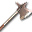</td><td class="col-name">
Francisca

フランキスカ
</td><td class="col-id"><code>WEAPON2_KA02_FRANCISCA</code><button type="button" class="copy-id" data-copy="WEAPON2_KA02_FRANCISCA" title="Copiar ID WEAPON2_KA02_FRANCISCA" aria-label="Copiar ID WEAPON2_KA02_FRANCISCA">⧉</button></td><td class="col-meta">Arma · Machado 1M Carta #263 · 0-2513 Máx 6x (+5)</td><td class="col-info">
Machado 1M · Atq: 51 · STR mín.: 10

Machado de um povo valente do Mediterrâneo
</td></tr>
<tr data-id="WEAPON2_KA03_WARAXE" data-cat="WEAPON2" data-sub="KA" data-flag="CARD" data-search="machado de guerra ウォーアックス weapon2_ka03_waraxe arma · machado 1m machado 1m · atq: 36 · str mín.: 10 machado de combate que evoluiu da ferramenta 0-2128 102"><td class="col-img"></td><td class="col-name">
Machado de Guerra

ウォーアックス
</td><td class="col-id"><code>WEAPON2_KA03_WARAXE</code><button type="button" class="copy-id" data-copy="WEAPON2_KA03_WARAXE" title="Copiar ID WEAPON2_KA03_WARAXE" aria-label="Copiar ID WEAPON2_KA03_WARAXE">⧉</button></td><td class="col-meta">Arma · Machado 1M Carta #102 · 0-2128 Máx 11x (+10)</td><td class="col-info">
Machado 1M · Atq: 36 · STR mín.: 10

Machado de combate que evoluiu da ferramenta
</td></tr>
<tr data-id="WEAPON2_KA04_BATTLEAXE" data-cat="WEAPON2" data-sub="KA" data-flag="CARD" data-search="machado de batalha バトルアックス weapon2_ka04_battleaxe arma · machado 1m machado 1m · atq: 57 · str mín.: 15 machado de guerra ainda mais feito para o combate 0-2129 103"><td class="col-img">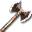</td><td class="col-name">
Machado de Batalha

バトルアックス
</td><td class="col-id"><code>WEAPON2_KA04_BATTLEAXE</code><button type="button" class="copy-id" data-copy="WEAPON2_KA04_BATTLEAXE" title="Copiar ID WEAPON2_KA04_BATTLEAXE" aria-label="Copiar ID WEAPON2_KA04_BATTLEAXE">⧉</button></td><td class="col-meta">Arma · Machado 1M Carta #103 · 0-2129 Máx 6x (+5)</td><td class="col-info">
Machado 1M · Atq: 57 · STR mín.: 15

Machado de guerra ainda mais feito para o combate
</td></tr>
<tr data-id="WEAPON2_KA05_GOLDAXE" data-cat="WEAPON2" data-sub="KA" data-flag="" data-search="machado de ouro ゴールドアックス weapon2_ka05_goldaxe arma · machado 1m machado 1m · atq: 40 · str mín.: 15 machado de batalha de ouro muito durável "><td class="col-img">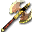</td><td class="col-name">
Machado de Ouro

ゴールドアックス
</td><td class="col-id"><code>WEAPON2_KA05_GOLDAXE</code><button type="button" class="copy-id" data-copy="WEAPON2_KA05_GOLDAXE" title="Copiar ID WEAPON2_KA05_GOLDAXE" aria-label="Copiar ID WEAPON2_KA05_GOLDAXE">⧉</button></td><td class="col-meta">Arma · Machado 1M</td><td class="col-info">
Machado 1M · Atq: 40 · STR mín.: 15

Machado de batalha de ouro muito durável
</td></tr>
<tr data-id="WEAPON2_KA06_SHIELDAXE" data-cat="WEAPON2" data-sub="KA" data-flag="CARD" data-search="machado-escudo シールドアックス weapon2_ka06_shieldaxe arma · machado 1m machado 1m · atq: 52 · str mín.: 10 machado com um escudo de ferro no cabo 0-2507 259"><td class="col-img">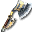</td><td class="col-name">
Machado-escudo

シールドアックス
</td><td class="col-id"><code>WEAPON2_KA06_SHIELDAXE</code><button type="button" class="copy-id" data-copy="WEAPON2_KA06_SHIELDAXE" title="Copiar ID WEAPON2_KA06_SHIELDAXE" aria-label="Copiar ID WEAPON2_KA06_SHIELDAXE">⧉</button></td><td class="col-meta">Arma · Machado 1M Carta #259 · 0-2507 Máx 6x (+5)</td><td class="col-info">
Machado 1M · Atq: 52 · STR mín.: 10

Machado com um escudo de ferro no cabo
</td></tr>
<tr data-id="WEAPON2_KA07_TRISTRAM" data-cat="WEAPON2" data-sub="KA" data-flag="" data-search="vertex ウェルテクス weapon2_ka07_tristram arma · machado 1m machado 1m · atq: 30 · str mín.: - machado lendário: só o rei divino pode tê-lo "><td class="col-img">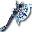</td><td class="col-name">
Vertex

ウェルテクス
</td><td class="col-id"><code>WEAPON2_KA07_TRISTRAM</code><button type="button" class="copy-id" data-copy="WEAPON2_KA07_TRISTRAM" title="Copiar ID WEAPON2_KA07_TRISTRAM" aria-label="Copiar ID WEAPON2_KA07_TRISTRAM">⧉</button></td><td class="col-meta">Arma · Machado 1M</td><td class="col-info">
Machado 1M · Atq: 30 · STR mín.: -

Machado lendário: só o Rei Divino pode tê-lo
</td></tr>
<tr data-id="WEAPON2_KA08_WARAXE" data-cat="WEAPON2" data-sub="KA" data-flag="STAR" data-search="★machado de guerra ★ウォーアックス weapon2_ka08_waraxe arma · machado 1m machado 1m · atq: 38 · str mín.: - machado de combate que evoluiu da ferramenta "><td class="col-img"></td><td class="col-name">
★Machado de Guerra

★ウォーアックス
</td><td class="col-id"><code>WEAPON2_KA08_WARAXE</code><button type="button" class="copy-id" data-copy="WEAPON2_KA08_WARAXE" title="Copiar ID WEAPON2_KA08_WARAXE" aria-label="Copiar ID WEAPON2_KA08_WARAXE">⧉</button></td><td class="col-meta">Arma · Machado 1M ★ Especial</td><td class="col-info">
Machado 1M · Atq: 38 · STR mín.: -

Machado de combate que evoluiu da ferramenta
</td></tr>
<tr data-id="WEAPON2_KA09_SILVERAXE" data-cat="WEAPON2" data-sub="KA" data-flag="CARD" data-search="machado de prata シルバーアックス weapon2_ka09_silveraxe arma · machado 1m machado 1m · atq: 30 · str mín.: 5 lindo machado de batalha de prata pura 0-2506 258"><td class="col-img">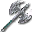</td><td class="col-name">
Machado de Prata

シルバーアックス
</td><td class="col-id"><code>WEAPON2_KA09_SILVERAXE</code><button type="button" class="copy-id" data-copy="WEAPON2_KA09_SILVERAXE" title="Copiar ID WEAPON2_KA09_SILVERAXE" aria-label="Copiar ID WEAPON2_KA09_SILVERAXE">⧉</button></td><td class="col-meta">Arma · Machado 1M Carta #258 · 0-2506 Máx 6x (+5)</td><td class="col-info">
Machado 1M · Atq: 30 · STR mín.: 5

Lindo machado de batalha de prata pura
</td></tr>
<tr data-id="WEAPON2_KA10_EGRET" data-cat="WEAPON2" data-sub="KA" data-flag="CARD" data-search="garça イーグレット weapon2_ka10_egret arma · machado 1m machado 1m · atq: 46 · str mín.: 10 machado de uma mão que pode ser arremessado 0-2611 369"><td class="col-img"></td><td class="col-name">
Garça

イーグレット
</td><td class="col-id"><code>WEAPON2_KA10_EGRET</code><button type="button" class="copy-id" data-copy="WEAPON2_KA10_EGRET" title="Copiar ID WEAPON2_KA10_EGRET" aria-label="Copiar ID WEAPON2_KA10_EGRET">⧉</button></td><td class="col-meta">Arma · Machado 1M Carta #369 · 0-2611 Máx 6x (+5)</td><td class="col-info">
Machado 1M · Atq: 46 · STR mín.: 10

Machado de uma mão que pode ser arremessado
</td></tr>
<tr data-id="WEAPON2_KA18_CRESCENT" data-cat="WEAPON2" data-sub="KA" data-flag="CARD" data-search="machado crescente クレセントアックス weapon2_ka18_crescent arma · machado 1m machado 1m · atq: 67 · str mín.: 15 lâmina curva em meia-lua, muito popular 1-374 449"><td class="col-img"></td><td class="col-name">
Machado Crescente

クレセントアックス
</td><td class="col-id"><code>WEAPON2_KA18_CRESCENT</code><button type="button" class="copy-id" data-copy="WEAPON2_KA18_CRESCENT" title="Copiar ID WEAPON2_KA18_CRESCENT" aria-label="Copiar ID WEAPON2_KA18_CRESCENT">⧉</button></td><td class="col-meta">Arma · Machado 1M Carta #449 · 1-374 Máx 4x (+3)</td><td class="col-info">
Machado 1M · Atq: 67 · STR mín.: 15

Lâmina curva em meia-lua, muito popular
</td></tr>
<tr data-id="WEAPON2_KA19_TAMECHAN2" data-cat="WEAPON2" data-sub="KA" data-flag="CARD" data-search="machado de espinho スパイクアックス weapon2_ka19_tamechan2 arma · machado 1m machado 1m · atq: 61 · str mín.: 15 machado com uma ponta afiada em vez de gume 0-2614 372"><td class="col-img"></td><td class="col-name">
Machado de Espinho

スパイクアックス
</td><td class="col-id"><code>WEAPON2_KA19_TAMECHAN2</code><button type="button" class="copy-id" data-copy="WEAPON2_KA19_TAMECHAN2" title="Copiar ID WEAPON2_KA19_TAMECHAN2" aria-label="Copiar ID WEAPON2_KA19_TAMECHAN2">⧉</button></td><td class="col-meta">Arma · Machado 1M Carta #372 · 0-2614 Máx 6x (+5)</td><td class="col-info">
Machado 1M · Atq: 61 · STR mín.: 15

Machado com uma ponta afiada em vez de gume
</td></tr>
<tr data-id="WEAPON2_KA20_DEMONCHOPPER" data-cat="WEAPON2" data-sub="KA" data-flag="" data-search="machadinha negra ブラックハチェット weapon2_ka20_demonchopper arma · machado 1m machado 1m · atq: 40 · str mín.: 15 machado negro feito de minério com poder das trevas "><td class="col-img"></td><td class="col-name">
Machadinha Negra

ブラックハチェット
</td><td class="col-id"><code>WEAPON2_KA20_DEMONCHOPPER</code><button type="button" class="copy-id" data-copy="WEAPON2_KA20_DEMONCHOPPER" title="Copiar ID WEAPON2_KA20_DEMONCHOPPER" aria-label="Copiar ID WEAPON2_KA20_DEMONCHOPPER">⧉</button></td><td class="col-meta">Arma · Machado 1M</td><td class="col-info">
Machado 1M · Atq: 40 · STR mín.: 15

Machado negro feito de minério com poder das trevas
</td></tr>
<tr data-id="WEAPON2_KA21_LILAC" data-cat="WEAPON2" data-sub="KA" data-flag="" data-search="machado silencioso サイレントアックス weapon2_ka21_lilac arma · machado 1m machado 1m · atq: 70 · str mín.: 15 sela a magia de quem é cortado por ele "><td class="col-img">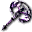</td><td class="col-name">
Machado Silencioso

サイレントアックス
</td><td class="col-id"><code>WEAPON2_KA21_LILAC</code><button type="button" class="copy-id" data-copy="WEAPON2_KA21_LILAC" title="Copiar ID WEAPON2_KA21_LILAC" aria-label="Copiar ID WEAPON2_KA21_LILAC">⧉</button></td><td class="col-meta">Arma · Machado 1M</td><td class="col-info">
Machado 1M · Atq: 70 · STR mín.: 15

Sela a magia de quem é cortado por ele
</td></tr>
<tr data-id="WEAPON2_KA25_HORIHORI" data-cat="WEAPON2" data-sub="KA" data-flag="" data-search="machado tribal トライブアックス weapon2_ka25_horihori arma · machado 1m machado 1m · atq: 55 · str mín.: 10 machado com o poder do sol, preferido dos bárbaros "><td class="col-img">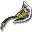</td><td class="col-name">
Machado Tribal

トライブアックス
</td><td class="col-id"><code>WEAPON2_KA25_HORIHORI</code><button type="button" class="copy-id" data-copy="WEAPON2_KA25_HORIHORI" title="Copiar ID WEAPON2_KA25_HORIHORI" aria-label="Copiar ID WEAPON2_KA25_HORIHORI">⧉</button></td><td class="col-meta">Arma · Machado 1M</td><td class="col-info">
Machado 1M · Atq: 55 · STR mín.: 10

Machado com o poder do sol, preferido dos bárbaros
</td></tr>
<tr data-id="WEAPON2_KA26_CRIMSON" data-cat="WEAPON2" data-sub="KA" data-flag="CARD" data-search="linha carmesim クリムゾンライン weapon2_ka26_crimson arma · machado 1m machado 1m · atq: 68 · str mín.: 15 dá poder destrutivo em troca do sangue de quem usa 1-494 506"><td class="col-img"></td><td class="col-name">
Linha Carmesim

クリムゾンライン
</td><td class="col-id"><code>WEAPON2_KA26_CRIMSON</code><button type="button" class="copy-id" data-copy="WEAPON2_KA26_CRIMSON" title="Copiar ID WEAPON2_KA26_CRIMSON" aria-label="Copiar ID WEAPON2_KA26_CRIMSON">⧉</button></td><td class="col-meta">Arma · Machado 1M Carta #506 · 1-494 Máx 4x (+3)</td><td class="col-info">
Machado 1M · Atq: 68 · STR mín.: 15

Dá poder destrutivo em troca do sangue de quem usa
</td></tr>
<tr data-id="WEAPON2_KA27_BATTLE" data-cat="WEAPON2" data-sub="KA" data-flag="STAR" data-search="★machado de batalha ★バトルアックス weapon2_ka27_battle arma · machado 1m machado 1m · atq: 50 · str mín.: - machado de guerra ainda mais feito para o combate "><td class="col-img"></td><td class="col-name">
★Machado de Batalha

★バトルアックス
</td><td class="col-id"><code>WEAPON2_KA27_BATTLE</code><button type="button" class="copy-id" data-copy="WEAPON2_KA27_BATTLE" title="Copiar ID WEAPON2_KA27_BATTLE" aria-label="Copiar ID WEAPON2_KA27_BATTLE">⧉</button></td><td class="col-meta">Arma · Machado 1M ★ Especial</td><td class="col-info">
Machado 1M · Atq: 50 · STR mín.: -

Machado de guerra ainda mais feito para o combate
</td></tr>
<tr data-id="WEAPON2_KA28_SHIELD" data-cat="WEAPON2" data-sub="KA" data-flag="STAR" data-search="★machado-escudo ★シールドアックス weapon2_ka28_shield arma · machado 1m machado 1m · atq: 46 · str mín.: - machado com um escudo de ferro no cabo "><td class="col-img"></td><td class="col-name">
★Machado-escudo

★シールドアックス
</td><td class="col-id"><code>WEAPON2_KA28_SHIELD</code><button type="button" class="copy-id" data-copy="WEAPON2_KA28_SHIELD" title="Copiar ID WEAPON2_KA28_SHIELD" aria-label="Copiar ID WEAPON2_KA28_SHIELD">⧉</button></td><td class="col-meta">Arma · Machado 1M ★ Especial</td><td class="col-info">
Machado 1M · Atq: 46 · STR mín.: -

Machado com um escudo de ferro no cabo
</td></tr>
<tr data-id="WEAPON2_KA29_FRANCISCA" data-cat="WEAPON2" data-sub="KA" data-flag="STAR" data-search="★francisca ★フランキスカ weapon2_ka29_francisca arma · machado 1m machado 1m · atq: 46 · str mín.: - machado de um povo valente do mediterrâneo "><td class="col-img"></td><td class="col-name">
★Francisca

★フランキスカ
</td><td class="col-id"><code>WEAPON2_KA29_FRANCISCA</code><button type="button" class="copy-id" data-copy="WEAPON2_KA29_FRANCISCA" title="Copiar ID WEAPON2_KA29_FRANCISCA" aria-label="Copiar ID WEAPON2_KA29_FRANCISCA">⧉</button></td><td class="col-meta">Arma · Machado 1M ★ Especial</td><td class="col-info">
Machado 1M · Atq: 46 · STR mín.: -

Machado de um povo valente do Mediterrâneo
</td></tr>
<tr data-id="WEAPON2_KA30_HORIHORI" data-cat="WEAPON2" data-sub="KA" data-flag="STAR" data-search="★machado tribal ★トライブアックス weapon2_ka30_horihori arma · machado 1m machado 1m · atq: 50 · str mín.: - machado com o poder do sol, preferido dos bárbaros "><td class="col-img"></td><td class="col-name">
★Machado Tribal

★トライブアックス
</td><td class="col-id"><code>WEAPON2_KA30_HORIHORI</code><button type="button" class="copy-id" data-copy="WEAPON2_KA30_HORIHORI" title="Copiar ID WEAPON2_KA30_HORIHORI" aria-label="Copiar ID WEAPON2_KA30_HORIHORI">⧉</button></td><td class="col-meta">Arma · Machado 1M ★ Especial</td><td class="col-info">
Machado 1M · Atq: 50 · STR mín.: -

Machado com o poder do sol, preferido dos bárbaros
</td></tr>
<tr data-id="WEAPON2_KA33_D4SHINKI1" data-cat="WEAPON2" data-sub="KA" data-flag="" data-search="carmesim infernal ヘルクリムゾン weapon2_ka33_d4shinki1 arma · machado 1m machado 1m · atq: 85 · str mín.: 15 machado que devora o dono, envolto no fogo do inferno "><td class="col-img">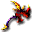</td><td class="col-name">
Carmesim Infernal

ヘルクリムゾン
</td><td class="col-id"><code>WEAPON2_KA33_D4SHINKI1</code><button type="button" class="copy-id" data-copy="WEAPON2_KA33_D4SHINKI1" title="Copiar ID WEAPON2_KA33_D4SHINKI1" aria-label="Copiar ID WEAPON2_KA33_D4SHINKI1">⧉</button></td><td class="col-meta">Arma · Machado 1M</td><td class="col-info">
Machado 1M · Atq: 85 · STR mín.: 15

Machado que devora o dono, envolto no fogo do inferno
</td></tr>
<tr data-id="WEAPON2_KA34_BARBARIAN" data-cat="WEAPON2" data-sub="KA" data-flag="" data-search="machado bárbaro バルバロスアックス weapon2_ka34_barbarian arma · machado 1m machado 1m · atq: 72 · str mín.: 15 machado de combate dado só a heróis bárbaros "><td class="col-img">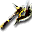</td><td class="col-name">
Machado Bárbaro

バルバロスアックス
</td><td class="col-id"><code>WEAPON2_KA34_BARBARIAN</code><button type="button" class="copy-id" data-copy="WEAPON2_KA34_BARBARIAN" title="Copiar ID WEAPON2_KA34_BARBARIAN" aria-label="Copiar ID WEAPON2_KA34_BARBARIAN">⧉</button></td><td class="col-meta">Arma · Machado 1M</td><td class="col-info">
Machado 1M · Atq: 72 · STR mín.: 15

Machado de combate dado só a heróis bárbaros
</td></tr>
<tr data-id="WEAPON2_KA35_D4SHINKI2" data-cat="WEAPON2" data-sub="KA" data-flag="" data-search="machado barroco バロックアックス weapon2_ka35_d4shinki2 arma · machado 1m machado 1m · atq: 76 · str mín.: 15 machado colorido e de forma estranha "><td class="col-img">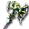</td><td class="col-name">
Machado Barroco

バロックアックス
</td><td class="col-id"><code>WEAPON2_KA35_D4SHINKI2</code><button type="button" class="copy-id" data-copy="WEAPON2_KA35_D4SHINKI2" title="Copiar ID WEAPON2_KA35_D4SHINKI2" aria-label="Copiar ID WEAPON2_KA35_D4SHINKI2">⧉</button></td><td class="col-meta">Arma · Machado 1M</td><td class="col-info">
Machado 1M · Atq: 76 · STR mín.: 15

Machado colorido e de forma estranha
</td></tr>
<tr data-id="WEAPON2_KA36_SUNLIGHT" data-cat="WEAPON2" data-sub="KA" data-flag="" data-search="machado da luz do sol サンライトアックス weapon2_ka36_sunlight arma · machado 1m machado 1m · atq: 73 · str mín.: 15 libera seu poder quando reunido com seu par "><td class="col-img"></td><td class="col-name">
Machado da Luz do Sol

サンライトアックス
</td><td class="col-id"><code>WEAPON2_KA36_SUNLIGHT</code><button type="button" class="copy-id" data-copy="WEAPON2_KA36_SUNLIGHT" title="Copiar ID WEAPON2_KA36_SUNLIGHT" aria-label="Copiar ID WEAPON2_KA36_SUNLIGHT">⧉</button></td><td class="col-meta">Arma · Machado 1M</td><td class="col-info">
Machado 1M · Atq: 73 · STR mín.: 15

Libera seu poder quando reunido com seu par
</td></tr>
<tr data-id="WEAPON2_KA37_MOONLIGHT" data-cat="WEAPON2" data-sub="KA" data-flag="" data-search="machado da luz da lua ムーンライトアックス weapon2_ka37_moonlight arma · machado 1m machado 1m · atq: 75 · str mín.: 15 libera seu poder quando reunido com seu par "><td class="col-img">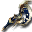</td><td class="col-name">
Machado da Luz da Lua

ムーンライトアックス
</td><td class="col-id"><code>WEAPON2_KA37_MOONLIGHT</code><button type="button" class="copy-id" data-copy="WEAPON2_KA37_MOONLIGHT" title="Copiar ID WEAPON2_KA37_MOONLIGHT" aria-label="Copiar ID WEAPON2_KA37_MOONLIGHT">⧉</button></td><td class="col-meta">Arma · Machado 1M</td><td class="col-info">
Machado 1M · Atq: 75 · STR mín.: 15

Libera seu poder quando reunido com seu par
</td></tr>
<tr data-id="WEAPON2_KA38_GLADIATOR" data-cat="WEAPON2" data-sub="KA" data-flag="" data-search="catástrofe カタストロフィー weapon2_ka38_gladiator arma · machado 1m machado 1m · atq: 79 · str mín.: 15 machado da ruína que dizem ter visto toda a história "><td class="col-img">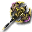</td><td class="col-name">
Catástrofe

カタストロフィー
</td><td class="col-id"><code>WEAPON2_KA38_GLADIATOR</code><button type="button" class="copy-id" data-copy="WEAPON2_KA38_GLADIATOR" title="Copiar ID WEAPON2_KA38_GLADIATOR" aria-label="Copiar ID WEAPON2_KA38_GLADIATOR">⧉</button></td><td class="col-meta">Arma · Machado 1M</td><td class="col-info">
Machado 1M · Atq: 79 · STR mín.: 15

Machado da ruína que dizem ter visto toda a história
</td></tr>
<tr data-id="WEAPON2_KA40_TRISTRAM_EX" data-cat="WEAPON2" data-sub="KA" data-flag="EX" data-search="vertex ex ウェルテクスｅｘ weapon2_ka40_tristram_ex arma · machado 1m machado 1m · atq: 60 · str mín.: - machado de uma mão inspirado no artefato vertex "><td class="col-img">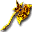</td><td class="col-name">
Vertex EX

ウェルテクスＥＸ
</td><td class="col-id"><code>WEAPON2_KA40_TRISTRAM_EX</code><button type="button" class="copy-id" data-copy="WEAPON2_KA40_TRISTRAM_EX" title="Copiar ID WEAPON2_KA40_TRISTRAM_EX" aria-label="Copiar ID WEAPON2_KA40_TRISTRAM_EX">⧉</button></td><td class="col-meta">Arma · Machado 1M EX</td><td class="col-info">
Machado 1M · Atq: 60 · STR mín.: -

Machado de uma mão inspirado no artefato Vertex
</td></tr>
<tr data-id="WEAPON2_KS01_SHORTSWORD" data-cat="WEAPON2" data-sub="KS" data-flag="CARD" data-search="espada curta ショートソード weapon2_ks01_shortsword arma · espada 1m espada 1m · atq: 24 · str mín.: 5 espada para aventureiros novatos 0-2108 018"><td class="col-img"></td><td class="col-name">
Espada Curta

ショートソード
</td><td class="col-id"><code>WEAPON2_KS01_SHORTSWORD</code><button type="button" class="copy-id" data-copy="WEAPON2_KS01_SHORTSWORD" title="Copiar ID WEAPON2_KS01_SHORTSWORD" aria-label="Copiar ID WEAPON2_KS01_SHORTSWORD">⧉</button></td><td class="col-meta">Arma · Espada 1M Carta #018 · 0-2108 Máx 11x (+10)</td><td class="col-info">
Espada 1M · Atq: 24 · STR mín.: 5

Espada para aventureiros novatos
</td></tr>
<tr data-id="WEAPON2_KS02_RAPIER" data-cat="WEAPON2" data-sub="KS" data-flag="CARD" data-search="rapieira レイピア weapon2_ks02_rapier arma · espada 1m espada 1m · atq: 33 · str mín.: 5 espada feita para cortar inimigos de armadura leve 0-2700 494"><td class="col-img">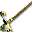</td><td class="col-name">
Rapieira

レイピア
</td><td class="col-id"><code>WEAPON2_KS02_RAPIER</code><button type="button" class="copy-id" data-copy="WEAPON2_KS02_RAPIER" title="Copiar ID WEAPON2_KS02_RAPIER" aria-label="Copiar ID WEAPON2_KS02_RAPIER">⧉</button></td><td class="col-meta">Arma · Espada 1M Carta #494 · 0-2700 Máx 11x (+10)</td><td class="col-info">
Espada 1M · Atq: 33 · STR mín.: 5

Espada feita para cortar inimigos de armadura leve
</td></tr>
<tr data-id="WEAPON2_KS03_LONGSWORD" data-cat="WEAPON2" data-sub="KS" data-flag="CARD" data-search="espada longa ロングソード weapon2_ks03_longsword arma · espada 1m espada 1m · atq: 34 · str mín.: 5 longa o bastante para golpear do alto do cavalo 0-2110 099"><td class="col-img">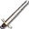</td><td class="col-name">
Espada Longa

ロングソード
</td><td class="col-id"><code>WEAPON2_KS03_LONGSWORD</code><button type="button" class="copy-id" data-copy="WEAPON2_KS03_LONGSWORD" title="Copiar ID WEAPON2_KS03_LONGSWORD" aria-label="Copiar ID WEAPON2_KS03_LONGSWORD">⧉</button></td><td class="col-meta">Arma · Espada 1M Carta #099 · 0-2110 Máx 11x (+10)</td><td class="col-info">
Espada 1M · Atq: 34 · STR mín.: 5

Longa o bastante para golpear do alto do cavalo
</td></tr>
<tr data-id="WEAPON2_KS04_VIKINGSWORD" data-cat="WEAPON2" data-sub="KS" data-flag="CARD" data-search="espada viking ヴァイキングソード weapon2_ks04_vikingsword arma · espada 1m espada 1m · atq: 30 · str mín.: 5 espada de ferro grossa e larga usada pelos vikings 0-2501 253"><td class="col-img">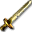</td><td class="col-name">
Espada Viking

ヴァイキングソード
</td><td class="col-id"><code>WEAPON2_KS04_VIKINGSWORD</code><button type="button" class="copy-id" data-copy="WEAPON2_KS04_VIKINGSWORD" title="Copiar ID WEAPON2_KS04_VIKINGSWORD" aria-label="Copiar ID WEAPON2_KS04_VIKINGSWORD">⧉</button></td><td class="col-meta">Arma · Espada 1M Carta #253 · 0-2501 Máx 6x (+5)</td><td class="col-info">
Espada 1M · Atq: 30 · STR mín.: 5

Espada de ferro grossa e larga usada pelos vikings
</td></tr>
<tr data-id="WEAPON2_KS05_FALCHION" data-cat="WEAPON2" data-sub="KS" data-flag="CARD" data-search="falchion ファルシオン weapon2_ks05_falchion arma · espada 1m espada 1m · atq: 54 · str mín.: 10 sabre pesado de um só gume, favorito do povo do deserto 0-2365 250"><td class="col-img">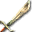</td><td class="col-name">
Falchion

ファルシオン
</td><td class="col-id"><code>WEAPON2_KS05_FALCHION</code><button type="button" class="copy-id" data-copy="WEAPON2_KS05_FALCHION" title="Copiar ID WEAPON2_KS05_FALCHION" aria-label="Copiar ID WEAPON2_KS05_FALCHION">⧉</button></td><td class="col-meta">Arma · Espada 1M Carta #250 · 0-2365 Máx 6x (+5)</td><td class="col-info">
Espada 1M · Atq: 54 · STR mín.: 10

Sabre pesado de um só gume, favorito do povo do deserto
</td></tr>
<tr data-id="WEAPON2_KS06_GLADIUS" data-cat="WEAPON2" data-sub="KS" data-flag="CARD" data-search="gládio グラディウス weapon2_ks06_gladius arma · espada 1m espada 1m · atq: 45 · str mín.: 10 espada fácil de usar, favorita dos gladiadores 0-2113 019"><td class="col-img">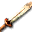</td><td class="col-name">
Gládio

グラディウス
</td><td class="col-id"><code>WEAPON2_KS06_GLADIUS</code><button type="button" class="copy-id" data-copy="WEAPON2_KS06_GLADIUS" title="Copiar ID WEAPON2_KS06_GLADIUS" aria-label="Copiar ID WEAPON2_KS06_GLADIUS">⧉</button></td><td class="col-meta">Arma · Espada 1M Carta #019 · 0-2113 Máx 6x (+5)</td><td class="col-info">
Espada 1M · Atq: 45 · STR mín.: 10

Espada fácil de usar, favorita dos gladiadores
</td></tr>
<tr data-id="WEAPON2_KS07_MITHRILBLADE" data-cat="WEAPON2" data-sub="KS" data-flag="CARD" data-search="espada de mithril ミスリルソード weapon2_ks07_mithrilblade arma · espada 1m espada 1m · atq: 65 · str mín.: 10 espada dura e leve feita de mithril, metal mágico 1-248 173"><td class="col-img"></td><td class="col-name">
Espada de Mithril

ミスリルソード
</td><td class="col-id"><code>WEAPON2_KS07_MITHRILBLADE</code><button type="button" class="copy-id" data-copy="WEAPON2_KS07_MITHRILBLADE" title="Copiar ID WEAPON2_KS07_MITHRILBLADE" aria-label="Copiar ID WEAPON2_KS07_MITHRILBLADE">⧉</button></td><td class="col-meta">Arma · Espada 1M Carta #173 · 1-248 Máx 4x (+3)</td><td class="col-info">
Espada 1M · Atq: 65 · STR mín.: 10

Espada dura e leve feita de mithril, metal mágico
</td></tr>
<tr data-id="WEAPON2_KS08_MAGICSWORD" data-cat="WEAPON2" data-sub="KS" data-flag="CARD" data-search="espada mágica マジックソード weapon2_ks08_magicsword arma · espada 1m espada 1m · atq: 12 · str mín.: - objeto de rituais mágicos que permite usar magia 1-371 375"><td class="col-img">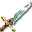</td><td class="col-name">
Espada Mágica

マジックソード
</td><td class="col-id"><code>WEAPON2_KS08_MAGICSWORD</code><button type="button" class="copy-id" data-copy="WEAPON2_KS08_MAGICSWORD" title="Copiar ID WEAPON2_KS08_MAGICSWORD" aria-label="Copiar ID WEAPON2_KS08_MAGICSWORD">⧉</button></td><td class="col-meta">Arma · Espada 1M Carta #375 · 1-371 Máx 4x (+3)</td><td class="col-info">
Espada 1M · Atq: 12 · STR mín.: -

Objeto de rituais mágicos que permite usar magia
</td></tr>
<tr data-id="WEAPON2_KS09_EXCALIBUR" data-cat="WEAPON2" data-sub="KS" data-flag="" data-search="excalibur エクスカリバー weapon2_ks09_excalibur arma · espada 1m espada 1m · atq: 68 · str mín.: 15 lendária espada afiada e resistente "><td class="col-img">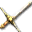</td><td class="col-name">
Excalibur

エクスカリバー
</td><td class="col-id"><code>WEAPON2_KS09_EXCALIBUR</code><button type="button" class="copy-id" data-copy="WEAPON2_KS09_EXCALIBUR" title="Copiar ID WEAPON2_KS09_EXCALIBUR" aria-label="Copiar ID WEAPON2_KS09_EXCALIBUR">⧉</button></td><td class="col-meta">Arma · Espada 1M</td><td class="col-info">
Espada 1M · Atq: 68 · STR mín.: 15

Lendária espada afiada e resistente
</td></tr>
<tr data-id="WEAPON2_KS10_FAKESWORD" data-cat="WEAPON2" data-sub="KS" data-flag="CARD" data-search="espada falsa フェイクソード weapon2_ks10_fakesword arma · espada 1m espada 1m · atq: 35 · str mín.: 5 espada longa decorativa, toda enfeitada 0-2701 495"><td class="col-img">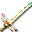</td><td class="col-name">
Espada Falsa

フェイクソード
</td><td class="col-id"><code>WEAPON2_KS10_FAKESWORD</code><button type="button" class="copy-id" data-copy="WEAPON2_KS10_FAKESWORD" title="Copiar ID WEAPON2_KS10_FAKESWORD" aria-label="Copiar ID WEAPON2_KS10_FAKESWORD">⧉</button></td><td class="col-meta">Arma · Espada 1M Carta #495 · 0-2701 Máx 11x (+10)</td><td class="col-info">
Espada 1M · Atq: 35 · STR mín.: 5

Espada longa decorativa, toda enfeitada
</td></tr>
<tr data-id="WEAPON2_KS11_BOLG" data-cat="WEAPON2" data-sub="KS" data-flag="" data-search="fragarach アンサラー weapon2_ks11_bolg arma · espada 1m espada 1m · atq: 30 · str mín.: - espada lendária: só o rei divino pode tê-la "><td class="col-img"></td><td class="col-name">
Fragarach

アンサラー
</td><td class="col-id"><code>WEAPON2_KS11_BOLG</code><button type="button" class="copy-id" data-copy="WEAPON2_KS11_BOLG" title="Copiar ID WEAPON2_KS11_BOLG" aria-label="Copiar ID WEAPON2_KS11_BOLG">⧉</button></td><td class="col-meta">Arma · Espada 1M</td><td class="col-info">
Espada 1M · Atq: 30 · STR mín.: -

Espada lendária: só o Rei Divino pode tê-la
</td></tr>
<tr data-id="WEAPON2_KS12_WHITESWORD" data-cat="WEAPON2" data-sub="KS" data-flag="CARD" data-search="espada demoníaca デモンズソード weapon2_ks12_whitesword arma · espada 1m espada 1m · atq: 40 · str mín.: 10 espada longa que guarda uma força negra sinistra 1-430 501"><td class="col-img"></td><td class="col-name">
Espada Demoníaca

デモンズソード
</td><td class="col-id"><code>WEAPON2_KS12_WHITESWORD</code><button type="button" class="copy-id" data-copy="WEAPON2_KS12_WHITESWORD" title="Copiar ID WEAPON2_KS12_WHITESWORD" aria-label="Copiar ID WEAPON2_KS12_WHITESWORD">⧉</button></td><td class="col-meta">Arma · Espada 1M Carta #501 · 1-430 Máx 4x (+3)</td><td class="col-info">
Espada 1M · Atq: 40 · STR mín.: 10

Espada longa que guarda uma força negra sinistra
</td></tr>
<tr data-id="WEAPON2_KS13_BLACKSWORD" data-cat="WEAPON2" data-sub="KS" data-flag="CARD" data-search="espada grande グレートソード weapon2_ks13_blacksword arma · espada 1m espada 1m · atq: 65 · str mín.: 15 espada bela e afiada, só para os melhores 1-373 448"><td class="col-img">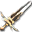</td><td class="col-name">
Espada Grande

グレートソード
</td><td class="col-id"><code>WEAPON2_KS13_BLACKSWORD</code><button type="button" class="copy-id" data-copy="WEAPON2_KS13_BLACKSWORD" title="Copiar ID WEAPON2_KS13_BLACKSWORD" aria-label="Copiar ID WEAPON2_KS13_BLACKSWORD">⧉</button></td><td class="col-meta">Arma · Espada 1M Carta #448 · 1-373 Máx 4x (+3)</td><td class="col-info">
Espada 1M · Atq: 65 · STR mín.: 15

Espada bela e afiada, só para os melhores
</td></tr>
<tr data-id="WEAPON2_KS14_KNIGHTSWORD" data-cat="WEAPON2" data-sub="KS" data-flag="" data-search="espada de cavaleiro ナイトソード weapon2_ks14_knightsword arma · espada 1m espada 1m · atq: 61 · str mín.: 10 espada lendária: só verdadeiros cavaleiros a usam "><td class="col-img"></td><td class="col-name">
Espada de Cavaleiro

ナイトソード
</td><td class="col-id"><code>WEAPON2_KS14_KNIGHTSWORD</code><button type="button" class="copy-id" data-copy="WEAPON2_KS14_KNIGHTSWORD" title="Copiar ID WEAPON2_KS14_KNIGHTSWORD" aria-label="Copiar ID WEAPON2_KS14_KNIGHTSWORD">⧉</button></td><td class="col-meta">Arma · Espada 1M</td><td class="col-info">
Espada 1M · Atq: 61 · STR mín.: 10

Espada lendária: só verdadeiros cavaleiros a usam
</td></tr>
<tr data-id="WEAPON2_KS15_LONGSWORD" data-cat="WEAPON2" data-sub="KS" data-flag="STAR" data-search="★espada longa ★ロングソード weapon2_ks15_longsword arma · espada 1m espada 1m · atq: 32 · str mín.: - longa o bastante para golpear do alto do cavalo "><td class="col-img">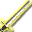</td><td class="col-name">
★Espada Longa

★ロングソード
</td><td class="col-id"><code>WEAPON2_KS15_LONGSWORD</code><button type="button" class="copy-id" data-copy="WEAPON2_KS15_LONGSWORD" title="Copiar ID WEAPON2_KS15_LONGSWORD" aria-label="Copiar ID WEAPON2_KS15_LONGSWORD">⧉</button></td><td class="col-meta">Arma · Espada 1M ★ Especial</td><td class="col-info">
Espada 1M · Atq: 32 · STR mín.: -

Longa o bastante para golpear do alto do cavalo
</td></tr>
<tr data-id="WEAPON2_KS16_FALCHION" data-cat="WEAPON2" data-sub="KS" data-flag="STAR" data-search="★falchion ★ファルシオン weapon2_ks16_falchion arma · espada 1m espada 1m · atq: 49 · str mín.: - sabre pesado de um só gume, favorito do povo do deserto "><td class="col-img">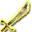</td><td class="col-name">
★Falchion

★ファルシオン
</td><td class="col-id"><code>WEAPON2_KS16_FALCHION</code><button type="button" class="copy-id" data-copy="WEAPON2_KS16_FALCHION" title="Copiar ID WEAPON2_KS16_FALCHION" aria-label="Copiar ID WEAPON2_KS16_FALCHION">⧉</button></td><td class="col-meta">Arma · Espada 1M ★ Especial</td><td class="col-info">
Espada 1M · Atq: 49 · STR mín.: -

Sabre pesado de um só gume, favorito do povo do deserto
</td></tr>
<tr data-id="WEAPON2_KS17_CULANNSWORD" data-cat="WEAPON2" data-sub="KS" data-flag="CARD" data-search="espada curta de klan クランのショートソード weapon2_ks17_culannsword arma · espada 1m espada 1m · atq: 32 · str mín.: - espada para iniciantes forjada pelo mestre klan 0-2350 "><td class="col-img"></td><td class="col-name">
Espada Curta de Klan

クランのショートソード
</td><td class="col-id"><code>WEAPON2_KS17_CULANNSWORD</code><button type="button" class="copy-id" data-copy="WEAPON2_KS17_CULANNSWORD" title="Copiar ID WEAPON2_KS17_CULANNSWORD" aria-label="Copiar ID WEAPON2_KS17_CULANNSWORD">⧉</button></td><td class="col-meta">Arma · Espada 1M Carta #— · 0-2350 Máx 6x (+5)</td><td class="col-info">
Espada 1M · Atq: 32 · STR mín.: -

Espada para iniciantes forjada pelo mestre Klan
</td></tr>
<tr data-id="WEAPON2_KS18_VIPERFUNG" data-cat="WEAPON2" data-sub="KS" data-flag="CARD" data-search="presa de víbora バイパーファング weapon2_ks18_viperfung arma · espada 1m espada 1m · atq: 50 · str mín.: 10 espada com ponta afiada como presa de cobra 0-2504 256"><td class="col-img">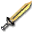</td><td class="col-name">
Presa de Víbora

バイパーファング
</td><td class="col-id"><code>WEAPON2_KS18_VIPERFUNG</code><button type="button" class="copy-id" data-copy="WEAPON2_KS18_VIPERFUNG" title="Copiar ID WEAPON2_KS18_VIPERFUNG" aria-label="Copiar ID WEAPON2_KS18_VIPERFUNG">⧉</button></td><td class="col-meta">Arma · Espada 1M Carta #256 · 0-2504 Máx 6x (+5)</td><td class="col-info">
Espada 1M · Atq: 50 · STR mín.: 10

Espada com ponta afiada como presa de cobra
</td></tr>
<tr data-id="WEAPON2_KS19_ROYAL" data-cat="WEAPON2" data-sub="KS" data-flag="CARD" data-search="espada sagrada ホーリーソード weapon2_ks19_royal arma · espada 1m espada 1m · atq: 35 · str mín.: 5 espada longa e ágil protegida pela força branca 1-431 502"><td class="col-img">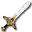</td><td class="col-name">
Espada Sagrada

ホーリーソード
</td><td class="col-id"><code>WEAPON2_KS19_ROYAL</code><button type="button" class="copy-id" data-copy="WEAPON2_KS19_ROYAL" title="Copiar ID WEAPON2_KS19_ROYAL" aria-label="Copiar ID WEAPON2_KS19_ROYAL">⧉</button></td><td class="col-meta">Arma · Espada 1M Carta #502 · 1-431 Máx 4x (+3)</td><td class="col-info">
Espada 1M · Atq: 35 · STR mín.: 5

Espada longa e ágil protegida pela força branca
</td></tr>
<tr data-id="WEAPON2_KS29_SAPPHIRE" data-cat="WEAPON2" data-sub="KS" data-flag="" data-search="lâmina de safira サファイアエッジ weapon2_ks29_sapphire arma · espada 1m espada 1m · atq: 83 · str mín.: 10 espada preciosa de safira pura com poder especial "><td class="col-img">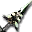</td><td class="col-name">
Lâmina de Safira

サファイアエッジ
</td><td class="col-id"><code>WEAPON2_KS29_SAPPHIRE</code><button type="button" class="copy-id" data-copy="WEAPON2_KS29_SAPPHIRE" title="Copiar ID WEAPON2_KS29_SAPPHIRE" aria-label="Copiar ID WEAPON2_KS29_SAPPHIRE">⧉</button></td><td class="col-meta">Arma · Espada 1M</td><td class="col-info">
Espada 1M · Atq: 83 · STR mín.: 10

Espada preciosa de safira pura com poder especial
</td></tr>
<tr data-id="WEAPON2_KS30_BLOODY" data-cat="WEAPON2" data-sub="KS" data-flag="" data-search="espinha sangrenta ブラッディスパイン weapon2_ks30_bloody arma · espada 1m espada 1m · atq: 55 · str mín.: 10 espada torta com presas de vampiro "><td class="col-img">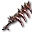</td><td class="col-name">
Espinha Sangrenta

ブラッディスパイン
</td><td class="col-id"><code>WEAPON2_KS30_BLOODY</code><button type="button" class="copy-id" data-copy="WEAPON2_KS30_BLOODY" title="Copiar ID WEAPON2_KS30_BLOODY" aria-label="Copiar ID WEAPON2_KS30_BLOODY">⧉</button></td><td class="col-meta">Arma · Espada 1M</td><td class="col-info">
Espada 1M · Atq: 55 · STR mín.: 10

Espada torta com presas de vampiro
</td></tr>
<tr data-id="WEAPON2_KS31_SHAMSHIR" data-cat="WEAPON2" data-sub="KS" data-flag="" data-search="cimitarra シャムシール weapon2_ks31_shamshir arma · espada 1m espada 1m · atq: 50 · str mín.: 5 espada que mostra toda a força ao descer o golpe "><td class="col-img">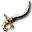</td><td class="col-name">
Cimitarra

シャムシール
</td><td class="col-id"><code>WEAPON2_KS31_SHAMSHIR</code><button type="button" class="copy-id" data-copy="WEAPON2_KS31_SHAMSHIR" title="Copiar ID WEAPON2_KS31_SHAMSHIR" aria-label="Copiar ID WEAPON2_KS31_SHAMSHIR">⧉</button></td><td class="col-meta">Arma · Espada 1M</td><td class="col-info">
Espada 1M · Atq: 50 · STR mín.: 5

Espada que mostra toda a força ao descer o golpe
</td></tr>
<tr data-id="WEAPON2_KS32_DIVIDER" data-cat="WEAPON2" data-sub="KS" data-flag="" data-search="espada divisora ディバイドソード weapon2_ks32_divider arma · espada 1m espada 1m · atq: 67 · str mín.: 10 facão adaptado para a luta, ótimo para cortar "><td class="col-img">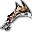</td><td class="col-name">
Espada Divisora

ディバイドソード
</td><td class="col-id"><code>WEAPON2_KS32_DIVIDER</code><button type="button" class="copy-id" data-copy="WEAPON2_KS32_DIVIDER" title="Copiar ID WEAPON2_KS32_DIVIDER" aria-label="Copiar ID WEAPON2_KS32_DIVIDER">⧉</button></td><td class="col-meta">Arma · Espada 1M</td><td class="col-info">
Espada 1M · Atq: 67 · STR mín.: 10

Facão adaptado para a luta, ótimo para cortar
</td></tr>
<tr data-id="WEAPON2_KS33_WING" data-cat="WEAPON2" data-sub="KS" data-flag="" data-search="espada alada ウィングソード weapon2_ks33_wing arma · espada 1m espada 1m · atq: 58 · str mín.: 5 feita com penas de uma ave veloz como um deus "><td class="col-img">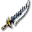</td><td class="col-name">
Espada Alada

ウィングソード
</td><td class="col-id"><code>WEAPON2_KS33_WING</code><button type="button" class="copy-id" data-copy="WEAPON2_KS33_WING" title="Copiar ID WEAPON2_KS33_WING" aria-label="Copiar ID WEAPON2_KS33_WING">⧉</button></td><td class="col-meta">Arma · Espada 1M</td><td class="col-info">
Espada 1M · Atq: 58 · STR mín.: 5

Feita com penas de uma ave veloz como um deus
</td></tr>
<tr data-id="WEAPON2_KS39_SEIRYUTOU" data-cat="WEAPON2" data-sub="KS" data-flag="CARD" data-search="espada do dragão azul 青龍刀 weapon2_ks39_seiryutou arma · espada 1m espada 1m · atq: 52 · str mín.: 10 grande espada antiga de ponta larga 0-2702 496"><td class="col-img"></td><td class="col-name">
Espada do Dragão Azul

青龍刀
</td><td class="col-id"><code>WEAPON2_KS39_SEIRYUTOU</code><button type="button" class="copy-id" data-copy="WEAPON2_KS39_SEIRYUTOU" title="Copiar ID WEAPON2_KS39_SEIRYUTOU" aria-label="Copiar ID WEAPON2_KS39_SEIRYUTOU">⧉</button></td><td class="col-meta">Arma · Espada 1M Carta #496 · 0-2702 Máx 6x (+5)</td><td class="col-info">
Espada 1M · Atq: 52 · STR mín.: 10

Grande espada antiga de ponta larga
</td></tr>
<tr data-id="WEAPON2_KS40_DRAGONSLAYER" data-cat="WEAPON2" data-sub="KS" data-flag="" data-search="espada de dragão ドラゴンソード weapon2_ks40_dragonslayer arma · espada 1m espada 1m · atq: 64 · str mín.: 15 feita da pele da cauda flexível de um dragão "><td class="col-img">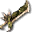</td><td class="col-name">
Espada de Dragão

ドラゴンソード
</td><td class="col-id"><code>WEAPON2_KS40_DRAGONSLAYER</code><button type="button" class="copy-id" data-copy="WEAPON2_KS40_DRAGONSLAYER" title="Copiar ID WEAPON2_KS40_DRAGONSLAYER" aria-label="Copiar ID WEAPON2_KS40_DRAGONSLAYER">⧉</button></td><td class="col-meta">Arma · Espada 1M</td><td class="col-info">
Espada 1M · Atq: 64 · STR mín.: 15

Feita da pele da cauda flexível de um dragão
</td></tr>
<tr data-id="WEAPON2_KS41_RAPIER" data-cat="WEAPON2" data-sub="KS" data-flag="STAR" data-search="★rapieira ★レイピア weapon2_ks41_rapier arma · espada 1m espada 1m · atq: 31 · str mín.: - espada feita para cortar inimigos de armadura leve "><td class="col-img"></td><td class="col-name">
★Rapieira

★レイピア
</td><td class="col-id"><code>WEAPON2_KS41_RAPIER</code><button type="button" class="copy-id" data-copy="WEAPON2_KS41_RAPIER" title="Copiar ID WEAPON2_KS41_RAPIER" aria-label="Copiar ID WEAPON2_KS41_RAPIER">⧉</button></td><td class="col-meta">Arma · Espada 1M ★ Especial</td><td class="col-info">
Espada 1M · Atq: 31 · STR mín.: -

Espada feita para cortar inimigos de armadura leve
</td></tr>
<tr data-id="WEAPON2_KS42" data-cat="WEAPON2" data-sub="KS" data-flag="STAR" data-search="★espada viking ★ヴァイキングソード weapon2_ks42 arma · espada 1m espada 1m · atq: 26 · str mín.: - espada de ferro grossa e larga usada pelos vikings "><td class="col-img">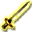</td><td class="col-name">
★Espada Viking

★ヴァイキングソード
</td><td class="col-id"><code>WEAPON2_KS42</code><button type="button" class="copy-id" data-copy="WEAPON2_KS42" title="Copiar ID WEAPON2_KS42" aria-label="Copiar ID WEAPON2_KS42">⧉</button></td><td class="col-meta">Arma · Espada 1M ★ Especial</td><td class="col-info">
Espada 1M · Atq: 26 · STR mín.: -

Espada de ferro grossa e larga usada pelos vikings
</td></tr>
<tr data-id="WEAPON2_KS43_GLADIUS" data-cat="WEAPON2" data-sub="KS" data-flag="STAR" data-search="★gládio ★グラディウス weapon2_ks43_gladius arma · espada 1m espada 1m · atq: 40 · str mín.: - espada fácil de usar, favorita dos gladiadores "><td class="col-img"></td><td class="col-name">
★Gládio

★グラディウス
</td><td class="col-id"><code>WEAPON2_KS43_GLADIUS</code><button type="button" class="copy-id" data-copy="WEAPON2_KS43_GLADIUS" title="Copiar ID WEAPON2_KS43_GLADIUS" aria-label="Copiar ID WEAPON2_KS43_GLADIUS">⧉</button></td><td class="col-meta">Arma · Espada 1M ★ Especial</td><td class="col-info">
Espada 1M · Atq: 40 · STR mín.: -

Espada fácil de usar, favorita dos gladiadores
</td></tr>
<tr data-id="WEAPON2_KS44_SHAMSHIR" data-cat="WEAPON2" data-sub="KS" data-flag="STAR" data-search="★cimitarra ★シャムシール weapon2_ks44_shamshir arma · espada 1m espada 1m · atq: 45 · str mín.: - espada que mostra toda a força ao descer o golpe "><td class="col-img"></td><td class="col-name">
★Cimitarra

★シャムシール
</td><td class="col-id"><code>WEAPON2_KS44_SHAMSHIR</code><button type="button" class="copy-id" data-copy="WEAPON2_KS44_SHAMSHIR" title="Copiar ID WEAPON2_KS44_SHAMSHIR" aria-label="Copiar ID WEAPON2_KS44_SHAMSHIR">⧉</button></td><td class="col-meta">Arma · Espada 1M ★ Especial</td><td class="col-info">
Espada 1M · Atq: 45 · STR mín.: -

Espada que mostra toda a força ao descer o golpe
</td></tr>
<tr data-id="WEAPON2_KS45_SEIRYUTOU" data-cat="WEAPON2" data-sub="KS" data-flag="STAR" data-search="★seiryu ★青龍刀 weapon2_ks45_seiryutou arma · espada 1m espada 1m · atq: 46 · str mín.: - grande espada antiga de ponta larga "><td class="col-img">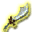</td><td class="col-name">
★Seiryu

★青龍刀
</td><td class="col-id"><code>WEAPON2_KS45_SEIRYUTOU</code><button type="button" class="copy-id" data-copy="WEAPON2_KS45_SEIRYUTOU" title="Copiar ID WEAPON2_KS45_SEIRYUTOU" aria-label="Copiar ID WEAPON2_KS45_SEIRYUTOU">⧉</button></td><td class="col-meta">Arma · Espada 1M ★ Especial</td><td class="col-info">
Espada 1M · Atq: 46 · STR mín.: -

Grande espada antiga de ponta larga
</td></tr>
<tr data-id="WEAPON2_KS49_MASTERRAPIER" data-cat="WEAPON2" data-sub="KS" data-flag="" data-search="rapieira mestra マスターレイピア weapon2_ks49_masterrapier arma · espada 1m espada 1m · atq: 53 · str mín.: 5 espada feita mais para perfurar do que cortar "><td class="col-img"></td><td class="col-name">
Rapieira Mestra

マスターレイピア
</td><td class="col-id"><code>WEAPON2_KS49_MASTERRAPIER</code><button type="button" class="copy-id" data-copy="WEAPON2_KS49_MASTERRAPIER" title="Copiar ID WEAPON2_KS49_MASTERRAPIER" aria-label="Copiar ID WEAPON2_KS49_MASTERRAPIER">⧉</button></td><td class="col-meta">Arma · Espada 1M</td><td class="col-info">
Espada 1M · Atq: 53 · STR mín.: 5

Espada feita mais para perfurar do que cortar
</td></tr>
<tr data-id="WEAPON2_KS50_TRIBE" data-cat="WEAPON2" data-sub="KS" data-flag="" data-search="lâmina tribal トライブエッジ weapon2_ks50_tribe arma · espada 1m espada 1m · atq: 50 · str mín.: 10 espada de uma mão de lâmina bem curva "><td class="col-img">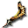</td><td class="col-name">
Lâmina Tribal

トライブエッジ
</td><td class="col-id"><code>WEAPON2_KS50_TRIBE</code><button type="button" class="copy-id" data-copy="WEAPON2_KS50_TRIBE" title="Copiar ID WEAPON2_KS50_TRIBE" aria-label="Copiar ID WEAPON2_KS50_TRIBE">⧉</button></td><td class="col-meta">Arma · Espada 1M</td><td class="col-info">
Espada 1M · Atq: 50 · STR mín.: 10

Espada de uma mão de lâmina bem curva
</td></tr>
<tr data-id="WEAPON2_KS51_D4SHINKI2" data-cat="WEAPON2" data-sub="KS" data-flag="" data-search="gladiador グラディエーター weapon2_ks51_d4shinki2 arma · espada 1m espada 1m · atq: 73 · str mín.: 10 espada com o rancor de criminosos "><td class="col-img">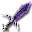</td><td class="col-name">
Gladiador

グラディエーター
</td><td class="col-id"><code>WEAPON2_KS51_D4SHINKI2</code><button type="button" class="copy-id" data-copy="WEAPON2_KS51_D4SHINKI2" title="Copiar ID WEAPON2_KS51_D4SHINKI2" aria-label="Copiar ID WEAPON2_KS51_D4SHINKI2">⧉</button></td><td class="col-meta">Arma · Espada 1M</td><td class="col-info">
Espada 1M · Atq: 73 · STR mín.: 10

Espada com o rancor de criminosos
</td></tr>
<tr data-id="WEAPON2_KS52_BRINGER_R" data-cat="WEAPON2" data-sub="KS" data-flag="" data-search="portadora da luz ライトブリンガー weapon2_ks52_bringer_r arma · espada 1m espada 1m · atq: 72 · str mín.: 10 dizem que os deuses a partiram em dois por medo "><td class="col-img">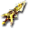</td><td class="col-name">
Portadora da Luz

ライトブリンガー
</td><td class="col-id"><code>WEAPON2_KS52_BRINGER_R</code><button type="button" class="copy-id" data-copy="WEAPON2_KS52_BRINGER_R" title="Copiar ID WEAPON2_KS52_BRINGER_R" aria-label="Copiar ID WEAPON2_KS52_BRINGER_R">⧉</button></td><td class="col-meta">Arma · Espada 1M</td><td class="col-info">
Espada 1M · Atq: 72 · STR mín.: 10

Dizem que os deuses a partiram em dois por medo
</td></tr>
<tr data-id="WEAPON2_KS53_BRINGER_L" data-cat="WEAPON2" data-sub="KS" data-flag="" data-search="portadora das sombras シャドウブリンガー weapon2_ks53_bringer_l arma · espada 1m espada 1m · atq: 74 · str mín.: 10 dizem que os deuses a partiram em dois por medo "><td class="col-img">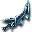</td><td class="col-name">
Portadora das Sombras

シャドウブリンガー
</td><td class="col-id"><code>WEAPON2_KS53_BRINGER_L</code><button type="button" class="copy-id" data-copy="WEAPON2_KS53_BRINGER_L" title="Copiar ID WEAPON2_KS53_BRINGER_L" aria-label="Copiar ID WEAPON2_KS53_BRINGER_L">⧉</button></td><td class="col-meta">Arma · Espada 1M</td><td class="col-info">
Espada 1M · Atq: 74 · STR mín.: 10

Dizem que os deuses a partiram em dois por medo
</td></tr>
<tr data-id="WEAPON2_KS54_RAGNAROK" data-cat="WEAPON2" data-sub="KS" data-flag="" data-search="arondight アロンダイト weapon2_ks54_ragnarok arma · espada 1m espada 1m · atq: 77 · str mín.: 10 espada mítica que dizem reger o destino das pessoas "><td class="col-img">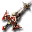</td><td class="col-name">
Arondight

アロンダイト
</td><td class="col-id"><code>WEAPON2_KS54_RAGNAROK</code><button type="button" class="copy-id" data-copy="WEAPON2_KS54_RAGNAROK" title="Copiar ID WEAPON2_KS54_RAGNAROK" aria-label="Copiar ID WEAPON2_KS54_RAGNAROK">⧉</button></td><td class="col-meta">Arma · Espada 1M</td><td class="col-info">
Espada 1M · Atq: 77 · STR mín.: 10

Espada mítica que dizem reger o destino das pessoas
</td></tr>
<tr data-id="WEAPON2_KS57_BOLG_EX" data-cat="WEAPON2" data-sub="KS" data-flag="EX" data-search="fragarach ex アンサラーｅｘ weapon2_ks57_bolg_ex arma · espada 1m espada 1m · atq: 58 · str mín.: - espada inspirada no artefato fragarach "><td class="col-img">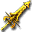</td><td class="col-name">
Fragarach EX

アンサラーＥＸ
</td><td class="col-id"><code>WEAPON2_KS57_BOLG_EX</code><button type="button" class="copy-id" data-copy="WEAPON2_KS57_BOLG_EX" title="Copiar ID WEAPON2_KS57_BOLG_EX" aria-label="Copiar ID WEAPON2_KS57_BOLG_EX">⧉</button></td><td class="col-meta">Arma · Espada 1M EX</td><td class="col-info">
Espada 1M · Atq: 58 · STR mín.: -

Espada inspirada no artefato Fragarach
</td></tr>
<tr data-id="WEAPON2_MA01_CLUB" data-cat="WEAPON2" data-sub="MA" data-flag="CARD" data-search="porrete クラブ weapon2_ma01_club arma · clava / maça clava · atq: 21 · str mín.: 5 a arma de impacto mais simples e primitiva 0-2141 025"><td class="col-img">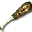</td><td class="col-name">
Porrete

クラブ
</td><td class="col-id"><code>WEAPON2_MA01_CLUB</code><button type="button" class="copy-id" data-copy="WEAPON2_MA01_CLUB" title="Copiar ID WEAPON2_MA01_CLUB" aria-label="Copiar ID WEAPON2_MA01_CLUB">⧉</button></td><td class="col-meta">Arma · Clava / Maça Carta #025 · 0-2141 Máx 11x (+10)</td><td class="col-info">
Clava · Atq: 21 · STR mín.: 5

A arma de impacto mais simples e primitiva
</td></tr>
<tr data-id="WEAPON2_MA02_MACE" data-cat="WEAPON2" data-sub="MA" data-flag="CARD" data-search="maça メイス weapon2_ma02_mace arma · clava / maça clava · atq: 34 · str mín.: 5 arma de ferro feita para golpear 0-2142 104"><td class="col-img">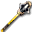</td><td class="col-name">
Maça

メイス
</td><td class="col-id"><code>WEAPON2_MA02_MACE</code><button type="button" class="copy-id" data-copy="WEAPON2_MA02_MACE" title="Copiar ID WEAPON2_MA02_MACE" aria-label="Copiar ID WEAPON2_MA02_MACE">⧉</button></td><td class="col-meta">Arma · Clava / Maça Carta #104 · 0-2142 Máx 11x (+10)</td><td class="col-info">
Clava · Atq: 34 · STR mín.: 5

Arma de ferro feita para golpear
</td></tr>
<tr data-id="WEAPON2_MA03_WARHAMMER" data-cat="WEAPON2" data-sub="MA" data-flag="CARD" data-search="martelo de guerra ウォーハンマー weapon2_ma03_warhammer arma · clava / maça clava · atq: 51 · str mín.: 10 martelo transformado em arma de guerra 0-2364 249"><td class="col-img">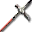</td><td class="col-name">
Martelo de Guerra

ウォーハンマー
</td><td class="col-id"><code>WEAPON2_MA03_WARHAMMER</code><button type="button" class="copy-id" data-copy="WEAPON2_MA03_WARHAMMER" title="Copiar ID WEAPON2_MA03_WARHAMMER" aria-label="Copiar ID WEAPON2_MA03_WARHAMMER">⧉</button></td><td class="col-meta">Arma · Clava / Maça Carta #249 · 0-2364 Máx 6x (+5)</td><td class="col-info">
Clava · Atq: 51 · STR mín.: 10

Martelo transformado em arma de guerra
</td></tr>
<tr data-id="WEAPON2_MA04_MORNINGSTAR" data-cat="WEAPON2" data-sub="MA" data-flag="CARD" data-search="estrela da manhã モーニングスター weapon2_ma04_morningstar arma · clava / maça clava · atq: 64 · str mín.: 10 maça com uma bola de ferro cheia de espinhos 1-437 503"><td class="col-img">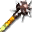</td><td class="col-name">
Estrela da Manhã

モーニングスター
</td><td class="col-id"><code>WEAPON2_MA04_MORNINGSTAR</code><button type="button" class="copy-id" data-copy="WEAPON2_MA04_MORNINGSTAR" title="Copiar ID WEAPON2_MA04_MORNINGSTAR" aria-label="Copiar ID WEAPON2_MA04_MORNINGSTAR">⧉</button></td><td class="col-meta">Arma · Clava / Maça Carta #503 · 1-437 Máx 4x (+3)</td><td class="col-info">
Clava · Atq: 64 · STR mín.: 10

Maça com uma bola de ferro cheia de espinhos
</td></tr>
<tr data-id="WEAPON2_MA05_MITHRILHAMMER" data-cat="WEAPON2" data-sub="MA" data-flag="CARD" data-search="martelo de mithril ミスリルハンマー weapon2_ma05_mithrilhammer arma · clava / maça clava · atq: 63 · str mín.: 10 martelo feito de mithril, metal mágico 1-420 454"><td class="col-img"></td><td class="col-name">
Martelo de Mithril

ミスリルハンマー
</td><td class="col-id"><code>WEAPON2_MA05_MITHRILHAMMER</code><button type="button" class="copy-id" data-copy="WEAPON2_MA05_MITHRILHAMMER" title="Copiar ID WEAPON2_MA05_MITHRILHAMMER" aria-label="Copiar ID WEAPON2_MA05_MITHRILHAMMER">⧉</button></td><td class="col-meta">Arma · Clava / Maça Carta #454 · 1-420 Máx 4x (+3)</td><td class="col-info">
Clava · Atq: 63 · STR mín.: 10

Martelo feito de mithril, metal mágico
</td></tr>
<tr data-id="WEAPON2_MA06_FAYHAMMER" data-cat="WEAPON2" data-sub="MA" data-flag="" data-search="pellegrande ペルグランデ weapon2_ma06_fayhammer arma · clava / maça clava · atq: 30 · str mín.: - martelo de poder imenso que muda o mundo num golpe "><td class="col-img">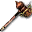</td><td class="col-name">
Pellegrande

ペルグランデ
</td><td class="col-id"><code>WEAPON2_MA06_FAYHAMMER</code><button type="button" class="copy-id" data-copy="WEAPON2_MA06_FAYHAMMER" title="Copiar ID WEAPON2_MA06_FAYHAMMER" aria-label="Copiar ID WEAPON2_MA06_FAYHAMMER">⧉</button></td><td class="col-meta">Arma · Clava / Maça</td><td class="col-info">
Clava · Atq: 30 · STR mín.: -

Martelo de poder imenso que muda o mundo num golpe
</td></tr>
<tr data-id="WEAPON2_MA07_MJOLLNIR" data-cat="WEAPON2" data-sub="MA" data-flag="" data-search="martelo de gnomo ノームハンマー weapon2_ma07_mjollnir arma · clava / maça clava · atq: 69 · str mín.: 5 clava que dizem ter sido feita pelo espírito gnomo "><td class="col-img">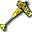</td><td class="col-name">
Martelo de Gnomo

ノームハンマー
</td><td class="col-id"><code>WEAPON2_MA07_MJOLLNIR</code><button type="button" class="copy-id" data-copy="WEAPON2_MA07_MJOLLNIR" title="Copiar ID WEAPON2_MA07_MJOLLNIR" aria-label="Copiar ID WEAPON2_MA07_MJOLLNIR">⧉</button></td><td class="col-meta">Arma · Clava / Maça</td><td class="col-info">
Clava · Atq: 69 · STR mín.: 5

Clava que dizem ter sido feita pelo espírito Gnomo
</td></tr>
<tr data-id="WEAPON2_MA08_MACE" data-cat="WEAPON2" data-sub="MA" data-flag="STAR" data-search="★maça ★メイス weapon2_ma08_mace arma · clava / maça clava · atq: 34 · str mín.: - arma de ferro feita para golpear "><td class="col-img"></td><td class="col-name">
★Maça

★メイス
</td><td class="col-id"><code>WEAPON2_MA08_MACE</code><button type="button" class="copy-id" data-copy="WEAPON2_MA08_MACE" title="Copiar ID WEAPON2_MA08_MACE" aria-label="Copiar ID WEAPON2_MA08_MACE">⧉</button></td><td class="col-meta">Arma · Clava / Maça ★ Especial</td><td class="col-info">
Clava · Atq: 34 · STR mín.: -

Arma de ferro feita para golpear
</td></tr>
<tr data-id="WEAPON2_MA09_HOLYMACE" data-cat="WEAPON2" data-sub="MA" data-flag="CARD" data-search="maça sagrada ホーリーメイス weapon2_ma09_holymace arma · clava / maça clava · atq: 34 · str mín.: 5 arma de ferro coberta por um poder sagrado 0-2510 262"><td class="col-img"></td><td class="col-name">
Maça Sagrada

ホーリーメイス
</td><td class="col-id"><code>WEAPON2_MA09_HOLYMACE</code><button type="button" class="copy-id" data-copy="WEAPON2_MA09_HOLYMACE" title="Copiar ID WEAPON2_MA09_HOLYMACE" aria-label="Copiar ID WEAPON2_MA09_HOLYMACE">⧉</button></td><td class="col-meta">Arma · Clava / Maça Carta #262 · 0-2510 Máx 6x (+5)</td><td class="col-info">
Clava · Atq: 34 · STR mín.: 5

Arma de ferro coberta por um poder sagrado
</td></tr>
<tr data-id="WEAPON2_MA10_OAKCLUB" data-cat="WEAPON2" data-sub="MA" data-flag="CARD" data-search="porrete de carvalho 樫のクラブ weapon2_ma10_oakclub arma · clava / maça clava · atq: 30 · str mín.: - arma pequena e resistente, fácil de manejar 0-2351 "><td class="col-img">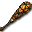</td><td class="col-name">
Porrete de Carvalho

樫のクラブ
</td><td class="col-id"><code>WEAPON2_MA10_OAKCLUB</code><button type="button" class="copy-id" data-copy="WEAPON2_MA10_OAKCLUB" title="Copiar ID WEAPON2_MA10_OAKCLUB" aria-label="Copiar ID WEAPON2_MA10_OAKCLUB">⧉</button></td><td class="col-meta">Arma · Clava / Maça Carta #— · 0-2351 Máx 6x (+5)</td><td class="col-info">
Clava · Atq: 30 · STR mín.: -

Arma pequena e resistente, fácil de manejar
</td></tr>
<tr data-id="WEAPON2_MA11_WARHAMMER_EX" data-cat="WEAPON2" data-sub="MA" data-flag="CARD,EX" data-search="martelo brilhante ブライトハンマー weapon2_ma11_warhammer_ex arma · clava / maça clava · atq: 43 · str mín.: 5 martelo que bate e também perfura 0-2610 368"><td class="col-img">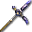</td><td class="col-name">
Martelo Brilhante

ブライトハンマー
</td><td class="col-id"><code>WEAPON2_MA11_WARHAMMER_EX</code><button type="button" class="copy-id" data-copy="WEAPON2_MA11_WARHAMMER_EX" title="Copiar ID WEAPON2_MA11_WARHAMMER_EX" aria-label="Copiar ID WEAPON2_MA11_WARHAMMER_EX">⧉</button></td><td class="col-meta">Arma · Clava / Maça Carta #368 · 0-2610 Máx 6x (+5) EX</td><td class="col-info">
Clava · Atq: 43 · STR mín.: 5

Martelo que bate e também perfura
</td></tr>
<tr data-id="WEAPON2_MA15_TAMECHAN1" data-cat="WEAPON2" data-sub="MA" data-flag="CARD" data-search="maça quadrada スクエアメイス weapon2_ma15_tamechan1 arma · clava / maça clava · atq: 57 · str mín.: 10 a cabeça quadrada e pesada acelera o golpe 0-2615 444"><td class="col-img">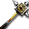</td><td class="col-name">
Maça Quadrada

スクエアメイス
</td><td class="col-id"><code>WEAPON2_MA15_TAMECHAN1</code><button type="button" class="copy-id" data-copy="WEAPON2_MA15_TAMECHAN1" title="Copiar ID WEAPON2_MA15_TAMECHAN1" aria-label="Copiar ID WEAPON2_MA15_TAMECHAN1">⧉</button></td><td class="col-meta">Arma · Clava / Maça Carta #444 · 0-2615 Máx 6x (+5)</td><td class="col-info">
Clava · Atq: 57 · STR mín.: 10

A cabeça quadrada e pesada acelera o golpe
</td></tr>
<tr data-id="WEAPON2_MA16_STRIKE" data-cat="WEAPON2" data-sub="MA" data-flag="" data-search="martelo esmagador スマッシュハンマー weapon2_ma16_strike arma · clava / maça clava · atq: 61 · str mín.: 10 clava de platina bela e muito poderosa "><td class="col-img"></td><td class="col-name">
Martelo Esmagador

スマッシュハンマー
</td><td class="col-id"><code>WEAPON2_MA16_STRIKE</code><button type="button" class="copy-id" data-copy="WEAPON2_MA16_STRIKE" title="Copiar ID WEAPON2_MA16_STRIKE" aria-label="Copiar ID WEAPON2_MA16_STRIKE">⧉</button></td><td class="col-meta">Arma · Clava / Maça</td><td class="col-info">
Clava · Atq: 61 · STR mín.: 10

Clava de platina bela e muito poderosa
</td></tr>
<tr data-id="WEAPON2_MA17_TIREI" data-cat="WEAPON2" data-sub="MA" data-flag="" data-search="martelo sísmico クェイクハンマー weapon2_ma17_tirei arma · clava / maça clava · atq: 81 · str mín.: 10 absorve a força da terra e a faz ressoar "><td class="col-img"></td><td class="col-name">
Martelo Sísmico

クェイクハンマー
</td><td class="col-id"><code>WEAPON2_MA17_TIREI</code><button type="button" class="copy-id" data-copy="WEAPON2_MA17_TIREI" title="Copiar ID WEAPON2_MA17_TIREI" aria-label="Copiar ID WEAPON2_MA17_TIREI">⧉</button></td><td class="col-meta">Arma · Clava / Maça</td><td class="col-info">
Clava · Atq: 81 · STR mín.: 10

Absorve a força da terra e a faz ressoar
</td></tr>
<tr data-id="WEAPON2_MA18_HORIHORI" data-cat="WEAPON2" data-sub="MA" data-flag="" data-search="martelo do juízo ジャッジハンマー weapon2_ma18_horihori arma · clava / maça clava · atq: 49 · str mín.: 10 clava do julgamento que castiga os maus de coração "><td class="col-img"></td><td class="col-name">
Martelo do Juízo

ジャッジハンマー
</td><td class="col-id"><code>WEAPON2_MA18_HORIHORI</code><button type="button" class="copy-id" data-copy="WEAPON2_MA18_HORIHORI" title="Copiar ID WEAPON2_MA18_HORIHORI" aria-label="Copiar ID WEAPON2_MA18_HORIHORI">⧉</button></td><td class="col-meta">Arma · Clava / Maça</td><td class="col-info">
Clava · Atq: 49 · STR mín.: 10

Clava do julgamento que castiga os maus de coração
</td></tr>
<tr data-id="WEAPON2_MA19_SHIMENKI" data-cat="WEAPON2" data-sub="MA" data-flag="" data-search="marreta do ogro 鬼面の大槌 weapon2_ma19_shimenki arma · clava / maça clava · atq: 63 · str mín.: 10 marreta sinistra com pontas como chifres de ogro "><td class="col-img"></td><td class="col-name">
Marreta do Ogro

鬼面の大槌
</td><td class="col-id"><code>WEAPON2_MA19_SHIMENKI</code><button type="button" class="copy-id" data-copy="WEAPON2_MA19_SHIMENKI" title="Copiar ID WEAPON2_MA19_SHIMENKI" aria-label="Copiar ID WEAPON2_MA19_SHIMENKI">⧉</button></td><td class="col-meta">Arma · Clava / Maça</td><td class="col-info">
Clava · Atq: 63 · STR mín.: 10

Marreta sinistra com pontas como chifres de ogro
</td></tr>
<tr data-id="WEAPON2_MA20_WARHAMMER" data-cat="WEAPON2" data-sub="MA" data-flag="STAR" data-search="★martelo de guerra ★ウォーハンマー weapon2_ma20_warhammer arma · clava / maça clava · atq: 45 · str mín.: - martelo transformado em arma de guerra "><td class="col-img"></td><td class="col-name">
★Martelo de Guerra

★ウォーハンマー
</td><td class="col-id"><code>WEAPON2_MA20_WARHAMMER</code><button type="button" class="copy-id" data-copy="WEAPON2_MA20_WARHAMMER" title="Copiar ID WEAPON2_MA20_WARHAMMER" aria-label="Copiar ID WEAPON2_MA20_WARHAMMER">⧉</button></td><td class="col-meta">Arma · Clava / Maça ★ Especial</td><td class="col-info">
Clava · Atq: 45 · STR mín.: -

Martelo transformado em arma de guerra
</td></tr>
<tr data-id="WEAPON2_MA21_SHINKI" data-cat="WEAPON2" data-sub="MA" data-flag="" data-search="maça rigorosa ストリクトメイス weapon2_ma21_shinki arma · clava / maça clava · atq: 66 · str mín.: 5 só bispos rigorosos podem usá-la "><td class="col-img"></td><td class="col-name">
Maça Rigorosa

ストリクトメイス
</td><td class="col-id"><code>WEAPON2_MA21_SHINKI</code><button type="button" class="copy-id" data-copy="WEAPON2_MA21_SHINKI" title="Copiar ID WEAPON2_MA21_SHINKI" aria-label="Copiar ID WEAPON2_MA21_SHINKI">⧉</button></td><td class="col-meta">Arma · Clava / Maça</td><td class="col-info">
Clava · Atq: 66 · STR mín.: 5

Só bispos rigorosos podem usá-la
</td></tr>
<tr data-id="WEAPON2_MA22_WARHAMMER_EX" data-cat="WEAPON2" data-sub="MA" data-flag="STAR,EX" data-search="★martelo brilho ★ブライトハンマー weapon2_ma22_warhammer_ex arma · clava / maça clava · atq: 38 · str mín.: - martelo que bate e também perfura "><td class="col-img"></td><td class="col-name">
★Martelo Brilho

★ブライトハンマー
</td><td class="col-id"><code>WEAPON2_MA22_WARHAMMER_EX</code><button type="button" class="copy-id" data-copy="WEAPON2_MA22_WARHAMMER_EX" title="Copiar ID WEAPON2_MA22_WARHAMMER_EX" aria-label="Copiar ID WEAPON2_MA22_WARHAMMER_EX">⧉</button></td><td class="col-meta">Arma · Clava / Maça ★ Especial EX</td><td class="col-info">
Clava · Atq: 38 · STR mín.: -

Martelo que bate e também perfura
</td></tr>
<tr data-id="WEAPON2_MA23_HORIHORI" data-cat="WEAPON2" data-sub="MA" data-flag="STAR" data-search="★martelo do juízo ★ジャッジハンマー weapon2_ma23_horihori arma · clava / maça clava · atq: 44 · str mín.: - clava do julgamento que castiga os maus de coração "><td class="col-img"></td><td class="col-name">
★Martelo do Juízo

★ジャッジハンマー
</td><td class="col-id"><code>WEAPON2_MA23_HORIHORI</code><button type="button" class="copy-id" data-copy="WEAPON2_MA23_HORIHORI" title="Copiar ID WEAPON2_MA23_HORIHORI" aria-label="Copiar ID WEAPON2_MA23_HORIHORI">⧉</button></td><td class="col-meta">Arma · Clava / Maça ★ Especial</td><td class="col-info">
Clava · Atq: 44 · STR mín.: -

Clava do julgamento que castiga os maus de coração
</td></tr>
<tr data-id="WEAPON2_MA24_JADE" data-cat="WEAPON2" data-sub="MA" data-flag="" data-search="marreta de jade 翡翠の大槌 weapon2_ma24_jade arma · clava / maça clava · atq: 55 · str mín.: 10 clava de jade com o poder de um grande monge "><td class="col-img"></td><td class="col-name">
Marreta de Jade

翡翠の大槌
</td><td class="col-id"><code>WEAPON2_MA24_JADE</code><button type="button" class="copy-id" data-copy="WEAPON2_MA24_JADE" title="Copiar ID WEAPON2_MA24_JADE" aria-label="Copiar ID WEAPON2_MA24_JADE">⧉</button></td><td class="col-meta">Arma · Clava / Maça</td><td class="col-info">
Clava · Atq: 55 · STR mín.: 10

Clava de jade com o poder de um grande monge
</td></tr>
<tr data-id="WEAPON2_MA25_D4SHINKI1" data-cat="WEAPON2" data-sub="MA" data-flag="" data-search="martelo leopardo レオパルドハンマー weapon2_ma25_d4shinki1 arma · clava / maça clava · atq: 75 · str mín.: 10 martelo gravado com o padrão da pele do leopardo "><td class="col-img"></td><td class="col-name">
Martelo Leopardo

レオパルドハンマー
</td><td class="col-id"><code>WEAPON2_MA25_D4SHINKI1</code><button type="button" class="copy-id" data-copy="WEAPON2_MA25_D4SHINKI1" title="Copiar ID WEAPON2_MA25_D4SHINKI1" aria-label="Copiar ID WEAPON2_MA25_D4SHINKI1">⧉</button></td><td class="col-meta">Arma · Clava / Maça</td><td class="col-info">
Clava · Atq: 75 · STR mín.: 10

Martelo gravado com o padrão da pele do leopardo
</td></tr>
<tr data-id="WEAPON2_MA26_D4SHINKI2" data-cat="WEAPON2" data-sub="MA" data-flag="" data-search="varinha minúscula タイニーワンド weapon2_ma26_d4shinki2 arma · clava / maça clava · atq: 43 · str mín.: - arma rara: uma clava usada como cajado de uma mão "><td class="col-img"></td><td class="col-name">
Varinha Minúscula

タイニーワンド
</td><td class="col-id"><code>WEAPON2_MA26_D4SHINKI2</code><button type="button" class="copy-id" data-copy="WEAPON2_MA26_D4SHINKI2" title="Copiar ID WEAPON2_MA26_D4SHINKI2" aria-label="Copiar ID WEAPON2_MA26_D4SHINKI2">⧉</button></td><td class="col-meta">Arma · Clava / Maça</td><td class="col-info">
Clava · Atq: 43 · STR mín.: -

Arma rara: uma clava usada como cajado de uma mão
</td></tr>
<tr data-id="WEAPON2_MA27_D4SHINKI3" data-cat="WEAPON2" data-sub="MA" data-flag="" data-search="brigantia ブリガンティア weapon2_ma27_d4shinki3 arma · clava / maça clava · atq: 73 · str mín.: 10 maça com o nome da deusa brigantia "><td class="col-img"></td><td class="col-name">
Brigantia

ブリガンティア
</td><td class="col-id"><code>WEAPON2_MA27_D4SHINKI3</code><button type="button" class="copy-id" data-copy="WEAPON2_MA27_D4SHINKI3" title="Copiar ID WEAPON2_MA27_D4SHINKI3" aria-label="Copiar ID WEAPON2_MA27_D4SHINKI3">⧉</button></td><td class="col-meta">Arma · Clava / Maça</td><td class="col-info">
Clava · Atq: 73 · STR mín.: 10

Maça com o nome da deusa Brigantia
</td></tr>
<tr data-id="WEAPON2_MA28_PIKOHAMMER" data-cat="WEAPON2" data-sub="MA" data-flag="" data-search="chui 錘 weapon2_ma28_pikohammer arma · clava / maça clava · atq: 60 · str mín.: - arma bonita, usada até em danças "><td class="col-img"></td><td class="col-name">
Chui

錘
</td><td class="col-id"><code>WEAPON2_MA28_PIKOHAMMER</code><button type="button" class="copy-id" data-copy="WEAPON2_MA28_PIKOHAMMER" title="Copiar ID WEAPON2_MA28_PIKOHAMMER" aria-label="Copiar ID WEAPON2_MA28_PIKOHAMMER">⧉</button></td><td class="col-meta">Arma · Clava / Maça</td><td class="col-info">
Clava · Atq: 60 · STR mín.: -

Arma bonita, usada até em danças
</td></tr>
<tr data-id="WEAPON2_MA30_FAYHAMMER_EX" data-cat="WEAPON2" data-sub="MA" data-flag="EX" data-search="pellegrande ex ペルグランデｅｘ weapon2_ma30_fayhammer_ex arma · clava / maça clava · atq: 56 · str mín.: - martelo inspirado no artefato pellegrande "><td class="col-img"></td><td class="col-name">
Pellegrande EX

ペルグランデＥＸ
</td><td class="col-id"><code>WEAPON2_MA30_FAYHAMMER_EX</code><button type="button" class="copy-id" data-copy="WEAPON2_MA30_FAYHAMMER_EX" title="Copiar ID WEAPON2_MA30_FAYHAMMER_EX" aria-label="Copiar ID WEAPON2_MA30_FAYHAMMER_EX">⧉</button></td><td class="col-meta">Arma · Clava / Maça EX</td><td class="col-info">
Clava · Atq: 56 · STR mín.: -

Martelo inspirado no artefato Pellegrande
</td></tr>
<tr data-id="WEAPON2_NC01_WAKKY" data-cat="WEAPON2" data-sub="NC" data-flag="" data-search="luva de madeira ウッドグローブ weapon2_nc01_wakky arma · soqueira soqueira · atq: 30 · str mín.: - soqueira de madeira, favorita dos iniciantes "><td class="col-img"></td><td class="col-name">
Luva de Madeira

ウッドグローブ
</td><td class="col-id"><code>WEAPON2_NC01_WAKKY</code><button type="button" class="copy-id" data-copy="WEAPON2_NC01_WAKKY" title="Copiar ID WEAPON2_NC01_WAKKY" aria-label="Copiar ID WEAPON2_NC01_WAKKY">⧉</button></td><td class="col-meta">Arma · Soqueira</td><td class="col-info">
Soqueira · Atq: 30 · STR mín.: -

Soqueira de madeira, favorita dos iniciantes
</td></tr>
<tr data-id="WEAPON2_NC02_TAMECHAN" data-cat="WEAPON2" data-sub="NC" data-flag="" data-search="garra tripla トライネイル weapon2_nc02_tamechan arma · soqueira soqueira · atq: 51 · str mín.: - soqueira com garras afiadas que perfuram e rasgam "><td class="col-img"></td><td class="col-name">
Garra Tripla

トライネイル
</td><td class="col-id"><code>WEAPON2_NC02_TAMECHAN</code><button type="button" class="copy-id" data-copy="WEAPON2_NC02_TAMECHAN" title="Copiar ID WEAPON2_NC02_TAMECHAN" aria-label="Copiar ID WEAPON2_NC02_TAMECHAN">⧉</button></td><td class="col-meta">Arma · Soqueira</td><td class="col-info">
Soqueira · Atq: 51 · STR mín.: -

Soqueira com garras afiadas que perfuram e rasgam
</td></tr>
<tr data-id="WEAPON2_NC03_MASSU" data-cat="WEAPON2" data-sub="NC" data-flag="CARD" data-search="cravo de ferro アイアンスパイク weapon2_nc03_massu arma · soqueira soqueira · atq: 42 · str mín.: - soqueira de aço com três espinhos 0-2605 367"><td class="col-img"></td><td class="col-name">
Cravo de Ferro

アイアンスパイク
</td><td class="col-id"><code>WEAPON2_NC03_MASSU</code><button type="button" class="copy-id" data-copy="WEAPON2_NC03_MASSU" title="Copiar ID WEAPON2_NC03_MASSU" aria-label="Copiar ID WEAPON2_NC03_MASSU">⧉</button></td><td class="col-meta">Arma · Soqueira Carta #367 · 0-2605 Máx 6x (+5)</td><td class="col-info">
Soqueira · Atq: 42 · STR mín.: -

Soqueira de aço com três espinhos
</td></tr>
<tr data-id="WEAPON2_NC04_WAKKY2" data-cat="WEAPON2" data-sub="NC" data-flag="" data-search="punho triturador クランチフィスト weapon2_nc04_wakky2 arma · soqueira soqueira · atq: 67 · str mín.: - luva feita com presas de uma fera feroz "><td class="col-img"></td><td class="col-name">
Punho Triturador

クランチフィスト
</td><td class="col-id"><code>WEAPON2_NC04_WAKKY2</code><button type="button" class="copy-id" data-copy="WEAPON2_NC04_WAKKY2" title="Copiar ID WEAPON2_NC04_WAKKY2" aria-label="Copiar ID WEAPON2_NC04_WAKKY2">⧉</button></td><td class="col-meta">Arma · Soqueira</td><td class="col-info">
Soqueira · Atq: 67 · STR mín.: -

Luva feita com presas de uma fera feroz
</td></tr>
<tr data-id="WEAPON2_NC05_THRUST" data-cat="WEAPON2" data-sub="NC" data-flag="CARD" data-search="soqueira perfurante スラストナックル weapon2_nc05_thrust arma · soqueira soqueira · atq: 54 · str mín.: - luva de chifre de fera, dura e inquebrável 0-2617 446"><td class="col-img"></td><td class="col-name">
Soqueira Perfurante

スラストナックル
</td><td class="col-id"><code>WEAPON2_NC05_THRUST</code><button type="button" class="copy-id" data-copy="WEAPON2_NC05_THRUST" title="Copiar ID WEAPON2_NC05_THRUST" aria-label="Copiar ID WEAPON2_NC05_THRUST">⧉</button></td><td class="col-meta">Arma · Soqueira Carta #446 · 0-2617 Máx 6x (+5)</td><td class="col-info">
Soqueira · Atq: 54 · STR mín.: -

Luva de chifre de fera, dura e inquebrável
</td></tr>
<tr data-id="WEAPON2_NC06_BLADE" data-cat="WEAPON2" data-sub="NC" data-flag="CARD" data-search="soqueira de lâmina ブレイドナックル weapon2_nc06_blade arma · soqueira soqueira · atq: 58 · str mín.: - luva com uma faca de aço que maximiza o poder 1-378 451"><td class="col-img"></td><td class="col-name">
Soqueira de Lâmina

ブレイドナックル
</td><td class="col-id"><code>WEAPON2_NC06_BLADE</code><button type="button" class="copy-id" data-copy="WEAPON2_NC06_BLADE" title="Copiar ID WEAPON2_NC06_BLADE" aria-label="Copiar ID WEAPON2_NC06_BLADE">⧉</button></td><td class="col-meta">Arma · Soqueira Carta #451 · 1-378 Máx 4x (+3)</td><td class="col-info">
Soqueira · Atq: 58 · STR mín.: -

Luva com uma faca de aço que maximiza o poder
</td></tr>
<tr data-id="WEAPON2_NC07_TETSUTUME" data-cat="WEAPON2" data-sub="NC" data-flag="CARD" data-search="garra do assassino アサシンネイル weapon2_nc07_tetsutume arma · soqueira soqueira · atq: 45 · str mín.: - luva de forma única com quatro garras longas 0-2705 497"><td class="col-img"></td><td class="col-name">
Garra do Assassino

アサシンネイル
</td><td class="col-id"><code>WEAPON2_NC07_TETSUTUME</code><button type="button" class="copy-id" data-copy="WEAPON2_NC07_TETSUTUME" title="Copiar ID WEAPON2_NC07_TETSUTUME" aria-label="Copiar ID WEAPON2_NC07_TETSUTUME">⧉</button></td><td class="col-meta">Arma · Soqueira Carta #497 · 0-2705 Máx 6x (+5)</td><td class="col-info">
Soqueira · Atq: 45 · STR mín.: -

Luva de forma única com quatro garras longas
</td></tr>
<tr data-id="WEAPON2_NC08_SHINKI" data-cat="WEAPON2" data-sub="NC" data-flag="" data-search="luva perfurante ピアスグローブ weapon2_nc08_shinki arma · soqueira soqueira · atq: 64 · str mín.: - luva letal feita de metal leve "><td class="col-img"></td><td class="col-name">
Luva Perfurante

ピアスグローブ
</td><td class="col-id"><code>WEAPON2_NC08_SHINKI</code><button type="button" class="copy-id" data-copy="WEAPON2_NC08_SHINKI" title="Copiar ID WEAPON2_NC08_SHINKI" aria-label="Copiar ID WEAPON2_NC08_SHINKI">⧉</button></td><td class="col-meta">Arma · Soqueira</td><td class="col-info">
Soqueira · Atq: 64 · STR mín.: -

Luva letal feita de metal leve
</td></tr>
<tr data-id="WEAPON2_NC09_WAKKY" data-cat="WEAPON2" data-sub="NC" data-flag="STAR" data-search="★luva madeira ★ウッドグローブ weapon2_nc09_wakky arma · soqueira soqueira · atq: 28 · str mín.: - soqueira de madeira, favorita dos iniciantes "><td class="col-img"></td><td class="col-name">
★Luva Madeira

★ウッドグローブ
</td><td class="col-id"><code>WEAPON2_NC09_WAKKY</code><button type="button" class="copy-id" data-copy="WEAPON2_NC09_WAKKY" title="Copiar ID WEAPON2_NC09_WAKKY" aria-label="Copiar ID WEAPON2_NC09_WAKKY">⧉</button></td><td class="col-meta">Arma · Soqueira ★ Especial</td><td class="col-info">
Soqueira · Atq: 28 · STR mín.: -

Soqueira de madeira, favorita dos iniciantes
</td></tr>
<tr data-id="WEAPON2_NC10_MASSU" data-cat="WEAPON2" data-sub="NC" data-flag="STAR" data-search="★cravo de ferro ★アイアンスパイク weapon2_nc10_massu arma · soqueira soqueira · atq: 37 · str mín.: - soqueira de aço com três espinhos "><td class="col-img"></td><td class="col-name">
★Cravo de Ferro

★アイアンスパイク
</td><td class="col-id"><code>WEAPON2_NC10_MASSU</code><button type="button" class="copy-id" data-copy="WEAPON2_NC10_MASSU" title="Copiar ID WEAPON2_NC10_MASSU" aria-label="Copiar ID WEAPON2_NC10_MASSU">⧉</button></td><td class="col-meta">Arma · Soqueira ★ Especial</td><td class="col-info">
Soqueira · Atq: 37 · STR mín.: -

Soqueira de aço com três espinhos
</td></tr>
<tr data-id="WEAPON2_NC11_FLAME" data-cat="WEAPON2" data-sub="NC" data-flag="" data-search="soqueira flamejante フレイムナックル weapon2_nc11_flame arma · soqueira soqueira · atq: 40 · str mín.: - luva envolta num fogo capaz de queimar tudo "><td class="col-img"></td><td class="col-name">
Soqueira Flamejante

フレイムナックル
</td><td class="col-id"><code>WEAPON2_NC11_FLAME</code><button type="button" class="copy-id" data-copy="WEAPON2_NC11_FLAME" title="Copiar ID WEAPON2_NC11_FLAME" aria-label="Copiar ID WEAPON2_NC11_FLAME">⧉</button></td><td class="col-meta">Arma · Soqueira</td><td class="col-info">
Soqueira · Atq: 40 · STR mín.: -

Luva envolta num fogo capaz de queimar tudo
</td></tr>
<tr data-id="WEAPON2_NC12_TAMECHAN" data-cat="WEAPON2" data-sub="NC" data-flag="STAR" data-search="★garra tripla ★トライネイル weapon2_nc12_tamechan arma · soqueira soqueira · atq: 46 · str mín.: - soqueira com garras afiadas que perfuram e rasgam "><td class="col-img"></td><td class="col-name">
★Garra Tripla

★トライネイル
</td><td class="col-id"><code>WEAPON2_NC12_TAMECHAN</code><button type="button" class="copy-id" data-copy="WEAPON2_NC12_TAMECHAN" title="Copiar ID WEAPON2_NC12_TAMECHAN" aria-label="Copiar ID WEAPON2_NC12_TAMECHAN">⧉</button></td><td class="col-meta">Arma · Soqueira ★ Especial</td><td class="col-info">
Soqueira · Atq: 46 · STR mín.: -

Soqueira com garras afiadas que perfuram e rasgam
</td></tr>
<tr data-id="WEAPON2_NC14_KAISER" data-cat="WEAPON2" data-sub="NC" data-flag="" data-search="soqueira do kaiser カイザーナックル weapon2_nc14_kaiser arma · soqueira soqueira · atq: 80 · str mín.: - transforma sua energia numa aura de ataque "><td class="col-img"></td><td class="col-name">
Soqueira do Kaiser

カイザーナックル
</td><td class="col-id"><code>WEAPON2_NC14_KAISER</code><button type="button" class="copy-id" data-copy="WEAPON2_NC14_KAISER" title="Copiar ID WEAPON2_NC14_KAISER" aria-label="Copiar ID WEAPON2_NC14_KAISER">⧉</button></td><td class="col-meta">Arma · Soqueira</td><td class="col-info">
Soqueira · Atq: 80 · STR mín.: -

Transforma sua energia numa aura de ataque
</td></tr>
<tr data-id="WEAPON2_NC15_MONK" data-cat="WEAPON2" data-sub="NC" data-flag="" data-search="manopla do santo punho 拳聖の手甲 weapon2_nc15_monk arma · soqueira soqueira · atq: 63 · str mín.: - arma de luta com joias que lembram um rosário "><td class="col-img"></td><td class="col-name">
Manopla do Santo Punho

拳聖の手甲
</td><td class="col-id"><code>WEAPON2_NC15_MONK</code><button type="button" class="copy-id" data-copy="WEAPON2_NC15_MONK" title="Copiar ID WEAPON2_NC15_MONK" aria-label="Copiar ID WEAPON2_NC15_MONK">⧉</button></td><td class="col-meta">Arma · Soqueira</td><td class="col-info">
Soqueira · Atq: 63 · STR mín.: -

Arma de luta com joias que lembram um rosário
</td></tr>
<tr data-id="WEAPON2_NC16_D4SHINKI" data-cat="WEAPON2" data-sub="NC" data-flag="" data-search="soqueira funesta ベインナックル weapon2_nc16_d4shinki arma · soqueira soqueira · atq: 68 · str mín.: - arma bizarra que dizem vir de um pacto com um deus maligno "><td class="col-img"></td><td class="col-name">
Soqueira Funesta

ベインナックル
</td><td class="col-id"><code>WEAPON2_NC16_D4SHINKI</code><button type="button" class="copy-id" data-copy="WEAPON2_NC16_D4SHINKI" title="Copiar ID WEAPON2_NC16_D4SHINKI" aria-label="Copiar ID WEAPON2_NC16_D4SHINKI">⧉</button></td><td class="col-meta">Arma · Soqueira</td><td class="col-info">
Soqueira · Atq: 68 · STR mín.: -

Arma bizarra que dizem vir de um pacto com um deus maligno
</td></tr>
<tr data-id="WEAPON2_NC17_SONIC" data-cat="WEAPON2" data-sub="NC" data-flag="CARD" data-search="soqueira sônica ソニックナックル weapon2_nc17_sonic arma · soqueira soqueira · atq: 60 · str mín.: - luva de metal com uma magia especial 1-491 504"><td class="col-img"></td><td class="col-name">
Soqueira Sônica

ソニックナックル
</td><td class="col-id"><code>WEAPON2_NC17_SONIC</code><button type="button" class="copy-id" data-copy="WEAPON2_NC17_SONIC" title="Copiar ID WEAPON2_NC17_SONIC" aria-label="Copiar ID WEAPON2_NC17_SONIC">⧉</button></td><td class="col-meta">Arma · Soqueira Carta #504 · 1-491 Máx 4x (+3)</td><td class="col-info">
Soqueira · Atq: 60 · STR mín.: -

Luva de metal com uma magia especial
</td></tr>
<tr data-id="WEAPON2_NC18_GODHAND" data-cat="WEAPON2" data-sub="NC" data-flag="" data-search="mão de deus ゴッドハンド weapon2_nc18_godhand arma · soqueira soqueira · atq: 72 · str mín.: - o punho supremo de um deus que faz a terra tremer "><td class="col-img"></td><td class="col-name">
Mão de Deus

ゴッドハンド
</td><td class="col-id"><code>WEAPON2_NC18_GODHAND</code><button type="button" class="copy-id" data-copy="WEAPON2_NC18_GODHAND" title="Copiar ID WEAPON2_NC18_GODHAND" aria-label="Copiar ID WEAPON2_NC18_GODHAND">⧉</button></td><td class="col-meta">Arma · Soqueira</td><td class="col-info">
Soqueira · Atq: 72 · STR mín.: -

O punho supremo de um deus que faz a terra tremer
</td></tr>
<tr data-id="WEAPON2_NI01_DAGGER" data-cat="WEAPON2" data-sub="NI" data-flag="CARD" data-search="adaga ダガー weapon2_ni01_dagger arma · adaga / faca faca · atq: 18 · str mín.: - faca pequena e simples 0-2147 026"><td class="col-img"></td><td class="col-name">
Adaga

ダガー
</td><td class="col-id"><code>WEAPON2_NI01_DAGGER</code><button type="button" class="copy-id" data-copy="WEAPON2_NI01_DAGGER" title="Copiar ID WEAPON2_NI01_DAGGER" aria-label="Copiar ID WEAPON2_NI01_DAGGER">⧉</button></td><td class="col-meta">Arma · Adaga / Faca Carta #026 · 0-2147 Máx 11x (+10)</td><td class="col-info">
Faca · Atq: 18 · STR mín.: -

Faca pequena e simples
</td></tr>
<tr data-id="WEAPON2_NI02_DIRK" data-cat="WEAPON2" data-sub="NI" data-flag="CARD" data-search="dirk ダーク weapon2_ni02_dirk arma · adaga / faca faca · atq: 25 · str mín.: - faca favorita de uma tribo valente das montanhas 0-2148 105"><td class="col-img"></td><td class="col-name">
Dirk

ダーク
</td><td class="col-id"><code>WEAPON2_NI02_DIRK</code><button type="button" class="copy-id" data-copy="WEAPON2_NI02_DIRK" title="Copiar ID WEAPON2_NI02_DIRK" aria-label="Copiar ID WEAPON2_NI02_DIRK">⧉</button></td><td class="col-meta">Arma · Adaga / Faca Carta #105 · 0-2148 Máx 11x (+10)</td><td class="col-info">
Faca · Atq: 25 · STR mín.: -

Faca favorita de uma tribo valente das montanhas
</td></tr>
<tr data-id="WEAPON2_NI03_POISONDAGGER" data-cat="WEAPON2" data-sub="NI" data-flag="CARD" data-search="adaga venenosa ポイズンダガー weapon2_ni03_poisondagger arma · adaga / faca faca · atq: 33 · str mín.: - faca de assassino com veneno na lâmina 0-2149 106"><td class="col-img"></td><td class="col-name">
Adaga Venenosa

ポイズンダガー
</td><td class="col-id"><code>WEAPON2_NI03_POISONDAGGER</code><button type="button" class="copy-id" data-copy="WEAPON2_NI03_POISONDAGGER" title="Copiar ID WEAPON2_NI03_POISONDAGGER" aria-label="Copiar ID WEAPON2_NI03_POISONDAGGER">⧉</button></td><td class="col-meta">Arma · Adaga / Faca Carta #106 · 0-2149 Máx 6x (+5)</td><td class="col-info">
Faca · Atq: 33 · STR mín.: -

Faca de assassino com veneno na lâmina
</td></tr>
<tr data-id="WEAPON2_NI04_SWORDBRAKER" data-cat="WEAPON2" data-sub="NI" data-flag="CARD" data-search="quebra-espadas ソードブレイカー weapon2_ni04_swordbraker arma · adaga / faca faca · atq: 36 · str mín.: - adaga feita para aparar e quebrar espadas 0-2514 264"><td class="col-img"></td><td class="col-name">
Quebra-Espadas

ソードブレイカー
</td><td class="col-id"><code>WEAPON2_NI04_SWORDBRAKER</code><button type="button" class="copy-id" data-copy="WEAPON2_NI04_SWORDBRAKER" title="Copiar ID WEAPON2_NI04_SWORDBRAKER" aria-label="Copiar ID WEAPON2_NI04_SWORDBRAKER">⧉</button></td><td class="col-meta">Arma · Adaga / Faca Carta #264 · 0-2514 Máx 6x (+5)</td><td class="col-info">
Faca · Atq: 36 · STR mín.: -

Adaga feita para aparar e quebrar espadas
</td></tr>
<tr data-id="WEAPON2_NI05_KOTETSU" data-cat="WEAPON2" data-sub="NI" data-flag="CARD" data-search="ferro antigo 古鉄 weapon2_ni05_kotetsu arma · adaga / faca faca · atq: 54 · str mín.: - faca famosa de um ferreiro do oriente 1-436 499"><td class="col-img"></td><td class="col-name">
Ferro Antigo

古鉄
</td><td class="col-id"><code>WEAPON2_NI05_KOTETSU</code><button type="button" class="copy-id" data-copy="WEAPON2_NI05_KOTETSU" title="Copiar ID WEAPON2_NI05_KOTETSU" aria-label="Copiar ID WEAPON2_NI05_KOTETSU">⧉</button></td><td class="col-meta">Arma · Adaga / Faca Carta #499 · 1-436 Máx 4x (+3)</td><td class="col-info">
Faca · Atq: 54 · STR mín.: -

Faca famosa de um ferreiro do Oriente
</td></tr>
<tr data-id="WEAPON2_NI06_GALESDAGGER" data-cat="WEAPON2" data-sub="NI" data-flag="" data-search="glacies グラキエース weapon2_ni06_galesdagger arma · adaga / faca faca · atq: 30 · str mín.: - adaga feita para longos combates "><td class="col-img"></td><td class="col-name">
Glacies

グラキエース
</td><td class="col-id"><code>WEAPON2_NI06_GALESDAGGER</code><button type="button" class="copy-id" data-copy="WEAPON2_NI06_GALESDAGGER" title="Copiar ID WEAPON2_NI06_GALESDAGGER" aria-label="Copiar ID WEAPON2_NI06_GALESDAGGER">⧉</button></td><td class="col-meta">Arma · Adaga / Faca</td><td class="col-info">
Faca · Atq: 30 · STR mín.: -

Adaga feita para longos combates
</td></tr>
<tr data-id="WEAPON2_NI07_DIRK" data-cat="WEAPON2" data-sub="NI" data-flag="STAR" data-search="★dirk ★ダーク weapon2_ni07_dirk arma · adaga / faca faca · atq: 24 · str mín.: - faca favorita de uma tribo valente das montanhas "><td class="col-img"></td><td class="col-name">
★Dirk

★ダーク
</td><td class="col-id"><code>WEAPON2_NI07_DIRK</code><button type="button" class="copy-id" data-copy="WEAPON2_NI07_DIRK" title="Copiar ID WEAPON2_NI07_DIRK" aria-label="Copiar ID WEAPON2_NI07_DIRK">⧉</button></td><td class="col-meta">Arma · Adaga / Faca ★ Especial</td><td class="col-info">
Faca · Atq: 24 · STR mín.: -

Faca favorita de uma tribo valente das montanhas
</td></tr>
<tr data-id="WEAPON2_NI08_ROUND" data-cat="WEAPON2" data-sub="NI" data-flag="CARD" data-search="faca redonda ラウンドナイフ weapon2_ni08_round arma · adaga / faca faca · atq: 14 · str mín.: - fere pouco, mas solta golpes fortes com facilidade 0-2502 254"><td class="col-img"></td><td class="col-name">
Faca Redonda

ラウンドナイフ
</td><td class="col-id"><code>WEAPON2_NI08_ROUND</code><button type="button" class="copy-id" data-copy="WEAPON2_NI08_ROUND" title="Copiar ID WEAPON2_NI08_ROUND" aria-label="Copiar ID WEAPON2_NI08_ROUND">⧉</button></td><td class="col-meta">Arma · Adaga / Faca Carta #254 · 0-2502 Máx 6x (+5)</td><td class="col-info">
Faca · Atq: 14 · STR mín.: -

Fere pouco, mas solta golpes fortes com facilidade
</td></tr>
<tr data-id="WEAPON2_NI09_STUNDAGGER" data-cat="WEAPON2" data-sub="NI" data-flag="CARD" data-search="adaga atordoante スタンダガー weapon2_ni09_stundagger arma · adaga / faca faca · atq: 30 · str mín.: - faca especial com toxina nervosa na lâmina 0-2503 255"><td class="col-img"></td><td class="col-name">
Adaga Atordoante

スタンダガー
</td><td class="col-id"><code>WEAPON2_NI09_STUNDAGGER</code><button type="button" class="copy-id" data-copy="WEAPON2_NI09_STUNDAGGER" title="Copiar ID WEAPON2_NI09_STUNDAGGER" aria-label="Copiar ID WEAPON2_NI09_STUNDAGGER">⧉</button></td><td class="col-meta">Arma · Adaga / Faca Carta #255 · 0-2503 Máx 6x (+5)</td><td class="col-info">
Faca · Atq: 30 · STR mín.: -

Faca especial com toxina nervosa na lâmina
</td></tr>
<tr data-id="WEAPON2_NI13_KERIS" data-cat="WEAPON2" data-sub="NI" data-flag="CARD" data-search="kris クリス weapon2_ni13_keris arma · adaga / faca faca · atq: 47 · str mín.: - adaga de lâmina peculiar usada como amuleto 0-2613 371"><td class="col-img"></td><td class="col-name">
Kris

クリス
</td><td class="col-id"><code>WEAPON2_NI13_KERIS</code><button type="button" class="copy-id" data-copy="WEAPON2_NI13_KERIS" title="Copiar ID WEAPON2_NI13_KERIS" aria-label="Copiar ID WEAPON2_NI13_KERIS">⧉</button></td><td class="col-meta">Arma · Adaga / Faca Carta #371 · 0-2613 Máx 6x (+5)</td><td class="col-info">
Faca · Atq: 47 · STR mín.: -

Adaga de lâmina peculiar usada como amuleto
</td></tr>
<tr data-id="WEAPON2_NI14_TAMECHAN2" data-cat="WEAPON2" data-sub="NI" data-flag="CARD" data-search="faca podre ロットナイフ weapon2_ni14_tamechan2 arma · adaga / faca faca · atq: 42 · str mín.: - faca terrível impregnada de todo tipo de veneno 0-2616 445"><td class="col-img"></td><td class="col-name">
Faca Podre

ロットナイフ
</td><td class="col-id"><code>WEAPON2_NI14_TAMECHAN2</code><button type="button" class="copy-id" data-copy="WEAPON2_NI14_TAMECHAN2" title="Copiar ID WEAPON2_NI14_TAMECHAN2" aria-label="Copiar ID WEAPON2_NI14_TAMECHAN2">⧉</button></td><td class="col-meta">Arma · Adaga / Faca Carta #445 · 0-2616 Máx 6x (+5)</td><td class="col-info">
Faca · Atq: 42 · STR mín.: -

Faca terrível impregnada de todo tipo de veneno
</td></tr>
<tr data-id="WEAPON2_NI16_CROSS" data-cat="WEAPON2" data-sub="NI" data-flag="" data-search="faca ofuscante グレアナイフ weapon2_ni16_cross arma · adaga / faca faca · atq: 51 · str mín.: - faca de lâmina grande que imita a luz do sol "><td class="col-img"></td><td class="col-name">
Faca Ofuscante

グレアナイフ
</td><td class="col-id"><code>WEAPON2_NI16_CROSS</code><button type="button" class="copy-id" data-copy="WEAPON2_NI16_CROSS" title="Copiar ID WEAPON2_NI16_CROSS" aria-label="Copiar ID WEAPON2_NI16_CROSS">⧉</button></td><td class="col-meta">Arma · Adaga / Faca</td><td class="col-info">
Faca · Atq: 51 · STR mín.: -

Faca de lâmina grande que imita a luz do sol
</td></tr>
<tr data-id="WEAPON2_NI17_SHINKI" data-cat="WEAPON2" data-sub="NI" data-flag="" data-search="faca leve フィートナイフ weapon2_ni17_shinki arma · adaga / faca faca · atq: 58 · str mín.: - faca com o centro vazado para ficar mais leve "><td class="col-img"></td><td class="col-name">
Faca Leve

フィートナイフ
</td><td class="col-id"><code>WEAPON2_NI17_SHINKI</code><button type="button" class="copy-id" data-copy="WEAPON2_NI17_SHINKI" title="Copiar ID WEAPON2_NI17_SHINKI" aria-label="Copiar ID WEAPON2_NI17_SHINKI">⧉</button></td><td class="col-meta">Arma · Adaga / Faca</td><td class="col-info">
Faca · Atq: 58 · STR mín.: -

Faca com o centro vazado para ficar mais leve
</td></tr>
<tr data-id="WEAPON2_NI18_POISONDAGGER" data-cat="WEAPON2" data-sub="NI" data-flag="STAR" data-search="★adaga venenosa ★ポイズンダガー weapon2_ni18_poisondagger arma · adaga / faca faca · atq: 29 · str mín.: - faca de assassino com veneno na lâmina "><td class="col-img"></td><td class="col-name">
★Adaga Venenosa

★ポイズンダガー
</td><td class="col-id"><code>WEAPON2_NI18_POISONDAGGER</code><button type="button" class="copy-id" data-copy="WEAPON2_NI18_POISONDAGGER" title="Copiar ID WEAPON2_NI18_POISONDAGGER" aria-label="Copiar ID WEAPON2_NI18_POISONDAGGER">⧉</button></td><td class="col-meta">Arma · Adaga / Faca ★ Especial</td><td class="col-info">
Faca · Atq: 29 · STR mín.: -

Faca de assassino com veneno na lâmina
</td></tr>
<tr data-id="WEAPON2_NI19_ROUND" data-cat="WEAPON2" data-sub="NI" data-flag="STAR" data-search="★faca redonda ★ラウンドナイフ weapon2_ni19_round arma · adaga / faca faca · atq: 11 · str mín.: - fere pouco, mas solta golpes fortes com facilidade "><td class="col-img"></td><td class="col-name">
★Faca Redonda

★ラウンドナイフ
</td><td class="col-id"><code>WEAPON2_NI19_ROUND</code><button type="button" class="copy-id" data-copy="WEAPON2_NI19_ROUND" title="Copiar ID WEAPON2_NI19_ROUND" aria-label="Copiar ID WEAPON2_NI19_ROUND">⧉</button></td><td class="col-meta">Arma · Adaga / Faca ★ Especial</td><td class="col-info">
Faca · Atq: 11 · STR mín.: -

Fere pouco, mas solta golpes fortes com facilidade
</td></tr>
<tr data-id="WEAPON2_NI20_SHINKI" data-cat="WEAPON2" data-sub="NI" data-flag="" data-search="devastador デヴァステイター weapon2_ni20_shinki arma · adaga / faca faca · atq: 76 · str mín.: - faca rara que tem o poder de roubar "><td class="col-img"></td><td class="col-name">
Devastador

デヴァステイター
</td><td class="col-id"><code>WEAPON2_NI20_SHINKI</code><button type="button" class="copy-id" data-copy="WEAPON2_NI20_SHINKI" title="Copiar ID WEAPON2_NI20_SHINKI" aria-label="Copiar ID WEAPON2_NI20_SHINKI">⧉</button></td><td class="col-meta">Arma · Adaga / Faca</td><td class="col-info">
Faca · Atq: 76 · STR mín.: -

Faca rara que tem o poder de roubar
</td></tr>
<tr data-id="WEAPON2_NI21_SAIJYOUI" data-cat="WEAPON2" data-sub="NI" data-flag="" data-search="lâmina dupla ツインエッジ weapon2_ni21_saijyoui arma · adaga / faca faca · atq: 64 · str mín.: - faca difícil, com lâminas nas duas pontas "><td class="col-img"></td><td class="col-name">
Lâmina Dupla

ツインエッジ
</td><td class="col-id"><code>WEAPON2_NI21_SAIJYOUI</code><button type="button" class="copy-id" data-copy="WEAPON2_NI21_SAIJYOUI" title="Copiar ID WEAPON2_NI21_SAIJYOUI" aria-label="Copiar ID WEAPON2_NI21_SAIJYOUI">⧉</button></td><td class="col-meta">Arma · Adaga / Faca</td><td class="col-info">
Faca · Atq: 64 · STR mín.: -

Faca difícil, com lâminas nas duas pontas
</td></tr>
<tr data-id="WEAPON2_NI22_TAMECHAN2" data-cat="WEAPON2" data-sub="NI" data-flag="STAR" data-search="★faca podre ★ロットナイフ weapon2_ni22_tamechan2 arma · adaga / faca faca · atq: 37 · str mín.: - faca terrível impregnada de todo tipo de veneno "><td class="col-img"></td><td class="col-name">
★Faca Podre

★ロットナイフ
</td><td class="col-id"><code>WEAPON2_NI22_TAMECHAN2</code><button type="button" class="copy-id" data-copy="WEAPON2_NI22_TAMECHAN2" title="Copiar ID WEAPON2_NI22_TAMECHAN2" aria-label="Copiar ID WEAPON2_NI22_TAMECHAN2">⧉</button></td><td class="col-meta">Arma · Adaga / Faca ★ Especial</td><td class="col-info">
Faca · Atq: 37 · STR mín.: -

Faca terrível impregnada de todo tipo de veneno
</td></tr>
<tr data-id="WEAPON2_NI23_SHINKI" data-cat="WEAPON2" data-sub="NI" data-flag="" data-search="sai サイ weapon2_ni23_shinki arma · adaga / faca faca · atq: 62 · str mín.: - arma de ferro antiga das artes marciais "><td class="col-img"></td><td class="col-name">
Sai

サイ
</td><td class="col-id"><code>WEAPON2_NI23_SHINKI</code><button type="button" class="copy-id" data-copy="WEAPON2_NI23_SHINKI" title="Copiar ID WEAPON2_NI23_SHINKI" aria-label="Copiar ID WEAPON2_NI23_SHINKI">⧉</button></td><td class="col-meta">Arma · Adaga / Faca</td><td class="col-info">
Faca · Atq: 62 · STR mín.: -

Arma de ferro antiga das artes marciais
</td></tr>
<tr data-id="WEAPON2_NI24_STUNDAGGER" data-cat="WEAPON2" data-sub="NI" data-flag="STAR" data-search="★adaga atordoante ★スタンダガー weapon2_ni24_stundagger arma · adaga / faca faca · atq: 26 · str mín.: - faca especial com toxina nervosa na lâmina "><td class="col-img"></td><td class="col-name">
★Adaga Atordoante

★スタンダガー
</td><td class="col-id"><code>WEAPON2_NI24_STUNDAGGER</code><button type="button" class="copy-id" data-copy="WEAPON2_NI24_STUNDAGGER" title="Copiar ID WEAPON2_NI24_STUNDAGGER" aria-label="Copiar ID WEAPON2_NI24_STUNDAGGER">⧉</button></td><td class="col-meta">Arma · Adaga / Faca ★ Especial</td><td class="col-info">
Faca · Atq: 26 · STR mín.: -

Faca especial com toxina nervosa na lâmina
</td></tr>
<tr data-id="WEAPON2_NI25_MOULIN" data-cat="WEAPON2" data-sub="NI" data-flag="CARD" data-search="moulin ムーラン weapon2_ni25_moulin arma · adaga / faca faca · atq: 63 · str mín.: - adaga de assassino com forma de cata-vento 1-493 500"><td class="col-img"></td><td class="col-name">
Moulin

ムーラン
</td><td class="col-id"><code>WEAPON2_NI25_MOULIN</code><button type="button" class="copy-id" data-copy="WEAPON2_NI25_MOULIN" title="Copiar ID WEAPON2_NI25_MOULIN" aria-label="Copiar ID WEAPON2_NI25_MOULIN">⧉</button></td><td class="col-meta">Arma · Adaga / Faca Carta #500 · 1-493 Máx 4x (+3)</td><td class="col-info">
Faca · Atq: 63 · STR mín.: -

Adaga de assassino com forma de cata-vento
</td></tr>
<tr data-id="WEAPON2_NI26_KUKRI" data-cat="WEAPON2" data-sub="NI" data-flag="" data-search="kukri ククリ weapon2_ni26_kukri arma · adaga / faca faca · atq: 61 · str mín.: - adaga prática nascida da sabedoria do dia a dia "><td class="col-img"></td><td class="col-name">
Kukri

ククリ
</td><td class="col-id"><code>WEAPON2_NI26_KUKRI</code><button type="button" class="copy-id" data-copy="WEAPON2_NI26_KUKRI" title="Copiar ID WEAPON2_NI26_KUKRI" aria-label="Copiar ID WEAPON2_NI26_KUKRI">⧉</button></td><td class="col-meta">Arma · Adaga / Faca</td><td class="col-info">
Faca · Atq: 61 · STR mín.: -

Adaga prática nascida da sabedoria do dia a dia
</td></tr>
<tr data-id="WEAPON2_NI27_SILENT" data-cat="WEAPON2" data-sub="NI" data-flag="" data-search="faca silenciosa サイレントナイフ weapon2_ni27_silent arma · adaga / faca faca · atq: 46 · str mín.: - faca de assassino com remédio que silencia "><td class="col-img"></td><td class="col-name">
Faca Silenciosa

サイレントナイフ
</td><td class="col-id"><code>WEAPON2_NI27_SILENT</code><button type="button" class="copy-id" data-copy="WEAPON2_NI27_SILENT" title="Copiar ID WEAPON2_NI27_SILENT" aria-label="Copiar ID WEAPON2_NI27_SILENT">⧉</button></td><td class="col-meta">Arma · Adaga / Faca</td><td class="col-info">
Faca · Atq: 46 · STR mín.: -

Faca de assassino com remédio que silencia
</td></tr>
<tr data-id="WEAPON2_NI28_PANIC" data-cat="WEAPON2" data-sub="NI" data-flag="" data-search="faca do pânico パニックナイフ weapon2_ni28_panic arma · adaga / faca faca · atq: 43 · str mín.: - faca de assassino com remédio que confunde "><td class="col-img"></td><td class="col-name">
Faca do Pânico

パニックナイフ
</td><td class="col-id"><code>WEAPON2_NI28_PANIC</code><button type="button" class="copy-id" data-copy="WEAPON2_NI28_PANIC" title="Copiar ID WEAPON2_NI28_PANIC" aria-label="Copiar ID WEAPON2_NI28_PANIC">⧉</button></td><td class="col-meta">Arma · Adaga / Faca</td><td class="col-info">
Faca · Atq: 43 · STR mín.: -

Faca de assassino com remédio que confunde
</td></tr>
<tr data-id="WEAPON2_NI29_D4SHINKI1" data-cat="WEAPON2" data-sub="NI" data-flag="" data-search="faca rúnica ルーンナイフ weapon2_ni29_d4shinki1 arma · adaga / faca faca · atq: 67 · str mín.: - adaga com bela lâmina laranja "><td class="col-img"></td><td class="col-name">
Faca Rúnica

ルーンナイフ
</td><td class="col-id"><code>WEAPON2_NI29_D4SHINKI1</code><button type="button" class="copy-id" data-copy="WEAPON2_NI29_D4SHINKI1" title="Copiar ID WEAPON2_NI29_D4SHINKI1" aria-label="Copiar ID WEAPON2_NI29_D4SHINKI1">⧉</button></td><td class="col-meta">Arma · Adaga / Faca</td><td class="col-info">
Faca · Atq: 67 · STR mín.: -

Adaga com bela lâmina laranja
</td></tr>
<tr data-id="WEAPON2_NI30_D4SHINKI2" data-cat="WEAPON2" data-sub="NI" data-flag="" data-search="adaga zwei ツヴァイダガー weapon2_ni30_d4shinki2 arma · adaga / faca faca · atq: 24 · str mín.: - faca decorativa com uma bela joia "><td class="col-img"></td><td class="col-name">
Adaga Zwei

ツヴァイダガー
</td><td class="col-id"><code>WEAPON2_NI30_D4SHINKI2</code><button type="button" class="copy-id" data-copy="WEAPON2_NI30_D4SHINKI2" title="Copiar ID WEAPON2_NI30_D4SHINKI2" aria-label="Copiar ID WEAPON2_NI30_D4SHINKI2">⧉</button></td><td class="col-meta">Arma · Adaga / Faca</td><td class="col-info">
Faca · Atq: 24 · STR mín.: -

Faca decorativa com uma bela joia
</td></tr>
<tr data-id="WEAPON2_NI31_D4SHINKI3" data-cat="WEAPON2" data-sub="NI" data-flag="" data-search="infinito インフィニティー weapon2_ni31_d4shinki3 arma · adaga / faca faca · atq: 71 · str mín.: - adaga lendária de possibilidades infinitas "><td class="col-img"></td><td class="col-name">
Infinito

インフィニティー
</td><td class="col-id"><code>WEAPON2_NI31_D4SHINKI3</code><button type="button" class="copy-id" data-copy="WEAPON2_NI31_D4SHINKI3" title="Copiar ID WEAPON2_NI31_D4SHINKI3" aria-label="Copiar ID WEAPON2_NI31_D4SHINKI3">⧉</button></td><td class="col-meta">Arma · Adaga / Faca</td><td class="col-info">
Faca · Atq: 71 · STR mín.: -

Adaga lendária de possibilidades infinitas
</td></tr>
<tr data-id="WEAPON2_NI34_CATHAND" data-cat="WEAPON2" data-sub="NI" data-flag="" data-search="ferrão do gato キャットスティンガー weapon2_ni34_cathand arma · adaga / faca faca · atq: 53 · str mín.: - faca inspirada nos movimentos de um gato "><td class="col-img"></td><td class="col-name">
Ferrão do Gato

キャットスティンガー
</td><td class="col-id"><code>WEAPON2_NI34_CATHAND</code><button type="button" class="copy-id" data-copy="WEAPON2_NI34_CATHAND" title="Copiar ID WEAPON2_NI34_CATHAND" aria-label="Copiar ID WEAPON2_NI34_CATHAND">⧉</button></td><td class="col-meta">Arma · Adaga / Faca</td><td class="col-info">
Faca · Atq: 53 · STR mín.: -

Faca inspirada nos movimentos de um gato
</td></tr>
<tr data-id="WEAPON2_NI35_GALESDAGGER_EX" data-cat="WEAPON2" data-sub="NI" data-flag="EX" data-search="glacies ex グラキエースｅｘ weapon2_ni35_galesdagger_ex arma · adaga / faca faca · atq: 52 · str mín.: - adaga inspirada no artefato glacies "><td class="col-img"></td><td class="col-name">
Glacies EX

グラキエースＥＸ
</td><td class="col-id"><code>WEAPON2_NI35_GALESDAGGER_EX</code><button type="button" class="copy-id" data-copy="WEAPON2_NI35_GALESDAGGER_EX" title="Copiar ID WEAPON2_NI35_GALESDAGGER_EX" aria-label="Copiar ID WEAPON2_NI35_GALESDAGGER_EX">⧉</button></td><td class="col-meta">Arma · Adaga / Faca EX</td><td class="col-info">
Faca · Atq: 52 · STR mín.: -

Adaga inspirada no artefato Glacies
</td></tr>
<tr data-id="WEAPON2_QI01_ARROW" data-cat="WEAPON2" data-sub="QI" data-flag="CARD" data-search="flecha アロー weapon2_qi01_arrow arma · aljava / flecha aljava · ataque: 5+ · str necessária: nenhuma flecha barata e fraca, mas fácil de usar 0-2161 028"><td class="col-img"></td><td class="col-name">
Flecha

アロー
</td><td class="col-id"><code>WEAPON2_QI01_ARROW</code><button type="button" class="copy-id" data-copy="WEAPON2_QI01_ARROW" title="Copiar ID WEAPON2_QI01_ARROW" aria-label="Copiar ID WEAPON2_QI01_ARROW">⧉</button></td><td class="col-meta">Arma · Aljava / Flecha Carta #028 · 0-2161 Máx 3x (99 cargas)</td><td class="col-info">
Aljava · Ataque: 5+ · STR necessária: nenhuma

Flecha barata e fraca, mas fácil de usar
</td></tr>
<tr data-id="WEAPON2_QI02_FIREARROW" data-cat="WEAPON2" data-sub="QI" data-flag="CARD" data-search="flecha de fogo ファイアーアロー weapon2_qi02_firearrow arma · aljava / flecha aljava · ataque: 4+ · str necessária: nenhuma flecha mágica com a ponta em chamas 0-2162 029"><td class="col-img"></td><td class="col-name">
Flecha de Fogo

ファイアーアロー
</td><td class="col-id"><code>WEAPON2_QI02_FIREARROW</code><button type="button" class="copy-id" data-copy="WEAPON2_QI02_FIREARROW" title="Copiar ID WEAPON2_QI02_FIREARROW" aria-label="Copiar ID WEAPON2_QI02_FIREARROW">⧉</button></td><td class="col-meta">Arma · Aljava / Flecha Carta #029 · 0-2162 Máx 3x (99 cargas)</td><td class="col-info">
Aljava · Ataque: 4+ · STR necessária: nenhuma

Flecha mágica com a ponta em chamas
</td></tr>
<tr data-id="WEAPON2_QI03_COLDARROW" data-cat="WEAPON2" data-sub="QI" data-flag="CARD" data-search="flecha de gelo コールドアロー weapon2_qi03_coldarrow arma · aljava / flecha aljava · ataque: 4+ · str necessária: nenhuma flecha mágica com frio selado na ponta 0-2163 030"><td class="col-img"></td><td class="col-name">
Flecha de Gelo

コールドアロー
</td><td class="col-id"><code>WEAPON2_QI03_COLDARROW</code><button type="button" class="copy-id" data-copy="WEAPON2_QI03_COLDARROW" title="Copiar ID WEAPON2_QI03_COLDARROW" aria-label="Copiar ID WEAPON2_QI03_COLDARROW">⧉</button></td><td class="col-meta">Arma · Aljava / Flecha Carta #030 · 0-2163 Máx 3x (99 cargas)</td><td class="col-info">
Aljava · Ataque: 4+ · STR necessária: nenhuma

Flecha mágica com frio selado na ponta
</td></tr>
<tr data-id="WEAPON2_QI04_SPARKARROW" data-cat="WEAPON2" data-sub="QI" data-flag="CARD" data-search="flecha do trovão サンダーアロー weapon2_qi04_sparkarrow arma · aljava / flecha aljava · ataque: 4+ · str necessária: nenhuma flecha mágica com o poder do raio na ponta 0-2164 031"><td class="col-img"></td><td class="col-name">
Flecha do Trovão

サンダーアロー
</td><td class="col-id"><code>WEAPON2_QI04_SPARKARROW</code><button type="button" class="copy-id" data-copy="WEAPON2_QI04_SPARKARROW" title="Copiar ID WEAPON2_QI04_SPARKARROW" aria-label="Copiar ID WEAPON2_QI04_SPARKARROW">⧉</button></td><td class="col-meta">Arma · Aljava / Flecha Carta #031 · 0-2164 Máx 3x (99 cargas)</td><td class="col-info">
Aljava · Ataque: 4+ · STR necessária: nenhuma

Flecha mágica com o poder do raio na ponta
</td></tr>
<tr data-id="WEAPON2_QI05_MITHRILARROW" data-cat="WEAPON2" data-sub="QI" data-flag="CARD" data-search="flecha sombria ダークアロー weapon2_qi05_mithrilarrow arma · aljava / flecha aljava · ataque: 4+ · str necessária: nenhuma graças às trevas, atinge o alvo sem fazer barulho 0-2517 267"><td class="col-img"></td><td class="col-name">
Flecha Sombria

ダークアロー
</td><td class="col-id"><code>WEAPON2_QI05_MITHRILARROW</code><button type="button" class="copy-id" data-copy="WEAPON2_QI05_MITHRILARROW" title="Copiar ID WEAPON2_QI05_MITHRILARROW" aria-label="Copiar ID WEAPON2_QI05_MITHRILARROW">⧉</button></td><td class="col-meta">Arma · Aljava / Flecha Carta #267 · 0-2517 Máx 3x (99 cargas)</td><td class="col-info">
Aljava · Ataque: 4+ · STR necessária: nenhuma

Graças às trevas, atinge o alvo sem fazer barulho
</td></tr>
<tr data-id="WEAPON2_QI06_HOLYARROW" data-cat="WEAPON2" data-sub="QI" data-flag="CARD" data-search="flecha sagrada ホーリーアロー weapon2_qi06_holyarrow arma · aljava / flecha aljava · ataque: 4+ · str necessária: nenhuma flecha com um poder sagrado na ponta 0-2518 268/156"><td class="col-img"></td><td class="col-name">
Flecha Sagrada

ホーリーアロー
</td><td class="col-id"><code>WEAPON2_QI06_HOLYARROW</code><button type="button" class="copy-id" data-copy="WEAPON2_QI06_HOLYARROW" title="Copiar ID WEAPON2_QI06_HOLYARROW" aria-label="Copiar ID WEAPON2_QI06_HOLYARROW">⧉</button></td><td class="col-meta">Arma · Aljava / Flecha Carta #268/156 · 0-2518 Máx 3x (99 cargas)</td><td class="col-info">
Aljava · Ataque: 4+ · STR necessária: nenhuma

Flecha com um poder sagrado na ponta
</td></tr>
<tr data-id="WEAPON2_QI07_TAIYOUNOYA" data-cat="WEAPON2" data-sub="QI" data-flag="" data-search="flecha do sol 太陽の矢 weapon2_qi07_taiyounoya arma · aljava / flecha aljava · ataque: 60+ · str necessária: nenhuma flecha quente e brilhante como o sol "><td class="col-img"></td><td class="col-name">
Flecha do Sol

太陽の矢
</td><td class="col-id"><code>WEAPON2_QI07_TAIYOUNOYA</code><button type="button" class="copy-id" data-copy="WEAPON2_QI07_TAIYOUNOYA" title="Copiar ID WEAPON2_QI07_TAIYOUNOYA" aria-label="Copiar ID WEAPON2_QI07_TAIYOUNOYA">⧉</button></td><td class="col-meta">Arma · Aljava / Flecha</td><td class="col-info">
Aljava · Ataque: 60+ · STR necessária: nenhuma

Flecha quente e brilhante como o sol
</td></tr>
<tr data-id="WEAPON2_QI08_SILVERARROW" data-cat="WEAPON2" data-sub="QI" data-flag="" data-search="flecha de prata 銀の矢 weapon2_qi08_silverarrow arma · aljava / flecha aljava · atq: 100 · str mín.: - poderosa contra monstros que odeiam prata "><td class="col-img"></td><td class="col-name">
Flecha de Prata

銀の矢
</td><td class="col-id"><code>WEAPON2_QI08_SILVERARROW</code><button type="button" class="copy-id" data-copy="WEAPON2_QI08_SILVERARROW" title="Copiar ID WEAPON2_QI08_SILVERARROW" aria-label="Copiar ID WEAPON2_QI08_SILVERARROW">⧉</button></td><td class="col-meta">Arma · Aljava / Flecha</td><td class="col-info">
Aljava · Atq: 100 · STR mín.: -

Poderosa contra monstros que odeiam prata
</td></tr>
<tr data-id="WEAPON2_QI09_SHINKI" data-cat="WEAPON2" data-sub="QI" data-flag="" data-search="flecha variada ベアリアスアロー weapon2_qi09_shinki arma · aljava / flecha aljava · ataque: 8+ · str necessária: nenhuma ponta com vários tipos de veneno mortal "><td class="col-img"></td><td class="col-name">
Flecha Variada

ベアリアスアロー
</td><td class="col-id"><code>WEAPON2_QI09_SHINKI</code><button type="button" class="copy-id" data-copy="WEAPON2_QI09_SHINKI" title="Copiar ID WEAPON2_QI09_SHINKI" aria-label="Copiar ID WEAPON2_QI09_SHINKI">⧉</button></td><td class="col-meta">Arma · Aljava / Flecha</td><td class="col-info">
Aljava · Ataque: 8+ · STR necessária: nenhuma

Ponta com vários tipos de veneno mortal
</td></tr>
<tr data-id="WEAPON2_QI10_SHINKI" data-cat="WEAPON2" data-sub="QI" data-flag="" data-search="flecha faiscante スパークアロー weapon2_qi10_shinki arma · aljava / flecha aljava · ataque: 6+ · str necessária: nenhuma ponta com pólvora que explode ao acertar "><td class="col-img"></td><td class="col-name">
Flecha Faiscante

スパークアロー
</td><td class="col-id"><code>WEAPON2_QI10_SHINKI</code><button type="button" class="copy-id" data-copy="WEAPON2_QI10_SHINKI" title="Copiar ID WEAPON2_QI10_SHINKI" aria-label="Copiar ID WEAPON2_QI10_SHINKI">⧉</button></td><td class="col-meta">Arma · Aljava / Flecha</td><td class="col-info">
Aljava · Ataque: 6+ · STR necessária: nenhuma

Ponta com pólvora que explode ao acertar
</td></tr>
<tr data-id="WEAPON2_RA01_BROADAXE" data-cat="WEAPON2" data-sub="RA" data-flag="CARD" data-search="machado largo ブロードアックス weapon2_ra01_broadaxe arma · machado 2m machado 2m · atq: 31 · str mín.: 10 machado de duas mãos para guerreiros novatos 0-2132 022"><td class="col-img"></td><td class="col-name">
Machado Largo

ブロードアックス
</td><td class="col-id"><code>WEAPON2_RA01_BROADAXE</code><button type="button" class="copy-id" data-copy="WEAPON2_RA01_BROADAXE" title="Copiar ID WEAPON2_RA01_BROADAXE" aria-label="Copiar ID WEAPON2_RA01_BROADAXE">⧉</button></td><td class="col-meta">Arma · Machado 2M Carta #022 · 0-2132 Máx 11x (+10)</td><td class="col-info">
Machado 2M · Atq: 31 · STR mín.: 10

Machado de duas mãos para guerreiros novatos
</td></tr>
<tr data-id="WEAPON2_RA02_GREATAXE" data-cat="WEAPON2" data-sub="RA" data-flag="CARD" data-search="grande machado グレートアックス weapon2_ra02_greataxe arma · machado 2m machado 2m · atq: 54 · str mín.: 10 machadão de dois gumes, mais destrutivo 0-2133 174"><td class="col-img"></td><td class="col-name">
Grande Machado

グレートアックス
</td><td class="col-id"><code>WEAPON2_RA02_GREATAXE</code><button type="button" class="copy-id" data-copy="WEAPON2_RA02_GREATAXE" title="Copiar ID WEAPON2_RA02_GREATAXE" aria-label="Copiar ID WEAPON2_RA02_GREATAXE">⧉</button></td><td class="col-meta">Arma · Machado 2M Carta #174 · 0-2133 Máx 6x (+5)</td><td class="col-info">
Machado 2M · Atq: 54 · STR mín.: 10

Machadão de dois gumes, mais destrutivo
</td></tr>
<tr data-id="WEAPON2_RA03_BERDYSH" data-cat="WEAPON2" data-sub="RA" data-flag="CARD" data-search="bardiche バルディッシュ weapon2_ra03_berdysh arma · machado 2m machado 2m · atq: 60 · str mín.: 15 machado longo que também perfura como lança 0-2704 "><td class="col-img"></td><td class="col-name">
Bardiche

バルディッシュ
</td><td class="col-id"><code>WEAPON2_RA03_BERDYSH</code><button type="button" class="copy-id" data-copy="WEAPON2_RA03_BERDYSH" title="Copiar ID WEAPON2_RA03_BERDYSH" aria-label="Copiar ID WEAPON2_RA03_BERDYSH">⧉</button></td><td class="col-meta">Arma · Machado 2M Carta #— · 0-2704 Máx 6x (+5)</td><td class="col-info">
Machado 2M · Atq: 60 · STR mín.: 15

Machado longo que também perfura como lança
</td></tr>
<tr data-id="WEAPON2_RA04_MITHRILAXE" data-cat="WEAPON2" data-sub="RA" data-flag="CARD" data-search="machado de mithril ミスリルアックス weapon2_ra04_mithrilaxe arma · machado 2m machado 2m · atq: 70 · str mín.: 10 machado leve feito de mithril, metal mágico 1-416 377"><td class="col-img"></td><td class="col-name">
Machado de Mithril

ミスリルアックス
</td><td class="col-id"><code>WEAPON2_RA04_MITHRILAXE</code><button type="button" class="copy-id" data-copy="WEAPON2_RA04_MITHRILAXE" title="Copiar ID WEAPON2_RA04_MITHRILAXE" aria-label="Copiar ID WEAPON2_RA04_MITHRILAXE">⧉</button></td><td class="col-meta">Arma · Machado 2M Carta #377 · 1-416 Máx 4x (+3)</td><td class="col-info">
Machado 2M · Atq: 70 · STR mín.: 10

Machado leve feito de mithril, metal mágico
</td></tr>
<tr data-id="WEAPON2_RA05_DWARVENWARAXE" data-cat="WEAPON2" data-sub="RA" data-flag="" data-search="machado anão ドワーブンアックス weapon2_ra05_dwarvenwaraxe arma · machado 2m machado 2m · atq: 62 · str mín.: 15 machado de guerra dado só aos guerreiros anões "><td class="col-img"></td><td class="col-name">
Machado Anão

ドワーブンアックス
</td><td class="col-id"><code>WEAPON2_RA05_DWARVENWARAXE</code><button type="button" class="copy-id" data-copy="WEAPON2_RA05_DWARVENWARAXE" title="Copiar ID WEAPON2_RA05_DWARVENWARAXE" aria-label="Copiar ID WEAPON2_RA05_DWARVENWARAXE">⧉</button></td><td class="col-meta">Arma · Machado 2M</td><td class="col-info">
Machado 2M · Atq: 62 · STR mín.: 15

Machado de guerra dado só aos guerreiros anões
</td></tr>
<tr data-id="WEAPON2_RA06_SICKLEAXE" data-cat="WEAPON2" data-sub="RA" data-flag="" data-search="foice maligna イビルシックル weapon2_ra06_sickleaxe arma · machado 2m machado 2m · atq: 63 · str mín.: 15 machado de lâmina longa como uma foice gigante "><td class="col-img"></td><td class="col-name">
Foice Maligna

イビルシックル
</td><td class="col-id"><code>WEAPON2_RA06_SICKLEAXE</code><button type="button" class="copy-id" data-copy="WEAPON2_RA06_SICKLEAXE" title="Copiar ID WEAPON2_RA06_SICKLEAXE" aria-label="Copiar ID WEAPON2_RA06_SICKLEAXE">⧉</button></td><td class="col-meta">Arma · Machado 2M</td><td class="col-info">
Machado 2M · Atq: 63 · STR mín.: 15

Machado de lâmina longa como uma foice gigante
</td></tr>
<tr data-id="WEAPON2_RA07_BROADAXE" data-cat="WEAPON2" data-sub="RA" data-flag="STAR" data-search="★machado largo ★ブロードアックス weapon2_ra07_broadaxe arma · machado 2m machado 2m · atq: 31 · str mín.: - machado de duas mãos para guerreiros novatos "><td class="col-img"></td><td class="col-name">
★Machado Largo

★ブロードアックス
</td><td class="col-id"><code>WEAPON2_RA07_BROADAXE</code><button type="button" class="copy-id" data-copy="WEAPON2_RA07_BROADAXE" title="Copiar ID WEAPON2_RA07_BROADAXE" aria-label="Copiar ID WEAPON2_RA07_BROADAXE">⧉</button></td><td class="col-meta">Arma · Machado 2M ★ Especial</td><td class="col-info">
Machado 2M · Atq: 31 · STR mín.: -

Machado de duas mãos para guerreiros novatos
</td></tr>
<tr data-id="WEAPON2_RA08_DIVINEAXE" data-cat="WEAPON2" data-sub="RA" data-flag="CARD" data-search="machado divino ディバインアックス weapon2_ra08_divineaxe arma · machado 2m machado 2m · atq: 47 · str mín.: 15 a estátua da deusa abriga um poder protetor 1-370 374"><td class="col-img"></td><td class="col-name">
Machado Divino

ディバインアックス
</td><td class="col-id"><code>WEAPON2_RA08_DIVINEAXE</code><button type="button" class="copy-id" data-copy="WEAPON2_RA08_DIVINEAXE" title="Copiar ID WEAPON2_RA08_DIVINEAXE" aria-label="Copiar ID WEAPON2_RA08_DIVINEAXE">⧉</button></td><td class="col-meta">Arma · Machado 2M Carta #374 · 1-370 Máx 4x (+3)</td><td class="col-info">
Machado 2M · Atq: 47 · STR mín.: 15

A estátua da deusa abriga um poder protetor
</td></tr>
<tr data-id="WEAPON2_RA09_STEELAXE" data-cat="WEAPON2" data-sub="RA" data-flag="CARD" data-search="machado de aço スチールアックス weapon2_ra09_steelaxe arma · machado 2m machado 2m · atq: 33 · str mín.: - lâmina enorme, mas leve até para os mais fracos 0-2508 260"><td class="col-img"></td><td class="col-name">
Machado de Aço

スチールアックス
</td><td class="col-id"><code>WEAPON2_RA09_STEELAXE</code><button type="button" class="copy-id" data-copy="WEAPON2_RA09_STEELAXE" title="Copiar ID WEAPON2_RA09_STEELAXE" aria-label="Copiar ID WEAPON2_RA09_STEELAXE">⧉</button></td><td class="col-meta">Arma · Machado 2M Carta #260 · 0-2508 Máx 6x (+5)</td><td class="col-info">
Machado 2M · Atq: 33 · STR mín.: -

Lâmina enorme, mas leve até para os mais fracos
</td></tr>
<tr data-id="WEAPON2_RA10_GREAT_EX1" data-cat="WEAPON2" data-sub="RA" data-flag="CARD" data-search="machado impulsor ブーストアックス weapon2_ra10_great_ex1 arma · machado 2m machado 2m · atq: 48 · str mín.: 5 machado leve que acompanha movimentos rápidos 0-2509 261"><td class="col-img"></td><td class="col-name">
Machado Impulsor

ブーストアックス
</td><td class="col-id"><code>WEAPON2_RA10_GREAT_EX1</code><button type="button" class="copy-id" data-copy="WEAPON2_RA10_GREAT_EX1" title="Copiar ID WEAPON2_RA10_GREAT_EX1" aria-label="Copiar ID WEAPON2_RA10_GREAT_EX1">⧉</button></td><td class="col-meta">Arma · Machado 2M Carta #261 · 0-2509 Máx 6x (+5)</td><td class="col-info">
Machado 2M · Atq: 48 · STR mín.: 5

Machado leve que acompanha movimentos rápidos
</td></tr>
<tr data-id="WEAPON2_RA22_RUIN" data-cat="WEAPON2" data-sub="RA" data-flag="CARD" data-search="machado da ruína ルーインアックス weapon2_ra22_ruin arma · machado 2m machado 2m · atq: 72 · str mín.: 20 machado sombrio capaz de tornar a luz em trevas 1-375 450"><td class="col-img"></td><td class="col-name">
Machado da Ruína

ルーインアックス
</td><td class="col-id"><code>WEAPON2_RA22_RUIN</code><button type="button" class="copy-id" data-copy="WEAPON2_RA22_RUIN" title="Copiar ID WEAPON2_RA22_RUIN" aria-label="Copiar ID WEAPON2_RA22_RUIN">⧉</button></td><td class="col-meta">Arma · Machado 2M Carta #450 · 1-375 Máx 4x (+3)</td><td class="col-info">
Machado 2M · Atq: 72 · STR mín.: 20

Machado sombrio capaz de tornar a luz em trevas
</td></tr>
<tr data-id="WEAPON2_RA24_BATTLEHOE" data-cat="WEAPON2" data-sub="RA" data-flag="" data-search="picareta de batalha バトルピック weapon2_ra24_battlehoe arma · machado 2m machado 2m · atq: 64 · str mín.: 15 machado inspirado na enxada do campo "><td class="col-img"></td><td class="col-name">
Picareta de Batalha

バトルピック
</td><td class="col-id"><code>WEAPON2_RA24_BATTLEHOE</code><button type="button" class="copy-id" data-copy="WEAPON2_RA24_BATTLEHOE" title="Copiar ID WEAPON2_RA24_BATTLEHOE" aria-label="Copiar ID WEAPON2_RA24_BATTLEHOE">⧉</button></td><td class="col-meta">Arma · Machado 2M</td><td class="col-info">
Machado 2M · Atq: 64 · STR mín.: 15

Machado inspirado na enxada do campo
</td></tr>
<tr data-id="WEAPON2_RA25_MARTIANDAWN" data-cat="WEAPON2" data-sub="RA" data-flag="" data-search="machado imperial インペリアルアックス weapon2_ra25_martiandawn arma · machado 2m machado 2m · atq: 74 · str mín.: 20 dizem que o deus guardião da terra o trouxe ao mundo "><td class="col-img"></td><td class="col-name">
Machado Imperial

インペリアルアックス
</td><td class="col-id"><code>WEAPON2_RA25_MARTIANDAWN</code><button type="button" class="copy-id" data-copy="WEAPON2_RA25_MARTIANDAWN" title="Copiar ID WEAPON2_RA25_MARTIANDAWN" aria-label="Copiar ID WEAPON2_RA25_MARTIANDAWN">⧉</button></td><td class="col-meta">Arma · Machado 2M</td><td class="col-info">
Machado 2M · Atq: 74 · STR mín.: 20

Dizem que o deus guardião da terra o trouxe ao mundo
</td></tr>
<tr data-id="WEAPON2_RA26_BERDYSH" data-cat="WEAPON2" data-sub="RA" data-flag="STAR" data-search="★bardiche ★バルディッシュ weapon2_ra26_berdysh arma · machado 2m machado 2m · atq: 53 · str mín.: - machado longo que também perfura como lança "><td class="col-img"></td><td class="col-name">
★Bardiche

★バルディッシュ
</td><td class="col-id"><code>WEAPON2_RA26_BERDYSH</code><button type="button" class="copy-id" data-copy="WEAPON2_RA26_BERDYSH" title="Copiar ID WEAPON2_RA26_BERDYSH" aria-label="Copiar ID WEAPON2_RA26_BERDYSH">⧉</button></td><td class="col-meta">Arma · Machado 2M ★ Especial</td><td class="col-info">
Machado 2M · Atq: 53 · STR mín.: -

Machado longo que também perfura como lança
</td></tr>
<tr data-id="WEAPON2_RA27_SAIJYOUI" data-cat="WEAPON2" data-sub="RA" data-flag="" data-search="machado colossal グランドアックス weapon2_ra27_saijyoui arma · machado 2m machado 2m · atq: 75 · str mín.: 15 machadão maior do que quem o usa "><td class="col-img"></td><td class="col-name">
Machado Colossal

グランドアックス
</td><td class="col-id"><code>WEAPON2_RA27_SAIJYOUI</code><button type="button" class="copy-id" data-copy="WEAPON2_RA27_SAIJYOUI" title="Copiar ID WEAPON2_RA27_SAIJYOUI" aria-label="Copiar ID WEAPON2_RA27_SAIJYOUI">⧉</button></td><td class="col-meta">Arma · Machado 2M</td><td class="col-info">
Machado 2M · Atq: 75 · STR mín.: 15

Machadão maior do que quem o usa
</td></tr>
<tr data-id="WEAPON2_RA28_GREATAXE" data-cat="WEAPON2" data-sub="RA" data-flag="STAR" data-search="★grande machado ★グレートアックス weapon2_ra28_greataxe arma · machado 2m machado 2m · atq: 48 · str mín.: - machadão de dois gumes, mais destrutivo "><td class="col-img"></td><td class="col-name">
★Grande Machado

★グレートアックス
</td><td class="col-id"><code>WEAPON2_RA28_GREATAXE</code><button type="button" class="copy-id" data-copy="WEAPON2_RA28_GREATAXE" title="Copiar ID WEAPON2_RA28_GREATAXE" aria-label="Copiar ID WEAPON2_RA28_GREATAXE">⧉</button></td><td class="col-meta">Arma · Machado 2M ★ Especial</td><td class="col-info">
Machado 2M · Atq: 48 · STR mín.: -

Machadão de dois gumes, mais destrutivo
</td></tr>
<tr data-id="WEAPON2_RA29_D4SHINKI1" data-cat="WEAPON2" data-sub="RA" data-flag="" data-search="tomahawk azul ブルートマホーク weapon2_ra29_d4shinki1 arma · machado 2m machado 2m · atq: 79 · str mín.: 15 machadão de bela lâmina azul "><td class="col-img"></td><td class="col-name">
Tomahawk Azul

ブルートマホーク
</td><td class="col-id"><code>WEAPON2_RA29_D4SHINKI1</code><button type="button" class="copy-id" data-copy="WEAPON2_RA29_D4SHINKI1" title="Copiar ID WEAPON2_RA29_D4SHINKI1" aria-label="Copiar ID WEAPON2_RA29_D4SHINKI1">⧉</button></td><td class="col-meta">Arma · Machado 2M</td><td class="col-info">
Machado 2M · Atq: 79 · STR mín.: 15

Machadão de bela lâmina azul
</td></tr>
<tr data-id="WEAPON2_RA30_D4SHINKI2" data-cat="WEAPON2" data-sub="RA" data-flag="" data-search="apocalipse アポカリプス weapon2_ra30_d4shinki2 arma · machado 2m machado 2m · atq: 90 · str mín.: 20 o machado supremo com o nome do apocalipse "><td class="col-img"></td><td class="col-name">
Apocalipse

アポカリプス
</td><td class="col-id"><code>WEAPON2_RA30_D4SHINKI2</code><button type="button" class="copy-id" data-copy="WEAPON2_RA30_D4SHINKI2" title="Copiar ID WEAPON2_RA30_D4SHINKI2" aria-label="Copiar ID WEAPON2_RA30_D4SHINKI2">⧉</button></td><td class="col-meta">Arma · Machado 2M</td><td class="col-info">
Machado 2M · Atq: 90 · STR mín.: 20

O machado supremo com o nome do Apocalipse
</td></tr>
<tr data-id="WEAPON2_RA31_GIGANT" data-cat="WEAPON2" data-sub="RA" data-flag="" data-search="machado gigante ギガントアックス weapon2_ra31_gigant arma · machado 2m machado 2m · atq: 88 · str mín.: 20 pesadíssimo: escolhe quem pode usá-lo "><td class="col-img"></td><td class="col-name">
Machado Gigante

ギガントアックス
</td><td class="col-id"><code>WEAPON2_RA31_GIGANT</code><button type="button" class="copy-id" data-copy="WEAPON2_RA31_GIGANT" title="Copiar ID WEAPON2_RA31_GIGANT" aria-label="Copiar ID WEAPON2_RA31_GIGANT">⧉</button></td><td class="col-meta">Arma · Machado 2M</td><td class="col-info">
Machado 2M · Atq: 88 · STR mín.: 20

Pesadíssimo: escolhe quem pode usá-lo
</td></tr>
<tr data-id="WEAPON2_RA32_EXECUTIONER" data-cat="WEAPON2" data-sub="RA" data-flag="" data-search="machado do vento ウィンドアックス weapon2_ra32_executioner arma · machado 2m machado 2m · atq: 78 · str mín.: 15 machado de lâmina dupla azul inspirado no vento "><td class="col-img"></td><td class="col-name">
Machado do Vento

ウィンドアックス
</td><td class="col-id"><code>WEAPON2_RA32_EXECUTIONER</code><button type="button" class="copy-id" data-copy="WEAPON2_RA32_EXECUTIONER" title="Copiar ID WEAPON2_RA32_EXECUTIONER" aria-label="Copiar ID WEAPON2_RA32_EXECUTIONER">⧉</button></td><td class="col-meta">Arma · Machado 2M</td><td class="col-info">
Machado 2M · Atq: 78 · STR mín.: 15

Machado de lâmina dupla azul inspirado no vento
</td></tr>
<tr data-id="WEAPON2_RA33_APOCALYPSE" data-cat="WEAPON2" data-sub="RA" data-flag="" data-search="distopia ディストピア weapon2_ra33_apocalypse arma · machado 2m machado 2m · atq: 84 · str mín.: 20 machado mágico com uma forte aura negativa "><td class="col-img"></td><td class="col-name">
Distopia

ディストピア
</td><td class="col-id"><code>WEAPON2_RA33_APOCALYPSE</code><button type="button" class="copy-id" data-copy="WEAPON2_RA33_APOCALYPSE" title="Copiar ID WEAPON2_RA33_APOCALYPSE" aria-label="Copiar ID WEAPON2_RA33_APOCALYPSE">⧉</button></td><td class="col-meta">Arma · Machado 2M</td><td class="col-info">
Machado 2M · Atq: 84 · STR mín.: 20

Machado mágico com uma forte aura negativa
</td></tr>
<tr data-id="WEAPON2_RS01_BASTARDSWORD" data-cat="WEAPON2" data-sub="RS" data-flag="CARD" data-search="espada bastarda バスタードソード weapon2_rs01_bastardsword arma · espada 2m espada 2m · atq: 30 · str mín.: 10 espadão para guerreiros novatos 0-2120 020"><td class="col-img"></td><td class="col-name">
Espada Bastarda

バスタードソード
</td><td class="col-id"><code>WEAPON2_RS01_BASTARDSWORD</code><button type="button" class="copy-id" data-copy="WEAPON2_RS01_BASTARDSWORD" title="Copiar ID WEAPON2_RS01_BASTARDSWORD" aria-label="Copiar ID WEAPON2_RS01_BASTARDSWORD">⧉</button></td><td class="col-meta">Arma · Espada 2M Carta #020 · 0-2120 Máx 11x (+10)</td><td class="col-info">
Espada 2M · Atq: 30 · STR mín.: 10

Espadão para guerreiros novatos
</td></tr>
<tr data-id="WEAPON2_RS02_CLAYMORE" data-cat="WEAPON2" data-sub="RS" data-flag="" data-search="claymore クレイモア weapon2_rs02_claymore arma · espada 2m espada 2m · atq: 59 · str mín.: 15 espadão de uma tribo valente das montanhas "><td class="col-img"></td><td class="col-name">
Claymore

クレイモア
</td><td class="col-id"><code>WEAPON2_RS02_CLAYMORE</code><button type="button" class="copy-id" data-copy="WEAPON2_RS02_CLAYMORE" title="Copiar ID WEAPON2_RS02_CLAYMORE" aria-label="Copiar ID WEAPON2_RS02_CLAYMORE">⧉</button></td><td class="col-meta">Arma · Espada 2M</td><td class="col-info">
Espada 2M · Atq: 59 · STR mín.: 15

Espadão de uma tribo valente das montanhas
</td></tr>
<tr data-id="WEAPON2_RS03_ZWEIHANDER" data-cat="WEAPON2" data-sub="RS" data-flag="CARD" data-search="espada de duas mãos トゥハンドソード weapon2_rs03_zweihander arma · espada 2m espada 2m · atq: 48 · str mín.: 10 espadão mais longo do que quem o usa 0-2122 100"><td class="col-img"></td><td class="col-name">
Espada de Duas Mãos

トゥハンドソード
</td><td class="col-id"><code>WEAPON2_RS03_ZWEIHANDER</code><button type="button" class="copy-id" data-copy="WEAPON2_RS03_ZWEIHANDER" title="Copiar ID WEAPON2_RS03_ZWEIHANDER" aria-label="Copiar ID WEAPON2_RS03_ZWEIHANDER">⧉</button></td><td class="col-meta">Arma · Espada 2M Carta #100 · 0-2122 Máx 6x (+5)</td><td class="col-info">
Espada 2M · Atq: 48 · STR mín.: 10

Espadão mais longo do que quem o usa
</td></tr>
<tr data-id="WEAPON2_RS04_STEAM" data-cat="WEAPON2" data-sub="RS" data-flag="" data-search="espada a vapor スチームソード weapon2_rs04_steam arma · espada 2m espada 2m · ataque: 63+ · str necessária: 10 espada gigante que solta vapor pela lâmina "><td class="col-img"></td><td class="col-name">
Espada a Vapor

スチームソード
</td><td class="col-id"><code>WEAPON2_RS04_STEAM</code><button type="button" class="copy-id" data-copy="WEAPON2_RS04_STEAM" title="Copiar ID WEAPON2_RS04_STEAM" aria-label="Copiar ID WEAPON2_RS04_STEAM">⧉</button></td><td class="col-meta">Arma · Espada 2M</td><td class="col-info">
Espada 2M · Ataque: 63+ · STR necessária: 10

Espada gigante que solta vapor pela lâmina
</td></tr>
<tr data-id="WEAPON2_RS05_EXECUTIONERSSWORD" data-cat="WEAPON2" data-sub="RS" data-flag="CARD" data-search="espada da condenação 断罪の剣 weapon2_rs05_executionerssword arma · espada 2m espada 2m · atq: 53 · str mín.: 10 usada pelo carrasco para decapitar condenados 1-434 498"><td class="col-img"></td><td class="col-name">
Espada da Condenação

断罪の剣
</td><td class="col-id"><code>WEAPON2_RS05_EXECUTIONERSSWORD</code><button type="button" class="copy-id" data-copy="WEAPON2_RS05_EXECUTIONERSSWORD" title="Copiar ID WEAPON2_RS05_EXECUTIONERSSWORD" aria-label="Copiar ID WEAPON2_RS05_EXECUTIONERSSWORD">⧉</button></td><td class="col-meta">Arma · Espada 2M Carta #498 · 1-434 Máx 4x (+3)</td><td class="col-info">
Espada 2M · Atq: 53 · STR mín.: 10

Usada pelo carrasco para decapitar condenados
</td></tr>
<tr data-id="WEAPON2_RS06_DRAGONKILLER" data-cat="WEAPON2" data-sub="RS" data-flag="CARD" data-search="mata-dragões ドラゴンキラー weapon2_rs06_dragonkiller arma · espada 2m espada 2m · atq: 69 · str mín.: 20 feita para cortar a pele dura dos dragões 1-250 101"><td class="col-img"></td><td class="col-name">
Mata-Dragões

ドラゴンキラー
</td><td class="col-id"><code>WEAPON2_RS06_DRAGONKILLER</code><button type="button" class="copy-id" data-copy="WEAPON2_RS06_DRAGONKILLER" title="Copiar ID WEAPON2_RS06_DRAGONKILLER" aria-label="Copiar ID WEAPON2_RS06_DRAGONKILLER">⧉</button></td><td class="col-meta">Arma · Espada 2M Carta #101 · 1-250 Máx 4x (+3)</td><td class="col-info">
Espada 2M · Atq: 69 · STR mín.: 20

Feita para cortar a pele dura dos dragões
</td></tr>
<tr data-id="WEAPON2_RS07_MURASAME" data-cat="WEAPON2" data-sub="RS" data-flag="" data-search="lâmina exorcista 砕魔刀 weapon2_rs07_murasame arma · espada 2m espada 2m · atq: 69 · str mín.: 15 espada preciosa do oriente com lâmina úmida "><td class="col-img"></td><td class="col-name">
Lâmina Exorcista

砕魔刀
</td><td class="col-id"><code>WEAPON2_RS07_MURASAME</code><button type="button" class="copy-id" data-copy="WEAPON2_RS07_MURASAME" title="Copiar ID WEAPON2_RS07_MURASAME" aria-label="Copiar ID WEAPON2_RS07_MURASAME">⧉</button></td><td class="col-meta">Arma · Espada 2M</td><td class="col-info">
Espada 2M · Atq: 69 · STR mín.: 15

Espada preciosa do Oriente com lâmina úmida
</td></tr>
<tr data-id="WEAPON2_RS08_PALAMEDES" data-cat="WEAPON2" data-sub="RS" data-flag="" data-search="claíomh solais クラウ・ソナス weapon2_rs08_palamedes arma · espada 2m espada 2m · atq: 30 · str mín.: - espadão lendário: só o rei divino pode tê-lo "><td class="col-img"></td><td class="col-name">
Claíomh Solais

クラウ・ソナス
</td><td class="col-id"><code>WEAPON2_RS08_PALAMEDES</code><button type="button" class="copy-id" data-copy="WEAPON2_RS08_PALAMEDES" title="Copiar ID WEAPON2_RS08_PALAMEDES" aria-label="Copiar ID WEAPON2_RS08_PALAMEDES">⧉</button></td><td class="col-meta">Arma · Espada 2M</td><td class="col-info">
Espada 2M · Atq: 30 · STR mín.: -

Espadão lendário: só o Rei Divino pode tê-lo
</td></tr>
<tr data-id="WEAPON2_RS09_FLAMESWORD" data-cat="WEAPON2" data-sub="RS" data-flag="CARD" data-search="espada flamejante フレイムソード weapon2_rs09_flamesword arma · espada 2m espada 2m · atq: 41 · str mín.: 15 queima quem é cortado num fogo infernal 1-435 554"><td class="col-img"></td><td class="col-name">
Espada Flamejante

フレイムソード
</td><td class="col-id"><code>WEAPON2_RS09_FLAMESWORD</code><button type="button" class="copy-id" data-copy="WEAPON2_RS09_FLAMESWORD" title="Copiar ID WEAPON2_RS09_FLAMESWORD" aria-label="Copiar ID WEAPON2_RS09_FLAMESWORD">⧉</button></td><td class="col-meta">Arma · Espada 2M Carta #554 · 1-435 Máx 4x (+3)</td><td class="col-info">
Espada 2M · Atq: 41 · STR mín.: 15

Queima quem é cortado num fogo infernal
</td></tr>
<tr data-id="WEAPON2_RS10_ZWEIHANDER" data-cat="WEAPON2" data-sub="RS" data-flag="STAR" data-search="★espada 2 mãos ★トゥハンドソード weapon2_rs10_zweihander arma · espada 2m espada 2m · atq: 42 · str mín.: - espadão mais longo do que quem o usa "><td class="col-img"></td><td class="col-name">
★Espada 2 Mãos

★トゥハンドソード
</td><td class="col-id"><code>WEAPON2_RS10_ZWEIHANDER</code><button type="button" class="copy-id" data-copy="WEAPON2_RS10_ZWEIHANDER" title="Copiar ID WEAPON2_RS10_ZWEIHANDER" aria-label="Copiar ID WEAPON2_RS10_ZWEIHANDER">⧉</button></td><td class="col-meta">Arma · Espada 2M ★ Especial</td><td class="col-info">
Espada 2M · Atq: 42 · STR mín.: -

Espadão mais longo do que quem o usa
</td></tr>
<tr data-id="WEAPON2_RS11_SQUARETHRUST" data-cat="WEAPON2" data-sub="RS" data-flag="CARD" data-search="cortador quadrado スクエアスラッシャー weapon2_rs11_squarethrust arma · espada 2m espada 2m · atq: 45 · str mín.: 10 espadão que perfura e arremessa o inimigo 0-2505 257"><td class="col-img"></td><td class="col-name">
Cortador Quadrado

スクエアスラッシャー
</td><td class="col-id"><code>WEAPON2_RS11_SQUARETHRUST</code><button type="button" class="copy-id" data-copy="WEAPON2_RS11_SQUARETHRUST" title="Copiar ID WEAPON2_RS11_SQUARETHRUST" aria-label="Copiar ID WEAPON2_RS11_SQUARETHRUST">⧉</button></td><td class="col-meta">Arma · Espada 2M Carta #257 · 0-2505 Máx 6x (+5)</td><td class="col-info">
Espada 2M · Atq: 45 · STR mín.: 10

Espadão que perfura e arremessa o inimigo
</td></tr>
<tr data-id="WEAPON2_RS16_TAMECHAN1" data-cat="WEAPON2" data-sub="RS" data-flag="" data-search="lâmina de gêmeos ジェミニブレード weapon2_rs16_tamechan1 arma · espada 2m espada 2m · atq: 65 · str mín.: 15 com a+g, dá luz e trevas à lâmina "><td class="col-img"></td><td class="col-name">
Lâmina de Gêmeos

ジェミニブレード
</td><td class="col-id"><code>WEAPON2_RS16_TAMECHAN1</code><button type="button" class="copy-id" data-copy="WEAPON2_RS16_TAMECHAN1" title="Copiar ID WEAPON2_RS16_TAMECHAN1" aria-label="Copiar ID WEAPON2_RS16_TAMECHAN1">⧉</button></td><td class="col-meta">Arma · Espada 2M</td><td class="col-info">
Espada 2M · Atq: 65 · STR mín.: 15

Com A+G, dá luz e trevas à lâmina
</td></tr>
<tr data-id="WEAPON2_RS17_CRYSTALEDGE" data-cat="WEAPON2" data-sub="RS" data-flag="" data-search="espada refletora リフレクトソード weapon2_rs17_crystaledge arma · espada 2m espada 2m · atq: 76 · str mín.: 15 bela espada longa que rebate a magia "><td class="col-img"></td><td class="col-name">
Espada Refletora

リフレクトソード
</td><td class="col-id"><code>WEAPON2_RS17_CRYSTALEDGE</code><button type="button" class="copy-id" data-copy="WEAPON2_RS17_CRYSTALEDGE" title="Copiar ID WEAPON2_RS17_CRYSTALEDGE" aria-label="Copiar ID WEAPON2_RS17_CRYSTALEDGE">⧉</button></td><td class="col-meta">Arma · Espada 2M</td><td class="col-info">
Espada 2M · Atq: 76 · STR mín.: 15

Bela espada longa que rebate a magia
</td></tr>
<tr data-id="WEAPON2_RS18_SHINKI1" data-cat="WEAPON2" data-sub="RS" data-flag="" data-search="lâmina guardiã ガーディアンブレード weapon2_rs18_shinki1 arma · espada 2m espada 2m · atq: 73 · str mín.: 15 lâmina larga e forte que também serve de escudo "><td class="col-img"></td><td class="col-name">
Lâmina Guardiã

ガーディアンブレード
</td><td class="col-id"><code>WEAPON2_RS18_SHINKI1</code><button type="button" class="copy-id" data-copy="WEAPON2_RS18_SHINKI1" title="Copiar ID WEAPON2_RS18_SHINKI1" aria-label="Copiar ID WEAPON2_RS18_SHINKI1">⧉</button></td><td class="col-meta">Arma · Espada 2M</td><td class="col-info">
Espada 2M · Atq: 73 · STR mín.: 15

Lâmina larga e forte que também serve de escudo
</td></tr>
<tr data-id="WEAPON2_RS19_CLAYMORE" data-cat="WEAPON2" data-sub="RS" data-flag="STAR" data-search="★claymore ★クレイモア weapon2_rs19_claymore arma · espada 2m espada 2m · atq: 54 · str mín.: - espadão de uma tribo valente das montanhas "><td class="col-img"></td><td class="col-name">
★Claymore

★クレイモア
</td><td class="col-id"><code>WEAPON2_RS19_CLAYMORE</code><button type="button" class="copy-id" data-copy="WEAPON2_RS19_CLAYMORE" title="Copiar ID WEAPON2_RS19_CLAYMORE" aria-label="Copiar ID WEAPON2_RS19_CLAYMORE">⧉</button></td><td class="col-meta">Arma · Espada 2M ★ Especial</td><td class="col-info">
Espada 2M · Atq: 54 · STR mín.: -

Espadão de uma tribo valente das montanhas
</td></tr>
<tr data-id="WEAPON2_RS20_SHINKI" data-cat="WEAPON2" data-sub="RS" data-flag="" data-search="espada arcana 魔道の剣 weapon2_rs20_shinki arma · espada 2m espada 2m · atq: 40 · str mín.: - espada arcana que reflete o coração de quem a usa "><td class="col-img"></td><td class="col-name">
Espada Arcana

魔道の剣
</td><td class="col-id"><code>WEAPON2_RS20_SHINKI</code><button type="button" class="copy-id" data-copy="WEAPON2_RS20_SHINKI" title="Copiar ID WEAPON2_RS20_SHINKI" aria-label="Copiar ID WEAPON2_RS20_SHINKI">⧉</button></td><td class="col-meta">Arma · Espada 2M</td><td class="col-info">
Espada 2M · Atq: 40 · STR mín.: -

Espada arcana que reflete o coração de quem a usa
</td></tr>
<tr data-id="WEAPON2_RS22_SAIJYOUI" data-cat="WEAPON2" data-sub="RS" data-flag="CARD" data-search="espada suprema アルティマソード weapon2_rs22_saijyoui arma · espada 2m espada 2m · atq: 72 · str mín.: 15 espadão de poder destrutivo sem igual 1-492 505"><td class="col-img"></td><td class="col-name">
Espada Suprema

アルティマソード
</td><td class="col-id"><code>WEAPON2_RS22_SAIJYOUI</code><button type="button" class="copy-id" data-copy="WEAPON2_RS22_SAIJYOUI" title="Copiar ID WEAPON2_RS22_SAIJYOUI" aria-label="Copiar ID WEAPON2_RS22_SAIJYOUI">⧉</button></td><td class="col-meta">Arma · Espada 2M Carta #505 · 1-492 Máx 4x (+3)</td><td class="col-info">
Espada 2M · Atq: 72 · STR mín.: 15

Espadão de poder destrutivo sem igual
</td></tr>
<tr data-id="WEAPON2_RS23_SQUARETHRUST" data-cat="WEAPON2" data-sub="RS" data-flag="STAR" data-search="★cortador quadrado ★スクエアスラッシャー weapon2_rs23_squarethrust arma · espada 2m espada 2m · atq: 40 · str mín.: - espadão que perfura e arremessa o inimigo "><td class="col-img"></td><td class="col-name">
★Cortador Quadrado

★スクエアスラッシャー
</td><td class="col-id"><code>WEAPON2_RS23_SQUARETHRUST</code><button type="button" class="copy-id" data-copy="WEAPON2_RS23_SQUARETHRUST" title="Copiar ID WEAPON2_RS23_SQUARETHRUST" aria-label="Copiar ID WEAPON2_RS23_SQUARETHRUST">⧉</button></td><td class="col-meta">Arma · Espada 2M ★ Especial</td><td class="col-info">
Espada 2M · Atq: 40 · STR mín.: -

Espadão que perfura e arremessa o inimigo
</td></tr>
<tr data-id="WEAPON2_RS24_ICEBRAND" data-cat="WEAPON2" data-sub="RS" data-flag="CARD" data-search="marca de gelo アイスブランド weapon2_rs24_icebrand arma · espada 2m espada 2m · atq: 41 · str mín.: 15 espadão de gelo que não derrete nem no calor 1-432 556"><td class="col-img"></td><td class="col-name">
Marca de Gelo

アイスブランド
</td><td class="col-id"><code>WEAPON2_RS24_ICEBRAND</code><button type="button" class="copy-id" data-copy="WEAPON2_RS24_ICEBRAND" title="Copiar ID WEAPON2_RS24_ICEBRAND" aria-label="Copiar ID WEAPON2_RS24_ICEBRAND">⧉</button></td><td class="col-meta">Arma · Espada 2M Carta #556 · 1-432 Máx 4x (+3)</td><td class="col-info">
Espada 2M · Atq: 41 · STR mín.: 15

Espadão de gelo que não derrete nem no calor
</td></tr>
<tr data-id="WEAPON2_RS25_THUNDERBLADE" data-cat="WEAPON2" data-sub="RS" data-flag="CARD" data-search="lâmina do trovão サンダーブレード weapon2_rs25_thunderblade arma · espada 2m espada 2m · atq: 41 · str mín.: 15 espada rara com o poder do relâmpago 1-433 555"><td class="col-img"></td><td class="col-name">
Lâmina do Trovão

サンダーブレード
</td><td class="col-id"><code>WEAPON2_RS25_THUNDERBLADE</code><button type="button" class="copy-id" data-copy="WEAPON2_RS25_THUNDERBLADE" title="Copiar ID WEAPON2_RS25_THUNDERBLADE" aria-label="Copiar ID WEAPON2_RS25_THUNDERBLADE">⧉</button></td><td class="col-meta">Arma · Espada 2M Carta #555 · 1-433 Máx 4x (+3)</td><td class="col-info">
Espada 2M · Atq: 41 · STR mín.: 15

Espada rara com o poder do relâmpago
</td></tr>
<tr data-id="WEAPON2_RS26_CALIBURN" data-cat="WEAPON2" data-sub="RS" data-flag="" data-search="caliburn カリバーン weapon2_rs26_caliburn arma · espada 2m espada 2m · atq: 77 · str mín.: 15 espada de lâmina dupla vermelha que escolhe o rei "><td class="col-img"></td><td class="col-name">
Caliburn

カリバーン
</td><td class="col-id"><code>WEAPON2_RS26_CALIBURN</code><button type="button" class="copy-id" data-copy="WEAPON2_RS26_CALIBURN" title="Copiar ID WEAPON2_RS26_CALIBURN" aria-label="Copiar ID WEAPON2_RS26_CALIBURN">⧉</button></td><td class="col-meta">Arma · Espada 2M</td><td class="col-info">
Espada 2M · Atq: 77 · STR mín.: 15

Espada de lâmina dupla vermelha que escolhe o rei
</td></tr>
<tr data-id="WEAPON2_RS27_MURAKUMO" data-cat="WEAPON2" data-sub="RS" data-flag="" data-search="ama-no-murakumo 天叢雲剣 weapon2_rs27_murakumo arma · espada 2m espada 2m · atq: 78 · str mín.: 10 achada ao vencer o dragão de oito cabeças "><td class="col-img"></td><td class="col-name">
Ama-no-Murakumo

天叢雲剣
</td><td class="col-id"><code>WEAPON2_RS27_MURAKUMO</code><button type="button" class="copy-id" data-copy="WEAPON2_RS27_MURAKUMO" title="Copiar ID WEAPON2_RS27_MURAKUMO" aria-label="Copiar ID WEAPON2_RS27_MURAKUMO">⧉</button></td><td class="col-meta">Arma · Espada 2M</td><td class="col-info">
Espada 2M · Atq: 78 · STR mín.: 10

Achada ao vencer o dragão de oito cabeças
</td></tr>
<tr data-id="WEAPON2_RS28_AVALON" data-cat="WEAPON2" data-sub="RS" data-flag="" data-search="coração de leão レオンハート weapon2_rs28_avalon arma · espada 2m espada 2m · atq: 82 · str mín.: 10 espadão que recebeu a força da terra, fonte da vida "><td class="col-img"></td><td class="col-name">
Coração de Leão

レオンハート
</td><td class="col-id"><code>WEAPON2_RS28_AVALON</code><button type="button" class="copy-id" data-copy="WEAPON2_RS28_AVALON" title="Copiar ID WEAPON2_RS28_AVALON" aria-label="Copiar ID WEAPON2_RS28_AVALON">⧉</button></td><td class="col-meta">Arma · Espada 2M</td><td class="col-info">
Espada 2M · Atq: 82 · STR mín.: 10

Espadão que recebeu a força da terra, fonte da vida
</td></tr>
<tr data-id="WEAPON2_RS31_SLAP" data-cat="WEAPON2" data-sub="RS" data-flag="" data-search="lâmina de leque ハリセンブレード weapon2_rs31_slap arma · espada 2m espada 2m · atq: 65 · str mín.: - objeto em forma de espada usado em festas "><td class="col-img"></td><td class="col-name">
Lâmina de Leque

ハリセンブレード
</td><td class="col-id"><code>WEAPON2_RS31_SLAP</code><button type="button" class="copy-id" data-copy="WEAPON2_RS31_SLAP" title="Copiar ID WEAPON2_RS31_SLAP" aria-label="Copiar ID WEAPON2_RS31_SLAP">⧉</button></td><td class="col-meta">Arma · Espada 2M</td><td class="col-info">
Espada 2M · Atq: 65 · STR mín.: -

Objeto em forma de espada usado em festas
</td></tr>
<tr data-id="WEAPON2_RS32_PALAMEDES_EX" data-cat="WEAPON2" data-sub="RS" data-flag="EX" data-search="claíomh solais ex クラウ・ソナスｅｘ weapon2_rs32_palamedes_ex arma · espada 2m espada 2m · atq: 62 · str mín.: - espada inspirada no artefato claíomh solais "><td class="col-img"></td><td class="col-name">
Claíomh Solais EX

クラウ・ソナスＥＸ
</td><td class="col-id"><code>WEAPON2_RS32_PALAMEDES_EX</code><button type="button" class="copy-id" data-copy="WEAPON2_RS32_PALAMEDES_EX" title="Copiar ID WEAPON2_RS32_PALAMEDES_EX" aria-label="Copiar ID WEAPON2_RS32_PALAMEDES_EX">⧉</button></td><td class="col-meta">Arma · Espada 2M EX</td><td class="col-info">
Espada 2M · Atq: 62 · STR mín.: -

Espada inspirada no artefato Claíomh Solais
</td></tr>
<tr data-id="WEAPON2_SP01_SHORTSPEAR" data-cat="WEAPON2" data-sub="SP" data-flag="CARD" data-search="lança curta ショートスピア weapon2_sp01_shortspear arma · lança lança · atq: 24 · str mín.: 5 lança simples para treino de combate 0-2136 023"><td class="col-img"></td><td class="col-name">
Lança Curta

ショートスピア
</td><td class="col-id"><code>WEAPON2_SP01_SHORTSPEAR</code><button type="button" class="copy-id" data-copy="WEAPON2_SP01_SHORTSPEAR" title="Copiar ID WEAPON2_SP01_SHORTSPEAR" aria-label="Copiar ID WEAPON2_SP01_SHORTSPEAR">⧉</button></td><td class="col-meta">Arma · Lança Carta #023 · 0-2136 Máx 11x (+10)</td><td class="col-info">
Lança · Atq: 24 · STR mín.: 5

Lança simples para treino de combate
</td></tr>
<tr data-id="WEAPON2_SP02_AWLPIKE" data-cat="WEAPON2" data-sub="SP" data-flag="CARD" data-search="pique leve オウルパイク weapon2_sp02_awlpike arma · lança lança · atq: 50 · str mín.: 5 lança leve que pode ser arremessada 0-2612 370"><td class="col-img"></td><td class="col-name">
Pique Leve

オウルパイク
</td><td class="col-id"><code>WEAPON2_SP02_AWLPIKE</code><button type="button" class="copy-id" data-copy="WEAPON2_SP02_AWLPIKE" title="Copiar ID WEAPON2_SP02_AWLPIKE" aria-label="Copiar ID WEAPON2_SP02_AWLPIKE">⧉</button></td><td class="col-meta">Arma · Lança Carta #370 · 0-2612 Máx 6x (+5)</td><td class="col-info">
Lança · Atq: 50 · STR mín.: 5

Lança leve que pode ser arremessada
</td></tr>
<tr data-id="WEAPON2_SP03_PARTIZAN" data-cat="WEAPON2" data-sub="SP" data-flag="CARD" data-search="partisana パルチザン weapon2_sp03_partizan arma · lança lança · atq: 36 · str mín.: 5 lança de ponta reforçada, mais letal 0-2138 024"><td class="col-img"></td><td class="col-name">
Partisana

パルチザン
</td><td class="col-id"><code>WEAPON2_SP03_PARTIZAN</code><button type="button" class="copy-id" data-copy="WEAPON2_SP03_PARTIZAN" title="Copiar ID WEAPON2_SP03_PARTIZAN" aria-label="Copiar ID WEAPON2_SP03_PARTIZAN">⧉</button></td><td class="col-meta">Arma · Lança Carta #024 · 0-2138 Máx 6x (+5)</td><td class="col-info">
Lança · Atq: 36 · STR mín.: 5

Lança de ponta reforçada, mais letal
</td></tr>
<tr data-id="WEAPON2_SP04_TRIDENT" data-cat="WEAPON2" data-sub="SP" data-flag="CARD" data-search="tridente トライデント weapon2_sp04_trident arma · lança lança · atq: 46 · str mín.: 5 símbolo do deus do mar. guarda o poder do raio 0-2139 214"><td class="col-img"></td><td class="col-name">
Tridente

トライデント
</td><td class="col-id"><code>WEAPON2_SP04_TRIDENT</code><button type="button" class="copy-id" data-copy="WEAPON2_SP04_TRIDENT" title="Copiar ID WEAPON2_SP04_TRIDENT" aria-label="Copiar ID WEAPON2_SP04_TRIDENT">⧉</button></td><td class="col-meta">Arma · Lança Carta #214 · 0-2139 Máx 6x (+5)</td><td class="col-info">
Lança · Atq: 46 · STR mín.: 5

Símbolo do deus do mar. Guarda o poder do raio
</td></tr>
<tr data-id="WEAPON2_SP05_MITHRILSPEAR" data-cat="WEAPON2" data-sub="SP" data-flag="CARD" data-search="lança de mithril ミスリルスピア weapon2_sp05_mithrilspear arma · lança lança · atq: 67 · str mín.: 10 lança leve e afiada feita de mithril, metal mágico 1-419 453"><td class="col-img"></td><td class="col-name">
Lança de Mithril

ミスリルスピア
</td><td class="col-id"><code>WEAPON2_SP05_MITHRILSPEAR</code><button type="button" class="copy-id" data-copy="WEAPON2_SP05_MITHRILSPEAR" title="Copiar ID WEAPON2_SP05_MITHRILSPEAR" aria-label="Copiar ID WEAPON2_SP05_MITHRILSPEAR">⧉</button></td><td class="col-meta">Arma · Lança Carta #453 · 1-419 Máx 4x (+3)</td><td class="col-info">
Lança · Atq: 67 · STR mín.: 10

Lança leve e afiada feita de mithril, metal mágico
</td></tr>
<tr data-id="WEAPON2_SP06_ICELANCE" data-cat="WEAPON2" data-sub="SP" data-flag="CARD" data-search="lança de gelo アイススピア weapon2_sp06_icelance arma · lança lança · atq: 12 · str mín.: 10 lança cuja ponta foi feita com o poder do gelo 1-257 215"><td class="col-img"></td><td class="col-name">
Lança de Gelo

アイススピア
</td><td class="col-id"><code>WEAPON2_SP06_ICELANCE</code><button type="button" class="copy-id" data-copy="WEAPON2_SP06_ICELANCE" title="Copiar ID WEAPON2_SP06_ICELANCE" aria-label="Copiar ID WEAPON2_SP06_ICELANCE">⧉</button></td><td class="col-meta">Arma · Lança Carta #215 · 1-257 Máx 4x (+3)</td><td class="col-info">
Lança · Atq: 12 · STR mín.: 10

Lança cuja ponta foi feita com o poder do gelo
</td></tr>
<tr data-id="WEAPON2_SP07_HOLYLANCE" data-cat="WEAPON2" data-sub="SP" data-flag="" data-search="gáe bolg ガイ・ボルガ weapon2_sp07_holylance arma · lança lança · atq: 30 · str mín.: - lança mágica que o herói cú chulainn ganhou de scáthach "><td class="col-img"></td><td class="col-name">
Gáe Bolg

ガイ・ボルガ
</td><td class="col-id"><code>WEAPON2_SP07_HOLYLANCE</code><button type="button" class="copy-id" data-copy="WEAPON2_SP07_HOLYLANCE" title="Copiar ID WEAPON2_SP07_HOLYLANCE" aria-label="Copiar ID WEAPON2_SP07_HOLYLANCE">⧉</button></td><td class="col-meta">Arma · Lança</td><td class="col-info">
Lança · Atq: 30 · STR mín.: -

Lança mágica que o herói Cú Chulainn ganhou de Scáthach
</td></tr>
<tr data-id="WEAPON2_SP08_PARTIZAN" data-cat="WEAPON2" data-sub="SP" data-flag="STAR" data-search="★partisana ★パルチザン weapon2_sp08_partizan arma · lança lança · atq: 31 · str mín.: - lança de ponta reforçada, mais letal "><td class="col-img"></td><td class="col-name">
★Partisana

★パルチザン
</td><td class="col-id"><code>WEAPON2_SP08_PARTIZAN</code><button type="button" class="copy-id" data-copy="WEAPON2_SP08_PARTIZAN" title="Copiar ID WEAPON2_SP08_PARTIZAN" aria-label="Copiar ID WEAPON2_SP08_PARTIZAN">⧉</button></td><td class="col-meta">Arma · Lança ★ Especial</td><td class="col-info">
Lança · Atq: 31 · STR mín.: -

Lança de ponta reforçada, mais letal
</td></tr>
<tr data-id="WEAPON2_SP09_FRAME" data-cat="WEAPON2" data-sub="SP" data-flag="CARD" data-search="lança flamejante フレイムスピア weapon2_sp09_frame arma · lança lança · atq: 12 · str mín.: 10 lança mágica com fogo selado na ponta 1-344 323"><td class="col-img"></td><td class="col-name">
Lança Flamejante

フレイムスピア
</td><td class="col-id"><code>WEAPON2_SP09_FRAME</code><button type="button" class="copy-id" data-copy="WEAPON2_SP09_FRAME" title="Copiar ID WEAPON2_SP09_FRAME" aria-label="Copiar ID WEAPON2_SP09_FRAME">⧉</button></td><td class="col-meta">Arma · Lança Carta #323 · 1-344 Máx 4x (+3)</td><td class="col-info">
Lança · Atq: 12 · STR mín.: 10

Lança mágica com fogo selado na ponta
</td></tr>
<tr data-id="WEAPON2_SP10_THUNDER" data-cat="WEAPON2" data-sub="SP" data-flag="CARD" data-search="lança do trovão サンダースピア weapon2_sp10_thunder arma · lança lança · atq: 12 · str mín.: 10 lança mágica com a força do raio, para qualquer um 1-345 324"><td class="col-img"></td><td class="col-name">
Lança do Trovão

サンダースピア
</td><td class="col-id"><code>WEAPON2_SP10_THUNDER</code><button type="button" class="copy-id" data-copy="WEAPON2_SP10_THUNDER" title="Copiar ID WEAPON2_SP10_THUNDER" aria-label="Copiar ID WEAPON2_SP10_THUNDER">⧉</button></td><td class="col-meta">Arma · Lança Carta #324 · 1-345 Máx 4x (+3)</td><td class="col-info">
Lança · Atq: 12 · STR mín.: 10

Lança mágica com a força do raio, para qualquer um
</td></tr>
<tr data-id="WEAPON2_SP17_SPLITLANCE" data-cat="WEAPON2" data-sub="SP" data-flag="" data-search="lança bifurcada スプリットランス weapon2_sp17_splitlance arma · lança lança · atq: 69 · str mín.: 10 lança de duas pontas afiadas, forte nas estocadas "><td class="col-img"></td><td class="col-name">
Lança Bifurcada

スプリットランス
</td><td class="col-id"><code>WEAPON2_SP17_SPLITLANCE</code><button type="button" class="copy-id" data-copy="WEAPON2_SP17_SPLITLANCE" title="Copiar ID WEAPON2_SP17_SPLITLANCE" aria-label="Copiar ID WEAPON2_SP17_SPLITLANCE">⧉</button></td><td class="col-meta">Arma · Lança</td><td class="col-info">
Lança · Atq: 69 · STR mín.: 10

Lança de duas pontas afiadas, forte nas estocadas
</td></tr>
<tr data-id="WEAPON2_SP18_MUSSU" data-cat="WEAPON2" data-sub="SP" data-flag="CARD" data-search="glaive グレイブ weapon2_sp18_mussu arma · lança lança · atq: 67 · str mín.: 10 lança fácil de usar com uma grande lâmina peculiar 1-376 447"><td class="col-img"></td><td class="col-name">
Glaive

グレイブ
</td><td class="col-id"><code>WEAPON2_SP18_MUSSU</code><button type="button" class="copy-id" data-copy="WEAPON2_SP18_MUSSU" title="Copiar ID WEAPON2_SP18_MUSSU" aria-label="Copiar ID WEAPON2_SP18_MUSSU">⧉</button></td><td class="col-meta">Arma · Lança Carta #447 · 1-376 Máx 4x (+3)</td><td class="col-info">
Lança · Atq: 67 · STR mín.: 10

Lança fácil de usar com uma grande lâmina peculiar
</td></tr>
<tr data-id="WEAPON2_SP19_RUSHING" data-cat="WEAPON2" data-sub="SP" data-flag="" data-search="lança investida ラッシングスピア weapon2_sp19_rushing arma · lança lança · atq: 61 · str mín.: 10 lança afiadíssima para perfurar fundo "><td class="col-img"></td><td class="col-name">
Lança Investida

ラッシングスピア
</td><td class="col-id"><code>WEAPON2_SP19_RUSHING</code><button type="button" class="copy-id" data-copy="WEAPON2_SP19_RUSHING" title="Copiar ID WEAPON2_SP19_RUSHING" aria-label="Copiar ID WEAPON2_SP19_RUSHING">⧉</button></td><td class="col-meta">Arma · Lança</td><td class="col-info">
Lança · Atq: 61 · STR mín.: 10

Lança afiadíssima para perfurar fundo
</td></tr>
<tr data-id="WEAPON2_SP20_SHINKI1" data-cat="WEAPON2" data-sub="SP" data-flag="" data-search="lança agulha ニードルランス weapon2_sp20_shinki1 arma · lança lança · atq: 73 · str mín.: 10 lança negra que dizem ter derrubado um deus do bem "><td class="col-img"></td><td class="col-name">
Lança Agulha

ニードルランス
</td><td class="col-id"><code>WEAPON2_SP20_SHINKI1</code><button type="button" class="copy-id" data-copy="WEAPON2_SP20_SHINKI1" title="Copiar ID WEAPON2_SP20_SHINKI1" aria-label="Copiar ID WEAPON2_SP20_SHINKI1">⧉</button></td><td class="col-meta">Arma · Lança</td><td class="col-info">
Lança · Atq: 73 · STR mín.: 10

Lança negra que dizem ter derrubado um deus do bem
</td></tr>
<tr data-id="WEAPON2_SP21_AWLPIKE" data-cat="WEAPON2" data-sub="SP" data-flag="STAR" data-search="★pique leve ★オウルパイク weapon2_sp21_awlpike arma · lança lança · atq: 44 · str mín.: - lança leve que pode ser arremessada "><td class="col-img"></td><td class="col-name">
★Pique Leve

★オウルパイク
</td><td class="col-id"><code>WEAPON2_SP21_AWLPIKE</code><button type="button" class="copy-id" data-copy="WEAPON2_SP21_AWLPIKE" title="Copiar ID WEAPON2_SP21_AWLPIKE" aria-label="Copiar ID WEAPON2_SP21_AWLPIKE">⧉</button></td><td class="col-meta">Arma · Lança ★ Especial</td><td class="col-info">
Lança · Atq: 44 · STR mín.: -

Lança leve que pode ser arremessada
</td></tr>
<tr data-id="WEAPON2_SP22_TRIDENT" data-cat="WEAPON2" data-sub="SP" data-flag="STAR" data-search="★tridente ★トライデント weapon2_sp22_trident arma · lança lança · atq: 41 · str mín.: - símbolo do deus do mar. guarda o poder do raio "><td class="col-img"></td><td class="col-name">
★Tridente

★トライデント
</td><td class="col-id"><code>WEAPON2_SP22_TRIDENT</code><button type="button" class="copy-id" data-copy="WEAPON2_SP22_TRIDENT" title="Copiar ID WEAPON2_SP22_TRIDENT" aria-label="Copiar ID WEAPON2_SP22_TRIDENT">⧉</button></td><td class="col-meta">Arma · Lança ★ Especial</td><td class="col-info">
Lança · Atq: 41 · STR mín.: -

Símbolo do deus do mar. Guarda o poder do raio
</td></tr>
<tr data-id="WEAPON2_SP23_BRIONAC" data-cat="WEAPON2" data-sub="SP" data-flag="" data-search="brionac ブリューナク weapon2_sp23_brionac arma · lança lança · atq: 75 · str mín.: 10 com a+g, dispara flechas de luz sagrada "><td class="col-img"></td><td class="col-name">
Brionac

ブリューナク
</td><td class="col-id"><code>WEAPON2_SP23_BRIONAC</code><button type="button" class="copy-id" data-copy="WEAPON2_SP23_BRIONAC" title="Copiar ID WEAPON2_SP23_BRIONAC" aria-label="Copiar ID WEAPON2_SP23_BRIONAC">⧉</button></td><td class="col-meta">Arma · Lança</td><td class="col-info">
Lança · Atq: 75 · STR mín.: 10

Com A+G, dispara flechas de luz sagrada
</td></tr>
<tr data-id="WEAPON2_SP24_FRAME" data-cat="WEAPON2" data-sub="SP" data-flag="STAR" data-search="★lança chama ★フレイムスピア weapon2_sp24_frame arma · lança lança · atq: 10 · str mín.: - lança mágica com fogo selado na ponta "><td class="col-img"></td><td class="col-name">
★Lança Chama

★フレイムスピア
</td><td class="col-id"><code>WEAPON2_SP24_FRAME</code><button type="button" class="copy-id" data-copy="WEAPON2_SP24_FRAME" title="Copiar ID WEAPON2_SP24_FRAME" aria-label="Copiar ID WEAPON2_SP24_FRAME">⧉</button></td><td class="col-meta">Arma · Lança ★ Especial</td><td class="col-info">
Lança · Atq: 10 · STR mín.: -

Lança mágica com fogo selado na ponta
</td></tr>
<tr data-id="WEAPON2_SP25_ICELANCE" data-cat="WEAPON2" data-sub="SP" data-flag="STAR" data-search="★lança gelo ★アイススピア weapon2_sp25_icelance arma · lança lança · atq: 10 · str mín.: - lança cuja ponta foi feita com o poder do gelo "><td class="col-img"></td><td class="col-name">
★Lança Gelo

★アイススピア
</td><td class="col-id"><code>WEAPON2_SP25_ICELANCE</code><button type="button" class="copy-id" data-copy="WEAPON2_SP25_ICELANCE" title="Copiar ID WEAPON2_SP25_ICELANCE" aria-label="Copiar ID WEAPON2_SP25_ICELANCE">⧉</button></td><td class="col-meta">Arma · Lança ★ Especial</td><td class="col-info">
Lança · Atq: 10 · STR mín.: -

Lança cuja ponta foi feita com o poder do gelo
</td></tr>
<tr data-id="WEAPON2_SP26_THUNDER" data-cat="WEAPON2" data-sub="SP" data-flag="STAR" data-search="★lança raio ★サンダースピア weapon2_sp26_thunder arma · lança lança · atq: 10 · str mín.: - lança mágica com a força do raio, para qualquer um "><td class="col-img"></td><td class="col-name">
★Lança Raio

★サンダースピア
</td><td class="col-id"><code>WEAPON2_SP26_THUNDER</code><button type="button" class="copy-id" data-copy="WEAPON2_SP26_THUNDER" title="Copiar ID WEAPON2_SP26_THUNDER" aria-label="Copiar ID WEAPON2_SP26_THUNDER">⧉</button></td><td class="col-meta">Arma · Lança ★ Especial</td><td class="col-info">
Lança · Atq: 10 · STR mín.: -

Lança mágica com a força do raio, para qualquer um
</td></tr>
<tr data-id="WEAPON2_SP27_PARALYZER" data-cat="WEAPON2" data-sub="SP" data-flag="" data-search="paralisador パラライザー weapon2_sp27_paralyzer arma · lança lança · atq: 48 · str mín.: 5 lança com magia. com a+g ganha um elemento "><td class="col-img"></td><td class="col-name">
Paralisador

パラライザー
</td><td class="col-id"><code>WEAPON2_SP27_PARALYZER</code><button type="button" class="copy-id" data-copy="WEAPON2_SP27_PARALYZER" title="Copiar ID WEAPON2_SP27_PARALYZER" aria-label="Copiar ID WEAPON2_SP27_PARALYZER">⧉</button></td><td class="col-meta">Arma · Lança</td><td class="col-info">
Lança · Atq: 48 · STR mín.: 5

Lança com magia. Com A+G ganha um elemento
</td></tr>
<tr data-id="WEAPON2_SP28_SNAKEHALBERD" data-cat="WEAPON2" data-sub="SP" data-flag="" data-search="lança serpente do deus da guerra 軍神の蛇矛 weapon2_sp28_snakehalberd arma · lança lança · atq: 74 · str mín.: 5 lança oriental de ponta ondulada como uma cobra "><td class="col-img"></td><td class="col-name">
Lança Serpente do Deus da Guerra

軍神の蛇矛
</td><td class="col-id"><code>WEAPON2_SP28_SNAKEHALBERD</code><button type="button" class="copy-id" data-copy="WEAPON2_SP28_SNAKEHALBERD" title="Copiar ID WEAPON2_SP28_SNAKEHALBERD" aria-label="Copiar ID WEAPON2_SP28_SNAKEHALBERD">⧉</button></td><td class="col-meta">Arma · Lança</td><td class="col-info">
Lança · Atq: 74 · STR mín.: 5

Lança oriental de ponta ondulada como uma cobra
</td></tr>
<tr data-id="WEAPON2_SP29_D4SHINKI" data-cat="WEAPON2" data-sub="SP" data-flag="" data-search="alabarda do norte ノーザンハルバード weapon2_sp29_d4shinki arma · lança lança · atq: 75 · str mín.: 10 lâmina enorme vinda das terras geladas do norte "><td class="col-img"></td><td class="col-name">
Alabarda do Norte

ノーザンハルバード
</td><td class="col-id"><code>WEAPON2_SP29_D4SHINKI</code><button type="button" class="copy-id" data-copy="WEAPON2_SP29_D4SHINKI" title="Copiar ID WEAPON2_SP29_D4SHINKI" aria-label="Copiar ID WEAPON2_SP29_D4SHINKI">⧉</button></td><td class="col-meta">Arma · Lança</td><td class="col-info">
Lança · Atq: 75 · STR mín.: 10

Lâmina enorme vinda das terras geladas do norte
</td></tr>
<tr data-id="WEAPON2_SP30_DYSTOPIA" data-cat="WEAPON2" data-sub="SP" data-flag="" data-search="lampejo do vazio 虚空閃 weapon2_sp30_dystopia arma · lança lança · atq: 80 · str mín.: 10 lança mágica antiga que brilha até no vazio "><td class="col-img"></td><td class="col-name">
Lampejo do Vazio

虚空閃
</td><td class="col-id"><code>WEAPON2_SP30_DYSTOPIA</code><button type="button" class="copy-id" data-copy="WEAPON2_SP30_DYSTOPIA" title="Copiar ID WEAPON2_SP30_DYSTOPIA" aria-label="Copiar ID WEAPON2_SP30_DYSTOPIA">⧉</button></td><td class="col-meta">Arma · Lança</td><td class="col-info">
Lança · Atq: 80 · STR mín.: 10

Lança mágica antiga que brilha até no vazio
</td></tr>
<tr data-id="WEAPON2_SP33_HOLYLANCE_EX" data-cat="WEAPON2" data-sub="SP" data-flag="EX" data-search="gáe bolg ex ガイ・ボルガｅｘ weapon2_sp33_holylance_ex arma · lança lança · atq: 61 · str mín.: - lança inspirada no artefato gáe bolg "><td class="col-img"></td><td class="col-name">
Gáe Bolg EX

ガイ・ボルガＥＸ
</td><td class="col-id"><code>WEAPON2_SP33_HOLYLANCE_EX</code><button type="button" class="copy-id" data-copy="WEAPON2_SP33_HOLYLANCE_EX" title="Copiar ID WEAPON2_SP33_HOLYLANCE_EX" aria-label="Copiar ID WEAPON2_SP33_HOLYLANCE_EX">⧉</button></td><td class="col-meta">Arma · Lança EX</td><td class="col-info">
Lança · Atq: 61 · STR mín.: -

Lança inspirada no artefato Gáe Bolg
</td></tr>
<tr data-id="WEAPON2_ST01_QUARTERSTAFF" data-cat="WEAPON2" data-sub="ST" data-flag="CARD" data-search="bastão クォータースタッフ weapon2_st01_quarterstaff arma · cajado cajado · atq: 20 · str mín.: - cajado simples para magos 0-2152 165"><td class="col-img"></td><td class="col-name">
Bastão

クォータースタッフ
</td><td class="col-id"><code>WEAPON2_ST01_QUARTERSTAFF</code><button type="button" class="copy-id" data-copy="WEAPON2_ST01_QUARTERSTAFF" title="Copiar ID WEAPON2_ST01_QUARTERSTAFF" aria-label="Copiar ID WEAPON2_ST01_QUARTERSTAFF">⧉</button></td><td class="col-meta">Arma · Cajado Carta #165 · 0-2152 Máx 11x (+10)</td><td class="col-info">
Cajado · Atq: 20 · STR mín.: -

Cajado simples para magos
</td></tr>
<tr data-id="WEAPON2_ST02_SCEPTER" data-cat="WEAPON2" data-sub="ST" data-flag="CARD" data-search="cetro セプター weapon2_st02_scepter arma · cajado cajado · atq: 25 · str mín.: - cetro real de madeira enfeitada 0-2153 166"><td class="col-img"></td><td class="col-name">
Cetro

セプター
</td><td class="col-id"><code>WEAPON2_ST02_SCEPTER</code><button type="button" class="copy-id" data-copy="WEAPON2_ST02_SCEPTER" title="Copiar ID WEAPON2_ST02_SCEPTER" aria-label="Copiar ID WEAPON2_ST02_SCEPTER">⧉</button></td><td class="col-meta">Arma · Cajado Carta #166 · 0-2153 Máx 11x (+10)</td><td class="col-info">
Cajado · Atq: 25 · STR mín.: -

Cetro real de madeira enfeitada
</td></tr>
<tr data-id="WEAPON2_ST03_WIZARDSSTAFF" data-cat="WEAPON2" data-sub="ST" data-flag="CARD" data-search="cajado de feiticeiro ウィザードスタッフ weapon2_st03_wizardsstaff arma · cajado cajado · atq: 33 · str mín.: - cajado que aumenta a magia, favorito de grandes magos 0-2154 207"><td class="col-img"></td><td class="col-name">
Cajado de Feiticeiro

ウィザードスタッフ
</td><td class="col-id"><code>WEAPON2_ST03_WIZARDSSTAFF</code><button type="button" class="copy-id" data-copy="WEAPON2_ST03_WIZARDSSTAFF" title="Copiar ID WEAPON2_ST03_WIZARDSSTAFF" aria-label="Copiar ID WEAPON2_ST03_WIZARDSSTAFF">⧉</button></td><td class="col-meta">Arma · Cajado Carta #207 · 0-2154 Máx 6x (+5)</td><td class="col-info">
Cajado · Atq: 33 · STR mín.: -

Cajado que aumenta a magia, favorito de grandes magos
</td></tr>
<tr data-id="WEAPON2_ST04_HEALROD" data-cat="WEAPON2" data-sub="ST" data-flag="" data-search="vara da cura ヒールロッド weapon2_st04_healrod arma · cajado cajado · atq: 50 · str mín.: - cajado misterioso do galho da árvore da vida "><td class="col-img"></td><td class="col-name">
Vara da Cura

ヒールロッド
</td><td class="col-id"><code>WEAPON2_ST04_HEALROD</code><button type="button" class="copy-id" data-copy="WEAPON2_ST04_HEALROD" title="Copiar ID WEAPON2_ST04_HEALROD" aria-label="Copiar ID WEAPON2_ST04_HEALROD">⧉</button></td><td class="col-meta">Arma · Cajado</td><td class="col-info">
Cajado · Atq: 50 · STR mín.: -

Cajado misterioso do galho da árvore da vida
</td></tr>
<tr data-id="WEAPON2_ST05_MAGICALSTAFF" data-cat="WEAPON2" data-sub="ST" data-flag="CARD" data-search="varinha de cristal クリスタルワンド weapon2_st05_magicalstaff arma · cajado cajado · atq: 35 · str mín.: - a joia na ponta aumenta a magia do dono 0-2618 373"><td class="col-img"></td><td class="col-name">
Varinha de Cristal

クリスタルワンド
</td><td class="col-id"><code>WEAPON2_ST05_MAGICALSTAFF</code><button type="button" class="copy-id" data-copy="WEAPON2_ST05_MAGICALSTAFF" title="Copiar ID WEAPON2_ST05_MAGICALSTAFF" aria-label="Copiar ID WEAPON2_ST05_MAGICALSTAFF">⧉</button></td><td class="col-meta">Arma · Cajado Carta #373 · 0-2618 Máx 6x (+5)</td><td class="col-info">
Cajado · Atq: 35 · STR mín.: -

A joia na ponta aumenta a magia do dono
</td></tr>
<tr data-id="WEAPON2_ST06_POWERSTAFF" data-cat="WEAPON2" data-sub="ST" data-flag="" data-search="cajado do poder パワースタッフ weapon2_st06_powerstaff arma · cajado cajado · atq: 57 · str mín.: 5 transforma a magia do cajado em força física "><td class="col-img"></td><td class="col-name">
Cajado do Poder

パワースタッフ
</td><td class="col-id"><code>WEAPON2_ST06_POWERSTAFF</code><button type="button" class="copy-id" data-copy="WEAPON2_ST06_POWERSTAFF" title="Copiar ID WEAPON2_ST06_POWERSTAFF" aria-label="Copiar ID WEAPON2_ST06_POWERSTAFF">⧉</button></td><td class="col-meta">Arma · Cajado</td><td class="col-info">
Cajado · Atq: 57 · STR mín.: 5

Transforma a magia do cajado em força física
</td></tr>
<tr data-id="WEAPON2_ST07_MYRDDINSTAFF" data-cat="WEAPON2" data-sub="ST" data-flag="" data-search="iudex ユーデクス weapon2_st07_myrddinstaff arma · cajado cajado · atq: 30 · str mín.: - o cajado supremo, passado só entre os demônios "><td class="col-img"></td><td class="col-name">
Iudex

ユーデクス
</td><td class="col-id"><code>WEAPON2_ST07_MYRDDINSTAFF</code><button type="button" class="copy-id" data-copy="WEAPON2_ST07_MYRDDINSTAFF" title="Copiar ID WEAPON2_ST07_MYRDDINSTAFF" aria-label="Copiar ID WEAPON2_ST07_MYRDDINSTAFF">⧉</button></td><td class="col-meta">Arma · Cajado</td><td class="col-info">
Cajado · Atq: 30 · STR mín.: -

O cajado supremo, passado só entre os demônios
</td></tr>
<tr data-id="WEAPON2_ST08_WIZARDSSTAFF" data-cat="WEAPON2" data-sub="ST" data-flag="STAR" data-search="★cajado feiticeiro ★ウィザードスタッフ weapon2_st08_wizardsstaff arma · cajado cajado · atq: 28 · str mín.: - cajado que aumenta a magia, favorito de grandes magos "><td class="col-img"></td><td class="col-name">
★Cajado Feiticeiro

★ウィザードスタッフ
</td><td class="col-id"><code>WEAPON2_ST08_WIZARDSSTAFF</code><button type="button" class="copy-id" data-copy="WEAPON2_ST08_WIZARDSSTAFF" title="Copiar ID WEAPON2_ST08_WIZARDSSTAFF" aria-label="Copiar ID WEAPON2_ST08_WIZARDSSTAFF">⧉</button></td><td class="col-meta">Arma · Cajado ★ Especial</td><td class="col-info">
Cajado · Atq: 28 · STR mín.: -

Cajado que aumenta a magia, favorito de grandes magos
</td></tr>
<tr data-id="WEAPON2_ST09_MANASTAFF" data-cat="WEAPON2" data-sub="ST" data-flag="" data-search="cajado de mana マナスタッフ weapon2_st09_manastaff arma · cajado cajado · atq: 45 · str mín.: - cajado resistente, bom em ataques físicos "><td class="col-img"></td><td class="col-name">
Cajado de Mana

マナスタッフ
</td><td class="col-id"><code>WEAPON2_ST09_MANASTAFF</code><button type="button" class="copy-id" data-copy="WEAPON2_ST09_MANASTAFF" title="Copiar ID WEAPON2_ST09_MANASTAFF" aria-label="Copiar ID WEAPON2_ST09_MANASTAFF">⧉</button></td><td class="col-meta">Arma · Cajado</td><td class="col-info">
Cajado · Atq: 45 · STR mín.: -

Cajado resistente, bom em ataques físicos
</td></tr>
<tr data-id="WEAPON2_ST10_MAGESTAFF" data-cat="WEAPON2" data-sub="ST" data-flag="CARD" data-search="cajado de mago メイジスタッフ weapon2_st10_magestaff arma · cajado cajado · atq: 26 · str mín.: - cajado leve com belos entalhes 0-2352 "><td class="col-img"></td><td class="col-name">
Cajado de Mago

メイジスタッフ
</td><td class="col-id"><code>WEAPON2_ST10_MAGESTAFF</code><button type="button" class="copy-id" data-copy="WEAPON2_ST10_MAGESTAFF" title="Copiar ID WEAPON2_ST10_MAGESTAFF" aria-label="Copiar ID WEAPON2_ST10_MAGESTAFF">⧉</button></td><td class="col-meta">Arma · Cajado Carta #— · 0-2352 Máx 6x (+5)</td><td class="col-info">
Cajado · Atq: 26 · STR mín.: -

Cajado leve com belos entalhes
</td></tr>
<tr data-id="WEAPON2_ST11_WIZARD_EX1" data-cat="WEAPON2" data-sub="ST" data-flag="CARD" data-search="cajado flamejante フレイムスタッフ weapon2_st11_wizard_ex1 arma · cajado cajado · atq: 8 · str mín.: - cajado mágico que lança fogo pela ponta 0-2571 320"><td class="col-img"></td><td class="col-name">
Cajado Flamejante

フレイムスタッフ
</td><td class="col-id"><code>WEAPON2_ST11_WIZARD_EX1</code><button type="button" class="copy-id" data-copy="WEAPON2_ST11_WIZARD_EX1" title="Copiar ID WEAPON2_ST11_WIZARD_EX1" aria-label="Copiar ID WEAPON2_ST11_WIZARD_EX1">⧉</button></td><td class="col-meta">Arma · Cajado Carta #320 · 0-2571 Máx 6x (+5)</td><td class="col-info">
Cajado · Atq: 8 · STR mín.: -

Cajado mágico que lança fogo pela ponta
</td></tr>
<tr data-id="WEAPON2_ST12_WIZARD_EX2" data-cat="WEAPON2" data-sub="ST" data-flag="CARD" data-search="cajado de gelo アイススタッフ weapon2_st12_wizard_ex2 arma · cajado cajado · atq: 8 · str mín.: - cajado mágico que lança frio pela ponta 0-2572 321"><td class="col-img"></td><td class="col-name">
Cajado de Gelo

アイススタッフ
</td><td class="col-id"><code>WEAPON2_ST12_WIZARD_EX2</code><button type="button" class="copy-id" data-copy="WEAPON2_ST12_WIZARD_EX2" title="Copiar ID WEAPON2_ST12_WIZARD_EX2" aria-label="Copiar ID WEAPON2_ST12_WIZARD_EX2">⧉</button></td><td class="col-meta">Arma · Cajado Carta #321 · 0-2572 Máx 6x (+5)</td><td class="col-info">
Cajado · Atq: 8 · STR mín.: -

Cajado mágico que lança frio pela ponta
</td></tr>
<tr data-id="WEAPON2_ST13_WIZARD_EX3" data-cat="WEAPON2" data-sub="ST" data-flag="CARD" data-search="cajado do trovão サンダースタッフ weapon2_st13_wizard_ex3 arma · cajado cajado · atq: 8 · str mín.: - cajado mágico que lança raios pela ponta 0-2573 322"><td class="col-img"></td><td class="col-name">
Cajado do Trovão

サンダースタッフ
</td><td class="col-id"><code>WEAPON2_ST13_WIZARD_EX3</code><button type="button" class="copy-id" data-copy="WEAPON2_ST13_WIZARD_EX3" title="Copiar ID WEAPON2_ST13_WIZARD_EX3" aria-label="Copiar ID WEAPON2_ST13_WIZARD_EX3">⧉</button></td><td class="col-meta">Arma · Cajado Carta #322 · 0-2573 Máx 6x (+5)</td><td class="col-info">
Cajado · Atq: 8 · STR mín.: -

Cajado mágico que lança raios pela ponta
</td></tr>
<tr data-id="WEAPON2_ST23_TAMECHAN1" data-cat="WEAPON2" data-sub="ST" data-flag="CARD" data-search="vara da maldição カースロッド weapon2_st23_tamechan1 arma · cajado cajado · atq: 39 · str mín.: - cajado amaldiçoado e sinistro com grande magia 1-377 452"><td class="col-img"></td><td class="col-name">
Vara da Maldição

カースロッド
</td><td class="col-id"><code>WEAPON2_ST23_TAMECHAN1</code><button type="button" class="copy-id" data-copy="WEAPON2_ST23_TAMECHAN1" title="Copiar ID WEAPON2_ST23_TAMECHAN1" aria-label="Copiar ID WEAPON2_ST23_TAMECHAN1">⧉</button></td><td class="col-meta">Arma · Cajado Carta #452 · 1-377 Máx 4x (+3)</td><td class="col-info">
Cajado · Atq: 39 · STR mín.: -

Cajado amaldiçoado e sinistro com grande magia
</td></tr>
<tr data-id="WEAPON2_ST24_MANA" data-cat="WEAPON2" data-sub="ST" data-flag="" data-search="vara de mana マナロッド weapon2_st24_mana arma · cajado cajado · atq: 37 · str mín.: - cajado especial que dizem abrigar espíritos "><td class="col-img"></td><td class="col-name">
Vara de Mana

マナロッド
</td><td class="col-id"><code>WEAPON2_ST24_MANA</code><button type="button" class="copy-id" data-copy="WEAPON2_ST24_MANA" title="Copiar ID WEAPON2_ST24_MANA" aria-label="Copiar ID WEAPON2_ST24_MANA">⧉</button></td><td class="col-meta">Arma · Cajado</td><td class="col-info">
Cajado · Atq: 37 · STR mín.: -

Cajado especial que dizem abrigar espíritos
</td></tr>
<tr data-id="WEAPON2_ST28_JEM" data-cat="WEAPON2" data-sub="ST" data-flag="" data-search="cajado de gemas ジェムスタッフ weapon2_st28_jem arma · cajado cajado · atq: 38 · str mín.: - cajado que brilha conforme a magia de quem o usa "><td class="col-img"></td><td class="col-name">
Cajado de Gemas

ジェムスタッフ
</td><td class="col-id"><code>WEAPON2_ST28_JEM</code><button type="button" class="copy-id" data-copy="WEAPON2_ST28_JEM" title="Copiar ID WEAPON2_ST28_JEM" aria-label="Copiar ID WEAPON2_ST28_JEM">⧉</button></td><td class="col-meta">Arma · Cajado</td><td class="col-info">
Cajado · Atq: 38 · STR mín.: -

Cajado que brilha conforme a magia de quem o usa
</td></tr>
<tr data-id="WEAPON2_ST29_SHINKI" data-cat="WEAPON2" data-sub="ST" data-flag="" data-search="varinha consagrada セイクリッドワンド weapon2_st29_shinki arma · cajado cajado · atq: 43 · str mín.: - cajado de madeira branca com a força da natureza "><td class="col-img"></td><td class="col-name">
Varinha Consagrada

セイクリッドワンド
</td><td class="col-id"><code>WEAPON2_ST29_SHINKI</code><button type="button" class="copy-id" data-copy="WEAPON2_ST29_SHINKI" title="Copiar ID WEAPON2_ST29_SHINKI" aria-label="Copiar ID WEAPON2_ST29_SHINKI">⧉</button></td><td class="col-meta">Arma · Cajado</td><td class="col-info">
Cajado · Atq: 43 · STR mín.: -

Cajado de madeira branca com a força da natureza
</td></tr>
<tr data-id="WEAPON2_ST30_MAGICALSTAFF" data-cat="WEAPON2" data-sub="ST" data-flag="STAR" data-search="★varinha cristal ★クリスタルワンド weapon2_st30_magicalstaff arma · cajado cajado · atq: 30 · str mín.: - a joia na ponta aumenta a magia do dono "><td class="col-img"></td><td class="col-name">
★Varinha Cristal

★クリスタルワンド
</td><td class="col-id"><code>WEAPON2_ST30_MAGICALSTAFF</code><button type="button" class="copy-id" data-copy="WEAPON2_ST30_MAGICALSTAFF" title="Copiar ID WEAPON2_ST30_MAGICALSTAFF" aria-label="Copiar ID WEAPON2_ST30_MAGICALSTAFF">⧉</button></td><td class="col-meta">Arma · Cajado ★ Especial</td><td class="col-info">
Cajado · Atq: 30 · STR mín.: -

A joia na ponta aumenta a magia do dono
</td></tr>
<tr data-id="WEAPON2_ST31_SHINKI" data-cat="WEAPON2" data-sub="ST" data-flag="" data-search="cajado mágico マギスタッフ weapon2_st31_shinki arma · cajado cajado · atq: 8 · str mín.: - cajado raro com fogo, gelo e raio ao mesmo tempo "><td class="col-img"></td><td class="col-name">
Cajado Mágico

マギスタッフ
</td><td class="col-id"><code>WEAPON2_ST31_SHINKI</code><button type="button" class="copy-id" data-copy="WEAPON2_ST31_SHINKI" title="Copiar ID WEAPON2_ST31_SHINKI" aria-label="Copiar ID WEAPON2_ST31_SHINKI">⧉</button></td><td class="col-meta">Arma · Cajado</td><td class="col-info">
Cajado · Atq: 8 · STR mín.: -

Cajado raro com fogo, gelo e raio ao mesmo tempo
</td></tr>
<tr data-id="WEAPON2_ST32_SHINKI" data-cat="WEAPON2" data-sub="ST" data-flag="CARD" data-search="varinha astral アストラルワンド weapon2_st32_shinki arma · cajado cajado · atq: 55 · str mín.: - cajado do deus que dominou a força branca e a negra 1-379 464"><td class="col-img"></td><td class="col-name">
Varinha Astral

アストラルワンド
</td><td class="col-id"><code>WEAPON2_ST32_SHINKI</code><button type="button" class="copy-id" data-copy="WEAPON2_ST32_SHINKI" title="Copiar ID WEAPON2_ST32_SHINKI" aria-label="Copiar ID WEAPON2_ST32_SHINKI">⧉</button></td><td class="col-meta">Arma · Cajado Carta #464 · 1-379 Máx 4x (+3)</td><td class="col-info">
Cajado · Atq: 55 · STR mín.: -

Cajado do deus que dominou a força branca e a negra
</td></tr>
<tr data-id="WEAPON2_ST33_SAIJYOUI" data-cat="WEAPON2" data-sub="ST" data-flag="" data-search="vara do eclipse エクリプスロッド weapon2_st33_saijyoui arma · cajado cajado · atq: 54 · str mín.: - cajado sinistro que brilha mais ao absorver trevas "><td class="col-img"></td><td class="col-name">
Vara do Eclipse

エクリプスロッド
</td><td class="col-id"><code>WEAPON2_ST33_SAIJYOUI</code><button type="button" class="copy-id" data-copy="WEAPON2_ST33_SAIJYOUI" title="Copiar ID WEAPON2_ST33_SAIJYOUI" aria-label="Copiar ID WEAPON2_ST33_SAIJYOUI">⧉</button></td><td class="col-meta">Arma · Cajado</td><td class="col-info">
Cajado · Atq: 54 · STR mín.: -

Cajado sinistro que brilha mais ao absorver trevas
</td></tr>
<tr data-id="WEAPON2_ST34_JEM" data-cat="WEAPON2" data-sub="ST" data-flag="STAR" data-search="★cajado gemas ★ジェムスタッフ weapon2_st34_jem arma · cajado cajado · atq: 33 · str mín.: - cajado que brilha conforme a magia de quem o usa "><td class="col-img"></td><td class="col-name">
★Cajado Gemas

★ジェムスタッフ
</td><td class="col-id"><code>WEAPON2_ST34_JEM</code><button type="button" class="copy-id" data-copy="WEAPON2_ST34_JEM" title="Copiar ID WEAPON2_ST34_JEM" aria-label="Copiar ID WEAPON2_ST34_JEM">⧉</button></td><td class="col-meta">Arma · Cajado ★ Especial</td><td class="col-info">
Cajado · Atq: 33 · STR mín.: -

Cajado que brilha conforme a magia de quem o usa
</td></tr>
<tr data-id="WEAPON2_ST35_WIZARD_EX1" data-cat="WEAPON2" data-sub="ST" data-flag="STAR" data-search="★cajado chama ★フレイムスタッフ weapon2_st35_wizard_ex1 arma · cajado cajado · atq: 8 · str mín.: - cajado mágico que lança fogo pela ponta "><td class="col-img"></td><td class="col-name">
★Cajado Chama

★フレイムスタッフ
</td><td class="col-id"><code>WEAPON2_ST35_WIZARD_EX1</code><button type="button" class="copy-id" data-copy="WEAPON2_ST35_WIZARD_EX1" title="Copiar ID WEAPON2_ST35_WIZARD_EX1" aria-label="Copiar ID WEAPON2_ST35_WIZARD_EX1">⧉</button></td><td class="col-meta">Arma · Cajado ★ Especial</td><td class="col-info">
Cajado · Atq: 8 · STR mín.: -

Cajado mágico que lança fogo pela ponta
</td></tr>
<tr data-id="WEAPON2_ST36_WIZARD_EX2" data-cat="WEAPON2" data-sub="ST" data-flag="STAR" data-search="★cajado de gelo ★アイススタッフ weapon2_st36_wizard_ex2 arma · cajado cajado · atq: 8 · str mín.: - cajado mágico que lança frio pela ponta "><td class="col-img"></td><td class="col-name">
★Cajado de Gelo

★アイススタッフ
</td><td class="col-id"><code>WEAPON2_ST36_WIZARD_EX2</code><button type="button" class="copy-id" data-copy="WEAPON2_ST36_WIZARD_EX2" title="Copiar ID WEAPON2_ST36_WIZARD_EX2" aria-label="Copiar ID WEAPON2_ST36_WIZARD_EX2">⧉</button></td><td class="col-meta">Arma · Cajado ★ Especial</td><td class="col-info">
Cajado · Atq: 8 · STR mín.: -

Cajado mágico que lança frio pela ponta
</td></tr>
<tr data-id="WEAPON2_ST37_WIZARD_EX3" data-cat="WEAPON2" data-sub="ST" data-flag="STAR" data-search="★cajado do trovão ★サンダースタッフ weapon2_st37_wizard_ex3 arma · cajado cajado · atq: 8 · str mín.: - cajado mágico que lança raios pela ponta "><td class="col-img"></td><td class="col-name">
★Cajado do Trovão

★サンダースタッフ
</td><td class="col-id"><code>WEAPON2_ST37_WIZARD_EX3</code><button type="button" class="copy-id" data-copy="WEAPON2_ST37_WIZARD_EX3" title="Copiar ID WEAPON2_ST37_WIZARD_EX3" aria-label="Copiar ID WEAPON2_ST37_WIZARD_EX3">⧉</button></td><td class="col-meta">Arma · Cajado ★ Especial</td><td class="col-info">
Cajado · Atq: 8 · STR mín.: -

Cajado mágico que lança raios pela ponta
</td></tr>
<tr data-id="WEAPON2_ST39_PRISMATIC" data-cat="WEAPON2" data-sub="ST" data-flag="" data-search="varinha prismática プリズマティックワンド weapon2_st39_prismatic arma · cajado cajado · atq: 41 · str mín.: - cajado que absorve mp a cada golpe "><td class="col-img"></td><td class="col-name">
Varinha Prismática

プリズマティックワンド
</td><td class="col-id"><code>WEAPON2_ST39_PRISMATIC</code><button type="button" class="copy-id" data-copy="WEAPON2_ST39_PRISMATIC" title="Copiar ID WEAPON2_ST39_PRISMATIC" aria-label="Copiar ID WEAPON2_ST39_PRISMATIC">⧉</button></td><td class="col-meta">Arma · Cajado</td><td class="col-info">
Cajado · Atq: 41 · STR mín.: -

Cajado que absorve MP a cada golpe
</td></tr>
<tr data-id="WEAPON2_ST40_NECRO" data-cat="WEAPON2" data-sub="ST" data-flag="" data-search="vara maligna イビルロッド weapon2_st40_necro arma · cajado cajado · atq: 38 · str mín.: - vara amaldiçoada que suga a força dos fracos "><td class="col-img"></td><td class="col-name">
Vara Maligna

イビルロッド
</td><td class="col-id"><code>WEAPON2_ST40_NECRO</code><button type="button" class="copy-id" data-copy="WEAPON2_ST40_NECRO" title="Copiar ID WEAPON2_ST40_NECRO" aria-label="Copiar ID WEAPON2_ST40_NECRO">⧉</button></td><td class="col-meta">Arma · Cajado</td><td class="col-info">
Cajado · Atq: 38 · STR mín.: -

Vara amaldiçoada que suga a força dos fracos
</td></tr>
<tr data-id="WEAPON2_ST41_D4SHINKI1" data-cat="WEAPON2" data-sub="ST" data-flag="" data-search="cajado poderoso マイティスタッフ weapon2_st41_d4shinki1 arma · cajado cajado · atq: 70 · str mín.: - cajado feito para bater, quase uma clava "><td class="col-img"></td><td class="col-name">
Cajado Poderoso

マイティスタッフ
</td><td class="col-id"><code>WEAPON2_ST41_D4SHINKI1</code><button type="button" class="copy-id" data-copy="WEAPON2_ST41_D4SHINKI1" title="Copiar ID WEAPON2_ST41_D4SHINKI1" aria-label="Copiar ID WEAPON2_ST41_D4SHINKI1">⧉</button></td><td class="col-meta">Arma · Cajado</td><td class="col-info">
Cajado · Atq: 70 · STR mín.: -

Cajado feito para bater, quase uma clava
</td></tr>
<tr data-id="WEAPON2_ST43_D4SHINKI2" data-cat="WEAPON2" data-sub="ST" data-flag="" data-search="cajado de láquesis ラケシスの杖 weapon2_st43_d4shinki2 arma · cajado cajado · atq: 61 · str mín.: - cajado da deusa que rege o destino "><td class="col-img"></td><td class="col-name">
Cajado de Láquesis

ラケシスの杖
</td><td class="col-id"><code>WEAPON2_ST43_D4SHINKI2</code><button type="button" class="copy-id" data-copy="WEAPON2_ST43_D4SHINKI2" title="Copiar ID WEAPON2_ST43_D4SHINKI2" aria-label="Copiar ID WEAPON2_ST43_D4SHINKI2">⧉</button></td><td class="col-meta">Arma · Cajado</td><td class="col-info">
Cajado · Atq: 61 · STR mín.: -

Cajado da deusa que rege o destino
</td></tr>
<tr data-id="WEAPON2_ST45_MAGICBROOM" data-cat="WEAPON2" data-sub="ST" data-flag="" data-search="vassoura mágica マジカルブルーム weapon2_st45_magicbroom arma · cajado cajado · atq: 50 · str mín.: - arma em forma de vassoura, essencial na magia "><td class="col-img"></td><td class="col-name">
Vassoura Mágica

マジカルブルーム
</td><td class="col-id"><code>WEAPON2_ST45_MAGICBROOM</code><button type="button" class="copy-id" data-copy="WEAPON2_ST45_MAGICBROOM" title="Copiar ID WEAPON2_ST45_MAGICBROOM" aria-label="Copiar ID WEAPON2_ST45_MAGICBROOM">⧉</button></td><td class="col-meta">Arma · Cajado</td><td class="col-info">
Cajado · Atq: 50 · STR mín.: -

Arma em forma de vassoura, essencial na magia
</td></tr>
<tr data-id="WEAPON2_ST46_MYRDDINSTAFF_EX" data-cat="WEAPON2" data-sub="ST" data-flag="EX" data-search="iudex ex ユーデクスｅｘ weapon2_st46_myrddinstaff_ex arma · cajado cajado · atq: 54 · str mín.: - cajado inspirado no artefato iudex "><td class="col-img"></td><td class="col-name">
Iudex EX

ユーデクスＥＸ
</td><td class="col-id"><code>WEAPON2_ST46_MYRDDINSTAFF_EX</code><button type="button" class="copy-id" data-copy="WEAPON2_ST46_MYRDDINSTAFF_EX" title="Copiar ID WEAPON2_ST46_MYRDDINSTAFF_EX" aria-label="Copiar ID WEAPON2_ST46_MYRDDINSTAFF_EX">⧉</button></td><td class="col-meta">Arma · Cajado EX</td><td class="col-info">
Cajado · Atq: 54 · STR mín.: -

Cajado inspirado no artefato Iudex
</td></tr>
<tr data-id="WEAPON2_YU01_WOODBOW" data-cat="WEAPON2" data-sub="YU" data-flag="CARD" data-search="arco de madeira ウッドボウ weapon2_yu01_woodbow arma · arco arco · atq: 3 · str mín.: - arco simples de madeira 0-2157 027"><td class="col-img"></td><td class="col-name">
Arco de Madeira

ウッドボウ
</td><td class="col-id"><code>WEAPON2_YU01_WOODBOW</code><button type="button" class="copy-id" data-copy="WEAPON2_YU01_WOODBOW" title="Copiar ID WEAPON2_YU01_WOODBOW" aria-label="Copiar ID WEAPON2_YU01_WOODBOW">⧉</button></td><td class="col-meta">Arma · Arco Carta #027 · 0-2157 Máx 11x (+10)</td><td class="col-info">
Arco · Atq: 3 · STR mín.: -

Arco simples de madeira
</td></tr>
<tr data-id="WEAPON2_YU02_BATTLEBOW" data-cat="WEAPON2" data-sub="YU" data-flag="" data-search="arco de batalha バトルボウ weapon2_yu02_battlebow arma · arco arco · atq: 6 · str mín.: - arco de vários materiais, mais elástico "><td class="col-img"></td><td class="col-name">
Arco de Batalha

バトルボウ
</td><td class="col-id"><code>WEAPON2_YU02_BATTLEBOW</code><button type="button" class="copy-id" data-copy="WEAPON2_YU02_BATTLEBOW" title="Copiar ID WEAPON2_YU02_BATTLEBOW" aria-label="Copiar ID WEAPON2_YU02_BATTLEBOW">⧉</button></td><td class="col-meta">Arma · Arco</td><td class="col-info">
Arco · Atq: 6 · STR mín.: -

Arco de vários materiais, mais elástico
</td></tr>
<tr data-id="WEAPON2_YU03_LONGBOW" data-cat="WEAPON2" data-sub="YU" data-flag="CARD" data-search="arco longo ロングボウ weapon2_yu03_longbow arma · arco arco · atq: 12 · str mín.: - arco longo reforçado para o combate 0-2516 266"><td class="col-img"></td><td class="col-name">
Arco Longo

ロングボウ
</td><td class="col-id"><code>WEAPON2_YU03_LONGBOW</code><button type="button" class="copy-id" data-copy="WEAPON2_YU03_LONGBOW" title="Copiar ID WEAPON2_YU03_LONGBOW" aria-label="Copiar ID WEAPON2_YU03_LONGBOW">⧉</button></td><td class="col-meta">Arma · Arco Carta #266 · 0-2516 Máx 6x (+5)</td><td class="col-info">
Arco · Atq: 12 · STR mín.: -

Arco longo reforçado para o combate
</td></tr>
<tr data-id="WEAPON2_YU04_GREATBOW" data-cat="WEAPON2" data-sub="YU" data-flag="CARD" data-search="grande arco グレートボウ weapon2_yu04_greatbow arma · arco arco · atq: 17 · str mín.: - arco de combate preferido dos franco-atiradores 0-2160 107"><td class="col-img"></td><td class="col-name">
Grande Arco

グレートボウ
</td><td class="col-id"><code>WEAPON2_YU04_GREATBOW</code><button type="button" class="copy-id" data-copy="WEAPON2_YU04_GREATBOW" title="Copiar ID WEAPON2_YU04_GREATBOW" aria-label="Copiar ID WEAPON2_YU04_GREATBOW">⧉</button></td><td class="col-meta">Arma · Arco Carta #107 · 0-2160 Máx 6x (+5)</td><td class="col-info">
Arco · Atq: 17 · STR mín.: -

Arco de combate preferido dos franco-atiradores
</td></tr>
<tr data-id="WEAPON2_YU05_YUMI" data-cat="WEAPON2" data-sub="YU" data-flag="CARD" data-search="cerejeira rubra 紅桜 weapon2_yu05_yumi arma · arco arco · atq: 25 · str mín.: - arco japonês dos tempos dos samurais 1-372 376"><td class="col-img"></td><td class="col-name">
Cerejeira Rubra

紅桜
</td><td class="col-id"><code>WEAPON2_YU05_YUMI</code><button type="button" class="copy-id" data-copy="WEAPON2_YU05_YUMI" title="Copiar ID WEAPON2_YU05_YUMI" aria-label="Copiar ID WEAPON2_YU05_YUMI">⧉</button></td><td class="col-meta">Arma · Arco Carta #376 · 1-372 Máx 4x (+3)</td><td class="col-info">
Arco · Atq: 25 · STR mín.: -

Arco japonês dos tempos dos samurais
</td></tr>
<tr data-id="WEAPON2_YU06_MITHRILBOW" data-cat="WEAPON2" data-sub="YU" data-flag="CARD" data-search="arco de mithril ミスリルボウ weapon2_yu06_mithrilbow arma · arco arco · atq: 30 · str mín.: - arco leve e preciso feito de mithril, metal mágico 1-421 378"><td class="col-img"></td><td class="col-name">
Arco de Mithril

ミスリルボウ
</td><td class="col-id"><code>WEAPON2_YU06_MITHRILBOW</code><button type="button" class="copy-id" data-copy="WEAPON2_YU06_MITHRILBOW" title="Copiar ID WEAPON2_YU06_MITHRILBOW" aria-label="Copiar ID WEAPON2_YU06_MITHRILBOW">⧉</button></td><td class="col-meta">Arma · Arco Carta #378 · 1-421 Máx 4x (+3)</td><td class="col-info">
Arco · Atq: 30 · STR mín.: -

Arco leve e preciso feito de mithril, metal mágico
</td></tr>
<tr data-id="WEAPON2_YU07_TSUKINOYUMI" data-cat="WEAPON2" data-sub="YU" data-flag="" data-search="arco da lua 月の弓 weapon2_yu07_tsukinoyumi arma · arco arco · atq: 5 · str mín.: - arco misterioso inspirado na lua minguante "><td class="col-img"></td><td class="col-name">
Arco da Lua

月の弓
</td><td class="col-id"><code>WEAPON2_YU07_TSUKINOYUMI</code><button type="button" class="copy-id" data-copy="WEAPON2_YU07_TSUKINOYUMI" title="Copiar ID WEAPON2_YU07_TSUKINOYUMI" aria-label="Copiar ID WEAPON2_YU07_TSUKINOYUMI">⧉</button></td><td class="col-meta">Arma · Arco</td><td class="col-info">
Arco · Atq: 5 · STR mín.: -

Arco misterioso inspirado na lua minguante
</td></tr>
<tr data-id="WEAPON2_YU08_LONGBOW" data-cat="WEAPON2" data-sub="YU" data-flag="STAR" data-search="★arco longo ★ロングボウ weapon2_yu08_longbow arma · arco arco · atq: 11 · str mín.: - arco longo reforçado para o combate "><td class="col-img"></td><td class="col-name">
★Arco Longo

★ロングボウ
</td><td class="col-id"><code>WEAPON2_YU08_LONGBOW</code><button type="button" class="copy-id" data-copy="WEAPON2_YU08_LONGBOW" title="Copiar ID WEAPON2_YU08_LONGBOW" aria-label="Copiar ID WEAPON2_YU08_LONGBOW">⧉</button></td><td class="col-meta">Arma · Arco ★ Especial</td><td class="col-info">
Arco · Atq: 11 · STR mín.: -

Arco longo reforçado para o combate
</td></tr>
<tr data-id="WEAPON2_YU09_IRONBOW" data-cat="WEAPON2" data-sub="YU" data-flag="CARD" data-search="arco de ferro アイアンボウ weapon2_yu09_ironbow arma · arco arco · atq: 9 · str mín.: - arco pesado de aço com grande poder 0-2515 265"><td class="col-img"></td><td class="col-name">
Arco de Ferro

アイアンボウ
</td><td class="col-id"><code>WEAPON2_YU09_IRONBOW</code><button type="button" class="copy-id" data-copy="WEAPON2_YU09_IRONBOW" title="Copiar ID WEAPON2_YU09_IRONBOW" aria-label="Copiar ID WEAPON2_YU09_IRONBOW">⧉</button></td><td class="col-meta">Arma · Arco Carta #265 · 0-2515 Máx 6x (+5)</td><td class="col-info">
Arco · Atq: 9 · STR mín.: -

Arco pesado de aço com grande poder
</td></tr>
<tr data-id="WEAPON2_YU11_BATTLEBOW" data-cat="WEAPON2" data-sub="YU" data-flag="STAR" data-search="★arco luta ★バトルボウ weapon2_yu11_battlebow arma · arco arco · atq: 5 · str mín.: - arco de vários materiais, mais elástico "><td class="col-img"></td><td class="col-name">
★Arco Luta

★バトルボウ
</td><td class="col-id"><code>WEAPON2_YU11_BATTLEBOW</code><button type="button" class="copy-id" data-copy="WEAPON2_YU11_BATTLEBOW" title="Copiar ID WEAPON2_YU11_BATTLEBOW" aria-label="Copiar ID WEAPON2_YU11_BATTLEBOW">⧉</button></td><td class="col-meta">Arma · Arco ★ Especial</td><td class="col-info">
Arco · Atq: 5 · STR mín.: -

Arco de vários materiais, mais elástico
</td></tr>
<tr data-id="WEAPON2_YU12_GREATBOW" data-cat="WEAPON2" data-sub="YU" data-flag="STAR" data-search="★grande arco ★グレートボウ weapon2_yu12_greatbow arma · arco arco · atq: 16 · str mín.: - arco de combate preferido dos franco-atiradores "><td class="col-img"></td><td class="col-name">
★Grande Arco

★グレートボウ
</td><td class="col-id"><code>WEAPON2_YU12_GREATBOW</code><button type="button" class="copy-id" data-copy="WEAPON2_YU12_GREATBOW" title="Copiar ID WEAPON2_YU12_GREATBOW" aria-label="Copiar ID WEAPON2_YU12_GREATBOW">⧉</button></td><td class="col-meta">Arma · Arco ★ Especial</td><td class="col-info">
Arco · Atq: 16 · STR mín.: -

Arco de combate preferido dos franco-atiradores
</td></tr>
<tr data-id="WEAPON2_YU13_SHINKI" data-cat="WEAPON2" data-sub="YU" data-flag="" data-search="arco élfico エルブンボウ weapon2_yu13_shinki arma · arco arco · atq: 28 · str mín.: - dizem que nas mãos de um elfo mostra poderes especiais "><td class="col-img"></td><td class="col-name">
Arco Élfico

エルブンボウ
</td><td class="col-id"><code>WEAPON2_YU13_SHINKI</code><button type="button" class="copy-id" data-copy="WEAPON2_YU13_SHINKI" title="Copiar ID WEAPON2_YU13_SHINKI" aria-label="Copiar ID WEAPON2_YU13_SHINKI">⧉</button></td><td class="col-meta">Arma · Arco</td><td class="col-info">
Arco · Atq: 28 · STR mín.: -

Dizem que nas mãos de um elfo mostra poderes especiais
</td></tr>
<tr data-id="WEAPON2_YU14_IRONBOW" data-cat="WEAPON2" data-sub="YU" data-flag="STAR" data-search="★arco ferro ★アイアンボウ weapon2_yu14_ironbow arma · arco arco · atq: 8 · str mín.: - arco pesado de aço com grande poder "><td class="col-img"></td><td class="col-name">
★Arco Ferro

★アイアンボウ
</td><td class="col-id"><code>WEAPON2_YU14_IRONBOW</code><button type="button" class="copy-id" data-copy="WEAPON2_YU14_IRONBOW" title="Copiar ID WEAPON2_YU14_IRONBOW" aria-label="Copiar ID WEAPON2_YU14_IRONBOW">⧉</button></td><td class="col-meta">Arma · Arco ★ Especial</td><td class="col-info">
Arco · Atq: 8 · STR mín.: -

Arco pesado de aço com grande poder
</td></tr>
<tr data-id="WEAPON2_YU15_LUGH" data-cat="WEAPON2" data-sub="YU" data-flag="" data-search="arco de lugh ルーの弓 weapon2_yu15_lugh arma · arco arco · atq: 47 · str mín.: - arco divino que dispara elementos como flechas "><td class="col-img"></td><td class="col-name">
Arco de Lugh

ルーの弓
</td><td class="col-id"><code>WEAPON2_YU15_LUGH</code><button type="button" class="copy-id" data-copy="WEAPON2_YU15_LUGH" title="Copiar ID WEAPON2_YU15_LUGH" aria-label="Copiar ID WEAPON2_YU15_LUGH">⧉</button></td><td class="col-meta">Arma · Arco</td><td class="col-info">
Arco · Atq: 47 · STR mín.: -

Arco divino que dispara elementos como flechas
</td></tr>
<tr data-id="WEAPON2_YU16_RANGER" data-cat="WEAPON2" data-sub="YU" data-flag="" data-search="arco do caçador de elite ハンターズボウ weapon2_yu16_ranger arma · arco arco · atq: 32 · str mín.: - feito não para caçar, mas só para lutar "><td class="col-img"></td><td class="col-name">
Arco do Caçador de Elite

ハンターズボウ
</td><td class="col-id"><code>WEAPON2_YU16_RANGER</code><button type="button" class="copy-id" data-copy="WEAPON2_YU16_RANGER" title="Copiar ID WEAPON2_YU16_RANGER" aria-label="Copiar ID WEAPON2_YU16_RANGER">⧉</button></td><td class="col-meta">Arma · Arco</td><td class="col-info">
Arco · Atq: 32 · STR mín.: -

Feito não para caçar, mas só para lutar
</td></tr>
<tr data-id="WEAPON2_YU17_D4SHINKI1" data-cat="WEAPON2" data-sub="YU" data-flag="" data-search="arco do assassino アサシンボウ weapon2_yu17_d4shinki1 arma · arco arco · atq: 34 · str mín.: - feito de asas de demônio, solta uma aura negativa "><td class="col-img"></td><td class="col-name">
Arco do Assassino

アサシンボウ
</td><td class="col-id"><code>WEAPON2_YU17_D4SHINKI1</code><button type="button" class="copy-id" data-copy="WEAPON2_YU17_D4SHINKI1" title="Copiar ID WEAPON2_YU17_D4SHINKI1" aria-label="Copiar ID WEAPON2_YU17_D4SHINKI1">⧉</button></td><td class="col-meta">Arma · Arco</td><td class="col-info">
Arco · Atq: 34 · STR mín.: -

Feito de asas de demônio, solta uma aura negativa
</td></tr>
<tr data-id="WEAPON2_YU18_D4SHINKI2" data-cat="WEAPON2" data-sub="YU" data-flag="" data-search="arco dimensional ディメンションボウ weapon2_yu18_d4shinki2 arma · arco arco · atq: 29 · str mín.: - arco misterioso que veio de outra dimensão "><td class="col-img"></td><td class="col-name">
Arco Dimensional

ディメンションボウ
</td><td class="col-id"><code>WEAPON2_YU18_D4SHINKI2</code><button type="button" class="copy-id" data-copy="WEAPON2_YU18_D4SHINKI2" title="Copiar ID WEAPON2_YU18_D4SHINKI2" aria-label="Copiar ID WEAPON2_YU18_D4SHINKI2">⧉</button></td><td class="col-meta">Arma · Arco</td><td class="col-info">
Arco · Atq: 29 · STR mín.: -

Arco misterioso que veio de outra dimensão
</td></tr>
<tr data-id="WEAPON2_YU19_D4SHINKI3" data-cat="WEAPON2" data-sub="YU" data-flag="" data-search="tathlum タスラム weapon2_yu19_d4shinki3 arma · arco arco · atq: 38 · str mín.: - arco longo que dizem ter sido criado pelos deuses "><td class="col-img"></td><td class="col-name">
Tathlum

タスラム
</td><td class="col-id"><code>WEAPON2_YU19_D4SHINKI3</code><button type="button" class="copy-id" data-copy="WEAPON2_YU19_D4SHINKI3" title="Copiar ID WEAPON2_YU19_D4SHINKI3" aria-label="Copiar ID WEAPON2_YU19_D4SHINKI3">⧉</button></td><td class="col-meta">Arma · Arco</td><td class="col-info">
Arco · Atq: 38 · STR mín.: -

Arco longo que dizem ter sido criado pelos deuses
</td></tr>
</tbody></table>

<h2 class="cat-title">Escudos (38)</h2>

<table class="wiki-table"><thead><tr><th>Ícone</th><th>Nome</th><th>ID</th><th>Categoria</th><th>Atributos e Descrição</th></tr></thead><tbody>
<tr data-id="SHIELD2_SH01_WOOD" data-cat="SHIELD2" data-sub="" data-flag="CARD" data-search="escudo de madeira ウッドシールド shield2_sh01_wood escudo escudo · def: 1 · str mín.: - escudo de madeira com borda reforçada 0-2187 036"><td class="col-img"></td><td class="col-name">
Escudo de Madeira

ウッドシールド
</td><td class="col-id"><code>SHIELD2_SH01_WOOD</code><button type="button" class="copy-id" data-copy="SHIELD2_SH01_WOOD" title="Copiar ID SHIELD2_SH01_WOOD" aria-label="Copiar ID SHIELD2_SH01_WOOD">⧉</button></td><td class="col-meta">Escudo Carta #036 · 0-2187 Máx 11x (+10)</td><td class="col-info">
Escudo · Def: 1 · STR mín.: -

Escudo de madeira com borda reforçada
</td></tr>
<tr data-id="SHIELD2_SH02_BUCKLER" data-cat="SHIELD2" data-sub="" data-flag="CARD" data-search="broquel バックラー shield2_sh02_buckler escudo escudo · def: 2 · str mín.: - escudo simples para aventureiros novatos 0-2188 037"><td class="col-img"></td><td class="col-name">
Broquel

バックラー
</td><td class="col-id"><code>SHIELD2_SH02_BUCKLER</code><button type="button" class="copy-id" data-copy="SHIELD2_SH02_BUCKLER" title="Copiar ID SHIELD2_SH02_BUCKLER" aria-label="Copiar ID SHIELD2_SH02_BUCKLER">⧉</button></td><td class="col-meta">Escudo Carta #037 · 0-2188 Máx 11x (+10)</td><td class="col-info">
Escudo · Def: 2 · STR mín.: -

Escudo simples para aventureiros novatos
</td></tr>
<tr data-id="SHIELD2_SH03_ROUND" data-cat="SHIELD2" data-sub="" data-flag="CARD" data-search="escudo redondo ラウンドシールド shield2_sh03_round escudo escudo · def: 3 · str mín.: - escudo de metal bom para desviar golpes 0-2189 038"><td class="col-img"></td><td class="col-name">
Escudo Redondo

ラウンドシールド
</td><td class="col-id"><code>SHIELD2_SH03_ROUND</code><button type="button" class="copy-id" data-copy="SHIELD2_SH03_ROUND" title="Copiar ID SHIELD2_SH03_ROUND" aria-label="Copiar ID SHIELD2_SH03_ROUND">⧉</button></td><td class="col-meta">Escudo Carta #038 · 0-2189 Máx 11x (+10)</td><td class="col-info">
Escudo · Def: 3 · STR mín.: -

Escudo de metal bom para desviar golpes
</td></tr>
<tr data-id="SHIELD2_SH04_LARGE" data-cat="SHIELD2" data-sub="" data-flag="CARD" data-search="escudo grande ラージシールド shield2_sh04_large escudo escudo · def: 5 · str mín.: - escudo enorme, com mais de um metro de altura 0-2190 112"><td class="col-img"></td><td class="col-name">
Escudo Grande

ラージシールド
</td><td class="col-id"><code>SHIELD2_SH04_LARGE</code><button type="button" class="copy-id" data-copy="SHIELD2_SH04_LARGE" title="Copiar ID SHIELD2_SH04_LARGE" aria-label="Copiar ID SHIELD2_SH04_LARGE">⧉</button></td><td class="col-meta">Escudo Carta #112 · 0-2190 Máx 6x (+5)</td><td class="col-info">
Escudo · Def: 5 · STR mín.: -

Escudo enorme, com mais de um metro de altura
</td></tr>
<tr data-id="SHIELD2_SH05_KITE" data-cat="SHIELD2" data-sub="" data-flag="" data-search="escudo pipa カイトシールド shield2_sh05_kite escudo escudo · def: 4 · str mín.: 10 escudo em losango, com forma de pipa "><td class="col-img"></td><td class="col-name">
Escudo Pipa

カイトシールド
</td><td class="col-id"><code>SHIELD2_SH05_KITE</code><button type="button" class="copy-id" data-copy="SHIELD2_SH05_KITE" title="Copiar ID SHIELD2_SH05_KITE" aria-label="Copiar ID SHIELD2_SH05_KITE">⧉</button></td><td class="col-meta">Escudo</td><td class="col-info">
Escudo · Def: 4 · STR mín.: 10

Escudo em losango, com forma de pipa
</td></tr>
<tr data-id="SHIELD2_SH06_KNIGHT" data-cat="SHIELD2" data-sub="" data-flag="" data-search="escudo de cavaleiro ナイトシールド shield2_sh06_knight escudo escudo · def: 6 · str mín.: 10 grande escudo de metal carregado pelos cavaleiros "><td class="col-img"></td><td class="col-name">
Escudo de Cavaleiro

ナイトシールド
</td><td class="col-id"><code>SHIELD2_SH06_KNIGHT</code><button type="button" class="copy-id" data-copy="SHIELD2_SH06_KNIGHT" title="Copiar ID SHIELD2_SH06_KNIGHT" aria-label="Copiar ID SHIELD2_SH06_KNIGHT">⧉</button></td><td class="col-meta">Escudo</td><td class="col-info">
Escudo · Def: 6 · STR mín.: 10

Grande escudo de metal carregado pelos cavaleiros
</td></tr>
<tr data-id="SHIELD2_SH07_WING" data-cat="SHIELD2" data-sub="" data-flag="CARD" data-search="escudo alado ウィングシールド shield2_sh07_wing escudo escudo · def: 1 · str mín.: - escudo de metal com o relevo de uma ave 0-2526 276"><td class="col-img"></td><td class="col-name">
Escudo Alado

ウィングシールド
</td><td class="col-id"><code>SHIELD2_SH07_WING</code><button type="button" class="copy-id" data-copy="SHIELD2_SH07_WING" title="Copiar ID SHIELD2_SH07_WING" aria-label="Copiar ID SHIELD2_SH07_WING">⧉</button></td><td class="col-meta">Escudo Carta #276 · 0-2526 Máx 6x (+5)</td><td class="col-info">
Escudo · Def: 1 · STR mín.: -

Escudo de metal com o relevo de uma ave
</td></tr>
<tr data-id="SHIELD2_SH08_TOWER" data-cat="SHIELD2" data-sub="" data-flag="CARD" data-search="escudo torre タワーシールド shield2_sh08_tower escudo escudo · def: 6 · str mín.: 10 escudo alto e pesado que cobre uma área grande 0-2622 382"><td class="col-img"></td><td class="col-name">
Escudo Torre

タワーシールド
</td><td class="col-id"><code>SHIELD2_SH08_TOWER</code><button type="button" class="copy-id" data-copy="SHIELD2_SH08_TOWER" title="Copiar ID SHIELD2_SH08_TOWER" aria-label="Copiar ID SHIELD2_SH08_TOWER">⧉</button></td><td class="col-meta">Escudo Carta #382 · 0-2622 Máx 6x (+5)</td><td class="col-info">
Escudo · Def: 6 · STR mín.: 10

Escudo alto e pesado que cobre uma área grande
</td></tr>
<tr data-id="SHIELD2_SH09_SPIKE" data-cat="SHIELD2" data-sub="" data-flag="" data-search="escudo de espinhos スパイクシールド shield2_sh09_spike escudo escudo · def: 5 · str mín.: 10 escudo com espinhos de metal "><td class="col-img"></td><td class="col-name">
Escudo de Espinhos

スパイクシールド
</td><td class="col-id"><code>SHIELD2_SH09_SPIKE</code><button type="button" class="copy-id" data-copy="SHIELD2_SH09_SPIKE" title="Copiar ID SHIELD2_SH09_SPIKE" aria-label="Copiar ID SHIELD2_SH09_SPIKE">⧉</button></td><td class="col-meta">Escudo</td><td class="col-info">
Escudo · Def: 5 · STR mín.: 10

Escudo com espinhos de metal
</td></tr>
<tr data-id="SHIELD2_SH10_FLAME" data-cat="SHIELD2" data-sub="" data-flag="" data-search="escudo flamejante フレイムシールド shield2_sh10_flame escudo escudo · def: 3 · str mín.: 5 escudo com o poder do fogo e chamas na superfície "><td class="col-img"></td><td class="col-name">
Escudo Flamejante

フレイムシールド
</td><td class="col-id"><code>SHIELD2_SH10_FLAME</code><button type="button" class="copy-id" data-copy="SHIELD2_SH10_FLAME" title="Copiar ID SHIELD2_SH10_FLAME" aria-label="Copiar ID SHIELD2_SH10_FLAME">⧉</button></td><td class="col-meta">Escudo</td><td class="col-info">
Escudo · Def: 3 · STR mín.: 5

Escudo com o poder do fogo e chamas na superfície
</td></tr>
<tr data-id="SHIELD2_SH11_ICE" data-cat="SHIELD2" data-sub="" data-flag="CARD" data-search="escudo de gelo アイスシールド shield2_sh11_ice escudo escudo · def: 1 · str mín.: 5 escudo de visual ousado com forma de cristal de gelo 0-2197 175"><td class="col-img"></td><td class="col-name">
Escudo de Gelo

アイスシールド
</td><td class="col-id"><code>SHIELD2_SH11_ICE</code><button type="button" class="copy-id" data-copy="SHIELD2_SH11_ICE" title="Copiar ID SHIELD2_SH11_ICE" aria-label="Copiar ID SHIELD2_SH11_ICE">⧉</button></td><td class="col-meta">Escudo Carta #175 · 0-2197 Máx 6x (+5)</td><td class="col-info">
Escudo · Def: 1 · STR mín.: 5

Escudo de visual ousado com forma de cristal de gelo
</td></tr>
<tr data-id="SHIELD2_SH12_THUNDER" data-cat="SHIELD2" data-sub="" data-flag="" data-search="escudo do trovão サンダーシールド shield2_sh12_thunder escudo escudo · def: 2 · str mín.: 5 escudo com o poder do raio e faíscas na superfície "><td class="col-img"></td><td class="col-name">
Escudo do Trovão

サンダーシールド
</td><td class="col-id"><code>SHIELD2_SH12_THUNDER</code><button type="button" class="copy-id" data-copy="SHIELD2_SH12_THUNDER" title="Copiar ID SHIELD2_SH12_THUNDER" aria-label="Copiar ID SHIELD2_SH12_THUNDER">⧉</button></td><td class="col-meta">Escudo</td><td class="col-info">
Escudo · Def: 2 · STR mín.: 5

Escudo com o poder do raio e faíscas na superfície
</td></tr>
<tr data-id="SHIELD2_SH13_MAGIC" data-cat="SHIELD2" data-sub="" data-flag="CARD" data-search="escudo mágico マジックシールド shield2_sh13_magic escudo escudo · def: 5 · str mín.: - escudo mágico com magia selada 1-443 516"><td class="col-img"></td><td class="col-name">
Escudo Mágico

マジックシールド
</td><td class="col-id"><code>SHIELD2_SH13_MAGIC</code><button type="button" class="copy-id" data-copy="SHIELD2_SH13_MAGIC" title="Copiar ID SHIELD2_SH13_MAGIC" aria-label="Copiar ID SHIELD2_SH13_MAGIC">⧉</button></td><td class="col-meta">Escudo Carta #516 · 1-443 Máx 4x (+3)</td><td class="col-info">
Escudo · Def: 5 · STR mín.: -

Escudo mágico com magia selada
</td></tr>
<tr data-id="SHIELD2_SH14_DRAGON" data-cat="SHIELD2" data-sub="" data-flag="CARD" data-search="escudo de dragão ドラゴンシールド shield2_sh14_dragon escudo escudo · def: 8 · str mín.: 10 pele de dragão enfeitada com presas e metal 1-280 219"><td class="col-img"></td><td class="col-name">
Escudo de Dragão

ドラゴンシールド
</td><td class="col-id"><code>SHIELD2_SH14_DRAGON</code><button type="button" class="copy-id" data-copy="SHIELD2_SH14_DRAGON" title="Copiar ID SHIELD2_SH14_DRAGON" aria-label="Copiar ID SHIELD2_SH14_DRAGON">⧉</button></td><td class="col-meta">Escudo Carta #219 · 1-280 Máx 4x (+3)</td><td class="col-info">
Escudo · Def: 8 · STR mín.: 10

Pele de dragão enfeitada com presas e metal
</td></tr>
<tr data-id="SHIELD2_SH15_MITHRIL" data-cat="SHIELD2" data-sub="" data-flag="CARD" data-search="escudo de mithril ミスリルシールド shield2_sh15_mithril escudo escudo · def: 7 · str mín.: 5 escudo leve de mithril, mais duro que o aço 1-281 176"><td class="col-img"></td><td class="col-name">
Escudo de Mithril

ミスリルシールド
</td><td class="col-id"><code>SHIELD2_SH15_MITHRIL</code><button type="button" class="copy-id" data-copy="SHIELD2_SH15_MITHRIL" title="Copiar ID SHIELD2_SH15_MITHRIL" aria-label="Copiar ID SHIELD2_SH15_MITHRIL">⧉</button></td><td class="col-meta">Escudo Carta #176 · 1-281 Máx 4x (+3)</td><td class="col-info">
Escudo · Def: 7 · STR mín.: 5

Escudo leve de mithril, mais duro que o aço
</td></tr>
<tr data-id="SHIELD2_SH16_REFLECT" data-cat="SHIELD2" data-sub="" data-flag="" data-search="escudo refletor リフレクトシールド shield2_sh16_reflect escudo escudo · def: 1 · str mín.: - magia que devolve ao inimigo o impacto defendido "><td class="col-img"></td><td class="col-name">
Escudo Refletor

リフレクトシールド
</td><td class="col-id"><code>SHIELD2_SH16_REFLECT</code><button type="button" class="copy-id" data-copy="SHIELD2_SH16_REFLECT" title="Copiar ID SHIELD2_SH16_REFLECT" aria-label="Copiar ID SHIELD2_SH16_REFLECT">⧉</button></td><td class="col-meta">Escudo</td><td class="col-info">
Escudo · Def: 1 · STR mín.: -

Magia que devolve ao inimigo o impacto defendido
</td></tr>
<tr data-id="SHIELD2_SH17_WHITE" data-cat="SHIELD2" data-sub="" data-flag="" data-search="escudo sagrado ホーリーシールド shield2_sh17_white escudo escudo · def: 5 · str mín.: 5 escudo entalhado em madeira, reforçado pela força branca "><td class="col-img"></td><td class="col-name">
Escudo Sagrado

ホーリーシールド
</td><td class="col-id"><code>SHIELD2_SH17_WHITE</code><button type="button" class="copy-id" data-copy="SHIELD2_SH17_WHITE" title="Copiar ID SHIELD2_SH17_WHITE" aria-label="Copiar ID SHIELD2_SH17_WHITE">⧉</button></td><td class="col-meta">Escudo</td><td class="col-info">
Escudo · Def: 5 · STR mín.: 5

Escudo entalhado em madeira, reforçado pela força branca
</td></tr>
<tr data-id="SHIELD2_SH18_BLACK" data-cat="SHIELD2" data-sub="" data-flag="" data-search="escudo demoníaco デモンズシールド shield2_sh18_black escudo escudo · def: 6 · str mín.: 10 com relevo sinistro de ossos de monstro "><td class="col-img"></td><td class="col-name">
Escudo Demoníaco

デモンズシールド
</td><td class="col-id"><code>SHIELD2_SH18_BLACK</code><button type="button" class="copy-id" data-copy="SHIELD2_SH18_BLACK" title="Copiar ID SHIELD2_SH18_BLACK" aria-label="Copiar ID SHIELD2_SH18_BLACK">⧉</button></td><td class="col-meta">Escudo</td><td class="col-info">
Escudo · Def: 6 · STR mín.: 10

Com relevo sinistro de ossos de monstro
</td></tr>
<tr data-id="SHIELD2_SH19_ROUND" data-cat="SHIELD2" data-sub="" data-flag="STAR" data-search="★escudo redondo ★ラウンドシールド shield2_sh19_round escudo escudo · def: 2 · str mín.: - escudo de metal bom para desviar golpes "><td class="col-img"></td><td class="col-name">
★Escudo Redondo

★ラウンドシールド
</td><td class="col-id"><code>SHIELD2_SH19_ROUND</code><button type="button" class="copy-id" data-copy="SHIELD2_SH19_ROUND" title="Copiar ID SHIELD2_SH19_ROUND" aria-label="Copiar ID SHIELD2_SH19_ROUND">⧉</button></td><td class="col-meta">Escudo ★ Especial</td><td class="col-info">
Escudo · Def: 2 · STR mín.: -

Escudo de metal bom para desviar golpes
</td></tr>
<tr data-id="SHIELD2_SH20_LARGE" data-cat="SHIELD2" data-sub="" data-flag="STAR" data-search="★escudo grande ★ラージシールド shield2_sh20_large escudo escudo · def: 4 · str mín.: - escudo enorme, com mais de um metro de altura "><td class="col-img"></td><td class="col-name">
★Escudo Grande

★ラージシールド
</td><td class="col-id"><code>SHIELD2_SH20_LARGE</code><button type="button" class="copy-id" data-copy="SHIELD2_SH20_LARGE" title="Copiar ID SHIELD2_SH20_LARGE" aria-label="Copiar ID SHIELD2_SH20_LARGE">⧉</button></td><td class="col-meta">Escudo ★ Especial</td><td class="col-info">
Escudo · Def: 4 · STR mín.: -

Escudo enorme, com mais de um metro de altura
</td></tr>
<tr data-id="SHIELD2_SH21_LEATHER" data-cat="SHIELD2" data-sub="" data-flag="" data-search="escudo de couro レザーシールド shield2_sh21_leather escudo escudo · def: 1 · str mín.: - escudo leve feito para dar mobilidade "><td class="col-img"></td><td class="col-name">
Escudo de Couro

レザーシールド
</td><td class="col-id"><code>SHIELD2_SH21_LEATHER</code><button type="button" class="copy-id" data-copy="SHIELD2_SH21_LEATHER" title="Copiar ID SHIELD2_SH21_LEATHER" aria-label="Copiar ID SHIELD2_SH21_LEATHER">⧉</button></td><td class="col-meta">Escudo</td><td class="col-info">
Escudo · Def: 1 · STR mín.: -

Escudo leve feito para dar mobilidade
</td></tr>
<tr data-id="SHIELD2_SH22_PALISADE" data-cat="SHIELD2" data-sub="" data-flag="CARD" data-search="escudo paliçada パリセイドシールド shield2_sh22_palisade escudo escudo · def: 4 · str mín.: - escudo resistente de barras de aço em grade 0-2527 277"><td class="col-img"></td><td class="col-name">
Escudo Paliçada

パリセイドシールド
</td><td class="col-id"><code>SHIELD2_SH22_PALISADE</code><button type="button" class="copy-id" data-copy="SHIELD2_SH22_PALISADE" title="Copiar ID SHIELD2_SH22_PALISADE" aria-label="Copiar ID SHIELD2_SH22_PALISADE">⧉</button></td><td class="col-meta">Escudo Carta #277 · 0-2527 Máx 6x (+5)</td><td class="col-info">
Escudo · Def: 4 · STR mín.: -

Escudo resistente de barras de aço em grade
</td></tr>
<tr data-id="SHIELD2_SH23_CHARCOAL" data-cat="SHIELD2" data-sub="" data-flag="CARD" data-search="escudo de carvão チャコールシールド shield2_sh23_charcoal escudo escudo · def: 2 · str mín.: - escudo pequeno feito com carvão 0-2356 "><td class="col-img"></td><td class="col-name">
Escudo de Carvão

チャコールシールド
</td><td class="col-id"><code>SHIELD2_SH23_CHARCOAL</code><button type="button" class="copy-id" data-copy="SHIELD2_SH23_CHARCOAL" title="Copiar ID SHIELD2_SH23_CHARCOAL" aria-label="Copiar ID SHIELD2_SH23_CHARCOAL">⧉</button></td><td class="col-meta">Escudo Carta #— · 0-2356 Máx 6x (+5)</td><td class="col-info">
Escudo · Def: 2 · STR mín.: -

Escudo pequeno feito com carvão
</td></tr>
<tr data-id="SHIELD2_SH30_WING" data-cat="SHIELD2" data-sub="" data-flag="STAR" data-search="★escudo alado ★ウィングシールド shield2_sh30_wing escudo escudo · def: 1 · str mín.: - escudo de metal com o relevo de uma ave "><td class="col-img"></td><td class="col-name">
★Escudo Alado

★ウィングシールド
</td><td class="col-id"><code>SHIELD2_SH30_WING</code><button type="button" class="copy-id" data-copy="SHIELD2_SH30_WING" title="Copiar ID SHIELD2_SH30_WING" aria-label="Copiar ID SHIELD2_SH30_WING">⧉</button></td><td class="col-meta">Escudo ★ Especial</td><td class="col-info">
Escudo · Def: 1 · STR mín.: -

Escudo de metal com o relevo de uma ave
</td></tr>
<tr data-id="SHIELD2_SH31_TOWER" data-cat="SHIELD2" data-sub="" data-flag="STAR" data-search="★escudo torre ★タワーシールド shield2_sh31_tower escudo escudo · def: 5 · str mín.: - escudo alto e pesado que cobre uma área grande "><td class="col-img"></td><td class="col-name">
★Escudo Torre

★タワーシールド
</td><td class="col-id"><code>SHIELD2_SH31_TOWER</code><button type="button" class="copy-id" data-copy="SHIELD2_SH31_TOWER" title="Copiar ID SHIELD2_SH31_TOWER" aria-label="Copiar ID SHIELD2_SH31_TOWER">⧉</button></td><td class="col-meta">Escudo ★ Especial</td><td class="col-info">
Escudo · Def: 5 · STR mín.: -

Escudo alto e pesado que cobre uma área grande
</td></tr>
<tr data-id="SHIELD2_SH32_PALISADE" data-cat="SHIELD2" data-sub="" data-flag="STAR" data-search="★escudo paliçada ★パリセイドシールド shield2_sh32_palisade escudo escudo · def: 3 · str mín.: - escudo resistente de barras de aço em grade "><td class="col-img"></td><td class="col-name">
★Escudo Paliçada

★パリセイドシールド
</td><td class="col-id"><code>SHIELD2_SH32_PALISADE</code><button type="button" class="copy-id" data-copy="SHIELD2_SH32_PALISADE" title="Copiar ID SHIELD2_SH32_PALISADE" aria-label="Copiar ID SHIELD2_SH32_PALISADE">⧉</button></td><td class="col-meta">Escudo ★ Especial</td><td class="col-info">
Escudo · Def: 3 · STR mín.: -

Escudo resistente de barras de aço em grade
</td></tr>
<tr data-id="SHIELD2_SH33_SHINKI" data-cat="SHIELD2" data-sub="" data-flag="" data-search="escudo do general ジェネラルシールド shield2_sh33_shinki escudo escudo · def: 7 · str mín.: 10 dado só a cavaleiros de grandes vitórias "><td class="col-img"></td><td class="col-name">
Escudo do General

ジェネラルシールド
</td><td class="col-id"><code>SHIELD2_SH33_SHINKI</code><button type="button" class="copy-id" data-copy="SHIELD2_SH33_SHINKI" title="Copiar ID SHIELD2_SH33_SHINKI" aria-label="Copiar ID SHIELD2_SH33_SHINKI">⧉</button></td><td class="col-meta">Escudo</td><td class="col-info">
Escudo · Def: 7 · STR mín.: 10

Dado só a cavaleiros de grandes vitórias
</td></tr>
<tr data-id="SHIELD2_SH34_SHINKI" data-cat="SHIELD2" data-sub="" data-flag="" data-search="escudo luminoso ルミナスシールド shield2_sh34_shinki escudo escudo · def: 6 · str mín.: 5 escudo puro: o sol gravado emite luz sagrada "><td class="col-img"></td><td class="col-name">
Escudo Luminoso

ルミナスシールド
</td><td class="col-id"><code>SHIELD2_SH34_SHINKI</code><button type="button" class="copy-id" data-copy="SHIELD2_SH34_SHINKI" title="Copiar ID SHIELD2_SH34_SHINKI" aria-label="Copiar ID SHIELD2_SH34_SHINKI">⧉</button></td><td class="col-meta">Escudo</td><td class="col-info">
Escudo · Def: 6 · STR mín.: 5

Escudo puro: o sol gravado emite luz sagrada
</td></tr>
<tr data-id="SHIELD2_SH35_SHINKI" data-cat="SHIELD2" data-sub="" data-flag="" data-search="escudo infame ノートリアスシールド shield2_sh35_shinki escudo escudo · def: 5 · str mín.: 5 escudo ofensivo com lâminas usado por piratas "><td class="col-img"></td><td class="col-name">
Escudo Infame

ノートリアスシールド
</td><td class="col-id"><code>SHIELD2_SH35_SHINKI</code><button type="button" class="copy-id" data-copy="SHIELD2_SH35_SHINKI" title="Copiar ID SHIELD2_SH35_SHINKI" aria-label="Copiar ID SHIELD2_SH35_SHINKI">⧉</button></td><td class="col-meta">Escudo</td><td class="col-info">
Escudo · Def: 5 · STR mín.: 5

Escudo ofensivo com lâminas usado por piratas
</td></tr>
<tr data-id="SHIELD2_SH36_LARGE" data-cat="SHIELD2" data-sub="" data-flag="STAR" data-search="★escudo grande ★ラージシールド shield2_sh36_large escudo escudo · def: 5 · str mín.: - escudo enorme, com mais de um metro de altura "><td class="col-img"></td><td class="col-name">
★Escudo Grande

★ラージシールド
</td><td class="col-id"><code>SHIELD2_SH36_LARGE</code><button type="button" class="copy-id" data-copy="SHIELD2_SH36_LARGE" title="Copiar ID SHIELD2_SH36_LARGE" aria-label="Copiar ID SHIELD2_SH36_LARGE">⧉</button></td><td class="col-meta">Escudo ★ Especial</td><td class="col-info">
Escudo · Def: 5 · STR mín.: -

Escudo enorme, com mais de um metro de altura
</td></tr>
<tr data-id="SHIELD2_SH37_KITE" data-cat="SHIELD2" data-sub="" data-flag="STAR" data-search="★escudo pipa ★カイトシールド shield2_sh37_kite escudo escudo · def: 3 · str mín.: - escudo em losango, com forma de pipa "><td class="col-img"></td><td class="col-name">
★Escudo Pipa

★カイトシールド
</td><td class="col-id"><code>SHIELD2_SH37_KITE</code><button type="button" class="copy-id" data-copy="SHIELD2_SH37_KITE" title="Copiar ID SHIELD2_SH37_KITE" aria-label="Copiar ID SHIELD2_SH37_KITE">⧉</button></td><td class="col-meta">Escudo ★ Especial</td><td class="col-info">
Escudo · Def: 3 · STR mín.: -

Escudo em losango, com forma de pipa
</td></tr>
<tr data-id="SHIELD2_SH41_SOURAN" data-cat="SHIELD2" data-sub="" data-flag="" data-search="escudo anil 蒼藍の盾 shield2_sh41_souran escudo escudo · def: 6 · str mín.: 10 do grande conquistador do oriente em batalha "><td class="col-img"></td><td class="col-name">
Escudo Anil

蒼藍の盾
</td><td class="col-id"><code>SHIELD2_SH41_SOURAN</code><button type="button" class="copy-id" data-copy="SHIELD2_SH41_SOURAN" title="Copiar ID SHIELD2_SH41_SOURAN" aria-label="Copiar ID SHIELD2_SH41_SOURAN">⧉</button></td><td class="col-meta">Escudo</td><td class="col-info">
Escudo · Def: 6 · STR mín.: 10

Do grande conquistador do Oriente em batalha
</td></tr>
<tr data-id="SHIELD2_SH42_MISTICAL" data-cat="SHIELD2" data-sub="" data-flag="" data-search="escudo do oráculo オラクルシールド shield2_sh42_mistical escudo escudo · def: 3 · str mín.: 5 escudo com o sol, usado em rituais sagrados da tribo "><td class="col-img"></td><td class="col-name">
Escudo do Oráculo

オラクルシールド
</td><td class="col-id"><code>SHIELD2_SH42_MISTICAL</code><button type="button" class="copy-id" data-copy="SHIELD2_SH42_MISTICAL" title="Copiar ID SHIELD2_SH42_MISTICAL" aria-label="Copiar ID SHIELD2_SH42_MISTICAL">⧉</button></td><td class="col-meta">Escudo</td><td class="col-info">
Escudo · Def: 3 · STR mín.: 5

Escudo com o sol, usado em rituais sagrados da tribo
</td></tr>
<tr data-id="SHIELD2_SH43_RAFFIAN" data-cat="SHIELD2" data-sub="" data-flag="" data-search="escudo do rufião ラフィアンシールド shield2_sh43_raffian escudo escudo · def: 3 · str mín.: 5 escudo em meia-lua, o favorito dos bandidos "><td class="col-img"></td><td class="col-name">
Escudo do Rufião

ラフィアンシールド
</td><td class="col-id"><code>SHIELD2_SH43_RAFFIAN</code><button type="button" class="copy-id" data-copy="SHIELD2_SH43_RAFFIAN" title="Copiar ID SHIELD2_SH43_RAFFIAN" aria-label="Copiar ID SHIELD2_SH43_RAFFIAN">⧉</button></td><td class="col-meta">Escudo</td><td class="col-info">
Escudo · Def: 3 · STR mín.: 5

Escudo em meia-lua, o favorito dos bandidos
</td></tr>
<tr data-id="SHIELD2_SH44_D4SHINKI1" data-cat="SHIELD2" data-sub="" data-flag="" data-search="escudo de arisanos アリサノスシールド shield2_sh44_d4shinki1 escudo escudo · def: 8 · str mín.: 10 lendário: só para cavaleiros fiéis ao reino "><td class="col-img"></td><td class="col-name">
Escudo de Arisanos

アリサノスシールド
</td><td class="col-id"><code>SHIELD2_SH44_D4SHINKI1</code><button type="button" class="copy-id" data-copy="SHIELD2_SH44_D4SHINKI1" title="Copiar ID SHIELD2_SH44_D4SHINKI1" aria-label="Copiar ID SHIELD2_SH44_D4SHINKI1">⧉</button></td><td class="col-meta">Escudo</td><td class="col-info">
Escudo · Def: 8 · STR mín.: 10

Lendário: só para cavaleiros fiéis ao reino
</td></tr>
<tr data-id="SHIELD2_SH45_HERMIT" data-cat="SHIELD2" data-sub="" data-flag="" data-search="escudo da graça グレイスシールド shield2_sh45_hermit escudo escudo · def: 6 · str mín.: 5 escudo de poderosos, cheio de metais preciosos "><td class="col-img"></td><td class="col-name">
Escudo da Graça

グレイスシールド
</td><td class="col-id"><code>SHIELD2_SH45_HERMIT</code><button type="button" class="copy-id" data-copy="SHIELD2_SH45_HERMIT" title="Copiar ID SHIELD2_SH45_HERMIT" aria-label="Copiar ID SHIELD2_SH45_HERMIT">⧉</button></td><td class="col-meta">Escudo</td><td class="col-info">
Escudo · Def: 6 · STR mín.: 5

Escudo de poderosos, cheio de metais preciosos
</td></tr>
<tr data-id="SHIELD2_SH46_D4SHINKI2" data-cat="SHIELD2" data-sub="" data-flag="" data-search="escudo sangrento ブラッディシールド shield2_sh46_d4shinki2 escudo escudo · def: 4 · str mín.: 5 bebeu tanto sangue inimigo que virou demônio "><td class="col-img"></td><td class="col-name">
Escudo Sangrento

ブラッディシールド
</td><td class="col-id"><code>SHIELD2_SH46_D4SHINKI2</code><button type="button" class="copy-id" data-copy="SHIELD2_SH46_D4SHINKI2" title="Copiar ID SHIELD2_SH46_D4SHINKI2" aria-label="Copiar ID SHIELD2_SH46_D4SHINKI2">⧉</button></td><td class="col-meta">Escudo</td><td class="col-info">
Escudo · Def: 4 · STR mín.: 5

Bebeu tanto sangue inimigo que virou demônio
</td></tr>
<tr data-id="SHIELD2_SH47_BARBAROS" data-cat="SHIELD2" data-sub="" data-flag="" data-search="escudo bárbaro バルバロスシールド shield2_sh47_barbaros escudo escudo · def: 7 · str mín.: 10 dizem que só bárbaros de alta posição o usam "><td class="col-img"></td><td class="col-name">
Escudo Bárbaro

バルバロスシールド
</td><td class="col-id"><code>SHIELD2_SH47_BARBAROS</code><button type="button" class="copy-id" data-copy="SHIELD2_SH47_BARBAROS" title="Copiar ID SHIELD2_SH47_BARBAROS" aria-label="Copiar ID SHIELD2_SH47_BARBAROS">⧉</button></td><td class="col-meta">Escudo</td><td class="col-info">
Escudo · Def: 7 · STR mín.: 10

Dizem que só bárbaros de alta posição o usam
</td></tr>
</tbody></table>

<h2 class="cat-title">Armaduras &amp; Vestes (87)</h2>

<table class="wiki-table"><thead><tr><th>Ícone</th><th>Nome</th><th>ID</th><th>Categoria</th><th>Atributos e Descrição</th></tr></thead><tbody>
<tr data-id="ARMOR2_AM01_LEATHER" data-cat="ARMOR2" data-sub="" data-flag="CARD" data-search="armadura de couro レザーアーマー armor2_am01_leather armadura / veste armadura · def: 13 · str mín.: 5 armadura leve feita de couro curtido 0-2524 274"><td class="col-img"></td><td class="col-name">
Armadura de Couro

レザーアーマー
</td><td class="col-id"><code>ARMOR2_AM01_LEATHER</code><button type="button" class="copy-id" data-copy="ARMOR2_AM01_LEATHER" title="Copiar ID ARMOR2_AM01_LEATHER" aria-label="Copiar ID ARMOR2_AM01_LEATHER">⧉</button></td><td class="col-meta">Armadura / Veste Carta #274 · 0-2524 Máx 6x (+5)</td><td class="col-info">
Armadura · Def: 13 · STR mín.: 5

Armadura leve feita de couro curtido
</td></tr>
<tr data-id="ARMOR2_AM02_JACKET" data-cat="ARMOR2" data-sub="" data-flag="CARD" data-search="jaqueta de couro レザージャケット armor2_am02_jacket armadura / veste armadura · def: 6 · str mín.: - casaco leve e prático feito de couro curtido 0-2523 273"><td class="col-img"></td><td class="col-name">
Jaqueta de Couro

レザージャケット
</td><td class="col-id"><code>ARMOR2_AM02_JACKET</code><button type="button" class="copy-id" data-copy="ARMOR2_AM02_JACKET" title="Copiar ID ARMOR2_AM02_JACKET" aria-label="Copiar ID ARMOR2_AM02_JACKET">⧉</button></td><td class="col-meta">Armadura / Veste Carta #273 · 0-2523 Máx 11x (+10)</td><td class="col-info">
Armadura · Def: 6 · STR mín.: -

Casaco leve e prático feito de couro curtido
</td></tr>
<tr data-id="ARMOR2_AM03_CHAINMAIL" data-cat="ARMOR2" data-sub="" data-flag="CARD" data-search="cota de malha チェインメイル armor2_am03_chainmail armadura / veste armadura · def: 19 · str mín.: 10 armadura feita de anéis de corrente entrelaçados 0-2170 033"><td class="col-img"></td><td class="col-name">
Cota de Malha

チェインメイル
</td><td class="col-id"><code>ARMOR2_AM03_CHAINMAIL</code><button type="button" class="copy-id" data-copy="ARMOR2_AM03_CHAINMAIL" title="Copiar ID ARMOR2_AM03_CHAINMAIL" aria-label="Copiar ID ARMOR2_AM03_CHAINMAIL">⧉</button></td><td class="col-meta">Armadura / Veste Carta #033 · 0-2170 Máx 11x (+10)</td><td class="col-info">
Armadura · Def: 19 · STR mín.: 10

Armadura feita de anéis de corrente entrelaçados
</td></tr>
<tr data-id="ARMOR2_AM04_SCALE" data-cat="ARMOR2" data-sub="" data-flag="CARD" data-search="cota de escamas スケイルメイル armor2_am04_scale armadura / veste armadura · def: 20 · str mín.: 10 placas de metal dispostas como escamas de peixe 0-2522 272"><td class="col-img"></td><td class="col-name">
Cota de Escamas

スケイルメイル
</td><td class="col-id"><code>ARMOR2_AM04_SCALE</code><button type="button" class="copy-id" data-copy="ARMOR2_AM04_SCALE" title="Copiar ID ARMOR2_AM04_SCALE" aria-label="Copiar ID ARMOR2_AM04_SCALE">⧉</button></td><td class="col-meta">Armadura / Veste Carta #272 · 0-2522 Máx 6x (+5)</td><td class="col-info">
Armadura · Def: 20 · STR mín.: 10

Placas de metal dispostas como escamas de peixe
</td></tr>
<tr data-id="ARMOR2_AM05_LAMELLAR" data-cat="ARMOR2" data-sub="" data-flag="CARD" data-search="armadura lamelar ラメラアーマー armor2_am05_lamellar armadura / veste armadura · def: 21 · str mín.: 10 grossas placas de ferro que protegem bem o corpo 0-2171 108"><td class="col-img"></td><td class="col-name">
Armadura Lamelar

ラメラアーマー
</td><td class="col-id"><code>ARMOR2_AM05_LAMELLAR</code><button type="button" class="copy-id" data-copy="ARMOR2_AM05_LAMELLAR" title="Copiar ID ARMOR2_AM05_LAMELLAR" aria-label="Copiar ID ARMOR2_AM05_LAMELLAR">⧉</button></td><td class="col-meta">Armadura / Veste Carta #108 · 0-2171 Máx 11x (+10)</td><td class="col-info">
Armadura · Def: 21 · STR mín.: 10

Grossas placas de ferro que protegem bem o corpo
</td></tr>
<tr data-id="ARMOR2_AM06_IRON" data-cat="ARMOR2" data-sub="" data-flag="CARD" data-search="armadura de ferro アイアンアーマー armor2_am06_iron armadura / veste armadura · def: 26 · str mín.: 10 robusta e coberta de ferro. defende bem, mas é pesada 0-2172 109"><td class="col-img"></td><td class="col-name">
Armadura de Ferro

アイアンアーマー
</td><td class="col-id"><code>ARMOR2_AM06_IRON</code><button type="button" class="copy-id" data-copy="ARMOR2_AM06_IRON" title="Copiar ID ARMOR2_AM06_IRON" aria-label="Copiar ID ARMOR2_AM06_IRON">⧉</button></td><td class="col-meta">Armadura / Veste Carta #109 · 0-2172 Máx 6x (+5)</td><td class="col-info">
Armadura · Def: 26 · STR mín.: 10

Robusta e coberta de ferro. Defende bem, mas é pesada
</td></tr>
<tr data-id="ARMOR2_AM07_PLATE" data-cat="ARMOR2" data-sub="" data-flag="CARD" data-search="armadura de placas プレートメイル armor2_am07_plate armadura / veste armadura · def: 26 · str mín.: 10 feita de grandes placas de metal unidas 0-2574 327"><td class="col-img"></td><td class="col-name">
Armadura de Placas

プレートメイル
</td><td class="col-id"><code>ARMOR2_AM07_PLATE</code><button type="button" class="copy-id" data-copy="ARMOR2_AM07_PLATE" title="Copiar ID ARMOR2_AM07_PLATE" aria-label="Copiar ID ARMOR2_AM07_PLATE">⧉</button></td><td class="col-meta">Armadura / Veste Carta #327 · 0-2574 Máx 6x (+5)</td><td class="col-info">
Armadura · Def: 26 · STR mín.: 10

Feita de grandes placas de metal unidas
</td></tr>
<tr data-id="ARMOR2_AM08_KNIGHT" data-cat="ARMOR2" data-sub="" data-flag="" data-search="placas de cavaleiro ナイトプレート armor2_am08_knight armadura / veste armadura · def: 24 · str mín.: 10 só quem tem o título de cavaleiro pode vesti-la "><td class="col-img"></td><td class="col-name">
Placas de Cavaleiro

ナイトプレート
</td><td class="col-id"><code>ARMOR2_AM08_KNIGHT</code><button type="button" class="copy-id" data-copy="ARMOR2_AM08_KNIGHT" title="Copiar ID ARMOR2_AM08_KNIGHT" aria-label="Copiar ID ARMOR2_AM08_KNIGHT">⧉</button></td><td class="col-meta">Armadura / Veste</td><td class="col-info">
Armadura · Def: 24 · STR mín.: 10

Só quem tem o título de cavaleiro pode vesti-la
</td></tr>
<tr data-id="ARMOR2_AM09_FLAME" data-cat="ARMOR2" data-sub="" data-flag="" data-search="armadura flamejante フレイムアーマー armor2_am09_flame armadura / veste armadura · def: 22 · str mín.: 5 armadura carmesim com o poder do fogo e ótima defesa "><td class="col-img"></td><td class="col-name">
Armadura Flamejante

フレイムアーマー
</td><td class="col-id"><code>ARMOR2_AM09_FLAME</code><button type="button" class="copy-id" data-copy="ARMOR2_AM09_FLAME" title="Copiar ID ARMOR2_AM09_FLAME" aria-label="Copiar ID ARMOR2_AM09_FLAME">⧉</button></td><td class="col-meta">Armadura / Veste</td><td class="col-info">
Armadura · Def: 22 · STR mín.: 5

Armadura carmesim com o poder do fogo e ótima defesa
</td></tr>
<tr data-id="ARMOR2_AM10_ICE" data-cat="ARMOR2" data-sub="" data-flag="" data-search="armadura de gelo アイスアーマー armor2_am10_ice armadura / veste armadura · def: 14 · str mín.: 5 armadura azul com o poder do gelo e ótima defesa "><td class="col-img"></td><td class="col-name">
Armadura de Gelo

アイスアーマー
</td><td class="col-id"><code>ARMOR2_AM10_ICE</code><button type="button" class="copy-id" data-copy="ARMOR2_AM10_ICE" title="Copiar ID ARMOR2_AM10_ICE" aria-label="Copiar ID ARMOR2_AM10_ICE">⧉</button></td><td class="col-meta">Armadura / Veste</td><td class="col-info">
Armadura · Def: 14 · STR mín.: 5

Armadura azul com o poder do gelo e ótima defesa
</td></tr>
<tr data-id="ARMOR2_AM11_SPARK" data-cat="ARMOR2" data-sub="" data-flag="" data-search="armadura faiscante スパークアーマー armor2_am11_spark armadura / veste armadura · def: 18 · str mín.: 5 armadura dourada com o poder do raio, digna de um deus "><td class="col-img"></td><td class="col-name">
Armadura Faiscante

スパークアーマー
</td><td class="col-id"><code>ARMOR2_AM11_SPARK</code><button type="button" class="copy-id" data-copy="ARMOR2_AM11_SPARK" title="Copiar ID ARMOR2_AM11_SPARK" aria-label="Copiar ID ARMOR2_AM11_SPARK">⧉</button></td><td class="col-meta">Armadura / Veste</td><td class="col-info">
Armadura · Def: 18 · STR mín.: 5

Armadura dourada com o poder do raio, digna de um deus
</td></tr>
<tr data-id="ARMOR2_AM12_MAGIC" data-cat="ARMOR2" data-sub="" data-flag="CARD" data-search="armadura mágica マジックアーマー armor2_am12_magic armadura / veste armadura · def: 18 · str mín.: - a magia selada nela reduz o dano recebido 1-380 393"><td class="col-img"></td><td class="col-name">
Armadura Mágica

マジックアーマー
</td><td class="col-id"><code>ARMOR2_AM12_MAGIC</code><button type="button" class="copy-id" data-copy="ARMOR2_AM12_MAGIC" title="Copiar ID ARMOR2_AM12_MAGIC" aria-label="Copiar ID ARMOR2_AM12_MAGIC">⧉</button></td><td class="col-meta">Armadura / Veste Carta #393 · 1-380 Máx 4x (+3)</td><td class="col-info">
Armadura · Def: 18 · STR mín.: -

A magia selada nela reduz o dano recebido
</td></tr>
<tr data-id="ARMOR2_AM13_CURE" data-cat="ARMOR2" data-sub="" data-flag="" data-search="armadura da cura キュアアーマー armor2_am13_cure armadura / veste armadura · def: 27 · str mín.: 10 usada no campo de batalha por quem socorre os feridos "><td class="col-img"></td><td class="col-name">
Armadura da Cura

キュアアーマー
</td><td class="col-id"><code>ARMOR2_AM13_CURE</code><button type="button" class="copy-id" data-copy="ARMOR2_AM13_CURE" title="Copiar ID ARMOR2_AM13_CURE" aria-label="Copiar ID ARMOR2_AM13_CURE">⧉</button></td><td class="col-meta">Armadura / Veste</td><td class="col-info">
Armadura · Def: 27 · STR mín.: 10

Usada no campo de batalha por quem socorre os feridos
</td></tr>
<tr data-id="ARMOR2_AM14_BRIGANDINE" data-cat="ARMOR2" data-sub="" data-flag="" data-search="brigandina ブリガンダイン armor2_am14_brigandine armadura / veste armadura · def: 30 · str mín.: 10 placas grossas de ferro sobrepostas, feita para defender "><td class="col-img"></td><td class="col-name">
Brigandina

ブリガンダイン
</td><td class="col-id"><code>ARMOR2_AM14_BRIGANDINE</code><button type="button" class="copy-id" data-copy="ARMOR2_AM14_BRIGANDINE" title="Copiar ID ARMOR2_AM14_BRIGANDINE" aria-label="Copiar ID ARMOR2_AM14_BRIGANDINE">⧉</button></td><td class="col-meta">Armadura / Veste</td><td class="col-info">
Armadura · Def: 30 · STR mín.: 10

Placas grossas de ferro sobrepostas, feita para defender
</td></tr>
<tr data-id="ARMOR2_AM15_MITHRIL" data-cat="ARMOR2" data-sub="" data-flag="CARD" data-search="armadura de mithril ミスリルアーマー armor2_am15_mithril armadura / veste armadura · def: 33 · str mín.: 10 armadura prateada feita de mithril, metal mágico 1-278 218"><td class="col-img"></td><td class="col-name">
Armadura de Mithril

ミスリルアーマー
</td><td class="col-id"><code>ARMOR2_AM15_MITHRIL</code><button type="button" class="copy-id" data-copy="ARMOR2_AM15_MITHRIL" title="Copiar ID ARMOR2_AM15_MITHRIL" aria-label="Copiar ID ARMOR2_AM15_MITHRIL">⧉</button></td><td class="col-meta">Armadura / Veste Carta #218 · 1-278 Máx 4x (+3)</td><td class="col-info">
Armadura · Def: 33 · STR mín.: 10

Armadura prateada feita de mithril, metal mágico
</td></tr>
<tr data-id="ARMOR2_AM16_DRAGON" data-cat="ARMOR2" data-sub="" data-flag="CARD" data-search="armadura de dragão ドラゴンアーマー armor2_am16_dragon armadura / veste armadura · def: 31 · str mín.: 15 feita de pele de dragão, dura como o aço 1-265 216"><td class="col-img"></td><td class="col-name">
Armadura de Dragão

ドラゴンアーマー
</td><td class="col-id"><code>ARMOR2_AM16_DRAGON</code><button type="button" class="copy-id" data-copy="ARMOR2_AM16_DRAGON" title="Copiar ID ARMOR2_AM16_DRAGON" aria-label="Copiar ID ARMOR2_AM16_DRAGON">⧉</button></td><td class="col-meta">Armadura / Veste Carta #216 · 1-265 Máx 4x (+3)</td><td class="col-info">
Armadura · Def: 31 · STR mín.: 15

Feita de pele de dragão, dura como o aço
</td></tr>
<tr data-id="ARMOR2_AM17_LEATHER" data-cat="ARMOR2" data-sub="" data-flag="CARD" data-search="couraça de couro レザークロス armor2_am17_leather armadura / veste armadura · def: 12 · str mín.: 5 couro duro com ótima defesa 0-2525 275"><td class="col-img"></td><td class="col-name">
Couraça de Couro

レザークロス
</td><td class="col-id"><code>ARMOR2_AM17_LEATHER</code><button type="button" class="copy-id" data-copy="ARMOR2_AM17_LEATHER" title="Copiar ID ARMOR2_AM17_LEATHER" aria-label="Copiar ID ARMOR2_AM17_LEATHER">⧉</button></td><td class="col-meta">Armadura / Veste Carta #275 · 0-2525 Máx 6x (+5)</td><td class="col-info">
Armadura · Def: 12 · STR mín.: 5

Couro duro com ótima defesa
</td></tr>
<tr data-id="ARMOR2_AM18_CUCHULAIN" data-cat="ARMOR2" data-sub="" data-flag="CARD" data-search="armadura sólida ソリッドアーマー armor2_am18_cuchulain armadura / veste armadura · def: 23 · str mín.: 10 camadas de aço sobrepostas com alta defesa 1-439 557"><td class="col-img"></td><td class="col-name">
Armadura Sólida

ソリッドアーマー
</td><td class="col-id"><code>ARMOR2_AM18_CUCHULAIN</code><button type="button" class="copy-id" data-copy="ARMOR2_AM18_CUCHULAIN" title="Copiar ID ARMOR2_AM18_CUCHULAIN" aria-label="Copiar ID ARMOR2_AM18_CUCHULAIN">⧉</button></td><td class="col-meta">Armadura / Veste Carta #557 · 1-439 Máx 4x (+3)</td><td class="col-info">
Armadura · Def: 23 · STR mín.: 10

Camadas de aço sobrepostas com alta defesa
</td></tr>
<tr data-id="ARMOR2_AM19_SPIKE" data-cat="ARMOR2" data-sub="" data-flag="CARD" data-search="couraça de espinhos スパイククロス armor2_am19_spike armadura / veste armadura · def: 16 · str mín.: 10 armadura de ferro com espinhos no ombro direito 0-2706 507"><td class="col-img"></td><td class="col-name">
Couraça de Espinhos

スパイククロス
</td><td class="col-id"><code>ARMOR2_AM19_SPIKE</code><button type="button" class="copy-id" data-copy="ARMOR2_AM19_SPIKE" title="Copiar ID ARMOR2_AM19_SPIKE" aria-label="Copiar ID ARMOR2_AM19_SPIKE">⧉</button></td><td class="col-meta">Armadura / Veste Carta #507 · 0-2706 Máx 6x (+5)</td><td class="col-info">
Armadura · Def: 16 · STR mín.: 10

Armadura de ferro com espinhos no ombro direito
</td></tr>
<tr data-id="ARMOR2_AM20_WHITE" data-cat="ARMOR2" data-sub="" data-flag="" data-search="malha sagrada ホーリーメイル armor2_am20_white armadura / veste armadura · def: 21 · str mín.: 5 a força branca reforça a sua defesa "><td class="col-img"></td><td class="col-name">
Malha Sagrada

ホーリーメイル
</td><td class="col-id"><code>ARMOR2_AM20_WHITE</code><button type="button" class="copy-id" data-copy="ARMOR2_AM20_WHITE" title="Copiar ID ARMOR2_AM20_WHITE" aria-label="Copiar ID ARMOR2_AM20_WHITE">⧉</button></td><td class="col-meta">Armadura / Veste</td><td class="col-info">
Armadura · Def: 21 · STR mín.: 5

A força branca reforça a sua defesa
</td></tr>
<tr data-id="ARMOR2_AM21_PIRATE" data-cat="ARMOR2" data-sub="" data-flag="" data-search="placas de pirata パイレーツプレート armor2_am21_pirate armadura / veste armadura · def: 28 · str mín.: 5 proteção que não enferruja, preferida dos piratas "><td class="col-img"></td><td class="col-name">
Placas de Pirata

パイレーツプレート
</td><td class="col-id"><code>ARMOR2_AM21_PIRATE</code><button type="button" class="copy-id" data-copy="ARMOR2_AM21_PIRATE" title="Copiar ID ARMOR2_AM21_PIRATE" aria-label="Copiar ID ARMOR2_AM21_PIRATE">⧉</button></td><td class="col-meta">Armadura / Veste</td><td class="col-info">
Armadura · Def: 28 · STR mín.: 5

Proteção que não enferruja, preferida dos piratas
</td></tr>
<tr data-id="ARMOR2_AM22_BLACK" data-cat="ARMOR2" data-sub="" data-flag="" data-search="armadura demoníaca デモンズアーマー armor2_am22_black armadura / veste armadura · def: 30 · str mín.: 10 guarda o poder negro e tem um brilho sinistro "><td class="col-img"></td><td class="col-name">
Armadura Demoníaca

デモンズアーマー
</td><td class="col-id"><code>ARMOR2_AM22_BLACK</code><button type="button" class="copy-id" data-copy="ARMOR2_AM22_BLACK" title="Copiar ID ARMOR2_AM22_BLACK" aria-label="Copiar ID ARMOR2_AM22_BLACK">⧉</button></td><td class="col-meta">Armadura / Veste</td><td class="col-info">
Armadura · Def: 30 · STR mín.: 10

Guarda o poder negro e tem um brilho sinistro
</td></tr>
<tr data-id="ARMOR2_AM23_CROTH" data-cat="ARMOR2" data-sub="" data-flag="CARD" data-search="armadura de pano クロスアーマー armor2_am23_croth armadura / veste armadura · def: 9 · str mín.: - feita de pano grosso, fácil de enfeitar 0-2177 035"><td class="col-img"></td><td class="col-name">
Armadura de Pano

クロスアーマー
</td><td class="col-id"><code>ARMOR2_AM23_CROTH</code><button type="button" class="copy-id" data-copy="ARMOR2_AM23_CROTH" title="Copiar ID ARMOR2_AM23_CROTH" aria-label="Copiar ID ARMOR2_AM23_CROTH">⧉</button></td><td class="col-meta">Armadura / Veste Carta #035 · 0-2177 Máx 11x (+10)</td><td class="col-info">
Armadura · Def: 9 · STR mín.: -

Feita de pano grosso, fácil de enfeitar
</td></tr>
<tr data-id="ARMOR2_AM24_DEFAULT" data-cat="ARMOR2" data-sub="" data-flag="CARD" data-search="couraça de lutador ファイタークロス armor2_am24_default armadura / veste armadura · def: 8 · str mín.: 10 proteção leve feita para se mover bem 0-2169 032"><td class="col-img"></td><td class="col-name">
Couraça de Lutador

ファイタークロス
</td><td class="col-id"><code>ARMOR2_AM24_DEFAULT</code><button type="button" class="copy-id" data-copy="ARMOR2_AM24_DEFAULT" title="Copiar ID ARMOR2_AM24_DEFAULT" aria-label="Copiar ID ARMOR2_AM24_DEFAULT">⧉</button></td><td class="col-meta">Armadura / Veste Carta #032 · 0-2169 Máx 11x (+10)</td><td class="col-info">
Armadura · Def: 8 · STR mín.: 10

Proteção leve feita para se mover bem
</td></tr>
<tr data-id="ARMOR2_AM26_LEATHER" data-cat="ARMOR2" data-sub="" data-flag="STAR" data-search="★armadura de couro ★レザーアーマー armor2_am26_leather armadura / veste armadura · def: 14 · str mín.: 5 armadura leve feita de couro curtido "><td class="col-img"></td><td class="col-name">
★Armadura de Couro

★レザーアーマー
</td><td class="col-id"><code>ARMOR2_AM26_LEATHER</code><button type="button" class="copy-id" data-copy="ARMOR2_AM26_LEATHER" title="Copiar ID ARMOR2_AM26_LEATHER" aria-label="Copiar ID ARMOR2_AM26_LEATHER">⧉</button></td><td class="col-meta">Armadura / Veste ★ Especial</td><td class="col-info">
Armadura · Def: 14 · STR mín.: 5

Armadura leve feita de couro curtido
</td></tr>
<tr data-id="ARMOR2_AM27_JACKET" data-cat="ARMOR2" data-sub="" data-flag="STAR" data-search="★jaqueta de couro ★レザージャケット armor2_am27_jacket armadura / veste armadura · def: 5 · str mín.: - casaco leve e prático feito de couro curtido "><td class="col-img"></td><td class="col-name">
★Jaqueta de Couro

★レザージャケット
</td><td class="col-id"><code>ARMOR2_AM27_JACKET</code><button type="button" class="copy-id" data-copy="ARMOR2_AM27_JACKET" title="Copiar ID ARMOR2_AM27_JACKET" aria-label="Copiar ID ARMOR2_AM27_JACKET">⧉</button></td><td class="col-meta">Armadura / Veste ★ Especial</td><td class="col-info">
Armadura · Def: 5 · STR mín.: -

Casaco leve e prático feito de couro curtido
</td></tr>
<tr data-id="ARMOR2_AM28_CHAINMAIL" data-cat="ARMOR2" data-sub="" data-flag="STAR" data-search="★cota de malha ★チェインメイル armor2_am28_chainmail armadura / veste armadura · def: 18 · str mín.: - armadura feita de anéis de corrente entrelaçados "><td class="col-img"></td><td class="col-name">
★Cota de Malha

★チェインメイル
</td><td class="col-id"><code>ARMOR2_AM28_CHAINMAIL</code><button type="button" class="copy-id" data-copy="ARMOR2_AM28_CHAINMAIL" title="Copiar ID ARMOR2_AM28_CHAINMAIL" aria-label="Copiar ID ARMOR2_AM28_CHAINMAIL">⧉</button></td><td class="col-meta">Armadura / Veste ★ Especial</td><td class="col-info">
Armadura · Def: 18 · STR mín.: -

Armadura feita de anéis de corrente entrelaçados
</td></tr>
<tr data-id="ARMOR2_AM29_IRON" data-cat="ARMOR2" data-sub="" data-flag="STAR" data-search="★armadura de ferro ★アイアンアーマー armor2_am29_iron armadura / veste armadura · def: 25 · str mín.: - robusta e coberta de ferro. defende bem, mas é pesada "><td class="col-img"></td><td class="col-name">
★Armadura de Ferro

★アイアンアーマー
</td><td class="col-id"><code>ARMOR2_AM29_IRON</code><button type="button" class="copy-id" data-copy="ARMOR2_AM29_IRON" title="Copiar ID ARMOR2_AM29_IRON" aria-label="Copiar ID ARMOR2_AM29_IRON">⧉</button></td><td class="col-meta">Armadura / Veste ★ Especial</td><td class="col-info">
Armadura · Def: 25 · STR mín.: -

Robusta e coberta de ferro. Defende bem, mas é pesada
</td></tr>
<tr data-id="ARMOR2_AM30_CROTH" data-cat="ARMOR2" data-sub="" data-flag="STAR" data-search="★armadura de pano ★クロスアーマー armor2_am30_croth armadura / veste armadura · def: 8 · str mín.: - feita de pano grosso, fácil de enfeitar "><td class="col-img"></td><td class="col-name">
★Armadura de Pano

★クロスアーマー
</td><td class="col-id"><code>ARMOR2_AM30_CROTH</code><button type="button" class="copy-id" data-copy="ARMOR2_AM30_CROTH" title="Copiar ID ARMOR2_AM30_CROTH" aria-label="Copiar ID ARMOR2_AM30_CROTH">⧉</button></td><td class="col-meta">Armadura / Veste ★ Especial</td><td class="col-info">
Armadura · Def: 8 · STR mín.: -

Feita de pano grosso, fácil de enfeitar
</td></tr>
<tr data-id="ARMOR2_AM31_COPPERCLOTH" data-cat="ARMOR2" data-sub="" data-flag="CARD" data-search="couraça de cobre カッパークロス armor2_am31_coppercloth armadura / veste armadura · def: 14 · str mín.: - armadura de treino de cobre: defende pouco, mas é leve 0-2353 "><td class="col-img"></td><td class="col-name">
Couraça de Cobre

カッパークロス
</td><td class="col-id"><code>ARMOR2_AM31_COPPERCLOTH</code><button type="button" class="copy-id" data-copy="ARMOR2_AM31_COPPERCLOTH" title="Copiar ID ARMOR2_AM31_COPPERCLOTH" aria-label="Copiar ID ARMOR2_AM31_COPPERCLOTH">⧉</button></td><td class="col-meta">Armadura / Veste Carta #— · 0-2353 Máx 6x (+5)</td><td class="col-info">
Armadura · Def: 14 · STR mín.: -

Armadura de treino de cobre: defende pouco, mas é leve
</td></tr>
<tr data-id="ARMOR2_AM32_DAIYOROI" data-cat="ARMOR2" data-sub="" data-flag="" data-search="armadura escarlate 緋染の鎧 armor2_am32_daiyoroi armadura / veste armadura · def: 24 · str mín.: 15 armadura usada no oriente em tempos de guerra "><td class="col-img"></td><td class="col-name">
Armadura Escarlate

緋染の鎧
</td><td class="col-id"><code>ARMOR2_AM32_DAIYOROI</code><button type="button" class="copy-id" data-copy="ARMOR2_AM32_DAIYOROI" title="Copiar ID ARMOR2_AM32_DAIYOROI" aria-label="Copiar ID ARMOR2_AM32_DAIYOROI">⧉</button></td><td class="col-meta">Armadura / Veste</td><td class="col-info">
Armadura · Def: 24 · STR mín.: 15

Armadura usada no Oriente em tempos de guerra
</td></tr>
<tr data-id="ARMOR2_AM33_CHAINMALE_EX" data-cat="ARMOR2" data-sub="" data-flag="CARD,EX" data-search="corrente carmesim クリムゾンチェイン armor2_am33_chainmale_ex armadura / veste armadura · def: 19 · str mín.: 10 correntes grossas entrelaçadas, bem resistente 0-2619 379"><td class="col-img"></td><td class="col-name">
Corrente Carmesim

クリムゾンチェイン
</td><td class="col-id"><code>ARMOR2_AM33_CHAINMALE_EX</code><button type="button" class="copy-id" data-copy="ARMOR2_AM33_CHAINMALE_EX" title="Copiar ID ARMOR2_AM33_CHAINMALE_EX" aria-label="Copiar ID ARMOR2_AM33_CHAINMALE_EX">⧉</button></td><td class="col-meta">Armadura / Veste Carta #379 · 0-2619 Máx 11x (+10) EX</td><td class="col-info">
Armadura · Def: 19 · STR mín.: 10

Correntes grossas entrelaçadas, bem resistente
</td></tr>
<tr data-id="ARMOR2_AM34_CLOTH_EX" data-cat="ARMOR2" data-sub="" data-flag="CARD,EX" data-search="manto do raio レイクロス armor2_am34_cloth_ex armadura / veste roupa · def: 10 · str mín.: - veste sacerdotal com poder que resiste a raios 0-2620 381"><td class="col-img"></td><td class="col-name">
Manto do Raio

レイクロス
</td><td class="col-id"><code>ARMOR2_AM34_CLOTH_EX</code><button type="button" class="copy-id" data-copy="ARMOR2_AM34_CLOTH_EX" title="Copiar ID ARMOR2_AM34_CLOTH_EX" aria-label="Copiar ID ARMOR2_AM34_CLOTH_EX">⧉</button></td><td class="col-meta">Armadura / Veste Carta #381 · 0-2620 Máx 11x (+10) EX</td><td class="col-info">
Roupa · Def: 10 · STR mín.: -

Veste sacerdotal com poder que resiste a raios
</td></tr>
<tr data-id="ARMOR2_AM36_REFLECT" data-cat="ARMOR2" data-sub="" data-flag="" data-search="armadura refletora リフレクトアーマー armor2_am36_reflect armadura / veste armadura · def: 1 · str mín.: - polida como um espelho, repele magias "><td class="col-img"></td><td class="col-name">
Armadura Refletora

リフレクトアーマー
</td><td class="col-id"><code>ARMOR2_AM36_REFLECT</code><button type="button" class="copy-id" data-copy="ARMOR2_AM36_REFLECT" title="Copiar ID ARMOR2_AM36_REFLECT" aria-label="Copiar ID ARMOR2_AM36_REFLECT">⧉</button></td><td class="col-meta">Armadura / Veste</td><td class="col-info">
Armadura · Def: 1 · STR mín.: -

Polida como um espelho, repele magias
</td></tr>
<tr data-id="ARMOR2_AM37_SCALE" data-cat="ARMOR2" data-sub="" data-flag="STAR" data-search="★escamas ★スケイルメイル armor2_am37_scale armadura / veste armadura · def: 20 · str mín.: - placas de metal dispostas como escamas de peixe "><td class="col-img"></td><td class="col-name">
★Escamas

★スケイルメイル
</td><td class="col-id"><code>ARMOR2_AM37_SCALE</code><button type="button" class="copy-id" data-copy="ARMOR2_AM37_SCALE" title="Copiar ID ARMOR2_AM37_SCALE" aria-label="Copiar ID ARMOR2_AM37_SCALE">⧉</button></td><td class="col-meta">Armadura / Veste ★ Especial</td><td class="col-info">
Armadura · Def: 20 · STR mín.: -

Placas de metal dispostas como escamas de peixe
</td></tr>
<tr data-id="ARMOR2_AM38_BONE" data-cat="ARMOR2" data-sub="" data-flag="" data-search="armadura de costelas リブアーマー armor2_am38_bone armadura / veste armadura · def: 25 · str mín.: 5 antiga e robusta, feita de costelas de animais "><td class="col-img"></td><td class="col-name">
Armadura de Costelas

リブアーマー
</td><td class="col-id"><code>ARMOR2_AM38_BONE</code><button type="button" class="copy-id" data-copy="ARMOR2_AM38_BONE" title="Copiar ID ARMOR2_AM38_BONE" aria-label="Copiar ID ARMOR2_AM38_BONE">⧉</button></td><td class="col-meta">Armadura / Veste</td><td class="col-info">
Armadura · Def: 25 · STR mín.: 5

Antiga e robusta, feita de costelas de animais
</td></tr>
<tr data-id="ARMOR2_AM39_SHINKI" data-cat="ARMOR2" data-sub="" data-flag="" data-search="armadura do general ジェネラルアーマー armor2_am39_shinki armadura / veste armadura · def: 32 · str mín.: 10 com manto carmesim, dada a cavaleiros de grandes feitos "><td class="col-img"></td><td class="col-name">
Armadura do General

ジェネラルアーマー
</td><td class="col-id"><code>ARMOR2_AM39_SHINKI</code><button type="button" class="copy-id" data-copy="ARMOR2_AM39_SHINKI" title="Copiar ID ARMOR2_AM39_SHINKI" aria-label="Copiar ID ARMOR2_AM39_SHINKI">⧉</button></td><td class="col-meta">Armadura / Veste</td><td class="col-info">
Armadura · Def: 32 · STR mín.: 10

Com manto carmesim, dada a cavaleiros de grandes feitos
</td></tr>
<tr data-id="ARMOR2_AM40_SOURAN" data-cat="ARMOR2" data-sub="" data-flag="" data-search="armadura anil 蒼藍の鎧 armor2_am40_souran armadura / veste armadura · def: 26 · str mín.: 10 usada em batalha pelo grande conquistador do oriente "><td class="col-img"></td><td class="col-name">
Armadura Anil

蒼藍の鎧
</td><td class="col-id"><code>ARMOR2_AM40_SOURAN</code><button type="button" class="copy-id" data-copy="ARMOR2_AM40_SOURAN" title="Copiar ID ARMOR2_AM40_SOURAN" aria-label="Copiar ID ARMOR2_AM40_SOURAN">⧉</button></td><td class="col-meta">Armadura / Veste</td><td class="col-info">
Armadura · Def: 26 · STR mín.: 10

Usada em batalha pelo grande conquistador do Oriente
</td></tr>
<tr data-id="ARMOR2_AM41_RUFFIAN" data-cat="ARMOR2" data-sub="" data-flag="" data-search="casaco do rufião ラフィアンコート armor2_am41_ruffian armadura / veste armadura · def: 21 · str mín.: 5 armadura leve feita para lutar na floresta "><td class="col-img"></td><td class="col-name">
Casaco do Rufião

ラフィアンコート
</td><td class="col-id"><code>ARMOR2_AM41_RUFFIAN</code><button type="button" class="copy-id" data-copy="ARMOR2_AM41_RUFFIAN" title="Copiar ID ARMOR2_AM41_RUFFIAN" aria-label="Copiar ID ARMOR2_AM41_RUFFIAN">⧉</button></td><td class="col-meta">Armadura / Veste</td><td class="col-info">
Armadura · Def: 21 · STR mín.: 5

Armadura leve feita para lutar na floresta
</td></tr>
<tr data-id="ARMOR2_AM42_D4SHINKI1" data-cat="ARMOR2" data-sub="" data-flag="" data-search="armadura de arisanos アリサノスアーマー armor2_am42_d4shinki1 armadura / veste armadura · def: 30 · str mín.: 15 lendária: só para cavaleiros fiéis ao reino "><td class="col-img"></td><td class="col-name">
Armadura de Arisanos

アリサノスアーマー
</td><td class="col-id"><code>ARMOR2_AM42_D4SHINKI1</code><button type="button" class="copy-id" data-copy="ARMOR2_AM42_D4SHINKI1" title="Copiar ID ARMOR2_AM42_D4SHINKI1" aria-label="Copiar ID ARMOR2_AM42_D4SHINKI1">⧉</button></td><td class="col-meta">Armadura / Veste</td><td class="col-info">
Armadura · Def: 30 · STR mín.: 15

Lendária: só para cavaleiros fiéis ao reino
</td></tr>
<tr data-id="ARMOR2_AM43_D4SHINKI2" data-cat="ARMOR2" data-sub="" data-flag="" data-search="couraça sangrenta ブラッディクロス armor2_am43_d4shinki2 armadura / veste armadura · def: 18 · str mín.: 5 bebeu tanto sangue inimigo que virou um demônio "><td class="col-img"></td><td class="col-name">
Couraça Sangrenta

ブラッディクロス
</td><td class="col-id"><code>ARMOR2_AM43_D4SHINKI2</code><button type="button" class="copy-id" data-copy="ARMOR2_AM43_D4SHINKI2" title="Copiar ID ARMOR2_AM43_D4SHINKI2" aria-label="Copiar ID ARMOR2_AM43_D4SHINKI2">⧉</button></td><td class="col-meta">Armadura / Veste</td><td class="col-info">
Armadura · Def: 18 · STR mín.: 5

Bebeu tanto sangue inimigo que virou um demônio
</td></tr>
<tr data-id="ARMOR2_AM44_BARBAROS" data-cat="ARMOR2" data-sub="" data-flag="" data-search="armadura bárbara バルバロスアーマー armor2_am44_barbaros armadura / veste armadura · def: 27 · str mín.: 10 dizem que só bárbaros de alta posição a usam "><td class="col-img"></td><td class="col-name">
Armadura Bárbara

バルバロスアーマー
</td><td class="col-id"><code>ARMOR2_AM44_BARBAROS</code><button type="button" class="copy-id" data-copy="ARMOR2_AM44_BARBAROS" title="Copiar ID ARMOR2_AM44_BARBAROS" aria-label="Copiar ID ARMOR2_AM44_BARBAROS">⧉</button></td><td class="col-meta">Armadura / Veste</td><td class="col-info">
Armadura · Def: 27 · STR mín.: 10

Dizem que só bárbaros de alta posição a usam
</td></tr>
<tr data-id="ARMOR2_AM45_HUNTER" data-cat="ARMOR2" data-sub="" data-flag="" data-search="couraça do caçador ハンターズクロス armor2_am45_hunter armadura / veste roupa · def: 17 · str mín.: 5 traje de guerra dado só a caçadores reconhecidos "><td class="col-img"></td><td class="col-name">
Couraça do Caçador

ハンターズクロス
</td><td class="col-id"><code>ARMOR2_AM45_HUNTER</code><button type="button" class="copy-id" data-copy="ARMOR2_AM45_HUNTER" title="Copiar ID ARMOR2_AM45_HUNTER" aria-label="Copiar ID ARMOR2_AM45_HUNTER">⧉</button></td><td class="col-meta">Armadura / Veste</td><td class="col-info">
Roupa · Def: 17 · STR mín.: 5

Traje de guerra dado só a caçadores reconhecidos
</td></tr>
<tr data-id="ARMOR2_AM47_LORD" data-cat="ARMOR2" data-sub="" data-flag="" data-search="senhor das rosas ロードオブローズ armor2_am47_lord armadura / veste armadura · def: 30 · str mín.: - só quem conquistou uma grande honra pode vesti-la "><td class="col-img"></td><td class="col-name">
Senhor das Rosas

ロードオブローズ
</td><td class="col-id"><code>ARMOR2_AM47_LORD</code><button type="button" class="copy-id" data-copy="ARMOR2_AM47_LORD" title="Copiar ID ARMOR2_AM47_LORD" aria-label="Copiar ID ARMOR2_AM47_LORD">⧉</button></td><td class="col-meta">Armadura / Veste</td><td class="col-info">
Armadura · Def: 30 · STR mín.: -

Só quem conquistou uma grande honra pode vesti-la
</td></tr>
<tr data-id="ARMOR2_AM48_D4SHINKI3" data-cat="ARMOR2" data-sub="" data-flag="" data-search="manto arcano アルカナローブ armor2_am48_d4shinki3 armadura / veste roupa · def: 19 · str mín.: - manto milagroso que une o sagrado e as trevas "><td class="col-img"></td><td class="col-name">
Manto Arcano

アルカナローブ
</td><td class="col-id"><code>ARMOR2_AM48_D4SHINKI3</code><button type="button" class="copy-id" data-copy="ARMOR2_AM48_D4SHINKI3" title="Copiar ID ARMOR2_AM48_D4SHINKI3" aria-label="Copiar ID ARMOR2_AM48_D4SHINKI3">⧉</button></td><td class="col-meta">Armadura / Veste</td><td class="col-info">
Roupa · Def: 19 · STR mín.: -

Manto milagroso que une o sagrado e as trevas
</td></tr>
<tr data-id="ARMOR2_AM49_DRAGON_EX" data-cat="ARMOR2" data-sub="" data-flag="EX" data-search="armadura dracônica ドラゴニックアーマー armor2_am49_dragon_ex armadura / veste armadura · def: 31 · str mín.: 15 tem a vontade de um dragão e dá força sobre-humana "><td class="col-img"></td><td class="col-name">
Armadura Dracônica

ドラゴニックアーマー
</td><td class="col-id"><code>ARMOR2_AM49_DRAGON_EX</code><button type="button" class="copy-id" data-copy="ARMOR2_AM49_DRAGON_EX" title="Copiar ID ARMOR2_AM49_DRAGON_EX" aria-label="Copiar ID ARMOR2_AM49_DRAGON_EX">⧉</button></td><td class="col-meta">Armadura / Veste EX</td><td class="col-info">
Armadura · Def: 31 · STR mín.: 15

Tem a vontade de um dragão e dá força sobre-humana
</td></tr>
<tr data-id="ARMOR2_AM50_SHADOWROBE_EX" data-cat="ARMOR2" data-sub="" data-flag="EX" data-search="manto marmóreo マーブルローブ armor2_am50_shadowrobe_ex armadura / veste roupa · def: 12 · str mín.: - manto de cores vivas, digno de um nobre "><td class="col-img"></td><td class="col-name">
Manto Marmóreo

マーブルローブ
</td><td class="col-id"><code>ARMOR2_AM50_SHADOWROBE_EX</code><button type="button" class="copy-id" data-copy="ARMOR2_AM50_SHADOWROBE_EX" title="Copiar ID ARMOR2_AM50_SHADOWROBE_EX" aria-label="Copiar ID ARMOR2_AM50_SHADOWROBE_EX">⧉</button></td><td class="col-meta">Armadura / Veste EX</td><td class="col-info">
Roupa · Def: 12 · STR mín.: -

Manto de cores vivas, digno de um nobre
</td></tr>
<tr data-id="ARMOR2_AM51_KINGROBE_EX" data-cat="ARMOR2" data-sub="" data-flag="EX" data-search="manto do imperador エンペラーローブ armor2_am51_kingrobe_ex armadura / veste roupa · def: 13 · str mín.: 5 manto de presença esmagadora, lembrado em lendas "><td class="col-img"></td><td class="col-name">
Manto do Imperador

エンペラーローブ
</td><td class="col-id"><code>ARMOR2_AM51_KINGROBE_EX</code><button type="button" class="copy-id" data-copy="ARMOR2_AM51_KINGROBE_EX" title="Copiar ID ARMOR2_AM51_KINGROBE_EX" aria-label="Copiar ID ARMOR2_AM51_KINGROBE_EX">⧉</button></td><td class="col-meta">Armadura / Veste EX</td><td class="col-info">
Roupa · Def: 13 · STR mín.: 5

Manto de presença esmagadora, lembrado em lendas
</td></tr>
<tr data-id="ARMOR2_AM52_NINJYA_EX" data-cat="ARMOR2" data-sub="" data-flag="EX" data-search="traje fuuma 風魔装束 armor2_am52_ninjya_ex armadura / veste roupa · def: 15 · str mín.: 5 traje do clã fuuma, de uma ilha do oriente "><td class="col-img"></td><td class="col-name">
Traje Fuuma

風魔装束
</td><td class="col-id"><code>ARMOR2_AM52_NINJYA_EX</code><button type="button" class="copy-id" data-copy="ARMOR2_AM52_NINJYA_EX" title="Copiar ID ARMOR2_AM52_NINJYA_EX" aria-label="Copiar ID ARMOR2_AM52_NINJYA_EX">⧉</button></td><td class="col-meta">Armadura / Veste EX</td><td class="col-info">
Roupa · Def: 15 · STR mín.: 5

Traje do clã Fuuma, de uma ilha do Oriente
</td></tr>
<tr data-id="ARMOR2_RO03_MAGEROBE" data-cat="ARMOR2" data-sub="" data-flag="CARD" data-search="manto de mago メイジローブ armor2_ro03_magerobe armadura / veste roupa · def: 4 · str mín.: - manto mágico muito usado por magos 0-2180 110"><td class="col-img"></td><td class="col-name">
Manto de Mago

メイジローブ
</td><td class="col-id"><code>ARMOR2_RO03_MAGEROBE</code><button type="button" class="copy-id" data-copy="ARMOR2_RO03_MAGEROBE" title="Copiar ID ARMOR2_RO03_MAGEROBE" aria-label="Copiar ID ARMOR2_RO03_MAGEROBE">⧉</button></td><td class="col-meta">Armadura / Veste Carta #110 · 0-2180 Máx 11x (+10)</td><td class="col-info">
Roupa · Def: 4 · STR mín.: -

Manto mágico muito usado por magos
</td></tr>
<tr data-id="ARMOR2_RO04_HOODROBE" data-cat="ARMOR2" data-sub="" data-flag="CARD" data-search="manto com capuz フードローブ armor2_ro04_hoodrobe armadura / veste roupa · def: 5 · str mín.: - manto curioso que parece uma armadura de longe 0-2181 111"><td class="col-img"></td><td class="col-name">
Manto com Capuz

フードローブ
</td><td class="col-id"><code>ARMOR2_RO04_HOODROBE</code><button type="button" class="copy-id" data-copy="ARMOR2_RO04_HOODROBE" title="Copiar ID ARMOR2_RO04_HOODROBE" aria-label="Copiar ID ARMOR2_RO04_HOODROBE">⧉</button></td><td class="col-meta">Armadura / Veste Carta #111 · 0-2181 Máx 6x (+5)</td><td class="col-info">
Roupa · Def: 5 · STR mín.: -

Manto curioso que parece uma armadura de longe
</td></tr>
<tr data-id="ARMOR2_RO06_CHASUBLE" data-cat="ARMOR2" data-sub="" data-flag="CARD" data-search="casula カズラ armor2_ro06_chasuble armadura / veste roupa · def: 17 · str mín.: - veste de sacerdote para rituais, de material nobre 0-2576 329"><td class="col-img"></td><td class="col-name">
Casula

カズラ
</td><td class="col-id"><code>ARMOR2_RO06_CHASUBLE</code><button type="button" class="copy-id" data-copy="ARMOR2_RO06_CHASUBLE" title="Copiar ID ARMOR2_RO06_CHASUBLE" aria-label="Copiar ID ARMOR2_RO06_CHASUBLE">⧉</button></td><td class="col-meta">Armadura / Veste Carta #329 · 0-2576 Máx 6x (+5)</td><td class="col-info">
Roupa · Def: 17 · STR mín.: -

Veste de sacerdote para rituais, de material nobre
</td></tr>
<tr data-id="ARMOR2_RO07_DALMATICA" data-cat="ARMOR2" data-sub="" data-flag="CARD" data-search="dalmática ダルマティカ armor2_ro07_dalmatica armadura / veste roupa · def: 8 · str mín.: 5 veste sagrada usada por clérigos em rituais 0-2176 034"><td class="col-img"></td><td class="col-name">
Dalmática

ダルマティカ
</td><td class="col-id"><code>ARMOR2_RO07_DALMATICA</code><button type="button" class="copy-id" data-copy="ARMOR2_RO07_DALMATICA" title="Copiar ID ARMOR2_RO07_DALMATICA" aria-label="Copiar ID ARMOR2_RO07_DALMATICA">⧉</button></td><td class="col-meta">Armadura / Veste Carta #034 · 0-2176 Máx 11x (+10)</td><td class="col-info">
Roupa · Def: 8 · STR mín.: 5

Veste sagrada usada por clérigos em rituais
</td></tr>
<tr data-id="ARMOR2_RO08_SHADOWROBE" data-cat="ARMOR2" data-sub="" data-flag="CARD" data-search="manto sombrio シャドウローブ armor2_ro08_shadowrobe armadura / veste roupa · def: 11 · str mín.: - manto mágico reforçado pelo poder das trevas 0-2575 384"><td class="col-img"></td><td class="col-name">
Manto Sombrio

シャドウローブ
</td><td class="col-id"><code>ARMOR2_RO08_SHADOWROBE</code><button type="button" class="copy-id" data-copy="ARMOR2_RO08_SHADOWROBE" title="Copiar ID ARMOR2_RO08_SHADOWROBE" aria-label="Copiar ID ARMOR2_RO08_SHADOWROBE">⧉</button></td><td class="col-meta">Armadura / Veste Carta #384 · 0-2575 Máx 6x (+5)</td><td class="col-info">
Roupa · Def: 11 · STR mín.: -

Manto mágico reforçado pelo poder das trevas
</td></tr>
<tr data-id="ARMOR2_RO09_KINGROBE" data-cat="ARMOR2" data-sub="" data-flag="CARD" data-search="manto do rei キングローブ armor2_ro09_kingrobe armadura / veste roupa · def: 11 · str mín.: 5 dizem que quem o veste se torna um rei 1-329 248"><td class="col-img"></td><td class="col-name">
Manto do Rei

キングローブ
</td><td class="col-id"><code>ARMOR2_RO09_KINGROBE</code><button type="button" class="copy-id" data-copy="ARMOR2_RO09_KINGROBE" title="Copiar ID ARMOR2_RO09_KINGROBE" aria-label="Copiar ID ARMOR2_RO09_KINGROBE">⧉</button></td><td class="col-meta">Armadura / Veste Carta #248 · 1-329 Máx 4x (+3)</td><td class="col-info">
Roupa · Def: 11 · STR mín.: 5

Dizem que quem o veste se torna um rei
</td></tr>
<tr data-id="ARMOR2_RO10_PROTECTROBE" data-cat="ARMOR2" data-sub="" data-flag="" data-search="manto protetor プロテクトローブ armor2_ro10_protectrobe armadura / veste roupa · def: 17 · str mín.: 5 manto reforçado com ombreiras e peitoral "><td class="col-img"></td><td class="col-name">
Manto Protetor

プロテクトローブ
</td><td class="col-id"><code>ARMOR2_RO10_PROTECTROBE</code><button type="button" class="copy-id" data-copy="ARMOR2_RO10_PROTECTROBE" title="Copiar ID ARMOR2_RO10_PROTECTROBE" aria-label="Copiar ID ARMOR2_RO10_PROTECTROBE">⧉</button></td><td class="col-meta">Armadura / Veste</td><td class="col-info">
Roupa · Def: 17 · STR mín.: 5

Manto reforçado com ombreiras e peitoral
</td></tr>
<tr data-id="ARMOR2_RO11_WIZARDROBE" data-cat="ARMOR2" data-sub="" data-flag="CARD" data-search="manto de feiticeiro ウィザードローブ armor2_ro11_wizardrobe armadura / veste roupa · def: 8 · str mín.: - manto mágico com alta defesa graças à magia 1-271 217"><td class="col-img"></td><td class="col-name">
Manto de Feiticeiro

ウィザードローブ
</td><td class="col-id"><code>ARMOR2_RO11_WIZARDROBE</code><button type="button" class="copy-id" data-copy="ARMOR2_RO11_WIZARDROBE" title="Copiar ID ARMOR2_RO11_WIZARDROBE" aria-label="Copiar ID ARMOR2_RO11_WIZARDROBE">⧉</button></td><td class="col-meta">Armadura / Veste Carta #217 · 1-271 Máx 4x (+3)</td><td class="col-info">
Roupa · Def: 8 · STR mín.: -

Manto mágico com alta defesa graças à magia
</td></tr>
<tr data-id="ARMOR2_RO12_BURGLARJACKET" data-cat="ARMOR2" data-sub="" data-flag="CARD" data-search="jaqueta do ladrão バーグラージャケット armor2_ro12_burglarjacket armadura / veste roupa · def: 18 · str mín.: 5 jaqueta selvagem com muita pele de animal 1-438 508"><td class="col-img"></td><td class="col-name">
Jaqueta do Ladrão

バーグラージャケット
</td><td class="col-id"><code>ARMOR2_RO12_BURGLARJACKET</code><button type="button" class="copy-id" data-copy="ARMOR2_RO12_BURGLARJACKET" title="Copiar ID ARMOR2_RO12_BURGLARJACKET" aria-label="Copiar ID ARMOR2_RO12_BURGLARJACKET">⧉</button></td><td class="col-meta">Armadura / Veste Carta #508 · 1-438 Máx 4x (+3)</td><td class="col-info">
Roupa · Def: 18 · STR mín.: 5

Jaqueta selvagem com muita pele de animal
</td></tr>
<tr data-id="ARMOR2_RO13_SOULROBE" data-cat="ARMOR2" data-sub="" data-flag="" data-search="manto da alma ソウルローブ armor2_ro13_soulrobe armadura / veste roupa · def: 13 · str mín.: - manto com pelos de fera que reflete a alma "><td class="col-img"></td><td class="col-name">
Manto da Alma

ソウルローブ
</td><td class="col-id"><code>ARMOR2_RO13_SOULROBE</code><button type="button" class="copy-id" data-copy="ARMOR2_RO13_SOULROBE" title="Copiar ID ARMOR2_RO13_SOULROBE" aria-label="Copiar ID ARMOR2_RO13_SOULROBE">⧉</button></td><td class="col-meta">Armadura / Veste</td><td class="col-info">
Roupa · Def: 13 · STR mín.: -

Manto com pelos de fera que reflete a alma
</td></tr>
<tr data-id="ARMOR2_RO14_MAGEROBE" data-cat="ARMOR2" data-sub="" data-flag="STAR" data-search="★manto mago ★メイジローブ armor2_ro14_magerobe armadura / veste roupa · def: 3 · str mín.: - manto mágico muito usado por magos "><td class="col-img"></td><td class="col-name">
★Manto Mago

★メイジローブ
</td><td class="col-id"><code>ARMOR2_RO14_MAGEROBE</code><button type="button" class="copy-id" data-copy="ARMOR2_RO14_MAGEROBE" title="Copiar ID ARMOR2_RO14_MAGEROBE" aria-label="Copiar ID ARMOR2_RO14_MAGEROBE">⧉</button></td><td class="col-meta">Armadura / Veste ★ Especial</td><td class="col-info">
Roupa · Def: 3 · STR mín.: -

Manto mágico muito usado por magos
</td></tr>
<tr data-id="ARMOR2_RO15_HOODROBE" data-cat="ARMOR2" data-sub="" data-flag="STAR" data-search="★capuz ★フードローブ armor2_ro15_hoodrobe armadura / veste roupa · def: 5 · str mín.: - manto curioso que parece uma armadura de longe "><td class="col-img"></td><td class="col-name">
★Capuz

★フードローブ
</td><td class="col-id"><code>ARMOR2_RO15_HOODROBE</code><button type="button" class="copy-id" data-copy="ARMOR2_RO15_HOODROBE" title="Copiar ID ARMOR2_RO15_HOODROBE" aria-label="Copiar ID ARMOR2_RO15_HOODROBE">⧉</button></td><td class="col-meta">Armadura / Veste ★ Especial</td><td class="col-info">
Roupa · Def: 5 · STR mín.: -

Manto curioso que parece uma armadura de longe
</td></tr>
<tr data-id="ARMOR2_RO16_DALMATICA" data-cat="ARMOR2" data-sub="" data-flag="STAR" data-search="★dalmática ★ダルマティカ armor2_ro16_dalmatica armadura / veste roupa · def: 6 · str mín.: - veste sagrada usada por clérigos em rituais "><td class="col-img"></td><td class="col-name">
★Dalmática

★ダルマティカ
</td><td class="col-id"><code>ARMOR2_RO16_DALMATICA</code><button type="button" class="copy-id" data-copy="ARMOR2_RO16_DALMATICA" title="Copiar ID ARMOR2_RO16_DALMATICA" aria-label="Copiar ID ARMOR2_RO16_DALMATICA">⧉</button></td><td class="col-meta">Armadura / Veste ★ Especial</td><td class="col-info">
Roupa · Def: 6 · STR mín.: -

Veste sagrada usada por clérigos em rituais
</td></tr>
<tr data-id="ARMOR2_RO17_WARLOCKROBE" data-cat="ARMOR2" data-sub="" data-flag="CARD" data-search="manto de bruxo ウォーロックローブ armor2_ro17_warlockrobe armadura / veste roupa · def: 4 · str mín.: - manto mágico usado por aprendizes de mago 0-2354 041"><td class="col-img"></td><td class="col-name">
Manto de Bruxo

ウォーロックローブ
</td><td class="col-id"><code>ARMOR2_RO17_WARLOCKROBE</code><button type="button" class="copy-id" data-copy="ARMOR2_RO17_WARLOCKROBE" title="Copiar ID ARMOR2_RO17_WARLOCKROBE" aria-label="Copiar ID ARMOR2_RO17_WARLOCKROBE">⧉</button></td><td class="col-meta">Armadura / Veste Carta #041 · 0-2354 Máx 6x (+5)</td><td class="col-info">
Roupa · Def: 4 · STR mín.: -

Manto mágico usado por aprendizes de mago
</td></tr>
<tr data-id="ARMOR2_RO18_DEGRATICA" data-cat="ARMOR2" data-sub="" data-flag="CARD" data-search="degratica ディグラティカ armor2_ro18_degratica armadura / veste roupa · def: 7 · str mín.: - veste de trabalho feita para monges novatos 0-2355 "><td class="col-img"></td><td class="col-name">
Degratica

ディグラティカ
</td><td class="col-id"><code>ARMOR2_RO18_DEGRATICA</code><button type="button" class="copy-id" data-copy="ARMOR2_RO18_DEGRATICA" title="Copiar ID ARMOR2_RO18_DEGRATICA" aria-label="Copiar ID ARMOR2_RO18_DEGRATICA">⧉</button></td><td class="col-meta">Armadura / Veste Carta #— · 0-2355 Máx 6x (+5)</td><td class="col-info">
Roupa · Def: 7 · STR mín.: -

Veste de trabalho feita para monges novatos
</td></tr>
<tr data-id="ARMOR2_RO19_MUSSU1" data-cat="ARMOR2" data-sub="" data-flag="CARD" data-search="manto anelado リンガーローブ armor2_ro19_mussu1 armadura / veste roupa · def: 19 · str mín.: - manto valioso decorado com muito ouro puro 1-441 559"><td class="col-img"></td><td class="col-name">
Manto Anelado

リンガーローブ
</td><td class="col-id"><code>ARMOR2_RO19_MUSSU1</code><button type="button" class="copy-id" data-copy="ARMOR2_RO19_MUSSU1" title="Copiar ID ARMOR2_RO19_MUSSU1" aria-label="Copiar ID ARMOR2_RO19_MUSSU1">⧉</button></td><td class="col-meta">Armadura / Veste Carta #559 · 1-441 Máx 4x (+3)</td><td class="col-info">
Roupa · Def: 19 · STR mín.: -

Manto valioso decorado com muito ouro puro
</td></tr>
<tr data-id="ARMOR2_RO20_WAKKY1" data-cat="ARMOR2" data-sub="" data-flag="" data-search="manto do caos カオスローブ armor2_ro20_wakky1 armadura / veste roupa · def: 16 · str mín.: - dá poder suficiente para lançar o mundo no caos "><td class="col-img"></td><td class="col-name">
Manto do Caos

カオスローブ
</td><td class="col-id"><code>ARMOR2_RO20_WAKKY1</code><button type="button" class="copy-id" data-copy="ARMOR2_RO20_WAKKY1" title="Copiar ID ARMOR2_RO20_WAKKY1" aria-label="Copiar ID ARMOR2_RO20_WAKKY1">⧉</button></td><td class="col-meta">Armadura / Veste</td><td class="col-info">
Roupa · Def: 16 · STR mín.: -

Dá poder suficiente para lançar o mundo no caos
</td></tr>
<tr data-id="ARMOR2_RO21_TAMECHAN1" data-cat="ARMOR2" data-sub="" data-flag="CARD" data-search="hábito de monge モンクフロック armor2_ro21_tamechan1 armadura / veste roupa · def: 11 · str mín.: 5 roupa ágil usada por monges lutadores 0-2637 380"><td class="col-img"></td><td class="col-name">
Hábito de Monge

モンクフロック
</td><td class="col-id"><code>ARMOR2_RO21_TAMECHAN1</code><button type="button" class="copy-id" data-copy="ARMOR2_RO21_TAMECHAN1" title="Copiar ID ARMOR2_RO21_TAMECHAN1" aria-label="Copiar ID ARMOR2_RO21_TAMECHAN1">⧉</button></td><td class="col-meta">Armadura / Veste Carta #380 · 0-2637 Máx 6x (+5)</td><td class="col-info">
Roupa · Def: 11 · STR mín.: 5

Roupa ágil usada por monges lutadores
</td></tr>
<tr data-id="ARMOR2_RO22_WAKKY2" data-cat="ARMOR2" data-sub="" data-flag="" data-search="manto santo セイントローブ armor2_ro22_wakky2 armadura / veste roupa · def: 6 · str mín.: - manto sagrado: asas de anjo repelem o mal "><td class="col-img"></td><td class="col-name">
Manto Santo

セイントローブ
</td><td class="col-id"><code>ARMOR2_RO22_WAKKY2</code><button type="button" class="copy-id" data-copy="ARMOR2_RO22_WAKKY2" title="Copiar ID ARMOR2_RO22_WAKKY2" aria-label="Copiar ID ARMOR2_RO22_WAKKY2">⧉</button></td><td class="col-meta">Armadura / Veste</td><td class="col-info">
Roupa · Def: 6 · STR mín.: -

Manto sagrado: asas de anjo repelem o mal
</td></tr>
<tr data-id="ARMOR2_RO23_SHAMANQUILT" data-cat="ARMOR2" data-sub="" data-flag="CARD" data-search="kilt de xamã シャーマンキルト armor2_ro23_shamanquilt armadura / veste roupa · def: 9 · str mín.: - traje curioso com tatuagens que aumentam a magia 1-440 558"><td class="col-img"></td><td class="col-name">
Kilt de Xamã

シャーマンキルト
</td><td class="col-id"><code>ARMOR2_RO23_SHAMANQUILT</code><button type="button" class="copy-id" data-copy="ARMOR2_RO23_SHAMANQUILT" title="Copiar ID ARMOR2_RO23_SHAMANQUILT" aria-label="Copiar ID ARMOR2_RO23_SHAMANQUILT">⧉</button></td><td class="col-meta">Armadura / Veste Carta #558 · 1-440 Máx 4x (+3)</td><td class="col-info">
Roupa · Def: 9 · STR mín.: -

Traje curioso com tatuagens que aumentam a magia
</td></tr>
<tr data-id="ARMOR2_RO24_HOOD_EX" data-cat="ARMOR2" data-sub="" data-flag="CARD,EX" data-search="manto reforçado エンハンスローブ armor2_ro24_hood_ex armadura / veste roupa · def: 9 · str mín.: 5 manto preferido dos clérigos, aumenta o espírito 0-2621 455"><td class="col-img"></td><td class="col-name">
Manto Reforçado

エンハンスローブ
</td><td class="col-id"><code>ARMOR2_RO24_HOOD_EX</code><button type="button" class="copy-id" data-copy="ARMOR2_RO24_HOOD_EX" title="Copiar ID ARMOR2_RO24_HOOD_EX" aria-label="Copiar ID ARMOR2_RO24_HOOD_EX">⧉</button></td><td class="col-meta">Armadura / Veste Carta #455 · 0-2621 Máx 6x (+5) EX</td><td class="col-info">
Roupa · Def: 9 · STR mín.: 5

Manto preferido dos clérigos, aumenta o espírito
</td></tr>
<tr data-id="ARMOR2_RO26_CHASUBLE" data-cat="ARMOR2" data-sub="" data-flag="STAR" data-search="★casula ★カズラ armor2_ro26_chasuble armadura / veste roupa · def: 17 · str mín.: - veste de sacerdote para rituais, de material nobre "><td class="col-img"></td><td class="col-name">
★Casula

★カズラ
</td><td class="col-id"><code>ARMOR2_RO26_CHASUBLE</code><button type="button" class="copy-id" data-copy="ARMOR2_RO26_CHASUBLE" title="Copiar ID ARMOR2_RO26_CHASUBLE" aria-label="Copiar ID ARMOR2_RO26_CHASUBLE">⧉</button></td><td class="col-meta">Armadura / Veste ★ Especial</td><td class="col-info">
Roupa · Def: 17 · STR mín.: -

Veste de sacerdote para rituais, de material nobre
</td></tr>
<tr data-id="ARMOR2_RO27_SHADOWROBE" data-cat="ARMOR2" data-sub="" data-flag="STAR" data-search="★manto sombrio ★シャドウローブ armor2_ro27_shadowrobe armadura / veste roupa · def: 10 · str mín.: - manto mágico reforçado pelo poder das trevas "><td class="col-img"></td><td class="col-name">
★Manto Sombrio

★シャドウローブ
</td><td class="col-id"><code>ARMOR2_RO27_SHADOWROBE</code><button type="button" class="copy-id" data-copy="ARMOR2_RO27_SHADOWROBE" title="Copiar ID ARMOR2_RO27_SHADOWROBE" aria-label="Copiar ID ARMOR2_RO27_SHADOWROBE">⧉</button></td><td class="col-meta">Armadura / Veste ★ Especial</td><td class="col-info">
Roupa · Def: 10 · STR mín.: -

Manto mágico reforçado pelo poder das trevas
</td></tr>
<tr data-id="ARMOR2_RO28_SHINKI" data-cat="ARMOR2" data-sub="" data-flag="" data-search="manto consagrado セイクリッドローブ armor2_ro28_shinki armadura / veste roupa · def: 7 · str mín.: - tecido com fibras da árvore divina que rege a natureza "><td class="col-img"></td><td class="col-name">
Manto Consagrado

セイクリッドローブ
</td><td class="col-id"><code>ARMOR2_RO28_SHINKI</code><button type="button" class="copy-id" data-copy="ARMOR2_RO28_SHINKI" title="Copiar ID ARMOR2_RO28_SHINKI" aria-label="Copiar ID ARMOR2_RO28_SHINKI">⧉</button></td><td class="col-meta">Armadura / Veste</td><td class="col-info">
Roupa · Def: 7 · STR mín.: -

Tecido com fibras da árvore divina que rege a natureza
</td></tr>
<tr data-id="ARMOR2_RO29_SHINKI" data-cat="ARMOR2" data-sub="" data-flag="CARD" data-search="manto astral アストラルローブ armor2_ro29_shinki armadura / veste roupa · def: 13 · str mín.: - manto do deus que dominou a força branca e a negra 1-388 465"><td class="col-img"></td><td class="col-name">
Manto Astral

アストラルローブ
</td><td class="col-id"><code>ARMOR2_RO29_SHINKI</code><button type="button" class="copy-id" data-copy="ARMOR2_RO29_SHINKI" title="Copiar ID ARMOR2_RO29_SHINKI" aria-label="Copiar ID ARMOR2_RO29_SHINKI">⧉</button></td><td class="col-meta">Armadura / Veste Carta #465 · 1-388 Máx 4x (+3)</td><td class="col-info">
Roupa · Def: 13 · STR mín.: -

Manto do deus que dominou a força branca e a negra
</td></tr>
<tr data-id="ARMOR2_RO30_PLATE" data-cat="ARMOR2" data-sub="" data-flag="STAR" data-search="★placas ★プレートメイル armor2_ro30_plate armadura / veste armadura · def: 24 · str mín.: 10 feita de grandes placas de metal unidas "><td class="col-img"></td><td class="col-name">
★Placas

★プレートメイル
</td><td class="col-id"><code>ARMOR2_RO30_PLATE</code><button type="button" class="copy-id" data-copy="ARMOR2_RO30_PLATE" title="Copiar ID ARMOR2_RO30_PLATE" aria-label="Copiar ID ARMOR2_RO30_PLATE">⧉</button></td><td class="col-meta">Armadura / Veste ★ Especial</td><td class="col-info">
Armadura · Def: 24 · STR mín.: 10

Feita de grandes placas de metal unidas
</td></tr>
<tr data-id="ARMOR2_RO31_SHINKI" data-cat="ARMOR2" data-sub="" data-flag="CARD" data-search="malha de bandido バンデットメイル armor2_ro31_shinki armadura / veste armadura · def: 19 · str mín.: 5 usada por bandidos: leve e quente 1-442 560"><td class="col-img"></td><td class="col-name">
Malha de Bandido

バンデットメイル
</td><td class="col-id"><code>ARMOR2_RO31_SHINKI</code><button type="button" class="copy-id" data-copy="ARMOR2_RO31_SHINKI" title="Copiar ID ARMOR2_RO31_SHINKI" aria-label="Copiar ID ARMOR2_RO31_SHINKI">⧉</button></td><td class="col-meta">Armadura / Veste Carta #560 · 1-442 Máx 4x (+3)</td><td class="col-info">
Armadura · Def: 19 · STR mín.: 5

Usada por bandidos: leve e quente
</td></tr>
<tr data-id="ARMOR2_RO32_SHINKI" data-cat="ARMOR2" data-sub="" data-flag="" data-search="traje ninja 忍者装束 armor2_ro32_shinki armadura / veste roupa · def: 14 · str mín.: 5 roupa leve que ninjas usam em missões secretas "><td class="col-img"></td><td class="col-name">
Traje Ninja

忍者装束
</td><td class="col-id"><code>ARMOR2_RO32_SHINKI</code><button type="button" class="copy-id" data-copy="ARMOR2_RO32_SHINKI" title="Copiar ID ARMOR2_RO32_SHINKI" aria-label="Copiar ID ARMOR2_RO32_SHINKI">⧉</button></td><td class="col-meta">Armadura / Veste</td><td class="col-info">
Roupa · Def: 14 · STR mín.: 5

Roupa leve que ninjas usam em missões secretas
</td></tr>
<tr data-id="ARMOR2_RO33_LEATHER" data-cat="ARMOR2" data-sub="" data-flag="STAR" data-search="★couro duro ★レザークロス armor2_ro33_leather armadura / veste armadura · def: 11 · str mín.: 5 couro duro com ótima defesa "><td class="col-img"></td><td class="col-name">
★Couro Duro

★レザークロス
</td><td class="col-id"><code>ARMOR2_RO33_LEATHER</code><button type="button" class="copy-id" data-copy="ARMOR2_RO33_LEATHER" title="Copiar ID ARMOR2_RO33_LEATHER" aria-label="Copiar ID ARMOR2_RO33_LEATHER">⧉</button></td><td class="col-meta">Armadura / Veste ★ Especial</td><td class="col-info">
Armadura · Def: 11 · STR mín.: 5

Couro duro com ótima defesa
</td></tr>
<tr data-id="ARMOR2_RO34_SHINKI" data-cat="ARMOR2" data-sub="" data-flag="" data-search="manto do abismo アビスローブ armor2_ro34_shinki armadura / veste roupa · def: 14 · str mín.: - manto de sábio, herdado só por magos poderosos "><td class="col-img"></td><td class="col-name">
Manto do Abismo

アビスローブ
</td><td class="col-id"><code>ARMOR2_RO34_SHINKI</code><button type="button" class="copy-id" data-copy="ARMOR2_RO34_SHINKI" title="Copiar ID ARMOR2_RO34_SHINKI" aria-label="Copiar ID ARMOR2_RO34_SHINKI">⧉</button></td><td class="col-meta">Armadura / Veste</td><td class="col-info">
Roupa · Def: 14 · STR mín.: -

Manto de sábio, herdado só por magos poderosos
</td></tr>
<tr data-id="ARMOR2_RO35_SHINKI" data-cat="ARMOR2" data-sub="" data-flag="" data-search="manto luminoso ルミナスローブ armor2_ro35_shinki armadura / veste roupa · def: 16 · str mín.: 5 manto santo dado a monges de grandes feitos "><td class="col-img"></td><td class="col-name">
Manto Luminoso

ルミナスローブ
</td><td class="col-id"><code>ARMOR2_RO35_SHINKI</code><button type="button" class="copy-id" data-copy="ARMOR2_RO35_SHINKI" title="Copiar ID ARMOR2_RO35_SHINKI" aria-label="Copiar ID ARMOR2_RO35_SHINKI">⧉</button></td><td class="col-meta">Armadura / Veste</td><td class="col-info">
Roupa · Def: 16 · STR mín.: 5

Manto santo dado a monges de grandes feitos
</td></tr>
<tr data-id="ARMOR2_RO36_SHINKI" data-cat="ARMOR2" data-sub="" data-flag="" data-search="jaqueta infame ノートリアスジャケット armor2_ro36_shinki armadura / veste roupa · def: 23 · str mín.: 5 roupa de piratas ferozes, com lâminas nas mangas "><td class="col-img"></td><td class="col-name">
Jaqueta Infame

ノートリアスジャケット
</td><td class="col-id"><code>ARMOR2_RO36_SHINKI</code><button type="button" class="copy-id" data-copy="ARMOR2_RO36_SHINKI" title="Copiar ID ARMOR2_RO36_SHINKI" aria-label="Copiar ID ARMOR2_RO36_SHINKI">⧉</button></td><td class="col-meta">Armadura / Veste</td><td class="col-info">
Roupa · Def: 23 · STR mín.: 5

Roupa de piratas ferozes, com lâminas nas mangas
</td></tr>
<tr data-id="ARMOR2_RO37_ROZETTA" data-cat="ARMOR2" data-sub="" data-flag="" data-search="manto rosetta ロゼッタローブ armor2_ro37_rozetta armadura / veste roupa · def: 15 · str mín.: - traje de gala com belas penas que encanta a todos "><td class="col-img"></td><td class="col-name">
Manto Rosetta

ロゼッタローブ
</td><td class="col-id"><code>ARMOR2_RO37_ROZETTA</code><button type="button" class="copy-id" data-copy="ARMOR2_RO37_ROZETTA" title="Copiar ID ARMOR2_RO37_ROZETTA" aria-label="Copiar ID ARMOR2_RO37_ROZETTA">⧉</button></td><td class="col-meta">Armadura / Veste</td><td class="col-info">
Roupa · Def: 15 · STR mín.: -

Traje de gala com belas penas que encanta a todos
</td></tr>
<tr data-id="ARMOR2_RO38_MISTICAL" data-cat="ARMOR2" data-sub="" data-flag="" data-search="manto do oráculo オラクルローブ armor2_ro38_mistical armadura / veste roupa · def: 8 · str mín.: 5 manto sagrado de seda com a magia dos deuses "><td class="col-img"></td><td class="col-name">
Manto do Oráculo

オラクルローブ
</td><td class="col-id"><code>ARMOR2_RO38_MISTICAL</code><button type="button" class="copy-id" data-copy="ARMOR2_RO38_MISTICAL" title="Copiar ID ARMOR2_RO38_MISTICAL" aria-label="Copiar ID ARMOR2_RO38_MISTICAL">⧉</button></td><td class="col-meta">Armadura / Veste</td><td class="col-info">
Roupa · Def: 8 · STR mín.: 5

Manto sagrado de seda com a magia dos deuses
</td></tr>
<tr data-id="ARMOR2_RO39_DEMONIC" data-cat="ARMOR2" data-sub="" data-flag="" data-search="manto demoníaco デモニックローブ armor2_ro39_demonic armadura / veste roupa · def: 19 · str mín.: - só para magos que dominaram as artes arcanas "><td class="col-img"></td><td class="col-name">
Manto Demoníaco

デモニックローブ
</td><td class="col-id"><code>ARMOR2_RO39_DEMONIC</code><button type="button" class="copy-id" data-copy="ARMOR2_RO39_DEMONIC" title="Copiar ID ARMOR2_RO39_DEMONIC" aria-label="Copiar ID ARMOR2_RO39_DEMONIC">⧉</button></td><td class="col-meta">Armadura / Veste</td><td class="col-info">
Roupa · Def: 19 · STR mín.: -

Só para magos que dominaram as artes arcanas
</td></tr>
<tr data-id="ARMOR2_RO40_HERMIT" data-cat="ARMOR2" data-sub="" data-flag="" data-search="manto da graça グレイスローブ armor2_ro40_hermit armadura / veste roupa · def: 18 · str mín.: 5 veste longa de poderosos, cheia de metais preciosos "><td class="col-img"></td><td class="col-name">
Manto da Graça

グレイスローブ
</td><td class="col-id"><code>ARMOR2_RO40_HERMIT</code><button type="button" class="copy-id" data-copy="ARMOR2_RO40_HERMIT" title="Copiar ID ARMOR2_RO40_HERMIT" aria-label="Copiar ID ARMOR2_RO40_HERMIT">⧉</button></td><td class="col-meta">Armadura / Veste</td><td class="col-info">
Roupa · Def: 18 · STR mín.: 5

Veste longa de poderosos, cheia de metais preciosos
</td></tr>
<tr data-id="ARMOR2_RO41_NECRO" data-cat="ARMOR2" data-sub="" data-flag="" data-search="manto maligno イビルローブ armor2_ro41_necro armadura / veste roupa · def: 11 · str mín.: - manto amaldiçoado que suga a força dos fracos "><td class="col-img"></td><td class="col-name">
Manto Maligno

イビルローブ
</td><td class="col-id"><code>ARMOR2_RO41_NECRO</code><button type="button" class="copy-id" data-copy="ARMOR2_RO41_NECRO" title="Copiar ID ARMOR2_RO41_NECRO" aria-label="Copiar ID ARMOR2_RO41_NECRO">⧉</button></td><td class="col-meta">Armadura / Veste</td><td class="col-info">
Roupa · Def: 11 · STR mín.: -

Manto amaldiçoado que suga a força dos fracos
</td></tr>
<tr data-id="ARMOR2_RO42_KENSEI" data-cat="ARMOR2" data-sub="" data-flag="" data-search="hábito do santo punho 拳聖の僧服 armor2_ro42_kensei armadura / veste roupa · def: 15 · str mín.: 5 roupa rara tecida com um pano especial do oriente "><td class="col-img"></td><td class="col-name">
Hábito do Santo Punho

拳聖の僧服
</td><td class="col-id"><code>ARMOR2_RO42_KENSEI</code><button type="button" class="copy-id" data-copy="ARMOR2_RO42_KENSEI" title="Copiar ID ARMOR2_RO42_KENSEI" aria-label="Copiar ID ARMOR2_RO42_KENSEI">⧉</button></td><td class="col-meta">Armadura / Veste</td><td class="col-info">
Roupa · Def: 15 · STR mín.: 5

Roupa rara tecida com um pano especial do Oriente
</td></tr>
</tbody></table>

<h2 class="cat-title">Elmos &amp; Chapéus (100)</h2>

<table class="wiki-table"><thead><tr><th>Ícone</th><th>Nome</th><th>ID</th><th>Categoria</th><th>Atributos e Descrição</th></tr></thead><tbody>
<tr data-id="HELM2_HM00_D4SHINKI4" data-cat="HELM2" data-sub="" data-flag="" data-search="véu arcano アルカナベール helm2_hm00_d4shinki4 elmo / chapéu chapéu · def: 7 · str mín.: - véu milagroso que une o sagrado e as trevas "><td class="col-img"></td><td class="col-name">
Véu Arcano

アルカナベール
</td><td class="col-id"><code>HELM2_HM00_D4SHINKI4</code><button type="button" class="copy-id" data-copy="HELM2_HM00_D4SHINKI4" title="Copiar ID HELM2_HM00_D4SHINKI4" aria-label="Copiar ID HELM2_HM00_D4SHINKI4">⧉</button></td><td class="col-meta">Elmo / Chapéu</td><td class="col-info">
Chapéu · Def: 7 · STR mín.: -

Véu milagroso que une o sagrado e as trevas
</td></tr>
<tr data-id="HELM2_HM01_HALF" data-cat="HELM2" data-sub="" data-flag="CARD" data-search="meio elmo ハーフヘルム helm2_hm01_half elmo / chapéu elmo · def: 5 · str mín.: 10 elmo simples feito de placas finas de metal 0-2201 039"><td class="col-img"></td><td class="col-name">
Meio Elmo

ハーフヘルム
</td><td class="col-id"><code>HELM2_HM01_HALF</code><button type="button" class="copy-id" data-copy="HELM2_HM01_HALF" title="Copiar ID HELM2_HM01_HALF" aria-label="Copiar ID HELM2_HM01_HALF">⧉</button></td><td class="col-meta">Elmo / Chapéu Carta #039 · 0-2201 Máx 11x (+10)</td><td class="col-info">
Elmo · Def: 5 · STR mín.: 10

Elmo simples feito de placas finas de metal
</td></tr>
<tr data-id="HELM2_HM02_IRON" data-cat="HELM2" data-sub="" data-flag="CARD" data-search="elmo de ferro アイアンヘルム helm2_hm02_iron elmo / chapéu elmo · def: 9 · str mín.: 10 elmo de verdade que envolve a cabeça em ferro grosso 0-2202 040"><td class="col-img"></td><td class="col-name">
Elmo de Ferro

アイアンヘルム
</td><td class="col-id"><code>HELM2_HM02_IRON</code><button type="button" class="copy-id" data-copy="HELM2_HM02_IRON" title="Copiar ID HELM2_HM02_IRON" aria-label="Copiar ID HELM2_HM02_IRON">⧉</button></td><td class="col-meta">Elmo / Chapéu Carta #040 · 0-2202 Máx 6x (+5)</td><td class="col-info">
Elmo · Def: 9 · STR mín.: 10

Elmo de verdade que envolve a cabeça em ferro grosso
</td></tr>
<tr data-id="HELM2_HM03_VIKING" data-cat="HELM2" data-sub="" data-flag="CARD" data-search="elmo viking ヴァイキングヘルム helm2_hm03_viking elmo / chapéu elmo · def: 7 · str mín.: 10 dizem que era usado pelos vikings, povo do mar 0-2520 270"><td class="col-img"></td><td class="col-name">
Elmo Viking

ヴァイキングヘルム
</td><td class="col-id"><code>HELM2_HM03_VIKING</code><button type="button" class="copy-id" data-copy="HELM2_HM03_VIKING" title="Copiar ID HELM2_HM03_VIKING" aria-label="Copiar ID HELM2_HM03_VIKING">⧉</button></td><td class="col-meta">Elmo / Chapéu Carta #270 · 0-2520 Máx 6x (+5)</td><td class="col-info">
Elmo · Def: 7 · STR mín.: 10

Dizem que era usado pelos vikings, povo do mar
</td></tr>
<tr data-id="HELM2_HM04_BARREL" data-cat="HELM2" data-sub="" data-flag="CARD" data-search="elmo barril バレルヘルム helm2_hm04_barrel elmo / chapéu elmo · def: 7 · str mín.: 10 elmo que cobre a cabeça e o rosto inteiros 0-2623 386"><td class="col-img"></td><td class="col-name">
Elmo Barril

バレルヘルム
</td><td class="col-id"><code>HELM2_HM04_BARREL</code><button type="button" class="copy-id" data-copy="HELM2_HM04_BARREL" title="Copiar ID HELM2_HM04_BARREL" aria-label="Copiar ID HELM2_HM04_BARREL">⧉</button></td><td class="col-meta">Elmo / Chapéu Carta #386 · 0-2623 Máx 6x (+5)</td><td class="col-info">
Elmo · Def: 7 · STR mín.: 10

Elmo que cobre a cabeça e o rosto inteiros
</td></tr>
<tr data-id="HELM2_HM05_GREAT" data-cat="HELM2" data-sub="" data-flag="CARD" data-search="grande elmo グレートヘルム helm2_hm05_great elmo / chapéu elmo · def: 10 · str mín.: 15 elmo com enormes chifres apontando para o céu 1-283 177"><td class="col-img"></td><td class="col-name">
Grande Elmo

グレートヘルム
</td><td class="col-id"><code>HELM2_HM05_GREAT</code><button type="button" class="copy-id" data-copy="HELM2_HM05_GREAT" title="Copiar ID HELM2_HM05_GREAT" aria-label="Copiar ID HELM2_HM05_GREAT">⧉</button></td><td class="col-meta">Elmo / Chapéu Carta #177 · 1-283 Máx 4x (+3)</td><td class="col-info">
Elmo · Def: 10 · STR mín.: 15

Elmo com enormes chifres apontando para o céu
</td></tr>
<tr data-id="HELM2_HM06_MITHRIL" data-cat="HELM2" data-sub="" data-flag="CARD" data-search="elmo de mithril ミスリルヘルム helm2_hm06_mithril elmo / chapéu elmo · def: 15 · str mín.: 5 de mithril: mais duro que o aço, mais leve que o ferro 1-284 220"><td class="col-img"></td><td class="col-name">
Elmo de Mithril

ミスリルヘルム
</td><td class="col-id"><code>HELM2_HM06_MITHRIL</code><button type="button" class="copy-id" data-copy="HELM2_HM06_MITHRIL" title="Copiar ID HELM2_HM06_MITHRIL" aria-label="Copiar ID HELM2_HM06_MITHRIL">⧉</button></td><td class="col-meta">Elmo / Chapéu Carta #220 · 1-284 Máx 4x (+3)</td><td class="col-info">
Elmo · Def: 15 · STR mín.: 5

De mithril: mais duro que o aço, mais leve que o ferro
</td></tr>
<tr data-id="HELM2_HM07_MAGIC" data-cat="HELM2" data-sub="" data-flag="CARD" data-search="elmo mágico マジックヘルム helm2_hm07_magic elmo / chapéu elmo · def: 7 · str mín.: - guarda uma magia que reduz o dano recebido 1-348 330"><td class="col-img"></td><td class="col-name">
Elmo Mágico

マジックヘルム
</td><td class="col-id"><code>HELM2_HM07_MAGIC</code><button type="button" class="copy-id" data-copy="HELM2_HM07_MAGIC" title="Copiar ID HELM2_HM07_MAGIC" aria-label="Copiar ID HELM2_HM07_MAGIC">⧉</button></td><td class="col-meta">Elmo / Chapéu Carta #330 · 1-348 Máx 4x (+3)</td><td class="col-info">
Elmo · Def: 7 · STR mín.: -

Guarda uma magia que reduz o dano recebido
</td></tr>
<tr data-id="HELM2_HM08_KNIGHT" data-cat="HELM2" data-sub="" data-flag="" data-search="elmo de cavaleiro ナイトヘルム helm2_hm08_knight elmo / chapéu elmo · def: 10 · str mín.: 10 feito para cavaleiros que lutam montados "><td class="col-img"></td><td class="col-name">
Elmo de Cavaleiro

ナイトヘルム
</td><td class="col-id"><code>HELM2_HM08_KNIGHT</code><button type="button" class="copy-id" data-copy="HELM2_HM08_KNIGHT" title="Copiar ID HELM2_HM08_KNIGHT" aria-label="Copiar ID HELM2_HM08_KNIGHT">⧉</button></td><td class="col-meta">Elmo / Chapéu</td><td class="col-info">
Elmo · Def: 10 · STR mín.: 10

Feito para cavaleiros que lutam montados
</td></tr>
<tr data-id="HELM2_HM09_BANDANNA" data-cat="HELM2" data-sub="" data-flag="CARD" data-search="bandana バンダナ helm2_hm09_bandanna elmo / chapéu chapéu · def: 1 · str mín.: - pano grande na cabeça. quase não defende 0-2707 510"><td class="col-img"></td><td class="col-name">
Bandana

バンダナ
</td><td class="col-id"><code>HELM2_HM09_BANDANNA</code><button type="button" class="copy-id" data-copy="HELM2_HM09_BANDANNA" title="Copiar ID HELM2_HM09_BANDANNA" aria-label="Copiar ID HELM2_HM09_BANDANNA">⧉</button></td><td class="col-meta">Elmo / Chapéu Carta #510 · 0-2707 Máx 6x (+5)</td><td class="col-info">
Chapéu · Def: 1 · STR mín.: -

Pano grande na cabeça. Quase não defende
</td></tr>
<tr data-id="HELM2_HM10_LEATHERHAT" data-cat="HELM2" data-sub="" data-flag="CARD" data-search="gorro de couro レザーキャップ helm2_hm10_leatherhat elmo / chapéu chapéu · def: 2 · str mín.: - gorro de couro curtido que cobre a cabeça toda 0-2519 269"><td class="col-img"></td><td class="col-name">
Gorro de Couro

レザーキャップ
</td><td class="col-id"><code>HELM2_HM10_LEATHERHAT</code><button type="button" class="copy-id" data-copy="HELM2_HM10_LEATHERHAT" title="Copiar ID HELM2_HM10_LEATHERHAT" aria-label="Copiar ID HELM2_HM10_LEATHERHAT">⧉</button></td><td class="col-meta">Elmo / Chapéu Carta #269 · 0-2519 Máx 11x (+10)</td><td class="col-info">
Chapéu · Def: 2 · STR mín.: -

Gorro de couro curtido que cobre a cabeça toda
</td></tr>
<tr data-id="HELM2_HM11_WINGHAT" data-cat="HELM2" data-sub="" data-flag="CARD" data-search="elmo alado ウィングヘルム helm2_hm11_winghat elmo / chapéu elmo · def: 4 · str mín.: - elmo elegante enfeitado com penas 0-2708 509"><td class="col-img"></td><td class="col-name">
Elmo Alado

ウィングヘルム
</td><td class="col-id"><code>HELM2_HM11_WINGHAT</code><button type="button" class="copy-id" data-copy="HELM2_HM11_WINGHAT" title="Copiar ID HELM2_HM11_WINGHAT" aria-label="Copiar ID HELM2_HM11_WINGHAT">⧉</button></td><td class="col-meta">Elmo / Chapéu Carta #509 · 0-2708 Máx 6x (+5)</td><td class="col-info">
Elmo · Def: 4 · STR mín.: -

Elmo elegante enfeitado com penas
</td></tr>
<tr data-id="HELM2_HM12_KETTLEHAT" data-cat="HELM2" data-sub="" data-flag="CARD" data-search="chapéu chaleira ケトルハット helm2_hm12_kettlehat elmo / chapéu chapéu · def: 3 · str mín.: - chapéu com cara de chaleira 0-2209 113"><td class="col-img"></td><td class="col-name">
Chapéu Chaleira

ケトルハット
</td><td class="col-id"><code>HELM2_HM12_KETTLEHAT</code><button type="button" class="copy-id" data-copy="HELM2_HM12_KETTLEHAT" title="Copiar ID HELM2_HM12_KETTLEHAT" aria-label="Copiar ID HELM2_HM12_KETTLEHAT">⧉</button></td><td class="col-meta">Elmo / Chapéu Carta #113 · 0-2209 Máx 11x (+10)</td><td class="col-info">
Chapéu · Def: 3 · STR mín.: -

Chapéu com cara de chaleira
</td></tr>
<tr data-id="HELM2_HM13_MAGICIANHAT" data-cat="HELM2" data-sub="" data-flag="CARD" data-search="chapéu de mágico マジシャンハット helm2_hm13_magicianhat elmo / chapéu chapéu · def: 2 · str mín.: - chapéu de aba larga, clássico dos magos 0-2215 115"><td class="col-img"></td><td class="col-name">
Chapéu de Mágico

マジシャンハット
</td><td class="col-id"><code>HELM2_HM13_MAGICIANHAT</code><button type="button" class="copy-id" data-copy="HELM2_HM13_MAGICIANHAT" title="Copiar ID HELM2_HM13_MAGICIANHAT" aria-label="Copiar ID HELM2_HM13_MAGICIANHAT">⧉</button></td><td class="col-meta">Elmo / Chapéu Carta #115 · 0-2215 Máx 11x (+10)</td><td class="col-info">
Chapéu · Def: 2 · STR mín.: -

Chapéu de aba larga, clássico dos magos
</td></tr>
<tr data-id="HELM2_HM14_MITLA" data-cat="HELM2" data-sub="" data-flag="CARD" data-search="mitra ミトラ helm2_hm14_mitla elmo / chapéu chapéu · def: 2 · str mín.: 5 coroa usada pelos bispos em ritos sagrados 0-2210 178"><td class="col-img"></td><td class="col-name">
Mitra

ミトラ
</td><td class="col-id"><code>HELM2_HM14_MITLA</code><button type="button" class="copy-id" data-copy="HELM2_HM14_MITLA" title="Copiar ID HELM2_HM14_MITLA" aria-label="Copiar ID HELM2_HM14_MITLA">⧉</button></td><td class="col-meta">Elmo / Chapéu Carta #178 · 0-2210 Máx 11x (+10)</td><td class="col-info">
Chapéu · Def: 2 · STR mín.: 5

Coroa usada pelos bispos em ritos sagrados
</td></tr>
<tr data-id="HELM2_HM15_WARLOCKCAP" data-cat="HELM2" data-sub="" data-flag="CARD" data-search="gorro de bruxo ウォーロックキャップ helm2_hm15_warlockcap elmo / chapéu chapéu · def: 3 · str mín.: - gorro de pano preferido dos magos 0-2211 041"><td class="col-img"></td><td class="col-name">
Gorro de Bruxo

ウォーロックキャップ
</td><td class="col-id"><code>HELM2_HM15_WARLOCKCAP</code><button type="button" class="copy-id" data-copy="HELM2_HM15_WARLOCKCAP" title="Copiar ID HELM2_HM15_WARLOCKCAP" aria-label="Copiar ID HELM2_HM15_WARLOCKCAP">⧉</button></td><td class="col-meta">Elmo / Chapéu Carta #041 · 0-2211 Máx 6x (+5)</td><td class="col-info">
Chapéu · Def: 3 · STR mín.: -

Gorro de pano preferido dos magos
</td></tr>
<tr data-id="HELM2_HM16_SORCERERCAP" data-cat="HELM2" data-sub="" data-flag="CARD" data-search="gorro de feiticeiro ソーサラーキャップ helm2_hm16_sorcerercap elmo / chapéu chapéu · def: 5 · str mín.: - mais parece uma coroa do que um chapéu 0-2212 114"><td class="col-img"></td><td class="col-name">
Gorro de Feiticeiro

ソーサラーキャップ
</td><td class="col-id"><code>HELM2_HM16_SORCERERCAP</code><button type="button" class="copy-id" data-copy="HELM2_HM16_SORCERERCAP" title="Copiar ID HELM2_HM16_SORCERERCAP" aria-label="Copiar ID HELM2_HM16_SORCERERCAP">⧉</button></td><td class="col-meta">Elmo / Chapéu Carta #114 · 0-2212 Máx 6x (+5)</td><td class="col-info">
Chapéu · Def: 5 · STR mín.: -

Mais parece uma coroa do que um chapéu
</td></tr>
<tr data-id="HELM2_HM17_CLERICCAP" data-cat="HELM2" data-sub="" data-flag="CARD" data-search="gorro de clérigo クレリックキャップ helm2_hm17_clericcap elmo / chapéu chapéu · def: 4 · str mín.: 5 gorro popular entre as sacerdotisas 0-2213 042"><td class="col-img"></td><td class="col-name">
Gorro de Clérigo

クレリックキャップ
</td><td class="col-id"><code>HELM2_HM17_CLERICCAP</code><button type="button" class="copy-id" data-copy="HELM2_HM17_CLERICCAP" title="Copiar ID HELM2_HM17_CLERICCAP" aria-label="Copiar ID HELM2_HM17_CLERICCAP">⧉</button></td><td class="col-meta">Elmo / Chapéu Carta #042 · 0-2213 Máx 6x (+5)</td><td class="col-info">
Chapéu · Def: 4 · STR mín.: 5

Gorro popular entre as sacerdotisas
</td></tr>
<tr data-id="HELM2_HM18_BISHOPCAP" data-cat="HELM2" data-sub="" data-flag="CARD" data-search="gorro de bispo ビショップキャップ helm2_hm18_bishopcap elmo / chapéu chapéu · def: 6 · str mín.: 5 usado por monges e bispos em rituais 0-2627 389"><td class="col-img"></td><td class="col-name">
Gorro de Bispo

ビショップキャップ
</td><td class="col-id"><code>HELM2_HM18_BISHOPCAP</code><button type="button" class="copy-id" data-copy="HELM2_HM18_BISHOPCAP" title="Copiar ID HELM2_HM18_BISHOPCAP" aria-label="Copiar ID HELM2_HM18_BISHOPCAP">⧉</button></td><td class="col-meta">Elmo / Chapéu Carta #389 · 0-2627 Máx 6x (+5)</td><td class="col-info">
Chapéu · Def: 6 · STR mín.: 5

Usado por monges e bispos em rituais
</td></tr>
<tr data-id="HELM2_HM19_CROTHCAP" data-cat="HELM2" data-sub="" data-flag="" data-search="gorro cruzado クロスキャップ helm2_hm19_crothcap elmo / chapéu chapéu · def: 4 · str mín.: - gorro de couro que cobre até a nuca "><td class="col-img"></td><td class="col-name">
Gorro Cruzado

クロスキャップ
</td><td class="col-id"><code>HELM2_HM19_CROTHCAP</code><button type="button" class="copy-id" data-copy="HELM2_HM19_CROTHCAP" title="Copiar ID HELM2_HM19_CROTHCAP" aria-label="Copiar ID HELM2_HM19_CROTHCAP">⧉</button></td><td class="col-meta">Elmo / Chapéu</td><td class="col-info">
Chapéu · Def: 4 · STR mín.: -

Gorro de couro que cobre até a nuca
</td></tr>
<tr data-id="HELM2_HM20_PIRATESHAT" data-cat="HELM2" data-sub="" data-flag="" data-search="chapéu de pirata パイレーツハット helm2_hm20_pirateshat elmo / chapéu chapéu · def: 5 · str mín.: - chapéu de três pontas usado pelos piratas "><td class="col-img"></td><td class="col-name">
Chapéu de Pirata

パイレーツハット
</td><td class="col-id"><code>HELM2_HM20_PIRATESHAT</code><button type="button" class="copy-id" data-copy="HELM2_HM20_PIRATESHAT" title="Copiar ID HELM2_HM20_PIRATESHAT" aria-label="Copiar ID HELM2_HM20_PIRATESHAT">⧉</button></td><td class="col-meta">Elmo / Chapéu</td><td class="col-info">
Chapéu · Def: 5 · STR mín.: -

Chapéu de três pontas usado pelos piratas
</td></tr>
<tr data-id="HELM2_HM21_TIARA" data-cat="HELM2" data-sub="" data-flag="CARD" data-search="tiara ティアラ helm2_hm21_tiara elmo / chapéu chapéu · def: 1 · str mín.: - lindo adorno de cabelo com belas joias 1-288 179"><td class="col-img"></td><td class="col-name">
Tiara

ティアラ
</td><td class="col-id"><code>HELM2_HM21_TIARA</code><button type="button" class="copy-id" data-copy="HELM2_HM21_TIARA" title="Copiar ID HELM2_HM21_TIARA" aria-label="Copiar ID HELM2_HM21_TIARA">⧉</button></td><td class="col-meta">Elmo / Chapéu Carta #179 · 1-288 Máx 4x (+3)</td><td class="col-info">
Chapéu · Def: 1 · STR mín.: -

Lindo adorno de cabelo com belas joias
</td></tr>
<tr data-id="HELM2_HM22_CIRCLET" data-cat="HELM2" data-sub="" data-flag="CARD" data-search="diadema サークレット helm2_hm22_circlet elmo / chapéu chapéu · def: 1 · str mín.: - adorno de cabeça com uma grande joia 1-347 326"><td class="col-img"></td><td class="col-name">
Diadema

サークレット
</td><td class="col-id"><code>HELM2_HM22_CIRCLET</code><button type="button" class="copy-id" data-copy="HELM2_HM22_CIRCLET" title="Copiar ID HELM2_HM22_CIRCLET" aria-label="Copiar ID HELM2_HM22_CIRCLET">⧉</button></td><td class="col-meta">Elmo / Chapéu Carta #326 · 1-347 Máx 4x (+3)</td><td class="col-info">
Chapéu · Def: 1 · STR mín.: -

Adorno de cabeça com uma grande joia
</td></tr>
<tr data-id="HELM2_HM23_WHITE" data-cat="HELM2" data-sub="" data-flag="" data-search="elmo sagrado ホーリーヘルム helm2_hm23_white elmo / chapéu elmo · def: 8 · str mín.: 5 a força branca aumenta muito sua defesa "><td class="col-img"></td><td class="col-name">
Elmo Sagrado

ホーリーヘルム
</td><td class="col-id"><code>HELM2_HM23_WHITE</code><button type="button" class="copy-id" data-copy="HELM2_HM23_WHITE" title="Copiar ID HELM2_HM23_WHITE" aria-label="Copiar ID HELM2_HM23_WHITE">⧉</button></td><td class="col-meta">Elmo / Chapéu</td><td class="col-info">
Elmo · Def: 8 · STR mín.: 5

A força branca aumenta muito sua defesa
</td></tr>
<tr data-id="HELM2_HM24_BLACK" data-cat="HELM2" data-sub="" data-flag="" data-search="elmo demoníaco デモンズヘルム helm2_hm24_black elmo / chapéu elmo · def: 10 · str mín.: 10 guarda a força negra, que aumenta a defesa "><td class="col-img"></td><td class="col-name">
Elmo Demoníaco

デモンズヘルム
</td><td class="col-id"><code>HELM2_HM24_BLACK</code><button type="button" class="copy-id" data-copy="HELM2_HM24_BLACK" title="Copiar ID HELM2_HM24_BLACK" aria-label="Copiar ID HELM2_HM24_BLACK">⧉</button></td><td class="col-meta">Elmo / Chapéu</td><td class="col-info">
Elmo · Def: 10 · STR mín.: 10

Guarda a força negra, que aumenta a defesa
</td></tr>
<tr data-id="HELM2_HM25_WIZARDHAT" data-cat="HELM2" data-sub="" data-flag="CARD" data-search="chapéu de feiticeiro ウィザードハット helm2_hm25_wizardhat elmo / chapéu chapéu · def: 3 · str mín.: - chapéu pontudo com magia de um famoso mago 1-346 325"><td class="col-img"></td><td class="col-name">
Chapéu de Feiticeiro

ウィザードハット
</td><td class="col-id"><code>HELM2_HM25_WIZARDHAT</code><button type="button" class="copy-id" data-copy="HELM2_HM25_WIZARDHAT" title="Copiar ID HELM2_HM25_WIZARDHAT" aria-label="Copiar ID HELM2_HM25_WIZARDHAT">⧉</button></td><td class="col-meta">Elmo / Chapéu Carta #325 · 1-346 Máx 4x (+3)</td><td class="col-info">
Chapéu · Def: 3 · STR mín.: -

Chapéu pontudo com magia de um famoso mago
</td></tr>
<tr data-id="HELM2_HM26_PROTECTHAT" data-cat="HELM2" data-sub="" data-flag="" data-search="chapéu protetor プロテクトハット helm2_hm26_protecthat elmo / chapéu chapéu · def: 5 · str mín.: 5 chapéu alto e cilíndrico de placas de metal "><td class="col-img"></td><td class="col-name">
Chapéu Protetor

プロテクトハット
</td><td class="col-id"><code>HELM2_HM26_PROTECTHAT</code><button type="button" class="copy-id" data-copy="HELM2_HM26_PROTECTHAT" title="Copiar ID HELM2_HM26_PROTECTHAT" aria-label="Copiar ID HELM2_HM26_PROTECTHAT">⧉</button></td><td class="col-meta">Elmo / Chapéu</td><td class="col-info">
Chapéu · Def: 5 · STR mín.: 5

Chapéu alto e cilíndrico de placas de metal
</td></tr>
<tr data-id="HELM2_HM27_SPIKECAP" data-cat="HELM2" data-sub="" data-flag="" data-search="gorro de espinhos スパイクキャップ helm2_hm27_spikecap elmo / chapéu chapéu · def: 7 · str mín.: 5 chapéu com vários espinhos pontudos "><td class="col-img"></td><td class="col-name">
Gorro de Espinhos

スパイクキャップ
</td><td class="col-id"><code>HELM2_HM27_SPIKECAP</code><button type="button" class="copy-id" data-copy="HELM2_HM27_SPIKECAP" title="Copiar ID HELM2_HM27_SPIKECAP" aria-label="Copiar ID HELM2_HM27_SPIKECAP">⧉</button></td><td class="col-meta">Elmo / Chapéu</td><td class="col-info">
Chapéu · Def: 7 · STR mín.: 5

Chapéu com vários espinhos pontudos
</td></tr>
<tr data-id="HELM2_HM28_KINGCROWN" data-cat="HELM2" data-sub="" data-flag="CARD" data-search="coroa do rei キングクラウン helm2_hm28_kingcrown elmo / chapéu chapéu · def: 4 · str mín.: 5 elmo de cerimônia de um famoso rei triunfante 1-294 180"><td class="col-img"></td><td class="col-name">
Coroa do Rei

キングクラウン
</td><td class="col-id"><code>HELM2_HM28_KINGCROWN</code><button type="button" class="copy-id" data-copy="HELM2_HM28_KINGCROWN" title="Copiar ID HELM2_HM28_KINGCROWN" aria-label="Copiar ID HELM2_HM28_KINGCROWN">⧉</button></td><td class="col-meta">Elmo / Chapéu Carta #180 · 1-294 Máx 4x (+3)</td><td class="col-info">
Chapéu · Def: 4 · STR mín.: 5

Elmo de cerimônia de um famoso rei triunfante
</td></tr>
<tr data-id="HELM2_HM29_SNAKEHEAD" data-cat="HELM2" data-sub="" data-flag="CARD" data-search="cabeça de serpente スネークヘッド helm2_hm29_snakehead elmo / chapéu chapéu · def: 5 · str mín.: - chapéu feito com a ponta da cauda de uma serpente gigante 0-2624 456"><td class="col-img"></td><td class="col-name">
Cabeça de Serpente

スネークヘッド
</td><td class="col-id"><code>HELM2_HM29_SNAKEHEAD</code><button type="button" class="copy-id" data-copy="HELM2_HM29_SNAKEHEAD" title="Copiar ID HELM2_HM29_SNAKEHEAD" aria-label="Copiar ID HELM2_HM29_SNAKEHEAD">⧉</button></td><td class="col-meta">Elmo / Chapéu Carta #456 · 0-2624 Máx 6x (+5)</td><td class="col-info">
Chapéu · Def: 5 · STR mín.: -

Chapéu feito com a ponta da cauda de uma serpente gigante
</td></tr>
<tr data-id="HELM2_HM30_IRON" data-cat="HELM2" data-sub="" data-flag="STAR" data-search="★elmo de ferro ★アイアンヘルム helm2_hm30_iron elmo / chapéu elmo · def: 8 · str mín.: - elmo de verdade que envolve a cabeça em ferro grosso "><td class="col-img"></td><td class="col-name">
★Elmo de Ferro

★アイアンヘルム
</td><td class="col-id"><code>HELM2_HM30_IRON</code><button type="button" class="copy-id" data-copy="HELM2_HM30_IRON" title="Copiar ID HELM2_HM30_IRON" aria-label="Copiar ID HELM2_HM30_IRON">⧉</button></td><td class="col-meta">Elmo / Chapéu ★ Especial</td><td class="col-info">
Elmo · Def: 8 · STR mín.: -

Elmo de verdade que envolve a cabeça em ferro grosso
</td></tr>
<tr data-id="HELM2_HM31_LEATHERHAT" data-cat="HELM2" data-sub="" data-flag="STAR" data-search="★gorro de couro ★レザーキャップ helm2_hm31_leatherhat elmo / chapéu chapéu · def: 1 · str mín.: - gorro de couro curtido que cobre a cabeça toda "><td class="col-img"></td><td class="col-name">
★Gorro de Couro

★レザーキャップ
</td><td class="col-id"><code>HELM2_HM31_LEATHERHAT</code><button type="button" class="copy-id" data-copy="HELM2_HM31_LEATHERHAT" title="Copiar ID HELM2_HM31_LEATHERHAT" aria-label="Copiar ID HELM2_HM31_LEATHERHAT">⧉</button></td><td class="col-meta">Elmo / Chapéu ★ Especial</td><td class="col-info">
Chapéu · Def: 1 · STR mín.: -

Gorro de couro curtido que cobre a cabeça toda
</td></tr>
<tr data-id="HELM2_HM32_MAGICIANHAT" data-cat="HELM2" data-sub="" data-flag="STAR" data-search="★chapéu de mágico ★マジシャンハット helm2_hm32_magicianhat elmo / chapéu chapéu · def: 1 · str mín.: - chapéu de aba larga, clássico dos magos "><td class="col-img"></td><td class="col-name">
★Chapéu de Mágico

★マジシャンハット
</td><td class="col-id"><code>HELM2_HM32_MAGICIANHAT</code><button type="button" class="copy-id" data-copy="HELM2_HM32_MAGICIANHAT" title="Copiar ID HELM2_HM32_MAGICIANHAT" aria-label="Copiar ID HELM2_HM32_MAGICIANHAT">⧉</button></td><td class="col-meta">Elmo / Chapéu ★ Especial</td><td class="col-info">
Chapéu · Def: 1 · STR mín.: -

Chapéu de aba larga, clássico dos magos
</td></tr>
<tr data-id="HELM2_HM33_CLERICCAP" data-cat="HELM2" data-sub="" data-flag="STAR" data-search="★gorro de clérigo ★クレリックキャップ helm2_hm33_clericcap elmo / chapéu chapéu · def: 3 · str mín.: - gorro popular entre as sacerdotisas "><td class="col-img"></td><td class="col-name">
★Gorro de Clérigo

★クレリックキャップ
</td><td class="col-id"><code>HELM2_HM33_CLERICCAP</code><button type="button" class="copy-id" data-copy="HELM2_HM33_CLERICCAP" title="Copiar ID HELM2_HM33_CLERICCAP" aria-label="Copiar ID HELM2_HM33_CLERICCAP">⧉</button></td><td class="col-meta">Elmo / Chapéu ★ Especial</td><td class="col-info">
Chapéu · Def: 3 · STR mín.: -

Gorro popular entre as sacerdotisas
</td></tr>
<tr data-id="HELM2_HM34_SCALE" data-cat="HELM2" data-sub="" data-flag="CARD" data-search="elmo de escamas スケイルヘルム helm2_hm34_scale elmo / chapéu chapéu · def: 5 · str mín.: - placas de metal dispostas como escamas de peixe 0-2521 271"><td class="col-img"></td><td class="col-name">
Elmo de Escamas

スケイルヘルム
</td><td class="col-id"><code>HELM2_HM34_SCALE</code><button type="button" class="copy-id" data-copy="HELM2_HM34_SCALE" title="Copiar ID HELM2_HM34_SCALE" aria-label="Copiar ID HELM2_HM34_SCALE">⧉</button></td><td class="col-meta">Elmo / Chapéu Carta #271 · 0-2521 Máx 6x (+5)</td><td class="col-info">
Chapéu · Def: 5 · STR mín.: -

Placas de metal dispostas como escamas de peixe
</td></tr>
<tr data-id="HELM2_HM35_RUSTYHAT" data-cat="HELM2" data-sub="" data-flag="CARD" data-search="chapéu enferrujado ラスティハット helm2_hm35_rustyhat elmo / chapéu chapéu · def: 4 · str mín.: - velho chapéu de combate muito usado 0-2357 "><td class="col-img"></td><td class="col-name">
Chapéu Enferrujado

ラスティハット
</td><td class="col-id"><code>HELM2_HM35_RUSTYHAT</code><button type="button" class="copy-id" data-copy="HELM2_HM35_RUSTYHAT" title="Copiar ID HELM2_HM35_RUSTYHAT" aria-label="Copiar ID HELM2_HM35_RUSTYHAT">⧉</button></td><td class="col-meta">Elmo / Chapéu Carta #— · 0-2357 Máx 6x (+5)</td><td class="col-info">
Chapéu · Def: 4 · STR mín.: -

Velho chapéu de combate muito usado
</td></tr>
<tr data-id="HELM2_HM36_WARLOCKCAP_EX" data-cat="HELM2" data-sub="" data-flag="CARD,EX" data-search="gorro encantado チャームキャップ helm2_hm36_warlockcap_ex elmo / chapéu chapéu · def: 4 · str mín.: - gorro fofo reforçado por magia protetora 0-2625 387"><td class="col-img"></td><td class="col-name">
Gorro Encantado

チャームキャップ
</td><td class="col-id"><code>HELM2_HM36_WARLOCKCAP_EX</code><button type="button" class="copy-id" data-copy="HELM2_HM36_WARLOCKCAP_EX" title="Copiar ID HELM2_HM36_WARLOCKCAP_EX" aria-label="Copiar ID HELM2_HM36_WARLOCKCAP_EX">⧉</button></td><td class="col-meta">Elmo / Chapéu Carta #387 · 0-2625 Máx 6x (+5) EX</td><td class="col-info">
Chapéu · Def: 4 · STR mín.: -

Gorro fofo reforçado por magia protetora
</td></tr>
<tr data-id="HELM2_HM37_CLERICCAP_EX" data-cat="HELM2" data-sub="" data-flag="CARD,EX" data-search="boina índigo インディゴバニット helm2_hm37_clericcap_ex elmo / chapéu chapéu · def: 5 · str mín.: 5 fica mais forte com a força do seu espírito 0-2626 388"><td class="col-img"></td><td class="col-name">
Boina Índigo

インディゴバニット
</td><td class="col-id"><code>HELM2_HM37_CLERICCAP_EX</code><button type="button" class="copy-id" data-copy="HELM2_HM37_CLERICCAP_EX" title="Copiar ID HELM2_HM37_CLERICCAP_EX" aria-label="Copiar ID HELM2_HM37_CLERICCAP_EX">⧉</button></td><td class="col-meta">Elmo / Chapéu Carta #388 · 0-2626 Máx 6x (+5) EX</td><td class="col-info">
Chapéu · Def: 5 · STR mín.: 5

Fica mais forte com a força do seu espírito
</td></tr>
<tr data-id="HELM2_HM38_HANNYA" data-cat="HELM2" data-sub="" data-flag="CARD" data-search="elmo do demônio branco 白鬼の兜 helm2_hm38_hannya elmo / chapéu elmo · def: 5 · str mín.: 5 símbolo da força e sabedoria de um deus demônio 1-381 459"><td class="col-img"></td><td class="col-name">
Elmo do Demônio Branco

白鬼の兜
</td><td class="col-id"><code>HELM2_HM38_HANNYA</code><button type="button" class="copy-id" data-copy="HELM2_HM38_HANNYA" title="Copiar ID HELM2_HM38_HANNYA" aria-label="Copiar ID HELM2_HM38_HANNYA">⧉</button></td><td class="col-meta">Elmo / Chapéu Carta #459 · 1-381 Máx 4x (+3)</td><td class="col-info">
Elmo · Def: 5 · STR mín.: 5

Símbolo da força e sabedoria de um deus demônio
</td></tr>
<tr data-id="HELM2_HM39_DIVINECIRCLET" data-cat="HELM2" data-sub="" data-flag="CARD" data-search="diadema divino ディバインサークレット helm2_hm39_divinecirclet elmo / chapéu chapéu · def: 1 · str mín.: - adorno sagrado com uma deusa que purifica almas 1-382 460"><td class="col-img"></td><td class="col-name">
Diadema Divino

ディバインサークレット
</td><td class="col-id"><code>HELM2_HM39_DIVINECIRCLET</code><button type="button" class="copy-id" data-copy="HELM2_HM39_DIVINECIRCLET" title="Copiar ID HELM2_HM39_DIVINECIRCLET" aria-label="Copiar ID HELM2_HM39_DIVINECIRCLET">⧉</button></td><td class="col-meta">Elmo / Chapéu Carta #460 · 1-382 Máx 4x (+3)</td><td class="col-info">
Chapéu · Def: 1 · STR mín.: -

Adorno sagrado com uma deusa que purifica almas
</td></tr>
<tr data-id="HELM2_HM40_QUEENTIARA" data-cat="HELM2" data-sub="" data-flag="CARD" data-search="tiara da rainha クイーンティアラ helm2_hm40_queentiara elmo / chapéu chapéu · def: 1 · str mín.: - adorno simples com uma enorme magia oculta 1-383 461"><td class="col-img"></td><td class="col-name">
Tiara da Rainha

クイーンティアラ
</td><td class="col-id"><code>HELM2_HM40_QUEENTIARA</code><button type="button" class="copy-id" data-copy="HELM2_HM40_QUEENTIARA" title="Copiar ID HELM2_HM40_QUEENTIARA" aria-label="Copiar ID HELM2_HM40_QUEENTIARA">⧉</button></td><td class="col-meta">Elmo / Chapéu Carta #461 · 1-383 Máx 4x (+3)</td><td class="col-info">
Chapéu · Def: 1 · STR mín.: -

Adorno simples com uma enorme magia oculta
</td></tr>
<tr data-id="HELM2_HM41_UNICORNHEAD" data-cat="HELM2" data-sub="" data-flag="CARD" data-search="cabeça de unicórnio ユニコーンヘッド helm2_hm41_unicornhead elmo / chapéu chapéu · def: 1 · str mín.: - adorno de cabelo com chifre de unicórnio 0-2630 383"><td class="col-img"></td><td class="col-name">
Cabeça de Unicórnio

ユニコーンヘッド
</td><td class="col-id"><code>HELM2_HM41_UNICORNHEAD</code><button type="button" class="copy-id" data-copy="HELM2_HM41_UNICORNHEAD" title="Copiar ID HELM2_HM41_UNICORNHEAD" aria-label="Copiar ID HELM2_HM41_UNICORNHEAD">⧉</button></td><td class="col-meta">Elmo / Chapéu Carta #383 · 0-2630 Máx 6x (+5)</td><td class="col-info">
Chapéu · Def: 1 · STR mín.: -

Adorno de cabelo com chifre de unicórnio
</td></tr>
<tr data-id="HELM2_HM42_CUREHELM" data-cat="HELM2" data-sub="" data-flag="" data-search="elmo da cura キュアヘルム helm2_hm42_curehelm elmo / chapéu elmo · def: 5 · str mín.: 5 elmo de socorrista com pedra protetora na testa "><td class="col-img"></td><td class="col-name">
Elmo da Cura

キュアヘルム
</td><td class="col-id"><code>HELM2_HM42_CUREHELM</code><button type="button" class="copy-id" data-copy="HELM2_HM42_CUREHELM" title="Copiar ID HELM2_HM42_CUREHELM" aria-label="Copiar ID HELM2_HM42_CUREHELM">⧉</button></td><td class="col-meta">Elmo / Chapéu</td><td class="col-info">
Elmo · Def: 5 · STR mín.: 5

Elmo de socorrista com pedra protetora na testa
</td></tr>
<tr data-id="HELM2_HM43_SHADOWHAT" data-cat="HELM2" data-sub="" data-flag="CARD" data-search="chapéu sombrio シャドウハット helm2_hm43_shadowhat elmo / chapéu chapéu · def: 5 · str mín.: - reforçado pelas trevas, concede poder mágico 0-2631 384"><td class="col-img"></td><td class="col-name">
Chapéu Sombrio

シャドウハット
</td><td class="col-id"><code>HELM2_HM43_SHADOWHAT</code><button type="button" class="copy-id" data-copy="HELM2_HM43_SHADOWHAT" title="Copiar ID HELM2_HM43_SHADOWHAT" aria-label="Copiar ID HELM2_HM43_SHADOWHAT">⧉</button></td><td class="col-meta">Elmo / Chapéu Carta #384 · 0-2631 Máx 6x (+5)</td><td class="col-info">
Chapéu · Def: 5 · STR mín.: -

Reforçado pelas trevas, concede poder mágico
</td></tr>
<tr data-id="HELM2_HM44_NISOUZUKIN" data-cat="HELM2" data-sub="" data-flag="CARD" data-search="véu de frade フライアベール helm2_hm44_nisouzukin elmo / chapéu chapéu · def: 7 · str mín.: - chapéu de monge com pedra protetora na testa 0-2632 385"><td class="col-img"></td><td class="col-name">
Véu de Frade

フライアベール
</td><td class="col-id"><code>HELM2_HM44_NISOUZUKIN</code><button type="button" class="copy-id" data-copy="HELM2_HM44_NISOUZUKIN" title="Copiar ID HELM2_HM44_NISOUZUKIN" aria-label="Copiar ID HELM2_HM44_NISOUZUKIN">⧉</button></td><td class="col-meta">Elmo / Chapéu Carta #385 · 0-2632 Máx 6x (+5)</td><td class="col-info">
Chapéu · Def: 7 · STR mín.: -

Chapéu de monge com pedra protetora na testa
</td></tr>
<tr data-id="HELM2_HM45_CROWN" data-cat="HELM2" data-sub="" data-flag="" data-search="coroa de ouro ゴールドクラウン helm2_hm45_crown elmo / chapéu chapéu · def: 1 · str mín.: - de ouro puro e joias, popular entre sacerdotisas "><td class="col-img"></td><td class="col-name">
Coroa de Ouro

ゴールドクラウン
</td><td class="col-id"><code>HELM2_HM45_CROWN</code><button type="button" class="copy-id" data-copy="HELM2_HM45_CROWN" title="Copiar ID HELM2_HM45_CROWN" aria-label="Copiar ID HELM2_HM45_CROWN">⧉</button></td><td class="col-meta">Elmo / Chapéu</td><td class="col-info">
Chapéu · Def: 1 · STR mín.: -

De ouro puro e joias, popular entre sacerdotisas
</td></tr>
<tr data-id="HELM2_HM46_EARRING1" data-cat="HELM2" data-sub="" data-flag="" data-search="brinco ondulante ウェイバーピアス helm2_hm46_earring1 elmo / chapéu acessório · def: 1 · str mín.: - brinco inspirado em uma borboleta voando "><td class="col-img"></td><td class="col-name">
Brinco Ondulante

ウェイバーピアス
</td><td class="col-id"><code>HELM2_HM46_EARRING1</code><button type="button" class="copy-id" data-copy="HELM2_HM46_EARRING1" title="Copiar ID HELM2_HM46_EARRING1" aria-label="Copiar ID HELM2_HM46_EARRING1">⧉</button></td><td class="col-meta">Elmo / Chapéu</td><td class="col-info">
Acessório · Def: 1 · STR mín.: -

Brinco inspirado em uma borboleta voando
</td></tr>
<tr data-id="HELM2_HM47_GLASS" data-cat="HELM2" data-sub="" data-flag="CARD" data-search="óculos メガネ helm2_hm47_glass elmo / chapéu acessório · def: 1 · str mín.: - óculos de lentes especiais com poder misterioso 0-2710 511"><td class="col-img"></td><td class="col-name">
Óculos

メガネ
</td><td class="col-id"><code>HELM2_HM47_GLASS</code><button type="button" class="copy-id" data-copy="HELM2_HM47_GLASS" title="Copiar ID HELM2_HM47_GLASS" aria-label="Copiar ID HELM2_HM47_GLASS">⧉</button></td><td class="col-meta">Elmo / Chapéu Carta #511 · 0-2710 Máx 6x (+5)</td><td class="col-info">
Acessório · Def: 1 · STR mín.: -

Óculos de lentes especiais com poder misterioso
</td></tr>
<tr data-id="HELM2_HM48_GOBLINMASK" data-cat="HELM2" data-sub="" data-flag="CARD" data-search="máscara de goblin ゴブリンマスク helm2_hm48_goblinmask elmo / chapéu máscara · def: 1 · str mín.: - máscara de madeira que dizem afastar o mal 1-360 "><td class="col-img"></td><td class="col-name">
Máscara de Goblin

ゴブリンマスク
</td><td class="col-id"><code>HELM2_HM48_GOBLINMASK</code><button type="button" class="copy-id" data-copy="HELM2_HM48_GOBLINMASK" title="Copiar ID HELM2_HM48_GOBLINMASK" aria-label="Copiar ID HELM2_HM48_GOBLINMASK">⧉</button></td><td class="col-meta">Elmo / Chapéu Carta #— · 1-360 Máx 6x (+5)</td><td class="col-info">
Máscara · Def: 1 · STR mín.: -

Máscara de madeira que dizem afastar o mal
</td></tr>
<tr data-id="HELM2_HM49_EARRING2" data-cat="HELM2" data-sub="" data-flag="" data-search="brinco encantador チャームピアス helm2_hm49_earring2 elmo / chapéu acessório · def: 1 · str mín.: - brinco de argola que faz um som cativante "><td class="col-img"></td><td class="col-name">
Brinco Encantador

チャームピアス
</td><td class="col-id"><code>HELM2_HM49_EARRING2</code><button type="button" class="copy-id" data-copy="HELM2_HM49_EARRING2" title="Copiar ID HELM2_HM49_EARRING2" aria-label="Copiar ID HELM2_HM49_EARRING2">⧉</button></td><td class="col-meta">Elmo / Chapéu</td><td class="col-info">
Acessório · Def: 1 · STR mín.: -

Brinco de argola que faz um som cativante
</td></tr>
<tr data-id="HELM2_HM50_CLOWNMASK" data-cat="HELM2" data-sub="" data-flag="" data-search="máscara fantasma ファントムマスク helm2_hm50_clownmask elmo / chapéu máscara · def: 1 · str mín.: - máscara de rosto estranho, comum no teatro "><td class="col-img"></td><td class="col-name">
Máscara Fantasma

ファントムマスク
</td><td class="col-id"><code>HELM2_HM50_CLOWNMASK</code><button type="button" class="copy-id" data-copy="HELM2_HM50_CLOWNMASK" title="Copiar ID HELM2_HM50_CLOWNMASK" aria-label="Copiar ID HELM2_HM50_CLOWNMASK">⧉</button></td><td class="col-meta">Elmo / Chapéu</td><td class="col-info">
Máscara · Def: 1 · STR mín.: -

Máscara de rosto estranho, comum no teatro
</td></tr>
<tr data-id="HELM2_HM51_BARANCHE" data-cat="HELM2" data-sub="" data-flag="" data-search="balancê バランチェ helm2_hm51_baranche elmo / chapéu máscara · def: 1 · str mín.: - máscara de aço que protege a parte de baixo do rosto "><td class="col-img"></td><td class="col-name">
Balancê

バランチェ
</td><td class="col-id"><code>HELM2_HM51_BARANCHE</code><button type="button" class="copy-id" data-copy="HELM2_HM51_BARANCHE" title="Copiar ID HELM2_HM51_BARANCHE" aria-label="Copiar ID HELM2_HM51_BARANCHE">⧉</button></td><td class="col-meta">Elmo / Chapéu</td><td class="col-info">
Máscara · Def: 1 · STR mín.: -

Máscara de aço que protege a parte de baixo do rosto
</td></tr>
<tr data-id="HELM2_HM52_EVILEYE" data-cat="HELM2" data-sub="" data-flag="CARD" data-search="olho maligno イービルアイ helm2_hm52_evileye elmo / chapéu máscara · def: 1 · str mín.: - máscara de poder terrível chamada olho do demônio 0-2711 512"><td class="col-img"></td><td class="col-name">
Olho Maligno

イービルアイ
</td><td class="col-id"><code>HELM2_HM52_EVILEYE</code><button type="button" class="copy-id" data-copy="HELM2_HM52_EVILEYE" title="Copiar ID HELM2_HM52_EVILEYE" aria-label="Copiar ID HELM2_HM52_EVILEYE">⧉</button></td><td class="col-meta">Elmo / Chapéu Carta #512 · 0-2711 Máx 6x (+5)</td><td class="col-info">
Máscara · Def: 1 · STR mín.: -

Máscara de poder terrível chamada olho do demônio
</td></tr>
<tr data-id="HELM2_HM53_VEIL" data-cat="HELM2" data-sub="" data-flag="" data-search="véu de arame ワイアベール helm2_hm53_veil elmo / chapéu máscara · def: 1 · str mín.: - véu de fibras especiais que nem faca atravessa "><td class="col-img"></td><td class="col-name">
Véu de Arame

ワイアベール
</td><td class="col-id"><code>HELM2_HM53_VEIL</code><button type="button" class="copy-id" data-copy="HELM2_HM53_VEIL" title="Copiar ID HELM2_HM53_VEIL" aria-label="Copiar ID HELM2_HM53_VEIL">⧉</button></td><td class="col-meta">Elmo / Chapéu</td><td class="col-info">
Máscara · Def: 1 · STR mín.: -

Véu de fibras especiais que nem faca atravessa
</td></tr>
<tr data-id="HELM2_HM54_EYECAP" data-cat="HELM2" data-sub="" data-flag="" data-search="máscara cega ブラインドマスク helm2_hm54_eyecap elmo / chapéu máscara · def: 1 · str mín.: - máscara cheia de furos que cobre os olhos "><td class="col-img"></td><td class="col-name">
Máscara Cega

ブラインドマスク
</td><td class="col-id"><code>HELM2_HM54_EYECAP</code><button type="button" class="copy-id" data-copy="HELM2_HM54_EYECAP" title="Copiar ID HELM2_HM54_EYECAP" aria-label="Copiar ID HELM2_HM54_EYECAP">⧉</button></td><td class="col-meta">Elmo / Chapéu</td><td class="col-info">
Máscara · Def: 1 · STR mín.: -

Máscara cheia de furos que cobre os olhos
</td></tr>
<tr data-id="HELM2_HM55_VALKYRIE" data-cat="HELM2" data-sub="" data-flag="CARD" data-search="valquíria ヴァルキリエ helm2_hm55_valkyrie elmo / chapéu chapéu · def: 1 · str mín.: - adorno que dizem ser da deusa da morte e da guerra 1-445 513"><td class="col-img"></td><td class="col-name">
Valquíria

ヴァルキリエ
</td><td class="col-id"><code>HELM2_HM55_VALKYRIE</code><button type="button" class="copy-id" data-copy="HELM2_HM55_VALKYRIE" title="Copiar ID HELM2_HM55_VALKYRIE" aria-label="Copiar ID HELM2_HM55_VALKYRIE">⧉</button></td><td class="col-meta">Elmo / Chapéu Carta #513 · 1-445 Máx 4x (+3)</td><td class="col-info">
Chapéu · Def: 1 · STR mín.: -

Adorno que dizem ser da deusa da morte e da guerra
</td></tr>
<tr data-id="HELM2_HM56_IRONMASK" data-cat="HELM2" data-sub="" data-flag="CARD" data-search="máscara de ferro アイアンマスク helm2_hm56_ironmask elmo / chapéu máscara · def: 2 · str mín.: - máscara de aço resistente que cobre o rosto 0-2709 265"><td class="col-img"></td><td class="col-name">
Máscara de Ferro

アイアンマスク
</td><td class="col-id"><code>HELM2_HM56_IRONMASK</code><button type="button" class="copy-id" data-copy="HELM2_HM56_IRONMASK" title="Copiar ID HELM2_HM56_IRONMASK" aria-label="Copiar ID HELM2_HM56_IRONMASK">⧉</button></td><td class="col-meta">Elmo / Chapéu Carta #265 · 0-2709 Máx 6x (+5)</td><td class="col-info">
Máscara · Def: 2 · STR mín.: -

Máscara de aço resistente que cobre o rosto
</td></tr>
<tr data-id="HELM2_HM57_SKULLFACE" data-cat="HELM2" data-sub="" data-flag="" data-search="rosto de caveira スカルフェイス helm2_hm57_skullface elmo / chapéu máscara · def: 1 · str mín.: - máscara sinistra de caveira usada em rituais "><td class="col-img"></td><td class="col-name">
Rosto de Caveira

スカルフェイス
</td><td class="col-id"><code>HELM2_HM57_SKULLFACE</code><button type="button" class="copy-id" data-copy="HELM2_HM57_SKULLFACE" title="Copiar ID HELM2_HM57_SKULLFACE" aria-label="Copiar ID HELM2_HM57_SKULLFACE">⧉</button></td><td class="col-meta">Elmo / Chapéu</td><td class="col-info">
Máscara · Def: 1 · STR mín.: -

Máscara sinistra de caveira usada em rituais
</td></tr>
<tr data-id="HELM2_HM58_BARRETTE" data-cat="HELM2" data-sub="" data-flag="CARD" data-search="presilha do falcão ファルコンバレッタ helm2_hm58_barrette elmo / chapéu chapéu · def: 1 · str mín.: - adorno inspirado no falcão, símbolo da rapidez 1-444 514"><td class="col-img"></td><td class="col-name">
Presilha do Falcão

ファルコンバレッタ
</td><td class="col-id"><code>HELM2_HM58_BARRETTE</code><button type="button" class="copy-id" data-copy="HELM2_HM58_BARRETTE" title="Copiar ID HELM2_HM58_BARRETTE" aria-label="Copiar ID HELM2_HM58_BARRETTE">⧉</button></td><td class="col-meta">Elmo / Chapéu Carta #514 · 1-444 Máx 4x (+3)</td><td class="col-info">
Chapéu · Def: 1 · STR mín.: -

Adorno inspirado no falcão, símbolo da rapidez
</td></tr>
<tr data-id="HELM2_HM59_PIERCE" data-cat="HELM2" data-sub="" data-flag="" data-search="brinco de argola リングピアス helm2_hm59_pierce elmo / chapéu acessório · def: 1 · str mín.: - dizem que traz paz a quem o usa "><td class="col-img"></td><td class="col-name">
Brinco de Argola

リングピアス
</td><td class="col-id"><code>HELM2_HM59_PIERCE</code><button type="button" class="copy-id" data-copy="HELM2_HM59_PIERCE" title="Copiar ID HELM2_HM59_PIERCE" aria-label="Copiar ID HELM2_HM59_PIERCE">⧉</button></td><td class="col-meta">Elmo / Chapéu</td><td class="col-info">
Acessório · Def: 1 · STR mín.: -

Dizem que traz paz a quem o usa
</td></tr>
<tr data-id="HELM2_HM60_MASQUERADE" data-cat="HELM2" data-sub="" data-flag="CARD" data-search="máscara de baile マスカレイドマスク helm2_hm60_masquerade elmo / chapéu máscara · def: 1 · str mín.: - máscara de fantasia comum com ar misterioso 0-2712 "><td class="col-img"></td><td class="col-name">
Máscara de Baile

マスカレイドマスク
</td><td class="col-id"><code>HELM2_HM60_MASQUERADE</code><button type="button" class="copy-id" data-copy="HELM2_HM60_MASQUERADE" title="Copiar ID HELM2_HM60_MASQUERADE" aria-label="Copiar ID HELM2_HM60_MASQUERADE">⧉</button></td><td class="col-meta">Elmo / Chapéu Carta #— · 0-2712 Máx 6x (+5)</td><td class="col-info">
Máscara · Def: 1 · STR mín.: -

Máscara de fantasia comum com ar misterioso
</td></tr>
<tr data-id="HELM2_HM61_MONOCLE" data-cat="HELM2" data-sub="" data-flag="" data-search="monóculo モノクル helm2_hm61_monocle elmo / chapéu acessório · def: 1 · str mín.: - monóculo de luxo com lente de joia polida "><td class="col-img"></td><td class="col-name">
Monóculo

モノクル
</td><td class="col-id"><code>HELM2_HM61_MONOCLE</code><button type="button" class="copy-id" data-copy="HELM2_HM61_MONOCLE" title="Copiar ID HELM2_HM61_MONOCLE" aria-label="Copiar ID HELM2_HM61_MONOCLE">⧉</button></td><td class="col-meta">Elmo / Chapéu</td><td class="col-info">
Acessório · Def: 1 · STR mín.: -

Monóculo de luxo com lente de joia polida
</td></tr>
<tr data-id="HELM2_HM62_SPIDERFRAME" data-cat="HELM2" data-sub="" data-flag="" data-search="armação de aranha スパイダーフレーム helm2_hm62_spiderframe elmo / chapéu máscara · def: 1 · str mín.: - máscara-amuleto com forma de patas de aranha "><td class="col-img"></td><td class="col-name">
Armação de Aranha

スパイダーフレーム
</td><td class="col-id"><code>HELM2_HM62_SPIDERFRAME</code><button type="button" class="copy-id" data-copy="HELM2_HM62_SPIDERFRAME" title="Copiar ID HELM2_HM62_SPIDERFRAME" aria-label="Copiar ID HELM2_HM62_SPIDERFRAME">⧉</button></td><td class="col-meta">Elmo / Chapéu</td><td class="col-info">
Máscara · Def: 1 · STR mín.: -

Máscara-amuleto com forma de patas de aranha
</td></tr>
<tr data-id="HELM2_HM63_WARRIORFRAME" data-cat="HELM2" data-sub="" data-flag="" data-search="armação de guerreiro ウォーリアーフレーム helm2_hm63_warriorframe elmo / chapéu máscara · def: 1 · str mín.: - máscara com meia-lua, favorita dos bárbaros "><td class="col-img"></td><td class="col-name">
Armação de Guerreiro

ウォーリアーフレーム
</td><td class="col-id"><code>HELM2_HM63_WARRIORFRAME</code><button type="button" class="copy-id" data-copy="HELM2_HM63_WARRIORFRAME" title="Copiar ID HELM2_HM63_WARRIORFRAME" aria-label="Copiar ID HELM2_HM63_WARRIORFRAME">⧉</button></td><td class="col-meta">Elmo / Chapéu</td><td class="col-info">
Máscara · Def: 1 · STR mín.: -

Máscara com meia-lua, favorita dos bárbaros
</td></tr>
<tr data-id="HELM2_HM64_SCALE" data-cat="HELM2" data-sub="" data-flag="STAR" data-search="★elmo escama ★スケイルヘルム helm2_hm64_scale elmo / chapéu chapéu · def: 5 · str mín.: - placas de metal dispostas como escamas de peixe "><td class="col-img"></td><td class="col-name">
★Elmo Escama

★スケイルヘルム
</td><td class="col-id"><code>HELM2_HM64_SCALE</code><button type="button" class="copy-id" data-copy="HELM2_HM64_SCALE" title="Copiar ID HELM2_HM64_SCALE" aria-label="Copiar ID HELM2_HM64_SCALE">⧉</button></td><td class="col-meta">Elmo / Chapéu ★ Especial</td><td class="col-info">
Chapéu · Def: 5 · STR mín.: -

Placas de metal dispostas como escamas de peixe
</td></tr>
<tr data-id="HELM2_HM65_WARLOCKCAP" data-cat="HELM2" data-sub="" data-flag="STAR" data-search="★gorro de bruxo ★ウォーロックキャップ helm2_hm65_warlockcap elmo / chapéu chapéu · def: 2 · str mín.: - gorro de pano preferido dos magos "><td class="col-img"></td><td class="col-name">
★Gorro de Bruxo

★ウォーロックキャップ
</td><td class="col-id"><code>HELM2_HM65_WARLOCKCAP</code><button type="button" class="copy-id" data-copy="HELM2_HM65_WARLOCKCAP" title="Copiar ID HELM2_HM65_WARLOCKCAP" aria-label="Copiar ID HELM2_HM65_WARLOCKCAP">⧉</button></td><td class="col-meta">Elmo / Chapéu ★ Especial</td><td class="col-info">
Chapéu · Def: 2 · STR mín.: -

Gorro de pano preferido dos magos
</td></tr>
<tr data-id="HELM2_HM66_SORCERERCAP" data-cat="HELM2" data-sub="" data-flag="STAR" data-search="★gorro feiticeiro ★ソーサラーキャップ helm2_hm66_sorcerercap elmo / chapéu chapéu · def: 4 · str mín.: - mais parece uma coroa do que um chapéu "><td class="col-img"></td><td class="col-name">
★Gorro Feiticeiro

★ソーサラーキャップ
</td><td class="col-id"><code>HELM2_HM66_SORCERERCAP</code><button type="button" class="copy-id" data-copy="HELM2_HM66_SORCERERCAP" title="Copiar ID HELM2_HM66_SORCERERCAP" aria-label="Copiar ID HELM2_HM66_SORCERERCAP">⧉</button></td><td class="col-meta">Elmo / Chapéu ★ Especial</td><td class="col-info">
Chapéu · Def: 4 · STR mín.: -

Mais parece uma coroa do que um chapéu
</td></tr>
<tr data-id="HELM2_HM67_MITLA" data-cat="HELM2" data-sub="" data-flag="STAR" data-search="★mitra ★ミトラ helm2_hm67_mitla elmo / chapéu chapéu · def: 2 · str mín.: - coroa usada pelos bispos em ritos sagrados "><td class="col-img"></td><td class="col-name">
★Mitra

★ミトラ
</td><td class="col-id"><code>HELM2_HM67_MITLA</code><button type="button" class="copy-id" data-copy="HELM2_HM67_MITLA" title="Copiar ID HELM2_HM67_MITLA" aria-label="Copiar ID HELM2_HM67_MITLA">⧉</button></td><td class="col-meta">Elmo / Chapéu ★ Especial</td><td class="col-info">
Chapéu · Def: 2 · STR mín.: -

Coroa usada pelos bispos em ritos sagrados
</td></tr>
<tr data-id="HELM2_HM68_BONE" data-cat="HELM2" data-sub="" data-flag="" data-search="elmo de caveira スカルヘルム helm2_hm68_bone elmo / chapéu elmo · def: 8 · str mín.: 5 feito de crânio, com chifres afiados e penas vermelhas "><td class="col-img"></td><td class="col-name">
Elmo de Caveira

スカルヘルム
</td><td class="col-id"><code>HELM2_HM68_BONE</code><button type="button" class="copy-id" data-copy="HELM2_HM68_BONE" title="Copiar ID HELM2_HM68_BONE" aria-label="Copiar ID HELM2_HM68_BONE">⧉</button></td><td class="col-meta">Elmo / Chapéu</td><td class="col-info">
Elmo · Def: 8 · STR mín.: 5

Feito de crânio, com chifres afiados e penas vermelhas
</td></tr>
<tr data-id="HELM2_HM69_DRAGON" data-cat="HELM2" data-sub="" data-flag="" data-search="elmo de dragão ドラゴンヘルム helm2_hm69_dragon elmo / chapéu elmo · def: 14 · str mín.: 10 elmo resistente de crânio e pele de dragão "><td class="col-img"></td><td class="col-name">
Elmo de Dragão

ドラゴンヘルム
</td><td class="col-id"><code>HELM2_HM69_DRAGON</code><button type="button" class="copy-id" data-copy="HELM2_HM69_DRAGON" title="Copiar ID HELM2_HM69_DRAGON" aria-label="Copiar ID HELM2_HM69_DRAGON">⧉</button></td><td class="col-meta">Elmo / Chapéu</td><td class="col-info">
Elmo · Def: 14 · STR mín.: 10

Elmo resistente de crânio e pele de dragão
</td></tr>
<tr data-id="HELM2_HM70_SHINKI" data-cat="HELM2" data-sub="" data-flag="" data-search="chapéu consagrado セイクリッドハット helm2_hm70_shinki elmo / chapéu chapéu · def: 3 · str mín.: - chapéu puro protegido pela força da natureza "><td class="col-img"></td><td class="col-name">
Chapéu Consagrado

セイクリッドハット
</td><td class="col-id"><code>HELM2_HM70_SHINKI</code><button type="button" class="copy-id" data-copy="HELM2_HM70_SHINKI" title="Copiar ID HELM2_HM70_SHINKI" aria-label="Copiar ID HELM2_HM70_SHINKI">⧉</button></td><td class="col-meta">Elmo / Chapéu</td><td class="col-info">
Chapéu · Def: 3 · STR mín.: -

Chapéu puro protegido pela força da natureza
</td></tr>
<tr data-id="HELM2_HM71_SHINKI" data-cat="HELM2" data-sub="" data-flag="" data-search="chapéu do abismo アビスハット helm2_hm71_shinki elmo / chapéu chapéu · def: 6 · str mín.: - dá grande magia e a sabedoria de um sábio "><td class="col-img"></td><td class="col-name">
Chapéu do Abismo

アビスハット
</td><td class="col-id"><code>HELM2_HM71_SHINKI</code><button type="button" class="copy-id" data-copy="HELM2_HM71_SHINKI" title="Copiar ID HELM2_HM71_SHINKI" aria-label="Copiar ID HELM2_HM71_SHINKI">⧉</button></td><td class="col-meta">Elmo / Chapéu</td><td class="col-info">
Chapéu · Def: 6 · STR mín.: -

Dá grande magia e a sabedoria de um sábio
</td></tr>
<tr data-id="HELM2_HM72_SHINKI" data-cat="HELM2" data-sub="" data-flag="CARD" data-search="chapéu astral アストラルハット helm2_hm72_shinki elmo / chapéu chapéu · def: 5 · str mín.: - chapéu do deus que dominou a força branca e a negra 1-390 467"><td class="col-img"></td><td class="col-name">
Chapéu Astral

アストラルハット
</td><td class="col-id"><code>HELM2_HM72_SHINKI</code><button type="button" class="copy-id" data-copy="HELM2_HM72_SHINKI" title="Copiar ID HELM2_HM72_SHINKI" aria-label="Copiar ID HELM2_HM72_SHINKI">⧉</button></td><td class="col-meta">Elmo / Chapéu Carta #467 · 1-390 Máx 4x (+3)</td><td class="col-info">
Chapéu · Def: 5 · STR mín.: -

Chapéu do deus que dominou a força branca e a negra
</td></tr>
<tr data-id="HELM2_HM73_BANDANNA" data-cat="HELM2" data-sub="" data-flag="STAR" data-search="★bandana ★バンダナ helm2_hm73_bandanna elmo / chapéu chapéu · def: 1 · str mín.: - pano grande na cabeça. quase não defende "><td class="col-img"></td><td class="col-name">
★Bandana

★バンダナ
</td><td class="col-id"><code>HELM2_HM73_BANDANNA</code><button type="button" class="copy-id" data-copy="HELM2_HM73_BANDANNA" title="Copiar ID HELM2_HM73_BANDANNA" aria-label="Copiar ID HELM2_HM73_BANDANNA">⧉</button></td><td class="col-meta">Elmo / Chapéu ★ Especial</td><td class="col-info">
Chapéu · Def: 1 · STR mín.: -

Pano grande na cabeça. Quase não defende
</td></tr>
<tr data-id="HELM2_HM74_SHINKI" data-cat="HELM2" data-sub="" data-flag="" data-search="capuz ninja 忍者頭巾 helm2_hm74_shinki elmo / chapéu chapéu · def: 7 · str mín.: 5 capuz que cobre o rosto em missões secretas "><td class="col-img"></td><td class="col-name">
Capuz Ninja

忍者頭巾
</td><td class="col-id"><code>HELM2_HM74_SHINKI</code><button type="button" class="copy-id" data-copy="HELM2_HM74_SHINKI" title="Copiar ID HELM2_HM74_SHINKI" aria-label="Copiar ID HELM2_HM74_SHINKI">⧉</button></td><td class="col-meta">Elmo / Chapéu</td><td class="col-info">
Chapéu · Def: 7 · STR mín.: 5

Capuz que cobre o rosto em missões secretas
</td></tr>
<tr data-id="HELM2_HM75_BARREL" data-cat="HELM2" data-sub="" data-flag="STAR" data-search="★elmo barril ★バレルヘルム helm2_hm75_barrel elmo / chapéu elmo · def: 6 · str mín.: - elmo que cobre a cabeça e o rosto inteiros "><td class="col-img"></td><td class="col-name">
★Elmo Barril

★バレルヘルム
</td><td class="col-id"><code>HELM2_HM75_BARREL</code><button type="button" class="copy-id" data-copy="HELM2_HM75_BARREL" title="Copiar ID HELM2_HM75_BARREL" aria-label="Copiar ID HELM2_HM75_BARREL">⧉</button></td><td class="col-meta">Elmo / Chapéu ★ Especial</td><td class="col-info">
Elmo · Def: 6 · STR mín.: -

Elmo que cobre a cabeça e o rosto inteiros
</td></tr>
<tr data-id="HELM2_HM76_SHINKI" data-cat="HELM2" data-sub="" data-flag="" data-search="elmo do general ジェネラルヘルム helm2_hm76_shinki elmo / chapéu elmo · def: 12 · str mín.: 10 elmo de aço que cobre o rosto, para cavaleiros heroicos "><td class="col-img"></td><td class="col-name">
Elmo do General

ジェネラルヘルム
</td><td class="col-id"><code>HELM2_HM76_SHINKI</code><button type="button" class="copy-id" data-copy="HELM2_HM76_SHINKI" title="Copiar ID HELM2_HM76_SHINKI" aria-label="Copiar ID HELM2_HM76_SHINKI">⧉</button></td><td class="col-meta">Elmo / Chapéu</td><td class="col-info">
Elmo · Def: 12 · STR mín.: 10

Elmo de aço que cobre o rosto, para cavaleiros heroicos
</td></tr>
<tr data-id="HELM2_HM77_SHINKI" data-cat="HELM2" data-sub="" data-flag="" data-search="gorro luminoso ルミナスキャップ helm2_hm77_shinki elmo / chapéu chapéu · def: 6 · str mín.: 5 traje de altos sacerdotes em rituais sagrados "><td class="col-img"></td><td class="col-name">
Gorro Luminoso

ルミナスキャップ
</td><td class="col-id"><code>HELM2_HM77_SHINKI</code><button type="button" class="copy-id" data-copy="HELM2_HM77_SHINKI" title="Copiar ID HELM2_HM77_SHINKI" aria-label="Copiar ID HELM2_HM77_SHINKI">⧉</button></td><td class="col-meta">Elmo / Chapéu</td><td class="col-info">
Chapéu · Def: 6 · STR mín.: 5

Traje de altos sacerdotes em rituais sagrados
</td></tr>
<tr data-id="HELM2_HM78_SHINKI" data-cat="HELM2" data-sub="" data-flag="" data-search="chapéu infame ノートリアスハット helm2_hm78_shinki elmo / chapéu chapéu · def: 5 · str mín.: 5 chapéu prático dos rudes homens do mar "><td class="col-img"></td><td class="col-name">
Chapéu Infame

ノートリアスハット
</td><td class="col-id"><code>HELM2_HM78_SHINKI</code><button type="button" class="copy-id" data-copy="HELM2_HM78_SHINKI" title="Copiar ID HELM2_HM78_SHINKI" aria-label="Copiar ID HELM2_HM78_SHINKI">⧉</button></td><td class="col-meta">Elmo / Chapéu</td><td class="col-info">
Chapéu · Def: 5 · STR mín.: 5

Chapéu prático dos rudes homens do mar
</td></tr>
<tr data-id="HELM2_HM79_SNAKEHEAD" data-cat="HELM2" data-sub="" data-flag="STAR" data-search="★cabeça cobra ★スネークヘッド helm2_hm79_snakehead elmo / chapéu chapéu · def: 4 · str mín.: - chapéu feito com a ponta da cauda de uma serpente gigante "><td class="col-img"></td><td class="col-name">
★Cabeça Cobra

★スネークヘッド
</td><td class="col-id"><code>HELM2_HM79_SNAKEHEAD</code><button type="button" class="copy-id" data-copy="HELM2_HM79_SNAKEHEAD" title="Copiar ID HELM2_HM79_SNAKEHEAD" aria-label="Copiar ID HELM2_HM79_SNAKEHEAD">⧉</button></td><td class="col-meta">Elmo / Chapéu ★ Especial</td><td class="col-info">
Chapéu · Def: 4 · STR mín.: -

Chapéu feito com a ponta da cauda de uma serpente gigante
</td></tr>
<tr data-id="HELM2_HM80_SOURAN" data-cat="HELM2" data-sub="" data-flag="" data-search="elmo anil 蒼藍の兜 helm2_hm80_souran elmo / chapéu elmo · def: 8 · str mín.: 10 do grande conquistador do oriente em batalha "><td class="col-img"></td><td class="col-name">
Elmo Anil

蒼藍の兜
</td><td class="col-id"><code>HELM2_HM80_SOURAN</code><button type="button" class="copy-id" data-copy="HELM2_HM80_SOURAN" title="Copiar ID HELM2_HM80_SOURAN" aria-label="Copiar ID HELM2_HM80_SOURAN">⧉</button></td><td class="col-meta">Elmo / Chapéu</td><td class="col-info">
Elmo · Def: 8 · STR mín.: 10

Do grande conquistador do Oriente em batalha
</td></tr>
<tr data-id="HELM2_HM81_ROZETTA" data-cat="HELM2" data-sub="" data-flag="" data-search="chapéu rosetta ロゼッタハット helm2_hm81_rozetta elmo / chapéu chapéu · def: 4 · str mín.: - chapéu com bela decoração que encanta a todos "><td class="col-img"></td><td class="col-name">
Chapéu Rosetta

ロゼッタハット
</td><td class="col-id"><code>HELM2_HM81_ROZETTA</code><button type="button" class="copy-id" data-copy="HELM2_HM81_ROZETTA" title="Copiar ID HELM2_HM81_ROZETTA" aria-label="Copiar ID HELM2_HM81_ROZETTA">⧉</button></td><td class="col-meta">Elmo / Chapéu</td><td class="col-info">
Chapéu · Def: 4 · STR mín.: -

Chapéu com bela decoração que encanta a todos
</td></tr>
<tr data-id="HELM2_HM82_MISTICAL" data-cat="HELM2" data-sub="" data-flag="" data-search="coroa do oráculo オラクルクラウン helm2_hm82_mistical elmo / chapéu chapéu · def: 1 · str mín.: 5 coroa de folhas da árvore divina que nunca murcha "><td class="col-img"></td><td class="col-name">
Coroa do Oráculo

オラクルクラウン
</td><td class="col-id"><code>HELM2_HM82_MISTICAL</code><button type="button" class="copy-id" data-copy="HELM2_HM82_MISTICAL" title="Copiar ID HELM2_HM82_MISTICAL" aria-label="Copiar ID HELM2_HM82_MISTICAL">⧉</button></td><td class="col-meta">Elmo / Chapéu</td><td class="col-info">
Chapéu · Def: 1 · STR mín.: 5

Coroa de folhas da árvore divina que nunca murcha
</td></tr>
<tr data-id="HELM2_HM83_RAFFIAN" data-cat="HELM2" data-sub="" data-flag="" data-search="turbante do rufião ラフィアンターバン helm2_hm83_raffian elmo / chapéu chapéu · def: 6 · str mín.: 5 só o líder dos bandidos pode usá-lo "><td class="col-img"></td><td class="col-name">
Turbante do Rufião

ラフィアンターバン
</td><td class="col-id"><code>HELM2_HM83_RAFFIAN</code><button type="button" class="copy-id" data-copy="HELM2_HM83_RAFFIAN" title="Copiar ID HELM2_HM83_RAFFIAN" aria-label="Copiar ID HELM2_HM83_RAFFIAN">⧉</button></td><td class="col-meta">Elmo / Chapéu</td><td class="col-info">
Chapéu · Def: 6 · STR mín.: 5

Só o líder dos bandidos pode usá-lo
</td></tr>
<tr data-id="HELM2_HM84_D4SHINKI2" data-cat="HELM2" data-sub="" data-flag="" data-search="elmo de arisanos アリサノスヘルム helm2_hm84_d4shinki2 elmo / chapéu elmo · def: 10 · str mín.: 15 lendário: só para cavaleiros fiéis ao reino "><td class="col-img"></td><td class="col-name">
Elmo de Arisanos

アリサノスヘルム
</td><td class="col-id"><code>HELM2_HM84_D4SHINKI2</code><button type="button" class="copy-id" data-copy="HELM2_HM84_D4SHINKI2" title="Copiar ID HELM2_HM84_D4SHINKI2" aria-label="Copiar ID HELM2_HM84_D4SHINKI2">⧉</button></td><td class="col-meta">Elmo / Chapéu</td><td class="col-info">
Elmo · Def: 10 · STR mín.: 15

Lendário: só para cavaleiros fiéis ao reino
</td></tr>
<tr data-id="HELM2_HM85_DEMONIC" data-cat="HELM2" data-sub="" data-flag="" data-search="elmo demoníaco デモニックヘルム helm2_hm85_demonic elmo / chapéu elmo · def: 8 · str mín.: - só para magos que dominaram as artes arcanas "><td class="col-img"></td><td class="col-name">
Elmo Demoníaco

デモニックヘルム
</td><td class="col-id"><code>HELM2_HM85_DEMONIC</code><button type="button" class="copy-id" data-copy="HELM2_HM85_DEMONIC" title="Copiar ID HELM2_HM85_DEMONIC" aria-label="Copiar ID HELM2_HM85_DEMONIC">⧉</button></td><td class="col-meta">Elmo / Chapéu</td><td class="col-info">
Elmo · Def: 8 · STR mín.: -

Só para magos que dominaram as artes arcanas
</td></tr>
<tr data-id="HELM2_HM86_HERMIT" data-cat="HELM2" data-sub="" data-flag="" data-search="coroa da graça グレイスクラウン helm2_hm86_hermit elmo / chapéu chapéu · def: 6 · str mín.: 5 adorno de poderosos, cheio de metais preciosos "><td class="col-img"></td><td class="col-name">
Coroa da Graça

グレイスクラウン
</td><td class="col-id"><code>HELM2_HM86_HERMIT</code><button type="button" class="copy-id" data-copy="HELM2_HM86_HERMIT" title="Copiar ID HELM2_HM86_HERMIT" aria-label="Copiar ID HELM2_HM86_HERMIT">⧉</button></td><td class="col-meta">Elmo / Chapéu</td><td class="col-info">
Chapéu · Def: 6 · STR mín.: 5

Adorno de poderosos, cheio de metais preciosos
</td></tr>
<tr data-id="HELM2_HM87_D4SHINKI3" data-cat="HELM2" data-sub="" data-flag="" data-search="chapéu sangrento ブラッディハット helm2_hm87_d4shinki3 elmo / chapéu chapéu · def: 8 · str mín.: 5 bebeu tanto sangue inimigo que virou demônio "><td class="col-img"></td><td class="col-name">
Chapéu Sangrento

ブラッディハット
</td><td class="col-id"><code>HELM2_HM87_D4SHINKI3</code><button type="button" class="copy-id" data-copy="HELM2_HM87_D4SHINKI3" title="Copiar ID HELM2_HM87_D4SHINKI3" aria-label="Copiar ID HELM2_HM87_D4SHINKI3">⧉</button></td><td class="col-meta">Elmo / Chapéu</td><td class="col-info">
Chapéu · Def: 8 · STR mín.: 5

Bebeu tanto sangue inimigo que virou demônio
</td></tr>
<tr data-id="HELM2_HM88_PRINCESS" data-cat="HELM2" data-sub="" data-flag="" data-search="tiara da princesa プリンセスティアラ helm2_hm88_princess elmo / chapéu chapéu · def: 1 · str mín.: - adorno com raras joias élficas "><td class="col-img"></td><td class="col-name">
Tiara da Princesa

プリンセスティアラ
</td><td class="col-id"><code>HELM2_HM88_PRINCESS</code><button type="button" class="copy-id" data-copy="HELM2_HM88_PRINCESS" title="Copiar ID HELM2_HM88_PRINCESS" aria-label="Copiar ID HELM2_HM88_PRINCESS">⧉</button></td><td class="col-meta">Elmo / Chapéu</td><td class="col-info">
Chapéu · Def: 1 · STR mín.: -

Adorno com raras joias élficas
</td></tr>
<tr data-id="HELM2_HM89_ROYAL" data-cat="HELM2" data-sub="" data-flag="" data-search="coroa real ロイヤルクラウン helm2_hm89_royal elmo / chapéu chapéu · def: 1 · str mín.: - afasta o mal e traz a bênção dos deuses "><td class="col-img"></td><td class="col-name">
Coroa Real

ロイヤルクラウン
</td><td class="col-id"><code>HELM2_HM89_ROYAL</code><button type="button" class="copy-id" data-copy="HELM2_HM89_ROYAL" title="Copiar ID HELM2_HM89_ROYAL" aria-label="Copiar ID HELM2_HM89_ROYAL">⧉</button></td><td class="col-meta">Elmo / Chapéu</td><td class="col-info">
Chapéu · Def: 1 · STR mín.: -

Afasta o mal e traz a bênção dos deuses
</td></tr>
<tr data-id="HELM2_HM90_D4SHINKI1" data-cat="HELM2" data-sub="" data-flag="" data-search="presilha de lamnamis ラムナミスバレッタ helm2_hm90_d4shinki1 elmo / chapéu chapéu · def: 1 · str mín.: 5 adorno com o chifre da fera lendária lamnamis "><td class="col-img"></td><td class="col-name">
Presilha de Lamnamis

ラムナミスバレッタ
</td><td class="col-id"><code>HELM2_HM90_D4SHINKI1</code><button type="button" class="copy-id" data-copy="HELM2_HM90_D4SHINKI1" title="Copiar ID HELM2_HM90_D4SHINKI1" aria-label="Copiar ID HELM2_HM90_D4SHINKI1">⧉</button></td><td class="col-meta">Elmo / Chapéu</td><td class="col-info">
Chapéu · Def: 1 · STR mín.: 5

Adorno com o chifre da fera lendária Lamnamis
</td></tr>
<tr data-id="HELM2_HM91_ALTORISER" data-cat="HELM2" data-sub="" data-flag="" data-search="altriser アルトライザー helm2_hm91_altoriser elmo / chapéu chapéu · def: 1 · str mín.: 5 adorno precioso com penas de anjo "><td class="col-img"></td><td class="col-name">
Altriser

アルトライザー
</td><td class="col-id"><code>HELM2_HM91_ALTORISER</code><button type="button" class="copy-id" data-copy="HELM2_HM91_ALTORISER" title="Copiar ID HELM2_HM91_ALTORISER" aria-label="Copiar ID HELM2_HM91_ALTORISER">⧉</button></td><td class="col-meta">Elmo / Chapéu</td><td class="col-info">
Chapéu · Def: 1 · STR mín.: 5

Adorno precioso com penas de anjo
</td></tr>
<tr data-id="HELM2_HM92_BARBAROS" data-cat="HELM2" data-sub="" data-flag="" data-search="elmo bárbaro バルバロスヘルム helm2_hm92_barbaros elmo / chapéu elmo · def: 13 · str mín.: 10 dizem que só bárbaros de alta posição o usam "><td class="col-img"></td><td class="col-name">
Elmo Bárbaro

バルバロスヘルム
</td><td class="col-id"><code>HELM2_HM92_BARBAROS</code><button type="button" class="copy-id" data-copy="HELM2_HM92_BARBAROS" title="Copiar ID HELM2_HM92_BARBAROS" aria-label="Copiar ID HELM2_HM92_BARBAROS">⧉</button></td><td class="col-meta">Elmo / Chapéu</td><td class="col-info">
Elmo · Def: 13 · STR mín.: 10

Dizem que só bárbaros de alta posição o usam
</td></tr>
<tr data-id="HELM2_HM93_KENSEI" data-cat="HELM2" data-sub="" data-flag="" data-search="capuz do santo punho 拳聖頭巾 helm2_hm93_kensei elmo / chapéu chapéu · def: 6 · str mín.: 5 capuz raro tecido com um pano especial do oriente "><td class="col-img"></td><td class="col-name">
Capuz do Santo Punho

拳聖頭巾
</td><td class="col-id"><code>HELM2_HM93_KENSEI</code><button type="button" class="copy-id" data-copy="HELM2_HM93_KENSEI" title="Copiar ID HELM2_HM93_KENSEI" aria-label="Copiar ID HELM2_HM93_KENSEI">⧉</button></td><td class="col-meta">Elmo / Chapéu</td><td class="col-info">
Chapéu · Def: 6 · STR mín.: 5

Capuz raro tecido com um pano especial do Oriente
</td></tr>
<tr data-id="HELM2_HM94_EVIL" data-cat="HELM2" data-sub="" data-flag="" data-search="chapéu maligno イビルハット helm2_hm94_evil elmo / chapéu chapéu · def: 5 · str mín.: - chapéu amaldiçoado que suga a força dos fracos "><td class="col-img"></td><td class="col-name">
Chapéu Maligno

イビルハット
</td><td class="col-id"><code>HELM2_HM94_EVIL</code><button type="button" class="copy-id" data-copy="HELM2_HM94_EVIL" title="Copiar ID HELM2_HM94_EVIL" aria-label="Copiar ID HELM2_HM94_EVIL">⧉</button></td><td class="col-meta">Elmo / Chapéu</td><td class="col-info">
Chapéu · Def: 5 · STR mín.: -

Chapéu amaldiçoado que suga a força dos fracos
</td></tr>
<tr data-id="HELM2_HM95_HUNTER" data-cat="HELM2" data-sub="" data-flag="" data-search="boina do caçador ハンターズベレー helm2_hm95_hunter elmo / chapéu chapéu · def: 5 · str mín.: 5 dada só a caçadores reconhecidos "><td class="col-img"></td><td class="col-name">
Boina do Caçador

ハンターズベレー
</td><td class="col-id"><code>HELM2_HM95_HUNTER</code><button type="button" class="copy-id" data-copy="HELM2_HM95_HUNTER" title="Copiar ID HELM2_HM95_HUNTER" aria-label="Copiar ID HELM2_HM95_HUNTER">⧉</button></td><td class="col-meta">Elmo / Chapéu</td><td class="col-info">
Chapéu · Def: 5 · STR mín.: 5

Dada só a caçadores reconhecidos
</td></tr>
<tr data-id="HELM2_HM96_DRAGON_EX" data-cat="HELM2" data-sub="" data-flag="EX" data-search="elmo dracônico ドラゴニックヘルム helm2_hm96_dragon_ex elmo / chapéu elmo · def: 14 · str mín.: 15 um mestre o criou ansiando pelo poder do dragão "><td class="col-img"></td><td class="col-name">
Elmo Dracônico

ドラゴニックヘルム
</td><td class="col-id"><code>HELM2_HM96_DRAGON_EX</code><button type="button" class="copy-id" data-copy="HELM2_HM96_DRAGON_EX" title="Copiar ID HELM2_HM96_DRAGON_EX" aria-label="Copiar ID HELM2_HM96_DRAGON_EX">⧉</button></td><td class="col-meta">Elmo / Chapéu EX</td><td class="col-info">
Elmo · Def: 14 · STR mín.: 15

Um mestre o criou ansiando pelo poder do dragão
</td></tr>
<tr data-id="HELM2_HM97_SHADOWHAT_EX" data-cat="HELM2" data-sub="" data-flag="EX" data-search="máscara marmórea マーブルマスク helm2_hm97_shadowhat_ex elmo / chapéu máscara · def: 1 · str mín.: - máscara de cores vivas, digna de um nobre "><td class="col-img"></td><td class="col-name">
Máscara Marmórea

マーブルマスク
</td><td class="col-id"><code>HELM2_HM97_SHADOWHAT_EX</code><button type="button" class="copy-id" data-copy="HELM2_HM97_SHADOWHAT_EX" title="Copiar ID HELM2_HM97_SHADOWHAT_EX" aria-label="Copiar ID HELM2_HM97_SHADOWHAT_EX">⧉</button></td><td class="col-meta">Elmo / Chapéu EX</td><td class="col-info">
Máscara · Def: 1 · STR mín.: -

Máscara de cores vivas, digna de um nobre
</td></tr>
<tr data-id="HELM2_HM98_KINGCROWN_EX" data-cat="HELM2" data-sub="" data-flag="EX" data-search="coroa do imperador エンペラークラウン helm2_hm98_kingcrown_ex elmo / chapéu chapéu · def: 5 · str mín.: 5 só quem está no topo pode tê-la "><td class="col-img"></td><td class="col-name">
Coroa do Imperador

エンペラークラウン
</td><td class="col-id"><code>HELM2_HM98_KINGCROWN_EX</code><button type="button" class="copy-id" data-copy="HELM2_HM98_KINGCROWN_EX" title="Copiar ID HELM2_HM98_KINGCROWN_EX" aria-label="Copiar ID HELM2_HM98_KINGCROWN_EX">⧉</button></td><td class="col-meta">Elmo / Chapéu EX</td><td class="col-info">
Chapéu · Def: 5 · STR mín.: 5

Só quem está no topo pode tê-la
</td></tr>
<tr data-id="HELM2_HM99_NINJYA_EX" data-cat="HELM2" data-sub="" data-flag="EX" data-search="capuz fuuma 風魔頭巾 helm2_hm99_ninjya_ex elmo / chapéu chapéu · def: 5 · str mín.: 5 do clã fuuma, de uma ilha do oriente "><td class="col-img"></td><td class="col-name">
Capuz Fuuma

風魔頭巾
</td><td class="col-id"><code>HELM2_HM99_NINJYA_EX</code><button type="button" class="copy-id" data-copy="HELM2_HM99_NINJYA_EX" title="Copiar ID HELM2_HM99_NINJYA_EX" aria-label="Copiar ID HELM2_HM99_NINJYA_EX">⧉</button></td><td class="col-meta">Elmo / Chapéu EX</td><td class="col-info">
Chapéu · Def: 5 · STR mín.: 5

Do clã Fuuma, de uma ilha do Oriente
</td></tr>
</tbody></table>

<h2 class="cat-title">Botas (70)</h2>

<table class="wiki-table"><thead><tr><th>Ícone</th><th>Nome</th><th>ID</th><th>Categoria</th><th>Atributos e Descrição</th></tr></thead><tbody>
<tr data-id="BOOTS2_BT01_LONG" data-cat="BOOTS2" data-sub="" data-flag="CARD" data-search="botas longas ロングブーツ boots2_bt01_long botas botas · def: 4 · str mín.: - botas longas de couro que protegem até acima do joelho 0-2531 281"><td class="col-img"></td><td class="col-name">
Botas Longas

ロングブーツ
</td><td class="col-id"><code>BOOTS2_BT01_LONG</code><button type="button" class="copy-id" data-copy="BOOTS2_BT01_LONG" title="Copiar ID BOOTS2_BT01_LONG" aria-label="Copiar ID BOOTS2_BT01_LONG">⧉</button></td><td class="col-meta">Botas Carta #281 · 0-2531 Máx 6x (+5)</td><td class="col-info">
Botas · Def: 4 · STR mín.: -

Botas longas de couro que protegem até acima do joelho
</td></tr>
<tr data-id="BOOTS2_BT02_LEATHER" data-cat="BOOTS2" data-sub="" data-flag="CARD" data-search="botas de couro レザーブーツ boots2_bt02_leather botas botas · def: 2 · str mín.: - botas de couro feitas para serem leves e práticas 0-2532 282"><td class="col-img"></td><td class="col-name">
Botas de Couro

レザーブーツ
</td><td class="col-id"><code>BOOTS2_BT02_LEATHER</code><button type="button" class="copy-id" data-copy="BOOTS2_BT02_LEATHER" title="Copiar ID BOOTS2_BT02_LEATHER" aria-label="Copiar ID BOOTS2_BT02_LEATHER">⧉</button></td><td class="col-meta">Botas Carta #282 · 0-2532 Máx 11x (+10)</td><td class="col-info">
Botas · Def: 2 · STR mín.: -

Botas de couro feitas para serem leves e práticas
</td></tr>
<tr data-id="BOOTS2_BT03_WING" data-cat="BOOTS2" data-sub="" data-flag="" data-search="botas aladas ウィングブーツ boots2_bt03_wing botas botas · def: 2 · str mín.: - botas com enfeites em forma de asa "><td class="col-img"></td><td class="col-name">
Botas Aladas

ウィングブーツ
</td><td class="col-id"><code>BOOTS2_BT03_WING</code><button type="button" class="copy-id" data-copy="BOOTS2_BT03_WING" title="Copiar ID BOOTS2_BT03_WING" aria-label="Copiar ID BOOTS2_BT03_WING">⧉</button></td><td class="col-meta">Botas</td><td class="col-info">
Botas · Def: 2 · STR mín.: -

Botas com enfeites em forma de asa
</td></tr>
<tr data-id="BOOTS2_BT04_PLATE" data-cat="BOOTS2" data-sub="" data-flag="CARD" data-search="botas de ferro アイアンブーツ boots2_bt04_plate botas botas · def: 7 · str mín.: 10 botas de metal feitas de placas de ferro 0-2221 043"><td class="col-img"></td><td class="col-name">
Botas de Ferro

アイアンブーツ
</td><td class="col-id"><code>BOOTS2_BT04_PLATE</code><button type="button" class="copy-id" data-copy="BOOTS2_BT04_PLATE" title="Copiar ID BOOTS2_BT04_PLATE" aria-label="Copiar ID BOOTS2_BT04_PLATE">⧉</button></td><td class="col-meta">Botas Carta #043 · 0-2221 Máx 6x (+5)</td><td class="col-info">
Botas · Def: 7 · STR mín.: 10

Botas de metal feitas de placas de ferro
</td></tr>
<tr data-id="BOOTS2_BT05_KNIGHT" data-cat="BOOTS2" data-sub="" data-flag="" data-search="botas de cavaleiro ナイトブーツ boots2_bt05_knight botas botas · def: 8 · str mín.: 10 feitas para cavaleiros que lutam montados "><td class="col-img"></td><td class="col-name">
Botas de Cavaleiro

ナイトブーツ
</td><td class="col-id"><code>BOOTS2_BT05_KNIGHT</code><button type="button" class="copy-id" data-copy="BOOTS2_BT05_KNIGHT" title="Copiar ID BOOTS2_BT05_KNIGHT" aria-label="Copiar ID BOOTS2_BT05_KNIGHT">⧉</button></td><td class="col-meta">Botas</td><td class="col-info">
Botas · Def: 8 · STR mín.: 10

Feitas para cavaleiros que lutam montados
</td></tr>
<tr data-id="BOOTS2_BT06_MITHRIL" data-cat="BOOTS2" data-sub="" data-flag="CARD" data-search="botas de mithril ミスリルブーツ boots2_bt06_mithril botas botas · def: 14 · str mín.: 5 de mithril: mais leve que o ferro e mais duro que o aço 1-296 221"><td class="col-img"></td><td class="col-name">
Botas de Mithril

ミスリルブーツ
</td><td class="col-id"><code>BOOTS2_BT06_MITHRIL</code><button type="button" class="copy-id" data-copy="BOOTS2_BT06_MITHRIL" title="Copiar ID BOOTS2_BT06_MITHRIL" aria-label="Copiar ID BOOTS2_BT06_MITHRIL">⧉</button></td><td class="col-meta">Botas Carta #221 · 1-296 Máx 4x (+3)</td><td class="col-info">
Botas · Def: 14 · STR mín.: 5

De mithril: mais leve que o ferro e mais duro que o aço
</td></tr>
<tr data-id="BOOTS2_BT07_MAGICIANSHOES" data-cat="BOOTS2" data-sub="" data-flag="CARD" data-search="sapatos de mágico マジシャンシューズ boots2_bt07_magicianshoes botas botas · def: 3 · str mín.: - couro e pano com magia oculta que dá poder 1-297 117"><td class="col-img"></td><td class="col-name">
Sapatos de Mágico

マジシャンシューズ
</td><td class="col-id"><code>BOOTS2_BT07_MAGICIANSHOES</code><button type="button" class="copy-id" data-copy="BOOTS2_BT07_MAGICIANSHOES" title="Copiar ID BOOTS2_BT07_MAGICIANSHOES" aria-label="Copiar ID BOOTS2_BT07_MAGICIANSHOES">⧉</button></td><td class="col-meta">Botas Carta #117 · 1-297 Máx 11x (+10)</td><td class="col-info">
Botas · Def: 3 · STR mín.: -

Couro e pano com magia oculta que dá poder
</td></tr>
<tr data-id="BOOTS2_BT08_MAGIC" data-cat="BOOTS2" data-sub="" data-flag="CARD" data-search="botas mágicas マジックブーツ boots2_bt08_magic botas botas · def: 7 · str mín.: - guardam uma magia que reduz o dano recebido 1-349 331"><td class="col-img"></td><td class="col-name">
Botas Mágicas

マジックブーツ
</td><td class="col-id"><code>BOOTS2_BT08_MAGIC</code><button type="button" class="copy-id" data-copy="BOOTS2_BT08_MAGIC" title="Copiar ID BOOTS2_BT08_MAGIC" aria-label="Copiar ID BOOTS2_BT08_MAGIC">⧉</button></td><td class="col-meta">Botas Carta #331 · 1-349 Máx 4x (+3)</td><td class="col-info">
Botas · Def: 7 · STR mín.: -

Guardam uma magia que reduz o dano recebido
</td></tr>
<tr data-id="BOOTS2_BT09_WHITE" data-cat="BOOTS2" data-sub="" data-flag="" data-search="botas sagradas ホーリーブーツ boots2_bt09_white botas botas · def: 7 · str mín.: 5 a força branca melhora seus movimentos "><td class="col-img"></td><td class="col-name">
Botas Sagradas

ホーリーブーツ
</td><td class="col-id"><code>BOOTS2_BT09_WHITE</code><button type="button" class="copy-id" data-copy="BOOTS2_BT09_WHITE" title="Copiar ID BOOTS2_BT09_WHITE" aria-label="Copiar ID BOOTS2_BT09_WHITE">⧉</button></td><td class="col-meta">Botas</td><td class="col-info">
Botas · Def: 7 · STR mín.: 5

A força branca melhora seus movimentos
</td></tr>
<tr data-id="BOOTS2_BT10_BLACK" data-cat="BOOTS2" data-sub="" data-flag="" data-search="botas demoníacas デモンズブーツ boots2_bt10_black botas botas · def: 9 · str mín.: 10 a força negra reforça suas habilidades "><td class="col-img"></td><td class="col-name">
Botas Demoníacas

デモンズブーツ
</td><td class="col-id"><code>BOOTS2_BT10_BLACK</code><button type="button" class="copy-id" data-copy="BOOTS2_BT10_BLACK" title="Copiar ID BOOTS2_BT10_BLACK" aria-label="Copiar ID BOOTS2_BT10_BLACK">⧉</button></td><td class="col-meta">Botas</td><td class="col-info">
Botas · Def: 9 · STR mín.: 10

A força negra reforça suas habilidades
</td></tr>
<tr data-id="BOOTS2_BT11_PRIEST" data-cat="BOOTS2" data-sub="" data-flag="CARD" data-search="botas de sacerdote プリーストブーツ boots2_bt11_priest botas botas · def: 3 · str mín.: 5 sapatos de pano purificados com orações sagradas 0-2225 118"><td class="col-img"></td><td class="col-name">
Botas de Sacerdote

プリーストブーツ
</td><td class="col-id"><code>BOOTS2_BT11_PRIEST</code><button type="button" class="copy-id" data-copy="BOOTS2_BT11_PRIEST" title="Copiar ID BOOTS2_BT11_PRIEST" aria-label="Copiar ID BOOTS2_BT11_PRIEST">⧉</button></td><td class="col-meta">Botas Carta #118 · 0-2225 Máx 11x (+10)</td><td class="col-info">
Botas · Def: 3 · STR mín.: 5

Sapatos de pano purificados com orações sagradas
</td></tr>
<tr data-id="BOOTS2_BT12_WARRIOR" data-cat="BOOTS2" data-sub="" data-flag="CARD" data-search="botas enferrujadas ラスティブーツ boots2_bt12_warrior botas botas · def: 5 · str mín.: 10 pé direito de ferro, pé esquerdo de couro 0-2220 116"><td class="col-img"></td><td class="col-name">
Botas Enferrujadas

ラスティブーツ
</td><td class="col-id"><code>BOOTS2_BT12_WARRIOR</code><button type="button" class="copy-id" data-copy="BOOTS2_BT12_WARRIOR" title="Copiar ID BOOTS2_BT12_WARRIOR" aria-label="Copiar ID BOOTS2_BT12_WARRIOR">⧉</button></td><td class="col-meta">Botas Carta #116 · 0-2220 Máx 11x (+10)</td><td class="col-info">
Botas · Def: 5 · STR mín.: 10

Pé direito de ferro, pé esquerdo de couro
</td></tr>
<tr data-id="BOOTS2_BT16_ROGUE" data-cat="BOOTS2" data-sub="" data-flag="CARD" data-search="botas de malandro ローグブーツ boots2_bt16_rogue botas botas · def: 4 · str mín.: - botas de ladrão mais leves e práticas 0-2713 515"><td class="col-img"></td><td class="col-name">
Botas de Malandro

ローグブーツ
</td><td class="col-id"><code>BOOTS2_BT16_ROGUE</code><button type="button" class="copy-id" data-copy="BOOTS2_BT16_ROGUE" title="Copiar ID BOOTS2_BT16_ROGUE" aria-label="Copiar ID BOOTS2_BT16_ROGUE">⧉</button></td><td class="col-meta">Botas Carta #515 · 0-2713 Máx 11x (+10)</td><td class="col-info">
Botas · Def: 4 · STR mín.: -

Botas de ladrão mais leves e práticas
</td></tr>
<tr data-id="BOOTS2_BT17_SPEED" data-cat="BOOTS2" data-sub="" data-flag="" data-search="botas velozes スピードブーツ boots2_bt17_speed botas botas · def: 2 · str mín.: - botas especiais que melhoram o movimento "><td class="col-img"></td><td class="col-name">
Botas Velozes

スピードブーツ
</td><td class="col-id"><code>BOOTS2_BT17_SPEED</code><button type="button" class="copy-id" data-copy="BOOTS2_BT17_SPEED" title="Copiar ID BOOTS2_BT17_SPEED" aria-label="Copiar ID BOOTS2_BT17_SPEED">⧉</button></td><td class="col-meta">Botas</td><td class="col-info">
Botas · Def: 2 · STR mín.: -

Botas especiais que melhoram o movimento
</td></tr>
<tr data-id="BOOTS2_BT18_WARM" data-cat="BOOTS2" data-sub="" data-flag="" data-search="botas quentes ワームブーツ boots2_bt18_warm botas botas · def: 5 · str mín.: - de pele de animal, mantêm os pés quentes "><td class="col-img"></td><td class="col-name">
Botas Quentes

ワームブーツ
</td><td class="col-id"><code>BOOTS2_BT18_WARM</code><button type="button" class="copy-id" data-copy="BOOTS2_BT18_WARM" title="Copiar ID BOOTS2_BT18_WARM" aria-label="Copiar ID BOOTS2_BT18_WARM">⧉</button></td><td class="col-meta">Botas</td><td class="col-info">
Botas · Def: 5 · STR mín.: -

De pele de animal, mantêm os pés quentes
</td></tr>
<tr data-id="BOOTS2_BT19_SPIKE" data-cat="BOOTS2" data-sub="" data-flag="" data-search="botas com cravos スパイクブーツ boots2_bt19_spike botas botas · def: 5 · str mín.: 5 botas robustas de ferro com cravos "><td class="col-img"></td><td class="col-name">
Botas com Cravos

スパイクブーツ
</td><td class="col-id"><code>BOOTS2_BT19_SPIKE</code><button type="button" class="copy-id" data-copy="BOOTS2_BT19_SPIKE" title="Copiar ID BOOTS2_BT19_SPIKE" aria-label="Copiar ID BOOTS2_BT19_SPIKE">⧉</button></td><td class="col-meta">Botas</td><td class="col-info">
Botas · Def: 5 · STR mín.: 5

Botas robustas de ferro com cravos
</td></tr>
<tr data-id="BOOTS2_BT20_GATHER" data-cat="BOOTS2" data-sub="" data-flag="" data-search="botas franzidas ギャザーブーツ boots2_bt20_gather botas botas · def: 6 · str mín.: - botas de couro usadas por monges "><td class="col-img"></td><td class="col-name">
Botas Franzidas

ギャザーブーツ
</td><td class="col-id"><code>BOOTS2_BT20_GATHER</code><button type="button" class="copy-id" data-copy="BOOTS2_BT20_GATHER" title="Copiar ID BOOTS2_BT20_GATHER" aria-label="Copiar ID BOOTS2_BT20_GATHER">⧉</button></td><td class="col-meta">Botas</td><td class="col-info">
Botas · Def: 6 · STR mín.: -

Botas de couro usadas por monges
</td></tr>
<tr data-id="BOOTS2_BT21_CROTH" data-cat="BOOTS2" data-sub="" data-flag="CARD" data-search="botas cruzadas クロスブーツ boots2_bt21_croth botas botas · def: 4 · str mín.: - botas de couro com sobrebotas por cima 0-2529 279"><td class="col-img"></td><td class="col-name">
Botas Cruzadas

クロスブーツ
</td><td class="col-id"><code>BOOTS2_BT21_CROTH</code><button type="button" class="copy-id" data-copy="BOOTS2_BT21_CROTH" title="Copiar ID BOOTS2_BT21_CROTH" aria-label="Copiar ID BOOTS2_BT21_CROTH">⧉</button></td><td class="col-meta">Botas Carta #279 · 0-2529 Máx 6x (+5)</td><td class="col-info">
Botas · Def: 4 · STR mín.: -

Botas de couro com sobrebotas por cima
</td></tr>
<tr data-id="BOOTS2_BT22_KING" data-cat="BOOTS2" data-sub="" data-flag="CARD" data-search="botas do rei キングブーツ boots2_bt22_king botas botas · def: 6 · str mín.: 5 botas nobres de pano e couro para sacerdotes 1-299 181"><td class="col-img"></td><td class="col-name">
Botas do Rei

キングブーツ
</td><td class="col-id"><code>BOOTS2_BT22_KING</code><button type="button" class="copy-id" data-copy="BOOTS2_BT22_KING" title="Copiar ID BOOTS2_BT22_KING" aria-label="Copiar ID BOOTS2_BT22_KING">⧉</button></td><td class="col-meta">Botas Carta #181 · 1-299 Máx 4x (+3)</td><td class="col-info">
Botas · Def: 6 · STR mín.: 5

Botas nobres de pano e couro para sacerdotes
</td></tr>
<tr data-id="BOOTS2_BT23_SOUL" data-cat="BOOTS2" data-sub="" data-flag="CARD" data-search="botas de feiticeiro ウィザードブーツ boots2_bt23_soul botas botas · def: 4 · str mín.: - botas de couro com um cristal de brilho estranho 1-300 222"><td class="col-img"></td><td class="col-name">
Botas de Feiticeiro

ウィザードブーツ
</td><td class="col-id"><code>BOOTS2_BT23_SOUL</code><button type="button" class="copy-id" data-copy="BOOTS2_BT23_SOUL" title="Copiar ID BOOTS2_BT23_SOUL" aria-label="Copiar ID BOOTS2_BT23_SOUL">⧉</button></td><td class="col-meta">Botas Carta #222 · 1-300 Máx 4x (+3)</td><td class="col-info">
Botas · Def: 4 · STR mín.: -

Botas de couro com um cristal de brilho estranho
</td></tr>
<tr data-id="BOOTS2_BT25_LEATHER" data-cat="BOOTS2" data-sub="" data-flag="STAR" data-search="★botas couro ★レザーブーツ boots2_bt25_leather botas botas · def: 1 · str mín.: - botas de couro feitas para serem leves e práticas "><td class="col-img"></td><td class="col-name">
★Botas Couro

★レザーブーツ
</td><td class="col-id"><code>BOOTS2_BT25_LEATHER</code><button type="button" class="copy-id" data-copy="BOOTS2_BT25_LEATHER" title="Copiar ID BOOTS2_BT25_LEATHER" aria-label="Copiar ID BOOTS2_BT25_LEATHER">⧉</button></td><td class="col-meta">Botas ★ Especial</td><td class="col-info">
Botas · Def: 1 · STR mín.: -

Botas de couro feitas para serem leves e práticas
</td></tr>
<tr data-id="BOOTS2_BT26_PLATE" data-cat="BOOTS2" data-sub="" data-flag="STAR" data-search="★botas de ferro ★アイアンブーツ boots2_bt26_plate botas botas · def: 7 · str mín.: - botas de metal feitas de placas de ferro "><td class="col-img"></td><td class="col-name">
★Botas de Ferro

★アイアンブーツ
</td><td class="col-id"><code>BOOTS2_BT26_PLATE</code><button type="button" class="copy-id" data-copy="BOOTS2_BT26_PLATE" title="Copiar ID BOOTS2_BT26_PLATE" aria-label="Copiar ID BOOTS2_BT26_PLATE">⧉</button></td><td class="col-meta">Botas ★ Especial</td><td class="col-info">
Botas · Def: 7 · STR mín.: -

Botas de metal feitas de placas de ferro
</td></tr>
<tr data-id="BOOTS2_BT27_MAGICIANSHOES" data-cat="BOOTS2" data-sub="" data-flag="STAR" data-search="★sapatos de mágico ★マジシャンシューズ boots2_bt27_magicianshoes botas botas · def: 2 · str mín.: - couro e pano com magia oculta que dá poder "><td class="col-img"></td><td class="col-name">
★Sapatos de Mágico

★マジシャンシューズ
</td><td class="col-id"><code>BOOTS2_BT27_MAGICIANSHOES</code><button type="button" class="copy-id" data-copy="BOOTS2_BT27_MAGICIANSHOES" title="Copiar ID BOOTS2_BT27_MAGICIANSHOES" aria-label="Copiar ID BOOTS2_BT27_MAGICIANSHOES">⧉</button></td><td class="col-meta">Botas ★ Especial</td><td class="col-info">
Botas · Def: 2 · STR mín.: -

Couro e pano com magia oculta que dá poder
</td></tr>
<tr data-id="BOOTS2_BT28_PRIEST" data-cat="BOOTS2" data-sub="" data-flag="STAR" data-search="★botas sacras ★プリーストブーツ boots2_bt28_priest botas botas · def: 2 · str mín.: - sapatos de pano purificados com orações sagradas "><td class="col-img"></td><td class="col-name">
★Botas Sacras

★プリーストブーツ
</td><td class="col-id"><code>BOOTS2_BT28_PRIEST</code><button type="button" class="copy-id" data-copy="BOOTS2_BT28_PRIEST" title="Copiar ID BOOTS2_BT28_PRIEST" aria-label="Copiar ID BOOTS2_BT28_PRIEST">⧉</button></td><td class="col-meta">Botas ★ Especial</td><td class="col-info">
Botas · Def: 2 · STR mín.: -

Sapatos de pano purificados com orações sagradas
</td></tr>
<tr data-id="BOOTS2_BT29_SCALE" data-cat="BOOTS2" data-sub="" data-flag="CARD" data-search="botas de escamas スケイルブーツ boots2_bt29_scale botas botas · def: 5 · str mín.: - placas de metal dispostas como escamas de peixe 0-2528 278"><td class="col-img"></td><td class="col-name">
Botas de Escamas

スケイルブーツ
</td><td class="col-id"><code>BOOTS2_BT29_SCALE</code><button type="button" class="copy-id" data-copy="BOOTS2_BT29_SCALE" title="Copiar ID BOOTS2_BT29_SCALE" aria-label="Copiar ID BOOTS2_BT29_SCALE">⧉</button></td><td class="col-meta">Botas Carta #278 · 0-2528 Máx 6x (+5)</td><td class="col-info">
Botas · Def: 5 · STR mín.: -

Placas de metal dispostas como escamas de peixe
</td></tr>
<tr data-id="BOOTS2_BT30_MANA" data-cat="BOOTS2" data-sub="" data-flag="CARD" data-search="botas de mana マナブーツ boots2_bt30_mana botas botas · def: 3 · str mín.: - botas longas protegidas por magia, não cansam 0-2530 280"><td class="col-img"></td><td class="col-name">
Botas de Mana

マナブーツ
</td><td class="col-id"><code>BOOTS2_BT30_MANA</code><button type="button" class="copy-id" data-copy="BOOTS2_BT30_MANA" title="Copiar ID BOOTS2_BT30_MANA" aria-label="Copiar ID BOOTS2_BT30_MANA">⧉</button></td><td class="col-meta">Botas Carta #280 · 0-2530 Máx 6x (+5)</td><td class="col-info">
Botas · Def: 3 · STR mín.: -

Botas longas protegidas por magia, não cansam
</td></tr>
<tr data-id="BOOTS2_BT31_CROWNSHOES" data-cat="BOOTS2" data-sub="" data-flag="CARD" data-search="sapatos de palhaço クラウンシューズ boots2_bt31_crownshoes botas botas · def: 3 · str mín.: - sapatos vistosos de palhaços e aprendizes de mago 0-2358 "><td class="col-img"></td><td class="col-name">
Sapatos de Palhaço

クラウンシューズ
</td><td class="col-id"><code>BOOTS2_BT31_CROWNSHOES</code><button type="button" class="copy-id" data-copy="BOOTS2_BT31_CROWNSHOES" title="Copiar ID BOOTS2_BT31_CROWNSHOES" aria-label="Copiar ID BOOTS2_BT31_CROWNSHOES">⧉</button></td><td class="col-meta">Botas Carta #— · 0-2358 Máx 6x (+5)</td><td class="col-info">
Botas · Def: 3 · STR mín.: -

Sapatos vistosos de palhaços e aprendizes de mago
</td></tr>
<tr data-id="BOOTS2_BT32_PRIEST_EX" data-cat="BOOTS2" data-sub="" data-flag="CARD,EX" data-search="botas orientais オリエントブーツ boots2_bt32_priest_ex botas botas · def: 4 · str mín.: 5 sapatos místicos que dizem vir do distante oriente 0-2628 390"><td class="col-img"></td><td class="col-name">
Botas Orientais

オリエントブーツ
</td><td class="col-id"><code>BOOTS2_BT32_PRIEST_EX</code><button type="button" class="copy-id" data-copy="BOOTS2_BT32_PRIEST_EX" title="Copiar ID BOOTS2_BT32_PRIEST_EX" aria-label="Copiar ID BOOTS2_BT32_PRIEST_EX">⧉</button></td><td class="col-meta">Botas Carta #390 · 0-2628 Máx 6x (+5) EX</td><td class="col-info">
Botas · Def: 4 · STR mín.: 5

Sapatos místicos que dizem vir do distante Oriente
</td></tr>
<tr data-id="BOOTS2_BT33_SOUL_EX" data-cat="BOOTS2" data-sub="" data-flag="CARD,EX" data-search="botas nobres ノーブルブーツ boots2_bt33_soul_ex botas botas · def: 5 · str mín.: - sapatos finos preferidos pelos nobres 0-2629 391"><td class="col-img"></td><td class="col-name">
Botas Nobres

ノーブルブーツ
</td><td class="col-id"><code>BOOTS2_BT33_SOUL_EX</code><button type="button" class="copy-id" data-copy="BOOTS2_BT33_SOUL_EX" title="Copiar ID BOOTS2_BT33_SOUL_EX" aria-label="Copiar ID BOOTS2_BT33_SOUL_EX">⧉</button></td><td class="col-meta">Botas Carta #391 · 0-2629 Máx 6x (+5) EX</td><td class="col-info">
Botas · Def: 5 · STR mín.: -

Sapatos finos preferidos pelos nobres
</td></tr>
<tr data-id="BOOTS2_BT34_DAIGUSOKU" data-cat="BOOTS2" data-sub="" data-flag="CARD" data-search="caneleira negra 黒紋の脛当 boots2_bt34_daigusoku botas botas · def: 6 · str mín.: 10 caneleira tradicional do oriente em tempos de guerra 1-384 462"><td class="col-img"></td><td class="col-name">
Caneleira Negra

黒紋の脛当
</td><td class="col-id"><code>BOOTS2_BT34_DAIGUSOKU</code><button type="button" class="copy-id" data-copy="BOOTS2_BT34_DAIGUSOKU" title="Copiar ID BOOTS2_BT34_DAIGUSOKU" aria-label="Copiar ID BOOTS2_BT34_DAIGUSOKU">⧉</button></td><td class="col-meta">Botas Carta #462 · 1-384 Máx 4x (+3)</td><td class="col-info">
Botas · Def: 6 · STR mín.: 10

Caneleira tradicional do Oriente em tempos de guerra
</td></tr>
<tr data-id="BOOTS2_BT35_CURE" data-cat="BOOTS2" data-sub="" data-flag="" data-search="botas da cura キュアブーツ boots2_bt35_cure botas botas · def: 6 · str mín.: 5 tão confortáveis que você nunca se cansa "><td class="col-img"></td><td class="col-name">
Botas da Cura

キュアブーツ
</td><td class="col-id"><code>BOOTS2_BT35_CURE</code><button type="button" class="copy-id" data-copy="BOOTS2_BT35_CURE" title="Copiar ID BOOTS2_BT35_CURE" aria-label="Copiar ID BOOTS2_BT35_CURE">⧉</button></td><td class="col-meta">Botas</td><td class="col-info">
Botas · Def: 6 · STR mín.: 5

Tão confortáveis que você nunca se cansa
</td></tr>
<tr data-id="BOOTS2_BT36_PROTECT" data-cat="BOOTS2" data-sub="" data-flag="CARD" data-search="botas protetoras プロテクトブーツ boots2_bt36_protect botas botas · def: 6 · str mín.: 5 placas de metal sobrepostas reforçam a proteção 1-385 463"><td class="col-img"></td><td class="col-name">
Botas Protetoras

プロテクトブーツ
</td><td class="col-id"><code>BOOTS2_BT36_PROTECT</code><button type="button" class="copy-id" data-copy="BOOTS2_BT36_PROTECT" title="Copiar ID BOOTS2_BT36_PROTECT" aria-label="Copiar ID BOOTS2_BT36_PROTECT">⧉</button></td><td class="col-meta">Botas Carta #463 · 1-385 Máx 4x (+3)</td><td class="col-info">
Botas · Def: 6 · STR mín.: 5

Placas de metal sobrepostas reforçam a proteção
</td></tr>
<tr data-id="BOOTS2_BT37_BISHOP" data-cat="BOOTS2" data-sub="" data-flag="CARD" data-search="botas de monge モンクブーツ boots2_bt37_bishop botas botas · def: 2 · str mín.: 5 botas belamente decoradas de monges lutadores 0-2633 392"><td class="col-img"></td><td class="col-name">
Botas de Monge

モンクブーツ
</td><td class="col-id"><code>BOOTS2_BT37_BISHOP</code><button type="button" class="copy-id" data-copy="BOOTS2_BT37_BISHOP" title="Copiar ID BOOTS2_BT37_BISHOP" aria-label="Copiar ID BOOTS2_BT37_BISHOP">⧉</button></td><td class="col-meta">Botas Carta #392 · 0-2633 Máx 6x (+5)</td><td class="col-info">
Botas · Def: 2 · STR mín.: 5

Botas belamente decoradas de monges lutadores
</td></tr>
<tr data-id="BOOTS2_BT38_SHADOW" data-cat="BOOTS2" data-sub="" data-flag="CARD" data-search="botas sombrias シャドウブーツ boots2_bt38_shadow botas botas · def: 5 · str mín.: - botas confortáveis reforçadas pelas trevas 0-2634 457"><td class="col-img"></td><td class="col-name">
Botas Sombrias

シャドウブーツ
</td><td class="col-id"><code>BOOTS2_BT38_SHADOW</code><button type="button" class="copy-id" data-copy="BOOTS2_BT38_SHADOW" title="Copiar ID BOOTS2_BT38_SHADOW" aria-label="Copiar ID BOOTS2_BT38_SHADOW">⧉</button></td><td class="col-meta">Botas Carta #457 · 0-2634 Máx 6x (+5)</td><td class="col-info">
Botas · Def: 5 · STR mín.: -

Botas confortáveis reforçadas pelas trevas
</td></tr>
<tr data-id="BOOTS2_BT39_MAGE" data-cat="BOOTS2" data-sub="" data-flag="CARD" data-search="botas atadas バインドブーツ boots2_bt39_mage botas botas · def: 2 · str mín.: - botas amarradas com cordões mágicos 0-2635 458"><td class="col-img"></td><td class="col-name">
Botas Atadas

バインドブーツ
</td><td class="col-id"><code>BOOTS2_BT39_MAGE</code><button type="button" class="copy-id" data-copy="BOOTS2_BT39_MAGE" title="Copiar ID BOOTS2_BT39_MAGE" aria-label="Copiar ID BOOTS2_BT39_MAGE">⧉</button></td><td class="col-meta">Botas Carta #458 · 0-2635 Máx 6x (+5)</td><td class="col-info">
Botas · Def: 2 · STR mín.: -

Botas amarradas com cordões mágicos
</td></tr>
<tr data-id="BOOTS2_BT42_SLASH" data-cat="BOOTS2" data-sub="" data-flag="" data-search="botas cortantes スラッシュブーツ boots2_bt42_slash botas botas · def: 6 · str mín.: 5 botas leves de metal flexível com lâmina na ponta "><td class="col-img"></td><td class="col-name">
Botas Cortantes

スラッシュブーツ
</td><td class="col-id"><code>BOOTS2_BT42_SLASH</code><button type="button" class="copy-id" data-copy="BOOTS2_BT42_SLASH" title="Copiar ID BOOTS2_BT42_SLASH" aria-label="Copiar ID BOOTS2_BT42_SLASH">⧉</button></td><td class="col-meta">Botas</td><td class="col-info">
Botas · Def: 6 · STR mín.: 5

Botas leves de metal flexível com lâmina na ponta
</td></tr>
<tr data-id="BOOTS2_BT43_SOARGREAVE" data-cat="BOOTS2" data-sub="" data-flag="" data-search="grevas celestes ソアグリーヴ boots2_bt43_soargreave botas botas · def: 5 · str mín.: 5 tão leves que parecem fazer voar "><td class="col-img"></td><td class="col-name">
Grevas Celestes

ソアグリーヴ
</td><td class="col-id"><code>BOOTS2_BT43_SOARGREAVE</code><button type="button" class="copy-id" data-copy="BOOTS2_BT43_SOARGREAVE" title="Copiar ID BOOTS2_BT43_SOARGREAVE" aria-label="Copiar ID BOOTS2_BT43_SOARGREAVE">⧉</button></td><td class="col-meta">Botas</td><td class="col-info">
Botas · Def: 5 · STR mín.: 5

Tão leves que parecem fazer voar
</td></tr>
<tr data-id="BOOTS2_BT44_CROTH" data-cat="BOOTS2" data-sub="" data-flag="STAR" data-search="★botas cruz ★クロスブーツ boots2_bt44_croth botas botas · def: 3 · str mín.: - botas de couro com sobrebotas por cima "><td class="col-img"></td><td class="col-name">
★Botas Cruz

★クロスブーツ
</td><td class="col-id"><code>BOOTS2_BT44_CROTH</code><button type="button" class="copy-id" data-copy="BOOTS2_BT44_CROTH" title="Copiar ID BOOTS2_BT44_CROTH" aria-label="Copiar ID BOOTS2_BT44_CROTH">⧉</button></td><td class="col-meta">Botas ★ Especial</td><td class="col-info">
Botas · Def: 3 · STR mín.: -

Botas de couro com sobrebotas por cima
</td></tr>
<tr data-id="BOOTS2_BT45_SCALE" data-cat="BOOTS2" data-sub="" data-flag="STAR" data-search="★botas escama ★スケイルブーツ boots2_bt45_scale botas botas · def: 4 · str mín.: - placas de metal dispostas como escamas de peixe "><td class="col-img"></td><td class="col-name">
★Botas Escama

★スケイルブーツ
</td><td class="col-id"><code>BOOTS2_BT45_SCALE</code><button type="button" class="copy-id" data-copy="BOOTS2_BT45_SCALE" title="Copiar ID BOOTS2_BT45_SCALE" aria-label="Copiar ID BOOTS2_BT45_SCALE">⧉</button></td><td class="col-meta">Botas ★ Especial</td><td class="col-info">
Botas · Def: 4 · STR mín.: -

Placas de metal dispostas como escamas de peixe
</td></tr>
<tr data-id="BOOTS2_BT46_MANA" data-cat="BOOTS2" data-sub="" data-flag="STAR" data-search="★botas mana ★マナブーツ boots2_bt46_mana botas botas · def: 2 · str mín.: - botas longas protegidas por magia, não cansam "><td class="col-img"></td><td class="col-name">
★Botas Mana

★マナブーツ
</td><td class="col-id"><code>BOOTS2_BT46_MANA</code><button type="button" class="copy-id" data-copy="BOOTS2_BT46_MANA" title="Copiar ID BOOTS2_BT46_MANA" aria-label="Copiar ID BOOTS2_BT46_MANA">⧉</button></td><td class="col-meta">Botas ★ Especial</td><td class="col-info">
Botas · Def: 2 · STR mín.: -

Botas longas protegidas por magia, não cansam
</td></tr>
<tr data-id="BOOTS2_BT47_BONE" data-cat="BOOTS2" data-sub="" data-flag="" data-search="botas afiadas シャンクブーツ boots2_bt47_bone botas botas · def: 5 · str mín.: 5 com pontas afiadas que tornam os chutes eficazes "><td class="col-img"></td><td class="col-name">
Botas Afiadas

シャンクブーツ
</td><td class="col-id"><code>BOOTS2_BT47_BONE</code><button type="button" class="copy-id" data-copy="BOOTS2_BT47_BONE" title="Copiar ID BOOTS2_BT47_BONE" aria-label="Copiar ID BOOTS2_BT47_BONE">⧉</button></td><td class="col-meta">Botas</td><td class="col-info">
Botas · Def: 5 · STR mín.: 5

Com pontas afiadas que tornam os chutes eficazes
</td></tr>
<tr data-id="BOOTS2_BT48_DRAGON" data-cat="BOOTS2" data-sub="" data-flag="" data-search="botas de dragão ドラゴンブーツ boots2_bt48_dragon botas botas · def: 10 · str mín.: 10 feitas de pele de dragão costurada, bem flexíveis "><td class="col-img"></td><td class="col-name">
Botas de Dragão

ドラゴンブーツ
</td><td class="col-id"><code>BOOTS2_BT48_DRAGON</code><button type="button" class="copy-id" data-copy="BOOTS2_BT48_DRAGON" title="Copiar ID BOOTS2_BT48_DRAGON" aria-label="Copiar ID BOOTS2_BT48_DRAGON">⧉</button></td><td class="col-meta">Botas</td><td class="col-info">
Botas · Def: 10 · STR mín.: 10

Feitas de pele de dragão costurada, bem flexíveis
</td></tr>
<tr data-id="BOOTS2_BT49_SHINKI" data-cat="BOOTS2" data-sub="" data-flag="" data-search="botas consagradas セイクリッドブーツ boots2_bt49_shinki botas botas · def: 2 · str mín.: - sapatos confortáveis de fibras de árvore natural "><td class="col-img"></td><td class="col-name">
Botas Consagradas

セイクリッドブーツ
</td><td class="col-id"><code>BOOTS2_BT49_SHINKI</code><button type="button" class="copy-id" data-copy="BOOTS2_BT49_SHINKI" title="Copiar ID BOOTS2_BT49_SHINKI" aria-label="Copiar ID BOOTS2_BT49_SHINKI">⧉</button></td><td class="col-meta">Botas</td><td class="col-info">
Botas · Def: 2 · STR mín.: -

Sapatos confortáveis de fibras de árvore natural
</td></tr>
<tr data-id="BOOTS2_BT50_SHINKI" data-cat="BOOTS2" data-sub="" data-flag="CARD" data-search="botas astrais アストラルブーツ boots2_bt50_shinki botas botas · def: 6 · str mín.: - sapatos do deus que dominou a força branca e a negra 1-389 466"><td class="col-img"></td><td class="col-name">
Botas Astrais

アストラルブーツ
</td><td class="col-id"><code>BOOTS2_BT50_SHINKI</code><button type="button" class="copy-id" data-copy="BOOTS2_BT50_SHINKI" title="Copiar ID BOOTS2_BT50_SHINKI" aria-label="Copiar ID BOOTS2_BT50_SHINKI">⧉</button></td><td class="col-meta">Botas Carta #466 · 1-389 Máx 4x (+3)</td><td class="col-info">
Botas · Def: 6 · STR mín.: -

Sapatos do deus que dominou a força branca e a negra
</td></tr>
<tr data-id="BOOTS2_BT51_SHINKI" data-cat="BOOTS2" data-sub="" data-flag="" data-search="botas dobradas フォールドブーツ boots2_bt51_shinki botas botas · def: 4 · str mín.: - botas de pano reforçadas com minério mágico "><td class="col-img"></td><td class="col-name">
Botas Dobradas

フォールドブーツ
</td><td class="col-id"><code>BOOTS2_BT51_SHINKI</code><button type="button" class="copy-id" data-copy="BOOTS2_BT51_SHINKI" title="Copiar ID BOOTS2_BT51_SHINKI" aria-label="Copiar ID BOOTS2_BT51_SHINKI">⧉</button></td><td class="col-meta">Botas</td><td class="col-info">
Botas · Def: 4 · STR mín.: -

Botas de pano reforçadas com minério mágico
</td></tr>
<tr data-id="BOOTS2_BT52_SHINKI" data-cat="BOOTS2" data-sub="" data-flag="" data-search="caneleira ninja 忍者脛当 boots2_bt52_shinki botas botas · def: 5 · str mín.: 5 caneleira ágil usada por ninjas em missões secretas "><td class="col-img"></td><td class="col-name">
Caneleira Ninja

忍者脛当
</td><td class="col-id"><code>BOOTS2_BT52_SHINKI</code><button type="button" class="copy-id" data-copy="BOOTS2_BT52_SHINKI" title="Copiar ID BOOTS2_BT52_SHINKI" aria-label="Copiar ID BOOTS2_BT52_SHINKI">⧉</button></td><td class="col-meta">Botas</td><td class="col-info">
Botas · Def: 5 · STR mín.: 5

Caneleira ágil usada por ninjas em missões secretas
</td></tr>
<tr data-id="BOOTS2_BT53_SHINKI" data-cat="BOOTS2" data-sub="" data-flag="" data-search="botas do general ジェネラルブーツ boots2_bt53_shinki botas botas · def: 9 · str mín.: 10 botas luxuosas dadas a cavaleiros de grandes feitos "><td class="col-img"></td><td class="col-name">
Botas do General

ジェネラルブーツ
</td><td class="col-id"><code>BOOTS2_BT53_SHINKI</code><button type="button" class="copy-id" data-copy="BOOTS2_BT53_SHINKI" title="Copiar ID BOOTS2_BT53_SHINKI" aria-label="Copiar ID BOOTS2_BT53_SHINKI">⧉</button></td><td class="col-meta">Botas</td><td class="col-info">
Botas · Def: 9 · STR mín.: 10

Botas luxuosas dadas a cavaleiros de grandes feitos
</td></tr>
<tr data-id="BOOTS2_BT54_SHINKI" data-cat="BOOTS2" data-sub="" data-flag="" data-search="botas do abismo アビスブーツ boots2_bt54_shinki botas botas · def: 4 · str mín.: - sapatos de sábio que tornam a força da terra em magia "><td class="col-img"></td><td class="col-name">
Botas do Abismo

アビスブーツ
</td><td class="col-id"><code>BOOTS2_BT54_SHINKI</code><button type="button" class="copy-id" data-copy="BOOTS2_BT54_SHINKI" title="Copiar ID BOOTS2_BT54_SHINKI" aria-label="Copiar ID BOOTS2_BT54_SHINKI">⧉</button></td><td class="col-meta">Botas</td><td class="col-info">
Botas · Def: 4 · STR mín.: -

Sapatos de sábio que tornam a força da terra em magia
</td></tr>
<tr data-id="BOOTS2_BT55_SHINKI" data-cat="BOOTS2" data-sub="" data-flag="" data-search="botas luminosas ルミナスブーツ boots2_bt55_shinki botas botas · def: 5 · str mín.: 5 sapatos para santos, protegidos por uma luz pura "><td class="col-img"></td><td class="col-name">
Botas Luminosas

ルミナスブーツ
</td><td class="col-id"><code>BOOTS2_BT55_SHINKI</code><button type="button" class="copy-id" data-copy="BOOTS2_BT55_SHINKI" title="Copiar ID BOOTS2_BT55_SHINKI" aria-label="Copiar ID BOOTS2_BT55_SHINKI">⧉</button></td><td class="col-meta">Botas</td><td class="col-info">
Botas · Def: 5 · STR mín.: 5

Sapatos para santos, protegidos por uma luz pura
</td></tr>
<tr data-id="BOOTS2_BT56_SHINKI" data-cat="BOOTS2" data-sub="" data-flag="" data-search="botas infames ノートリアスブーツ boots2_bt56_shinki botas botas · def: 5 · str mín.: 5 sapatos à prova d&#x27;água dos homens do mar "><td class="col-img"></td><td class="col-name">
Botas Infames

ノートリアスブーツ
</td><td class="col-id"><code>BOOTS2_BT56_SHINKI</code><button type="button" class="copy-id" data-copy="BOOTS2_BT56_SHINKI" title="Copiar ID BOOTS2_BT56_SHINKI" aria-label="Copiar ID BOOTS2_BT56_SHINKI">⧉</button></td><td class="col-meta">Botas</td><td class="col-info">
Botas · Def: 5 · STR mín.: 5

Sapatos à prova d&#x27;água dos homens do mar
</td></tr>
<tr data-id="BOOTS2_BT57_WARRIOR" data-cat="BOOTS2" data-sub="" data-flag="STAR" data-search="★botas velhas ★ラスティブーツ boots2_bt57_warrior botas botas · def: 4 · str mín.: - pé direito de ferro, pé esquerdo de couro "><td class="col-img"></td><td class="col-name">
★Botas Velhas

★ラスティブーツ
</td><td class="col-id"><code>BOOTS2_BT57_WARRIOR</code><button type="button" class="copy-id" data-copy="BOOTS2_BT57_WARRIOR" title="Copiar ID BOOTS2_BT57_WARRIOR" aria-label="Copiar ID BOOTS2_BT57_WARRIOR">⧉</button></td><td class="col-meta">Botas ★ Especial</td><td class="col-info">
Botas · Def: 4 · STR mín.: -

Pé direito de ferro, pé esquerdo de couro
</td></tr>
<tr data-id="BOOTS2_BT58_ROGUE" data-cat="BOOTS2" data-sub="" data-flag="STAR" data-search="★botas de malandro ★ローグブーツ boots2_bt58_rogue botas botas · def: 4 · str mín.: - botas de ladrão mais leves e práticas "><td class="col-img"></td><td class="col-name">
★Botas de Malandro

★ローグブーツ
</td><td class="col-id"><code>BOOTS2_BT58_ROGUE</code><button type="button" class="copy-id" data-copy="BOOTS2_BT58_ROGUE" title="Copiar ID BOOTS2_BT58_ROGUE" aria-label="Copiar ID BOOTS2_BT58_ROGUE">⧉</button></td><td class="col-meta">Botas ★ Especial</td><td class="col-info">
Botas · Def: 4 · STR mín.: -

Botas de ladrão mais leves e práticas
</td></tr>
<tr data-id="BOOTS2_BT59_SPEED" data-cat="BOOTS2" data-sub="" data-flag="STAR" data-search="★botas velozes ★スピードブーツ boots2_bt59_speed botas botas · def: 1 · str mín.: - botas especiais que melhoram o movimento "><td class="col-img"></td><td class="col-name">
★Botas Velozes

★スピードブーツ
</td><td class="col-id"><code>BOOTS2_BT59_SPEED</code><button type="button" class="copy-id" data-copy="BOOTS2_BT59_SPEED" title="Copiar ID BOOTS2_BT59_SPEED" aria-label="Copiar ID BOOTS2_BT59_SPEED">⧉</button></td><td class="col-meta">Botas ★ Especial</td><td class="col-info">
Botas · Def: 1 · STR mín.: -

Botas especiais que melhoram o movimento
</td></tr>
<tr data-id="BOOTS2_BT60_SOURAN" data-cat="BOOTS2" data-sub="" data-flag="" data-search="caneleira anil 蒼藍の脛当 boots2_bt60_souran botas botas · def: 7 · str mín.: 10 do grande conquistador do oriente em batalha "><td class="col-img"></td><td class="col-name">
Caneleira Anil

蒼藍の脛当
</td><td class="col-id"><code>BOOTS2_BT60_SOURAN</code><button type="button" class="copy-id" data-copy="BOOTS2_BT60_SOURAN" title="Copiar ID BOOTS2_BT60_SOURAN" aria-label="Copiar ID BOOTS2_BT60_SOURAN">⧉</button></td><td class="col-meta">Botas</td><td class="col-info">
Botas · Def: 7 · STR mín.: 10

Do grande conquistador do Oriente em batalha
</td></tr>
<tr data-id="BOOTS2_BT61_ROZETTA" data-cat="BOOTS2" data-sub="" data-flag="" data-search="botas rosetta ロゼッタブーツ boots2_bt61_rozetta botas botas · def: 4 · str mín.: - sapatos com bela decoração que encanta a todos "><td class="col-img"></td><td class="col-name">
Botas Rosetta

ロゼッタブーツ
</td><td class="col-id"><code>BOOTS2_BT61_ROZETTA</code><button type="button" class="copy-id" data-copy="BOOTS2_BT61_ROZETTA" title="Copiar ID BOOTS2_BT61_ROZETTA" aria-label="Copiar ID BOOTS2_BT61_ROZETTA">⧉</button></td><td class="col-meta">Botas</td><td class="col-info">
Botas · Def: 4 · STR mín.: -

Sapatos com bela decoração que encanta a todos
</td></tr>
<tr data-id="BOOTS2_BT62_MISTICAL" data-cat="BOOTS2" data-sub="" data-flag="" data-search="botas do oráculo オラクルブーツ boots2_bt62_mistical botas botas · def: 2 · str mín.: 5 dizem que eram usadas pelos servos dos deuses "><td class="col-img"></td><td class="col-name">
Botas do Oráculo

オラクルブーツ
</td><td class="col-id"><code>BOOTS2_BT62_MISTICAL</code><button type="button" class="copy-id" data-copy="BOOTS2_BT62_MISTICAL" title="Copiar ID BOOTS2_BT62_MISTICAL" aria-label="Copiar ID BOOTS2_BT62_MISTICAL">⧉</button></td><td class="col-meta">Botas</td><td class="col-info">
Botas · Def: 2 · STR mín.: 5

Dizem que eram usadas pelos servos dos deuses
</td></tr>
<tr data-id="BOOTS2_BT63_RAFFIAN" data-cat="BOOTS2" data-sub="" data-flag="" data-search="sapatos do rufião ラフィアンシューズ boots2_bt63_raffian botas botas · def: 4 · str mín.: 5 sapatos brilhantes com enfeites esféricos "><td class="col-img"></td><td class="col-name">
Sapatos do Rufião

ラフィアンシューズ
</td><td class="col-id"><code>BOOTS2_BT63_RAFFIAN</code><button type="button" class="copy-id" data-copy="BOOTS2_BT63_RAFFIAN" title="Copiar ID BOOTS2_BT63_RAFFIAN" aria-label="Copiar ID BOOTS2_BT63_RAFFIAN">⧉</button></td><td class="col-meta">Botas</td><td class="col-info">
Botas · Def: 4 · STR mín.: 5

Sapatos brilhantes com enfeites esféricos
</td></tr>
<tr data-id="BOOTS2_BT64_D4SHINKI1" data-cat="BOOTS2" data-sub="" data-flag="" data-search="botas de arisanos アリサノスブーツ boots2_bt64_d4shinki1 botas botas · def: 8 · str mín.: 10 lendárias: só para cavaleiros fiéis ao reino "><td class="col-img"></td><td class="col-name">
Botas de Arisanos

アリサノスブーツ
</td><td class="col-id"><code>BOOTS2_BT64_D4SHINKI1</code><button type="button" class="copy-id" data-copy="BOOTS2_BT64_D4SHINKI1" title="Copiar ID BOOTS2_BT64_D4SHINKI1" aria-label="Copiar ID BOOTS2_BT64_D4SHINKI1">⧉</button></td><td class="col-meta">Botas</td><td class="col-info">
Botas · Def: 8 · STR mín.: 10

Lendárias: só para cavaleiros fiéis ao reino
</td></tr>
<tr data-id="BOOTS2_BT65_DEMONIC" data-cat="BOOTS2" data-sub="" data-flag="" data-search="botas demoníacas デモニックブーツ boots2_bt65_demonic botas botas · def: 5 · str mín.: - só para magos que dominaram as artes arcanas "><td class="col-img"></td><td class="col-name">
Botas Demoníacas

デモニックブーツ
</td><td class="col-id"><code>BOOTS2_BT65_DEMONIC</code><button type="button" class="copy-id" data-copy="BOOTS2_BT65_DEMONIC" title="Copiar ID BOOTS2_BT65_DEMONIC" aria-label="Copiar ID BOOTS2_BT65_DEMONIC">⧉</button></td><td class="col-meta">Botas</td><td class="col-info">
Botas · Def: 5 · STR mín.: -

Só para magos que dominaram as artes arcanas
</td></tr>
<tr data-id="BOOTS2_BT66_HERMIT" data-cat="BOOTS2" data-sub="" data-flag="" data-search="botas da graça グレイスブーツ boots2_bt66_hermit botas botas · def: 5 · str mín.: 5 botas de poderosos, cheias de metais preciosos "><td class="col-img"></td><td class="col-name">
Botas da Graça

グレイスブーツ
</td><td class="col-id"><code>BOOTS2_BT66_HERMIT</code><button type="button" class="copy-id" data-copy="BOOTS2_BT66_HERMIT" title="Copiar ID BOOTS2_BT66_HERMIT" aria-label="Copiar ID BOOTS2_BT66_HERMIT">⧉</button></td><td class="col-meta">Botas</td><td class="col-info">
Botas · Def: 5 · STR mín.: 5

Botas de poderosos, cheias de metais preciosos
</td></tr>
<tr data-id="BOOTS2_BT67_D4SHINKI2" data-cat="BOOTS2" data-sub="" data-flag="" data-search="botas sangrentas ブラッディブーツ boots2_bt67_d4shinki2 botas botas · def: 7 · str mín.: 5 beberam tanto sangue inimigo que viraram demônio "><td class="col-img"></td><td class="col-name">
Botas Sangrentas

ブラッディブーツ
</td><td class="col-id"><code>BOOTS2_BT67_D4SHINKI2</code><button type="button" class="copy-id" data-copy="BOOTS2_BT67_D4SHINKI2" title="Copiar ID BOOTS2_BT67_D4SHINKI2" aria-label="Copiar ID BOOTS2_BT67_D4SHINKI2">⧉</button></td><td class="col-meta">Botas</td><td class="col-info">
Botas · Def: 7 · STR mín.: 5

Beberam tanto sangue inimigo que viraram demônio
</td></tr>
<tr data-id="BOOTS2_BT68_BARBAROS" data-cat="BOOTS2" data-sub="" data-flag="" data-search="botas bárbaras バルバロスブーツ boots2_bt68_barbaros botas botas · def: 7 · str mín.: 10 dizem que só bárbaros de alta posição as usam "><td class="col-img"></td><td class="col-name">
Botas Bárbaras

バルバロスブーツ
</td><td class="col-id"><code>BOOTS2_BT68_BARBAROS</code><button type="button" class="copy-id" data-copy="BOOTS2_BT68_BARBAROS" title="Copiar ID BOOTS2_BT68_BARBAROS" aria-label="Copiar ID BOOTS2_BT68_BARBAROS">⧉</button></td><td class="col-meta">Botas</td><td class="col-info">
Botas · Def: 7 · STR mín.: 10

Dizem que só bárbaros de alta posição as usam
</td></tr>
<tr data-id="BOOTS2_BT69_KENSEI" data-cat="BOOTS2" data-sub="" data-flag="" data-search="caneleira do santo punho 拳聖の脛当 boots2_bt69_kensei botas botas · def: 5 · str mín.: 5 rara, tecida com um pano especial do oriente "><td class="col-img"></td><td class="col-name">
Caneleira do Santo Punho

拳聖の脛当
</td><td class="col-id"><code>BOOTS2_BT69_KENSEI</code><button type="button" class="copy-id" data-copy="BOOTS2_BT69_KENSEI" title="Copiar ID BOOTS2_BT69_KENSEI" aria-label="Copiar ID BOOTS2_BT69_KENSEI">⧉</button></td><td class="col-meta">Botas</td><td class="col-info">
Botas · Def: 5 · STR mín.: 5

Rara, tecida com um pano especial do Oriente
</td></tr>
<tr data-id="BOOTS2_BT70_EVIL" data-cat="BOOTS2" data-sub="" data-flag="" data-search="botas malignas イビルブーツ boots2_bt70_evil botas botas · def: 5 · str mín.: - botas amaldiçoadas que sugam a força dos fracos "><td class="col-img"></td><td class="col-name">
Botas Malignas

イビルブーツ
</td><td class="col-id"><code>BOOTS2_BT70_EVIL</code><button type="button" class="copy-id" data-copy="BOOTS2_BT70_EVIL" title="Copiar ID BOOTS2_BT70_EVIL" aria-label="Copiar ID BOOTS2_BT70_EVIL">⧉</button></td><td class="col-meta">Botas</td><td class="col-info">
Botas · Def: 5 · STR mín.: -

Botas amaldiçoadas que sugam a força dos fracos
</td></tr>
<tr data-id="BOOTS2_BT71_HUNTER" data-cat="BOOTS2" data-sub="" data-flag="" data-search="botas do caçador ハンターズブーツ boots2_bt71_hunter botas botas · def: 4 · str mín.: 5 dadas só a caçadores reconhecidos "><td class="col-img"></td><td class="col-name">
Botas do Caçador

ハンターズブーツ
</td><td class="col-id"><code>BOOTS2_BT71_HUNTER</code><button type="button" class="copy-id" data-copy="BOOTS2_BT71_HUNTER" title="Copiar ID BOOTS2_BT71_HUNTER" aria-label="Copiar ID BOOTS2_BT71_HUNTER">⧉</button></td><td class="col-meta">Botas</td><td class="col-info">
Botas · Def: 4 · STR mín.: 5

Dadas só a caçadores reconhecidos
</td></tr>
<tr data-id="BOOTS2_BT72_D4SHINKI3" data-cat="BOOTS2" data-sub="" data-flag="" data-search="botas arcanas アルカナブーツ boots2_bt72_d4shinki3 botas botas · def: 7 · str mín.: - botas milagrosas que unem o sagrado e as trevas "><td class="col-img"></td><td class="col-name">
Botas Arcanas

アルカナブーツ
</td><td class="col-id"><code>BOOTS2_BT72_D4SHINKI3</code><button type="button" class="copy-id" data-copy="BOOTS2_BT72_D4SHINKI3" title="Copiar ID BOOTS2_BT72_D4SHINKI3" aria-label="Copiar ID BOOTS2_BT72_D4SHINKI3">⧉</button></td><td class="col-meta">Botas</td><td class="col-info">
Botas · Def: 7 · STR mín.: -

Botas milagrosas que unem o sagrado e as trevas
</td></tr>
<tr data-id="BOOTS2_BT73_DRAGON_EX" data-cat="BOOTS2" data-sub="" data-flag="EX" data-search="botas dracônicas ドラゴニックブーツ boots2_bt73_dragon_ex botas botas · def: 10 · str mín.: 10 feitas para ter a agilidade de um dragão "><td class="col-img"></td><td class="col-name">
Botas Dracônicas

ドラゴニックブーツ
</td><td class="col-id"><code>BOOTS2_BT73_DRAGON_EX</code><button type="button" class="copy-id" data-copy="BOOTS2_BT73_DRAGON_EX" title="Copiar ID BOOTS2_BT73_DRAGON_EX" aria-label="Copiar ID BOOTS2_BT73_DRAGON_EX">⧉</button></td><td class="col-meta">Botas EX</td><td class="col-info">
Botas · Def: 10 · STR mín.: 10

Feitas para ter a agilidade de um dragão
</td></tr>
<tr data-id="BOOTS2_BT74_SHADOW_EX" data-cat="BOOTS2" data-sub="" data-flag="EX" data-search="botas marmóreas マーブルブーツ boots2_bt74_shadow_ex botas botas · def: 5 · str mín.: - botas de cores vivas, dignas de um nobre "><td class="col-img"></td><td class="col-name">
Botas Marmóreas

マーブルブーツ
</td><td class="col-id"><code>BOOTS2_BT74_SHADOW_EX</code><button type="button" class="copy-id" data-copy="BOOTS2_BT74_SHADOW_EX" title="Copiar ID BOOTS2_BT74_SHADOW_EX" aria-label="Copiar ID BOOTS2_BT74_SHADOW_EX">⧉</button></td><td class="col-meta">Botas EX</td><td class="col-info">
Botas · Def: 5 · STR mín.: -

Botas de cores vivas, dignas de um nobre
</td></tr>
<tr data-id="BOOTS2_BT75_KING_EX" data-cat="BOOTS2" data-sub="" data-flag="EX" data-search="botas do imperador エンペラーブーツ boots2_bt75_king_ex botas botas · def: 6 · str mín.: 5 dizem que eram as favoritas dos grandes nobres "><td class="col-img"></td><td class="col-name">
Botas do Imperador

エンペラーブーツ
</td><td class="col-id"><code>BOOTS2_BT75_KING_EX</code><button type="button" class="copy-id" data-copy="BOOTS2_BT75_KING_EX" title="Copiar ID BOOTS2_BT75_KING_EX" aria-label="Copiar ID BOOTS2_BT75_KING_EX">⧉</button></td><td class="col-meta">Botas EX</td><td class="col-info">
Botas · Def: 6 · STR mín.: 5

Dizem que eram as favoritas dos grandes nobres
</td></tr>
<tr data-id="BOOTS2_BT76_NINJYA_EX" data-cat="BOOTS2" data-sub="" data-flag="EX" data-search="caneleira fuuma 風魔脛当 boots2_bt76_ninjya_ex botas botas · def: 5 · str mín.: 5 do clã fuuma, de uma ilha do oriente "><td class="col-img"></td><td class="col-name">
Caneleira Fuuma

風魔脛当
</td><td class="col-id"><code>BOOTS2_BT76_NINJYA_EX</code><button type="button" class="copy-id" data-copy="BOOTS2_BT76_NINJYA_EX" title="Copiar ID BOOTS2_BT76_NINJYA_EX" aria-label="Copiar ID BOOTS2_BT76_NINJYA_EX">⧉</button></td><td class="col-meta">Botas EX</td><td class="col-info">
Botas · Def: 5 · STR mín.: 5

Do clã Fuuma, de uma ilha do Oriente
</td></tr>
</tbody></table>

<h2 class="cat-title">Acessórios (90)</h2>

<table class="wiki-table"><thead><tr><th>Ícone</th><th>Nome</th><th>ID</th><th>Categoria</th><th>Atributos e Descrição</th></tr></thead><tbody>
<tr data-id="ACCES2_AL01_FIREAMULET" data-cat="ACCES2" data-sub="" data-flag="CARD" data-search="amuleto de fogo ファイアーアミュレット acces2_al01_fireamulet acessório amuleto · def: 1 · str mín.: - colar que guarda o poder das chamas 0-2232 044"><td class="col-img"></td><td class="col-name">
Amuleto de Fogo

ファイアーアミュレット
</td><td class="col-id"><code>ACCES2_AL01_FIREAMULET</code><button type="button" class="copy-id" data-copy="ACCES2_AL01_FIREAMULET" title="Copiar ID ACCES2_AL01_FIREAMULET" aria-label="Copiar ID ACCES2_AL01_FIREAMULET">⧉</button></td><td class="col-meta">Acessório Carta #044 · 0-2232 Máx 6x (+5)</td><td class="col-info">
Amuleto · Def: 1 · STR mín.: -

Colar que guarda o poder das chamas
</td></tr>
<tr data-id="ACCES2_AL02_ICEAMULET" data-cat="ACCES2" data-sub="" data-flag="CARD" data-search="amuleto de gelo アイスアミュレット acces2_al02_iceamulet acessório amuleto · def: 1 · str mín.: - colar que guarda o poder do gelo 0-2233 182"><td class="col-img"></td><td class="col-name">
Amuleto de Gelo

アイスアミュレット
</td><td class="col-id"><code>ACCES2_AL02_ICEAMULET</code><button type="button" class="copy-id" data-copy="ACCES2_AL02_ICEAMULET" title="Copiar ID ACCES2_AL02_ICEAMULET" aria-label="Copiar ID ACCES2_AL02_ICEAMULET">⧉</button></td><td class="col-meta">Acessório Carta #182 · 0-2233 Máx 6x (+5)</td><td class="col-info">
Amuleto · Def: 1 · STR mín.: -

Colar que guarda o poder do gelo
</td></tr>
<tr data-id="ACCES2_AL03_THUNDERAMULET" data-cat="ACCES2" data-sub="" data-flag="CARD" data-search="amuleto do trovão サンダーアミュレット acces2_al03_thunderamulet acessório amuleto · def: 1 · str mín.: - colar dourado e reluzente que guarda o poder do raio 0-2234 183"><td class="col-img"></td><td class="col-name">
Amuleto do Trovão

サンダーアミュレット
</td><td class="col-id"><code>ACCES2_AL03_THUNDERAMULET</code><button type="button" class="copy-id" data-copy="ACCES2_AL03_THUNDERAMULET" title="Copiar ID ACCES2_AL03_THUNDERAMULET" aria-label="Copiar ID ACCES2_AL03_THUNDERAMULET">⧉</button></td><td class="col-meta">Acessório Carta #183 · 0-2234 Máx 6x (+5)</td><td class="col-info">
Amuleto · Def: 1 · STR mín.: -

Colar dourado e reluzente que guarda o poder do raio
</td></tr>
<tr data-id="ACCES2_AL04_HOLYAMULET" data-cat="ACCES2" data-sub="" data-flag="CARD" data-search="amuleto sagrado ホーリーアミュレット acces2_al04_holyamulet acessório amuleto · def: 1 · str mín.: - colar com medalhão que guarda um poder sagrado 1-331 252"><td class="col-img"></td><td class="col-name">
Amuleto Sagrado

ホーリーアミュレット
</td><td class="col-id"><code>ACCES2_AL04_HOLYAMULET</code><button type="button" class="copy-id" data-copy="ACCES2_AL04_HOLYAMULET" title="Copiar ID ACCES2_AL04_HOLYAMULET" aria-label="Copiar ID ACCES2_AL04_HOLYAMULET">⧉</button></td><td class="col-meta">Acessório Carta #252 · 1-331 Máx 6x (+5)</td><td class="col-info">
Amuleto · Def: 1 · STR mín.: -

Colar com medalhão que guarda um poder sagrado
</td></tr>
<tr data-id="ACCES2_AL05_DARKAMULET" data-cat="ACCES2" data-sub="" data-flag="CARD" data-search="amuleto sombrio ダークアミュレット acces2_al05_darkamulet acessório amuleto · def: 1 · str mín.: - colar que aprisiona o poder das trevas 1-330 251"><td class="col-img"></td><td class="col-name">
Amuleto Sombrio

ダークアミュレット
</td><td class="col-id"><code>ACCES2_AL05_DARKAMULET</code><button type="button" class="copy-id" data-copy="ACCES2_AL05_DARKAMULET" title="Copiar ID ACCES2_AL05_DARKAMULET" aria-label="Copiar ID ACCES2_AL05_DARKAMULET">⧉</button></td><td class="col-meta">Acessório Carta #251 · 1-330 Máx 6x (+5)</td><td class="col-info">
Amuleto · Def: 1 · STR mín.: -

Colar que aprisiona o poder das trevas
</td></tr>
<tr data-id="ACCES2_AL06_GREATAMULET" data-cat="ACCES2" data-sub="" data-flag="" data-search="grande amuleto グレートアミュレット acces2_al06_greatamulet acessório amuleto · def: 1 · str mín.: - colar raríssimo que poucos sabem que existe "><td class="col-img"></td><td class="col-name">
Grande Amuleto

グレートアミュレット
</td><td class="col-id"><code>ACCES2_AL06_GREATAMULET</code><button type="button" class="copy-id" data-copy="ACCES2_AL06_GREATAMULET" title="Copiar ID ACCES2_AL06_GREATAMULET" aria-label="Copiar ID ACCES2_AL06_GREATAMULET">⧉</button></td><td class="col-meta">Acessório</td><td class="col-info">
Amuleto · Def: 1 · STR mín.: -

Colar raríssimo que poucos sabem que existe
</td></tr>
<tr data-id="ACCES2_AL07_HOLYCHARM" data-cat="ACCES2" data-sub="" data-flag="" data-search="talismã exorcista 破邪の護符 acces2_al07_holycharm acessório amuleto · def: 1 · str mín.: - talismã com poder de afastar os seres malignos "><td class="col-img"></td><td class="col-name">
Talismã Exorcista

破邪の護符
</td><td class="col-id"><code>ACCES2_AL07_HOLYCHARM</code><button type="button" class="copy-id" data-copy="ACCES2_AL07_HOLYCHARM" title="Copiar ID ACCES2_AL07_HOLYCHARM" aria-label="Copiar ID ACCES2_AL07_HOLYCHARM">⧉</button></td><td class="col-meta">Acessório</td><td class="col-info">
Amuleto · Def: 1 · STR mín.: -

Talismã com poder de afastar os seres malignos
</td></tr>
<tr data-id="ACCES2_AL08_GOODCHARM" data-cat="ACCES2" data-sub="" data-flag="" data-search="talismã da luz 光の護符 acces2_al08_goodcharm acessório amuleto · def: 1 · str mín.: - talismã mágico que guarda a magia da luz "><td class="col-img"></td><td class="col-name">
Talismã da Luz

光の護符
</td><td class="col-id"><code>ACCES2_AL08_GOODCHARM</code><button type="button" class="copy-id" data-copy="ACCES2_AL08_GOODCHARM" title="Copiar ID ACCES2_AL08_GOODCHARM" aria-label="Copiar ID ACCES2_AL08_GOODCHARM">⧉</button></td><td class="col-meta">Acessório</td><td class="col-info">
Amuleto · Def: 1 · STR mín.: -

Talismã mágico que guarda a magia da luz
</td></tr>
<tr data-id="ACCES2_AL09_EVILCHARM" data-cat="ACCES2" data-sub="" data-flag="" data-search="talismã do vento 風の護符 acces2_al09_evilcharm acessório amuleto · def: 1 · str mín.: - talismã mágico que guarda a magia do vento "><td class="col-img"></td><td class="col-name">
Talismã do Vento

風の護符
</td><td class="col-id"><code>ACCES2_AL09_EVILCHARM</code><button type="button" class="copy-id" data-copy="ACCES2_AL09_EVILCHARM" title="Copiar ID ACCES2_AL09_EVILCHARM" aria-label="Copiar ID ACCES2_AL09_EVILCHARM">⧉</button></td><td class="col-meta">Acessório</td><td class="col-info">
Amuleto · Def: 1 · STR mín.: -

Talismã mágico que guarda a magia do vento
</td></tr>
<tr data-id="ACCES2_AL10_WATERCHARM" data-cat="ACCES2" data-sub="" data-flag="" data-search="talismã da água 水の護符 acces2_al10_watercharm acessório amuleto · def: 1 · str mín.: - talismã mágico que guarda a magia da água "><td class="col-img"></td><td class="col-name">
Talismã da Água

水の護符
</td><td class="col-id"><code>ACCES2_AL10_WATERCHARM</code><button type="button" class="copy-id" data-copy="ACCES2_AL10_WATERCHARM" title="Copiar ID ACCES2_AL10_WATERCHARM" aria-label="Copiar ID ACCES2_AL10_WATERCHARM">⧉</button></td><td class="col-meta">Acessório</td><td class="col-info">
Amuleto · Def: 1 · STR mín.: -

Talismã mágico que guarda a magia da água
</td></tr>
<tr data-id="ACCES2_AL11_FIRECHARM" data-cat="ACCES2" data-sub="" data-flag="" data-search="talismã das chamas 炎の護符 acces2_al11_firecharm acessório amuleto · def: 1 · str mín.: - talismã mágico que guarda a magia das chamas "><td class="col-img"></td><td class="col-name">
Talismã das Chamas

炎の護符
</td><td class="col-id"><code>ACCES2_AL11_FIRECHARM</code><button type="button" class="copy-id" data-copy="ACCES2_AL11_FIRECHARM" title="Copiar ID ACCES2_AL11_FIRECHARM" aria-label="Copiar ID ACCES2_AL11_FIRECHARM">⧉</button></td><td class="col-meta">Acessório</td><td class="col-info">
Amuleto · Def: 1 · STR mín.: -

Talismã mágico que guarda a magia das chamas
</td></tr>
<tr data-id="ACCES2_AL12_EARTHCHARM" data-cat="ACCES2" data-sub="" data-flag="" data-search="talismã da terra 地の護符 acces2_al12_earthcharm acessório amuleto · def: 1 · str mín.: - talismã mágico que guarda o poder da terra "><td class="col-img"></td><td class="col-name">
Talismã da Terra

地の護符
</td><td class="col-id"><code>ACCES2_AL12_EARTHCHARM</code><button type="button" class="copy-id" data-copy="ACCES2_AL12_EARTHCHARM" title="Copiar ID ACCES2_AL12_EARTHCHARM" aria-label="Copiar ID ACCES2_AL12_EARTHCHARM">⧉</button></td><td class="col-meta">Acessório</td><td class="col-info">
Amuleto · Def: 1 · STR mín.: -

Talismã mágico que guarda o poder da terra
</td></tr>
<tr data-id="ACCES2_AL13_OCEANCHARM" data-cat="ACCES2" data-sub="" data-flag="" data-search="talismã do mar 海の護符 acces2_al13_oceancharm acessório amuleto · def: 1 · str mín.: - talismã mágico que guarda o poder do mar "><td class="col-img"></td><td class="col-name">
Talismã do Mar

海の護符
</td><td class="col-id"><code>ACCES2_AL13_OCEANCHARM</code><button type="button" class="copy-id" data-copy="ACCES2_AL13_OCEANCHARM" title="Copiar ID ACCES2_AL13_OCEANCHARM" aria-label="Copiar ID ACCES2_AL13_OCEANCHARM">⧉</button></td><td class="col-meta">Acessório</td><td class="col-info">
Amuleto · Def: 1 · STR mín.: -

Talismã mágico que guarda o poder do mar
</td></tr>
<tr data-id="ACCES2_AL14_LAWCHARM" data-cat="ACCES2" data-sub="" data-flag="" data-search="talismã da lei 法の護符 acces2_al14_lawcharm acessório amuleto · def: 1 · str mín.: - talismã com o poder da lei que traz a ordem "><td class="col-img"></td><td class="col-name">
Talismã da Lei

法の護符
</td><td class="col-id"><code>ACCES2_AL14_LAWCHARM</code><button type="button" class="copy-id" data-copy="ACCES2_AL14_LAWCHARM" title="Copiar ID ACCES2_AL14_LAWCHARM" aria-label="Copiar ID ACCES2_AL14_LAWCHARM">⧉</button></td><td class="col-meta">Acessório</td><td class="col-info">
Amuleto · Def: 1 · STR mín.: -

Talismã com o poder da lei que traz a ordem
</td></tr>
<tr data-id="ACCES2_AL15_HOLYAMULET" data-cat="ACCES2" data-sub="" data-flag="STAR" data-search="★amuleto sagrado ★ホーリーアミュレット acces2_al15_holyamulet acessório amuleto · def: 1 · str mín.: - colar com medalhão que guarda um poder sagrado "><td class="col-img"></td><td class="col-name">
★Amuleto Sagrado

★ホーリーアミュレット
</td><td class="col-id"><code>ACCES2_AL15_HOLYAMULET</code><button type="button" class="copy-id" data-copy="ACCES2_AL15_HOLYAMULET" title="Copiar ID ACCES2_AL15_HOLYAMULET" aria-label="Copiar ID ACCES2_AL15_HOLYAMULET">⧉</button></td><td class="col-meta">Acessório ★ Especial</td><td class="col-info">
Amuleto · Def: 1 · STR mín.: -

Colar com medalhão que guarda um poder sagrado
</td></tr>
<tr data-id="ACCES2_AL16_DARKAMULET" data-cat="ACCES2" data-sub="" data-flag="STAR" data-search="★amuleto sombrio ★ダークアミュレット acces2_al16_darkamulet acessório amuleto · def: 1 · str mín.: - colar que aprisiona o poder das trevas "><td class="col-img"></td><td class="col-name">
★Amuleto Sombrio

★ダークアミュレット
</td><td class="col-id"><code>ACCES2_AL16_DARKAMULET</code><button type="button" class="copy-id" data-copy="ACCES2_AL16_DARKAMULET" title="Copiar ID ACCES2_AL16_DARKAMULET" aria-label="Copiar ID ACCES2_AL16_DARKAMULET">⧉</button></td><td class="col-meta">Acessório ★ Especial</td><td class="col-info">
Amuleto · Def: 1 · STR mín.: -

Colar que aprisiona o poder das trevas
</td></tr>
<tr data-id="ACCES2_AL17_GREATAMULET" data-cat="ACCES2" data-sub="" data-flag="STAR" data-search="★grande amuleto ★グレートアミュレット acces2_al17_greatamulet acessório amuleto · def: 1 · str mín.: - colar raríssimo que poucos sabem que existe "><td class="col-img"></td><td class="col-name">
★Grande Amuleto

★グレートアミュレット
</td><td class="col-id"><code>ACCES2_AL17_GREATAMULET</code><button type="button" class="copy-id" data-copy="ACCES2_AL17_GREATAMULET" title="Copiar ID ACCES2_AL17_GREATAMULET" aria-label="Copiar ID ACCES2_AL17_GREATAMULET">⧉</button></td><td class="col-meta">Acessório ★ Especial</td><td class="col-info">
Amuleto · Def: 1 · STR mín.: -

Colar raríssimo que poucos sabem que existe
</td></tr>
<tr data-id="ACCES2_AL18_SILVERAMULET" data-cat="ACCES2" data-sub="" data-flag="" data-search="colar de prata 銀のネックレス acces2_al18_silveramulet acessório amuleto · def: 1 · str mín.: - colar feito de prata pura trabalhada "><td class="col-img"></td><td class="col-name">
Colar de Prata

銀のネックレス
</td><td class="col-id"><code>ACCES2_AL18_SILVERAMULET</code><button type="button" class="copy-id" data-copy="ACCES2_AL18_SILVERAMULET" title="Copiar ID ACCES2_AL18_SILVERAMULET" aria-label="Copiar ID ACCES2_AL18_SILVERAMULET">⧉</button></td><td class="col-meta">Acessório</td><td class="col-info">
Amuleto · Def: 1 · STR mín.: -

Colar feito de prata pura trabalhada
</td></tr>
<tr data-id="ACCES2_AL19_OMAMORI" data-cat="ACCES2" data-sub="" data-flag="" data-search="amuleto da fênix 朱鳥のお守り acces2_al19_omamori acessório amuleto · def: 1 · str mín.: - amuleto de uma ilha do oriente feito com penas de fênix "><td class="col-img"></td><td class="col-name">
Amuleto da Fênix

朱鳥のお守り
</td><td class="col-id"><code>ACCES2_AL19_OMAMORI</code><button type="button" class="copy-id" data-copy="ACCES2_AL19_OMAMORI" title="Copiar ID ACCES2_AL19_OMAMORI" aria-label="Copiar ID ACCES2_AL19_OMAMORI">⧉</button></td><td class="col-meta">Acessório</td><td class="col-info">
Amuleto · Def: 1 · STR mín.: -

Amuleto de uma ilha do Oriente feito com penas de fênix
</td></tr>
<tr data-id="ACCES2_AL20_WISEAMULET" data-cat="ACCES2" data-sub="" data-flag="" data-search="amuleto do alívio リリーフアミュレット acces2_al20_wiseamulet acessório amuleto · def: 1 · str mín.: - colar que reduz o esforço mental ao lançar magias "><td class="col-img"></td><td class="col-name">
Amuleto do Alívio

リリーフアミュレット
</td><td class="col-id"><code>ACCES2_AL20_WISEAMULET</code><button type="button" class="copy-id" data-copy="ACCES2_AL20_WISEAMULET" title="Copiar ID ACCES2_AL20_WISEAMULET" aria-label="Copiar ID ACCES2_AL20_WISEAMULET">⧉</button></td><td class="col-meta">Acessório</td><td class="col-info">
Amuleto · Def: 1 · STR mín.: -

Colar que reduz o esforço mental ao lançar magias
</td></tr>
<tr data-id="ACCES2_AL21_WISDOMAMULET" data-cat="ACCES2" data-sub="" data-flag="" data-search="amuleto sábio ワイズアミュレット acces2_al21_wisdomamulet acessório amuleto · def: 1 · str mín.: - colar que reduz o gasto de magia ao lançar feitiços "><td class="col-img"></td><td class="col-name">
Amuleto Sábio

ワイズアミュレット
</td><td class="col-id"><code>ACCES2_AL21_WISDOMAMULET</code><button type="button" class="copy-id" data-copy="ACCES2_AL21_WISDOMAMULET" title="Copiar ID ACCES2_AL21_WISDOMAMULET" aria-label="Copiar ID ACCES2_AL21_WISDOMAMULET">⧉</button></td><td class="col-meta">Acessório</td><td class="col-info">
Amuleto · Def: 1 · STR mín.: -

Colar que reduz o gasto de magia ao lançar feitiços
</td></tr>
<tr data-id="ACCES2_AL22_ETHERAMULET" data-cat="ACCES2" data-sub="" data-flag="" data-search="amuleto etéreo エーテルアミュレット acces2_al22_etheramulet acessório amuleto · def: 1 · str mín.: - colar que dizem curar quem o usa "><td class="col-img"></td><td class="col-name">
Amuleto Etéreo

エーテルアミュレット
</td><td class="col-id"><code>ACCES2_AL22_ETHERAMULET</code><button type="button" class="copy-id" data-copy="ACCES2_AL22_ETHERAMULET" title="Copiar ID ACCES2_AL22_ETHERAMULET" aria-label="Copiar ID ACCES2_AL22_ETHERAMULET">⧉</button></td><td class="col-meta">Acessório</td><td class="col-info">
Amuleto · Def: 1 · STR mín.: -

Colar que dizem curar quem o usa
</td></tr>
<tr data-id="ACCES2_AL23_DIANAAMULET" data-cat="ACCES2" data-sub="" data-flag="" data-search="amuleto de diana ディアナアミュレット acces2_al23_dianaamulet acessório amuleto · def: 1 · str mín.: - protege de confusão, sono, cegueira e veneno "><td class="col-img"></td><td class="col-name">
Amuleto de Diana

ディアナアミュレット
</td><td class="col-id"><code>ACCES2_AL23_DIANAAMULET</code><button type="button" class="copy-id" data-copy="ACCES2_AL23_DIANAAMULET" title="Copiar ID ACCES2_AL23_DIANAAMULET" aria-label="Copiar ID ACCES2_AL23_DIANAAMULET">⧉</button></td><td class="col-meta">Acessório</td><td class="col-info">
Amuleto · Def: 1 · STR mín.: -

Protege de confusão, sono, cegueira e veneno
</td></tr>
<tr data-id="ACCES2_AL24_SOLAMULET" data-cat="ACCES2" data-sub="" data-flag="" data-search="amuleto de sol ソルアミュレット acces2_al24_solamulet acessório amuleto · def: 1 · str mín.: - protege de silêncio, petrificação e desmaio "><td class="col-img"></td><td class="col-name">
Amuleto de Sol

ソルアミュレット
</td><td class="col-id"><code>ACCES2_AL24_SOLAMULET</code><button type="button" class="copy-id" data-copy="ACCES2_AL24_SOLAMULET" title="Copiar ID ACCES2_AL24_SOLAMULET" aria-label="Copiar ID ACCES2_AL24_SOLAMULET">⧉</button></td><td class="col-meta">Acessório</td><td class="col-info">
Amuleto · Def: 1 · STR mín.: -

Protege de silêncio, petrificação e desmaio
</td></tr>
<tr data-id="ACCES2_AL25_DAMULET" data-cat="ACCES2" data-sub="" data-flag="" data-search="colar arcano 魔道の首飾り acces2_al25_damulet acessório amuleto · def: 1 · str mín.: - colar com o poder &quot;arcano&quot; que domina este mundo "><td class="col-img"></td><td class="col-name">
Colar Arcano

魔道の首飾り
</td><td class="col-id"><code>ACCES2_AL25_DAMULET</code><button type="button" class="copy-id" data-copy="ACCES2_AL25_DAMULET" title="Copiar ID ACCES2_AL25_DAMULET" aria-label="Copiar ID ACCES2_AL25_DAMULET">⧉</button></td><td class="col-meta">Acessório</td><td class="col-info">
Amuleto · Def: 1 · STR mín.: -

Colar com o poder &quot;arcano&quot; que domina este mundo
</td></tr>
<tr data-id="ACCES2_AL26_FIREAMULET" data-cat="ACCES2" data-sub="" data-flag="STAR" data-search="★amuleto f ★ｆアミュレット acces2_al26_fireamulet acessório amuleto · def: 1 · str mín.: - colar que guarda o poder das chamas "><td class="col-img"></td><td class="col-name">
★Amuleto F

★Ｆアミュレット
</td><td class="col-id"><code>ACCES2_AL26_FIREAMULET</code><button type="button" class="copy-id" data-copy="ACCES2_AL26_FIREAMULET" title="Copiar ID ACCES2_AL26_FIREAMULET" aria-label="Copiar ID ACCES2_AL26_FIREAMULET">⧉</button></td><td class="col-meta">Acessório ★ Especial</td><td class="col-info">
Amuleto · Def: 1 · STR mín.: -

Colar que guarda o poder das chamas
</td></tr>
<tr data-id="ACCES2_AL27_ICEAMULET" data-cat="ACCES2" data-sub="" data-flag="STAR" data-search="★amuleto de gelo ★アイスアミュレット acces2_al27_iceamulet acessório amuleto · def: 1 · str mín.: - colar que guarda o poder do gelo "><td class="col-img"></td><td class="col-name">
★Amuleto de Gelo

★アイスアミュレット
</td><td class="col-id"><code>ACCES2_AL27_ICEAMULET</code><button type="button" class="copy-id" data-copy="ACCES2_AL27_ICEAMULET" title="Copiar ID ACCES2_AL27_ICEAMULET" aria-label="Copiar ID ACCES2_AL27_ICEAMULET">⧉</button></td><td class="col-meta">Acessório ★ Especial</td><td class="col-info">
Amuleto · Def: 1 · STR mín.: -

Colar que guarda o poder do gelo
</td></tr>
<tr data-id="ACCES2_AL28_THUNDERAMULET" data-cat="ACCES2" data-sub="" data-flag="STAR" data-search="★amuleto do trovão ★サンダーアミュレット acces2_al28_thunderamulet acessório amuleto · def: 1 · str mín.: - colar dourado e reluzente que guarda o poder do raio "><td class="col-img"></td><td class="col-name">
★Amuleto do Trovão

★サンダーアミュレット
</td><td class="col-id"><code>ACCES2_AL28_THUNDERAMULET</code><button type="button" class="copy-id" data-copy="ACCES2_AL28_THUNDERAMULET" title="Copiar ID ACCES2_AL28_THUNDERAMULET" aria-label="Copiar ID ACCES2_AL28_THUNDERAMULET">⧉</button></td><td class="col-meta">Acessório ★ Especial</td><td class="col-info">
Amuleto · Def: 1 · STR mín.: -

Colar dourado e reluzente que guarda o poder do raio
</td></tr>
<tr data-id="ACCES2_AL29_SC3000" data-cat="ACCES2" data-sub="" data-flag="" data-search="sc-3000 ｓｃ－３０００ acces2_al29_sc3000 acessório sega · def: 1 · str mín.: - lançado em 07/1983 · sc = sega computer "><td class="col-img"></td><td class="col-name">
SC-3000

ＳＣ－３０００
</td><td class="col-id"><code>ACCES2_AL29_SC3000</code><button type="button" class="copy-id" data-copy="ACCES2_AL29_SC3000" title="Copiar ID ACCES2_AL29_SC3000" aria-label="Copiar ID ACCES2_AL29_SC3000">⧉</button></td><td class="col-meta">Acessório</td><td class="col-info">
SEGA · Def: 1 · STR mín.: -

Lançado em 07/1983 · SC = Sega Computer
</td></tr>
<tr data-id="ACCES2_AL30_SG1000" data-cat="ACCES2" data-sub="" data-flag="" data-search="sg-1000 ｓｇ－１０００ acces2_al30_sg1000 acessório sega · def: 1 · str mín.: - lançado em 07/1983 · sg = sega game "><td class="col-img"></td><td class="col-name">
SG-1000

ＳＧ－１０００
</td><td class="col-id"><code>ACCES2_AL30_SG1000</code><button type="button" class="copy-id" data-copy="ACCES2_AL30_SG1000" title="Copiar ID ACCES2_AL30_SG1000" aria-label="Copiar ID ACCES2_AL30_SG1000">⧉</button></td><td class="col-meta">Acessório</td><td class="col-info">
SEGA · Def: 1 · STR mín.: -

Lançado em 07/1983 · SG = Sega Game
</td></tr>
<tr data-id="ACCES2_AL31_SG1000_2" data-cat="ACCES2" data-sub="" data-flag="" data-search="sg-1000 ii ｓｇ－１０００ⅱ acces2_al31_sg1000_2 acessório sega · def: 1 · str mín.: - lançado em 07/1984 · aceita teclado vendido à parte "><td class="col-img"></td><td class="col-name">
SG-1000 II

ＳＧ－１０００Ⅱ
</td><td class="col-id"><code>ACCES2_AL31_SG1000_2</code><button type="button" class="copy-id" data-copy="ACCES2_AL31_SG1000_2" title="Copiar ID ACCES2_AL31_SG1000_2" aria-label="Copiar ID ACCES2_AL31_SG1000_2">⧉</button></td><td class="col-meta">Acessório</td><td class="col-info">
SEGA · Def: 1 · STR mín.: -

Lançado em 07/1984 · Aceita teclado vendido à parte
</td></tr>
<tr data-id="ACCES2_AL32_MARK3" data-cat="ACCES2" data-sub="" data-flag="" data-search="sega mark iii ｓｅｇａ ｍａｒｋⅲ acces2_al32_mark3 acessório sega · def: 1 · str mín.: - lançado em 10/1985 · melhorado e retrocompatível "><td class="col-img"></td><td class="col-name">
SEGA MARK III

ＳＥＧＡ ＭＡＲＫⅢ
</td><td class="col-id"><code>ACCES2_AL32_MARK3</code><button type="button" class="copy-id" data-copy="ACCES2_AL32_MARK3" title="Copiar ID ACCES2_AL32_MARK3" aria-label="Copiar ID ACCES2_AL32_MARK3">⧉</button></td><td class="col-meta">Acessório</td><td class="col-info">
SEGA · Def: 1 · STR mín.: -

Lançado em 10/1985 · Melhorado e retrocompatível
</td></tr>
<tr data-id="ACCES2_AL33_MASTERSYSTEM" data-cat="ACCES2" data-sub="" data-flag="" data-search="master system マスターシステム acces2_al33_mastersystem acessório sega · def: 1 · str mín.: - lançado em 11/1987 · mark iii com som fm embutido "><td class="col-img"></td><td class="col-name">
Master System

マスターシステム
</td><td class="col-id"><code>ACCES2_AL33_MASTERSYSTEM</code><button type="button" class="copy-id" data-copy="ACCES2_AL33_MASTERSYSTEM" title="Copiar ID ACCES2_AL33_MASTERSYSTEM" aria-label="Copiar ID ACCES2_AL33_MASTERSYSTEM">⧉</button></td><td class="col-meta">Acessório</td><td class="col-info">
SEGA · Def: 1 · STR mín.: -

Lançado em 11/1987 · Mark III com som FM embutido
</td></tr>
<tr data-id="ACCES2_AL34_MEGADRIVE" data-cat="ACCES2" data-sub="" data-flag="" data-search="mega drive メガドライブ acces2_al34_megadrive acessório sega · def: 1 · str mín.: - lançado em 10/1988 · 16 bit dourado sobre preto "><td class="col-img"></td><td class="col-name">
Mega Drive

メガドライブ
</td><td class="col-id"><code>ACCES2_AL34_MEGADRIVE</code><button type="button" class="copy-id" data-copy="ACCES2_AL34_MEGADRIVE" title="Copiar ID ACCES2_AL34_MEGADRIVE" aria-label="Copiar ID ACCES2_AL34_MEGADRIVE">⧉</button></td><td class="col-meta">Acessório</td><td class="col-info">
SEGA · Def: 1 · STR mín.: -

Lançado em 10/1988 · 16 BIT dourado sobre preto
</td></tr>
<tr data-id="ACCES2_AL35_MEGADRIVE_SET" data-cat="ACCES2" data-sub="" data-flag="" data-search="kit mega drive メガドライブセット acces2_al35_megadrive_set acessório sega · def: 1 · str mín.: - lançado em 12/1994 · o kit sagrado do mega drive "><td class="col-img"></td><td class="col-name">
Kit Mega Drive

メガドライブセット
</td><td class="col-id"><code>ACCES2_AL35_MEGADRIVE_SET</code><button type="button" class="copy-id" data-copy="ACCES2_AL35_MEGADRIVE_SET" title="Copiar ID ACCES2_AL35_MEGADRIVE_SET" aria-label="Copiar ID ACCES2_AL35_MEGADRIVE_SET">⧉</button></td><td class="col-meta">Acessório</td><td class="col-info">
SEGA · Def: 1 · STR mín.: -

Lançado em 12/1994 · O kit sagrado do Mega Drive
</td></tr>
<tr data-id="ACCES2_AL36_MEGAJET" data-cat="ACCES2" data-sub="" data-flag="" data-search="mega jet メガジェット acces2_al36_megajet acessório sega · def: 1 · str mín.: - lançado em 03/1994 · pioneiro dos sega compactos "><td class="col-img"></td><td class="col-name">
Mega Jet

メガジェット
</td><td class="col-id"><code>ACCES2_AL36_MEGAJET</code><button type="button" class="copy-id" data-copy="ACCES2_AL36_MEGAJET" title="Copiar ID ACCES2_AL36_MEGAJET" aria-label="Copiar ID ACCES2_AL36_MEGAJET">⧉</button></td><td class="col-meta">Acessório</td><td class="col-info">
SEGA · Def: 1 · STR mín.: -

Lançado em 03/1994 · Pioneiro dos SEGA compactos
</td></tr>
<tr data-id="ACCES2_AL37_GENESIS_CDX" data-cat="ACCES2" data-sub="" data-flag="" data-search="genesis cdx ｇｅｎｅｓｉｓ ｃｄｘ acces2_al37_genesis_cdx acessório sega · def: 1 · str mín.: - lançado em 04/1994 · o modelo premium do mega drive "><td class="col-img"></td><td class="col-name">
GENESIS CDX

ＧＥＮＥＳＩＳ ＣＤＸ
</td><td class="col-id"><code>ACCES2_AL37_GENESIS_CDX</code><button type="button" class="copy-id" data-copy="ACCES2_AL37_GENESIS_CDX" title="Copiar ID ACCES2_AL37_GENESIS_CDX" aria-label="Copiar ID ACCES2_AL37_GENESIS_CDX">⧉</button></td><td class="col-meta">Acessório</td><td class="col-info">
SEGA · Def: 1 · STR mín.: -

Lançado em 04/1994 · O modelo premium do Mega Drive
</td></tr>
<tr data-id="ACCES2_AL38_GAMEGEAR" data-cat="ACCES2" data-sub="" data-flag="" data-search="game gear ゲームギア acces2_al38_gamegear acessório sega · def: 1 · str mín.: - lançado em 10/1990 · tela lcd colorida de 3,2 pol. "><td class="col-img"></td><td class="col-name">
Game Gear

ゲームギア
</td><td class="col-id"><code>ACCES2_AL38_GAMEGEAR</code><button type="button" class="copy-id" data-copy="ACCES2_AL38_GAMEGEAR" title="Copiar ID ACCES2_AL38_GAMEGEAR" aria-label="Copiar ID ACCES2_AL38_GAMEGEAR">⧉</button></td><td class="col-meta">Acessório</td><td class="col-info">
SEGA · Def: 1 · STR mín.: -

Lançado em 10/1990 · Tela LCD colorida de 3,2 pol.
</td></tr>
<tr data-id="ACCES2_AL39_SEGASATURN" data-cat="ACCES2" data-sub="" data-flag="" data-search="sega saturn セガサターン acces2_al39_segasaturn acessório sega · def: 1 · str mín.: - lançado em 11/1994 · dizia ser &quot;64 bit&quot; "><td class="col-img"></td><td class="col-name">
Sega Saturn

セガサターン
</td><td class="col-id"><code>ACCES2_AL39_SEGASATURN</code><button type="button" class="copy-id" data-copy="ACCES2_AL39_SEGASATURN" title="Copiar ID ACCES2_AL39_SEGASATURN" aria-label="Copiar ID ACCES2_AL39_SEGASATURN">⧉</button></td><td class="col-meta">Acessório</td><td class="col-info">
SEGA · Def: 1 · STR mín.: -

Lançado em 11/1994 · Dizia ser &quot;64 bit&quot;
</td></tr>
<tr data-id="ACCES2_AL40_SEGASATURN_W" data-cat="ACCES2" data-sub="" data-flag="" data-search="sega saturn branco セガサターン 白 acces2_al40_segasaturn_w acessório sega · def: 1 · str mín.: - lançado em 03/1996 · versão barata de outra cor "><td class="col-img"></td><td class="col-name">
Sega Saturn Branco

セガサターン 白
</td><td class="col-id"><code>ACCES2_AL40_SEGASATURN_W</code><button type="button" class="copy-id" data-copy="ACCES2_AL40_SEGASATURN_W" title="Copiar ID ACCES2_AL40_SEGASATURN_W" aria-label="Copiar ID ACCES2_AL40_SEGASATURN_W">⧉</button></td><td class="col-meta">Acessório</td><td class="col-info">
SEGA · Def: 1 · STR mín.: -

Lançado em 03/1996 · Versão barata de outra cor
</td></tr>
<tr data-id="ACCES2_AL41_DREAMCAST" data-cat="ACCES2" data-sub="" data-flag="" data-search="dreamcast ドリームキャスト acces2_al41_dreamcast acessório sega · def: 1 · str mín.: - lançado em 11/1998 · gd-rom e modem de série "><td class="col-img"></td><td class="col-name">
Dreamcast

ドリームキャスト
</td><td class="col-id"><code>ACCES2_AL41_DREAMCAST</code><button type="button" class="copy-id" data-copy="ACCES2_AL41_DREAMCAST" title="Copiar ID ACCES2_AL41_DREAMCAST" aria-label="Copiar ID ACCES2_AL41_DREAMCAST">⧉</button></td><td class="col-meta">Acessório</td><td class="col-info">
SEGA · Def: 1 · STR mín.: -

Lançado em 11/1998 · GD-ROM e modem de série
</td></tr>
<tr data-id="ACCES2_AL42_DREAMCAST_R7" data-cat="ACCES2" data-sub="" data-flag="" data-search="dreamcast r7 ドリームキャストｒ７ acces2_al42_dreamcast_r7 acessório sega · def: 1 · str mín.: - lançado em 09/2001 · r7 = regulation 7 "><td class="col-img"></td><td class="col-name">
Dreamcast R7

ドリームキャストＲ７
</td><td class="col-id"><code>ACCES2_AL42_DREAMCAST_R7</code><button type="button" class="copy-id" data-copy="ACCES2_AL42_DREAMCAST_R7" title="Copiar ID ACCES2_AL42_DREAMCAST_R7" aria-label="Copiar ID ACCES2_AL42_DREAMCAST_R7">⧉</button></td><td class="col-meta">Acessório</td><td class="col-info">
SEGA · Def: 1 · STR mín.: -

Lançado em 09/2001 · R7 = Regulation 7
</td></tr>
<tr data-id="ACCES2_AL43_D4SHINKI1" data-cat="ACCES2" data-sub="" data-flag="" data-search="amuleto de sangue ブラッドアミュレット acces2_al43_d4shinki1 acessório amuleto · def: 1 · str mín.: - colar que reforça os efeitos de status "><td class="col-img"></td><td class="col-name">
Amuleto de Sangue

ブラッドアミュレット
</td><td class="col-id"><code>ACCES2_AL43_D4SHINKI1</code><button type="button" class="copy-id" data-copy="ACCES2_AL43_D4SHINKI1" title="Copiar ID ACCES2_AL43_D4SHINKI1" aria-label="Copiar ID ACCES2_AL43_D4SHINKI1">⧉</button></td><td class="col-meta">Acessório</td><td class="col-info">
Amuleto · Def: 1 · STR mín.: -

Colar que reforça os efeitos de status
</td></tr>
<tr data-id="ACCES2_AL44_WILLAMULET" data-cat="ACCES2" data-sub="" data-flag="" data-search="amuleto da alma ソウルアミュレット acces2_al44_willamulet acessório amuleto · def: 1 · str mín.: - colar que acelera a recuperação de mp "><td class="col-img"></td><td class="col-name">
Amuleto da Alma

ソウルアミュレット
</td><td class="col-id"><code>ACCES2_AL44_WILLAMULET</code><button type="button" class="copy-id" data-copy="ACCES2_AL44_WILLAMULET" title="Copiar ID ACCES2_AL44_WILLAMULET" aria-label="Copiar ID ACCES2_AL44_WILLAMULET">⧉</button></td><td class="col-meta">Acessório</td><td class="col-info">
Amuleto · Def: 1 · STR mín.: -

Colar que acelera a recuperação de MP
</td></tr>
<tr data-id="ACCES2_AL45_GLOWAMULET" data-cat="ACCES2" data-sub="" data-flag="" data-search="amuleto do crescimento グロウアミュレット acces2_al45_glowamulet acessório amuleto · def: 1 · str mín.: - colar que aumenta a experiência obtida "><td class="col-img"></td><td class="col-name">
Amuleto do Crescimento

グロウアミュレット
</td><td class="col-id"><code>ACCES2_AL45_GLOWAMULET</code><button type="button" class="copy-id" data-copy="ACCES2_AL45_GLOWAMULET" title="Copiar ID ACCES2_AL45_GLOWAMULET" aria-label="Copiar ID ACCES2_AL45_GLOWAMULET">⧉</button></td><td class="col-meta">Acessório</td><td class="col-info">
Amuleto · Def: 1 · STR mín.: -

Colar que aumenta a experiência obtida
</td></tr>
<tr data-id="ACCES2_AL46_D4SHINKI2" data-cat="ACCES2" data-sub="" data-flag="" data-search="amuleto de júpiter ジュピターアミュレット acces2_al46_d4shinki2 acessório amuleto · def: 1 · str mín.: - colar que protege de sangramento e pé ferido "><td class="col-img"></td><td class="col-name">
Amuleto de Júpiter

ジュピターアミュレット
</td><td class="col-id"><code>ACCES2_AL46_D4SHINKI2</code><button type="button" class="copy-id" data-copy="ACCES2_AL46_D4SHINKI2" title="Copiar ID ACCES2_AL46_D4SHINKI2" aria-label="Copiar ID ACCES2_AL46_D4SHINKI2">⧉</button></td><td class="col-meta">Acessório</td><td class="col-info">
Amuleto · Def: 1 · STR mín.: -

Colar que protege de sangramento e pé ferido
</td></tr>
<tr data-id="ACCES2_AL47_D4SHINKI3" data-cat="ACCES2" data-sub="" data-flag="" data-search="novo amuleto d4 2 ｄ４新規アミュレット２ acces2_al47_d4shinki3 acessório amuleto · def: 1 · str mín.: - colar que guarda o poder das chamas "><td class="col-img"></td><td class="col-name">
Novo amuleto D4 2

Ｄ４新規アミュレット２
</td><td class="col-id"><code>ACCES2_AL47_D4SHINKI3</code><button type="button" class="copy-id" data-copy="ACCES2_AL47_D4SHINKI3" title="Copiar ID ACCES2_AL47_D4SHINKI3" aria-label="Copiar ID ACCES2_AL47_D4SHINKI3">⧉</button></td><td class="col-meta">Acessório</td><td class="col-info">
Amuleto · Def: 1 · STR mín.: -

Colar que guarda o poder das chamas
</td></tr>
<tr data-id="ACCES2_RI01_SPELLRING" data-cat="ACCES2" data-sub="" data-flag="CARD" data-search="anel da mente マインドリング acces2_ri01_spellring acessório anel · def: 1 · str mín.: - o poder puro do espírito aumenta a magia sagrada 0-2363 247"><td class="col-img"></td><td class="col-name">
Anel da Mente

マインドリング
</td><td class="col-id"><code>ACCES2_RI01_SPELLRING</code><button type="button" class="copy-id" data-copy="ACCES2_RI01_SPELLRING" title="Copiar ID ACCES2_RI01_SPELLRING" aria-label="Copiar ID ACCES2_RI01_SPELLRING">⧉</button></td><td class="col-meta">Acessório Carta #247 · 0-2363 Máx 6x (+5)</td><td class="col-info">
Anel · Def: 1 · STR mín.: -

O poder puro do espírito aumenta a magia sagrada
</td></tr>
<tr data-id="ACCES2_RI02_TOUGHNESSRING" data-cat="ACCES2" data-sub="" data-flag="CARD" data-search="anel da resistência タフネスリング acces2_ri02_toughnessring acessório anel · def: 1 · str mín.: - gravado com um símbolo mágico que desperta o vigor 0-2236 223"><td class="col-img"></td><td class="col-name">
Anel da Resistência

タフネスリング
</td><td class="col-id"><code>ACCES2_RI02_TOUGHNESSRING</code><button type="button" class="copy-id" data-copy="ACCES2_RI02_TOUGHNESSRING" title="Copiar ID ACCES2_RI02_TOUGHNESSRING" aria-label="Copiar ID ACCES2_RI02_TOUGHNESSRING">⧉</button></td><td class="col-meta">Acessório Carta #223 · 0-2236 Máx 6x (+5)</td><td class="col-info">
Anel · Def: 1 · STR mín.: -

Gravado com um símbolo mágico que desperta o vigor
</td></tr>
<tr data-id="ACCES2_RI03_POWERRING" data-cat="ACCES2" data-sub="" data-flag="CARD" data-search="anel do poder パワーリング acces2_ri03_powerring acessório anel · def: 1 · str mín.: - a magia da joia aumenta a força do corpo inteiro 0-2237 045"><td class="col-img"></td><td class="col-name">
Anel do Poder

パワーリング
</td><td class="col-id"><code>ACCES2_RI03_POWERRING</code><button type="button" class="copy-id" data-copy="ACCES2_RI03_POWERRING" title="Copiar ID ACCES2_RI03_POWERRING" aria-label="Copiar ID ACCES2_RI03_POWERRING">⧉</button></td><td class="col-meta">Acessório Carta #045 · 0-2237 Máx 6x (+5)</td><td class="col-info">
Anel · Def: 1 · STR mín.: -

A magia da joia aumenta a força do corpo inteiro
</td></tr>
<tr data-id="ACCES2_RI04_SPEEDRING" data-cat="ACCES2" data-sub="" data-flag="CARD" data-search="anel da velocidade スピードリング acces2_ri04_speedring acessório anel · def: 1 · str mín.: - guarda uma magia que deixa seu dono mais ágil 0-2238 224"><td class="col-img"></td><td class="col-name">
Anel da Velocidade

スピードリング
</td><td class="col-id"><code>ACCES2_RI04_SPEEDRING</code><button type="button" class="copy-id" data-copy="ACCES2_RI04_SPEEDRING" title="Copiar ID ACCES2_RI04_SPEEDRING" aria-label="Copiar ID ACCES2_RI04_SPEEDRING">⧉</button></td><td class="col-meta">Acessório Carta #224 · 0-2238 Máx 6x (+5)</td><td class="col-info">
Anel · Def: 1 · STR mín.: -

Guarda uma magia que deixa seu dono mais ágil
</td></tr>
<tr data-id="ACCES2_RI05_MAGICIANRING" data-cat="ACCES2" data-sub="" data-flag="CARD" data-search="anel mágico マジックリング acces2_ri05_magicianring acessório anel · def: 1 · str mín.: - esconde um poder que aumenta a força da magia 0-2239 184"><td class="col-img"></td><td class="col-name">
Anel Mágico

マジックリング
</td><td class="col-id"><code>ACCES2_RI05_MAGICIANRING</code><button type="button" class="copy-id" data-copy="ACCES2_RI05_MAGICIANRING" title="Copiar ID ACCES2_RI05_MAGICIANRING" aria-label="Copiar ID ACCES2_RI05_MAGICIANRING">⧉</button></td><td class="col-meta">Acessório Carta #184 · 0-2239 Máx 6x (+5)</td><td class="col-info">
Anel · Def: 1 · STR mín.: -

Esconde um poder que aumenta a força da magia
</td></tr>
<tr data-id="ACCES2_RI06_SIGHTRING" data-cat="ACCES2" data-sub="" data-flag="CARD" data-search="anel do vendaval ゲイルリング acces2_ri06_sightring acessório anel · def: 1 · str mín.: - letras mágicas aumentam a agilidade de quem o usa 0-2362 246"><td class="col-img"></td><td class="col-name">
Anel do Vendaval

ゲイルリング
</td><td class="col-id"><code>ACCES2_RI06_SIGHTRING</code><button type="button" class="copy-id" data-copy="ACCES2_RI06_SIGHTRING" title="Copiar ID ACCES2_RI06_SIGHTRING" aria-label="Copiar ID ACCES2_RI06_SIGHTRING">⧉</button></td><td class="col-meta">Acessório Carta #246 · 0-2362 Máx 6x (+5)</td><td class="col-info">
Anel · Def: 1 · STR mín.: -

Letras mágicas aumentam a agilidade de quem o usa
</td></tr>
<tr data-id="ACCES2_RI07_HAPPYRING" data-cat="ACCES2" data-sub="" data-flag="" data-search="anel de guinevere ギネヴィアの指輪 acces2_ri07_happyring acessório anel · def: 1 · str mín.: -  "><td class="col-img">—</td><td class="col-name">
Anel de Guinevere

ギネヴィアの指輪
</td><td class="col-id"><code>ACCES2_RI07_HAPPYRING</code><button type="button" class="copy-id" data-copy="ACCES2_RI07_HAPPYRING" title="Copiar ID ACCES2_RI07_HAPPYRING" aria-label="Copiar ID ACCES2_RI07_HAPPYRING">⧉</button></td><td class="col-meta">Acessório</td><td class="col-info">
Anel · Def: 1 · STR mín.: -
</td></tr>
<tr data-id="ACCES2_RI08_DICTATOR" data-cat="ACCES2" data-sub="" data-flag="" data-search="anel do soberano 支配者の指輪 acces2_ri08_dictator acessório anel · def: 1 · str mín.: -  "><td class="col-img">—</td><td class="col-name">
Anel do Soberano

支配者の指輪
</td><td class="col-id"><code>ACCES2_RI08_DICTATOR</code><button type="button" class="copy-id" data-copy="ACCES2_RI08_DICTATOR" title="Copiar ID ACCES2_RI08_DICTATOR" aria-label="Copiar ID ACCES2_RI08_DICTATOR">⧉</button></td><td class="col-meta">Acessório</td><td class="col-info">
Anel · Def: 1 · STR mín.: -
</td></tr>
<tr data-id="ACCES2_RI09_GREATRING" data-cat="ACCES2" data-sub="" data-flag="" data-search="grande anel グレートリング acces2_ri09_greatring acessório anel · def: 1 · str mín.: - joia azul com o relevo de três varinhas "><td class="col-img"></td><td class="col-name">
Grande Anel

グレートリング
</td><td class="col-id"><code>ACCES2_RI09_GREATRING</code><button type="button" class="copy-id" data-copy="ACCES2_RI09_GREATRING" title="Copiar ID ACCES2_RI09_GREATRING" aria-label="Copiar ID ACCES2_RI09_GREATRING">⧉</button></td><td class="col-meta">Acessório</td><td class="col-info">
Anel · Def: 1 · STR mín.: -

Joia azul com o relevo de três varinhas
</td></tr>
<tr data-id="ACCES2_RI10_LUCKRING" data-cat="ACCES2" data-sub="" data-flag="" data-search="anel da sorte ラックリング acces2_ri10_luckring acessório anel · def: 1 · str mín.: - anel da sorte inspirado em duas serpentes da fortuna "><td class="col-img"></td><td class="col-name">
Anel da Sorte

ラックリング
</td><td class="col-id"><code>ACCES2_RI10_LUCKRING</code><button type="button" class="copy-id" data-copy="ACCES2_RI10_LUCKRING" title="Copiar ID ACCES2_RI10_LUCKRING" aria-label="Copiar ID ACCES2_RI10_LUCKRING">⧉</button></td><td class="col-meta">Acessório</td><td class="col-info">
Anel · Def: 1 · STR mín.: -

Anel da sorte inspirado em duas serpentes da fortuna
</td></tr>
<tr data-id="ACCES2_RI11" data-cat="ACCES2" data-sub="" data-flag="" data-search="olho maligno de balor バロルの邪眼 acces2_ri11 acessório anel · def: 1 · str mín.: - anel sinistro em forma de olho "><td class="col-img">—</td><td class="col-name">
Olho Maligno de Balor

バロルの邪眼
</td><td class="col-id"><code>ACCES2_RI11</code><button type="button" class="copy-id" data-copy="ACCES2_RI11" title="Copiar ID ACCES2_RI11" aria-label="Copiar ID ACCES2_RI11">⧉</button></td><td class="col-meta">Acessório</td><td class="col-info">
Anel · Def: 1 · STR mín.: -

Anel sinistro em forma de olho
</td></tr>
<tr data-id="ACCES2_RI12" data-cat="ACCES2" data-sub="" data-flag="" data-search="rubi do rei das fadas 妖精王の紅玉 acces2_ri12 acessório colar com a joia vermelha que o rei das fadas usava  "><td class="col-img">—</td><td class="col-name">
Rubi do Rei das Fadas

妖精王の紅玉
</td><td class="col-id"><code>ACCES2_RI12</code><button type="button" class="copy-id" data-copy="ACCES2_RI12" title="Copiar ID ACCES2_RI12" aria-label="Copiar ID ACCES2_RI12">⧉</button></td><td class="col-meta">Acessório</td><td class="col-info">
Colar com a joia vermelha que o Rei das Fadas usava
</td></tr>
<tr data-id="ACCES2_RI13" data-cat="ACCES2" data-sub="" data-flag="" data-search="orbe 宝珠 acces2_ri13 acessório orbe lendário que faz surgir na hora o que seu dono deseja  "><td class="col-img">—</td><td class="col-name">
Orbe

宝珠
</td><td class="col-id"><code>ACCES2_RI13</code><button type="button" class="copy-id" data-copy="ACCES2_RI13" title="Copiar ID ACCES2_RI13" aria-label="Copiar ID ACCES2_RI13">⧉</button></td><td class="col-meta">Acessório</td><td class="col-info">
Orbe lendário que faz surgir na hora o que seu dono deseja
</td></tr>
<tr data-id="ACCES2_RI14_SPELLRING" data-cat="ACCES2" data-sub="" data-flag="STAR" data-search="★anel da mente ★マインドリング acces2_ri14_spellring acessório anel · def: 1 · str mín.: - o poder puro do espírito aumenta a magia sagrada "><td class="col-img"></td><td class="col-name">
★Anel da Mente

★マインドリング
</td><td class="col-id"><code>ACCES2_RI14_SPELLRING</code><button type="button" class="copy-id" data-copy="ACCES2_RI14_SPELLRING" title="Copiar ID ACCES2_RI14_SPELLRING" aria-label="Copiar ID ACCES2_RI14_SPELLRING">⧉</button></td><td class="col-meta">Acessório ★ Especial</td><td class="col-info">
Anel · Def: 1 · STR mín.: -

O poder puro do espírito aumenta a magia sagrada
</td></tr>
<tr data-id="ACCES2_RI15_TOUGHNESSRING" data-cat="ACCES2" data-sub="" data-flag="STAR" data-search="★anel vigor ★タフネスリング acces2_ri15_toughnessring acessório anel · def: 1 · str mín.: - gravado com um símbolo mágico que desperta o vigor "><td class="col-img"></td><td class="col-name">
★Anel Vigor

★タフネスリング
</td><td class="col-id"><code>ACCES2_RI15_TOUGHNESSRING</code><button type="button" class="copy-id" data-copy="ACCES2_RI15_TOUGHNESSRING" title="Copiar ID ACCES2_RI15_TOUGHNESSRING" aria-label="Copiar ID ACCES2_RI15_TOUGHNESSRING">⧉</button></td><td class="col-meta">Acessório ★ Especial</td><td class="col-info">
Anel · Def: 1 · STR mín.: -

Gravado com um símbolo mágico que desperta o vigor
</td></tr>
<tr data-id="ACCES2_RI16_POWERRING" data-cat="ACCES2" data-sub="" data-flag="STAR" data-search="★anel poder ★パワーリング acces2_ri16_powerring acessório anel · def: 1 · str mín.: - a magia da joia aumenta a força do corpo inteiro "><td class="col-img"></td><td class="col-name">
★Anel Poder

★パワーリング
</td><td class="col-id"><code>ACCES2_RI16_POWERRING</code><button type="button" class="copy-id" data-copy="ACCES2_RI16_POWERRING" title="Copiar ID ACCES2_RI16_POWERRING" aria-label="Copiar ID ACCES2_RI16_POWERRING">⧉</button></td><td class="col-meta">Acessório ★ Especial</td><td class="col-info">
Anel · Def: 1 · STR mín.: -

A magia da joia aumenta a força do corpo inteiro
</td></tr>
<tr data-id="ACCES2_RI17_SPEEDRING" data-cat="ACCES2" data-sub="" data-flag="STAR" data-search="★anel veloz ★スピードリング acces2_ri17_speedring acessório anel · def: 1 · str mín.: - guarda uma magia que deixa seu dono mais ágil "><td class="col-img"></td><td class="col-name">
★Anel Veloz

★スピードリング
</td><td class="col-id"><code>ACCES2_RI17_SPEEDRING</code><button type="button" class="copy-id" data-copy="ACCES2_RI17_SPEEDRING" title="Copiar ID ACCES2_RI17_SPEEDRING" aria-label="Copiar ID ACCES2_RI17_SPEEDRING">⧉</button></td><td class="col-meta">Acessório ★ Especial</td><td class="col-info">
Anel · Def: 1 · STR mín.: -

Guarda uma magia que deixa seu dono mais ágil
</td></tr>
<tr data-id="ACCES2_RI18_MAGICIANRING" data-cat="ACCES2" data-sub="" data-flag="STAR" data-search="★anel mágico ★マジックリング acces2_ri18_magicianring acessório anel · def: 1 · str mín.: - esconde um poder que aumenta a força da magia "><td class="col-img"></td><td class="col-name">
★Anel Mágico

★マジックリング
</td><td class="col-id"><code>ACCES2_RI18_MAGICIANRING</code><button type="button" class="copy-id" data-copy="ACCES2_RI18_MAGICIANRING" title="Copiar ID ACCES2_RI18_MAGICIANRING" aria-label="Copiar ID ACCES2_RI18_MAGICIANRING">⧉</button></td><td class="col-meta">Acessório ★ Especial</td><td class="col-info">
Anel · Def: 1 · STR mín.: -

Esconde um poder que aumenta a força da magia
</td></tr>
<tr data-id="ACCES2_RI19_SIGHTRING" data-cat="ACCES2" data-sub="" data-flag="STAR" data-search="★anel brisa ★ゲイルリング acces2_ri19_sightring acessório anel · def: 1 · str mín.: - letras mágicas aumentam a agilidade de quem o usa "><td class="col-img"></td><td class="col-name">
★Anel Brisa

★ゲイルリング
</td><td class="col-id"><code>ACCES2_RI19_SIGHTRING</code><button type="button" class="copy-id" data-copy="ACCES2_RI19_SIGHTRING" title="Copiar ID ACCES2_RI19_SIGHTRING" aria-label="Copiar ID ACCES2_RI19_SIGHTRING">⧉</button></td><td class="col-meta">Acessório ★ Especial</td><td class="col-info">
Anel · Def: 1 · STR mín.: -

Letras mágicas aumentam a agilidade de quem o usa
</td></tr>
<tr data-id="ACCES2_RI20_GREATRING" data-cat="ACCES2" data-sub="" data-flag="STAR" data-search="★grande anel ★グレートリング acces2_ri20_greatring acessório anel · def: 1 · str mín.: - joia azul com o relevo de três varinhas "><td class="col-img"></td><td class="col-name">
★Grande Anel

★グレートリング
</td><td class="col-id"><code>ACCES2_RI20_GREATRING</code><button type="button" class="copy-id" data-copy="ACCES2_RI20_GREATRING" title="Copiar ID ACCES2_RI20_GREATRING" aria-label="Copiar ID ACCES2_RI20_GREATRING">⧉</button></td><td class="col-meta">Acessório ★ Especial</td><td class="col-info">
Anel · Def: 1 · STR mín.: -

Joia azul com o relevo de três varinhas
</td></tr>
<tr data-id="ACCES2_RI21_LUCKRING" data-cat="ACCES2" data-sub="" data-flag="STAR" data-search="★anel sorte ★ラックリング acces2_ri21_luckring acessório anel · def: 1 · str mín.: - anel da sorte inspirado em duas serpentes da fortuna "><td class="col-img"></td><td class="col-name">
★Anel Sorte

★ラックリング
</td><td class="col-id"><code>ACCES2_RI21_LUCKRING</code><button type="button" class="copy-id" data-copy="ACCES2_RI21_LUCKRING" title="Copiar ID ACCES2_RI21_LUCKRING" aria-label="Copiar ID ACCES2_RI21_LUCKRING">⧉</button></td><td class="col-meta">Acessório ★ Especial</td><td class="col-info">
Anel · Def: 1 · STR mín.: -

Anel da sorte inspirado em duas serpentes da fortuna
</td></tr>
<tr data-id="ACCES2_RI22_HAPPYRING" data-cat="ACCES2" data-sub="" data-flag="STAR" data-search="★anel protetor ★プロテクトリング acces2_ri22_happyring acessório anel · def: 1 · str mín.: - dizem que protege de qualquer obstáculo "><td class="col-img"></td><td class="col-name">
★Anel Protetor

★プロテクトリング
</td><td class="col-id"><code>ACCES2_RI22_HAPPYRING</code><button type="button" class="copy-id" data-copy="ACCES2_RI22_HAPPYRING" title="Copiar ID ACCES2_RI22_HAPPYRING" aria-label="Copiar ID ACCES2_RI22_HAPPYRING">⧉</button></td><td class="col-meta">Acessório ★ Especial</td><td class="col-info">
Anel · Def: 1 · STR mín.: -

Dizem que protege de qualquer obstáculo
</td></tr>
<tr data-id="ACCES2_RI23_KNIGHT" data-cat="ACCES2" data-sub="" data-flag="" data-search="anel do cavaleiro ナイトリング acces2_ri23_knight acessório anel · def: 1 · str mín.: - só cavaleiros de feitos reconhecidos podem usá-lo "><td class="col-img"></td><td class="col-name">
Anel do Cavaleiro

ナイトリング
</td><td class="col-id"><code>ACCES2_RI23_KNIGHT</code><button type="button" class="copy-id" data-copy="ACCES2_RI23_KNIGHT" title="Copiar ID ACCES2_RI23_KNIGHT" aria-label="Copiar ID ACCES2_RI23_KNIGHT">⧉</button></td><td class="col-meta">Acessório</td><td class="col-info">
Anel · Def: 1 · STR mín.: -

Só cavaleiros de feitos reconhecidos podem usá-lo
</td></tr>
<tr data-id="ACCES2_RI24_PROTECT" data-cat="ACCES2" data-sub="" data-flag="" data-search="anel protetor プロテクトリング acces2_ri24_protect acessório anel · def: 5 · str mín.: - anel mágico que dá um corpo que não cede a ataques "><td class="col-img"></td><td class="col-name">
Anel Protetor

プロテクトリング
</td><td class="col-id"><code>ACCES2_RI24_PROTECT</code><button type="button" class="copy-id" data-copy="ACCES2_RI24_PROTECT" title="Copiar ID ACCES2_RI24_PROTECT" aria-label="Copiar ID ACCES2_RI24_PROTECT">⧉</button></td><td class="col-meta">Acessório</td><td class="col-info">
Anel · Def: 5 · STR mín.: -

Anel mágico que dá um corpo que não cede a ataques
</td></tr>
<tr data-id="ACCES2_RI25_DWARVEN" data-cat="ACCES2" data-sub="" data-flag="" data-search="anel anão ドワーブンリング acces2_ri25_dwarven acessório anel · def: 1 · str mín.: - anel mágico que aumenta força e vigor de quem o usa "><td class="col-img"></td><td class="col-name">
Anel Anão

ドワーブンリング
</td><td class="col-id"><code>ACCES2_RI25_DWARVEN</code><button type="button" class="copy-id" data-copy="ACCES2_RI25_DWARVEN" title="Copiar ID ACCES2_RI25_DWARVEN" aria-label="Copiar ID ACCES2_RI25_DWARVEN">⧉</button></td><td class="col-meta">Acessório</td><td class="col-info">
Anel · Def: 1 · STR mín.: -

Anel mágico que aumenta força e vigor de quem o usa
</td></tr>
<tr data-id="ACCES2_RI26_CRONUS" data-cat="ACCES2" data-sub="" data-flag="" data-search="anel de cronos クロノスリング acces2_ri26_cronus acessório anel · def: 1 · str mín.: - anel mágico que aumenta espírito e intelecto "><td class="col-img"></td><td class="col-name">
Anel de Cronos

クロノスリング
</td><td class="col-id"><code>ACCES2_RI26_CRONUS</code><button type="button" class="copy-id" data-copy="ACCES2_RI26_CRONUS" title="Copiar ID ACCES2_RI26_CRONUS" aria-label="Copiar ID ACCES2_RI26_CRONUS">⧉</button></td><td class="col-meta">Acessório</td><td class="col-info">
Anel · Def: 1 · STR mín.: -

Anel mágico que aumenta espírito e intelecto
</td></tr>
<tr data-id="ACCES2_RI27_ELVISH" data-cat="ACCES2" data-sub="" data-flag="" data-search="anel élfico エルビッシュリング acces2_ri27_elvish acessório anel · def: 1 · str mín.: - anel mágico que aumenta destreza e agilidade "><td class="col-img"></td><td class="col-name">
Anel Élfico

エルビッシュリング
</td><td class="col-id"><code>ACCES2_RI27_ELVISH</code><button type="button" class="copy-id" data-copy="ACCES2_RI27_ELVISH" title="Copiar ID ACCES2_RI27_ELVISH" aria-label="Copiar ID ACCES2_RI27_ELVISH">⧉</button></td><td class="col-meta">Acessório</td><td class="col-info">
Anel · Def: 1 · STR mín.: -

Anel mágico que aumenta destreza e agilidade
</td></tr>
<tr data-id="ACCES2_RI28_TECH" data-cat="ACCES2" data-sub="" data-flag="CARD" data-search="anel técnico テックリング acces2_ri28_tech acessório anel · def: 1 · str mín.: - melhora a técnica de luta e elimina brechas no ataque 1-489 517"><td class="col-img"></td><td class="col-name">
Anel Técnico

テックリング
</td><td class="col-id"><code>ACCES2_RI28_TECH</code><button type="button" class="copy-id" data-copy="ACCES2_RI28_TECH" title="Copiar ID ACCES2_RI28_TECH" aria-label="Copiar ID ACCES2_RI28_TECH">⧉</button></td><td class="col-meta">Acessório Carta #517 · 1-489 Máx 4x (+3)</td><td class="col-info">
Anel · Def: 1 · STR mín.: -

Melhora a técnica de luta e elimina brechas no ataque
</td></tr>
<tr data-id="ACCES2_RI29_SENCE" data-cat="ACCES2" data-sub="" data-flag="" data-search="anel dos sentidos センスリング acces2_ri29_sence acessório anel · def: 1 · str mín.: - anel misterioso que acelera as magias "><td class="col-img"></td><td class="col-name">
Anel dos Sentidos

センスリング
</td><td class="col-id"><code>ACCES2_RI29_SENCE</code><button type="button" class="copy-id" data-copy="ACCES2_RI29_SENCE" title="Copiar ID ACCES2_RI29_SENCE" aria-label="Copiar ID ACCES2_RI29_SENCE">⧉</button></td><td class="col-meta">Acessório</td><td class="col-info">
Anel · Def: 1 · STR mín.: -

Anel misterioso que acelera as magias
</td></tr>
<tr data-id="ACCES2_RI30_RISE" data-cat="ACCES2" data-sub="" data-flag="" data-search="anel da ascensão ライズリング acces2_ri30_rise acessório anel · def: 1 · str mín.: - anel misterioso que acelera os ataques "><td class="col-img"></td><td class="col-name">
Anel da Ascensão

ライズリング
</td><td class="col-id"><code>ACCES2_RI30_RISE</code><button type="button" class="copy-id" data-copy="ACCES2_RI30_RISE" title="Copiar ID ACCES2_RI30_RISE" aria-label="Copiar ID ACCES2_RI30_RISE">⧉</button></td><td class="col-meta">Acessório</td><td class="col-info">
Anel · Def: 1 · STR mín.: -

Anel misterioso que acelera os ataques
</td></tr>
<tr data-id="ACCES2_RI31_LIBERAL" data-cat="ACCES2" data-sub="" data-flag="CARD" data-search="anel liberal リベラルリング acces2_ri31_liberal acessório anel · def: 1 · str mín.: - permite atingir vários inimigos de um só golpe 1-490 518"><td class="col-img"></td><td class="col-name">
Anel Liberal

リベラルリング
</td><td class="col-id"><code>ACCES2_RI31_LIBERAL</code><button type="button" class="copy-id" data-copy="ACCES2_RI31_LIBERAL" title="Copiar ID ACCES2_RI31_LIBERAL" aria-label="Copiar ID ACCES2_RI31_LIBERAL">⧉</button></td><td class="col-meta">Acessório Carta #518 · 1-490 Máx 4x (+3)</td><td class="col-info">
Anel · Def: 1 · STR mín.: -

Permite atingir vários inimigos de um só golpe
</td></tr>
<tr data-id="ACCES2_RI32_DEMONS" data-cat="ACCES2" data-sub="" data-flag="" data-search="anel demoníaco デモンズリング acces2_ri32_demons acessório anel · def: 1 · str mín.: - anel sinistro gravado com um demônio das trevas "><td class="col-img"></td><td class="col-name">
Anel Demoníaco

デモンズリング
</td><td class="col-id"><code>ACCES2_RI32_DEMONS</code><button type="button" class="copy-id" data-copy="ACCES2_RI32_DEMONS" title="Copiar ID ACCES2_RI32_DEMONS" aria-label="Copiar ID ACCES2_RI32_DEMONS">⧉</button></td><td class="col-meta">Acessório</td><td class="col-info">
Anel · Def: 1 · STR mín.: -

Anel sinistro gravado com um demônio das trevas
</td></tr>
<tr data-id="ACCES2_RI33_DWARVEN" data-cat="ACCES2" data-sub="" data-flag="STAR" data-search="★anel anão ★ドワーブンリング acces2_ri33_dwarven acessório anel · def: 1 · str mín.: - anel mágico que aumenta força e vigor de quem o usa "><td class="col-img"></td><td class="col-name">
★Anel Anão

★ドワーブンリング
</td><td class="col-id"><code>ACCES2_RI33_DWARVEN</code><button type="button" class="copy-id" data-copy="ACCES2_RI33_DWARVEN" title="Copiar ID ACCES2_RI33_DWARVEN" aria-label="Copiar ID ACCES2_RI33_DWARVEN">⧉</button></td><td class="col-meta">Acessório ★ Especial</td><td class="col-info">
Anel · Def: 1 · STR mín.: -

Anel mágico que aumenta força e vigor de quem o usa
</td></tr>
<tr data-id="ACCES2_RI34_CRONUS" data-cat="ACCES2" data-sub="" data-flag="STAR" data-search="★anel de cronos ★クロノスリング acces2_ri34_cronus acessório anel · def: 1 · str mín.: - anel mágico que aumenta espírito e intelecto "><td class="col-img"></td><td class="col-name">
★Anel de Cronos

★クロノスリング
</td><td class="col-id"><code>ACCES2_RI34_CRONUS</code><button type="button" class="copy-id" data-copy="ACCES2_RI34_CRONUS" title="Copiar ID ACCES2_RI34_CRONUS" aria-label="Copiar ID ACCES2_RI34_CRONUS">⧉</button></td><td class="col-meta">Acessório ★ Especial</td><td class="col-info">
Anel · Def: 1 · STR mín.: -

Anel mágico que aumenta espírito e intelecto
</td></tr>
<tr data-id="ACCES2_RI35_ELVISH" data-cat="ACCES2" data-sub="" data-flag="STAR" data-search="★anel élfico ★エルビッシュリング acces2_ri35_elvish acessório anel · def: 1 · str mín.: - anel mágico que aumenta destreza e agilidade "><td class="col-img"></td><td class="col-name">
★Anel Élfico

★エルビッシュリング
</td><td class="col-id"><code>ACCES2_RI35_ELVISH</code><button type="button" class="copy-id" data-copy="ACCES2_RI35_ELVISH" title="Copiar ID ACCES2_RI35_ELVISH" aria-label="Copiar ID ACCES2_RI35_ELVISH">⧉</button></td><td class="col-meta">Acessório ★ Especial</td><td class="col-info">
Anel · Def: 1 · STR mín.: -

Anel mágico que aumenta destreza e agilidade
</td></tr>
<tr data-id="ACCES2_RI36_FORCERING" data-cat="ACCES2" data-sub="" data-flag="" data-search="anel da força フォースリング acces2_ri36_forcering acessório anel · def: 1 · str mín.: - desperta o potencial de quem o usa e enche de força "><td class="col-img"></td><td class="col-name">
Anel da Força

フォースリング
</td><td class="col-id"><code>ACCES2_RI36_FORCERING</code><button type="button" class="copy-id" data-copy="ACCES2_RI36_FORCERING" title="Copiar ID ACCES2_RI36_FORCERING" aria-label="Copiar ID ACCES2_RI36_FORCERING">⧉</button></td><td class="col-meta">Acessório</td><td class="col-info">
Anel · Def: 1 · STR mín.: -

Desperta o potencial de quem o usa e enche de força
</td></tr>
<tr data-id="ACCES2_RI37_VITALRING" data-cat="ACCES2" data-sub="" data-flag="" data-search="anel vital バイタルリング acces2_ri37_vitalring acessório anel · def: 1 · str mín.: - desperta o potencial de quem o usa e dá vigor "><td class="col-img"></td><td class="col-name">
Anel Vital

バイタルリング
</td><td class="col-id"><code>ACCES2_RI37_VITALRING</code><button type="button" class="copy-id" data-copy="ACCES2_RI37_VITALRING" title="Copiar ID ACCES2_RI37_VITALRING" aria-label="Copiar ID ACCES2_RI37_VITALRING">⧉</button></td><td class="col-meta">Acessório</td><td class="col-info">
Anel · Def: 1 · STR mín.: -

Desperta o potencial de quem o usa e dá vigor
</td></tr>
<tr data-id="ACCES2_RI38_SPIRITRING" data-cat="ACCES2" data-sub="" data-flag="" data-search="anel espiritual スピリットリング acces2_ri38_spiritring acessório anel · def: 1 · str mín.: - desperta o potencial de quem o usa e aumenta o intelecto "><td class="col-img"></td><td class="col-name">
Anel Espiritual

スピリットリング
</td><td class="col-id"><code>ACCES2_RI38_SPIRITRING</code><button type="button" class="copy-id" data-copy="ACCES2_RI38_SPIRITRING" title="Copiar ID ACCES2_RI38_SPIRITRING" aria-label="Copiar ID ACCES2_RI38_SPIRITRING">⧉</button></td><td class="col-meta">Acessório</td><td class="col-info">
Anel · Def: 1 · STR mín.: -

Desperta o potencial de quem o usa e aumenta o intelecto
</td></tr>
<tr data-id="ACCES2_RI39_MISTICALRING" data-cat="ACCES2" data-sub="" data-flag="" data-search="anel da vontade ウィルリング acces2_ri39_misticalring acessório anel · def: 1 · str mín.: - desperta o potencial de quem o usa e aumenta o espírito "><td class="col-img"></td><td class="col-name">
Anel da Vontade

ウィルリング
</td><td class="col-id"><code>ACCES2_RI39_MISTICALRING</code><button type="button" class="copy-id" data-copy="ACCES2_RI39_MISTICALRING" title="Copiar ID ACCES2_RI39_MISTICALRING" aria-label="Copiar ID ACCES2_RI39_MISTICALRING">⧉</button></td><td class="col-meta">Acessório</td><td class="col-info">
Anel · Def: 1 · STR mín.: -

Desperta o potencial de quem o usa e aumenta o espírito
</td></tr>
<tr data-id="ACCES2_RI40_MOMENTRING" data-cat="ACCES2" data-sub="" data-flag="" data-search="anel do momento モーメントリング acces2_ri40_momentring acessório anel · def: 1 · str mín.: - desperta o potencial de quem o usa e aumenta a agilidade "><td class="col-img"></td><td class="col-name">
Anel do Momento

モーメントリング
</td><td class="col-id"><code>ACCES2_RI40_MOMENTRING</code><button type="button" class="copy-id" data-copy="ACCES2_RI40_MOMENTRING" title="Copiar ID ACCES2_RI40_MOMENTRING" aria-label="Copiar ID ACCES2_RI40_MOMENTRING">⧉</button></td><td class="col-meta">Acessório</td><td class="col-info">
Anel · Def: 1 · STR mín.: -

Desperta o potencial de quem o usa e aumenta a agilidade
</td></tr>
<tr data-id="ACCES2_RI41_WINDRING" data-cat="ACCES2" data-sub="" data-flag="" data-search="anel do vento ウィンドリング acces2_ri41_windring acessório anel · def: 1 · str mín.: - desperta o potencial de quem o usa e aumenta a rapidez "><td class="col-img"></td><td class="col-name">
Anel do Vento

ウィンドリング
</td><td class="col-id"><code>ACCES2_RI41_WINDRING</code><button type="button" class="copy-id" data-copy="ACCES2_RI41_WINDRING" title="Copiar ID ACCES2_RI41_WINDRING" aria-label="Copiar ID ACCES2_RI41_WINDRING">⧉</button></td><td class="col-meta">Acessório</td><td class="col-info">
Anel · Def: 1 · STR mín.: -

Desperta o potencial de quem o usa e aumenta a rapidez
</td></tr>
<tr data-id="ACCES2_RI42_FORTUNERING" data-cat="ACCES2" data-sub="" data-flag="" data-search="anel da fortuna フォーチュンリング acces2_ri42_fortunering acessório anel · def: 1 · str mín.: - desperta o potencial de quem o usa e traz sorte "><td class="col-img"></td><td class="col-name">
Anel da Fortuna

フォーチュンリング
</td><td class="col-id"><code>ACCES2_RI42_FORTUNERING</code><button type="button" class="copy-id" data-copy="ACCES2_RI42_FORTUNERING" title="Copiar ID ACCES2_RI42_FORTUNERING" aria-label="Copiar ID ACCES2_RI42_FORTUNERING">⧉</button></td><td class="col-meta">Acessório</td><td class="col-info">
Anel · Def: 1 · STR mín.: -

Desperta o potencial de quem o usa e traz sorte
</td></tr>
<tr data-id="ACCES2_RI43_MASTERRING" data-cat="ACCES2" data-sub="" data-flag="" data-search="anel mestre マスターリング acces2_ri43_masterring acessório anel · def: 1 · str mín.: - eleva a consciência e desperta o potencial interior "><td class="col-img"></td><td class="col-name">
Anel Mestre

マスターリング
</td><td class="col-id"><code>ACCES2_RI43_MASTERRING</code><button type="button" class="copy-id" data-copy="ACCES2_RI43_MASTERRING" title="Copiar ID ACCES2_RI43_MASTERRING" aria-label="Copiar ID ACCES2_RI43_MASTERRING">⧉</button></td><td class="col-meta">Acessório</td><td class="col-info">
Anel · Def: 1 · STR mín.: -

Eleva a consciência e desperta o potencial interior
</td></tr>
</tbody></table>

<h2 class="cat-title">Poções (27)</h2>

<table class="wiki-table"><thead><tr><th>Ícone</th><th>Nome</th><th>ID</th><th>Categoria</th><th>Atributos e Descrição</th></tr></thead><tbody>
<tr data-id="POTION2_PO01_HEAL1" data-cat="POTION2" data-sub="" data-flag="CARD" data-search="poção ポーション potion2_po01_heal1 poção poção · hp: pequeno · não fundível remédio azul que recupera o vigor perdido 0-2066 047"><td class="col-img"></td><td class="col-name">
Poção

ポーション
</td><td class="col-id"><code>POTION2_PO01_HEAL1</code><button type="button" class="copy-id" data-copy="POTION2_PO01_HEAL1" title="Copiar ID POTION2_PO01_HEAL1" aria-label="Copiar ID POTION2_PO01_HEAL1">⧉</button></td><td class="col-meta">Poção Carta #047 · 0-2066 Máx 3x (Unid.)</td><td class="col-info">
Poção · HP: pequeno · Não fundível

Remédio azul que recupera o vigor perdido
</td></tr>
<tr data-id="POTION2_PO02_HEAL2" data-cat="POTION2" data-sub="" data-flag="CARD" data-search="superpoção ハイポーション potion2_po02_heal2 poção poção · hp: grande · não fundível remédio bem mais eficaz que a poção 1-232 048"><td class="col-img"></td><td class="col-name">
Superpoção

ハイポーション
</td><td class="col-id"><code>POTION2_PO02_HEAL2</code><button type="button" class="copy-id" data-copy="POTION2_PO02_HEAL2" title="Copiar ID POTION2_PO02_HEAL2" aria-label="Copiar ID POTION2_PO02_HEAL2">⧉</button></td><td class="col-meta">Poção Carta #048 · 1-232 Máx 3x (Unid.)</td><td class="col-info">
Poção · HP: grande · Não fundível

Remédio bem mais eficaz que a poção
</td></tr>
<tr data-id="POTION2_PO04_ELIXIR" data-cat="POTION2" data-sub="" data-flag="" data-search="elixir エリクシャー potion2_po04_elixir poção  o remédio supremo: recupera todo o vigor de quem bebe "><td class="col-img"></td><td class="col-name">
Elixir

エリクシャー
</td><td class="col-id"><code>POTION2_PO04_ELIXIR</code><button type="button" class="copy-id" data-copy="POTION2_PO04_ELIXIR" title="Copiar ID POTION2_PO04_ELIXIR" aria-label="Copiar ID POTION2_PO04_ELIXIR">⧉</button></td><td class="col-meta">Poção</td><td class="col-info">
O remédio supremo: recupera todo o vigor de quem bebe
</td></tr>
<tr data-id="POTION2_PO05_POISON1" data-cat="POTION2" data-sub="" data-flag="CARD" data-search="veneno 毒薬 potion2_po05_poison1 poção arraste e solte para usar · causa envenenamento frasco com líquido venenoso 0-2067 187"><td class="col-img"></td><td class="col-name">
Veneno

毒薬
</td><td class="col-id"><code>POTION2_PO05_POISON1</code><button type="button" class="copy-id" data-copy="POTION2_PO05_POISON1" title="Copiar ID POTION2_PO05_POISON1" aria-label="Copiar ID POTION2_PO05_POISON1">⧉</button></td><td class="col-meta">Poção Carta #187 · 0-2067 Máx 30x (30 cargas)</td><td class="col-info">
Arraste e solte para usar · Causa envenenamento

Frasco com líquido venenoso
</td></tr>
<tr data-id="POTION2_PO06_SLEEP1" data-cat="POTION2" data-sub="" data-flag="CARD" data-search="sonífero 眠り薬 potion2_po06_sleep1 poção arraste e solte para usar · causa sono frasco com sonífero roxo 0-2068 188"><td class="col-img"></td><td class="col-name">
Sonífero

眠り薬
</td><td class="col-id"><code>POTION2_PO06_SLEEP1</code><button type="button" class="copy-id" data-copy="POTION2_PO06_SLEEP1" title="Copiar ID POTION2_PO06_SLEEP1" aria-label="Copiar ID POTION2_PO06_SLEEP1">⧉</button></td><td class="col-meta">Poção Carta #188 · 0-2068 Máx 30x (30 cargas)</td><td class="col-info">
Arraste e solte para usar · Causa sono

Frasco com sonífero roxo
</td></tr>
<tr data-id="POTION2_PO07_SILENCE1" data-cat="POTION2" data-sub="" data-flag="CARD" data-search="remédio do silêncio 沈黙薬 potion2_po07_silence1 poção arraste e solte para usar · causa selo mágico frasco com líquido que sela a magia 0-2069 189"><td class="col-img"></td><td class="col-name">
Remédio do Silêncio

沈黙薬
</td><td class="col-id"><code>POTION2_PO07_SILENCE1</code><button type="button" class="copy-id" data-copy="POTION2_PO07_SILENCE1" title="Copiar ID POTION2_PO07_SILENCE1" aria-label="Copiar ID POTION2_PO07_SILENCE1">⧉</button></td><td class="col-meta">Poção Carta #189 · 0-2069 Máx 30x (30 cargas)</td><td class="col-info">
Arraste e solte para usar · Causa selo mágico

Frasco com líquido que sela a magia
</td></tr>
<tr data-id="POTION2_PO08_PANIC1" data-cat="POTION2" data-sub="" data-flag="CARD" data-search="remédio da confusão 混乱薬 potion2_po08_panic1 poção arraste e solte para usar · causa confusão frasco com alucinógeno vermelho 0-2070 190"><td class="col-img"></td><td class="col-name">
Remédio da Confusão

混乱薬
</td><td class="col-id"><code>POTION2_PO08_PANIC1</code><button type="button" class="copy-id" data-copy="POTION2_PO08_PANIC1" title="Copiar ID POTION2_PO08_PANIC1" aria-label="Copiar ID POTION2_PO08_PANIC1">⧉</button></td><td class="col-meta">Poção Carta #190 · 0-2070 Máx 30x (30 cargas)</td><td class="col-info">
Arraste e solte para usar · Causa confusão

Frasco com alucinógeno vermelho
</td></tr>
<tr data-id="POTION2_PO09_C_POISON" data-cat="POTION2" data-sub="" data-flag="CARD" data-search="antídoto 解毒薬 potion2_po09_c_poison poção use com o botão usar · cura o envenenamento frasco com remédio que neutraliza venenos 0-2071 191"><td class="col-img"></td><td class="col-name">
Antídoto

解毒薬
</td><td class="col-id"><code>POTION2_PO09_C_POISON</code><button type="button" class="copy-id" data-copy="POTION2_PO09_C_POISON" title="Copiar ID POTION2_PO09_C_POISON" aria-label="Copiar ID POTION2_PO09_C_POISON">⧉</button></td><td class="col-meta">Poção Carta #191 · 0-2071 Máx 30x (30 cargas)</td><td class="col-info">
Use com o botão Usar · Cura o envenenamento

Frasco com remédio que neutraliza venenos
</td></tr>
<tr data-id="POTION2_PO10_C_SLEEP" data-cat="POTION2" data-sub="" data-flag="CARD" data-search="despertador 目覚まし薬 potion2_po10_c_sleep poção use com o botão usar · cura o sono acorda quem dormiu por magia ou remédio 0-2072 121"><td class="col-img"></td><td class="col-name">
Despertador

目覚まし薬
</td><td class="col-id"><code>POTION2_PO10_C_SLEEP</code><button type="button" class="copy-id" data-copy="POTION2_PO10_C_SLEEP" title="Copiar ID POTION2_PO10_C_SLEEP" aria-label="Copiar ID POTION2_PO10_C_SLEEP">⧉</button></td><td class="col-meta">Poção Carta #121 · 0-2072 Máx 30x (30 cargas)</td><td class="col-info">
Use com o botão Usar · Cura o sono

Acorda quem dormiu por magia ou remédio
</td></tr>
<tr data-id="POTION2_PO11_C_SILENT" data-cat="POTION2" data-sub="" data-flag="CARD" data-search="remédio antisselo 封印解除薬 potion2_po11_c_silent poção use com o botão usar · cura o selo mágico para quando a névoa do selo impede o uso de magia 0-2073 192"><td class="col-img"></td><td class="col-name">
Remédio Antisselo

封印解除薬
</td><td class="col-id"><code>POTION2_PO11_C_SILENT</code><button type="button" class="copy-id" data-copy="POTION2_PO11_C_SILENT" title="Copiar ID POTION2_PO11_C_SILENT" aria-label="Copiar ID POTION2_PO11_C_SILENT">⧉</button></td><td class="col-meta">Poção Carta #192 · 0-2073 Máx 30x (30 cargas)</td><td class="col-info">
Use com o botão Usar · Cura o selo mágico

Para quando a névoa do selo impede o uso de magia
</td></tr>
<tr data-id="POTION2_PO12_C_PANIC" data-cat="POTION2" data-sub="" data-flag="CARD" data-search="sais revigorantes きつけ薬 potion2_po12_c_panic poção use com o botão usar · cura a confusão devolve a razão a quem ficou confuso por ilusões 0-2074 122"><td class="col-img"></td><td class="col-name">
Sais Revigorantes

きつけ薬
</td><td class="col-id"><code>POTION2_PO12_C_PANIC</code><button type="button" class="copy-id" data-copy="POTION2_PO12_C_PANIC" title="Copiar ID POTION2_PO12_C_PANIC" aria-label="Copiar ID POTION2_PO12_C_PANIC">⧉</button></td><td class="col-meta">Poção Carta #122 · 0-2074 Máx 30x (30 cargas)</td><td class="col-info">
Use com o botão Usar · Cura a confusão

Devolve a razão a quem ficou confuso por ilusões
</td></tr>
<tr data-id="POTION2_PO13_C_ALL" data-cat="POTION2" data-sub="" data-flag="CARD" data-search="panaceia 万能薬 potion2_po13_c_all poção use com o botão usar · cura todos os status cura na hora qualquer status negativo 1-408 487"><td class="col-img"></td><td class="col-name">
Panaceia

万能薬
</td><td class="col-id"><code>POTION2_PO13_C_ALL</code><button type="button" class="copy-id" data-copy="POTION2_PO13_C_ALL" title="Copiar ID POTION2_PO13_C_ALL" aria-label="Copiar ID POTION2_PO13_C_ALL">⧉</button></td><td class="col-meta">Poção Carta #487 · 1-408 Máx 10x (10 cargas)</td><td class="col-info">
Use com o botão Usar · Cura todos os status

Cura na hora qualquer status negativo
</td></tr>
<tr data-id="POTION2_PO16_INVISIBLE1" data-cat="POTION2" data-sub="" data-flag="CARD" data-search="remédio da invisibilidade 透明薬 potion2_po16_invisible1 poção use com o botão usar · fica invisível por um tempo seu corpo fica transparente e os inimigos não o notam 0-2579 340"><td class="col-img"></td><td class="col-name">
Remédio da Invisibilidade

透明薬
</td><td class="col-id"><code>POTION2_PO16_INVISIBLE1</code><button type="button" class="copy-id" data-copy="POTION2_PO16_INVISIBLE1" title="Copiar ID POTION2_PO16_INVISIBLE1" aria-label="Copiar ID POTION2_PO16_INVISIBLE1">⧉</button></td><td class="col-meta">Poção Carta #340 · 0-2579 Máx 10x (10 cargas)</td><td class="col-info">
Use com o botão Usar · Fica invisível por um tempo

Seu corpo fica transparente e os inimigos não o notam
</td></tr>
<tr data-id="POTION2_PO17_BLUSTER" data-cat="POTION2" data-sub="" data-flag="CARD" data-search="erva da investida 特攻草 potion2_po17_bluster poção use com o botão usar · trombadas arremessam inimigos erva que dá força para arremessar inimigos 0-2681 488"><td class="col-img"></td><td class="col-name">
Erva da Investida

特攻草
</td><td class="col-id"><code>POTION2_PO17_BLUSTER</code><button type="button" class="copy-id" data-copy="POTION2_PO17_BLUSTER" title="Copiar ID POTION2_PO17_BLUSTER" aria-label="Copiar ID POTION2_PO17_BLUSTER">⧉</button></td><td class="col-meta">Poção Carta #488 · 0-2681 Máx 10x (10 cargas)</td><td class="col-info">
Use com o botão Usar · Trombadas arremessam inimigos

Erva que dá força para arremessar inimigos
</td></tr>
<tr data-id="POTION2_PO18_STRIKE" data-cat="POTION2" data-sub="" data-flag="CARD" data-search="erva do golpe 打撃草 potion2_po18_strike poção use com o botão usar · um golpe físico mais forte erva que aumenta muito um único ataque físico 0-2580 341"><td class="col-img"></td><td class="col-name">
Erva do Golpe

打撃草
</td><td class="col-id"><code>POTION2_PO18_STRIKE</code><button type="button" class="copy-id" data-copy="POTION2_PO18_STRIKE" title="Copiar ID POTION2_PO18_STRIKE" aria-label="Copiar ID POTION2_PO18_STRIKE">⧉</button></td><td class="col-meta">Poção Carta #341 · 0-2580 Máx 10x (10 cargas)</td><td class="col-info">
Use com o botão Usar · Um golpe físico mais forte

Erva que aumenta muito um único ataque físico
</td></tr>
<tr data-id="POTION2_PO19_HEAL_MP" data-cat="POTION2" data-sub="" data-flag="" data-search="maçã 林檎 potion2_po19_heal_mp poção comida · mp: média · não pode ser fundida fruta misteriosa com poder mágico sagrado "><td class="col-img"></td><td class="col-name">
Maçã

林檎
</td><td class="col-id"><code>POTION2_PO19_HEAL_MP</code><button type="button" class="copy-id" data-copy="POTION2_PO19_HEAL_MP" title="Copiar ID POTION2_PO19_HEAL_MP" aria-label="Copiar ID POTION2_PO19_HEAL_MP">⧉</button></td><td class="col-meta">Poção</td><td class="col-info">
Comida · MP: média · Não pode ser fundida

Fruta misteriosa com poder mágico sagrado
</td></tr>
<tr data-id="POTION2_PO20_HOLYWATER" data-cat="POTION2" data-sub="" data-flag="" data-search="água benta 聖水 potion2_po20_holywater poção arraste e solte para usar · não pode ser fundida água com o poder das orações sagradas dos deuses "><td class="col-img"></td><td class="col-name">
Água Benta

聖水
</td><td class="col-id"><code>POTION2_PO20_HOLYWATER</code><button type="button" class="copy-id" data-copy="POTION2_PO20_HOLYWATER" title="Copiar ID POTION2_PO20_HOLYWATER" aria-label="Copiar ID POTION2_PO20_HOLYWATER">⧉</button></td><td class="col-meta">Poção</td><td class="col-info">
Arraste e solte para usar · Não pode ser fundida

Água com o poder das orações sagradas dos deuses
</td></tr>
<tr data-id="POTION2_PO22_BLOW_AGAINST" data-cat="POTION2" data-sub="" data-flag="" data-search="pena do cata-vento 風見の羽根 potion2_po22_blow_against poção use com o botão usar · anula o efeito do vento pena da ave divina com o poder de dominar o vento "><td class="col-img"></td><td class="col-name">
Pena do Cata-vento

風見の羽根
</td><td class="col-id"><code>POTION2_PO22_BLOW_AGAINST</code><button type="button" class="copy-id" data-copy="POTION2_PO22_BLOW_AGAINST" title="Copiar ID POTION2_PO22_BLOW_AGAINST" aria-label="Copiar ID POTION2_PO22_BLOW_AGAINST">⧉</button></td><td class="col-meta">Poção</td><td class="col-info">
Use com o botão Usar · Anula o efeito do vento

Pena da ave divina com o poder de dominar o vento
</td></tr>
<tr data-id="POTION2_PO30_STRUP1" data-cat="POTION2" data-sub="" data-flag="" data-search="remédio do ataque 攻撃力向上薬 potion2_po30_strup1 poção ataque aumenta não misture - perigo "><td class="col-img"></td><td class="col-name">
Remédio do Ataque

攻撃力向上薬
</td><td class="col-id"><code>POTION2_PO30_STRUP1</code><button type="button" class="copy-id" data-copy="POTION2_PO30_STRUP1" title="Copiar ID POTION2_PO30_STRUP1" aria-label="Copiar ID POTION2_PO30_STRUP1">⧉</button></td><td class="col-meta">Poção</td><td class="col-info">
Ataque aumenta

Não misture - perigo
</td></tr>
<tr data-id="POTION2_PO31_STRDW1" data-cat="POTION2" data-sub="" data-flag="" data-search="redutor de ataque 攻撃力減少薬 potion2_po31_strdw1 poção arraste e solte para usar · reduz o ataque do inimigo frasco com remédio que reduz o ataque "><td class="col-img"></td><td class="col-name">
Redutor de Ataque

攻撃力減少薬
</td><td class="col-id"><code>POTION2_PO31_STRDW1</code><button type="button" class="copy-id" data-copy="POTION2_PO31_STRDW1" title="Copiar ID POTION2_PO31_STRDW1" aria-label="Copiar ID POTION2_PO31_STRDW1">⧉</button></td><td class="col-meta">Poção</td><td class="col-info">
Arraste e solte para usar · Reduz o ataque do inimigo

Frasco com remédio que reduz o ataque
</td></tr>
<tr data-id="POTION2_PO32_VITUP1" data-cat="POTION2" data-sub="" data-flag="" data-search="remédio da defesa 防御力向上薬 potion2_po32_vitup1 poção defesa aumenta não misture - perigo "><td class="col-img"></td><td class="col-name">
Remédio da Defesa

防御力向上薬
</td><td class="col-id"><code>POTION2_PO32_VITUP1</code><button type="button" class="copy-id" data-copy="POTION2_PO32_VITUP1" title="Copiar ID POTION2_PO32_VITUP1" aria-label="Copiar ID POTION2_PO32_VITUP1">⧉</button></td><td class="col-meta">Poção</td><td class="col-info">
Defesa aumenta

Não misture - perigo
</td></tr>
<tr data-id="POTION2_PO33_VITDW1" data-cat="POTION2" data-sub="" data-flag="" data-search="redutor de defesa 防御力減少薬 potion2_po33_vitdw1 poção arraste e solte para usar · reduz a defesa do inimigo frasco com remédio que reduz a defesa "><td class="col-img"></td><td class="col-name">
Redutor de Defesa

防御力減少薬
</td><td class="col-id"><code>POTION2_PO33_VITDW1</code><button type="button" class="copy-id" data-copy="POTION2_PO33_VITDW1" title="Copiar ID POTION2_PO33_VITDW1" aria-label="Copiar ID POTION2_PO33_VITDW1">⧉</button></td><td class="col-meta">Poção</td><td class="col-info">
Arraste e solte para usar · Reduz a defesa do inimigo

Frasco com remédio que reduz a defesa
</td></tr>
<tr data-id="POTION2_PO34_AGIUP1" data-cat="POTION2" data-sub="" data-flag="" data-search="remédio da velocidade 移動力向上薬 potion2_po34_agiup1 poção velocidade aumenta não misture - perigo "><td class="col-img"></td><td class="col-name">
Remédio da Velocidade

移動力向上薬
</td><td class="col-id"><code>POTION2_PO34_AGIUP1</code><button type="button" class="copy-id" data-copy="POTION2_PO34_AGIUP1" title="Copiar ID POTION2_PO34_AGIUP1" aria-label="Copiar ID POTION2_PO34_AGIUP1">⧉</button></td><td class="col-meta">Poção</td><td class="col-info">
Velocidade aumenta

Não misture - perigo
</td></tr>
<tr data-id="POTION2_PO35_AGIDW1" data-cat="POTION2" data-sub="" data-flag="" data-search="redutor de velocidade 移動力減少薬 potion2_po35_agidw1 poção arraste e solte para usar · reduz o movimento do inimigo frasco com remédio que reduz o movimento "><td class="col-img"></td><td class="col-name">
Redutor de Velocidade

移動力減少薬
</td><td class="col-id"><code>POTION2_PO35_AGIDW1</code><button type="button" class="copy-id" data-copy="POTION2_PO35_AGIDW1" title="Copiar ID POTION2_PO35_AGIDW1" aria-label="Copiar ID POTION2_PO35_AGIDW1">⧉</button></td><td class="col-meta">Poção</td><td class="col-info">
Arraste e solte para usar · Reduz o movimento do inimigo

Frasco com remédio que reduz o movimento
</td></tr>
<tr data-id="POTION2_PO36_C_SLOW" data-cat="POTION2" data-sub="" data-flag="" data-search="curar lentidão キュアスロウ potion2_po36_c_slow poção use com o botão usar · cura o pé ferido remédio que alivia a dor no pé "><td class="col-img"></td><td class="col-name">
Curar Lentidão

キュアスロウ
</td><td class="col-id"><code>POTION2_PO36_C_SLOW</code><button type="button" class="copy-id" data-copy="POTION2_PO36_C_SLOW" title="Copiar ID POTION2_PO36_C_SLOW" aria-label="Copiar ID POTION2_PO36_C_SLOW">⧉</button></td><td class="col-meta">Poção</td><td class="col-info">
Use com o botão Usar · Cura o pé ferido

Remédio que alivia a dor no pé
</td></tr>
<tr data-id="POTION2_PO37_C_BLIND" data-cat="POTION2" data-sub="" data-flag="" data-search="curar cegueira キュアブラインド potion2_po37_c_blind poção use com o botão usar · cura a cegueira remédio que devolve a luz aos olhos "><td class="col-img"></td><td class="col-name">
Curar Cegueira

キュアブラインド
</td><td class="col-id"><code>POTION2_PO37_C_BLIND</code><button type="button" class="copy-id" data-copy="POTION2_PO37_C_BLIND" title="Copiar ID POTION2_PO37_C_BLIND" aria-label="Copiar ID POTION2_PO37_C_BLIND">⧉</button></td><td class="col-meta">Poção</td><td class="col-info">
Use com o botão Usar · Cura a cegueira

Remédio que devolve a luz aos olhos
</td></tr>
<tr data-id="POTION2_PO38_C_BLEED" data-cat="POTION2" data-sub="" data-flag="" data-search="curar sangramento キュアブリード potion2_po38_c_bleed poção use com o botão usar · cura o sangramento fecha feridas na hora e estanca o sangue "><td class="col-img"></td><td class="col-name">
Curar Sangramento

キュアブリード
</td><td class="col-id"><code>POTION2_PO38_C_BLEED</code><button type="button" class="copy-id" data-copy="POTION2_PO38_C_BLEED" title="Copiar ID POTION2_PO38_C_BLEED" aria-label="Copiar ID POTION2_PO38_C_BLEED">⧉</button></td><td class="col-meta">Poção</td><td class="col-info">
Use com o botão Usar · Cura o sangramento

Fecha feridas na hora e estanca o sangue
</td></tr>
</tbody></table>

<h2 class="cat-title">Comidas (21)</h2>

<table class="wiki-table"><thead><tr><th>Ícone</th><th>Nome</th><th>ID</th><th>Categoria</th><th>Atributos e Descrição</th></tr></thead><tbody>
<tr data-id="FOOD2_FD01_MEAT" data-cat="FOOD2" data-sub="" data-flag="CARD" data-search="carne 肉 food2_fd01_meat comida comida · energia: média · não pode ser fundida comida que recupera energia. essencial na dungeon 0-2059 046"><td class="col-img"></td><td class="col-name">
Carne

肉
</td><td class="col-id"><code>FOOD2_FD01_MEAT</code><button type="button" class="copy-id" data-copy="FOOD2_FD01_MEAT" title="Copiar ID FOOD2_FD01_MEAT" aria-label="Copiar ID FOOD2_FD01_MEAT">⧉</button></td><td class="col-meta">Comida Carta #046 · 0-2059 Máx 3x (Unid.)</td><td class="col-info">
Comida · Energia: média · Não pode ser fundida

Comida que recupera energia. Essencial na dungeon
</td></tr>
<tr data-id="FOOD2_FD02_BIGMEAT" data-cat="FOOD2" data-sub="" data-flag="" data-search="carne grande 大きい肉 food2_fd02_bigmeat comida comida · energia: 20 · não pode ser fundida carne grande com osso. sabor duvidoso, mas enche "><td class="col-img"></td><td class="col-name">
Carne Grande

大きい肉
</td><td class="col-id"><code>FOOD2_FD02_BIGMEAT</code><button type="button" class="copy-id" data-copy="FOOD2_FD02_BIGMEAT" title="Copiar ID FOOD2_FD02_BIGMEAT" aria-label="Copiar ID FOOD2_FD02_BIGMEAT">⧉</button></td><td class="col-meta">Comida</td><td class="col-info">
Comida · Energia: 20 · Não pode ser fundida

Carne grande com osso. Sabor duvidoso, mas enche
</td></tr>
<tr data-id="FOOD2_FD04_PUTREFY" data-cat="FOOD2" data-sub="" data-flag="" data-search="carne podre くさった肉 food2_fd04_putrefy comida comida · energia: pequena · não pode ser fundida carne azulada que exala um cheiro podre "><td class="col-img"></td><td class="col-name">
Carne Podre

くさった肉
</td><td class="col-id"><code>FOOD2_FD04_PUTREFY</code><button type="button" class="copy-id" data-copy="FOOD2_FD04_PUTREFY" title="Copiar ID FOOD2_FD04_PUTREFY" aria-label="Copiar ID FOOD2_FD04_PUTREFY">⧉</button></td><td class="col-meta">Comida</td><td class="col-info">
Comida · Energia: pequena · Não pode ser fundida

Carne azulada que exala um cheiro podre
</td></tr>
<tr data-id="FOOD2_FD05_BREAD" data-cat="FOOD2" data-sub="" data-flag="CARD" data-search="pão パン food2_fd05_bread comida comida · energia: pequena · não pode ser fundida pão um pouco seco e duro para durar mais 0-2061 185"><td class="col-img"></td><td class="col-name">
Pão

パン
</td><td class="col-id"><code>FOOD2_FD05_BREAD</code><button type="button" class="copy-id" data-copy="FOOD2_FD05_BREAD" title="Copiar ID FOOD2_FD05_BREAD" aria-label="Copiar ID FOOD2_FD05_BREAD">⧉</button></td><td class="col-meta">Comida Carta #185 · 0-2061 Máx 3x (Unid.)</td><td class="col-info">
Comida · Energia: pequena · Não pode ser fundida

Pão um pouco seco e duro para durar mais
</td></tr>
<tr data-id="FOOD2_FD06_BIGBREAD" data-cat="FOOD2" data-sub="" data-flag="" data-search="pão grande 大きいパン food2_fd06_bigbread comida comida · energia: 10 · não pode ser fundida pão bem grande. sabor duvidoso, mas satisfaz "><td class="col-img"></td><td class="col-name">
Pão Grande

大きいパン
</td><td class="col-id"><code>FOOD2_FD06_BIGBREAD</code><button type="button" class="copy-id" data-copy="FOOD2_FD06_BIGBREAD" title="Copiar ID FOOD2_FD06_BIGBREAD" aria-label="Copiar ID FOOD2_FD06_BIGBREAD">⧉</button></td><td class="col-meta">Comida</td><td class="col-info">
Comida · Energia: 10 · Não pode ser fundida

Pão bem grande. Sabor duvidoso, mas satisfaz
</td></tr>
<tr data-id="FOOD2_FD08_ADDLEBREAD" data-cat="FOOD2" data-sub="" data-flag="" data-search="pão podre くさったパン food2_fd08_addlebread comida comida · energia: pequena · não pode ser fundida pão que molhou sem querer e embolorou "><td class="col-img"></td><td class="col-name">
Pão Podre

くさったパン
</td><td class="col-id"><code>FOOD2_FD08_ADDLEBREAD</code><button type="button" class="copy-id" data-copy="FOOD2_FD08_ADDLEBREAD" title="Copiar ID FOOD2_FD08_ADDLEBREAD" aria-label="Copiar ID FOOD2_FD08_ADDLEBREAD">⧉</button></td><td class="col-meta">Comida</td><td class="col-info">
Comida · Energia: pequena · Não pode ser fundida

Pão que molhou sem querer e embolorou
</td></tr>
<tr data-id="FOOD2_FD09_MUSH" data-cat="FOOD2" data-sub="" data-flag="CARD" data-search="cogumelo きのこ food2_fd09_mush comida comida · energia: pequena · não pode ser fundida cogumelo de cor venenosa, visto até nas dungeons 0-2063 119"><td class="col-img"></td><td class="col-name">
Cogumelo

きのこ
</td><td class="col-id"><code>FOOD2_FD09_MUSH</code><button type="button" class="copy-id" data-copy="FOOD2_FD09_MUSH" title="Copiar ID FOOD2_FD09_MUSH" aria-label="Copiar ID FOOD2_FD09_MUSH">⧉</button></td><td class="col-meta">Comida Carta #119 · 0-2063 Máx 3x (Unid.)</td><td class="col-info">
Comida · Energia: pequena · Não pode ser fundida

Cogumelo de cor venenosa, visto até nas dungeons
</td></tr>
<tr data-id="FOOD2_FD10_CHEESE" data-cat="FOOD2" data-sub="" data-flag="CARD" data-search="queijo チーズ food2_fd10_cheese comida comida · energia: pequena · não pode ser fundida queijo nutritivo de leite de vaca ou de cabra 0-2064 186"><td class="col-img"></td><td class="col-name">
Queijo

チーズ
</td><td class="col-id"><code>FOOD2_FD10_CHEESE</code><button type="button" class="copy-id" data-copy="FOOD2_FD10_CHEESE" title="Copiar ID FOOD2_FD10_CHEESE" aria-label="Copiar ID FOOD2_FD10_CHEESE">⧉</button></td><td class="col-meta">Comida Carta #186 · 0-2064 Máx 3x (Unid.)</td><td class="col-info">
Comida · Energia: pequena · Não pode ser fundida

Queijo nutritivo de leite de vaca ou de cabra
</td></tr>
<tr data-id="FOOD2_FD11_CHIKEN" data-cat="FOOD2" data-sub="" data-flag="CARD" data-search="frango 鶏肉 food2_fd11_chiken comida comida · energia: média · não pode ser fundida carne de galinha que já não punha ovos 0-2065 120"><td class="col-img"></td><td class="col-name">
Frango

鶏肉
</td><td class="col-id"><code>FOOD2_FD11_CHIKEN</code><button type="button" class="copy-id" data-copy="FOOD2_FD11_CHIKEN" title="Copiar ID FOOD2_FD11_CHIKEN" aria-label="Copiar ID FOOD2_FD11_CHIKEN">⧉</button></td><td class="col-meta">Comida Carta #120 · 0-2065 Máx 3x (Unid.)</td><td class="col-info">
Comida · Energia: média · Não pode ser fundida

Carne de galinha que já não punha ovos
</td></tr>
<tr data-id="FOOD2_FD12_DRAGONMEAT" data-cat="FOOD2" data-sub="" data-flag="" data-search="carne de dragão ドラゴン肉 food2_fd12_dragonmeat comida  carne de dragão conservada, muito rara "><td class="col-img">—</td><td class="col-name">
Carne de Dragão

ドラゴン肉
</td><td class="col-id"><code>FOOD2_FD12_DRAGONMEAT</code><button type="button" class="copy-id" data-copy="FOOD2_FD12_DRAGONMEAT" title="Copiar ID FOOD2_FD12_DRAGONMEAT" aria-label="Copiar ID FOOD2_FD12_DRAGONMEAT">⧉</button></td><td class="col-meta">Comida</td><td class="col-info">
Carne de dragão conservada, muito rara
</td></tr>
<tr data-id="FOOD2_FD13_MONSTER_MEAL" data-cat="FOOD2" data-sub="" data-flag="" data-search="ração de monstro モンスターフード food2_fd13_monster_meal comida usada num monstro invocado, sobe o nível dele comida que sobe o nível de monstros invocados "><td class="col-img"></td><td class="col-name">
Ração de Monstro

モンスターフード
</td><td class="col-id"><code>FOOD2_FD13_MONSTER_MEAL</code><button type="button" class="copy-id" data-copy="FOOD2_FD13_MONSTER_MEAL" title="Copiar ID FOOD2_FD13_MONSTER_MEAL" aria-label="Copiar ID FOOD2_FD13_MONSTER_MEAL">⧉</button></td><td class="col-meta">Comida</td><td class="col-info">
Usada num monstro invocado, sobe o nível dele

Comida que sobe o nível de monstros invocados
</td></tr>
<tr data-id="FOOD2_FD14_FIREWORKS" data-cat="FOOD2" data-sub="" data-flag="CARD" data-search="fogos de artifício 花火 food2_fd14_fireworks comida ao usar, solta fogos sobre a sua cabeça belos fogos para comemorações 0-2684 436"><td class="col-img"></td><td class="col-name">
Fogos de Artifício

花火
</td><td class="col-id"><code>FOOD2_FD14_FIREWORKS</code><button type="button" class="copy-id" data-copy="FOOD2_FD14_FIREWORKS" title="Copiar ID FOOD2_FD14_FIREWORKS" aria-label="Copiar ID FOOD2_FD14_FIREWORKS">⧉</button></td><td class="col-meta">Comida Carta #436 · 0-2684 Máx 33x (99 cargas)</td><td class="col-info">
Ao usar, solta fogos sobre a sua cabeça

Belos fogos para comemorações
</td></tr>
<tr data-id="FOOD2_FD15_CHOCOLATE" data-cat="FOOD2" data-sub="" data-flag="CARD" data-search="chocolate チョコレート food2_fd15_chocolate comida comida · energia: pequena · não pode ser fundida doce que deixa você feliz ao comer 1-356 "><td class="col-img"></td><td class="col-name">
Chocolate

チョコレート
</td><td class="col-id"><code>FOOD2_FD15_CHOCOLATE</code><button type="button" class="copy-id" data-copy="FOOD2_FD15_CHOCOLATE" title="Copiar ID FOOD2_FD15_CHOCOLATE" aria-label="Copiar ID FOOD2_FD15_CHOCOLATE">⧉</button></td><td class="col-meta">Comida Carta #— · 1-356 Máx 3x (Unid.)</td><td class="col-info">
Comida · Energia: pequena · Não pode ser fundida

Doce que deixa você feliz ao comer
</td></tr>
<tr data-id="FOOD2_FD16_PERSIMMON" data-cat="FOOD2" data-sub="" data-flag="CARD" data-search="caqui 柿 food2_fd16_persimmon comida comida · mp: média · não pode ser fundida fruta misteriosa com poder mágico sagrado 1-357 "><td class="col-img"></td><td class="col-name">
Caqui

柿
</td><td class="col-id"><code>FOOD2_FD16_PERSIMMON</code><button type="button" class="copy-id" data-copy="FOOD2_FD16_PERSIMMON" title="Copiar ID FOOD2_FD16_PERSIMMON" aria-label="Copiar ID FOOD2_FD16_PERSIMMON">⧉</button></td><td class="col-meta">Comida Carta #— · 1-357 Máx 3x (Unid.)</td><td class="col-info">
Comida · MP: média · Não pode ser fundida

Fruta misteriosa com poder mágico sagrado
</td></tr>
<tr data-id="FOOD2_FD17_MONSTER_MEAL_L" data-cat="FOOD2" data-sub="" data-flag="" data-search="folha da vida 生命の葉 food2_fd17_monster_meal_l comida usada num monstro em treino, dá experiência folha misteriosa que dá experiência de vitalidade "><td class="col-img"></td><td class="col-name">
Folha da Vida

生命の葉
</td><td class="col-id"><code>FOOD2_FD17_MONSTER_MEAL_L</code><button type="button" class="copy-id" data-copy="FOOD2_FD17_MONSTER_MEAL_L" title="Copiar ID FOOD2_FD17_MONSTER_MEAL_L" aria-label="Copiar ID FOOD2_FD17_MONSTER_MEAL_L">⧉</button></td><td class="col-meta">Comida</td><td class="col-info">
Usada num monstro em treino, dá experiência

Folha misteriosa que dá experiência de vitalidade
</td></tr>
<tr data-id="FOOD2_FD18_MONSTER_MEAL_S" data-cat="FOOD2" data-sub="" data-flag="" data-search="fruto da força 力の実 food2_fd18_monster_meal_s comida usada num monstro em treino, dá experiência fruto misterioso que dá experiência de ataque "><td class="col-img"></td><td class="col-name">
Fruto da Força

力の実
</td><td class="col-id"><code>FOOD2_FD18_MONSTER_MEAL_S</code><button type="button" class="copy-id" data-copy="FOOD2_FD18_MONSTER_MEAL_S" title="Copiar ID FOOD2_FD18_MONSTER_MEAL_S" aria-label="Copiar ID FOOD2_FD18_MONSTER_MEAL_S">⧉</button></td><td class="col-meta">Comida</td><td class="col-info">
Usada num monstro em treino, dá experiência

Fruto misterioso que dá experiência de ataque
</td></tr>
<tr data-id="FOOD2_FD19_MONSTER_MEAL_I" data-cat="FOOD2" data-sub="" data-flag="" data-search="fruta da magia 魔力の果実 food2_fd19_monster_meal_i comida usada num monstro em treino, dá experiência fruta misteriosa que dá experiência de inteligência "><td class="col-img"></td><td class="col-name">
Fruta da Magia

魔力の果実
</td><td class="col-id"><code>FOOD2_FD19_MONSTER_MEAL_I</code><button type="button" class="copy-id" data-copy="FOOD2_FD19_MONSTER_MEAL_I" title="Copiar ID FOOD2_FD19_MONSTER_MEAL_I" aria-label="Copiar ID FOOD2_FD19_MONSTER_MEAL_I">⧉</button></td><td class="col-meta">Comida</td><td class="col-info">
Usada num monstro em treino, dá experiência

Fruta misteriosa que dá experiência de inteligência
</td></tr>
<tr data-id="FOOD2_FD20_MONSTER_MEAL_V" data-cat="FOOD2" data-sub="" data-flag="" data-search="erva protetora 守りのハーブ food2_fd20_monster_meal_v comida usada num monstro em treino, dá experiência erva misteriosa que dá experiência de defesa "><td class="col-img"></td><td class="col-name">
Erva Protetora

守りのハーブ
</td><td class="col-id"><code>FOOD2_FD20_MONSTER_MEAL_V</code><button type="button" class="copy-id" data-copy="FOOD2_FD20_MONSTER_MEAL_V" title="Copiar ID FOOD2_FD20_MONSTER_MEAL_V" aria-label="Copiar ID FOOD2_FD20_MONSTER_MEAL_V">⧉</button></td><td class="col-meta">Comida</td><td class="col-info">
Usada num monstro em treino, dá experiência

Erva misteriosa que dá experiência de defesa
</td></tr>
<tr data-id="FOOD2_FD21_D4FIREWORKS01" data-cat="FOOD2" data-sub="" data-flag="" data-search="fogos (flor) 花火（華） food2_fd21_d4fireworks01 comida ao usar, solta fogos sobre a sua cabeça fogos que desenham uma linda flor no céu "><td class="col-img"></td><td class="col-name">
Fogos (Flor)

花火（華）
</td><td class="col-id"><code>FOOD2_FD21_D4FIREWORKS01</code><button type="button" class="copy-id" data-copy="FOOD2_FD21_D4FIREWORKS01" title="Copiar ID FOOD2_FD21_D4FIREWORKS01" aria-label="Copiar ID FOOD2_FD21_D4FIREWORKS01">⧉</button></td><td class="col-meta">Comida</td><td class="col-info">
Ao usar, solta fogos sobre a sua cabeça

Fogos que desenham uma linda flor no céu
</td></tr>
<tr data-id="FOOD2_FD22_D4FIREWORKS02" data-cat="FOOD2" data-sub="" data-flag="CARD" data-search="fogos de sapo 蛙花火 food2_fd22_d4fireworks02 comida ao usar, solta fogos sobre a sua cabeça feitos por um fogueteiro fã de sapos blindados 1-483 "><td class="col-img"></td><td class="col-name">
Fogos de Sapo

蛙花火
</td><td class="col-id"><code>FOOD2_FD22_D4FIREWORKS02</code><button type="button" class="copy-id" data-copy="FOOD2_FD22_D4FIREWORKS02" title="Copiar ID FOOD2_FD22_D4FIREWORKS02" aria-label="Copiar ID FOOD2_FD22_D4FIREWORKS02">⧉</button></td><td class="col-meta">Comida Carta #— · 1-483 Máx 3x (99 cargas)</td><td class="col-info">
Ao usar, solta fogos sobre a sua cabeça

Feitos por um fogueteiro fã de Sapos Blindados
</td></tr>
<tr data-id="FOOD2_FD23_D4FIREWORKS03" data-cat="FOOD2" data-sub="" data-flag="CARD" data-search="fogos (estrela) 花火（飛星） food2_fd23_d4fireworks03 comida ao usar, solta fogos sobre a sua cabeça fogos feitos para desejar prosperidade a ulster 1-484 "><td class="col-img"></td><td class="col-name">
Fogos (Estrela)

花火（飛星）
</td><td class="col-id"><code>FOOD2_FD23_D4FIREWORKS03</code><button type="button" class="copy-id" data-copy="FOOD2_FD23_D4FIREWORKS03" title="Copiar ID FOOD2_FD23_D4FIREWORKS03" aria-label="Copiar ID FOOD2_FD23_D4FIREWORKS03">⧉</button></td><td class="col-meta">Comida Carta #— · 1-484 Máx 3x (99 cargas)</td><td class="col-info">
Ao usar, solta fogos sobre a sua cabeça

Fogos feitos para desejar prosperidade a Ulster
</td></tr>
</tbody></table>

<h2 class="cat-title">Livros de Magia (176)</h2>

<table class="wiki-table"><thead><tr><th>Ícone</th><th>Nome</th><th>ID</th><th>Categoria</th><th>Atributos e Descrição</th></tr></thead><tbody>
<tr data-id="BOOK2_SK051_FIRE01" data-cat="BOOK2_SK" data-sub="" data-flag="CARD" data-search="bola de fogo ファイアーボール book2_sk051_fire01 livro de magia fogo: reta nv1 — botão usar lança magia de fogo em linha reta. dano pequeno 0-2291 049/143"><td class="col-img"></td><td class="col-name">
Bola de Fogo

ファイアーボール
</td><td class="col-id"><code>BOOK2_SK051_FIRE01</code><button type="button" class="copy-id" data-copy="BOOK2_SK051_FIRE01" title="Copiar ID BOOK2_SK051_FIRE01" aria-label="Copiar ID BOOK2_SK051_FIRE01">⧉</button></td><td class="col-meta">Livro de Magia Carta #049/143 · 0-2291 Máx 11x (+10)</td><td class="col-info">
Fogo: reta Nv1 — botão Usar

Lança magia de fogo em linha reta. Dano pequeno
</td></tr>
<tr data-id="BOOK2_SK052_FIRE02" data-cat="BOOK2_SK" data-sub="" data-flag="CARD" data-search="explosão flamejante フレアバースト book2_sk052_fire02 livro de magia fogo: reta nv2 — botão usar lança magia de fogo em linha reta. dano médio 0-2292 050/144"><td class="col-img"></td><td class="col-name">
Explosão Flamejante

フレアバースト
</td><td class="col-id"><code>BOOK2_SK052_FIRE02</code><button type="button" class="copy-id" data-copy="BOOK2_SK052_FIRE02" title="Copiar ID BOOK2_SK052_FIRE02" aria-label="Copiar ID BOOK2_SK052_FIRE02">⧉</button></td><td class="col-meta">Livro de Magia Carta #050/144 · 0-2292 Máx 6x (+5)</td><td class="col-info">
Fogo: reta Nv2 — botão Usar

Lança magia de fogo em linha reta. Dano médio
</td></tr>
<tr data-id="BOOK2_SK053_FIRE03" data-cat="BOOK2_SK" data-sub="" data-flag="CARD" data-search="inferno feroz ハードインフェルノ book2_sk053_fire03 livro de magia fogo: reta nv3 — botão usar lança magia de fogo em linha reta. dano grande 1-320 051/238"><td class="col-img"></td><td class="col-name">
Inferno Feroz

ハードインフェルノ
</td><td class="col-id"><code>BOOK2_SK053_FIRE03</code><button type="button" class="copy-id" data-copy="BOOK2_SK053_FIRE03" title="Copiar ID BOOK2_SK053_FIRE03" aria-label="Copiar ID BOOK2_SK053_FIRE03">⧉</button></td><td class="col-meta">Livro de Magia Carta #051/238 · 1-320 Máx 4x (+3)</td><td class="col-info">
Fogo: reta Nv3 — botão Usar

Lança magia de fogo em linha reta. Dano grande
</td></tr>
<tr data-id="BOOK2_SK054_FIRE04" data-cat="BOOK2_SK" data-sub="" data-flag="CARD" data-search="fogo convergente コンバージファイアー book2_sk054_fire04 livro de magia fogo: reta nv1 — botão usar lança magia de fogo de vários golpes. dano pequeno 0-2554 304"><td class="col-img"></td><td class="col-name">
Fogo Convergente

コンバージファイアー
</td><td class="col-id"><code>BOOK2_SK054_FIRE04</code><button type="button" class="copy-id" data-copy="BOOK2_SK054_FIRE04" title="Copiar ID BOOK2_SK054_FIRE04" aria-label="Copiar ID BOOK2_SK054_FIRE04">⧉</button></td><td class="col-meta">Livro de Magia Carta #304 · 0-2554 Máx 11x (+10)</td><td class="col-info">
Fogo: reta Nv1 — botão Usar

Lança magia de fogo de vários golpes. Dano pequeno
</td></tr>
<tr data-id="BOOK2_SK055_FIRE05" data-cat="BOOK2_SK" data-sub="" data-flag="CARD" data-search="chama convergente コンバージフレイム book2_sk055_fire05 livro de magia fogo: reta nv2 — botão usar lança magia de fogo de vários golpes. dano médio 0-2643 399"><td class="col-img"></td><td class="col-name">
Chama Convergente

コンバージフレイム
</td><td class="col-id"><code>BOOK2_SK055_FIRE05</code><button type="button" class="copy-id" data-copy="BOOK2_SK055_FIRE05" title="Copiar ID BOOK2_SK055_FIRE05" aria-label="Copiar ID BOOK2_SK055_FIRE05">⧉</button></td><td class="col-meta">Livro de Magia Carta #399 · 0-2643 Máx 6x (+5)</td><td class="col-info">
Fogo: reta Nv2 — botão Usar

Lança magia de fogo de vários golpes. Dano médio
</td></tr>
<tr data-id="BOOK2_SK056_FIRE06" data-cat="BOOK2_SK" data-sub="" data-flag="CARD" data-search="inferno convergente コンバージインフェルノ book2_sk056_fire06 livro de magia fogo: reta nv3 — botão usar lança magia de fogo de vários golpes. dano grande 1-395 470"><td class="col-img"></td><td class="col-name">
Inferno Convergente

コンバージインフェルノ
</td><td class="col-id"><code>BOOK2_SK056_FIRE06</code><button type="button" class="copy-id" data-copy="BOOK2_SK056_FIRE06" title="Copiar ID BOOK2_SK056_FIRE06" aria-label="Copiar ID BOOK2_SK056_FIRE06">⧉</button></td><td class="col-meta">Livro de Magia Carta #470 · 1-395 Máx 4x (+3)</td><td class="col-info">
Fogo: reta Nv3 — botão Usar

Lança magia de fogo de vários golpes. Dano grande
</td></tr>
<tr data-id="BOOK2_SK057_FIRE07" data-cat="BOOK2_SK" data-sub="" data-flag="CARD" data-search="espírito do fogo ファイアースピリット book2_sk057_fire07 livro de magia fogo: guiada perfura nv1 — botão usar fogo teleguiado de vários golpes. dano pequeno 0-2258 083"><td class="col-img"></td><td class="col-name">
Espírito do Fogo

ファイアースピリット
</td><td class="col-id"><code>BOOK2_SK057_FIRE07</code><button type="button" class="copy-id" data-copy="BOOK2_SK057_FIRE07" title="Copiar ID BOOK2_SK057_FIRE07" aria-label="Copiar ID BOOK2_SK057_FIRE07">⧉</button></td><td class="col-meta">Livro de Magia Carta #083 · 0-2258 Máx 11x (+10)</td><td class="col-info">
Fogo: guiada perfura Nv1 — botão Usar

Fogo teleguiado de vários golpes. Dano pequeno
</td></tr>
<tr data-id="BOOK2_SK058_FIRE08" data-cat="BOOK2_SK" data-sub="" data-flag="CARD" data-search="espírito da chama フレイムスピリット book2_sk058_fire08 livro de magia fogo: guiada perfura nv2 — botão usar fogo teleguiado de vários golpes. dano médio 0-2293 145"><td class="col-img"></td><td class="col-name">
Espírito da Chama

フレイムスピリット
</td><td class="col-id"><code>BOOK2_SK058_FIRE08</code><button type="button" class="copy-id" data-copy="BOOK2_SK058_FIRE08" title="Copiar ID BOOK2_SK058_FIRE08" aria-label="Copiar ID BOOK2_SK058_FIRE08">⧉</button></td><td class="col-meta">Livro de Magia Carta #145 · 0-2293 Máx 6x (+5)</td><td class="col-info">
Fogo: guiada perfura Nv2 — botão Usar

Fogo teleguiado de vários golpes. Dano médio
</td></tr>
<tr data-id="BOOK2_SK059_FIRE09" data-cat="BOOK2_SK" data-sub="" data-flag="CARD" data-search="espírito da salamandra サラマンダースピリット book2_sk059_fire09 livro de magia fogo: guiada perfura nv3 — botão usar fogo teleguiado de vários golpes. dano grande 1-321 239"><td class="col-img"></td><td class="col-name">
Espírito da Salamandra

サラマンダースピリット
</td><td class="col-id"><code>BOOK2_SK059_FIRE09</code><button type="button" class="copy-id" data-copy="BOOK2_SK059_FIRE09" title="Copiar ID BOOK2_SK059_FIRE09" aria-label="Copiar ID BOOK2_SK059_FIRE09">⧉</button></td><td class="col-meta">Livro de Magia Carta #239 · 1-321 Máx 4x (+3)</td><td class="col-info">
Fogo: guiada perfura Nv3 — botão Usar

Fogo teleguiado de vários golpes. Dano grande
</td></tr>
<tr data-id="BOOK2_SK060_FIRE10" data-cat="BOOK2_SK" data-sub="" data-flag="CARD" data-search="explosão エクスプロージョン book2_sk060_fire10 livro de magia fogo: em área nv1 — botão usar onda de fogo ao seu redor. dano pequeno 0-2257 082"><td class="col-img"></td><td class="col-name">
Explosão

エクスプロージョン
</td><td class="col-id"><code>BOOK2_SK060_FIRE10</code><button type="button" class="copy-id" data-copy="BOOK2_SK060_FIRE10" title="Copiar ID BOOK2_SK060_FIRE10" aria-label="Copiar ID BOOK2_SK060_FIRE10">⧉</button></td><td class="col-meta">Livro de Magia Carta #082 · 0-2257 Máx 11x (+10)</td><td class="col-info">
Fogo: em área Nv1 — botão Usar

Onda de fogo ao seu redor. Dano pequeno
</td></tr>
<tr data-id="BOOK2_SK061_FIRE11" data-cat="BOOK2_SK" data-sub="" data-flag="CARD" data-search="inferno de chamas フレイムインフェルノ book2_sk061_fire11 livro de magia fogo: em área nv2 — botão usar onda de fogo ao seu redor. dano médio 0-2589 350"><td class="col-img"></td><td class="col-name">
Inferno de Chamas

フレイムインフェルノ
</td><td class="col-id"><code>BOOK2_SK061_FIRE11</code><button type="button" class="copy-id" data-copy="BOOK2_SK061_FIRE11" title="Copiar ID BOOK2_SK061_FIRE11" aria-label="Copiar ID BOOK2_SK061_FIRE11">⧉</button></td><td class="col-meta">Livro de Magia Carta #350 · 0-2589 Máx 6x (+5)</td><td class="col-info">
Fogo: em área Nv2 — botão Usar

Onda de fogo ao seu redor. Dano médio
</td></tr>
<tr data-id="BOOK2_SK062_FIRE12" data-cat="BOOK2_SK" data-sub="" data-flag="CARD" data-search="vulcão ボルケーノ book2_sk062_fire12 livro de magia fogo: em área nv3 — botão usar onda de fogo ao seu redor. dano grande 1-394 398"><td class="col-img"></td><td class="col-name">
Vulcão

ボルケーノ
</td><td class="col-id"><code>BOOK2_SK062_FIRE12</code><button type="button" class="copy-id" data-copy="BOOK2_SK062_FIRE12" title="Copiar ID BOOK2_SK062_FIRE12" aria-label="Copiar ID BOOK2_SK062_FIRE12">⧉</button></td><td class="col-meta">Livro de Magia Carta #398 · 1-394 Máx 4x (+3)</td><td class="col-info">
Fogo: em área Nv3 — botão Usar

Onda de fogo ao seu redor. Dano grande
</td></tr>
<tr data-id="BOOK2_SK063_ICE01" data-cat="BOOK2_SK" data-sub="" data-flag="CARD" data-search="rajada de gelo アイスブラスト book2_sk063_ice01 livro de magia gelo: reta nv1 — botão usar lança magia de gelo em linha reta. dano pequeno 0-2294 052/146"><td class="col-img"></td><td class="col-name">
Rajada de Gelo

アイスブラスト
</td><td class="col-id"><code>BOOK2_SK063_ICE01</code><button type="button" class="copy-id" data-copy="BOOK2_SK063_ICE01" title="Copiar ID BOOK2_SK063_ICE01" aria-label="Copiar ID BOOK2_SK063_ICE01">⧉</button></td><td class="col-meta">Livro de Magia Carta #052/146 · 0-2294 Máx 11x (+10)</td><td class="col-info">
Gelo: reta Nv1 — botão Usar

Lança magia de gelo em linha reta. Dano pequeno
</td></tr>
<tr data-id="BOOK2_SK064_ICE02" data-cat="BOOK2_SK" data-sub="" data-flag="CARD" data-search="queimadura de gelo フロストバイト book2_sk064_ice02 livro de magia gelo: reta nv2 — botão usar lança magia de gelo em linha reta. dano médio 0-2295 053/147"><td class="col-img"></td><td class="col-name">
Queimadura de Gelo

フロストバイト
</td><td class="col-id"><code>BOOK2_SK064_ICE02</code><button type="button" class="copy-id" data-copy="BOOK2_SK064_ICE02" title="Copiar ID BOOK2_SK064_ICE02" aria-label="Copiar ID BOOK2_SK064_ICE02">⧉</button></td><td class="col-meta">Livro de Magia Carta #053/147 · 0-2295 Máx 6x (+5)</td><td class="col-info">
Gelo: reta Nv2 — botão Usar

Lança magia de gelo em linha reta. Dano médio
</td></tr>
<tr data-id="BOOK2_SK065_ICE03" data-cat="BOOK2_SK" data-sub="" data-flag="CARD" data-search="nevasca ブリザード book2_sk065_ice03 livro de magia gelo: reta nv3 — botão usar lança magia de gelo em linha reta. dano grande 1-322 054/198"><td class="col-img"></td><td class="col-name">
Nevasca

ブリザード
</td><td class="col-id"><code>BOOK2_SK065_ICE03</code><button type="button" class="copy-id" data-copy="BOOK2_SK065_ICE03" title="Copiar ID BOOK2_SK065_ICE03" aria-label="Copiar ID BOOK2_SK065_ICE03">⧉</button></td><td class="col-meta">Livro de Magia Carta #054/198 · 1-322 Máx 4x (+3)</td><td class="col-info">
Gelo: reta Nv3 — botão Usar

Lança magia de gelo em linha reta. Dano grande
</td></tr>
<tr data-id="BOOK2_SK066_ICE04" data-cat="BOOK2_SK" data-sub="" data-flag="CARD" data-search="corte de gelo アイススラッシュ book2_sk066_ice04 livro de magia gelo: reta perfurante nv1 — botão usar magia de gelo que atravessa inimigos. dano pequeno 0-2644 400"><td class="col-img"></td><td class="col-name">
Corte de Gelo

アイススラッシュ
</td><td class="col-id"><code>BOOK2_SK066_ICE04</code><button type="button" class="copy-id" data-copy="BOOK2_SK066_ICE04" title="Copiar ID BOOK2_SK066_ICE04" aria-label="Copiar ID BOOK2_SK066_ICE04">⧉</button></td><td class="col-meta">Livro de Magia Carta #400 · 0-2644 Máx 11x (+10)</td><td class="col-info">
Gelo: reta perfurante Nv1 — botão Usar

Magia de gelo que atravessa inimigos. Dano pequeno
</td></tr>
<tr data-id="BOOK2_SK067_ICE05" data-cat="BOOK2_SK" data-sub="" data-flag="CARD" data-search="corte gélido フロストスラッシュ book2_sk067_ice05 livro de magia gelo: reta perfurante nv2 — botão usar magia de gelo que atravessa inimigos. dano médio 0-2645 483"><td class="col-img"></td><td class="col-name">
Corte Gélido

フロストスラッシュ
</td><td class="col-id"><code>BOOK2_SK067_ICE05</code><button type="button" class="copy-id" data-copy="BOOK2_SK067_ICE05" title="Copiar ID BOOK2_SK067_ICE05" aria-label="Copiar ID BOOK2_SK067_ICE05">⧉</button></td><td class="col-meta">Livro de Magia Carta #483 · 0-2645 Máx 6x (+5)</td><td class="col-info">
Gelo: reta perfurante Nv2 — botão Usar

Magia de gelo que atravessa inimigos. Dano médio
</td></tr>
<tr data-id="BOOK2_SK068_ICE06" data-cat="BOOK2_SK" data-sub="" data-flag="CARD" data-search="corte da nevasca ブリザードスラッシュ book2_sk068_ice06 livro de magia gelo: reta perfurante nv3 — botão usar magia de gelo que atravessa inimigos. dano grande 1-396 468"><td class="col-img"></td><td class="col-name">
Corte da Nevasca

ブリザードスラッシュ
</td><td class="col-id"><code>BOOK2_SK068_ICE06</code><button type="button" class="copy-id" data-copy="BOOK2_SK068_ICE06" title="Copiar ID BOOK2_SK068_ICE06" aria-label="Copiar ID BOOK2_SK068_ICE06">⧉</button></td><td class="col-meta">Livro de Magia Carta #468 · 1-396 Máx 4x (+3)</td><td class="col-info">
Gelo: reta perfurante Nv3 — botão Usar

Magia de gelo que atravessa inimigos. Dano grande
</td></tr>
<tr data-id="BOOK2_SK069_ICE07" data-cat="BOOK2_SK" data-sub="" data-flag="CARD" data-search="vento gélido アイスウインド book2_sk069_ice07 livro de magia gelo: em área nv1 — botão usar onda de gelo ao seu redor. dano pequeno 0-2259 084"><td class="col-img"></td><td class="col-name">
Vento Gélido

アイスウインド
</td><td class="col-id"><code>BOOK2_SK069_ICE07</code><button type="button" class="copy-id" data-copy="BOOK2_SK069_ICE07" title="Copiar ID BOOK2_SK069_ICE07" aria-label="Copiar ID BOOK2_SK069_ICE07">⧉</button></td><td class="col-meta">Livro de Magia Carta #084 · 0-2259 Máx 11x (+10)</td><td class="col-info">
Gelo: em área Nv1 — botão Usar

Onda de gelo ao seu redor. Dano pequeno
</td></tr>
<tr data-id="BOOK2_SK070_ICE08" data-cat="BOOK2_SK" data-sub="" data-flag="CARD" data-search="tempestade de gelo アイスストーム book2_sk070_ice08 livro de magia gelo: em área nv2 — botão usar onda de gelo ao seu redor. dano médio 0-2296 148"><td class="col-img"></td><td class="col-name">
Tempestade de Gelo

アイスストーム
</td><td class="col-id"><code>BOOK2_SK070_ICE08</code><button type="button" class="copy-id" data-copy="BOOK2_SK070_ICE08" title="Copiar ID BOOK2_SK070_ICE08" aria-label="Copiar ID BOOK2_SK070_ICE08">⧉</button></td><td class="col-meta">Livro de Magia Carta #148 · 0-2296 Máx 6x (+5)</td><td class="col-info">
Gelo: em área Nv2 — botão Usar

Onda de gelo ao seu redor. Dano médio
</td></tr>
<tr data-id="BOOK2_SK071_ICE09" data-cat="BOOK2_SK" data-sub="" data-flag="CARD" data-search="nevasca de gelo アイスブリザード book2_sk071_ice09 livro de magia gelo: em área nv3 — botão usar onda de gelo ao seu redor. dano grande 0-2555 305"><td class="col-img"></td><td class="col-name">
Nevasca de Gelo

アイスブリザード
</td><td class="col-id"><code>BOOK2_SK071_ICE09</code><button type="button" class="copy-id" data-copy="BOOK2_SK071_ICE09" title="Copiar ID BOOK2_SK071_ICE09" aria-label="Copiar ID BOOK2_SK071_ICE09">⧉</button></td><td class="col-meta">Livro de Magia Carta #305 · 0-2555 Máx 4x (+3)</td><td class="col-info">
Gelo: em área Nv3 — botão Usar

Onda de gelo ao seu redor. Dano grande
</td></tr>
<tr data-id="BOOK2_SK072_ICE10" data-cat="BOOK2_SK" data-sub="" data-flag="CARD" data-search="impacto tempestuoso ｓストームインパクト book2_sk072_ice10 livro de magia gelo: área no impacto nv1 — botão usar magia de gelo que explode onde cai. dano pequeno 0-2260 085"><td class="col-img"></td><td class="col-name">
Impacto Tempestuoso

Ｓストームインパクト
</td><td class="col-id"><code>BOOK2_SK072_ICE10</code><button type="button" class="copy-id" data-copy="BOOK2_SK072_ICE10" title="Copiar ID BOOK2_SK072_ICE10" aria-label="Copiar ID BOOK2_SK072_ICE10">⧉</button></td><td class="col-meta">Livro de Magia Carta #085 · 0-2260 Máx 11x (+10)</td><td class="col-info">
Gelo: área no impacto Nv1 — botão Usar

Magia de gelo que explode onde cai. Dano pequeno
</td></tr>
<tr data-id="BOOK2_SK073_ICE11" data-cat="BOOK2_SK" data-sub="" data-flag="CARD" data-search="impacto congelante フリーズインパクト book2_sk073_ice11 livro de magia gelo: área no impacto nv2 — botão usar magia de gelo que explode onde cai. dano médio 0-2595 356"><td class="col-img"></td><td class="col-name">
Impacto Congelante

フリーズインパクト
</td><td class="col-id"><code>BOOK2_SK073_ICE11</code><button type="button" class="copy-id" data-copy="BOOK2_SK073_ICE11" title="Copiar ID BOOK2_SK073_ICE11" aria-label="Copiar ID BOOK2_SK073_ICE11">⧉</button></td><td class="col-meta">Livro de Magia Carta #356 · 0-2595 Máx 6x (+5)</td><td class="col-info">
Gelo: área no impacto Nv2 — botão Usar

Magia de gelo que explode onde cai. Dano médio
</td></tr>
<tr data-id="BOOK2_SK074_ICE12" data-cat="BOOK2_SK" data-sub="" data-flag="CARD" data-search="impacto da nevasca ブリザードインパクト book2_sk074_ice12 livro de magia gelo: área no impacto nv3 — botão usar magia de gelo que explode onde cai. dano grande 1-397 401"><td class="col-img"></td><td class="col-name">
Impacto da Nevasca

ブリザードインパクト
</td><td class="col-id"><code>BOOK2_SK074_ICE12</code><button type="button" class="copy-id" data-copy="BOOK2_SK074_ICE12" title="Copiar ID BOOK2_SK074_ICE12" aria-label="Copiar ID BOOK2_SK074_ICE12">⧉</button></td><td class="col-meta">Livro de Magia Carta #401 · 1-397 Máx 4x (+3)</td><td class="col-info">
Gelo: área no impacto Nv3 — botão Usar

Magia de gelo que explode onde cai. Dano grande
</td></tr>
<tr data-id="BOOK2_SK075_THUNDER01" data-cat="BOOK2_SK" data-sub="" data-flag="CARD" data-search="bola de trovão サンダーボール book2_sk075_thunder01 livro de magia raio: reta nv1 — botão usar lança magia de raio em linha reta. dano pequeno 0-2297 055/149"><td class="col-img"></td><td class="col-name">
Bola de Trovão

サンダーボール
</td><td class="col-id"><code>BOOK2_SK075_THUNDER01</code><button type="button" class="copy-id" data-copy="BOOK2_SK075_THUNDER01" title="Copiar ID BOOK2_SK075_THUNDER01" aria-label="Copiar ID BOOK2_SK075_THUNDER01">⧉</button></td><td class="col-meta">Livro de Magia Carta #055/149 · 0-2297 Máx 11x (+10)</td><td class="col-info">
Raio: reta Nv1 — botão Usar

Lança magia de raio em linha reta. Dano pequeno
</td></tr>
<tr data-id="BOOK2_SK076_THUNDER02" data-cat="BOOK2_SK" data-sub="" data-flag="CARD" data-search="relâmpago ライトニングボルト book2_sk076_thunder02 livro de magia raio: reta nv2 — botão usar lança magia de raio em linha reta. dano médio 0-2298 056/150"><td class="col-img"></td><td class="col-name">
Relâmpago

ライトニングボルト
</td><td class="col-id"><code>BOOK2_SK076_THUNDER02</code><button type="button" class="copy-id" data-copy="BOOK2_SK076_THUNDER02" title="Copiar ID BOOK2_SK076_THUNDER02" aria-label="Copiar ID BOOK2_SK076_THUNDER02">⧉</button></td><td class="col-meta">Livro de Magia Carta #056/150 · 0-2298 Máx 6x (+5)</td><td class="col-info">
Raio: reta Nv2 — botão Usar

Lança magia de raio em linha reta. Dano médio
</td></tr>
<tr data-id="BOOK2_SK077_THUNDER03" data-cat="BOOK2_SK" data-sub="" data-flag="CARD" data-search="tempestade de raios サンダーストーム book2_sk077_thunder03 livro de magia raio: reta nv3 — botão usar lança magia de raio em linha reta. dano grande 1-323 057/240"><td class="col-img"></td><td class="col-name">
Tempestade de Raios

サンダーストーム
</td><td class="col-id"><code>BOOK2_SK077_THUNDER03</code><button type="button" class="copy-id" data-copy="BOOK2_SK077_THUNDER03" title="Copiar ID BOOK2_SK077_THUNDER03" aria-label="Copiar ID BOOK2_SK077_THUNDER03">⧉</button></td><td class="col-meta">Livro de Magia Carta #057/240 · 1-323 Máx 4x (+3)</td><td class="col-info">
Raio: reta Nv3 — botão Usar

Lança magia de raio em linha reta. Dano grande
</td></tr>
<tr data-id="BOOK2_SK078_THUNDER04" data-cat="BOOK2_SK" data-sub="" data-flag="CARD" data-search="corrente de relâmpagos ライトニングチェイン book2_sk078_thunder04 livro de magia raio: guiada perfura nv1 — botão usar raio teleguiado de vários golpes. dano pequeno 0-2261 086"><td class="col-img"></td><td class="col-name">
Corrente de Relâmpagos

ライトニングチェイン
</td><td class="col-id"><code>BOOK2_SK078_THUNDER04</code><button type="button" class="copy-id" data-copy="BOOK2_SK078_THUNDER04" title="Copiar ID BOOK2_SK078_THUNDER04" aria-label="Copiar ID BOOK2_SK078_THUNDER04">⧉</button></td><td class="col-meta">Livro de Magia Carta #086 · 0-2261 Máx 11x (+10)</td><td class="col-info">
Raio: guiada perfura Nv1 — botão Usar

Raio teleguiado de vários golpes. Dano pequeno
</td></tr>
<tr data-id="BOOK2_SK079_THUNDER05" data-cat="BOOK2_SK" data-sub="" data-flag="CARD" data-search="corrente de trovões サンダーチェイン book2_sk079_thunder05 livro de magia raio: guiada perfura nv2 — botão usar raio teleguiado de vários golpes. dano médio 0-2299 241"><td class="col-img"></td><td class="col-name">
Corrente de Trovões

サンダーチェイン
</td><td class="col-id"><code>BOOK2_SK079_THUNDER05</code><button type="button" class="copy-id" data-copy="BOOK2_SK079_THUNDER05" title="Copiar ID BOOK2_SK079_THUNDER05" aria-label="Copiar ID BOOK2_SK079_THUNDER05">⧉</button></td><td class="col-meta">Livro de Magia Carta #241 · 0-2299 Máx 6x (+5)</td><td class="col-info">
Raio: guiada perfura Nv2 — botão Usar

Raio teleguiado de vários golpes. Dano médio
</td></tr>
<tr data-id="BOOK2_SK080_THUNDER06" data-cat="BOOK2_SK" data-sub="" data-flag="CARD" data-search="corrente de trovões t ｔサンダーチェイン book2_sk080_thunder06 livro de magia raio: guiada perfura nv3 — botão usar raio teleguiado de vários golpes. dano grande 1-324 242"><td class="col-img"></td><td class="col-name">
Corrente de Trovões T

Ｔサンダーチェイン
</td><td class="col-id"><code>BOOK2_SK080_THUNDER06</code><button type="button" class="copy-id" data-copy="BOOK2_SK080_THUNDER06" title="Copiar ID BOOK2_SK080_THUNDER06" aria-label="Copiar ID BOOK2_SK080_THUNDER06">⧉</button></td><td class="col-meta">Livro de Magia Carta #242 · 1-324 Máx 4x (+3)</td><td class="col-info">
Raio: guiada perfura Nv3 — botão Usar

Raio teleguiado de vários golpes. Dano grande
</td></tr>
<tr data-id="BOOK2_SK081_THUNDER07" data-cat="BOOK2_SK" data-sub="" data-flag="CARD" data-search="tempestade elétrica ライトニングストーム book2_sk081_thunder07 livro de magia raio: área no impacto nv1 — botão usar magia de raio que explode onde cai. dano pequeno 0-2262 087"><td class="col-img"></td><td class="col-name">
Tempestade Elétrica

ライトニングストーム
</td><td class="col-id"><code>BOOK2_SK081_THUNDER07</code><button type="button" class="copy-id" data-copy="BOOK2_SK081_THUNDER07" title="Copiar ID BOOK2_SK081_THUNDER07" aria-label="Copiar ID BOOK2_SK081_THUNDER07">⧉</button></td><td class="col-meta">Livro de Magia Carta #087 · 0-2262 Máx 11x (+10)</td><td class="col-info">
Raio: área no impacto Nv1 — botão Usar

Magia de raio que explode onde cai. Dano pequeno
</td></tr>
<tr data-id="BOOK2_SK082_THUNDER08" data-cat="BOOK2_SK" data-sub="" data-flag="CARD" data-search="tornado elétrico ライトニングトルネード book2_sk082_thunder08 livro de magia raio: área no impacto nv2 — botão usar magia de raio que explode onde cai. dano médio 0-2556 306"><td class="col-img"></td><td class="col-name">
Tornado Elétrico

ライトニングトルネード
</td><td class="col-id"><code>BOOK2_SK082_THUNDER08</code><button type="button" class="copy-id" data-copy="BOOK2_SK082_THUNDER08" title="Copiar ID BOOK2_SK082_THUNDER08" aria-label="Copiar ID BOOK2_SK082_THUNDER08">⧉</button></td><td class="col-meta">Livro de Magia Carta #306 · 0-2556 Máx 6x (+5)</td><td class="col-info">
Raio: área no impacto Nv2 — botão Usar

Magia de raio que explode onde cai. Dano médio
</td></tr>
<tr data-id="BOOK2_SK083_THUNDER09" data-cat="BOOK2_SK" data-sub="" data-flag="CARD" data-search="tormenta elétrica ライトニングテンペスト book2_sk083_thunder09 livro de magia raio: área no impacto nv3 — botão usar magia de raio que explode onde cai. dano grande 1-393 479"><td class="col-img"></td><td class="col-name">
Tormenta Elétrica

ライトニングテンペスト
</td><td class="col-id"><code>BOOK2_SK083_THUNDER09</code><button type="button" class="copy-id" data-copy="BOOK2_SK083_THUNDER09" title="Copiar ID BOOK2_SK083_THUNDER09" aria-label="Copiar ID BOOK2_SK083_THUNDER09">⧉</button></td><td class="col-meta">Livro de Magia Carta #479 · 1-393 Máx 4x (+3)</td><td class="col-info">
Raio: área no impacto Nv3 — botão Usar

Magia de raio que explode onde cai. Dano grande
</td></tr>
<tr data-id="BOOK2_SK084_THUNDER10" data-cat="BOOK2_SK" data-sub="" data-flag="CARD" data-search="martelo do deus do trovão 雷神の鉄槌 book2_sk084_thunder10 livro de magia raio: teleguiada — botão usar raio cai sobre o inimigo mirado durante o encantamento 0-2642 397"><td class="col-img"></td><td class="col-name">
Martelo do Deus do Trovão

雷神の鉄槌
</td><td class="col-id"><code>BOOK2_SK084_THUNDER10</code><button type="button" class="copy-id" data-copy="BOOK2_SK084_THUNDER10" title="Copiar ID BOOK2_SK084_THUNDER10" aria-label="Copiar ID BOOK2_SK084_THUNDER10">⧉</button></td><td class="col-meta">Livro de Magia Carta #397 · 0-2642 Máx 6x (+5)</td><td class="col-info">
Raio: teleguiada — botão Usar

Raio cai sobre o inimigo mirado durante o encantamento
</td></tr>
<tr data-id="BOOK2_SK087_POISON01" data-cat="BOOK2_SK" data-sub="" data-flag="CARD" data-search="veneno ポイズン book2_sk087_poison01 livro de magia trevas: veneno — botão usar envenena o inimigo atingido 0-2300 151"><td class="col-img"></td><td class="col-name">
Veneno

ポイズン
</td><td class="col-id"><code>BOOK2_SK087_POISON01</code><button type="button" class="copy-id" data-copy="BOOK2_SK087_POISON01" title="Copiar ID BOOK2_SK087_POISON01" aria-label="Copiar ID BOOK2_SK087_POISON01">⧉</button></td><td class="col-meta">Livro de Magia Carta #151 · 0-2300 Máx 6x (+5)</td><td class="col-info">
Trevas: veneno — botão Usar

Envenena o inimigo atingido
</td></tr>
<tr data-id="BOOK2_SK088_SLEEP01" data-cat="BOOK2_SK" data-sub="" data-flag="CARD" data-search="sono スリープ book2_sk088_sleep01 livro de magia trevas: sono — botão usar faz o inimigo atingido dormir 0-2301 199"><td class="col-img"></td><td class="col-name">
Sono

スリープ
</td><td class="col-id"><code>BOOK2_SK088_SLEEP01</code><button type="button" class="copy-id" data-copy="BOOK2_SK088_SLEEP01" title="Copiar ID BOOK2_SK088_SLEEP01" aria-label="Copiar ID BOOK2_SK088_SLEEP01">⧉</button></td><td class="col-meta">Livro de Magia Carta #199 · 0-2301 Máx 6x (+5)</td><td class="col-info">
Trevas: sono — botão Usar

Faz o inimigo atingido dormir
</td></tr>
<tr data-id="BOOK2_SK089_PANIC01" data-cat="BOOK2_SK" data-sub="" data-flag="CARD" data-search="confusão コンフューズ book2_sk089_panic01 livro de magia trevas: confusão — botão usar confunde o inimigo atingido 0-2302 152"><td class="col-img"></td><td class="col-name">
Confusão

コンフューズ
</td><td class="col-id"><code>BOOK2_SK089_PANIC01</code><button type="button" class="copy-id" data-copy="BOOK2_SK089_PANIC01" title="Copiar ID BOOK2_SK089_PANIC01" aria-label="Copiar ID BOOK2_SK089_PANIC01">⧉</button></td><td class="col-meta">Livro de Magia Carta #152 · 0-2302 Máx 6x (+5)</td><td class="col-info">
Trevas: confusão — botão Usar

Confunde o inimigo atingido
</td></tr>
<tr data-id="BOOK2_SK090_STONE01" data-cat="BOOK2_SK" data-sub="" data-flag="CARD" data-search="pedra ストーン book2_sk090_stone01 livro de magia trevas: petrificação — botão usar petrifica o inimigo atingido 0-2594 355"><td class="col-img"></td><td class="col-name">
Pedra

ストーン
</td><td class="col-id"><code>BOOK2_SK090_STONE01</code><button type="button" class="copy-id" data-copy="BOOK2_SK090_STONE01" title="Copiar ID BOOK2_SK090_STONE01" aria-label="Copiar ID BOOK2_SK090_STONE01">⧉</button></td><td class="col-meta">Livro de Magia Carta #355 · 0-2594 Máx 11x (+10)</td><td class="col-info">
Trevas: petrificação — botão Usar

Petrifica o inimigo atingido
</td></tr>
<tr data-id="BOOK2_SK091_POISON02" data-cat="BOOK2_SK" data-sub="" data-flag="CARD" data-search="chuva ácida アシッドレイン book2_sk091_poison02 livro de magia trevas: veneno — botão usar faz chover veneno em uma grande área ao seu redor 0-2588 349"><td class="col-img"></td><td class="col-name">
Chuva Ácida

アシッドレイン
</td><td class="col-id"><code>BOOK2_SK091_POISON02</code><button type="button" class="copy-id" data-copy="BOOK2_SK091_POISON02" title="Copiar ID BOOK2_SK091_POISON02" aria-label="Copiar ID BOOK2_SK091_POISON02">⧉</button></td><td class="col-meta">Livro de Magia Carta #349 · 0-2588 Máx 11x (+10)</td><td class="col-info">
Trevas: veneno — botão Usar

Faz chover veneno em uma grande área ao seu redor
</td></tr>
<tr data-id="BOOK2_SK092_STUN01" data-cat="BOOK2_SK" data-sub="" data-flag="CARD" data-search="onda de choque ショックウェーブ book2_sk092_stun01 livro de magia luz: atordoar — botão usar onda ao seu redor que atordoa os inimigos 0-2649 405"><td class="col-img"></td><td class="col-name">
Onda de Choque

ショックウェーブ
</td><td class="col-id"><code>BOOK2_SK092_STUN01</code><button type="button" class="copy-id" data-copy="BOOK2_SK092_STUN01" title="Copiar ID BOOK2_SK092_STUN01" aria-label="Copiar ID BOOK2_SK092_STUN01">⧉</button></td><td class="col-meta">Livro de Magia Carta #405 · 0-2649 Máx 11x (+10)</td><td class="col-info">
Luz: atordoar — botão Usar

Onda ao seu redor que atordoa os inimigos
</td></tr>
<tr data-id="BOOK2_SK094_HOLY01" data-cat="BOOK2_SK" data-sub="" data-flag="CARD" data-search="flecha sagrada ホーリーアロー book2_sk094_holy01 livro de magia luz: reta nv1 — botão usar lança magia de luz em linha reta. dano pequeno 0-2309 268/156"><td class="col-img"></td><td class="col-name">
Flecha Sagrada

ホーリーアロー
</td><td class="col-id"><code>BOOK2_SK094_HOLY01</code><button type="button" class="copy-id" data-copy="BOOK2_SK094_HOLY01" title="Copiar ID BOOK2_SK094_HOLY01" aria-label="Copiar ID BOOK2_SK094_HOLY01">⧉</button></td><td class="col-meta">Livro de Magia Carta #268/156 · 0-2309 Máx 11x (+10)</td><td class="col-info">
Luz: reta Nv1 — botão Usar

Lança magia de luz em linha reta. Dano pequeno
</td></tr>
<tr data-id="BOOK2_SK095_HOLY02" data-cat="BOOK2_SK" data-sub="" data-flag="CARD" data-search="relâmpago sagrado ホーリーライトニング book2_sk095_holy02 livro de magia luz: reta nv2 — botão usar lança magia de luz em linha reta. dano médio 0-2310 157"><td class="col-img"></td><td class="col-name">
Relâmpago Sagrado

ホーリーライトニング
</td><td class="col-id"><code>BOOK2_SK095_HOLY02</code><button type="button" class="copy-id" data-copy="BOOK2_SK095_HOLY02" title="Copiar ID BOOK2_SK095_HOLY02" aria-label="Copiar ID BOOK2_SK095_HOLY02">⧉</button></td><td class="col-meta">Livro de Magia Carta #157 · 0-2310 Máx 6x (+5)</td><td class="col-info">
Luz: reta Nv2 — botão Usar

Lança magia de luz em linha reta. Dano médio
</td></tr>
<tr data-id="BOOK2_SK096_HOLY03" data-cat="BOOK2_SK" data-sub="" data-flag="CARD" data-search="raio sagrado ホーリーボルト book2_sk096_holy03 livro de magia luz: reta nv3 — botão usar lança magia de luz em linha reta. dano grande 1-325 203"><td class="col-img"></td><td class="col-name">
Raio Sagrado

ホーリーボルト
</td><td class="col-id"><code>BOOK2_SK096_HOLY03</code><button type="button" class="copy-id" data-copy="BOOK2_SK096_HOLY03" title="Copiar ID BOOK2_SK096_HOLY03" aria-label="Copiar ID BOOK2_SK096_HOLY03">⧉</button></td><td class="col-meta">Livro de Magia Carta #203 · 1-325 Máx 4x (+3)</td><td class="col-info">
Luz: reta Nv3 — botão Usar

Lança magia de luz em linha reta. Dano grande
</td></tr>
<tr data-id="BOOK2_SK097_HEAL01" data-cat="BOOK2_SK" data-sub="" data-flag="CARD" data-search="cura leve マイナーヒーリング book2_sk097_heal01 livro de magia luz: cura teleguiada nv1 — botão usar recupera o hp do aliado atingido. cura pequena 0-2311 158"><td class="col-img"></td><td class="col-name">
Cura Leve

マイナーヒーリング
</td><td class="col-id"><code>BOOK2_SK097_HEAL01</code><button type="button" class="copy-id" data-copy="BOOK2_SK097_HEAL01" title="Copiar ID BOOK2_SK097_HEAL01" aria-label="Copiar ID BOOK2_SK097_HEAL01">⧉</button></td><td class="col-meta">Livro de Magia Carta #158 · 0-2311 Máx 11x (+10)</td><td class="col-info">
Luz: cura teleguiada Nv1 — botão Usar

Recupera o HP do aliado atingido. Cura pequena
</td></tr>
<tr data-id="BOOK2_SK098_HEAL02" data-cat="BOOK2_SK" data-sub="" data-flag="CARD" data-search="curar ヒーリング book2_sk098_heal02 livro de magia luz: cura teleguiada nv2 — botão usar recupera o hp do aliado atingido. cura média 0-2312 159"><td class="col-img"></td><td class="col-name">
Curar

ヒーリング
</td><td class="col-id"><code>BOOK2_SK098_HEAL02</code><button type="button" class="copy-id" data-copy="BOOK2_SK098_HEAL02" title="Copiar ID BOOK2_SK098_HEAL02" aria-label="Copiar ID BOOK2_SK098_HEAL02">⧉</button></td><td class="col-meta">Livro de Magia Carta #159 · 0-2312 Máx 6x (+5)</td><td class="col-info">
Luz: cura teleguiada Nv2 — botão Usar

Recupera o HP do aliado atingido. Cura média
</td></tr>
<tr data-id="BOOK2_SK099_HEAL03" data-cat="BOOK2_SK" data-sub="" data-flag="CARD" data-search="supercurar スーパーヒーリング book2_sk099_heal03 livro de magia luz: cura teleguiada nv3 — botão usar recupera o hp do aliado atingido. cura grande 1-341 314"><td class="col-img"></td><td class="col-name">
Supercurar

スーパーヒーリング
</td><td class="col-id"><code>BOOK2_SK099_HEAL03</code><button type="button" class="copy-id" data-copy="BOOK2_SK099_HEAL03" title="Copiar ID BOOK2_SK099_HEAL03" aria-label="Copiar ID BOOK2_SK099_HEAL03">⧉</button></td><td class="col-meta">Livro de Magia Carta #314 · 1-341 Máx 4x (+3)</td><td class="col-info">
Luz: cura teleguiada Nv3 — botão Usar

Recupera o HP do aliado atingido. Cura grande
</td></tr>
<tr data-id="BOOK2_SK100_HEAL04" data-cat="BOOK2_SK" data-sub="" data-flag="CARD" data-search="nova curativa menor マイナーヒールノヴァ book2_sk100_heal04 livro de magia luz: cura em área nv1 — botão usar magia de cura que se espalha ao seu redor. cura pequena 0-2313 160"><td class="col-img"></td><td class="col-name">
Nova Curativa Menor

マイナーヒールノヴァ
</td><td class="col-id"><code>BOOK2_SK100_HEAL04</code><button type="button" class="copy-id" data-copy="BOOK2_SK100_HEAL04" title="Copiar ID BOOK2_SK100_HEAL04" aria-label="Copiar ID BOOK2_SK100_HEAL04">⧉</button></td><td class="col-meta">Livro de Magia Carta #160 · 0-2313 Máx 11x (+10)</td><td class="col-info">
Luz: cura em área Nv1 — botão Usar

Magia de cura que se espalha ao seu redor. Cura pequena
</td></tr>
<tr data-id="BOOK2_SK101_HEAL05" data-cat="BOOK2_SK" data-sub="" data-flag="CARD" data-search="nova curativa ヒールノヴァ book2_sk101_heal05 livro de magia luz: cura em área nv2 — botão usar magia de cura que se espalha ao seu redor. cura média 0-2314 204"><td class="col-img"></td><td class="col-name">
Nova Curativa

ヒールノヴァ
</td><td class="col-id"><code>BOOK2_SK101_HEAL05</code><button type="button" class="copy-id" data-copy="BOOK2_SK101_HEAL05" title="Copiar ID BOOK2_SK101_HEAL05" aria-label="Copiar ID BOOK2_SK101_HEAL05">⧉</button></td><td class="col-meta">Livro de Magia Carta #204 · 0-2314 Máx 6x (+5)</td><td class="col-info">
Luz: cura em área Nv2 — botão Usar

Magia de cura que se espalha ao seu redor. Cura média
</td></tr>
<tr data-id="BOOK2_SK102_HEAL06" data-cat="BOOK2_SK" data-sub="" data-flag="" data-search="supernova curativa スーパーヒールノヴァ book2_sk102_heal06 livro de magia luz: cura em área nv3 — botão usar cura todos os aliados tocados pela onda "><td class="col-img"></td><td class="col-name">
Supernova Curativa

スーパーヒールノヴァ
</td><td class="col-id"><code>BOOK2_SK102_HEAL06</code><button type="button" class="copy-id" data-copy="BOOK2_SK102_HEAL06" title="Copiar ID BOOK2_SK102_HEAL06" aria-label="Copiar ID BOOK2_SK102_HEAL06">⧉</button></td><td class="col-meta">Livro de Magia</td><td class="col-info">
Luz: cura em área Nv3 — botão Usar

Cura todos os aliados tocados pela onda
</td></tr>
<tr data-id="BOOK2_SK103_HEAL07" data-cat="BOOK2_SK" data-sub="" data-flag="CARD" data-search="impacto curativo m ｍヒールインパクト book2_sk103_heal07 livro de magia luz: cura no impacto nv1 — botão usar cura que se espalha onde acerta. cura pequena 0-2315 161"><td class="col-img"></td><td class="col-name">
Impacto Curativo M

Ｍヒールインパクト
</td><td class="col-id"><code>BOOK2_SK103_HEAL07</code><button type="button" class="copy-id" data-copy="BOOK2_SK103_HEAL07" title="Copiar ID BOOK2_SK103_HEAL07" aria-label="Copiar ID BOOK2_SK103_HEAL07">⧉</button></td><td class="col-meta">Livro de Magia Carta #161 · 0-2315 Máx 11x (+10)</td><td class="col-info">
Luz: cura no impacto Nv1 — botão Usar

Cura que se espalha onde acerta. Cura pequena
</td></tr>
<tr data-id="BOOK2_SK104_HEAL08" data-cat="BOOK2_SK" data-sub="" data-flag="CARD" data-search="impacto curativo ヒールインパクト book2_sk104_heal08 livro de magia luz: cura no impacto nv2 — botão usar cura que se espalha onde acerta. cura média 0-2316 205"><td class="col-img"></td><td class="col-name">
Impacto Curativo

ヒールインパクト
</td><td class="col-id"><code>BOOK2_SK104_HEAL08</code><button type="button" class="copy-id" data-copy="BOOK2_SK104_HEAL08" title="Copiar ID BOOK2_SK104_HEAL08" aria-label="Copiar ID BOOK2_SK104_HEAL08">⧉</button></td><td class="col-meta">Livro de Magia Carta #205 · 0-2316 Máx 6x (+5)</td><td class="col-info">
Luz: cura no impacto Nv2 — botão Usar

Cura que se espalha onde acerta. Cura média
</td></tr>
<tr data-id="BOOK2_SK105_HEAL09" data-cat="BOOK2_SK" data-sub="" data-flag="CARD" data-search="impacto curativo s ｓヒールインパクト book2_sk105_heal09 livro de magia luz: cura no impacto nv3 — botão usar cura que se espalha onde acerta. cura grande 1-342 316"><td class="col-img"></td><td class="col-name">
Impacto Curativo S

Ｓヒールインパクト
</td><td class="col-id"><code>BOOK2_SK105_HEAL09</code><button type="button" class="copy-id" data-copy="BOOK2_SK105_HEAL09" title="Copiar ID BOOK2_SK105_HEAL09" aria-label="Copiar ID BOOK2_SK105_HEAL09">⧉</button></td><td class="col-meta">Livro de Magia Carta #316 · 1-342 Máx 4x (+3)</td><td class="col-info">
Luz: cura no impacto Nv3 — botão Usar

Cura que se espalha onde acerta. Cura grande
</td></tr>
<tr data-id="BOOK2_SK106_SILENT01" data-cat="BOOK2_SK" data-sub="" data-flag="CARD" data-search="silêncio サイレンス book2_sk106_silent01 livro de magia luz: selo mágico — botão usar sela a magia do inimigo atingido 1-326 206"><td class="col-img"></td><td class="col-name">
Silêncio

サイレンス
</td><td class="col-id"><code>BOOK2_SK106_SILENT01</code><button type="button" class="copy-id" data-copy="BOOK2_SK106_SILENT01" title="Copiar ID BOOK2_SK106_SILENT01" aria-label="Copiar ID BOOK2_SK106_SILENT01">⧉</button></td><td class="col-meta">Livro de Magia Carta #206 · 1-326 Máx 4x (+3)</td><td class="col-info">
Luz: selo mágico — botão Usar

Sela a magia do inimigo atingido
</td></tr>
<tr data-id="BOOK2_SK107_C_POISON01" data-cat="BOOK2_SK" data-sub="" data-flag="CARD" data-search="curar veneno キュアポイズン book2_sk107_c_poison01 livro de magia luz: cura veneno — botão usar cura o veneno do aliado atingido 0-2265 061/090"><td class="col-img"></td><td class="col-name">
Curar Veneno

キュアポイズン
</td><td class="col-id"><code>BOOK2_SK107_C_POISON01</code><button type="button" class="copy-id" data-copy="BOOK2_SK107_C_POISON01" title="Copiar ID BOOK2_SK107_C_POISON01" aria-label="Copiar ID BOOK2_SK107_C_POISON01">⧉</button></td><td class="col-meta">Livro de Magia Carta #061/090 · 0-2265 Máx 11x (+10)</td><td class="col-info">
Luz: cura veneno — botão Usar

Cura o veneno do aliado atingido
</td></tr>
<tr data-id="BOOK2_SK108_C_SLEEP01" data-cat="BOOK2_SK" data-sub="" data-flag="CARD" data-search="despertar アレイズ book2_sk108_c_sleep01 livro de magia luz: cura sono — botão usar cura o sono do aliado atingido 0-2266 062/091"><td class="col-img"></td><td class="col-name">
Despertar

アレイズ
</td><td class="col-id"><code>BOOK2_SK108_C_SLEEP01</code><button type="button" class="copy-id" data-copy="BOOK2_SK108_C_SLEEP01" title="Copiar ID BOOK2_SK108_C_SLEEP01" aria-label="Copiar ID BOOK2_SK108_C_SLEEP01">⧉</button></td><td class="col-meta">Livro de Magia Carta #062/091 · 0-2266 Máx 11x (+10)</td><td class="col-info">
Luz: cura sono — botão Usar

Cura o sono do aliado atingido
</td></tr>
<tr data-id="BOOK2_SK109_C_SILENT01" data-cat="BOOK2_SK" data-sub="" data-flag="CARD" data-search="antissilêncio アンチサイレンス book2_sk109_c_silent01 livro de magia luz: cura selo mágico — botão usar cura o selo mágico do aliado atingido 0-2317 063/162"><td class="col-img"></td><td class="col-name">
Antissilêncio

アンチサイレンス
</td><td class="col-id"><code>BOOK2_SK109_C_SILENT01</code><button type="button" class="copy-id" data-copy="BOOK2_SK109_C_SILENT01" title="Copiar ID BOOK2_SK109_C_SILENT01" aria-label="Copiar ID BOOK2_SK109_C_SILENT01">⧉</button></td><td class="col-meta">Livro de Magia Carta #063/162 · 0-2317 Máx 11x (+10)</td><td class="col-info">
Luz: cura selo mágico — botão Usar

Cura o selo mágico do aliado atingido
</td></tr>
<tr data-id="BOOK2_SK110_C_PANIC01" data-cat="BOOK2_SK" data-sub="" data-flag="CARD" data-search="curar confusão キュアコンフューズ book2_sk110_c_panic01 livro de magia luz: cura confusão — botão usar cura a confusão do aliado atingido 0-2267 064/092"><td class="col-img"></td><td class="col-name">
Curar Confusão

キュアコンフューズ
</td><td class="col-id"><code>BOOK2_SK110_C_PANIC01</code><button type="button" class="copy-id" data-copy="BOOK2_SK110_C_PANIC01" title="Copiar ID BOOK2_SK110_C_PANIC01" aria-label="Copiar ID BOOK2_SK110_C_PANIC01">⧉</button></td><td class="col-meta">Livro de Magia Carta #064/092 · 0-2267 Máx 11x (+10)</td><td class="col-info">
Luz: cura confusão — botão Usar

Cura a confusão do aliado atingido
</td></tr>
<tr data-id="BOOK2_SK111_C_ALL01" data-cat="BOOK2_SK" data-sub="" data-flag="CARD" data-search="cura total キュアオール book2_sk111_c_all01 livro de magia luz: cura todos os status — botão usar cura todos os status negativos do aliado atingido 1-327 243"><td class="col-img"></td><td class="col-name">
Cura Total

キュアオール
</td><td class="col-id"><code>BOOK2_SK111_C_ALL01</code><button type="button" class="copy-id" data-copy="BOOK2_SK111_C_ALL01" title="Copiar ID BOOK2_SK111_C_ALL01" aria-label="Copiar ID BOOK2_SK111_C_ALL01">⧉</button></td><td class="col-meta">Livro de Magia Carta #243 · 1-327 Máx 4x (+3)</td><td class="col-info">
Luz: cura todos os status — botão Usar

Cura todos os status negativos do aliado atingido
</td></tr>
<tr data-id="BOOK2_SK112_STRUP01" data-cat="BOOK2_SK" data-sub="" data-flag="CARD" data-search="canção do poder ソングオブパワー book2_sk112_strup01 livro de magia luz: aumenta ataque nv1 — botão usar aumenta o ataque do aliado atingido. aumento pequeno 0-2318 163"><td class="col-img"></td><td class="col-name">
Canção do Poder

ソングオブパワー
</td><td class="col-id"><code>BOOK2_SK112_STRUP01</code><button type="button" class="copy-id" data-copy="BOOK2_SK112_STRUP01" title="Copiar ID BOOK2_SK112_STRUP01" aria-label="Copiar ID BOOK2_SK112_STRUP01">⧉</button></td><td class="col-meta">Livro de Magia Carta #163 · 0-2318 Máx 11x (+10)</td><td class="col-info">
Luz: aumenta ataque Nv1 — botão Usar

Aumenta o ataque do aliado atingido. Aumento pequeno
</td></tr>
<tr data-id="BOOK2_SK113_STRUP02" data-cat="BOOK2_SK" data-sub="" data-flag="CARD" data-search="canção da batalha ソングオブバトル book2_sk113_strup02 livro de magia luz: aumenta ataque nv2 — botão usar aumenta o ataque do aliado atingido. aumento médio 0-2590 351"><td class="col-img"></td><td class="col-name">
Canção da Batalha

ソングオブバトル
</td><td class="col-id"><code>BOOK2_SK113_STRUP02</code><button type="button" class="copy-id" data-copy="BOOK2_SK113_STRUP02" title="Copiar ID BOOK2_SK113_STRUP02" aria-label="Copiar ID BOOK2_SK113_STRUP02">⧉</button></td><td class="col-meta">Livro de Magia Carta #351 · 0-2590 Máx 6x (+5)</td><td class="col-info">
Luz: aumenta ataque Nv2 — botão Usar

Aumenta o ataque do aliado atingido. Aumento médio
</td></tr>
<tr data-id="BOOK2_SK114_STRUP03" data-cat="BOOK2_SK" data-sub="" data-flag="" data-search="canção da guerra ソングオブウォー book2_sk114_strup03 livro de magia luz: aumenta ataque nv3 — botão usar aumenta o ataque do aliado atingido. aumento grande "><td class="col-img"></td><td class="col-name">
Canção da Guerra

ソングオブウォー
</td><td class="col-id"><code>BOOK2_SK114_STRUP03</code><button type="button" class="copy-id" data-copy="BOOK2_SK114_STRUP03" title="Copiar ID BOOK2_SK114_STRUP03" aria-label="Copiar ID BOOK2_SK114_STRUP03">⧉</button></td><td class="col-meta">Livro de Magia</td><td class="col-info">
Luz: aumenta ataque Nv3 — botão Usar

Aumenta o ataque do aliado atingido. Aumento grande
</td></tr>
<tr data-id="BOOK2_SK115_DEFUP01" data-cat="BOOK2_SK" data-sub="" data-flag="CARD" data-search="escudo シールド book2_sk115_defup01 livro de magia luz: aumenta defesa nv1 — botão usar aumenta a defesa do aliado atingido. aumento pequeno 0-2319 164"><td class="col-img"></td><td class="col-name">
Escudo

シールド
</td><td class="col-id"><code>BOOK2_SK115_DEFUP01</code><button type="button" class="copy-id" data-copy="BOOK2_SK115_DEFUP01" title="Copiar ID BOOK2_SK115_DEFUP01" aria-label="Copiar ID BOOK2_SK115_DEFUP01">⧉</button></td><td class="col-meta">Livro de Magia Carta #164 · 0-2319 Máx 11x (+10)</td><td class="col-info">
Luz: aumenta defesa Nv1 — botão Usar

Aumenta a defesa do aliado atingido. Aumento pequeno
</td></tr>
<tr data-id="BOOK2_SK116_DEFUP02" data-cat="BOOK2_SK" data-sub="" data-flag="CARD" data-search="proteção プロテクション book2_sk116_defup02 livro de magia luz: aumenta defesa nv2 — botão usar aumenta a defesa do aliado atingido. aumento médio 0-2565 315"><td class="col-img"></td><td class="col-name">
Proteção

プロテクション
</td><td class="col-id"><code>BOOK2_SK116_DEFUP02</code><button type="button" class="copy-id" data-copy="BOOK2_SK116_DEFUP02" title="Copiar ID BOOK2_SK116_DEFUP02" aria-label="Copiar ID BOOK2_SK116_DEFUP02">⧉</button></td><td class="col-meta">Livro de Magia Carta #315 · 0-2565 Máx 6x (+5)</td><td class="col-info">
Luz: aumenta defesa Nv2 — botão Usar

Aumenta a defesa do aliado atingido. Aumento médio
</td></tr>
<tr data-id="BOOK2_SK117_DEFUP03" data-cat="BOOK2_SK" data-sub="" data-flag="" data-search="divino ディバイン book2_sk117_defup03 livro de magia luz: aumenta defesa nv3 — botão usar aumenta o ataque do aliado atingido. aumento grande "><td class="col-img"></td><td class="col-name">
Divino

ディバイン
</td><td class="col-id"><code>BOOK2_SK117_DEFUP03</code><button type="button" class="copy-id" data-copy="BOOK2_SK117_DEFUP03" title="Copiar ID BOOK2_SK117_DEFUP03" aria-label="Copiar ID BOOK2_SK117_DEFUP03">⧉</button></td><td class="col-meta">Livro de Magia</td><td class="col-info">
Luz: aumenta defesa Nv3 — botão Usar

Aumenta o ataque do aliado atingido. Aumento grande
</td></tr>
<tr data-id="BOOK2_SK118_STRDW01" data-cat="BOOK2_SK" data-sub="" data-flag="CARD" data-search="enfraquecer パワーダウン book2_sk118_strdw01 livro de magia luz: reduz ataque — botão usar reduz o ataque do inimigo atingido 0-2562 312"><td class="col-img"></td><td class="col-name">
Enfraquecer

パワーダウン
</td><td class="col-id"><code>BOOK2_SK118_STRDW01</code><button type="button" class="copy-id" data-copy="BOOK2_SK118_STRDW01" title="Copiar ID BOOK2_SK118_STRDW01" aria-label="Copiar ID BOOK2_SK118_STRDW01">⧉</button></td><td class="col-meta">Livro de Magia Carta #312 · 0-2562 Máx 11x (+10)</td><td class="col-info">
Luz: reduz ataque — botão Usar

Reduz o ataque do inimigo atingido
</td></tr>
<tr data-id="BOOK2_SK119_STRDW02" data-cat="BOOK2_SK" data-sub="" data-flag="" data-search="enervar エネバート book2_sk119_strdw02 livro de magia luz: reduz ataque — botão usar reduz o ataque do inimigo atingido "><td class="col-img"></td><td class="col-name">
Enervar

エネバート
</td><td class="col-id"><code>BOOK2_SK119_STRDW02</code><button type="button" class="copy-id" data-copy="BOOK2_SK119_STRDW02" title="Copiar ID BOOK2_SK119_STRDW02" aria-label="Copiar ID BOOK2_SK119_STRDW02">⧉</button></td><td class="col-meta">Livro de Magia</td><td class="col-info">
Luz: reduz ataque — botão Usar

Reduz o ataque do inimigo atingido
</td></tr>
<tr data-id="BOOK2_SK120_STRDW03" data-cat="BOOK2_SK" data-sub="" data-flag="" data-search="poder perdido ロストパワー book2_sk120_strdw03 livro de magia luz: reduz ataque — botão usar reduz o ataque do inimigo atingido "><td class="col-img"></td><td class="col-name">
Poder Perdido

ロストパワー
</td><td class="col-id"><code>BOOK2_SK120_STRDW03</code><button type="button" class="copy-id" data-copy="BOOK2_SK120_STRDW03" title="Copiar ID BOOK2_SK120_STRDW03" aria-label="Copiar ID BOOK2_SK120_STRDW03">⧉</button></td><td class="col-meta">Livro de Magia</td><td class="col-info">
Luz: reduz ataque — botão Usar

Reduz o ataque do inimigo atingido
</td></tr>
<tr data-id="BOOK2_SK121_DEFDW01" data-cat="BOOK2_SK" data-sub="" data-flag="CARD" data-search="fraqueza ウィークネス book2_sk121_defdw01 livro de magia luz: reduz defesa — botão usar reduz a defesa do inimigo atingido 0-2563 313"><td class="col-img"></td><td class="col-name">
Fraqueza

ウィークネス
</td><td class="col-id"><code>BOOK2_SK121_DEFDW01</code><button type="button" class="copy-id" data-copy="BOOK2_SK121_DEFDW01" title="Copiar ID BOOK2_SK121_DEFDW01" aria-label="Copiar ID BOOK2_SK121_DEFDW01">⧉</button></td><td class="col-meta">Livro de Magia Carta #313 · 0-2563 Máx 11x (+10)</td><td class="col-info">
Luz: reduz defesa — botão Usar

Reduz a defesa do inimigo atingido
</td></tr>
<tr data-id="BOOK2_SK123_DEFDW03" data-cat="BOOK2_SK" data-sub="" data-flag="" data-search="fragilizar ウィーケニング book2_sk123_defdw03 livro de magia luz: reduz defesa — botão usar reduz a defesa do inimigo atingido "><td class="col-img"></td><td class="col-name">
Fragilizar

ウィーケニング
</td><td class="col-id"><code>BOOK2_SK123_DEFDW03</code><button type="button" class="copy-id" data-copy="BOOK2_SK123_DEFDW03" title="Copiar ID BOOK2_SK123_DEFDW03" aria-label="Copiar ID BOOK2_SK123_DEFDW03">⧉</button></td><td class="col-meta">Livro de Magia</td><td class="col-info">
Luz: reduz defesa — botão Usar

Reduz a defesa do inimigo atingido
</td></tr>
<tr data-id="BOOK2_SK124_BODY01" data-cat="BOOK2_SK" data-sub="" data-flag="CARD" data-search="corpo ardente ヒートボディ book2_sk124_body01 livro de magia técnica: muda status — botão usar envolve você numa aura que arremessa os inimigos 0-2552 302"><td class="col-img"></td><td class="col-name">
Corpo Ardente

ヒートボディ
</td><td class="col-id"><code>BOOK2_SK124_BODY01</code><button type="button" class="copy-id" data-copy="BOOK2_SK124_BODY01" title="Copiar ID BOOK2_SK124_BODY01" aria-label="Copiar ID BOOK2_SK124_BODY01">⧉</button></td><td class="col-meta">Livro de Magia Carta #302 · 0-2552 Máx 11x (+10)</td><td class="col-info">
Técnica: muda status — botão Usar

Envolve você numa aura que arremessa os inimigos
</td></tr>
<tr data-id="BOOK2_SK125_BODY02" data-cat="BOOK2_SK" data-sub="" data-flag="CARD" data-search="permanência パーマネンス book2_sk125_body02 livro de magia técnica: aumenta defesa — botão usar aumenta sua defesa por um tempo 0-2586 347"><td class="col-img"></td><td class="col-name">
Permanência

パーマネンス
</td><td class="col-id"><code>BOOK2_SK125_BODY02</code><button type="button" class="copy-id" data-copy="BOOK2_SK125_BODY02" title="Copiar ID BOOK2_SK125_BODY02" aria-label="Copiar ID BOOK2_SK125_BODY02">⧉</button></td><td class="col-meta">Livro de Magia Carta #347 · 0-2586 Máx 6x (+5)</td><td class="col-info">
Técnica: aumenta defesa — botão Usar

Aumenta sua defesa por um tempo
</td></tr>
<tr data-id="BOOK2_SK128_BOMB" data-cat="BOOK2_SK" data-sub="" data-flag="CARD" data-search="bomba ボム book2_sk128_bomb livro de magia técnica: bomba — botão usar lança uma bomba que explode após um tempo 0-2545 295"><td class="col-img"></td><td class="col-name">
Bomba

ボム
</td><td class="col-id"><code>BOOK2_SK128_BOMB</code><button type="button" class="copy-id" data-copy="BOOK2_SK128_BOMB" title="Copiar ID BOOK2_SK128_BOMB" aria-label="Copiar ID BOOK2_SK128_BOMB">⧉</button></td><td class="col-meta">Livro de Magia Carta #295 · 0-2545 Máx 11x (+10)</td><td class="col-info">
Técnica: bomba — botão Usar

Lança uma bomba que explode após um tempo
</td></tr>
<tr data-id="BOOK2_SK129_BOMB_STUN" data-cat="BOOK2_SK" data-sub="" data-flag="CARD" data-search="bomba atordoante スタンボム book2_sk129_bomb_stun livro de magia técnica: bomba — botão usar lança uma bomba que atordoa o inimigo atingido 0-2582 343"><td class="col-img"></td><td class="col-name">
Bomba Atordoante

スタンボム
</td><td class="col-id"><code>BOOK2_SK129_BOMB_STUN</code><button type="button" class="copy-id" data-copy="BOOK2_SK129_BOMB_STUN" title="Copiar ID BOOK2_SK129_BOMB_STUN" aria-label="Copiar ID BOOK2_SK129_BOMB_STUN">⧉</button></td><td class="col-meta">Livro de Magia Carta #343 · 0-2582 Máx 6x (+5)</td><td class="col-info">
Técnica: bomba — botão Usar

Lança uma bomba que atordoa o inimigo atingido
</td></tr>
<tr data-id="BOOK2_SK130_BOMB_POISON" data-cat="BOOK2_SK" data-sub="" data-flag="" data-search="bomba venenosa ポイズンボム book2_sk130_bomb_poison livro de magia técnica: bomba — botão usar lança uma bomba que envenena o inimigo atingido "><td class="col-img"></td><td class="col-name">
Bomba Venenosa

ポイズンボム
</td><td class="col-id"><code>BOOK2_SK130_BOMB_POISON</code><button type="button" class="copy-id" data-copy="BOOK2_SK130_BOMB_POISON" title="Copiar ID BOOK2_SK130_BOMB_POISON" aria-label="Copiar ID BOOK2_SK130_BOMB_POISON">⧉</button></td><td class="col-meta">Livro de Magia</td><td class="col-info">
Técnica: bomba — botão Usar

Lança uma bomba que envenena o inimigo atingido
</td></tr>
<tr data-id="BOOK2_SK131_MINE01" data-cat="BOOK2_SK" data-sub="" data-flag="CARD" data-search="mina マイン book2_sk131_mine01 livro de magia técnica: armadilha — botão usar instala uma mina que explode quando um inimigo passa 0-2583 344"><td class="col-img"></td><td class="col-name">
Mina

マイン
</td><td class="col-id"><code>BOOK2_SK131_MINE01</code><button type="button" class="copy-id" data-copy="BOOK2_SK131_MINE01" title="Copiar ID BOOK2_SK131_MINE01" aria-label="Copiar ID BOOK2_SK131_MINE01">⧉</button></td><td class="col-meta">Livro de Magia Carta #344 · 0-2583 Máx 6x (+5)</td><td class="col-info">
Técnica: armadilha — botão Usar

Instala uma mina que explode quando um inimigo passa
</td></tr>
<tr data-id="BOOK2_SK132_MINE02" data-cat="BOOK2_SK" data-sub="" data-flag="" data-search="emboscada アンブッシュ book2_sk132_mine02 livro de magia técnica: aumenta ataque — botão usar  "><td class="col-img"></td><td class="col-name">
Emboscada

アンブッシュ
</td><td class="col-id"><code>BOOK2_SK132_MINE02</code><button type="button" class="copy-id" data-copy="BOOK2_SK132_MINE02" title="Copiar ID BOOK2_SK132_MINE02" aria-label="Copiar ID BOOK2_SK132_MINE02">⧉</button></td><td class="col-meta">Livro de Magia</td><td class="col-info">
Técnica: aumenta ataque — botão Usar
</td></tr>
<tr data-id="BOOK2_SK133_MINE03" data-cat="BOOK2_SK" data-sub="" data-flag="" data-search="assassinato silencioso サイレントキル book2_sk133_mine03 livro de magia técnica: aumenta ataque — botão usar  "><td class="col-img"></td><td class="col-name">
Assassinato Silencioso

サイレントキル
</td><td class="col-id"><code>BOOK2_SK133_MINE03</code><button type="button" class="copy-id" data-copy="BOOK2_SK133_MINE03" title="Copiar ID BOOK2_SK133_MINE03" aria-label="Copiar ID BOOK2_SK133_MINE03">⧉</button></td><td class="col-meta">Livro de Magia</td><td class="col-info">
Técnica: aumenta ataque — botão Usar
</td></tr>
<tr data-id="BOOK2_SK134_INVISIBLE" data-cat="BOOK2_SK" data-sub="" data-flag="CARD" data-search="invisível インビジブル book2_sk134_invisible livro de magia técnica: muda status — botão usar seu corpo fica transparente e os inimigos não o notam 0-2546 296"><td class="col-img"></td><td class="col-name">
Invisível

インビジブル
</td><td class="col-id"><code>BOOK2_SK134_INVISIBLE</code><button type="button" class="copy-id" data-copy="BOOK2_SK134_INVISIBLE" title="Copiar ID BOOK2_SK134_INVISIBLE" aria-label="Copiar ID BOOK2_SK134_INVISIBLE">⧉</button></td><td class="col-meta">Livro de Magia Carta #296 · 0-2546 Máx 6x (+5)</td><td class="col-info">
Técnica: muda status — botão Usar

Seu corpo fica transparente e os inimigos não o notam
</td></tr>
<tr data-id="BOOK2_SK135_STONE_COVER" data-cat="BOOK2_SK" data-sub="" data-flag="CARD" data-search="prever プレディクト book2_sk135_stone_cover livro de magia técnica: detecção — botão usar sela a armadilha do chão à sua frente 0-2657 481"><td class="col-img"></td><td class="col-name">
Prever

プレディクト
</td><td class="col-id"><code>BOOK2_SK135_STONE_COVER</code><button type="button" class="copy-id" data-copy="BOOK2_SK135_STONE_COVER" title="Copiar ID BOOK2_SK135_STONE_COVER" aria-label="Copiar ID BOOK2_SK135_STONE_COVER">⧉</button></td><td class="col-meta">Livro de Magia Carta #481 · 0-2657 Máx 11x (+10)</td><td class="col-info">
Técnica: detecção — botão Usar

Sela a armadilha do chão à sua frente
</td></tr>
<tr data-id="BOOK2_SK136_IMPASSE" data-cat="BOOK2_SK" data-sub="" data-flag="CARD" data-search="detectar ディティクト book2_sk136_impasse livro de magia técnica: detecção — botão usar revela baús e inimigos do andar atual 0-2585 346"><td class="col-img"></td><td class="col-name">
Detectar

ディティクト
</td><td class="col-id"><code>BOOK2_SK136_IMPASSE</code><button type="button" class="copy-id" data-copy="BOOK2_SK136_IMPASSE" title="Copiar ID BOOK2_SK136_IMPASSE" aria-label="Copiar ID BOOK2_SK136_IMPASSE">⧉</button></td><td class="col-meta">Livro de Magia Carta #346 · 0-2585 Máx 11x (+10)</td><td class="col-info">
Técnica: detecção — botão Usar

Revela baús e inimigos do andar atual
</td></tr>
<tr data-id="BOOK2_SK137_QUAKE1" data-cat="BOOK2_SK" data-sub="" data-flag="CARD" data-search="sacudir o solo グランドシェイカー book2_sk137_quake1 livro de magia trevas: terremoto nv1 — botão usar causa um terremoto que derruba os inimigos próximos 0-2553 303"><td class="col-img"></td><td class="col-name">
Sacudir o Solo

グランドシェイカー
</td><td class="col-id"><code>BOOK2_SK137_QUAKE1</code><button type="button" class="copy-id" data-copy="BOOK2_SK137_QUAKE1" title="Copiar ID BOOK2_SK137_QUAKE1" aria-label="Copiar ID BOOK2_SK137_QUAKE1">⧉</button></td><td class="col-meta">Livro de Magia Carta #303 · 0-2553 Máx 11x (+10)</td><td class="col-info">
Trevas: terremoto Nv1 — botão Usar

Causa um terremoto que derruba os inimigos próximos
</td></tr>
<tr data-id="BOOK2_SK138_QUAKE2" data-cat="BOOK2_SK" data-sub="" data-flag="CARD" data-search="terremoto アースクェイク book2_sk138_quake2 livro de magia trevas: terremoto nv2 — botão usar causa um terremoto que derruba os inimigos próximos 0-2646 402"><td class="col-img"></td><td class="col-name">
Terremoto

アースクェイク
</td><td class="col-id"><code>BOOK2_SK138_QUAKE2</code><button type="button" class="copy-id" data-copy="BOOK2_SK138_QUAKE2" title="Copiar ID BOOK2_SK138_QUAKE2" aria-label="Copiar ID BOOK2_SK138_QUAKE2">⧉</button></td><td class="col-meta">Livro de Magia Carta #402 · 0-2646 Máx 6x (+5)</td><td class="col-info">
Trevas: terremoto Nv2 — botão Usar

Causa um terremoto que derruba os inimigos próximos
</td></tr>
<tr data-id="BOOK2_SK139_QUAKE3" data-cat="BOOK2_SK" data-sub="" data-flag="CARD" data-search="fúria de gaia レイジングガイア book2_sk139_quake3 livro de magia trevas: terremoto nv3 — botão usar causa um terremoto que derruba os inimigos próximos 1-398 469"><td class="col-img"></td><td class="col-name">
Fúria de Gaia

レイジングガイア
</td><td class="col-id"><code>BOOK2_SK139_QUAKE3</code><button type="button" class="copy-id" data-copy="BOOK2_SK139_QUAKE3" title="Copiar ID BOOK2_SK139_QUAKE3" aria-label="Copiar ID BOOK2_SK139_QUAKE3">⧉</button></td><td class="col-meta">Livro de Magia Carta #469 · 1-398 Máx 4x (+3)</td><td class="col-info">
Trevas: terremoto Nv3 — botão Usar

Causa um terremoto que derruba os inimigos próximos
</td></tr>
<tr data-id="BOOK2_SK140_FIREWALL1" data-cat="BOOK2_SK" data-sub="" data-flag="CARD" data-search="muro de fogo ファイアーウォール book2_sk140_firewall1 livro de magia fogo: muro de fogo — botão usar cria um muro de fogo à frente que bloqueia o inimigo 0-2587 348"><td class="col-img"></td><td class="col-name">
Muro de Fogo

ファイアーウォール
</td><td class="col-id"><code>BOOK2_SK140_FIREWALL1</code><button type="button" class="copy-id" data-copy="BOOK2_SK140_FIREWALL1" title="Copiar ID BOOK2_SK140_FIREWALL1" aria-label="Copiar ID BOOK2_SK140_FIREWALL1">⧉</button></td><td class="col-meta">Livro de Magia Carta #348 · 0-2587 Máx 11x (+10)</td><td class="col-info">
Fogo: muro de fogo — botão Usar

Cria um muro de fogo à frente que bloqueia o inimigo
</td></tr>
<tr data-id="BOOK2_SK141_FIREWALL2" data-cat="BOOK2_SK" data-sub="" data-flag="" data-search="muro de fogo 2 ファイアーウォール２ book2_sk141_firewall2 livro de magia   "><td class="col-img"></td><td class="col-name">
Muro de Fogo 2

ファイアーウォール２
</td><td class="col-id"><code>BOOK2_SK141_FIREWALL2</code><button type="button" class="copy-id" data-copy="BOOK2_SK141_FIREWALL2" title="Copiar ID BOOK2_SK141_FIREWALL2" aria-label="Copiar ID BOOK2_SK141_FIREWALL2">⧉</button></td><td class="col-meta">Livro de Magia</td><td class="col-info">—</td></tr>
<tr data-id="BOOK2_SK142_FIREWALL3" data-cat="BOOK2_SK" data-sub="" data-flag="" data-search="muro de fogo 3 ファイアーウォール３ book2_sk142_firewall3 livro de magia   "><td class="col-img"></td><td class="col-name">
Muro de Fogo 3

ファイアーウォール３
</td><td class="col-id"><code>BOOK2_SK142_FIREWALL3</code><button type="button" class="copy-id" data-copy="BOOK2_SK142_FIREWALL3" title="Copiar ID BOOK2_SK142_FIREWALL3" aria-label="Copiar ID BOOK2_SK142_FIREWALL3">⧉</button></td><td class="col-meta">Livro de Magia</td><td class="col-info">—</td></tr>
<tr data-id="BOOK2_SK143_NOATTACK" data-cat="BOOK2_SK" data-sub="" data-flag="CARD" data-search="solidão ソリチュード book2_sk143_noattack livro de magia luz: sela ataques — botão usar impede o inimigo atingido de atacar por um tempo 0-2653 476"><td class="col-img"></td><td class="col-name">
Solidão

ソリチュード
</td><td class="col-id"><code>BOOK2_SK143_NOATTACK</code><button type="button" class="copy-id" data-copy="BOOK2_SK143_NOATTACK" title="Copiar ID BOOK2_SK143_NOATTACK" aria-label="Copiar ID BOOK2_SK143_NOATTACK">⧉</button></td><td class="col-meta">Livro de Magia Carta #476 · 0-2653 Máx 11x (+10)</td><td class="col-info">
Luz: sela ataques — botão Usar

Impede o inimigo atingido de atacar por um tempo
</td></tr>
<tr data-id="BOOK2_SK144_LVLDOWN" data-cat="BOOK2_SK" data-sub="" data-flag="CARD" data-search="rebaixar nível レベルダウン book2_sk144_lvldown livro de magia luz: regressão — botão usar reduz o nível do inimigo atingido 0-2652 407"><td class="col-img"></td><td class="col-name">
Rebaixar Nível

レベルダウン
</td><td class="col-id"><code>BOOK2_SK144_LVLDOWN</code><button type="button" class="copy-id" data-copy="BOOK2_SK144_LVLDOWN" title="Copiar ID BOOK2_SK144_LVLDOWN" aria-label="Copiar ID BOOK2_SK144_LVLDOWN">⧉</button></td><td class="col-meta">Livro de Magia Carta #407 · 0-2652 Máx 11x (+10)</td><td class="col-info">
Luz: regressão — botão Usar

Reduz o nível do inimigo atingido
</td></tr>
<tr data-id="BOOK2_SK146_DEXUP01" data-cat="BOOK2_SK" data-sub="" data-flag="CARD" data-search="rapidez クイックネス book2_sk146_dexup01 livro de magia luz: ataque rápido — botão usar aumenta por um tempo a velocidade de ataque do aliado 0-2650 406"><td class="col-img"></td><td class="col-name">
Rapidez

クイックネス
</td><td class="col-id"><code>BOOK2_SK146_DEXUP01</code><button type="button" class="copy-id" data-copy="BOOK2_SK146_DEXUP01" title="Copiar ID BOOK2_SK146_DEXUP01" aria-label="Copiar ID BOOK2_SK146_DEXUP01">⧉</button></td><td class="col-meta">Livro de Magia Carta #406 · 0-2650 Máx 6x (+5)</td><td class="col-info">
Luz: ataque rápido — botão Usar

Aumenta por um tempo a velocidade de ataque do aliado
</td></tr>
<tr data-id="BOOK2_SK147_AGIUP01" data-cat="BOOK2_SK" data-sub="" data-flag="CARD" data-search="ligeireza スウィットネス book2_sk147_agiup01 livro de magia luz: passo rápido — botão usar acelera por um tempo o movimento do aliado 0-2651 475"><td class="col-img"></td><td class="col-name">
Ligeireza

スウィットネス
</td><td class="col-id"><code>BOOK2_SK147_AGIUP01</code><button type="button" class="copy-id" data-copy="BOOK2_SK147_AGIUP01" title="Copiar ID BOOK2_SK147_AGIUP01" aria-label="Copiar ID BOOK2_SK147_AGIUP01">⧉</button></td><td class="col-meta">Livro de Magia Carta #475 · 0-2651 Máx 6x (+5)</td><td class="col-info">
Luz: passo rápido — botão Usar

Acelera por um tempo o movimento do aliado
</td></tr>
<tr data-id="BOOK2_SK148_INTUP01" data-cat="BOOK2_SK" data-sub="" data-flag="CARD" data-search="aura オーラ book2_sk148_intup01 livro de magia técnica: aumenta int — botão usar aumenta sua inteligência por um tempo 0-2557 307"><td class="col-img"></td><td class="col-name">
Aura

オーラ
</td><td class="col-id"><code>BOOK2_SK148_INTUP01</code><button type="button" class="copy-id" data-copy="BOOK2_SK148_INTUP01" title="Copiar ID BOOK2_SK148_INTUP01" aria-label="Copiar ID BOOK2_SK148_INTUP01">⧉</button></td><td class="col-meta">Livro de Magia Carta #307 · 0-2557 Máx 6x (+5)</td><td class="col-info">
Técnica: aumenta INT — botão Usar

Aumenta sua inteligência por um tempo
</td></tr>
<tr data-id="BOOK2_SK149_MNDUP01" data-cat="BOOK2_SK" data-sub="" data-flag="CARD" data-search="graça グレイス book2_sk149_mndup01 livro de magia técnica: aumenta min — botão usar aumenta seu espírito por um tempo 0-2593 354"><td class="col-img"></td><td class="col-name">
Graça

グレイス
</td><td class="col-id"><code>BOOK2_SK149_MNDUP01</code><button type="button" class="copy-id" data-copy="BOOK2_SK149_MNDUP01" title="Copiar ID BOOK2_SK149_MNDUP01" aria-label="Copiar ID BOOK2_SK149_MNDUP01">⧉</button></td><td class="col-meta">Livro de Magia Carta #354 · 0-2593 Máx 6x (+5)</td><td class="col-info">
Técnica: aumenta MIN — botão Usar

Aumenta seu espírito por um tempo
</td></tr>
<tr data-id="BOOK2_SK150_LUCUP01" data-cat="BOOK2_SK" data-sub="" data-flag="CARD" data-search="sorte ラック book2_sk150_lucup01 livro de magia técnica: aumenta sorte — botão usar aumenta sua sorte por um tempo 1-361 359"><td class="col-img"></td><td class="col-name">
Sorte

ラック
</td><td class="col-id"><code>BOOK2_SK150_LUCUP01</code><button type="button" class="copy-id" data-copy="BOOK2_SK150_LUCUP01" title="Copiar ID BOOK2_SK150_LUCUP01" aria-label="Copiar ID BOOK2_SK150_LUCUP01">⧉</button></td><td class="col-meta">Livro de Magia Carta #359 · 1-361 Máx 6x (+5)</td><td class="col-info">
Técnica: aumenta sorte — botão Usar

Aumenta sua sorte por um tempo
</td></tr>
<tr data-id="BOOK2_SK211_SPEEDUP" data-cat="BOOK2_SK" data-sub="" data-flag="CARD" data-search="acelerar スピードアップ book2_sk211_speedup livro de magia técnica: ataque rápido — botão usar aumenta sua velocidade de ataque por um tempo 1-315 135"><td class="col-img"></td><td class="col-name">
Acelerar

スピードアップ
</td><td class="col-id"><code>BOOK2_SK211_SPEEDUP</code><button type="button" class="copy-id" data-copy="BOOK2_SK211_SPEEDUP" title="Copiar ID BOOK2_SK211_SPEEDUP" aria-label="Copiar ID BOOK2_SK211_SPEEDUP">⧉</button></td><td class="col-meta">Livro de Magia Carta #135 · 1-315 Máx 4x (+3)</td><td class="col-info">
Técnica: ataque rápido — botão Usar

Aumenta sua velocidade de ataque por um tempo
</td></tr>
<tr data-id="BOOK2_SK212_ATKUP01" data-cat="BOOK2_SK" data-sub="" data-flag="CARD" data-search="concentração コンセントレーション book2_sk212_atkup01 livro de magia técnica: aumenta ataque — botão usar aumenta seu ataque por um tempo 0-2256 081"><td class="col-img"></td><td class="col-name">
Concentração

コンセントレーション
</td><td class="col-id"><code>BOOK2_SK212_ATKUP01</code><button type="button" class="copy-id" data-copy="BOOK2_SK212_ATKUP01" title="Copiar ID BOOK2_SK212_ATKUP01" aria-label="Copiar ID BOOK2_SK212_ATKUP01">⧉</button></td><td class="col-meta">Livro de Magia Carta #081 · 0-2256 Máx 6x (+5)</td><td class="col-info">
Técnica: aumenta ataque — botão Usar

Aumenta seu ataque por um tempo
</td></tr>
<tr data-id="BOOK2_SK317_GRAPPLE" data-cat="BOOK2_SK" data-sub="" data-flag="CARD" data-search="agarrão グラップル book2_sk317_grapple livro de magia técnica: artes marciais — botão usar chute poderoso que arremessa qualquer inimigo 0-2719 519"><td class="col-img"></td><td class="col-name">
Agarrão

グラップル
</td><td class="col-id"><code>BOOK2_SK317_GRAPPLE</code><button type="button" class="copy-id" data-copy="BOOK2_SK317_GRAPPLE" title="Copiar ID BOOK2_SK317_GRAPPLE" aria-label="Copiar ID BOOK2_SK317_GRAPPLE">⧉</button></td><td class="col-meta">Livro de Magia Carta #519 · 0-2719 Máx 11x (+10)</td><td class="col-info">
Técnica: artes marciais — botão Usar

Chute poderoso que arremessa qualquer inimigo
</td></tr>
<tr data-id="BOOK2_SK322_MANADRAIN" data-cat="BOOK2_SK" data-sub="" data-flag="CARD" data-search="dreno de mana マナドレイン book2_sk322_manadrain livro de magia trevas: absorção — botão usar absorve mp do inimigo atingido 0-2723 523"><td class="col-img"></td><td class="col-name">
Dreno de Mana

マナドレイン
</td><td class="col-id"><code>BOOK2_SK322_MANADRAIN</code><button type="button" class="copy-id" data-copy="BOOK2_SK322_MANADRAIN" title="Copiar ID BOOK2_SK322_MANADRAIN" aria-label="Copiar ID BOOK2_SK322_MANADRAIN">⧉</button></td><td class="col-meta">Livro de Magia Carta #523 · 0-2723 Máx 6x (+5)</td><td class="col-info">
Trevas: absorção — botão Usar

Absorve MP do inimigo atingido
</td></tr>
<tr data-id="BOOK2_SK323_ENFEEBLE" data-cat="BOOK2_SK" data-sub="" data-flag="CARD" data-search="debilitar エンフィーブル book2_sk323_enfeeble livro de magia trevas: reduz defesa — botão usar onda ao seu redor que reduz a defesa mágica 0-2724 575"><td class="col-img"></td><td class="col-name">
Debilitar

エンフィーブル
</td><td class="col-id"><code>BOOK2_SK323_ENFEEBLE</code><button type="button" class="copy-id" data-copy="BOOK2_SK323_ENFEEBLE" title="Copiar ID BOOK2_SK323_ENFEEBLE" aria-label="Copiar ID BOOK2_SK323_ENFEEBLE">⧉</button></td><td class="col-meta">Livro de Magia Carta #575 · 0-2724 Máx 11x (+10)</td><td class="col-info">
Trevas: reduz defesa — botão Usar

Onda ao seu redor que reduz a defesa mágica
</td></tr>
<tr data-id="BOOK2_SK329_HEAL06" data-cat="BOOK2_SK" data-sub="" data-flag="CARD" data-search="supernova curativa スーパーヒールノヴァ book2_sk329_heal06 livro de magia luz: cura em área nv3 — botão usar magia de cura que se espalha ao seu redor. cura grande 1-463 525"><td class="col-img"></td><td class="col-name">
Supernova Curativa

スーパーヒールノヴァ
</td><td class="col-id"><code>BOOK2_SK329_HEAL06</code><button type="button" class="copy-id" data-copy="BOOK2_SK329_HEAL06" title="Copiar ID BOOK2_SK329_HEAL06" aria-label="Copiar ID BOOK2_SK329_HEAL06">⧉</button></td><td class="col-meta">Livro de Magia Carta #525 · 1-463 Máx 4x (+3)</td><td class="col-info">
Luz: cura em área Nv3 — botão Usar

Magia de cura que se espalha ao seu redor. Cura grande
</td></tr>
<tr data-id="BOOK2_SK330_RAPID" data-cat="BOOK2_SK" data-sub="" data-flag="CARD" data-search="movimento rápido ラピッドムーブ book2_sk330_rapid livro de magia técnica: ação — botão usar usado após atacar, reduz a brecha do golpe 1-468 535"><td class="col-img"></td><td class="col-name">
Movimento Rápido

ラピッドムーブ
</td><td class="col-id"><code>BOOK2_SK330_RAPID</code><button type="button" class="copy-id" data-copy="BOOK2_SK330_RAPID" title="Copiar ID BOOK2_SK330_RAPID" aria-label="Copiar ID BOOK2_SK330_RAPID">⧉</button></td><td class="col-meta">Livro de Magia Carta #535 · 1-468 Máx 4x (+3)</td><td class="col-info">
Técnica: ação — botão Usar

Usado após atacar, reduz a brecha do golpe
</td></tr>
<tr data-id="BOOK2_SK331_HOLY06" data-cat="BOOK2_SK" data-sub="" data-flag="CARD" data-search="aglomerado sagrado セイクレッドクラスター book2_sk331_holy06 livro de magia luz: em área nv3 — botão usar onda de luz ao seu redor. dano grande 1-464 582"><td class="col-img"></td><td class="col-name">
Aglomerado Sagrado

セイクレッドクラスター
</td><td class="col-id"><code>BOOK2_SK331_HOLY06</code><button type="button" class="copy-id" data-copy="BOOK2_SK331_HOLY06" title="Copiar ID BOOK2_SK331_HOLY06" aria-label="Copiar ID BOOK2_SK331_HOLY06">⧉</button></td><td class="col-meta">Livro de Magia Carta #582 · 1-464 Máx 4x (+3)</td><td class="col-info">
Luz: em área Nv3 — botão Usar

Onda de luz ao seu redor. Dano grande
</td></tr>
<tr data-id="BOOK2_SK332_HOLY05" data-cat="BOOK2_SK" data-sub="" data-flag="CARD" data-search="círculo sagrado セイクレッドサークル book2_sk332_holy05 livro de magia luz: em área nv2 — botão usar onda de luz ao seu redor. dano médio 0-2729 526"><td class="col-img"></td><td class="col-name">
Círculo Sagrado

セイクレッドサークル
</td><td class="col-id"><code>BOOK2_SK332_HOLY05</code><button type="button" class="copy-id" data-copy="BOOK2_SK332_HOLY05" title="Copiar ID BOOK2_SK332_HOLY05" aria-label="Copiar ID BOOK2_SK332_HOLY05">⧉</button></td><td class="col-meta">Livro de Magia Carta #526 · 0-2729 Máx 6x (+5)</td><td class="col-info">
Luz: em área Nv2 — botão Usar

Onda de luz ao seu redor. Dano médio
</td></tr>
<tr data-id="BOOK2_SK333_DULLNESS" data-cat="BOOK2_SK" data-sub="" data-flag="CARD" data-search="lerdeza ダルネス book2_sk333_dullness livro de magia luz: reduz movimento — botão usar reduz a velocidade de movimento do inimigo atingido 0-2731 580"><td class="col-img"></td><td class="col-name">
Lerdeza

ダルネス
</td><td class="col-id"><code>BOOK2_SK333_DULLNESS</code><button type="button" class="copy-id" data-copy="BOOK2_SK333_DULLNESS" title="Copiar ID BOOK2_SK333_DULLNESS" aria-label="Copiar ID BOOK2_SK333_DULLNESS">⧉</button></td><td class="col-meta">Livro de Magia Carta #580 · 0-2731 Máx 11x (+10)</td><td class="col-info">
Luz: reduz movimento — botão Usar

Reduz a velocidade de movimento do inimigo atingido
</td></tr>
<tr data-id="BOOK2_SK335_SNARE" data-cat="BOOK2_SK" data-sub="" data-flag="CARD" data-search="laço sombrio シャドウスネア book2_sk335_snare livro de magia técnica: arremesso — botão usar lança uma kunai que paralisa o inimigo atingido 1-481 571"><td class="col-img"></td><td class="col-name">
Laço Sombrio

シャドウスネア
</td><td class="col-id"><code>BOOK2_SK335_SNARE</code><button type="button" class="copy-id" data-copy="BOOK2_SK335_SNARE" title="Copiar ID BOOK2_SK335_SNARE" aria-label="Copiar ID BOOK2_SK335_SNARE">⧉</button></td><td class="col-meta">Livro de Magia Carta #571 · 1-481 Máx 4x (+3)</td><td class="col-info">
Técnica: arremesso — botão Usar

Lança uma kunai que paralisa o inimigo atingido
</td></tr>
<tr data-id="BOOK2_SK340_ARMS" data-cat="BOOK2_SK" data-sub="" data-flag="CARD" data-search="armas アームズ book2_sk340_arms livro de magia técnica: bomba — botão usar lança uma bomba que explode após um tempo 1-466 530"><td class="col-img"></td><td class="col-name">
Armas

アームズ
</td><td class="col-id"><code>BOOK2_SK340_ARMS</code><button type="button" class="copy-id" data-copy="BOOK2_SK340_ARMS" title="Copiar ID BOOK2_SK340_ARMS" aria-label="Copiar ID BOOK2_SK340_ARMS">⧉</button></td><td class="col-meta">Livro de Magia Carta #530 · 1-466 Máx 4x (+3)</td><td class="col-info">
Técnica: bomba — botão Usar

Lança uma bomba que explode após um tempo
</td></tr>
<tr data-id="BOOK2_SK351_DEMONIC" data-cat="BOOK2_SK" data-sub="" data-flag="CARD" data-search="ataque demoníaco デモニックレイド book2_sk351_demonic livro de magia trevas: área à frente — botão usar lança 5 magias de curto alcance ao mesmo tempo 1-474 567"><td class="col-img"></td><td class="col-name">
Ataque Demoníaco

デモニックレイド
</td><td class="col-id"><code>BOOK2_SK351_DEMONIC</code><button type="button" class="copy-id" data-copy="BOOK2_SK351_DEMONIC" title="Copiar ID BOOK2_SK351_DEMONIC" aria-label="Copiar ID BOOK2_SK351_DEMONIC">⧉</button></td><td class="col-meta">Livro de Magia Carta #567 · 1-474 Máx 4x (+3)</td><td class="col-info">
Trevas: área à frente — botão Usar

Lança 5 magias de curto alcance ao mesmo tempo
</td></tr>
<tr data-id="BOOK2_SK352_GRAVITY" data-cat="BOOK2_SK" data-sub="" data-flag="CARD" data-search="campo gravitacional グラビティフィールド book2_sk352_gravity livro de magia trevas: reta que para — botão usar ao acertar, uma onda de gravidade deixa o inimigo lento 0-2746 540"><td class="col-img"></td><td class="col-name">
Campo Gravitacional

グラビティフィールド
</td><td class="col-id"><code>BOOK2_SK352_GRAVITY</code><button type="button" class="copy-id" data-copy="BOOK2_SK352_GRAVITY" title="Copiar ID BOOK2_SK352_GRAVITY" aria-label="Copiar ID BOOK2_SK352_GRAVITY">⧉</button></td><td class="col-meta">Livro de Magia Carta #540 · 0-2746 Máx 6x (+5)</td><td class="col-info">
Trevas: reta que para — botão Usar

Ao acertar, uma onda de gravidade deixa o inimigo lento
</td></tr>
<tr data-id="BOOK2_SK353_VENOM" data-cat="BOOK2_SK" data-sub="" data-flag="CARD" data-search="peçonha ベノム book2_sk353_venom livro de magia trevas: teleguiada lenta — botão usar magia de veneno que persegue o inimigo devagar 0-2747 541"><td class="col-img"></td><td class="col-name">
Peçonha

ベノム
</td><td class="col-id"><code>BOOK2_SK353_VENOM</code><button type="button" class="copy-id" data-copy="BOOK2_SK353_VENOM" title="Copiar ID BOOK2_SK353_VENOM" aria-label="Copiar ID BOOK2_SK353_VENOM">⧉</button></td><td class="col-meta">Livro de Magia Carta #541 · 0-2747 Máx 11x (+10)</td><td class="col-info">
Trevas: teleguiada lenta — botão Usar

Magia de veneno que persegue o inimigo devagar
</td></tr>
<tr data-id="BOOK2_SK354_DARKFLARE" data-cat="BOOK2_SK" data-sub="" data-flag="CARD" data-search="chama sombria ダークフレア book2_sk354_darkflare livro de magia trevas: em área — botão usar libera uma onda de trevas ao seu redor 1-475 566"><td class="col-img"></td><td class="col-name">
Chama Sombria

ダークフレア
</td><td class="col-id"><code>BOOK2_SK354_DARKFLARE</code><button type="button" class="copy-id" data-copy="BOOK2_SK354_DARKFLARE" title="Copiar ID BOOK2_SK354_DARKFLARE" aria-label="Copiar ID BOOK2_SK354_DARKFLARE">⧉</button></td><td class="col-meta">Livro de Magia Carta #566 · 1-475 Máx 4x (+3)</td><td class="col-info">
Trevas: em área — botão Usar

Libera uma onda de trevas ao seu redor
</td></tr>
<tr data-id="BOOK2_SK355_JAVELIN" data-cat="BOOK2_SK" data-sub="" data-flag="CARD" data-search="dardo de gelo アイスジャベリン book2_sk355_javelin livro de magia gelo: linha à frente — botão usar cria uma lança de gelo à frente que fere o inimigo 1-476 542"><td class="col-img"></td><td class="col-name">
Dardo de Gelo

アイスジャベリン
</td><td class="col-id"><code>BOOK2_SK355_JAVELIN</code><button type="button" class="copy-id" data-copy="BOOK2_SK355_JAVELIN" title="Copiar ID BOOK2_SK355_JAVELIN" aria-label="Copiar ID BOOK2_SK355_JAVELIN">⧉</button></td><td class="col-meta">Livro de Magia Carta #542 · 1-476 Máx 4x (+3)</td><td class="col-info">
Gelo: linha à frente — botão Usar

Cria uma lança de gelo à frente que fere o inimigo
</td></tr>
<tr data-id="BOOK2_SK359_HOLYSTREAM" data-cat="BOOK2_SK" data-sub="" data-flag="CARD" data-search="fluxo sagrado ホーリーストリーム book2_sk359_holystream livro de magia luz: linha à frente — botão usar onda de choque à frente que derruba os inimigos 0-2748 544"><td class="col-img"></td><td class="col-name">
Fluxo Sagrado

ホーリーストリーム
</td><td class="col-id"><code>BOOK2_SK359_HOLYSTREAM</code><button type="button" class="copy-id" data-copy="BOOK2_SK359_HOLYSTREAM" title="Copiar ID BOOK2_SK359_HOLYSTREAM" aria-label="Copiar ID BOOK2_SK359_HOLYSTREAM">⧉</button></td><td class="col-meta">Livro de Magia Carta #544 · 0-2748 Máx 11x (+10)</td><td class="col-info">
Luz: linha à frente — botão Usar

Onda de choque à frente que derruba os inimigos
</td></tr>
<tr data-id="BOOK2_SK360_DESIRE" data-cat="BOOK2_SK" data-sub="" data-flag="CARD" data-search="canção do desejo ソングオブデザイア book2_sk360_desire livro de magia técnica: golpe fatal — botão usar aumenta muito o dano do seu próximo ataque 0-2749 545"><td class="col-img"></td><td class="col-name">
Canção do Desejo

ソングオブデザイア
</td><td class="col-id"><code>BOOK2_SK360_DESIRE</code><button type="button" class="copy-id" data-copy="BOOK2_SK360_DESIRE" title="Copiar ID BOOK2_SK360_DESIRE" aria-label="Copiar ID BOOK2_SK360_DESIRE">⧉</button></td><td class="col-meta">Livro de Magia Carta #545 · 0-2749 Máx 6x (+5)</td><td class="col-info">
Técnica: golpe fatal — botão Usar

Aumenta muito o dano do seu próximo ataque
</td></tr>
<tr data-id="BOOK2_SK362_FANG" data-cat="BOOK2_SK" data-sub="" data-flag="CARD" data-search="presa do tigre タイガーファング book2_sk362_fang livro de magia técnica: armadilha — botão usar instala uma armadilha que dispara quando o inimigo passa 0-2738 584"><td class="col-img"></td><td class="col-name">
Presa do Tigre

タイガーファング
</td><td class="col-id"><code>BOOK2_SK362_FANG</code><button type="button" class="copy-id" data-copy="BOOK2_SK362_FANG" title="Copiar ID BOOK2_SK362_FANG" aria-label="Copiar ID BOOK2_SK362_FANG">⧉</button></td><td class="col-meta">Livro de Magia Carta #584 · 0-2738 Máx 6x (+5)</td><td class="col-info">
Técnica: armadilha — botão Usar

Instala uma armadilha que dispara quando o inimigo passa
</td></tr>
<tr data-id="BOOK2_SK363_BLASTARROW" data-cat="BOOK2_SK" data-sub="" data-flag="CARD" data-search="flecha explosiva ブラストアロー book2_sk363_blastarrow livro de magia técnica: ataque reforçado — botão usar dá efeito explosivo aos ataques com arco 0-2750 546"><td class="col-img"></td><td class="col-name">
Flecha Explosiva

ブラストアロー
</td><td class="col-id"><code>BOOK2_SK363_BLASTARROW</code><button type="button" class="copy-id" data-copy="BOOK2_SK363_BLASTARROW" title="Copiar ID BOOK2_SK363_BLASTARROW" aria-label="Copiar ID BOOK2_SK363_BLASTARROW">⧉</button></td><td class="col-meta">Livro de Magia Carta #546 · 0-2750 Máx 11x (+10)</td><td class="col-info">
Técnica: ataque reforçado — botão Usar

Dá efeito explosivo aos ataques com arco
</td></tr>
<tr data-id="BOOK2_SK367_POISON_EN" data-cat="BOOK2_SK" data-sub="" data-flag="CARD" data-search="encantar veneno エンチャントポイズン book2_sk367_poison_en livro de magia técnica: ataque reforçado — botão usar dá efeito de veneno aos ataques com arma 0-2736 528"><td class="col-img"></td><td class="col-name">
Encantar Veneno

エンチャントポイズン
</td><td class="col-id"><code>BOOK2_SK367_POISON_EN</code><button type="button" class="copy-id" data-copy="BOOK2_SK367_POISON_EN" title="Copiar ID BOOK2_SK367_POISON_EN" aria-label="Copiar ID BOOK2_SK367_POISON_EN">⧉</button></td><td class="col-meta">Livro de Magia Carta #528 · 0-2736 Máx 11x (+10)</td><td class="col-info">
Técnica: ataque reforçado — botão Usar

Dá efeito de veneno aos ataques com arma
</td></tr>
<tr data-id="BOOK2_SK388_BODY01_EX" data-cat="BOOK2_SK" data-sub="" data-flag="EX" data-search="corpo quente ex ヒートボディｅｘ book2_sk388_body01_ex livro de magia técnica: muda status — botão usar envolve você numa aura que arremessa os inimigos "><td class="col-img"></td><td class="col-name">
Corpo Quente EX

ヒートボディＥＸ
</td><td class="col-id"><code>BOOK2_SK388_BODY01_EX</code><button type="button" class="copy-id" data-copy="BOOK2_SK388_BODY01_EX" title="Copiar ID BOOK2_SK388_BODY01_EX" aria-label="Copiar ID BOOK2_SK388_BODY01_EX">⧉</button></td><td class="col-meta">Livro de Magia EX</td><td class="col-info">
Técnica: muda status — botão Usar

Envolve você numa aura que arremessa os inimigos
</td></tr>
<tr data-id="BOOK2_SK389_ATKUP01_EX" data-cat="BOOK2_SK" data-sub="" data-flag="EX" data-search="concentração ex コンセントレーションｅｘ book2_sk389_atkup01_ex livro de magia técnica: aumenta ataque — botão usar aumenta seu ataque por um tempo "><td class="col-img"></td><td class="col-name">
Concentração EX

コンセントレーションＥＸ
</td><td class="col-id"><code>BOOK2_SK389_ATKUP01_EX</code><button type="button" class="copy-id" data-copy="BOOK2_SK389_ATKUP01_EX" title="Copiar ID BOOK2_SK389_ATKUP01_EX" aria-label="Copiar ID BOOK2_SK389_ATKUP01_EX">⧉</button></td><td class="col-meta">Livro de Magia EX</td><td class="col-info">
Técnica: aumenta ataque — botão Usar

Aumenta seu ataque por um tempo
</td></tr>
<tr data-id="BOOK2_SK390_SPEEDUP_EX" data-cat="BOOK2_SK" data-sub="" data-flag="EX" data-search="acelerar ex スピードアップｅｘ book2_sk390_speedup_ex livro de magia técnica: ataque rápido — botão usar aumenta sua velocidade de ataque por um tempo "><td class="col-img"></td><td class="col-name">
Acelerar EX

スピードアップＥＸ
</td><td class="col-id"><code>BOOK2_SK390_SPEEDUP_EX</code><button type="button" class="copy-id" data-copy="BOOK2_SK390_SPEEDUP_EX" title="Copiar ID BOOK2_SK390_SPEEDUP_EX" aria-label="Copiar ID BOOK2_SK390_SPEEDUP_EX">⧉</button></td><td class="col-meta">Livro de Magia EX</td><td class="col-info">
Técnica: ataque rápido — botão Usar

Aumenta sua velocidade de ataque por um tempo
</td></tr>
<tr data-id="BOOK2_SK392_FIRE04_EX" data-cat="BOOK2_SK" data-sub="" data-flag="EX" data-search="fogo convergente ex コンバージファイアーｅｘ book2_sk392_fire04_ex livro de magia fogo: reta nv1 — botão usar lança magia de fogo de vários golpes. dano pequeno "><td class="col-img"></td><td class="col-name">
Fogo Convergente EX

コンバージファイアーＥＸ
</td><td class="col-id"><code>BOOK2_SK392_FIRE04_EX</code><button type="button" class="copy-id" data-copy="BOOK2_SK392_FIRE04_EX" title="Copiar ID BOOK2_SK392_FIRE04_EX" aria-label="Copiar ID BOOK2_SK392_FIRE04_EX">⧉</button></td><td class="col-meta">Livro de Magia EX</td><td class="col-info">
Fogo: reta Nv1 — botão Usar

Lança magia de fogo de vários golpes. Dano pequeno
</td></tr>
<tr data-id="BOOK2_SK393_FIRE11_EX" data-cat="BOOK2_SK" data-sub="" data-flag="EX" data-search="inferno de chamas ex フレイムインフェルノｅｘ book2_sk393_fire11_ex livro de magia fogo: em área nv2 — botão usar onda de fogo ao seu redor. dano médio "><td class="col-img"></td><td class="col-name">
Inferno de Chamas EX

フレイムインフェルノＥＸ
</td><td class="col-id"><code>BOOK2_SK393_FIRE11_EX</code><button type="button" class="copy-id" data-copy="BOOK2_SK393_FIRE11_EX" title="Copiar ID BOOK2_SK393_FIRE11_EX" aria-label="Copiar ID BOOK2_SK393_FIRE11_EX">⧉</button></td><td class="col-meta">Livro de Magia EX</td><td class="col-info">
Fogo: em área Nv2 — botão Usar

Onda de fogo ao seu redor. Dano médio
</td></tr>
<tr data-id="BOOK2_SK394_FIRE03_EX" data-cat="BOOK2_SK" data-sub="" data-flag="EX" data-search="inferno feroz ex ハードインフェルノｅｘ book2_sk394_fire03_ex livro de magia fogo: reta nv3 — botão usar lança magia de fogo em linha reta. dano grande "><td class="col-img"></td><td class="col-name">
Inferno Feroz EX

ハードインフェルノＥＸ
</td><td class="col-id"><code>BOOK2_SK394_FIRE03_EX</code><button type="button" class="copy-id" data-copy="BOOK2_SK394_FIRE03_EX" title="Copiar ID BOOK2_SK394_FIRE03_EX" aria-label="Copiar ID BOOK2_SK394_FIRE03_EX">⧉</button></td><td class="col-meta">Livro de Magia EX</td><td class="col-info">
Fogo: reta Nv3 — botão Usar

Lança magia de fogo em linha reta. Dano grande
</td></tr>
<tr data-id="BOOK2_SK395_FIRE09_EX" data-cat="BOOK2_SK" data-sub="" data-flag="EX" data-search="espírito da salamandra ex サラマンダースピリットｅｘ book2_sk395_fire09_ex livro de magia fogo: guiada perfura nv3 — botão usar fogo teleguiado de vários golpes. dano grande "><td class="col-img"></td><td class="col-name">
Espírito da Salamandra EX

サラマンダースピリットＥＸ
</td><td class="col-id"><code>BOOK2_SK395_FIRE09_EX</code><button type="button" class="copy-id" data-copy="BOOK2_SK395_FIRE09_EX" title="Copiar ID BOOK2_SK395_FIRE09_EX" aria-label="Copiar ID BOOK2_SK395_FIRE09_EX">⧉</button></td><td class="col-meta">Livro de Magia EX</td><td class="col-info">
Fogo: guiada perfura Nv3 — botão Usar

Fogo teleguiado de vários golpes. Dano grande
</td></tr>
<tr data-id="BOOK2_SK396_ICE04_EX" data-cat="BOOK2_SK" data-sub="" data-flag="EX" data-search="corte de gelo ex アイススラッシュｅｘ book2_sk396_ice04_ex livro de magia gelo: reta perfurante nv1 — botão usar magia de gelo que atravessa inimigos. dano pequeno "><td class="col-img"></td><td class="col-name">
Corte de Gelo EX

アイススラッシュＥＸ
</td><td class="col-id"><code>BOOK2_SK396_ICE04_EX</code><button type="button" class="copy-id" data-copy="BOOK2_SK396_ICE04_EX" title="Copiar ID BOOK2_SK396_ICE04_EX" aria-label="Copiar ID BOOK2_SK396_ICE04_EX">⧉</button></td><td class="col-meta">Livro de Magia EX</td><td class="col-info">
Gelo: reta perfurante Nv1 — botão Usar

Magia de gelo que atravessa inimigos. Dano pequeno
</td></tr>
<tr data-id="BOOK2_SK397_ICE11_EX" data-cat="BOOK2_SK" data-sub="" data-flag="EX" data-search="impacto congelante ex フリーズインパクトｅｘ book2_sk397_ice11_ex livro de magia gelo: área no impacto nv2 — botão usar magia de gelo que explode onde cai. dano médio "><td class="col-img"></td><td class="col-name">
Impacto Congelante EX

フリーズインパクトＥＸ
</td><td class="col-id"><code>BOOK2_SK397_ICE11_EX</code><button type="button" class="copy-id" data-copy="BOOK2_SK397_ICE11_EX" title="Copiar ID BOOK2_SK397_ICE11_EX" aria-label="Copiar ID BOOK2_SK397_ICE11_EX">⧉</button></td><td class="col-meta">Livro de Magia EX</td><td class="col-info">
Gelo: área no impacto Nv2 — botão Usar

Magia de gelo que explode onde cai. Dano médio
</td></tr>
<tr data-id="BOOK2_SK398_ICE03_EX" data-cat="BOOK2_SK" data-sub="" data-flag="EX" data-search="nevasca ex ブリザードｅｘ book2_sk398_ice03_ex livro de magia gelo: reta nv3 — botão usar lança magia de gelo em linha reta. dano grande "><td class="col-img"></td><td class="col-name">
Nevasca EX

ブリザードＥＸ
</td><td class="col-id"><code>BOOK2_SK398_ICE03_EX</code><button type="button" class="copy-id" data-copy="BOOK2_SK398_ICE03_EX" title="Copiar ID BOOK2_SK398_ICE03_EX" aria-label="Copiar ID BOOK2_SK398_ICE03_EX">⧉</button></td><td class="col-meta">Livro de Magia EX</td><td class="col-info">
Gelo: reta Nv3 — botão Usar

Lança magia de gelo em linha reta. Dano grande
</td></tr>
<tr data-id="BOOK2_SK399_ICE09_EX" data-cat="BOOK2_SK" data-sub="" data-flag="EX" data-search="nevasca de gelo ex アイスブリザードｅｘ book2_sk399_ice09_ex livro de magia gelo: em área nv3 — botão usar onda de gelo ao seu redor. dano grande "><td class="col-img"></td><td class="col-name">
Nevasca de Gelo EX

アイスブリザードＥＸ
</td><td class="col-id"><code>BOOK2_SK399_ICE09_EX</code><button type="button" class="copy-id" data-copy="BOOK2_SK399_ICE09_EX" title="Copiar ID BOOK2_SK399_ICE09_EX" aria-label="Copiar ID BOOK2_SK399_ICE09_EX">⧉</button></td><td class="col-meta">Livro de Magia EX</td><td class="col-info">
Gelo: em área Nv3 — botão Usar

Onda de gelo ao seu redor. Dano grande
</td></tr>
<tr data-id="BOOK2_SK401_TORNADO01" data-cat="BOOK2_SK" data-sub="" data-flag="CARD" data-search="vento sagrado ホーリーウィンド book2_sk401_tornado01 livro de magia luz: teleguiada lenta nv1 — botão usar luz que persegue o inimigo devagar. dano pequeno 0-2561 311"><td class="col-img"></td><td class="col-name">
Vento Sagrado

ホーリーウィンド
</td><td class="col-id"><code>BOOK2_SK401_TORNADO01</code><button type="button" class="copy-id" data-copy="BOOK2_SK401_TORNADO01" title="Copiar ID BOOK2_SK401_TORNADO01" aria-label="Copiar ID BOOK2_SK401_TORNADO01">⧉</button></td><td class="col-meta">Livro de Magia Carta #311 · 0-2561 Máx 11x (+10)</td><td class="col-info">
Luz: teleguiada lenta Nv1 — botão Usar

Luz que persegue o inimigo devagar. Dano pequeno
</td></tr>
<tr data-id="BOOK2_SK402_TORNADO02" data-cat="BOOK2_SK" data-sub="" data-flag="CARD" data-search="tornado sagrado ホーリートルネード book2_sk402_tornado02 livro de magia luz: teleguiada lenta nv2 — botão usar luz que persegue o inimigo devagar. dano médio 0-2655 409"><td class="col-img"></td><td class="col-name">
Tornado Sagrado

ホーリートルネード
</td><td class="col-id"><code>BOOK2_SK402_TORNADO02</code><button type="button" class="copy-id" data-copy="BOOK2_SK402_TORNADO02" title="Copiar ID BOOK2_SK402_TORNADO02" aria-label="Copiar ID BOOK2_SK402_TORNADO02">⧉</button></td><td class="col-meta">Livro de Magia Carta #409 · 0-2655 Máx 6x (+5)</td><td class="col-info">
Luz: teleguiada lenta Nv2 — botão Usar

Luz que persegue o inimigo devagar. Dano médio
</td></tr>
<tr data-id="BOOK2_SK403_TORNADO03" data-cat="BOOK2_SK" data-sub="" data-flag="CARD" data-search="tempestade sagrada ホーリーストーム book2_sk403_tornado03 livro de magia luz: teleguiada lenta nv3 — botão usar luz que persegue o inimigo devagar. dano grande 1-401 478"><td class="col-img"></td><td class="col-name">
Tempestade Sagrada

ホーリーストーム
</td><td class="col-id"><code>BOOK2_SK403_TORNADO03</code><button type="button" class="copy-id" data-copy="BOOK2_SK403_TORNADO03" title="Copiar ID BOOK2_SK403_TORNADO03" aria-label="Copiar ID BOOK2_SK403_TORNADO03">⧉</button></td><td class="col-meta">Livro de Magia Carta #478 · 1-401 Máx 4x (+3)</td><td class="col-info">
Luz: teleguiada lenta Nv3 — botão Usar

Luz que persegue o inimigo devagar. Dano grande
</td></tr>
<tr data-id="BOOK2_SK404_HOLY04" data-cat="BOOK2_SK" data-sub="" data-flag="CARD" data-search="força sagrada セイクレッドフォース book2_sk404_holy04 livro de magia luz: em área nv1 — botão usar onda de luz ao seu redor. dano pequeno 0-2596 357"><td class="col-img"></td><td class="col-name">
Força Sagrada

セイクレッドフォース
</td><td class="col-id"><code>BOOK2_SK404_HOLY04</code><button type="button" class="copy-id" data-copy="BOOK2_SK404_HOLY04" title="Copiar ID BOOK2_SK404_HOLY04" aria-label="Copiar ID BOOK2_SK404_HOLY04">⧉</button></td><td class="col-meta">Livro de Magia Carta #357 · 0-2596 Máx 11x (+10)</td><td class="col-info">
Luz: em área Nv1 — botão Usar

Onda de luz ao seu redor. Dano pequeno
</td></tr>
<tr data-id="BOOK2_SK405_HOLY05" data-cat="BOOK2_SK" data-sub="" data-flag="" data-search="magia sagrada em área ii ホーリー範囲魔法攻撃ⅱ book2_sk405_holy05 livro de magia   "><td class="col-img"></td><td class="col-name">
Magia sagrada em área II

ホーリー範囲魔法攻撃Ⅱ
</td><td class="col-id"><code>BOOK2_SK405_HOLY05</code><button type="button" class="copy-id" data-copy="BOOK2_SK405_HOLY05" title="Copiar ID BOOK2_SK405_HOLY05" aria-label="Copiar ID BOOK2_SK405_HOLY05">⧉</button></td><td class="col-meta">Livro de Magia</td><td class="col-info">—</td></tr>
<tr data-id="BOOK2_SK406_HOLY06" data-cat="BOOK2_SK" data-sub="" data-flag="" data-search="magia sagrada em área iii ホーリー範囲魔法攻撃ⅲ book2_sk406_holy06 livro de magia   "><td class="col-img"></td><td class="col-name">
Magia sagrada em área III

ホーリー範囲魔法攻撃Ⅲ
</td><td class="col-id"><code>BOOK2_SK406_HOLY06</code><button type="button" class="copy-id" data-copy="BOOK2_SK406_HOLY06" title="Copiar ID BOOK2_SK406_HOLY06" aria-label="Copiar ID BOOK2_SK406_HOLY06">⧉</button></td><td class="col-meta">Livro de Magia</td><td class="col-info">—</td></tr>
<tr data-id="BOOK2_SK407_SAINT01" data-cat="BOOK2_SK" data-sub="" data-flag="CARD" data-search="luz santa セイントライト book2_sk407_saint01 livro de magia luz: reta nv1 — botão usar só afeta mortos-vivos e demônios. dano pequeno 0-2597 358"><td class="col-img"></td><td class="col-name">
Luz Santa

セイントライト
</td><td class="col-id"><code>BOOK2_SK407_SAINT01</code><button type="button" class="copy-id" data-copy="BOOK2_SK407_SAINT01" title="Copiar ID BOOK2_SK407_SAINT01" aria-label="Copiar ID BOOK2_SK407_SAINT01">⧉</button></td><td class="col-meta">Livro de Magia Carta #358 · 0-2597 Máx 11x (+10)</td><td class="col-info">
Luz: reta Nv1 — botão Usar

Só afeta mortos-vivos e demônios. Dano pequeno
</td></tr>
<tr data-id="BOOK2_SK408_SAINT02" data-cat="BOOK2_SK" data-sub="" data-flag="CARD" data-search="sopro santo セイントブレス book2_sk408_saint02 livro de magia luz: reta nv2 — botão usar só afeta mortos-vivos e demônios. dano médio 0-2654 408"><td class="col-img"></td><td class="col-name">
Sopro Santo

セイントブレス
</td><td class="col-id"><code>BOOK2_SK408_SAINT02</code><button type="button" class="copy-id" data-copy="BOOK2_SK408_SAINT02" title="Copiar ID BOOK2_SK408_SAINT02" aria-label="Copiar ID BOOK2_SK408_SAINT02">⧉</button></td><td class="col-meta">Livro de Magia Carta #408 · 0-2654 Máx 6x (+5)</td><td class="col-info">
Luz: reta Nv2 — botão Usar

Só afeta mortos-vivos e demônios. Dano médio
</td></tr>
<tr data-id="BOOK2_SK409_SAINT03" data-cat="BOOK2_SK" data-sub="" data-flag="CARD" data-search="lágrima santa セイントティアー book2_sk409_saint03 livro de magia luz: reta nv3 — botão usar só afeta mortos-vivos e demônios. dano grande 1-400 477"><td class="col-img"></td><td class="col-name">
Lágrima Santa

セイントティアー
</td><td class="col-id"><code>BOOK2_SK409_SAINT03</code><button type="button" class="copy-id" data-copy="BOOK2_SK409_SAINT03" title="Copiar ID BOOK2_SK409_SAINT03" aria-label="Copiar ID BOOK2_SK409_SAINT03">⧉</button></td><td class="col-meta">Livro de Magia Carta #477 · 1-400 Máx 4x (+3)</td><td class="col-info">
Luz: reta Nv3 — botão Usar

Só afeta mortos-vivos e demônios. Dano grande
</td></tr>
<tr data-id="BOOK2_SK420_SHIELDBASH" data-cat="BOOK2_SK" data-sub="" data-flag="CARD" data-search="golpe de escudo シールドバッシュ book2_sk420_shieldbash livro de magia técnica: só para escudo — botão usar arremessa o inimigo com o escudo e o atordoa 0-2639 480"><td class="col-img"></td><td class="col-name">
Golpe de Escudo

シールドバッシュ
</td><td class="col-id"><code>BOOK2_SK420_SHIELDBASH</code><button type="button" class="copy-id" data-copy="BOOK2_SK420_SHIELDBASH" title="Copiar ID BOOK2_SK420_SHIELDBASH" aria-label="Copiar ID BOOK2_SK420_SHIELDBASH">⧉</button></td><td class="col-meta">Livro de Magia Carta #480 · 0-2639 Máx 11x (+10)</td><td class="col-info">
Técnica: só para escudo — botão Usar

Arremessa o inimigo com o escudo e o atordoa
</td></tr>
<tr data-id="BOOK2_SK451_REGIST_FIRE" data-cat="BOOK2_SK" data-sub="" data-flag="CARD" data-search="resistir ao fogo レジストファイアー book2_sk451_regist_fire livro de magia técnica: aumenta defesa mágica — botão usar aumenta por um tempo a defesa do aliado contra fogo 0-2567 317"><td class="col-img"></td><td class="col-name">
Resistir ao Fogo

レジストファイアー
</td><td class="col-id"><code>BOOK2_SK451_REGIST_FIRE</code><button type="button" class="copy-id" data-copy="BOOK2_SK451_REGIST_FIRE" title="Copiar ID BOOK2_SK451_REGIST_FIRE" aria-label="Copiar ID BOOK2_SK451_REGIST_FIRE">⧉</button></td><td class="col-meta">Livro de Magia Carta #317 · 0-2567 Máx 11x (+10)</td><td class="col-info">
Técnica: aumenta defesa mágica — botão Usar

Aumenta por um tempo a defesa do aliado contra fogo
</td></tr>
<tr data-id="BOOK2_SK452_REGIST_ICE" data-cat="BOOK2_SK" data-sub="" data-flag="CARD" data-search="resistir ao gelo レジストアイス book2_sk452_regist_ice livro de magia técnica: aumenta defesa mágica — botão usar aumenta por um tempo a defesa do aliado contra gelo 0-2568 318"><td class="col-img"></td><td class="col-name">
Resistir ao Gelo

レジストアイス
</td><td class="col-id"><code>BOOK2_SK452_REGIST_ICE</code><button type="button" class="copy-id" data-copy="BOOK2_SK452_REGIST_ICE" title="Copiar ID BOOK2_SK452_REGIST_ICE" aria-label="Copiar ID BOOK2_SK452_REGIST_ICE">⧉</button></td><td class="col-meta">Livro de Magia Carta #318 · 0-2568 Máx 11x (+10)</td><td class="col-info">
Técnica: aumenta defesa mágica — botão Usar

Aumenta por um tempo a defesa do aliado contra gelo
</td></tr>
<tr data-id="BOOK2_SK453_REGIST_THUNDER" data-cat="BOOK2_SK" data-sub="" data-flag="CARD" data-search="resistir ao trovão レジストサンダー book2_sk453_regist_thunder livro de magia técnica: aumenta defesa mágica — botão usar aumenta por um tempo a defesa do aliado contra raio 0-2569 319"><td class="col-img"></td><td class="col-name">
Resistir ao Trovão

レジストサンダー
</td><td class="col-id"><code>BOOK2_SK453_REGIST_THUNDER</code><button type="button" class="copy-id" data-copy="BOOK2_SK453_REGIST_THUNDER" title="Copiar ID BOOK2_SK453_REGIST_THUNDER" aria-label="Copiar ID BOOK2_SK453_REGIST_THUNDER">⧉</button></td><td class="col-meta">Livro de Magia Carta #319 · 0-2569 Máx 11x (+10)</td><td class="col-info">
Técnica: aumenta defesa mágica — botão Usar

Aumenta por um tempo a defesa do aliado contra raio
</td></tr>
<tr data-id="BOOK2_SK454_REGIST_HOLY" data-cat="BOOK2_SK" data-sub="" data-flag="CARD" data-search="resistir à luz レジストホーリー book2_sk454_regist_holy livro de magia técnica: aumenta defesa mágica — botão usar aumenta por um tempo a defesa do aliado contra luz 0-2591 352"><td class="col-img"></td><td class="col-name">
Resistir à Luz

レジストホーリー
</td><td class="col-id"><code>BOOK2_SK454_REGIST_HOLY</code><button type="button" class="copy-id" data-copy="BOOK2_SK454_REGIST_HOLY" title="Copiar ID BOOK2_SK454_REGIST_HOLY" aria-label="Copiar ID BOOK2_SK454_REGIST_HOLY">⧉</button></td><td class="col-meta">Livro de Magia Carta #352 · 0-2591 Máx 11x (+10)</td><td class="col-info">
Técnica: aumenta defesa mágica — botão Usar

Aumenta por um tempo a defesa do aliado contra luz
</td></tr>
<tr data-id="BOOK2_SK455_REGIST_DARK" data-cat="BOOK2_SK" data-sub="" data-flag="CARD" data-search="resistir às trevas レジストダーク book2_sk455_regist_dark livro de magia técnica: aumenta defesa mágica — botão usar aumenta por um tempo a defesa do aliado contra trevas 0-2592 353"><td class="col-img"></td><td class="col-name">
Resistir às Trevas

レジストダーク
</td><td class="col-id"><code>BOOK2_SK455_REGIST_DARK</code><button type="button" class="copy-id" data-copy="BOOK2_SK455_REGIST_DARK" title="Copiar ID BOOK2_SK455_REGIST_DARK" aria-label="Copiar ID BOOK2_SK455_REGIST_DARK">⧉</button></td><td class="col-meta">Livro de Magia Carta #353 · 0-2592 Máx 11x (+10)</td><td class="col-info">
Técnica: aumenta defesa mágica — botão Usar

Aumenta por um tempo a defesa do aliado contra trevas
</td></tr>
<tr data-id="BOOK2_SK457_MPRATIO" data-cat="BOOK2_SK" data-sub="" data-flag="CARD" data-search="ressurreição da alma ソウルリザレクション book2_sk457_mpratio livro de magia técnica: cura reforçada — botão usar acelera por um tempo a recuperação de mp 0-2648 404"><td class="col-img"></td><td class="col-name">
Ressurreição da Alma

ソウルリザレクション
</td><td class="col-id"><code>BOOK2_SK457_MPRATIO</code><button type="button" class="copy-id" data-copy="BOOK2_SK457_MPRATIO" title="Copiar ID BOOK2_SK457_MPRATIO" aria-label="Copiar ID BOOK2_SK457_MPRATIO">⧉</button></td><td class="col-meta">Livro de Magia Carta #404 · 0-2648 Máx 6x (+5)</td><td class="col-info">
Técnica: cura reforçada — botão Usar

Acelera por um tempo a recuperação de MP
</td></tr>
<tr data-id="BOOK2_SK458_PROVOKE1" data-cat="BOOK2_SK" data-sub="" data-flag="CARD" data-search="isca ルアー book2_sk458_provoke1 livro de magia técnica: provocação — botão usar atrai a atenção dos inimigos numa área 1-414 "><td class="col-img"></td><td class="col-name">
Isca

ルアー
</td><td class="col-id"><code>BOOK2_SK458_PROVOKE1</code><button type="button" class="copy-id" data-copy="BOOK2_SK458_PROVOKE1" title="Copiar ID BOOK2_SK458_PROVOKE1" aria-label="Copiar ID BOOK2_SK458_PROVOKE1">⧉</button></td><td class="col-meta">Livro de Magia Carta #— · 1-414 Máx 6x (+5)</td><td class="col-info">
Técnica: provocação — botão Usar

Atrai a atenção dos inimigos numa área
</td></tr>
<tr data-id="BOOK2_SK459_PROVOKE2" data-cat="BOOK2_SK" data-sub="" data-flag="CARD" data-search="provocar プロボーク book2_sk459_provoke2 livro de magia técnica: provocação — botão usar atrai a atenção dos inimigos numa área 1-415 "><td class="col-img"></td><td class="col-name">
Provocar

プロボーク
</td><td class="col-id"><code>BOOK2_SK459_PROVOKE2</code><button type="button" class="copy-id" data-copy="BOOK2_SK459_PROVOKE2" title="Copiar ID BOOK2_SK459_PROVOKE2" aria-label="Copiar ID BOOK2_SK459_PROVOKE2">⧉</button></td><td class="col-meta">Livro de Magia Carta #— · 1-415 Máx 6x (+5)</td><td class="col-info">
Técnica: provocação — botão Usar

Atrai a atenção dos inimigos numa área
</td></tr>
<tr data-id="BOOK2_SK470_MAGE01" data-cat="BOOK2_SK" data-sub="" data-flag="CARD" data-search="última lembrança ラストメモリー book2_sk470_mage01 livro de magia magia: área no impacto — botão usar gasta todo o mp restante numa magia poderosa 1-405 427"><td class="col-img"></td><td class="col-name">
Última Lembrança

ラストメモリー
</td><td class="col-id"><code>BOOK2_SK470_MAGE01</code><button type="button" class="copy-id" data-copy="BOOK2_SK470_MAGE01" title="Copiar ID BOOK2_SK470_MAGE01" aria-label="Copiar ID BOOK2_SK470_MAGE01">⧉</button></td><td class="col-meta">Livro de Magia Carta #427 · 1-405 Máx 4x (+3)</td><td class="col-info">
Magia: área no impacto — botão Usar

Gasta todo o MP restante numa magia poderosa
</td></tr>
<tr data-id="BOOK2_SK471_MAGE02" data-cat="BOOK2_SK" data-sub="" data-flag="CARD" data-search="zero absoluto アブソリュートゼロ book2_sk471_mage02 livro de magia gelo: reta em área — botão usar vento gelado que congela qualquer inimigo 0-2676 426"><td class="col-img"></td><td class="col-name">
Zero Absoluto

アブソリュートゼロ
</td><td class="col-id"><code>BOOK2_SK471_MAGE02</code><button type="button" class="copy-id" data-copy="BOOK2_SK471_MAGE02" title="Copiar ID BOOK2_SK471_MAGE02" aria-label="Copiar ID BOOK2_SK471_MAGE02">⧉</button></td><td class="col-meta">Livro de Magia Carta #426 · 0-2676 Máx 6x (+5)</td><td class="col-info">
Gelo: reta em área — botão Usar

Vento gelado que congela qualquer inimigo
</td></tr>
<tr data-id="BOOK2_SK472_MAGE03" data-cat="BOOK2_SK" data-sub="" data-flag="CARD" data-search="dor genocida ジェノサイドペイン book2_sk472_mage03 livro de magia trevas: reta — botão usar lança magia de trevas em linha reta 0-2675 425"><td class="col-img"></td><td class="col-name">
Dor Genocida

ジェノサイドペイン
</td><td class="col-id"><code>BOOK2_SK472_MAGE03</code><button type="button" class="copy-id" data-copy="BOOK2_SK472_MAGE03" title="Copiar ID BOOK2_SK472_MAGE03" aria-label="Copiar ID BOOK2_SK472_MAGE03">⧉</button></td><td class="col-meta">Livro de Magia Carta #425 · 0-2675 Máx 11x (+10)</td><td class="col-info">
Trevas: reta — botão Usar

Lança magia de trevas em linha reta
</td></tr>
<tr data-id="BOOK2_SK480_BISHOP01" data-cat="BOOK2_SK" data-sub="" data-flag="CARD" data-search="força elemental エレメンタルフォース book2_sk480_bishop01 livro de magia luz: aumenta atributos — botão usar aumenta por um tempo todos os atributos do aliado 1-406 430"><td class="col-img"></td><td class="col-name">
Força Elemental

エレメンタルフォース
</td><td class="col-id"><code>BOOK2_SK480_BISHOP01</code><button type="button" class="copy-id" data-copy="BOOK2_SK480_BISHOP01" title="Copiar ID BOOK2_SK480_BISHOP01" aria-label="Copiar ID BOOK2_SK480_BISHOP01">⧉</button></td><td class="col-meta">Livro de Magia Carta #430 · 1-406 Máx 4x (+3)</td><td class="col-info">
Luz: aumenta atributos — botão Usar

Aumenta por um tempo todos os atributos do aliado
</td></tr>
<tr data-id="BOOK2_SK481_BISHOP02" data-cat="BOOK2_SK" data-sub="" data-flag="CARD" data-search="onda da vitória ビクトリーサージ book2_sk481_bishop02 livro de magia luz: aumenta ataque — botão usar onda ao seu redor que aumenta o ataque 0-2677 428"><td class="col-img"></td><td class="col-name">
Onda da Vitória

ビクトリーサージ
</td><td class="col-id"><code>BOOK2_SK481_BISHOP02</code><button type="button" class="copy-id" data-copy="BOOK2_SK481_BISHOP02" title="Copiar ID BOOK2_SK481_BISHOP02" aria-label="Copiar ID BOOK2_SK481_BISHOP02">⧉</button></td><td class="col-meta">Livro de Magia Carta #428 · 0-2677 Máx 11x (+10)</td><td class="col-info">
Luz: aumenta ataque — botão Usar

Onda ao seu redor que aumenta o ataque
</td></tr>
<tr data-id="BOOK2_SK482_BISHOP03" data-cat="BOOK2_SK" data-sub="" data-flag="CARD" data-search="proteção d ｄプロテクション book2_sk482_bishop03 livro de magia luz: previne status — botão usar previne status negativos no aliado atingido 0-2678 429"><td class="col-img"></td><td class="col-name">
Proteção D

Ｄプロテクション
</td><td class="col-id"><code>BOOK2_SK482_BISHOP03</code><button type="button" class="copy-id" data-copy="BOOK2_SK482_BISHOP03" title="Copiar ID BOOK2_SK482_BISHOP03" aria-label="Copiar ID BOOK2_SK482_BISHOP03">⧉</button></td><td class="col-meta">Livro de Magia Carta #429 · 0-2678 Máx 6x (+5)</td><td class="col-info">
Luz: previne status — botão Usar

Previne status negativos no aliado atingido
</td></tr>
<tr data-id="BOOK2_SK490_BANDIT01" data-cat="BOOK2_SK" data-sub="" data-flag="CARD" data-search="tornado de ouro ゴールドツイスター book2_sk490_bandit01 livro de magia técnica: arremesso — botão usar arremessa ouro e fere o inimigo 0-2680 432"><td class="col-img"></td><td class="col-name">
Tornado de Ouro

ゴールドツイスター
</td><td class="col-id"><code>BOOK2_SK490_BANDIT01</code><button type="button" class="copy-id" data-copy="BOOK2_SK490_BANDIT01" title="Copiar ID BOOK2_SK490_BANDIT01" aria-label="Copiar ID BOOK2_SK490_BANDIT01">⧉</button></td><td class="col-meta">Livro de Magia Carta #432 · 0-2680 Máx 6x (+5)</td><td class="col-info">
Técnica: arremesso — botão Usar

Arremessa ouro e fere o inimigo
</td></tr>
<tr data-id="BOOK2_SK501_THUNDER04_EX" data-cat="BOOK2_SK" data-sub="" data-flag="EX" data-search="cadeia relâmpago ex ライトニングチェインｅｘ book2_sk501_thunder04_ex livro de magia raio: guiada perfura nv1 — botão usar raio teleguiado de vários golpes. dano pequeno "><td class="col-img"></td><td class="col-name">
Cadeia Relâmpago EX

ライトニングチェインＥＸ
</td><td class="col-id"><code>BOOK2_SK501_THUNDER04_EX</code><button type="button" class="copy-id" data-copy="BOOK2_SK501_THUNDER04_EX" title="Copiar ID BOOK2_SK501_THUNDER04_EX" aria-label="Copiar ID BOOK2_SK501_THUNDER04_EX">⧉</button></td><td class="col-meta">Livro de Magia EX</td><td class="col-info">
Raio: guiada perfura Nv1 — botão Usar

Raio teleguiado de vários golpes. Dano pequeno
</td></tr>
<tr data-id="BOOK2_SK502_THUNDER10_EX" data-cat="BOOK2_SK" data-sub="" data-flag="EX" data-search="martelo do deus do trovão ex 雷神の鉄槌ｅｘ book2_sk502_thunder10_ex livro de magia raio: teleguiada — botão usar raio cai sobre o inimigo mirado durante o encantamento "><td class="col-img"></td><td class="col-name">
Martelo do Deus do Trovão EX

雷神の鉄槌ＥＸ
</td><td class="col-id"><code>BOOK2_SK502_THUNDER10_EX</code><button type="button" class="copy-id" data-copy="BOOK2_SK502_THUNDER10_EX" title="Copiar ID BOOK2_SK502_THUNDER10_EX" aria-label="Copiar ID BOOK2_SK502_THUNDER10_EX">⧉</button></td><td class="col-meta">Livro de Magia EX</td><td class="col-info">
Raio: teleguiada — botão Usar

Raio cai sobre o inimigo mirado durante o encantamento
</td></tr>
<tr data-id="BOOK2_SK503_THUNDER03_EX" data-cat="BOOK2_SK" data-sub="" data-flag="EX" data-search="tempestade raio ex サンダーストームｅｘ book2_sk503_thunder03_ex livro de magia raio: reta nv3 — botão usar lança magia de raio em linha reta. dano grande "><td class="col-img"></td><td class="col-name">
Tempestade Raio EX

サンダーストームＥＸ
</td><td class="col-id"><code>BOOK2_SK503_THUNDER03_EX</code><button type="button" class="copy-id" data-copy="BOOK2_SK503_THUNDER03_EX" title="Copiar ID BOOK2_SK503_THUNDER03_EX" aria-label="Copiar ID BOOK2_SK503_THUNDER03_EX">⧉</button></td><td class="col-meta">Livro de Magia EX</td><td class="col-info">
Raio: reta Nv3 — botão Usar

Lança magia de raio em linha reta. Dano grande
</td></tr>
<tr data-id="BOOK2_SK504_THUNDER09_EX" data-cat="BOOK2_SK" data-sub="" data-flag="EX" data-search="tormenta elétrica ex ライトニングテンペストｅｘ book2_sk504_thunder09_ex livro de magia raio: área no impacto nv3 — botão usar magia de raio que explode onde cai. dano grande "><td class="col-img"></td><td class="col-name">
Tormenta Elétrica EX

ライトニングテンペストＥＸ
</td><td class="col-id"><code>BOOK2_SK504_THUNDER09_EX</code><button type="button" class="copy-id" data-copy="BOOK2_SK504_THUNDER09_EX" title="Copiar ID BOOK2_SK504_THUNDER09_EX" aria-label="Copiar ID BOOK2_SK504_THUNDER09_EX">⧉</button></td><td class="col-meta">Livro de Magia EX</td><td class="col-info">
Raio: área no impacto Nv3 — botão Usar

Magia de raio que explode onde cai. Dano grande
</td></tr>
<tr data-id="BOOK2_SK505_POISON02_EX" data-cat="BOOK2_SK" data-sub="" data-flag="EX" data-search="chuva ácida ex アシッドレインｅｘ book2_sk505_poison02_ex livro de magia trevas: veneno — botão usar faz chover veneno em uma grande área ao seu redor "><td class="col-img"></td><td class="col-name">
Chuva Ácida EX

アシッドレインＥＸ
</td><td class="col-id"><code>BOOK2_SK505_POISON02_EX</code><button type="button" class="copy-id" data-copy="BOOK2_SK505_POISON02_EX" title="Copiar ID BOOK2_SK505_POISON02_EX" aria-label="Copiar ID BOOK2_SK505_POISON02_EX">⧉</button></td><td class="col-meta">Livro de Magia EX</td><td class="col-info">
Trevas: veneno — botão Usar

Faz chover veneno em uma grande área ao seu redor
</td></tr>
<tr data-id="BOOK2_SK506_MPRATIO_EX" data-cat="BOOK2_SK" data-sub="" data-flag="EX" data-search="ressurreição da alma ex ソウルリザレクションｅｘ book2_sk506_mpratio_ex livro de magia técnica: cura reforçada — botão usar acelera por um tempo a recuperação de mp "><td class="col-img"></td><td class="col-name">
Ressurreição da Alma EX

ソウルリザレクションＥＸ
</td><td class="col-id"><code>BOOK2_SK506_MPRATIO_EX</code><button type="button" class="copy-id" data-copy="BOOK2_SK506_MPRATIO_EX" title="Copiar ID BOOK2_SK506_MPRATIO_EX" aria-label="Copiar ID BOOK2_SK506_MPRATIO_EX">⧉</button></td><td class="col-meta">Livro de Magia EX</td><td class="col-info">
Técnica: cura reforçada — botão Usar

Acelera por um tempo a recuperação de MP
</td></tr>
<tr data-id="BOOK2_SK507_QUAKE2_EX" data-cat="BOOK2_SK" data-sub="" data-flag="EX" data-search="terremoto ex アースクェイクｅｘ book2_sk507_quake2_ex livro de magia trevas: terremoto nv2 — botão usar causa um terremoto que derruba os inimigos próximos "><td class="col-img"></td><td class="col-name">
Terremoto EX

アースクェイクＥＸ
</td><td class="col-id"><code>BOOK2_SK507_QUAKE2_EX</code><button type="button" class="copy-id" data-copy="BOOK2_SK507_QUAKE2_EX" title="Copiar ID BOOK2_SK507_QUAKE2_EX" aria-label="Copiar ID BOOK2_SK507_QUAKE2_EX">⧉</button></td><td class="col-meta">Livro de Magia EX</td><td class="col-info">
Trevas: terremoto Nv2 — botão Usar

Causa um terremoto que derruba os inimigos próximos
</td></tr>
<tr data-id="BOOK2_SK513_STUN01_EX" data-cat="BOOK2_SK" data-sub="" data-flag="EX" data-search="onda de choque ex ショックウェーブｅｘ book2_sk513_stun01_ex livro de magia luz: atordoar — botão usar onda ao seu redor que atordoa os inimigos "><td class="col-img"></td><td class="col-name">
Onda de Choque EX

ショックウェーブＥＸ
</td><td class="col-id"><code>BOOK2_SK513_STUN01_EX</code><button type="button" class="copy-id" data-copy="BOOK2_SK513_STUN01_EX" title="Copiar ID BOOK2_SK513_STUN01_EX" aria-label="Copiar ID BOOK2_SK513_STUN01_EX">⧉</button></td><td class="col-meta">Livro de Magia EX</td><td class="col-info">
Luz: atordoar — botão Usar

Onda ao seu redor que atordoa os inimigos
</td></tr>
<tr data-id="BOOK2_SK514_HOLY02_EX" data-cat="BOOK2_SK" data-sub="" data-flag="EX" data-search="relâmpago sagrado ex ホーリーライトニングｅｘ book2_sk514_holy02_ex livro de magia luz: reta nv2 — botão usar lança magia de luz em linha reta. dano médio "><td class="col-img"></td><td class="col-name">
Relâmpago Sagrado EX

ホーリーライトニングＥＸ
</td><td class="col-id"><code>BOOK2_SK514_HOLY02_EX</code><button type="button" class="copy-id" data-copy="BOOK2_SK514_HOLY02_EX" title="Copiar ID BOOK2_SK514_HOLY02_EX" aria-label="Copiar ID BOOK2_SK514_HOLY02_EX">⧉</button></td><td class="col-meta">Livro de Magia EX</td><td class="col-info">
Luz: reta Nv2 — botão Usar

Lança magia de luz em linha reta. Dano médio
</td></tr>
<tr data-id="BOOK2_SK515_TORNADO03_EX" data-cat="BOOK2_SK" data-sub="" data-flag="EX" data-search="tormenta sacra ex ホーリーストームｅｘ book2_sk515_tornado03_ex livro de magia luz: teleguiada lenta nv3 — botão usar luz que persegue o inimigo devagar. dano grande "><td class="col-img"></td><td class="col-name">
Tormenta Sacra EX

ホーリーストームＥＸ
</td><td class="col-id"><code>BOOK2_SK515_TORNADO03_EX</code><button type="button" class="copy-id" data-copy="BOOK2_SK515_TORNADO03_EX" title="Copiar ID BOOK2_SK515_TORNADO03_EX" aria-label="Copiar ID BOOK2_SK515_TORNADO03_EX">⧉</button></td><td class="col-meta">Livro de Magia EX</td><td class="col-info">
Luz: teleguiada lenta Nv3 — botão Usar

Luz que persegue o inimigo devagar. Dano grande
</td></tr>
<tr data-id="BOOK2_SK517_HEAL07_EX" data-cat="BOOK2_SK" data-sub="" data-flag="EX" data-search="impacto curativo m ex ｍヒールインパクトｅｘ book2_sk517_heal07_ex livro de magia luz: cura no impacto nv1 — botão usar cura que se espalha onde acerta. cura pequena "><td class="col-img"></td><td class="col-name">
Impacto Curativo M EX

ＭヒールインパクトＥＸ
</td><td class="col-id"><code>BOOK2_SK517_HEAL07_EX</code><button type="button" class="copy-id" data-copy="BOOK2_SK517_HEAL07_EX" title="Copiar ID BOOK2_SK517_HEAL07_EX" aria-label="Copiar ID BOOK2_SK517_HEAL07_EX">⧉</button></td><td class="col-meta">Livro de Magia EX</td><td class="col-info">
Luz: cura no impacto Nv1 — botão Usar

Cura que se espalha onde acerta. Cura pequena
</td></tr>
<tr data-id="BOOK2_SK518_HEAL02_EX" data-cat="BOOK2_SK" data-sub="" data-flag="EX" data-search="curar ex ヒーリングｅｘ book2_sk518_heal02_ex livro de magia luz: cura teleguiada nv2 — botão usar recupera o hp do aliado atingido. cura média "><td class="col-img"></td><td class="col-name">
Curar EX

ヒーリングＥＸ
</td><td class="col-id"><code>BOOK2_SK518_HEAL02_EX</code><button type="button" class="copy-id" data-copy="BOOK2_SK518_HEAL02_EX" title="Copiar ID BOOK2_SK518_HEAL02_EX" aria-label="Copiar ID BOOK2_SK518_HEAL02_EX">⧉</button></td><td class="col-meta">Livro de Magia EX</td><td class="col-info">
Luz: cura teleguiada Nv2 — botão Usar

Recupera o HP do aliado atingido. Cura média
</td></tr>
<tr data-id="BOOK2_SK519_HEAL05_EX" data-cat="BOOK2_SK" data-sub="" data-flag="EX" data-search="nova cura ex ヒールノヴァｅｘ book2_sk519_heal05_ex livro de magia luz: cura em área nv2 — botão usar magia de cura que se espalha ao seu redor. cura média "><td class="col-img"></td><td class="col-name">
Nova Cura EX

ヒールノヴァＥＸ
</td><td class="col-id"><code>BOOK2_SK519_HEAL05_EX</code><button type="button" class="copy-id" data-copy="BOOK2_SK519_HEAL05_EX" title="Copiar ID BOOK2_SK519_HEAL05_EX" aria-label="Copiar ID BOOK2_SK519_HEAL05_EX">⧉</button></td><td class="col-meta">Livro de Magia EX</td><td class="col-info">
Luz: cura em área Nv2 — botão Usar

Magia de cura que se espalha ao seu redor. Cura média
</td></tr>
<tr data-id="BOOK2_SK520_HEAL03_EX" data-cat="BOOK2_SK" data-sub="" data-flag="EX" data-search="supercurar ex スーパーヒーリングｅｘ book2_sk520_heal03_ex livro de magia luz: cura teleguiada nv3 — botão usar recupera o hp do aliado atingido. cura grande "><td class="col-img"></td><td class="col-name">
Supercurar EX

スーパーヒーリングＥＸ
</td><td class="col-id"><code>BOOK2_SK520_HEAL03_EX</code><button type="button" class="copy-id" data-copy="BOOK2_SK520_HEAL03_EX" title="Copiar ID BOOK2_SK520_HEAL03_EX" aria-label="Copiar ID BOOK2_SK520_HEAL03_EX">⧉</button></td><td class="col-meta">Livro de Magia EX</td><td class="col-info">
Luz: cura teleguiada Nv3 — botão Usar

Recupera o HP do aliado atingido. Cura grande
</td></tr>
<tr data-id="BOOK2_SK521_DEXUP01_EX" data-cat="BOOK2_SK" data-sub="" data-flag="EX" data-search="rapidez ex クイックネスｅｘ book2_sk521_dexup01_ex livro de magia luz: ataque rápido — botão usar aumenta por um tempo a velocidade de ataque do aliado "><td class="col-img"></td><td class="col-name">
Rapidez EX

クイックネスＥＸ
</td><td class="col-id"><code>BOOK2_SK521_DEXUP01_EX</code><button type="button" class="copy-id" data-copy="BOOK2_SK521_DEXUP01_EX" title="Copiar ID BOOK2_SK521_DEXUP01_EX" aria-label="Copiar ID BOOK2_SK521_DEXUP01_EX">⧉</button></td><td class="col-meta">Livro de Magia EX</td><td class="col-info">
Luz: ataque rápido — botão Usar

Aumenta por um tempo a velocidade de ataque do aliado
</td></tr>
<tr data-id="BOOK2_SK522_AGIUP01_EX" data-cat="BOOK2_SK" data-sub="" data-flag="EX" data-search="ligeireza ex スウィットネスｅｘ book2_sk522_agiup01_ex livro de magia luz: passo rápido — botão usar acelera por um tempo o movimento do aliado "><td class="col-img"></td><td class="col-name">
Ligeireza EX

スウィットネスＥＸ
</td><td class="col-id"><code>BOOK2_SK522_AGIUP01_EX</code><button type="button" class="copy-id" data-copy="BOOK2_SK522_AGIUP01_EX" title="Copiar ID BOOK2_SK522_AGIUP01_EX" aria-label="Copiar ID BOOK2_SK522_AGIUP01_EX">⧉</button></td><td class="col-meta">Livro de Magia EX</td><td class="col-info">
Luz: passo rápido — botão Usar

Acelera por um tempo o movimento do aliado
</td></tr>
<tr data-id="BOOK2_SK523_STRUP02_EX" data-cat="BOOK2_SK" data-sub="" data-flag="EX" data-search="canção batalha ex ソングオブバトルｅｘ book2_sk523_strup02_ex livro de magia luz: aumenta ataque nv2 — botão usar aumenta o ataque do aliado atingido. aumento médio "><td class="col-img"></td><td class="col-name">
Canção Batalha EX

ソングオブバトルＥＸ
</td><td class="col-id"><code>BOOK2_SK523_STRUP02_EX</code><button type="button" class="copy-id" data-copy="BOOK2_SK523_STRUP02_EX" title="Copiar ID BOOK2_SK523_STRUP02_EX" aria-label="Copiar ID BOOK2_SK523_STRUP02_EX">⧉</button></td><td class="col-meta">Livro de Magia EX</td><td class="col-info">
Luz: aumenta ataque Nv2 — botão Usar

Aumenta o ataque do aliado atingido. Aumento médio
</td></tr>
<tr data-id="BOOK2_SK533_MINE01_EX" data-cat="BOOK2_SK" data-sub="" data-flag="EX" data-search="mina ex マインｅｘ book2_sk533_mine01_ex livro de magia técnica: armadilha — botão usar instala uma mina que explode quando um inimigo passa "><td class="col-img"></td><td class="col-name">
Mina EX

マインＥＸ
</td><td class="col-id"><code>BOOK2_SK533_MINE01_EX</code><button type="button" class="copy-id" data-copy="BOOK2_SK533_MINE01_EX" title="Copiar ID BOOK2_SK533_MINE01_EX" aria-label="Copiar ID BOOK2_SK533_MINE01_EX">⧉</button></td><td class="col-meta">Livro de Magia EX</td><td class="col-info">
Técnica: armadilha — botão Usar

Instala uma mina que explode quando um inimigo passa
</td></tr>
<tr data-id="BOOK2_SK534_BOMB_STUN_EX" data-cat="BOOK2_SK" data-sub="" data-flag="EX" data-search="bomba atordoante ex スタンボムｅｘ book2_sk534_bomb_stun_ex livro de magia técnica: bomba — botão usar lança uma bomba que atordoa o inimigo atingido "><td class="col-img"></td><td class="col-name">
Bomba Atordoante EX

スタンボムＥＸ
</td><td class="col-id"><code>BOOK2_SK534_BOMB_STUN_EX</code><button type="button" class="copy-id" data-copy="BOOK2_SK534_BOMB_STUN_EX" title="Copiar ID BOOK2_SK534_BOMB_STUN_EX" aria-label="Copiar ID BOOK2_SK534_BOMB_STUN_EX">⧉</button></td><td class="col-meta">Livro de Magia EX</td><td class="col-info">
Técnica: bomba — botão Usar

Lança uma bomba que atordoa o inimigo atingido
</td></tr>
<tr data-id="BOOK2_SK535_FANG_EX" data-cat="BOOK2_SK" data-sub="" data-flag="EX" data-search="presa do tigre ex タイガーファングｅｘ book2_sk535_fang_ex livro de magia técnica: armadilha — botão usar instala uma armadilha que dispara quando o inimigo passa "><td class="col-img"></td><td class="col-name">
Presa do Tigre EX

タイガーファングＥＸ
</td><td class="col-id"><code>BOOK2_SK535_FANG_EX</code><button type="button" class="copy-id" data-copy="BOOK2_SK535_FANG_EX" title="Copiar ID BOOK2_SK535_FANG_EX" aria-label="Copiar ID BOOK2_SK535_FANG_EX">⧉</button></td><td class="col-meta">Livro de Magia EX</td><td class="col-info">
Técnica: armadilha — botão Usar

Instala uma armadilha que dispara quando o inimigo passa
</td></tr>
<tr data-id="BOOK2_SK537_IMPASSE_EX" data-cat="BOOK2_SK" data-sub="" data-flag="EX" data-search="detectar ex ディティクトｅｘ book2_sk537_impasse_ex livro de magia técnica: detecção — botão usar revela baús e inimigos do andar atual "><td class="col-img"></td><td class="col-name">
Detectar EX

ディティクトＥＸ
</td><td class="col-id"><code>BOOK2_SK537_IMPASSE_EX</code><button type="button" class="copy-id" data-copy="BOOK2_SK537_IMPASSE_EX" title="Copiar ID BOOK2_SK537_IMPASSE_EX" aria-label="Copiar ID BOOK2_SK537_IMPASSE_EX">⧉</button></td><td class="col-meta">Livro de Magia EX</td><td class="col-info">
Técnica: detecção — botão Usar

Revela baús e inimigos do andar atual
</td></tr>
<tr data-id="BOOK2_SK538_STONE_COVER_EX" data-cat="BOOK2_SK" data-sub="" data-flag="EX" data-search="prever ex プレディクトｅｘ book2_sk538_stone_cover_ex livro de magia técnica: detecção — botão usar sela a armadilha do chão à sua frente "><td class="col-img"></td><td class="col-name">
Prever EX

プレディクトＥＸ
</td><td class="col-id"><code>BOOK2_SK538_STONE_COVER_EX</code><button type="button" class="copy-id" data-copy="BOOK2_SK538_STONE_COVER_EX" title="Copiar ID BOOK2_SK538_STONE_COVER_EX" aria-label="Copiar ID BOOK2_SK538_STONE_COVER_EX">⧉</button></td><td class="col-meta">Livro de Magia EX</td><td class="col-info">
Técnica: detecção — botão Usar

Sela a armadilha do chão à sua frente
</td></tr>
<tr data-id="BOOK2_SK539_INVISIBLE_EX" data-cat="BOOK2_SK" data-sub="" data-flag="EX" data-search="invisível ex インビジブルｅｘ book2_sk539_invisible_ex livro de magia técnica: muda status — botão usar seu corpo fica transparente e os inimigos não o notam "><td class="col-img"></td><td class="col-name">
Invisível EX

インビジブルＥＸ
</td><td class="col-id"><code>BOOK2_SK539_INVISIBLE_EX</code><button type="button" class="copy-id" data-copy="BOOK2_SK539_INVISIBLE_EX" title="Copiar ID BOOK2_SK539_INVISIBLE_EX" aria-label="Copiar ID BOOK2_SK539_INVISIBLE_EX">⧉</button></td><td class="col-meta">Livro de Magia EX</td><td class="col-info">
Técnica: muda status — botão Usar

Seu corpo fica transparente e os inimigos não o notam
</td></tr>
<tr data-id="BOOK2_SK540_LUCUP01_EX" data-cat="BOOK2_SK" data-sub="" data-flag="EX" data-search="sorte ex ラックｅｘ book2_sk540_lucup01_ex livro de magia técnica: aumenta sorte — botão usar aumenta sua sorte por um tempo "><td class="col-img"></td><td class="col-name">
Sorte EX

ラックＥＸ
</td><td class="col-id"><code>BOOK2_SK540_LUCUP01_EX</code><button type="button" class="copy-id" data-copy="BOOK2_SK540_LUCUP01_EX" title="Copiar ID BOOK2_SK540_LUCUP01_EX" aria-label="Copiar ID BOOK2_SK540_LUCUP01_EX">⧉</button></td><td class="col-meta">Livro de Magia EX</td><td class="col-info">
Técnica: aumenta sorte — botão Usar

Aumenta sua sorte por um tempo
</td></tr>
<tr data-id="BOOK2_SK543_POISON_EN_EX" data-cat="BOOK2_SK" data-sub="" data-flag="EX" data-search="encantar veneno ex エンチャントポイズンｅｘ book2_sk543_poison_en_ex livro de magia técnica: ataque reforçado — botão usar dá efeito de veneno aos ataques com arma "><td class="col-img"></td><td class="col-name">
Encantar Veneno EX

エンチャントポイズンＥＸ
</td><td class="col-id"><code>BOOK2_SK543_POISON_EN_EX</code><button type="button" class="copy-id" data-copy="BOOK2_SK543_POISON_EN_EX" title="Copiar ID BOOK2_SK543_POISON_EN_EX" aria-label="Copiar ID BOOK2_SK543_POISON_EN_EX">⧉</button></td><td class="col-meta">Livro de Magia EX</td><td class="col-info">
Técnica: ataque reforçado — botão Usar

Dá efeito de veneno aos ataques com arma
</td></tr>
</tbody></table>

<h2 class="cat-title">Pergaminhos &amp; Utilitários (36)</h2>

<table class="wiki-table"><thead><tr><th>Ícone</th><th>Nome</th><th>ID</th><th>Categoria</th><th>Atributos e Descrição</th></tr></thead><tbody>
<tr data-id="BOOK2_GG04_FEATHER" data-cat="BOOK2_UTIL" data-sub="GG" data-flag="" data-search="asas do retorno 帰還の翼 book2_gg04_feather utilitário / brasão pena mágica que leva você de volta da dungeon ao usar, você sai da dungeon "><td class="col-img"></td><td class="col-name">
Asas do Retorno

帰還の翼
</td><td class="col-id"><code>BOOK2_GG04_FEATHER</code><button type="button" class="copy-id" data-copy="BOOK2_GG04_FEATHER" title="Copiar ID BOOK2_GG04_FEATHER" aria-label="Copiar ID BOOK2_GG04_FEATHER">⧉</button></td><td class="col-meta">Utilitário / Brasão</td><td class="col-info">
Pena mágica que leva você de volta da dungeon

Ao usar, você sai da dungeon
</td></tr>
<tr data-id="BOOK2_GG05_BLACKSMITH" data-cat="BOOK2_UTIL" data-sub="GG" data-flag="" data-search="pedido de reparo a klan クランへの修理依頼書 book2_gg05_blacksmith utilitário / brasão reparo · combine com armas e armaduras desgastadas reparo · o mestre klan conserta itens desgastados "><td class="col-img"></td><td class="col-name">
Pedido de reparo a Klan

クランへの修理依頼書
</td><td class="col-id"><code>BOOK2_GG05_BLACKSMITH</code><button type="button" class="copy-id" data-copy="BOOK2_GG05_BLACKSMITH" title="Copiar ID BOOK2_GG05_BLACKSMITH" aria-label="Copiar ID BOOK2_GG05_BLACKSMITH">⧉</button></td><td class="col-meta">Utilitário / Brasão</td><td class="col-info">
Reparo · Combine com armas e armaduras desgastadas

Reparo · O mestre Klan conserta itens desgastados
</td></tr>
<tr data-id="BOOK2_GG06_LEVELUP" data-cat="BOOK2_UTIL" data-sub="GG" data-flag="" data-search="fruto do crescimento 成長の実 book2_gg06_levelup utilitário / brasão fruto misterioso: comê-lo faz crescer 1 nível ao usar, sobe 1 nível "><td class="col-img"></td><td class="col-name">
Fruto do Crescimento

成長の実
</td><td class="col-id"><code>BOOK2_GG06_LEVELUP</code><button type="button" class="copy-id" data-copy="BOOK2_GG06_LEVELUP" title="Copiar ID BOOK2_GG06_LEVELUP" aria-label="Copiar ID BOOK2_GG06_LEVELUP">⧉</button></td><td class="col-meta">Utilitário / Brasão</td><td class="col-info">
Fruto misterioso: comê-lo faz crescer 1 nível

Ao usar, sobe 1 nível
</td></tr>
<tr data-id="BOOK2_GG07_OCARINA" data-cat="BOOK2_UTIL" data-sub="GG" data-flag="CARD" data-search="ocarina オカリナ book2_gg07_ocarina utilitário / brasão ocarina de som estranho que encanta monstros ao usar, um inimigo vira aliado por um tempo 0-2683 435"><td class="col-img"></td><td class="col-name">
Ocarina

オカリナ
</td><td class="col-id"><code>BOOK2_GG07_OCARINA</code><button type="button" class="copy-id" data-copy="BOOK2_GG07_OCARINA" title="Copiar ID BOOK2_GG07_OCARINA" aria-label="Copiar ID BOOK2_GG07_OCARINA">⧉</button></td><td class="col-meta">Utilitário / Brasão Carta #435 · 0-2683 Máx 10x (10 cargas)</td><td class="col-info">
Ocarina de som estranho que encanta monstros

Ao usar, um inimigo vira aliado por um tempo
</td></tr>
<tr data-id="BOOK2_GG08_ALSTER" data-cat="BOOK2_UTIL" data-sub="GG" data-flag="" data-search="brasão de ulster アルスターの紋章 book2_gg08_alster utilitário / brasão item-chave · brasão antigo do reino de ulster item-chave · tesouro nacional: precisa ser devolvido "><td class="col-img">—</td><td class="col-name">
Brasão de Ulster

アルスターの紋章
</td><td class="col-id"><code>BOOK2_GG08_ALSTER</code><button type="button" class="copy-id" data-copy="BOOK2_GG08_ALSTER" title="Copiar ID BOOK2_GG08_ALSTER" aria-label="Copiar ID BOOK2_GG08_ALSTER">⧉</button></td><td class="col-meta">Utilitário / Brasão</td><td class="col-info">
Item-chave · Brasão antigo do Reino de Ulster

Item-chave · Tesouro nacional: precisa ser devolvido
</td></tr>
<tr data-id="BOOK2_GG15_MAP" data-cat="BOOK2_UTIL" data-sub="GG" data-flag="CARD" data-search="mapa 地図 book2_gg15_map utilitário / brasão mapa com o formato da dungeon ao usar, mostra o mapa inteiro do andar atual 0-2578 339"><td class="col-img"></td><td class="col-name">
Mapa

地図
</td><td class="col-id"><code>BOOK2_GG15_MAP</code><button type="button" class="copy-id" data-copy="BOOK2_GG15_MAP" title="Copiar ID BOOK2_GG15_MAP" aria-label="Copiar ID BOOK2_GG15_MAP">⧉</button></td><td class="col-meta">Utilitário / Brasão Carta #339 · 0-2578 Máx 10x (10 cargas)</td><td class="col-info">
Mapa com o formato da dungeon

Ao usar, mostra o mapa inteiro do andar atual
</td></tr>
<tr data-id="BOOK2_GG16_COMPASS" data-cat="BOOK2_UTIL" data-sub="GG" data-flag="CARD" data-search="cristal 水晶 book2_gg16_compass utilitário / brasão cristal que revela baús e inimigos da dungeon ao usar, mostra baús e inimigos do andar 0-2682 434"><td class="col-img"></td><td class="col-name">
Cristal

水晶
</td><td class="col-id"><code>BOOK2_GG16_COMPASS</code><button type="button" class="copy-id" data-copy="BOOK2_GG16_COMPASS" title="Copiar ID BOOK2_GG16_COMPASS" aria-label="Copiar ID BOOK2_GG16_COMPASS">⧉</button></td><td class="col-meta">Utilitário / Brasão Carta #434 · 0-2682 Máx 10x (10 cargas)</td><td class="col-info">
Cristal que revela baús e inimigos da dungeon

Ao usar, mostra baús e inimigos do andar
</td></tr>
<tr data-id="BOOK2_GG17_STONE_COVER" data-cat="BOOK2_UTIL" data-sub="GG" data-flag="" data-search="talismã タリスマン book2_gg17_stone_cover utilitário / brasão talismã que sela armadilhas do chão ao usar, sela a armadilha do chão à sua frente "><td class="col-img"></td><td class="col-name">
Talismã

タリスマン
</td><td class="col-id"><code>BOOK2_GG17_STONE_COVER</code><button type="button" class="copy-id" data-copy="BOOK2_GG17_STONE_COVER" title="Copiar ID BOOK2_GG17_STONE_COVER" aria-label="Copiar ID BOOK2_GG17_STONE_COVER">⧉</button></td><td class="col-meta">Utilitário / Brasão</td><td class="col-info">
Talismã que sela armadilhas do chão

Ao usar, sela a armadilha do chão à sua frente
</td></tr>
<tr data-id="BOOK2_GG21_SMALLCOIN1" data-cat="BOOK2_UTIL" data-sub="GG" data-flag="" data-search="brasão de cobre カッパークレスト book2_gg21_smallcoin1 utilitário / brasão brasão de cobre do reino de ulster pode ser trocado por itens raros "><td class="col-img"></td><td class="col-name">
Brasão de Cobre

カッパークレスト
</td><td class="col-id"><code>BOOK2_GG21_SMALLCOIN1</code><button type="button" class="copy-id" data-copy="BOOK2_GG21_SMALLCOIN1" title="Copiar ID BOOK2_GG21_SMALLCOIN1" aria-label="Copiar ID BOOK2_GG21_SMALLCOIN1">⧉</button></td><td class="col-meta">Utilitário / Brasão</td><td class="col-info">
Brasão de cobre do Reino de Ulster

Pode ser trocado por itens raros
</td></tr>
<tr data-id="BOOK2_GG22_SMALLCOIN2" data-cat="BOOK2_UTIL" data-sub="GG" data-flag="" data-search="brasão de prata シルバークレスト book2_gg22_smallcoin2 utilitário / brasão brasão de prata do reino de ulster pode ser trocado por itens raros "><td class="col-img"></td><td class="col-name">
Brasão de Prata

シルバークレスト
</td><td class="col-id"><code>BOOK2_GG22_SMALLCOIN2</code><button type="button" class="copy-id" data-copy="BOOK2_GG22_SMALLCOIN2" title="Copiar ID BOOK2_GG22_SMALLCOIN2" aria-label="Copiar ID BOOK2_GG22_SMALLCOIN2">⧉</button></td><td class="col-meta">Utilitário / Brasão</td><td class="col-info">
Brasão de prata do Reino de Ulster

Pode ser trocado por itens raros
</td></tr>
<tr data-id="BOOK2_GG23_SMALLCOIN3" data-cat="BOOK2_UTIL" data-sub="GG" data-flag="" data-search="brasão de ouro ゴールドクレスト book2_gg23_smallcoin3 utilitário / brasão brasão de ouro do reino de ulster pode ser trocado por itens raros "><td class="col-img"></td><td class="col-name">
Brasão de Ouro

ゴールドクレスト
</td><td class="col-id"><code>BOOK2_GG23_SMALLCOIN3</code><button type="button" class="copy-id" data-copy="BOOK2_GG23_SMALLCOIN3" title="Copiar ID BOOK2_GG23_SMALLCOIN3" aria-label="Copiar ID BOOK2_GG23_SMALLCOIN3">⧉</button></td><td class="col-meta">Utilitário / Brasão</td><td class="col-info">
Brasão de ouro do Reino de Ulster

Pode ser trocado por itens raros
</td></tr>
<tr data-id="BOOK2_GG24_SMALLCOIN4" data-cat="BOOK2_UTIL" data-sub="GG" data-flag="" data-search="brasão de platina プラチナクレスト book2_gg24_smallcoin4 utilitário / brasão brasão de platina do reino de ulster pode ser trocado por itens raros "><td class="col-img"></td><td class="col-name">
Brasão de Platina

プラチナクレスト
</td><td class="col-id"><code>BOOK2_GG24_SMALLCOIN4</code><button type="button" class="copy-id" data-copy="BOOK2_GG24_SMALLCOIN4" title="Copiar ID BOOK2_GG24_SMALLCOIN4" aria-label="Copiar ID BOOK2_GG24_SMALLCOIN4">⧉</button></td><td class="col-meta">Utilitário / Brasão</td><td class="col-info">
Brasão de platina do Reino de Ulster

Pode ser trocado por itens raros
</td></tr>
<tr data-id="BOOK2_GG25_KEY_GREEN" data-cat="BOOK2_UTIL" data-sub="GG" data-flag="" data-search="chave da reencarnação 転生の鍵 book2_gg25_key_green utilitário / brasão chave verde para abrir portas trancadas chave especial que abre a porta da colina do renascer "><td class="col-img"></td><td class="col-name">
Chave da Reencarnação

転生の鍵
</td><td class="col-id"><code>BOOK2_GG25_KEY_GREEN</code><button type="button" class="copy-id" data-copy="BOOK2_GG25_KEY_GREEN" title="Copiar ID BOOK2_GG25_KEY_GREEN" aria-label="Copiar ID BOOK2_GG25_KEY_GREEN">⧉</button></td><td class="col-meta">Utilitário / Brasão</td><td class="col-info">
Chave verde para abrir portas trancadas

Chave especial que abre a porta da Colina do Renascer
</td></tr>
<tr data-id="BOOK2_GO09_COPPER" data-cat="BOOK2_UTIL" data-sub="GO" data-flag="" data-search="bolsa pequena スモールバッグ book2_go09_copper bolsa de ouro saquinho cheio de dinheiro vendendo, você recebe algum dinheiro "><td class="col-img"></td><td class="col-name">
Bolsa Pequena

スモールバッグ
</td><td class="col-id"><code>BOOK2_GO09_COPPER</code><button type="button" class="copy-id" data-copy="BOOK2_GO09_COPPER" title="Copiar ID BOOK2_GO09_COPPER" aria-label="Copiar ID BOOK2_GO09_COPPER">⧉</button></td><td class="col-meta">Bolsa de Ouro</td><td class="col-info">
Saquinho cheio de dinheiro

Vendendo, você recebe algum dinheiro
</td></tr>
<tr data-id="BOOK2_GO10_SILVER" data-cat="BOOK2_UTIL" data-sub="GO" data-flag="" data-search="bolsa バッグ book2_go10_silver bolsa de ouro saco cheio de dinheiro vendendo, você recebe algum dinheiro "><td class="col-img"></td><td class="col-name">
Bolsa

バッグ
</td><td class="col-id"><code>BOOK2_GO10_SILVER</code><button type="button" class="copy-id" data-copy="BOOK2_GO10_SILVER" title="Copiar ID BOOK2_GO10_SILVER" aria-label="Copiar ID BOOK2_GO10_SILVER">⧉</button></td><td class="col-meta">Bolsa de Ouro</td><td class="col-info">
Saco cheio de dinheiro

Vendendo, você recebe algum dinheiro
</td></tr>
<tr data-id="BOOK2_GO11_GOLD" data-cat="BOOK2_UTIL" data-sub="GO" data-flag="" data-search="bolsa grande ラージバッグ book2_go11_gold bolsa de ouro saco grande cheio de dinheiro vendendo, você recebe algum dinheiro "><td class="col-img"></td><td class="col-name">
Bolsa Grande

ラージバッグ
</td><td class="col-id"><code>BOOK2_GO11_GOLD</code><button type="button" class="copy-id" data-copy="BOOK2_GO11_GOLD" title="Copiar ID BOOK2_GO11_GOLD" aria-label="Copiar ID BOOK2_GO11_GOLD">⧉</button></td><td class="col-meta">Bolsa de Ouro</td><td class="col-info">
Saco grande cheio de dinheiro

Vendendo, você recebe algum dinheiro
</td></tr>
<tr data-id="BOOK2_SC01_FIRE1" data-cat="BOOK2_UTIL" data-sub="SC" data-flag="CARD" data-search="bola de fogo ファイアーボール book2_sc01_fire1 pergaminho lança bola de fogo, magia de fogo reta nv1 pergaminho que guarda bola de fogo 0-2077 049/143"><td class="col-img"></td><td class="col-name">
Bola de Fogo

ファイアーボール
</td><td class="col-id"><code>BOOK2_SC01_FIRE1</code><button type="button" class="copy-id" data-copy="BOOK2_SC01_FIRE1" title="Copiar ID BOOK2_SC01_FIRE1" aria-label="Copiar ID BOOK2_SC01_FIRE1">⧉</button></td><td class="col-meta">Pergaminho Carta #049/143 · 0-2077 Máx 30x (30 cargas)</td><td class="col-info">
Lança Bola de Fogo, magia de fogo reta Nv1

Pergaminho que guarda Bola de Fogo
</td></tr>
<tr data-id="BOOK2_SC02_FIRE2" data-cat="BOOK2_UTIL" data-sub="SC" data-flag="CARD" data-search="explosão flamejante フレアバースト book2_sc02_fire2 pergaminho lança explosão flamejante, fogo reto nv2 pergaminho que guarda explosão flamejante 0-2078 050/144"><td class="col-img"></td><td class="col-name">
Explosão Flamejante

フレアバースト
</td><td class="col-id"><code>BOOK2_SC02_FIRE2</code><button type="button" class="copy-id" data-copy="BOOK2_SC02_FIRE2" title="Copiar ID BOOK2_SC02_FIRE2" aria-label="Copiar ID BOOK2_SC02_FIRE2">⧉</button></td><td class="col-meta">Pergaminho Carta #050/144 · 0-2078 Máx 20x (20 cargas)</td><td class="col-info">
Lança Explosão Flamejante, fogo reto Nv2

Pergaminho que guarda Explosão Flamejante
</td></tr>
<tr data-id="BOOK2_SC03_FIRE3" data-cat="BOOK2_UTIL" data-sub="SC" data-flag="CARD" data-search="inferno feroz ハードインフェルノ book2_sc03_fire3 pergaminho lança inferno feroz, magia de fogo reta nv3 pergaminho que guarda inferno feroz 1-235 051/238"><td class="col-img"></td><td class="col-name">
Inferno Feroz

ハードインフェルノ
</td><td class="col-id"><code>BOOK2_SC03_FIRE3</code><button type="button" class="copy-id" data-copy="BOOK2_SC03_FIRE3" title="Copiar ID BOOK2_SC03_FIRE3" aria-label="Copiar ID BOOK2_SC03_FIRE3">⧉</button></td><td class="col-meta">Pergaminho Carta #051/238 · 1-235 Máx 10x (10 cargas)</td><td class="col-info">
Lança Inferno Feroz, magia de fogo reta Nv3

Pergaminho que guarda Inferno Feroz
</td></tr>
<tr data-id="BOOK2_SC10_ICE1" data-cat="BOOK2_UTIL" data-sub="SC" data-flag="CARD" data-search="rajada de gelo アイスブラスト book2_sc10_ice1 pergaminho lança rajada de gelo, magia de gelo reta nv1 pergaminho que guarda rajada de gelo 0-2080 052/146"><td class="col-img"></td><td class="col-name">
Rajada de Gelo

アイスブラスト
</td><td class="col-id"><code>BOOK2_SC10_ICE1</code><button type="button" class="copy-id" data-copy="BOOK2_SC10_ICE1" title="Copiar ID BOOK2_SC10_ICE1" aria-label="Copiar ID BOOK2_SC10_ICE1">⧉</button></td><td class="col-meta">Pergaminho Carta #052/146 · 0-2080 Máx 30x (30 cargas)</td><td class="col-info">
Lança Rajada de Gelo, magia de gelo reta Nv1

Pergaminho que guarda Rajada de Gelo
</td></tr>
<tr data-id="BOOK2_SC11_ICE2" data-cat="BOOK2_UTIL" data-sub="SC" data-flag="CARD" data-search="queimadura de gelo フロストバイト book2_sc11_ice2 pergaminho lança queimadura de gelo, gelo reto nv2 pergaminho que guarda queimadura de gelo 0-2081 053/147"><td class="col-img"></td><td class="col-name">
Queimadura de Gelo

フロストバイト
</td><td class="col-id"><code>BOOK2_SC11_ICE2</code><button type="button" class="copy-id" data-copy="BOOK2_SC11_ICE2" title="Copiar ID BOOK2_SC11_ICE2" aria-label="Copiar ID BOOK2_SC11_ICE2">⧉</button></td><td class="col-meta">Pergaminho Carta #053/147 · 0-2081 Máx 20x (20 cargas)</td><td class="col-info">
Lança Queimadura de Gelo, gelo reto Nv2

Pergaminho que guarda Queimadura de Gelo
</td></tr>
<tr data-id="BOOK2_SC12_ICE3" data-cat="BOOK2_UTIL" data-sub="SC" data-flag="CARD" data-search="nevasca ブリザード book2_sc12_ice3 pergaminho lança nevasca, magia de gelo reta nv3 pergaminho que guarda nevasca 1-236 054/198"><td class="col-img"></td><td class="col-name">
Nevasca

ブリザード
</td><td class="col-id"><code>BOOK2_SC12_ICE3</code><button type="button" class="copy-id" data-copy="BOOK2_SC12_ICE3" title="Copiar ID BOOK2_SC12_ICE3" aria-label="Copiar ID BOOK2_SC12_ICE3">⧉</button></td><td class="col-meta">Pergaminho Carta #054/198 · 1-236 Máx 10x (10 cargas)</td><td class="col-info">
Lança Nevasca, magia de gelo reta Nv3

Pergaminho que guarda Nevasca
</td></tr>
<tr data-id="BOOK2_SC16_THUNDER1" data-cat="BOOK2_UTIL" data-sub="SC" data-flag="CARD" data-search="bola de trovão サンダーボール book2_sc16_thunder1 pergaminho lança bola de trovão, magia de raio reta nv1 pergaminho que guarda bola de trovão 0-2082 055/149"><td class="col-img"></td><td class="col-name">
Bola de Trovão

サンダーボール
</td><td class="col-id"><code>BOOK2_SC16_THUNDER1</code><button type="button" class="copy-id" data-copy="BOOK2_SC16_THUNDER1" title="Copiar ID BOOK2_SC16_THUNDER1" aria-label="Copiar ID BOOK2_SC16_THUNDER1">⧉</button></td><td class="col-meta">Pergaminho Carta #055/149 · 0-2082 Máx 30x (30 cargas)</td><td class="col-info">
Lança Bola de Trovão, magia de raio reta Nv1

Pergaminho que guarda Bola de Trovão
</td></tr>
<tr data-id="BOOK2_SC17_THUNDER2" data-cat="BOOK2_UTIL" data-sub="SC" data-flag="CARD" data-search="relâmpago ライトニングボルト book2_sc17_thunder2 pergaminho lança relâmpago, magia de raio reta nv2 pergaminho que guarda relâmpago 0-2083 056/150"><td class="col-img"></td><td class="col-name">
Relâmpago

ライトニングボルト
</td><td class="col-id"><code>BOOK2_SC17_THUNDER2</code><button type="button" class="copy-id" data-copy="BOOK2_SC17_THUNDER2" title="Copiar ID BOOK2_SC17_THUNDER2" aria-label="Copiar ID BOOK2_SC17_THUNDER2">⧉</button></td><td class="col-meta">Pergaminho Carta #056/150 · 0-2083 Máx 20x (20 cargas)</td><td class="col-info">
Lança Relâmpago, magia de raio reta Nv2

Pergaminho que guarda Relâmpago
</td></tr>
<tr data-id="BOOK2_SC18_THUNDER3" data-cat="BOOK2_UTIL" data-sub="SC" data-flag="CARD" data-search="tempestade de raios サンダーストーム book2_sc18_thunder3 pergaminho lança tempestade de raios, raio reto nv3 pergaminho que guarda tempestade de raios 1-237 057/240"><td class="col-img"></td><td class="col-name">
Tempestade de Raios

サンダーストーム
</td><td class="col-id"><code>BOOK2_SC18_THUNDER3</code><button type="button" class="copy-id" data-copy="BOOK2_SC18_THUNDER3" title="Copiar ID BOOK2_SC18_THUNDER3" aria-label="Copiar ID BOOK2_SC18_THUNDER3">⧉</button></td><td class="col-meta">Pergaminho Carta #057/240 · 1-237 Máx 10x (10 cargas)</td><td class="col-info">
Lança Tempestade de Raios, raio reto Nv3

Pergaminho que guarda Tempestade de Raios
</td></tr>
<tr data-id="BOOK2_SC22_HEAL1" data-cat="BOOK2_UTIL" data-sub="SC" data-flag="CARD" data-search="cura menor マイナーヒール book2_sc22_heal1 pergaminho lança cura menor. sem mirar, cura você mesmo pergaminho que guarda cura menor 0-2084 058"><td class="col-img"></td><td class="col-name">
Cura Menor

マイナーヒール
</td><td class="col-id"><code>BOOK2_SC22_HEAL1</code><button type="button" class="copy-id" data-copy="BOOK2_SC22_HEAL1" title="Copiar ID BOOK2_SC22_HEAL1" aria-label="Copiar ID BOOK2_SC22_HEAL1">⧉</button></td><td class="col-meta">Pergaminho Carta #058 · 0-2084 Máx 3x (Unid.)</td><td class="col-info">
Lança Cura Menor. Sem mirar, cura você mesmo

Pergaminho que guarda Cura Menor
</td></tr>
<tr data-id="BOOK2_SC23_HEAL2" data-cat="BOOK2_UTIL" data-sub="SC" data-flag="CARD" data-search="cura ヒール book2_sc23_heal2 pergaminho lança cura. sem mirar, cura você mesmo pergaminho que guarda cura 0-2085 059"><td class="col-img"></td><td class="col-name">
Cura

ヒール
</td><td class="col-id"><code>BOOK2_SC23_HEAL2</code><button type="button" class="copy-id" data-copy="BOOK2_SC23_HEAL2" title="Copiar ID BOOK2_SC23_HEAL2" aria-label="Copiar ID BOOK2_SC23_HEAL2">⧉</button></td><td class="col-meta">Pergaminho Carta #059 · 0-2085 Máx 3x (Unid.)</td><td class="col-info">
Lança Cura. Sem mirar, cura você mesmo

Pergaminho que guarda Cura
</td></tr>
<tr data-id="BOOK2_SC24_HEAL3" data-cat="BOOK2_UTIL" data-sub="SC" data-flag="CARD" data-search="supercura スーパーヒール book2_sc24_heal3 pergaminho lança supercura. sem mirar, cura você mesmo pergaminho que guarda supercura 1-238 060"><td class="col-img"></td><td class="col-name">
Supercura

スーパーヒール
</td><td class="col-id"><code>BOOK2_SC24_HEAL3</code><button type="button" class="copy-id" data-copy="BOOK2_SC24_HEAL3" title="Copiar ID BOOK2_SC24_HEAL3" aria-label="Copiar ID BOOK2_SC24_HEAL3">⧉</button></td><td class="col-meta">Pergaminho Carta #060 · 1-238 Máx 3x (Unid.)</td><td class="col-info">
Lança Supercura. Sem mirar, cura você mesmo

Pergaminho que guarda Supercura
</td></tr>
<tr data-id="BOOK2_SC28_ABSORB1" data-cat="BOOK2_UTIL" data-sub="SC" data-flag="" data-search="dreno ドレイン book2_sc28_absorb1 pergaminho  pergaminho que ativa absorção de hp 1 "><td class="col-img"></td><td class="col-name">
Dreno

ドレイン
</td><td class="col-id"><code>BOOK2_SC28_ABSORB1</code><button type="button" class="copy-id" data-copy="BOOK2_SC28_ABSORB1" title="Copiar ID BOOK2_SC28_ABSORB1" aria-label="Copiar ID BOOK2_SC28_ABSORB1">⧉</button></td><td class="col-meta">Pergaminho</td><td class="col-info">
Pergaminho que ativa Absorção de HP 1
</td></tr>
<tr data-id="BOOK2_SC29_ABSORB2" data-cat="BOOK2_UTIL" data-sub="SC" data-flag="" data-search="roubo de alma ソウルスティール book2_sc29_absorb2 pergaminho  pergaminho que ativa absorção de hp 2 "><td class="col-img"></td><td class="col-name">
Roubo de Alma

ソウルスティール
</td><td class="col-id"><code>BOOK2_SC29_ABSORB2</code><button type="button" class="copy-id" data-copy="BOOK2_SC29_ABSORB2" title="Copiar ID BOOK2_SC29_ABSORB2" aria-label="Copiar ID BOOK2_SC29_ABSORB2">⧉</button></td><td class="col-meta">Pergaminho</td><td class="col-info">
Pergaminho que ativa Absorção de HP 2
</td></tr>
<tr data-id="BOOK2_SC34_ULTIMET" data-cat="BOOK2_UTIL" data-sub="SC" data-flag="" data-search="toque drenante ドレインタッチ book2_sc34_ultimet pergaminho  ataque: alto "><td class="col-img"></td><td class="col-name">
Toque Drenante

ドレインタッチ
</td><td class="col-id"><code>BOOK2_SC34_ULTIMET</code><button type="button" class="copy-id" data-copy="BOOK2_SC34_ULTIMET" title="Copiar ID BOOK2_SC34_ULTIMET" aria-label="Copiar ID BOOK2_SC34_ULTIMET">⧉</button></td><td class="col-meta">Pergaminho</td><td class="col-info">
Ataque: alto
</td></tr>
<tr data-id="BOOK2_SC35_LVLDOWN" data-cat="BOOK2_UTIL" data-sub="SC" data-flag="" data-search="rebaixar nível レベルダウン book2_sc35_lvldown pergaminho lança magia que reduz o nível de monstros fortes pergaminho que guarda rebaixar nível "><td class="col-img"></td><td class="col-name">
Rebaixar Nível

レベルダウン
</td><td class="col-id"><code>BOOK2_SC35_LVLDOWN</code><button type="button" class="copy-id" data-copy="BOOK2_SC35_LVLDOWN" title="Copiar ID BOOK2_SC35_LVLDOWN" aria-label="Copiar ID BOOK2_SC35_LVLDOWN">⧉</button></td><td class="col-meta">Pergaminho</td><td class="col-info">
Lança magia que reduz o nível de monstros fortes

Pergaminho que guarda Rebaixar Nível
</td></tr>
<tr data-id="BOOK2_SC41_C_POISON" data-cat="BOOK2_UTIL" data-sub="SC" data-flag="CARD" data-search="curar veneno キュアポイズン book2_sc41_c_poison pergaminho use com o botão usar. emite uma onda que cura veneno pó que cura veneno. também cura aliados próximos 0-2089 061/090"><td class="col-img"></td><td class="col-name">
Curar Veneno

キュアポイズン
</td><td class="col-id"><code>BOOK2_SC41_C_POISON</code><button type="button" class="copy-id" data-copy="BOOK2_SC41_C_POISON" title="Copiar ID BOOK2_SC41_C_POISON" aria-label="Copiar ID BOOK2_SC41_C_POISON">⧉</button></td><td class="col-meta">Pergaminho Carta #061/090 · 0-2089 Máx 30x (30 cargas)</td><td class="col-info">
Use com o botão Usar. Emite uma onda que cura veneno

Pó que cura veneno. Também cura aliados próximos
</td></tr>
<tr data-id="BOOK2_SC42_C_SLEEP" data-cat="BOOK2_UTIL" data-sub="SC" data-flag="CARD" data-search="despertar アレイズ book2_sc42_c_sleep pergaminho use com o botão usar. emite uma onda que cura sono pó que cura sono. também cura aliados próximos 0-2090 062/091"><td class="col-img"></td><td class="col-name">
Despertar

アレイズ
</td><td class="col-id"><code>BOOK2_SC42_C_SLEEP</code><button type="button" class="copy-id" data-copy="BOOK2_SC42_C_SLEEP" title="Copiar ID BOOK2_SC42_C_SLEEP" aria-label="Copiar ID BOOK2_SC42_C_SLEEP">⧉</button></td><td class="col-meta">Pergaminho Carta #062/091 · 0-2090 Máx 30x (30 cargas)</td><td class="col-info">
Use com o botão Usar. Emite uma onda que cura sono

Pó que cura sono. Também cura aliados próximos
</td></tr>
<tr data-id="BOOK2_SC43_C_SILENCE" data-cat="BOOK2_UTIL" data-sub="SC" data-flag="CARD" data-search="antissilêncio アンチサイレンス book2_sc43_c_silence pergaminho use com o botão usar. onda que cura selo mágico pó que cura o selo mágico. também cura aliados próximos 0-2091 063/162"><td class="col-img"></td><td class="col-name">
Antissilêncio

アンチサイレンス
</td><td class="col-id"><code>BOOK2_SC43_C_SILENCE</code><button type="button" class="copy-id" data-copy="BOOK2_SC43_C_SILENCE" title="Copiar ID BOOK2_SC43_C_SILENCE" aria-label="Copiar ID BOOK2_SC43_C_SILENCE">⧉</button></td><td class="col-meta">Pergaminho Carta #063/162 · 0-2091 Máx 30x (30 cargas)</td><td class="col-info">
Use com o botão Usar. Onda que cura selo mágico

Pó que cura o selo mágico. Também cura aliados próximos
</td></tr>
<tr data-id="BOOK2_SC44_C_PANIC" data-cat="BOOK2_UTIL" data-sub="SC" data-flag="CARD" data-search="curar confusão キュアコンフューズ book2_sc44_c_panic pergaminho use com o botão usar. emite uma onda que cura confusão pó que cura confusão. também cura aliados próximos 0-2092 064/092"><td class="col-img"></td><td class="col-name">
Curar Confusão

キュアコンフューズ
</td><td class="col-id"><code>BOOK2_SC44_C_PANIC</code><button type="button" class="copy-id" data-copy="BOOK2_SC44_C_PANIC" title="Copiar ID BOOK2_SC44_C_PANIC" aria-label="Copiar ID BOOK2_SC44_C_PANIC">⧉</button></td><td class="col-meta">Pergaminho Carta #064/092 · 0-2092 Máx 30x (30 cargas)</td><td class="col-info">
Use com o botão Usar. Emite uma onda que cura confusão

Pó que cura confusão. Também cura aliados próximos
</td></tr>
</tbody></table>

<h2 class="cat-title">Joias &amp; Materiais (93)</h2>

<table class="wiki-table"><thead><tr><th>Ícone</th><th>Nome</th><th>ID</th><th>Categoria</th><th>Atributos e Descrição</th></tr></thead><tbody>
<tr data-id="BOOK2_JW01_RUBY_ORE" data-cat="BOOK2_MAT" data-sub="JW" data-flag="CARD" data-search="rubi bruto ルビーの原石 book2_jw01_ruby_ore joia / material faz efeito só de carregar. e-item não pode ser fundido carregá-lo aumenta um pouco a str 0-2094 123"><td class="col-img"></td><td class="col-name">
Rubi Bruto

ルビーの原石
</td><td class="col-id"><code>BOOK2_JW01_RUBY_ORE</code><button type="button" class="copy-id" data-copy="BOOK2_JW01_RUBY_ORE" title="Copiar ID BOOK2_JW01_RUBY_ORE" aria-label="Copiar ID BOOK2_JW01_RUBY_ORE">⧉</button></td><td class="col-meta">Joia / Material Carta #123 · 0-2094 Máx 5x (Unid.)</td><td class="col-info">
Faz efeito só de carregar. E-item não pode ser fundido

Carregá-lo aumenta um pouco a STR
</td></tr>
<tr data-id="BOOK2_JW02_DIAMOND_ORE" data-cat="BOOK2_MAT" data-sub="JW" data-flag="CARD" data-search="diamante bruto ダイヤモンドの原石 book2_jw02_diamond_ore joia / material faz efeito só de carregar. e-item não pode ser fundido carregá-lo aumenta um pouco a vit 0-2095 193"><td class="col-img"></td><td class="col-name">
Diamante Bruto

ダイヤモンドの原石
</td><td class="col-id"><code>BOOK2_JW02_DIAMOND_ORE</code><button type="button" class="copy-id" data-copy="BOOK2_JW02_DIAMOND_ORE" title="Copiar ID BOOK2_JW02_DIAMOND_ORE" aria-label="Copiar ID BOOK2_JW02_DIAMOND_ORE">⧉</button></td><td class="col-meta">Joia / Material Carta #193 · 0-2095 Máx 5x (Unid.)</td><td class="col-info">
Faz efeito só de carregar. E-item não pode ser fundido

Carregá-lo aumenta um pouco a VIT
</td></tr>
<tr data-id="BOOK2_JW03_TOPAZ_ORE" data-cat="BOOK2_MAT" data-sub="JW" data-flag="CARD" data-search="topázio bruto トパーズの原石 book2_jw03_topaz_ore joia / material faz efeito só de carregar. e-item não pode ser fundido carregá-lo aumenta um pouco a agi 0-2096 225"><td class="col-img"></td><td class="col-name">
Topázio Bruto

トパーズの原石
</td><td class="col-id"><code>BOOK2_JW03_TOPAZ_ORE</code><button type="button" class="copy-id" data-copy="BOOK2_JW03_TOPAZ_ORE" title="Copiar ID BOOK2_JW03_TOPAZ_ORE" aria-label="Copiar ID BOOK2_JW03_TOPAZ_ORE">⧉</button></td><td class="col-meta">Joia / Material Carta #225 · 0-2096 Máx 5x (Unid.)</td><td class="col-info">
Faz efeito só de carregar. E-item não pode ser fundido

Carregá-lo aumenta um pouco a AGI
</td></tr>
<tr data-id="BOOK2_JW04_SAPPHIA_ORE" data-cat="BOOK2_MAT" data-sub="JW" data-flag="CARD" data-search="safira bruta サファイアの原石 book2_jw04_sapphia_ore joia / material faz efeito só de carregar. e-item não pode ser fundido carregá-la aumenta um pouco a dex 0-2097 226"><td class="col-img"></td><td class="col-name">
Safira Bruta

サファイアの原石
</td><td class="col-id"><code>BOOK2_JW04_SAPPHIA_ORE</code><button type="button" class="copy-id" data-copy="BOOK2_JW04_SAPPHIA_ORE" title="Copiar ID BOOK2_JW04_SAPPHIA_ORE" aria-label="Copiar ID BOOK2_JW04_SAPPHIA_ORE">⧉</button></td><td class="col-meta">Joia / Material Carta #226 · 0-2097 Máx 5x (Unid.)</td><td class="col-info">
Faz efeito só de carregar. E-item não pode ser fundido

Carregá-la aumenta um pouco a DEX
</td></tr>
<tr data-id="BOOK2_JW05_AQUAMARINE_ORE" data-cat="BOOK2_MAT" data-sub="JW" data-flag="CARD" data-search="água-marinha bruta アクアマリンの原石 book2_jw05_aquamarine_ore joia / material faz efeito só de carregar. e-item não pode ser fundido carregá-la aumenta um pouco a int 0-2098 124"><td class="col-img"></td><td class="col-name">
Água-marinha Bruta

アクアマリンの原石
</td><td class="col-id"><code>BOOK2_JW05_AQUAMARINE_ORE</code><button type="button" class="copy-id" data-copy="BOOK2_JW05_AQUAMARINE_ORE" title="Copiar ID BOOK2_JW05_AQUAMARINE_ORE" aria-label="Copiar ID BOOK2_JW05_AQUAMARINE_ORE">⧉</button></td><td class="col-meta">Joia / Material Carta #124 · 0-2098 Máx 5x (Unid.)</td><td class="col-info">
Faz efeito só de carregar. E-item não pode ser fundido

Carregá-la aumenta um pouco a INT
</td></tr>
<tr data-id="BOOK2_JW06_AMETHYST_ORE" data-cat="BOOK2_MAT" data-sub="JW" data-flag="CARD" data-search="ametista bruta アメジストの原石 book2_jw06_amethyst_ore joia / material faz efeito só de carregar. e-item não pode ser fundido carregá-la aumenta um pouco a min 0-2099 125"><td class="col-img"></td><td class="col-name">
Ametista Bruta

アメジストの原石
</td><td class="col-id"><code>BOOK2_JW06_AMETHYST_ORE</code><button type="button" class="copy-id" data-copy="BOOK2_JW06_AMETHYST_ORE" title="Copiar ID BOOK2_JW06_AMETHYST_ORE" aria-label="Copiar ID BOOK2_JW06_AMETHYST_ORE">⧉</button></td><td class="col-meta">Joia / Material Carta #125 · 0-2099 Máx 5x (Unid.)</td><td class="col-info">
Faz efeito só de carregar. E-item não pode ser fundido

Carregá-la aumenta um pouco a MIN
</td></tr>
<tr data-id="BOOK2_JW07_EMERALD_ORE" data-cat="BOOK2_MAT" data-sub="JW" data-flag="CARD" data-search="esmeralda bruta エメラルドの原石 book2_jw07_emerald_ore joia / material faz efeito só de carregar. e-item não pode ser fundido carregá-la aumenta um pouco a luc 0-2100 227"><td class="col-img"></td><td class="col-name">
Esmeralda Bruta

エメラルドの原石
</td><td class="col-id"><code>BOOK2_JW07_EMERALD_ORE</code><button type="button" class="copy-id" data-copy="BOOK2_JW07_EMERALD_ORE" title="Copiar ID BOOK2_JW07_EMERALD_ORE" aria-label="Copiar ID BOOK2_JW07_EMERALD_ORE">⧉</button></td><td class="col-meta">Joia / Material Carta #227 · 0-2100 Máx 5x (Unid.)</td><td class="col-info">
Faz efeito só de carregar. E-item não pode ser fundido

Carregá-la aumenta um pouco a LUC
</td></tr>
<tr data-id="BOOK2_JW08_RUBY" data-cat="BOOK2_MAT" data-sub="JW" data-flag="CARD" data-search="rubi lapidado ルビーの宝石 book2_jw08_ruby joia / material faz efeito só de carregar. e-item não pode ser fundido carregá-lo aumenta a str 1-446 589"><td class="col-img"></td><td class="col-name">
Rubi Lapidado

ルビーの宝石
</td><td class="col-id"><code>BOOK2_JW08_RUBY</code><button type="button" class="copy-id" data-copy="BOOK2_JW08_RUBY" title="Copiar ID BOOK2_JW08_RUBY" aria-label="Copiar ID BOOK2_JW08_RUBY">⧉</button></td><td class="col-meta">Joia / Material Carta #589 · 1-446 Máx 3x (Unid.)</td><td class="col-info">
Faz efeito só de carregar. E-item não pode ser fundido

Carregá-lo aumenta a STR
</td></tr>
<tr data-id="BOOK2_JW09_DIAMOND" data-cat="BOOK2_MAT" data-sub="JW" data-flag="CARD" data-search="diamante lapidado ダイヤモンドの宝石 book2_jw09_diamond joia / material faz efeito só de carregar. e-item não pode ser fundido carregá-lo aumenta a vit 1-452 595"><td class="col-img"></td><td class="col-name">
Diamante Lapidado

ダイヤモンドの宝石
</td><td class="col-id"><code>BOOK2_JW09_DIAMOND</code><button type="button" class="copy-id" data-copy="BOOK2_JW09_DIAMOND" title="Copiar ID BOOK2_JW09_DIAMOND" aria-label="Copiar ID BOOK2_JW09_DIAMOND">⧉</button></td><td class="col-meta">Joia / Material Carta #595 · 1-452 Máx 3x (Unid.)</td><td class="col-info">
Faz efeito só de carregar. E-item não pode ser fundido

Carregá-lo aumenta a VIT
</td></tr>
<tr data-id="BOOK2_JW10_TOPAZ" data-cat="BOOK2_MAT" data-sub="JW" data-flag="CARD" data-search="topázio lapidado トパーズの宝石 book2_jw10_topaz joia / material faz efeito só de carregar. e-item não pode ser fundido carregá-lo aumenta a agi 1-450 593"><td class="col-img"></td><td class="col-name">
Topázio Lapidado

トパーズの宝石
</td><td class="col-id"><code>BOOK2_JW10_TOPAZ</code><button type="button" class="copy-id" data-copy="BOOK2_JW10_TOPAZ" title="Copiar ID BOOK2_JW10_TOPAZ" aria-label="Copiar ID BOOK2_JW10_TOPAZ">⧉</button></td><td class="col-meta">Joia / Material Carta #593 · 1-450 Máx 3x (Unid.)</td><td class="col-info">
Faz efeito só de carregar. E-item não pode ser fundido

Carregá-lo aumenta a AGI
</td></tr>
<tr data-id="BOOK2_JW11_SAPPHIA" data-cat="BOOK2_MAT" data-sub="JW" data-flag="CARD" data-search="safira lapidada サファイアの宝石 book2_jw11_sapphia joia / material faz efeito só de carregar. e-item não pode ser fundido carregá-la aumenta a dex 1-449 592"><td class="col-img"></td><td class="col-name">
Safira Lapidada

サファイアの宝石
</td><td class="col-id"><code>BOOK2_JW11_SAPPHIA</code><button type="button" class="copy-id" data-copy="BOOK2_JW11_SAPPHIA" title="Copiar ID BOOK2_JW11_SAPPHIA" aria-label="Copiar ID BOOK2_JW11_SAPPHIA">⧉</button></td><td class="col-meta">Joia / Material Carta #592 · 1-449 Máx 3x (Unid.)</td><td class="col-info">
Faz efeito só de carregar. E-item não pode ser fundido

Carregá-la aumenta a DEX
</td></tr>
<tr data-id="BOOK2_JW12_AQUAMARINE" data-cat="BOOK2_MAT" data-sub="JW" data-flag="CARD" data-search="água-marinha lapidada アクアマリンの宝石 book2_jw12_aquamarine joia / material faz efeito só de carregar. e-item não pode ser fundido carregá-la aumenta a int 1-447 590"><td class="col-img"></td><td class="col-name">
Água-marinha Lapidada

アクアマリンの宝石
</td><td class="col-id"><code>BOOK2_JW12_AQUAMARINE</code><button type="button" class="copy-id" data-copy="BOOK2_JW12_AQUAMARINE" title="Copiar ID BOOK2_JW12_AQUAMARINE" aria-label="Copiar ID BOOK2_JW12_AQUAMARINE">⧉</button></td><td class="col-meta">Joia / Material Carta #590 · 1-447 Máx 3x (Unid.)</td><td class="col-info">
Faz efeito só de carregar. E-item não pode ser fundido

Carregá-la aumenta a INT
</td></tr>
<tr data-id="BOOK2_JW13_AMETHYST" data-cat="BOOK2_MAT" data-sub="JW" data-flag="CARD" data-search="ametista lapidada アメジストの宝石 book2_jw13_amethyst joia / material faz efeito só de carregar. e-item não pode ser fundido carregá-la aumenta a min 1-448 591"><td class="col-img"></td><td class="col-name">
Ametista Lapidada

アメジストの宝石
</td><td class="col-id"><code>BOOK2_JW13_AMETHYST</code><button type="button" class="copy-id" data-copy="BOOK2_JW13_AMETHYST" title="Copiar ID BOOK2_JW13_AMETHYST" aria-label="Copiar ID BOOK2_JW13_AMETHYST">⧉</button></td><td class="col-meta">Joia / Material Carta #591 · 1-448 Máx 3x (Unid.)</td><td class="col-info">
Faz efeito só de carregar. E-item não pode ser fundido

Carregá-la aumenta a MIN
</td></tr>
<tr data-id="BOOK2_JW14_EMERALD" data-cat="BOOK2_MAT" data-sub="JW" data-flag="CARD" data-search="esmeralda lapidada エメラルドの宝石 book2_jw14_emerald joia / material faz efeito só de carregar. e-item não pode ser fundido carregá-la aumenta a luc 1-451 594"><td class="col-img"></td><td class="col-name">
Esmeralda Lapidada

エメラルドの宝石
</td><td class="col-id"><code>BOOK2_JW14_EMERALD</code><button type="button" class="copy-id" data-copy="BOOK2_JW14_EMERALD" title="Copiar ID BOOK2_JW14_EMERALD" aria-label="Copiar ID BOOK2_JW14_EMERALD">⧉</button></td><td class="col-meta">Joia / Material Carta #594 · 1-451 Máx 3x (Unid.)</td><td class="col-info">
Faz efeito só de carregar. E-item não pode ser fundido

Carregá-la aumenta a LUC
</td></tr>
<tr data-id="BOOK2_JW15_RUBY_GORGEOUS" data-cat="BOOK2_MAT" data-sub="JW" data-flag="" data-search="pepita de rubi ルビーの塊鉱 book2_jw15_ruby_gorgeous joia / material faz efeito só de carregar. e-item não pode ser fundido carregá-la aumenta muito a str "><td class="col-img"></td><td class="col-name">
Pepita de Rubi

ルビーの塊鉱
</td><td class="col-id"><code>BOOK2_JW15_RUBY_GORGEOUS</code><button type="button" class="copy-id" data-copy="BOOK2_JW15_RUBY_GORGEOUS" title="Copiar ID BOOK2_JW15_RUBY_GORGEOUS" aria-label="Copiar ID BOOK2_JW15_RUBY_GORGEOUS">⧉</button></td><td class="col-meta">Joia / Material</td><td class="col-info">
Faz efeito só de carregar. E-item não pode ser fundido

Carregá-la aumenta muito a STR
</td></tr>
<tr data-id="BOOK2_JW16_DIAMOND_GORGEOUS" data-cat="BOOK2_MAT" data-sub="JW" data-flag="" data-search="pepita de diamante ダイヤモンドの塊鉱 book2_jw16_diamond_gorgeous joia / material faz efeito só de carregar. e-item não pode ser fundido carregá-la aumenta muito a vit "><td class="col-img"></td><td class="col-name">
Pepita de Diamante

ダイヤモンドの塊鉱
</td><td class="col-id"><code>BOOK2_JW16_DIAMOND_GORGEOUS</code><button type="button" class="copy-id" data-copy="BOOK2_JW16_DIAMOND_GORGEOUS" title="Copiar ID BOOK2_JW16_DIAMOND_GORGEOUS" aria-label="Copiar ID BOOK2_JW16_DIAMOND_GORGEOUS">⧉</button></td><td class="col-meta">Joia / Material</td><td class="col-info">
Faz efeito só de carregar. E-item não pode ser fundido

Carregá-la aumenta muito a VIT
</td></tr>
<tr data-id="BOOK2_JW17_TOPAZ_GORGEOUS" data-cat="BOOK2_MAT" data-sub="JW" data-flag="" data-search="pepita de topázio トパーズの塊鉱 book2_jw17_topaz_gorgeous joia / material faz efeito só de carregar. e-item não pode ser fundido carregá-la aumenta muito a agi "><td class="col-img"></td><td class="col-name">
Pepita de Topázio

トパーズの塊鉱
</td><td class="col-id"><code>BOOK2_JW17_TOPAZ_GORGEOUS</code><button type="button" class="copy-id" data-copy="BOOK2_JW17_TOPAZ_GORGEOUS" title="Copiar ID BOOK2_JW17_TOPAZ_GORGEOUS" aria-label="Copiar ID BOOK2_JW17_TOPAZ_GORGEOUS">⧉</button></td><td class="col-meta">Joia / Material</td><td class="col-info">
Faz efeito só de carregar. E-item não pode ser fundido

Carregá-la aumenta muito a AGI
</td></tr>
<tr data-id="BOOK2_JW18_SAPPHIA_GORGEOUS" data-cat="BOOK2_MAT" data-sub="JW" data-flag="" data-search="pepita de safira サファイアの塊鉱 book2_jw18_sapphia_gorgeous joia / material faz efeito só de carregar. e-item não pode ser fundido carregá-la aumenta muito a dex "><td class="col-img"></td><td class="col-name">
Pepita de Safira

サファイアの塊鉱
</td><td class="col-id"><code>BOOK2_JW18_SAPPHIA_GORGEOUS</code><button type="button" class="copy-id" data-copy="BOOK2_JW18_SAPPHIA_GORGEOUS" title="Copiar ID BOOK2_JW18_SAPPHIA_GORGEOUS" aria-label="Copiar ID BOOK2_JW18_SAPPHIA_GORGEOUS">⧉</button></td><td class="col-meta">Joia / Material</td><td class="col-info">
Faz efeito só de carregar. E-item não pode ser fundido

Carregá-la aumenta muito a DEX
</td></tr>
<tr data-id="BOOK2_JW19_AQUAMARINE_GORGEOUS" data-cat="BOOK2_MAT" data-sub="JW" data-flag="" data-search="pepita de água-marinha アクアマリンの塊鉱 book2_jw19_aquamarine_gorgeous joia / material faz efeito só de carregar. e-item não pode ser fundido carregá-la aumenta muito a int "><td class="col-img"></td><td class="col-name">
Pepita de Água-marinha

アクアマリンの塊鉱
</td><td class="col-id"><code>BOOK2_JW19_AQUAMARINE_GORGEOUS</code><button type="button" class="copy-id" data-copy="BOOK2_JW19_AQUAMARINE_GORGEOUS" title="Copiar ID BOOK2_JW19_AQUAMARINE_GORGEOUS" aria-label="Copiar ID BOOK2_JW19_AQUAMARINE_GORGEOUS">⧉</button></td><td class="col-meta">Joia / Material</td><td class="col-info">
Faz efeito só de carregar. E-item não pode ser fundido

Carregá-la aumenta muito a INT
</td></tr>
<tr data-id="BOOK2_JW20_AMETHYST_GORGEOUS" data-cat="BOOK2_MAT" data-sub="JW" data-flag="" data-search="pepita de ametista アメジストの塊鉱 book2_jw20_amethyst_gorgeous joia / material faz efeito só de carregar. e-item não pode ser fundido carregá-la aumenta muito a min "><td class="col-img"></td><td class="col-name">
Pepita de Ametista

アメジストの塊鉱
</td><td class="col-id"><code>BOOK2_JW20_AMETHYST_GORGEOUS</code><button type="button" class="copy-id" data-copy="BOOK2_JW20_AMETHYST_GORGEOUS" title="Copiar ID BOOK2_JW20_AMETHYST_GORGEOUS" aria-label="Copiar ID BOOK2_JW20_AMETHYST_GORGEOUS">⧉</button></td><td class="col-meta">Joia / Material</td><td class="col-info">
Faz efeito só de carregar. E-item não pode ser fundido

Carregá-la aumenta muito a MIN
</td></tr>
<tr data-id="BOOK2_JW21_EMERALD_GORGEOUS" data-cat="BOOK2_MAT" data-sub="JW" data-flag="" data-search="pepita de esmeralda エメラルドの塊鉱 book2_jw21_emerald_gorgeous joia / material faz efeito só de carregar. e-item não pode ser fundido carregá-la aumenta muito a luc "><td class="col-img"></td><td class="col-name">
Pepita de Esmeralda

エメラルドの塊鉱
</td><td class="col-id"><code>BOOK2_JW21_EMERALD_GORGEOUS</code><button type="button" class="copy-id" data-copy="BOOK2_JW21_EMERALD_GORGEOUS" title="Copiar ID BOOK2_JW21_EMERALD_GORGEOUS" aria-label="Copiar ID BOOK2_JW21_EMERALD_GORGEOUS">⧉</button></td><td class="col-meta">Joia / Material</td><td class="col-info">
Faz efeito só de carregar. E-item não pode ser fundido

Carregá-la aumenta muito a LUC
</td></tr>
<tr data-id="BOOK2_MS01_MATERIAL" data-cat="BOOK2_MAT" data-sub="MS" data-flag="" data-search="pedra material マテリアルストーン book2_ms01_material joia / material faz efeito quando combinada com itens customizáveis pedra que dá poder físico a itens customizáveis "><td class="col-img"></td><td class="col-name">
Pedra Material

マテリアルストーン
</td><td class="col-id"><code>BOOK2_MS01_MATERIAL</code><button type="button" class="copy-id" data-copy="BOOK2_MS01_MATERIAL" title="Copiar ID BOOK2_MS01_MATERIAL" aria-label="Copiar ID BOOK2_MS01_MATERIAL">⧉</button></td><td class="col-meta">Joia / Material</td><td class="col-info">
Faz efeito quando combinada com itens customizáveis

Pedra que dá poder físico a itens customizáveis
</td></tr>
<tr data-id="BOOK2_MS02_FIRE" data-cat="BOOK2_MAT" data-sub="MS" data-flag="" data-search="pedra de fogo ファイアーストーン book2_ms02_fire joia / material faz efeito quando combinada com itens customizáveis pedra que dá o poder do fogo a itens customizáveis "><td class="col-img"></td><td class="col-name">
Pedra de Fogo

ファイアーストーン
</td><td class="col-id"><code>BOOK2_MS02_FIRE</code><button type="button" class="copy-id" data-copy="BOOK2_MS02_FIRE" title="Copiar ID BOOK2_MS02_FIRE" aria-label="Copiar ID BOOK2_MS02_FIRE">⧉</button></td><td class="col-meta">Joia / Material</td><td class="col-info">
Faz efeito quando combinada com itens customizáveis

Pedra que dá o poder do fogo a itens customizáveis
</td></tr>
<tr data-id="BOOK2_MS03_ICE" data-cat="BOOK2_MAT" data-sub="MS" data-flag="" data-search="pedra de gelo アイスストーン book2_ms03_ice joia / material faz efeito quando combinada com itens customizáveis pedra que dá o poder do gelo a itens customizáveis "><td class="col-img"></td><td class="col-name">
Pedra de Gelo

アイスストーン
</td><td class="col-id"><code>BOOK2_MS03_ICE</code><button type="button" class="copy-id" data-copy="BOOK2_MS03_ICE" title="Copiar ID BOOK2_MS03_ICE" aria-label="Copiar ID BOOK2_MS03_ICE">⧉</button></td><td class="col-meta">Joia / Material</td><td class="col-info">
Faz efeito quando combinada com itens customizáveis

Pedra que dá o poder do gelo a itens customizáveis
</td></tr>
<tr data-id="BOOK2_MS04_THUNDER" data-cat="BOOK2_MAT" data-sub="MS" data-flag="" data-search="pedra do trovão サンダーストーン book2_ms04_thunder joia / material faz efeito quando combinada com itens customizáveis pedra que dá o poder do raio a itens customizáveis "><td class="col-img"></td><td class="col-name">
Pedra do Trovão

サンダーストーン
</td><td class="col-id"><code>BOOK2_MS04_THUNDER</code><button type="button" class="copy-id" data-copy="BOOK2_MS04_THUNDER" title="Copiar ID BOOK2_MS04_THUNDER" aria-label="Copiar ID BOOK2_MS04_THUNDER">⧉</button></td><td class="col-meta">Joia / Material</td><td class="col-info">
Faz efeito quando combinada com itens customizáveis

Pedra que dá o poder do raio a itens customizáveis
</td></tr>
<tr data-id="BOOK2_MS05_HOLY" data-cat="BOOK2_MAT" data-sub="MS" data-flag="" data-search="pedra sagrada ホーリーストーン book2_ms05_holy joia / material faz efeito quando combinada com itens customizáveis pedra que dá o poder da luz a itens customizáveis "><td class="col-img"></td><td class="col-name">
Pedra Sagrada

ホーリーストーン
</td><td class="col-id"><code>BOOK2_MS05_HOLY</code><button type="button" class="copy-id" data-copy="BOOK2_MS05_HOLY" title="Copiar ID BOOK2_MS05_HOLY" aria-label="Copiar ID BOOK2_MS05_HOLY">⧉</button></td><td class="col-meta">Joia / Material</td><td class="col-info">
Faz efeito quando combinada com itens customizáveis

Pedra que dá o poder da luz a itens customizáveis
</td></tr>
<tr data-id="BOOK2_MS06_DARK" data-cat="BOOK2_MAT" data-sub="MS" data-flag="" data-search="pedra sombria ダークストーン book2_ms06_dark joia / material faz efeito quando combinada com itens customizáveis pedra que dá o poder das trevas a itens customizáveis "><td class="col-img"></td><td class="col-name">
Pedra Sombria

ダークストーン
</td><td class="col-id"><code>BOOK2_MS06_DARK</code><button type="button" class="copy-id" data-copy="BOOK2_MS06_DARK" title="Copiar ID BOOK2_MS06_DARK" aria-label="Copiar ID BOOK2_MS06_DARK">⧉</button></td><td class="col-meta">Joia / Material</td><td class="col-info">
Faz efeito quando combinada com itens customizáveis

Pedra que dá o poder das trevas a itens customizáveis
</td></tr>
<tr data-id="BOOK2_MS07_POWER" data-cat="BOOK2_MAT" data-sub="MS" data-flag="" data-search="pedra do poder パワーストーン book2_ms07_power joia / material faz efeito quando combinada com itens customizáveis pedra que aumenta a str de itens customizáveis "><td class="col-img"></td><td class="col-name">
Pedra do Poder

パワーストーン
</td><td class="col-id"><code>BOOK2_MS07_POWER</code><button type="button" class="copy-id" data-copy="BOOK2_MS07_POWER" title="Copiar ID BOOK2_MS07_POWER" aria-label="Copiar ID BOOK2_MS07_POWER">⧉</button></td><td class="col-meta">Joia / Material</td><td class="col-info">
Faz efeito quando combinada com itens customizáveis

Pedra que aumenta a STR de itens customizáveis
</td></tr>
<tr data-id="BOOK2_MS08_TOUGHNESS" data-cat="BOOK2_MAT" data-sub="MS" data-flag="" data-search="pedra da resistência タフネスストーン book2_ms08_toughness joia / material faz efeito quando combinada com itens customizáveis pedra que aumenta a vit de itens customizáveis "><td class="col-img"></td><td class="col-name">
Pedra da Resistência

タフネスストーン
</td><td class="col-id"><code>BOOK2_MS08_TOUGHNESS</code><button type="button" class="copy-id" data-copy="BOOK2_MS08_TOUGHNESS" title="Copiar ID BOOK2_MS08_TOUGHNESS" aria-label="Copiar ID BOOK2_MS08_TOUGHNESS">⧉</button></td><td class="col-meta">Joia / Material</td><td class="col-info">
Faz efeito quando combinada com itens customizáveis

Pedra que aumenta a VIT de itens customizáveis
</td></tr>
<tr data-id="BOOK2_MS09_SPEED" data-cat="BOOK2_MAT" data-sub="MS" data-flag="" data-search="pedra da velocidade スピードストーン book2_ms09_speed joia / material faz efeito quando combinada com itens customizáveis pedra que aumenta a dex de itens customizáveis "><td class="col-img"></td><td class="col-name">
Pedra da Velocidade

スピードストーン
</td><td class="col-id"><code>BOOK2_MS09_SPEED</code><button type="button" class="copy-id" data-copy="BOOK2_MS09_SPEED" title="Copiar ID BOOK2_MS09_SPEED" aria-label="Copiar ID BOOK2_MS09_SPEED">⧉</button></td><td class="col-meta">Joia / Material</td><td class="col-info">
Faz efeito quando combinada com itens customizáveis

Pedra que aumenta a DEX de itens customizáveis
</td></tr>
<tr data-id="BOOK2_MS10_GALE" data-cat="BOOK2_MAT" data-sub="MS" data-flag="" data-search="pedra do vendaval ゲイルストーン book2_ms10_gale joia / material faz efeito quando combinada com itens customizáveis pedra que aumenta a agi de itens customizáveis "><td class="col-img"></td><td class="col-name">
Pedra do Vendaval

ゲイルストーン
</td><td class="col-id"><code>BOOK2_MS10_GALE</code><button type="button" class="copy-id" data-copy="BOOK2_MS10_GALE" title="Copiar ID BOOK2_MS10_GALE" aria-label="Copiar ID BOOK2_MS10_GALE">⧉</button></td><td class="col-meta">Joia / Material</td><td class="col-info">
Faz efeito quando combinada com itens customizáveis

Pedra que aumenta a AGI de itens customizáveis
</td></tr>
<tr data-id="BOOK2_MS11_MAGIC" data-cat="BOOK2_MAT" data-sub="MS" data-flag="" data-search="pedra mágica マジックストーン book2_ms11_magic joia / material faz efeito quando combinada com itens customizáveis pedra que aumenta a int de itens customizáveis "><td class="col-img"></td><td class="col-name">
Pedra Mágica

マジックストーン
</td><td class="col-id"><code>BOOK2_MS11_MAGIC</code><button type="button" class="copy-id" data-copy="BOOK2_MS11_MAGIC" title="Copiar ID BOOK2_MS11_MAGIC" aria-label="Copiar ID BOOK2_MS11_MAGIC">⧉</button></td><td class="col-meta">Joia / Material</td><td class="col-info">
Faz efeito quando combinada com itens customizáveis

Pedra que aumenta a INT de itens customizáveis
</td></tr>
<tr data-id="BOOK2_MS12_MIND" data-cat="BOOK2_MAT" data-sub="MS" data-flag="" data-search="pedra da mente マインドストーン book2_ms12_mind joia / material faz efeito quando combinada com itens customizáveis pedra que aumenta a min de itens customizáveis "><td class="col-img"></td><td class="col-name">
Pedra da Mente

マインドストーン
</td><td class="col-id"><code>BOOK2_MS12_MIND</code><button type="button" class="copy-id" data-copy="BOOK2_MS12_MIND" title="Copiar ID BOOK2_MS12_MIND" aria-label="Copiar ID BOOK2_MS12_MIND">⧉</button></td><td class="col-meta">Joia / Material</td><td class="col-info">
Faz efeito quando combinada com itens customizáveis

Pedra que aumenta a MIN de itens customizáveis
</td></tr>
<tr data-id="BOOK2_MS13_LUCK" data-cat="BOOK2_MAT" data-sub="MS" data-flag="" data-search="pedra da sorte ラックストーン book2_ms13_luck joia / material faz efeito quando combinada com itens customizáveis pedra que aumenta a luc de itens customizáveis "><td class="col-img"></td><td class="col-name">
Pedra da Sorte

ラックストーン
</td><td class="col-id"><code>BOOK2_MS13_LUCK</code><button type="button" class="copy-id" data-copy="BOOK2_MS13_LUCK" title="Copiar ID BOOK2_MS13_LUCK" aria-label="Copiar ID BOOK2_MS13_LUCK">⧉</button></td><td class="col-meta">Joia / Material</td><td class="col-info">
Faz efeito quando combinada com itens customizáveis

Pedra que aumenta a LUC de itens customizáveis
</td></tr>
<tr data-id="BOOK2_MS14_POISON" data-cat="BOOK2_MAT" data-sub="MS" data-flag="" data-search="pedra do veneno ポイズンストーン book2_ms14_poison joia / material faz efeito quando combinada com itens customizáveis arma ganha veneno; armadura previne veneno "><td class="col-img"></td><td class="col-name">
Pedra do Veneno

ポイズンストーン
</td><td class="col-id"><code>BOOK2_MS14_POISON</code><button type="button" class="copy-id" data-copy="BOOK2_MS14_POISON" title="Copiar ID BOOK2_MS14_POISON" aria-label="Copiar ID BOOK2_MS14_POISON">⧉</button></td><td class="col-meta">Joia / Material</td><td class="col-info">
Faz efeito quando combinada com itens customizáveis

Arma ganha veneno; armadura previne veneno
</td></tr>
<tr data-id="BOOK2_MS15_BREAK" data-cat="BOOK2_MAT" data-sub="MS" data-flag="" data-search="pedra da ruptura ブレイクストーン book2_ms15_break joia / material faz efeito quando combinada com itens customizáveis arma ganha petrificação; armadura a previne "><td class="col-img"></td><td class="col-name">
Pedra da Ruptura

ブレイクストーン
</td><td class="col-id"><code>BOOK2_MS15_BREAK</code><button type="button" class="copy-id" data-copy="BOOK2_MS15_BREAK" title="Copiar ID BOOK2_MS15_BREAK" aria-label="Copiar ID BOOK2_MS15_BREAK">⧉</button></td><td class="col-meta">Joia / Material</td><td class="col-info">
Faz efeito quando combinada com itens customizáveis

Arma ganha petrificação; armadura a previne
</td></tr>
<tr data-id="BOOK2_MS16_SILENCE" data-cat="BOOK2_MAT" data-sub="MS" data-flag="" data-search="pedra do silêncio サイレンスストーン book2_ms16_silence joia / material faz efeito quando combinada com itens customizáveis arma ganha silêncio; armadura previne silêncio "><td class="col-img"></td><td class="col-name">
Pedra do Silêncio

サイレンスストーン
</td><td class="col-id"><code>BOOK2_MS16_SILENCE</code><button type="button" class="copy-id" data-copy="BOOK2_MS16_SILENCE" title="Copiar ID BOOK2_MS16_SILENCE" aria-label="Copiar ID BOOK2_MS16_SILENCE">⧉</button></td><td class="col-meta">Joia / Material</td><td class="col-info">
Faz efeito quando combinada com itens customizáveis

Arma ganha silêncio; armadura previne silêncio
</td></tr>
<tr data-id="BOOK2_MS17_PANIC" data-cat="BOOK2_MAT" data-sub="MS" data-flag="" data-search="pedra do sono スリープストーン book2_ms17_panic joia / material faz efeito quando combinada com itens customizáveis arma ganha sono; armadura previne sono "><td class="col-img"></td><td class="col-name">
Pedra do Sono

スリープストーン
</td><td class="col-id"><code>BOOK2_MS17_PANIC</code><button type="button" class="copy-id" data-copy="BOOK2_MS17_PANIC" title="Copiar ID BOOK2_MS17_PANIC" aria-label="Copiar ID BOOK2_MS17_PANIC">⧉</button></td><td class="col-meta">Joia / Material</td><td class="col-info">
Faz efeito quando combinada com itens customizáveis

Arma ganha sono; armadura previne sono
</td></tr>
<tr data-id="BOOK2_MS18_BLEED" data-cat="BOOK2_MAT" data-sub="MS" data-flag="" data-search="pedra do sangramento ブリードストーン book2_ms18_bleed joia / material faz efeito quando combinada com itens customizáveis arma ganha sangramento; armadura o previne "><td class="col-img"></td><td class="col-name">
Pedra do Sangramento

ブリードストーン
</td><td class="col-id"><code>BOOK2_MS18_BLEED</code><button type="button" class="copy-id" data-copy="BOOK2_MS18_BLEED" title="Copiar ID BOOK2_MS18_BLEED" aria-label="Copiar ID BOOK2_MS18_BLEED">⧉</button></td><td class="col-meta">Joia / Material</td><td class="col-info">
Faz efeito quando combinada com itens customizáveis

Arma ganha sangramento; armadura o previne
</td></tr>
<tr data-id="BOOK2_MS19_RISE" data-cat="BOOK2_MAT" data-sub="MS" data-flag="" data-search="pedra da ascensão ライズストーン book2_ms19_rise joia / material faz efeito quando combinada com itens customizáveis carregá-la aumenta um pouco a str "><td class="col-img"></td><td class="col-name">
Pedra da Ascensão

ライズストーン
</td><td class="col-id"><code>BOOK2_MS19_RISE</code><button type="button" class="copy-id" data-copy="BOOK2_MS19_RISE" title="Copiar ID BOOK2_MS19_RISE" aria-label="Copiar ID BOOK2_MS19_RISE">⧉</button></td><td class="col-meta">Joia / Material</td><td class="col-info">
Faz efeito quando combinada com itens customizáveis

Carregá-la aumenta um pouco a STR
</td></tr>
<tr data-id="BOOK2_MS20_SENCE" data-cat="BOOK2_MAT" data-sub="MS" data-flag="" data-search="pedra dos sentidos センスストーン book2_ms20_sence joia / material faz efeito quando combinada com itens customizáveis carregá-la aumenta um pouco a str "><td class="col-img"></td><td class="col-name">
Pedra dos Sentidos

センスストーン
</td><td class="col-id"><code>BOOK2_MS20_SENCE</code><button type="button" class="copy-id" data-copy="BOOK2_MS20_SENCE" title="Copiar ID BOOK2_MS20_SENCE" aria-label="Copiar ID BOOK2_MS20_SENCE">⧉</button></td><td class="col-meta">Joia / Material</td><td class="col-info">
Faz efeito quando combinada com itens customizáveis

Carregá-la aumenta um pouco a STR
</td></tr>
<tr data-id="BOOK2_MS21_SOUL" data-cat="BOOK2_MAT" data-sub="MS" data-flag="" data-search="pedra da alma ソウルストーン book2_ms21_soul joia / material faz efeito quando combinada com itens customizáveis em item customizável, acelera a volta do mp "><td class="col-img"></td><td class="col-name">
Pedra da Alma

ソウルストーン
</td><td class="col-id"><code>BOOK2_MS21_SOUL</code><button type="button" class="copy-id" data-copy="BOOK2_MS21_SOUL" title="Copiar ID BOOK2_MS21_SOUL" aria-label="Copiar ID BOOK2_MS21_SOUL">⧉</button></td><td class="col-meta">Joia / Material</td><td class="col-info">
Faz efeito quando combinada com itens customizáveis

Em item customizável, acelera a volta do MP
</td></tr>
<tr data-id="BOOK2_MS22_ETHER" data-cat="BOOK2_MAT" data-sub="MS" data-flag="" data-search="pedra etérea エーテルストーン book2_ms22_ether joia / material faz efeito quando combinada com itens customizáveis em item customizável, recupera hp sozinho "><td class="col-img"></td><td class="col-name">
Pedra Etérea

エーテルストーン
</td><td class="col-id"><code>BOOK2_MS22_ETHER</code><button type="button" class="copy-id" data-copy="BOOK2_MS22_ETHER" title="Copiar ID BOOK2_MS22_ETHER" aria-label="Copiar ID BOOK2_MS22_ETHER">⧉</button></td><td class="col-meta">Joia / Material</td><td class="col-info">
Faz efeito quando combinada com itens customizáveis

Em item customizável, recupera HP sozinho
</td></tr>
<tr data-id="BOOK2_MS23_BLIND" data-cat="BOOK2_MAT" data-sub="MS" data-flag="" data-search="pedra da cegueira ブラインドストーン book2_ms23_blind joia / material faz efeito quando combinada com itens customizáveis arma ganha cegueira; armadura previne cegueira "><td class="col-img"></td><td class="col-name">
Pedra da Cegueira

ブラインドストーン
</td><td class="col-id"><code>BOOK2_MS23_BLIND</code><button type="button" class="copy-id" data-copy="BOOK2_MS23_BLIND" title="Copiar ID BOOK2_MS23_BLIND" aria-label="Copiar ID BOOK2_MS23_BLIND">⧉</button></td><td class="col-meta">Joia / Material</td><td class="col-info">
Faz efeito quando combinada com itens customizáveis

Arma ganha cegueira; armadura previne cegueira
</td></tr>
<tr data-id="BOOK2_MS24_SLOW" data-cat="BOOK2_MAT" data-sub="MS" data-flag="" data-search="pedra da lentidão スロウストーン book2_ms24_slow joia / material faz efeito quando combinada com itens customizáveis arma ganha pé ferido; armadura o previne "><td class="col-img"></td><td class="col-name">
Pedra da Lentidão

スロウストーン
</td><td class="col-id"><code>BOOK2_MS24_SLOW</code><button type="button" class="copy-id" data-copy="BOOK2_MS24_SLOW" title="Copiar ID BOOK2_MS24_SLOW" aria-label="Copiar ID BOOK2_MS24_SLOW">⧉</button></td><td class="col-meta">Joia / Material</td><td class="col-info">
Faz efeito quando combinada com itens customizáveis

Arma ganha pé ferido; armadura o previne
</td></tr>
<tr data-id="BOOK2_MT01_WHITE" data-cat="BOOK2_MAT" data-sub="MT" data-flag="" data-search="pergaminho em branco 白紙のスクロール book2_mt01_white joia / material item especial usado na alquimia pode ser refinado com elementos "><td class="col-img"></td><td class="col-name">
Pergaminho em Branco

白紙のスクロール
</td><td class="col-id"><code>BOOK2_MT01_WHITE</code><button type="button" class="copy-id" data-copy="BOOK2_MT01_WHITE" title="Copiar ID BOOK2_MT01_WHITE" aria-label="Copiar ID BOOK2_MT01_WHITE">⧉</button></td><td class="col-meta">Joia / Material</td><td class="col-info">
Item especial usado na alquimia

Pode ser refinado com elementos
</td></tr>
<tr data-id="BOOK2_MT02_MGC_POWDER" data-cat="BOOK2_MAT" data-sub="MT" data-flag="" data-search="pó mágico 魔力の粉 book2_mt02_mgc_powder joia / material item especial usado na alquimia pode ser refinado com ferro "><td class="col-img"></td><td class="col-name">
Pó Mágico

魔力の粉
</td><td class="col-id"><code>BOOK2_MT02_MGC_POWDER</code><button type="button" class="copy-id" data-copy="BOOK2_MT02_MGC_POWDER" title="Copiar ID BOOK2_MT02_MGC_POWDER" aria-label="Copiar ID BOOK2_MT02_MGC_POWDER">⧉</button></td><td class="col-meta">Joia / Material</td><td class="col-info">
Item especial usado na alquimia

Pode ser refinado com ferro
</td></tr>
<tr data-id="BOOK2_MT03_MGC_STONE" data-cat="BOOK2_MAT" data-sub="MT" data-flag="" data-search="pedra refinada 魔錬石 book2_mt03_mgc_stone joia / material item especial usado na alquimia pode ser refinada com armas e armaduras "><td class="col-img"></td><td class="col-name">
Pedra Refinada

魔錬石
</td><td class="col-id"><code>BOOK2_MT03_MGC_STONE</code><button type="button" class="copy-id" data-copy="BOOK2_MT03_MGC_STONE" title="Copiar ID BOOK2_MT03_MGC_STONE" aria-label="Copiar ID BOOK2_MT03_MGC_STONE">⧉</button></td><td class="col-meta">Joia / Material</td><td class="col-info">
Item especial usado na alquimia

Pode ser refinada com armas e armaduras
</td></tr>
<tr data-id="BOOK2_MT04_ELEM_FIRE" data-cat="BOOK2_MAT" data-sub="MT" data-flag="" data-search="elemento fogo ファイアーエレメント book2_mt04_elem_fire joia / material item especial usado na alquimia pode ser refinado com pergaminho em branco "><td class="col-img"></td><td class="col-name">
Elemento Fogo

ファイアーエレメント
</td><td class="col-id"><code>BOOK2_MT04_ELEM_FIRE</code><button type="button" class="copy-id" data-copy="BOOK2_MT04_ELEM_FIRE" title="Copiar ID BOOK2_MT04_ELEM_FIRE" aria-label="Copiar ID BOOK2_MT04_ELEM_FIRE">⧉</button></td><td class="col-meta">Joia / Material</td><td class="col-info">
Item especial usado na alquimia

Pode ser refinado com pergaminho em branco
</td></tr>
<tr data-id="BOOK2_MT05_ELEM_ICE" data-cat="BOOK2_MAT" data-sub="MT" data-flag="" data-search="elemento gelo アイスエレメント book2_mt05_elem_ice joia / material item especial usado na alquimia pode ser refinado com pergaminho em branco "><td class="col-img"></td><td class="col-name">
Elemento Gelo

アイスエレメント
</td><td class="col-id"><code>BOOK2_MT05_ELEM_ICE</code><button type="button" class="copy-id" data-copy="BOOK2_MT05_ELEM_ICE" title="Copiar ID BOOK2_MT05_ELEM_ICE" aria-label="Copiar ID BOOK2_MT05_ELEM_ICE">⧉</button></td><td class="col-meta">Joia / Material</td><td class="col-info">
Item especial usado na alquimia

Pode ser refinado com pergaminho em branco
</td></tr>
<tr data-id="BOOK2_MT06_ELEM_THUNDER" data-cat="BOOK2_MAT" data-sub="MT" data-flag="" data-search="elemento raio サンダーエレメント book2_mt06_elem_thunder joia / material item especial usado na alquimia pode ser refinado com pergaminho em branco "><td class="col-img"></td><td class="col-name">
Elemento Raio

サンダーエレメント
</td><td class="col-id"><code>BOOK2_MT06_ELEM_THUNDER</code><button type="button" class="copy-id" data-copy="BOOK2_MT06_ELEM_THUNDER" title="Copiar ID BOOK2_MT06_ELEM_THUNDER" aria-label="Copiar ID BOOK2_MT06_ELEM_THUNDER">⧉</button></td><td class="col-meta">Joia / Material</td><td class="col-info">
Item especial usado na alquimia

Pode ser refinado com pergaminho em branco
</td></tr>
<tr data-id="BOOK2_MT09_ORB_FIRE" data-cat="BOOK2_MAT" data-sub="MT" data-flag="" data-search="orbe de fogo ファイアーオーブ book2_mt09_orb_fire joia / material item especial usado na alquimia pode ser refinado com pergaminho em branco "><td class="col-img"></td><td class="col-name">
Orbe de Fogo

ファイアーオーブ
</td><td class="col-id"><code>BOOK2_MT09_ORB_FIRE</code><button type="button" class="copy-id" data-copy="BOOK2_MT09_ORB_FIRE" title="Copiar ID BOOK2_MT09_ORB_FIRE" aria-label="Copiar ID BOOK2_MT09_ORB_FIRE">⧉</button></td><td class="col-meta">Joia / Material</td><td class="col-info">
Item especial usado na alquimia

Pode ser refinado com pergaminho em branco
</td></tr>
<tr data-id="BOOK2_MT10_ORB_ICE" data-cat="BOOK2_MAT" data-sub="MT" data-flag="" data-search="orbe de gelo アイスオーブ book2_mt10_orb_ice joia / material item especial usado na alquimia pode ser refinado com pergaminho em branco "><td class="col-img"></td><td class="col-name">
Orbe de Gelo

アイスオーブ
</td><td class="col-id"><code>BOOK2_MT10_ORB_ICE</code><button type="button" class="copy-id" data-copy="BOOK2_MT10_ORB_ICE" title="Copiar ID BOOK2_MT10_ORB_ICE" aria-label="Copiar ID BOOK2_MT10_ORB_ICE">⧉</button></td><td class="col-meta">Joia / Material</td><td class="col-info">
Item especial usado na alquimia

Pode ser refinado com pergaminho em branco
</td></tr>
<tr data-id="BOOK2_MT11_ORB_THUNDER" data-cat="BOOK2_MAT" data-sub="MT" data-flag="" data-search="orbe do trovão サンダーオーブ book2_mt11_orb_thunder joia / material item especial usado na alquimia pode ser refinado com pergaminho em branco "><td class="col-img"></td><td class="col-name">
Orbe do Trovão

サンダーオーブ
</td><td class="col-id"><code>BOOK2_MT11_ORB_THUNDER</code><button type="button" class="copy-id" data-copy="BOOK2_MT11_ORB_THUNDER" title="Copiar ID BOOK2_MT11_ORB_THUNDER" aria-label="Copiar ID BOOK2_MT11_ORB_THUNDER">⧉</button></td><td class="col-meta">Joia / Material</td><td class="col-info">
Item especial usado na alquimia

Pode ser refinado com pergaminho em branco
</td></tr>
<tr data-id="BOOK2_MT12_ORB_HOLY" data-cat="BOOK2_MAT" data-sub="MT" data-flag="" data-search="orbe sagrado ホーリーオーブ book2_mt12_orb_holy joia / material item especial usado na alquimia pode ser refinado com orbe sagrado "><td class="col-img"></td><td class="col-name">
Orbe Sagrado

ホーリーオーブ
</td><td class="col-id"><code>BOOK2_MT12_ORB_HOLY</code><button type="button" class="copy-id" data-copy="BOOK2_MT12_ORB_HOLY" title="Copiar ID BOOK2_MT12_ORB_HOLY" aria-label="Copiar ID BOOK2_MT12_ORB_HOLY">⧉</button></td><td class="col-meta">Joia / Material</td><td class="col-info">
Item especial usado na alquimia

Pode ser refinado com orbe sagrado
</td></tr>
<tr data-id="BOOK2_MT13_ORB_DARK" data-cat="BOOK2_MAT" data-sub="MT" data-flag="" data-search="orbe sombrio ダークオーブ book2_mt13_orb_dark joia / material item especial usado na alquimia pode ser refinado com orbe sombrio "><td class="col-img"></td><td class="col-name">
Orbe Sombrio

ダークオーブ
</td><td class="col-id"><code>BOOK2_MT13_ORB_DARK</code><button type="button" class="copy-id" data-copy="BOOK2_MT13_ORB_DARK" title="Copiar ID BOOK2_MT13_ORB_DARK" aria-label="Copiar ID BOOK2_MT13_ORB_DARK">⧉</button></td><td class="col-meta">Joia / Material</td><td class="col-info">
Item especial usado na alquimia

Pode ser refinado com orbe sombrio
</td></tr>
<tr data-id="BOOK2_MT14_IRON_RAW" data-cat="BOOK2_MAT" data-sub="MT" data-flag="" data-search="areia de ferro 砂鉄 book2_mt14_iron_raw joia / material item especial usado na alquimia pode ser refinada com areia de ferro "><td class="col-img"></td><td class="col-name">
Areia de Ferro

砂鉄
</td><td class="col-id"><code>BOOK2_MT14_IRON_RAW</code><button type="button" class="copy-id" data-copy="BOOK2_MT14_IRON_RAW" title="Copiar ID BOOK2_MT14_IRON_RAW" aria-label="Copiar ID BOOK2_MT14_IRON_RAW">⧉</button></td><td class="col-meta">Joia / Material</td><td class="col-info">
Item especial usado na alquimia

Pode ser refinada com areia de ferro
</td></tr>
<tr data-id="BOOK2_MT15_IRON" data-cat="BOOK2_MAT" data-sub="MT" data-flag="" data-search="ferro 鉄 book2_mt15_iron joia / material item especial usado na alquimia pode ser refinado com armas "><td class="col-img"></td><td class="col-name">
Ferro

鉄
</td><td class="col-id"><code>BOOK2_MT15_IRON</code><button type="button" class="copy-id" data-copy="BOOK2_MT15_IRON" title="Copiar ID BOOK2_MT15_IRON" aria-label="Copiar ID BOOK2_MT15_IRON">⧉</button></td><td class="col-meta">Joia / Material</td><td class="col-info">
Item especial usado na alquimia

Pode ser refinado com armas
</td></tr>
<tr data-id="BOOK2_MT16_IRON_INGOT" data-cat="BOOK2_MAT" data-sub="MT" data-flag="" data-search="lingote de ferro アイアンインゴット book2_mt16_iron_ingot joia / material item especial usado na alquimia pode ser refinada com armas e armaduras "><td class="col-img"></td><td class="col-name">
Lingote de Ferro

アイアンインゴット
</td><td class="col-id"><code>BOOK2_MT16_IRON_INGOT</code><button type="button" class="copy-id" data-copy="BOOK2_MT16_IRON_INGOT" title="Copiar ID BOOK2_MT16_IRON_INGOT" aria-label="Copiar ID BOOK2_MT16_IRON_INGOT">⧉</button></td><td class="col-meta">Joia / Material</td><td class="col-info">
Item especial usado na alquimia

Pode ser refinada com armas e armaduras
</td></tr>
<tr data-id="BOOK2_MT18_LEATHER_BEAST" data-cat="BOOK2_MAT" data-sub="MT" data-flag="" data-search="pele de fera 獣の皮 book2_mt18_leather_beast joia / material item especial usado na alquimia pode ser refinada com pele de fera "><td class="col-img"></td><td class="col-name">
Pele de Fera

獣の皮
</td><td class="col-id"><code>BOOK2_MT18_LEATHER_BEAST</code><button type="button" class="copy-id" data-copy="BOOK2_MT18_LEATHER_BEAST" title="Copiar ID BOOK2_MT18_LEATHER_BEAST" aria-label="Copiar ID BOOK2_MT18_LEATHER_BEAST">⧉</button></td><td class="col-meta">Joia / Material</td><td class="col-info">
Item especial usado na alquimia

Pode ser refinada com pele de fera
</td></tr>
<tr data-id="BOOK2_MT19_LEATHER_TANNED" data-cat="BOOK2_MAT" data-sub="MT" data-flag="" data-search="couro curtido なめした皮 book2_mt19_leather_tanned joia / material item especial usado na alquimia pode ser refinado com itens de couro "><td class="col-img"></td><td class="col-name">
Couro Curtido

なめした皮
</td><td class="col-id"><code>BOOK2_MT19_LEATHER_TANNED</code><button type="button" class="copy-id" data-copy="BOOK2_MT19_LEATHER_TANNED" title="Copiar ID BOOK2_MT19_LEATHER_TANNED" aria-label="Copiar ID BOOK2_MT19_LEATHER_TANNED">⧉</button></td><td class="col-meta">Joia / Material</td><td class="col-info">
Item especial usado na alquimia

Pode ser refinado com itens de couro
</td></tr>
<tr data-id="BOOK2_MT20_POLISHER" data-cat="BOOK2_MAT" data-sub="MT" data-flag="" data-search="pano de polir 研磨布 book2_mt20_polisher joia / material item especial usado na alquimia pode ser refinado com pedras brutas "><td class="col-img"></td><td class="col-name">
Pano de Polir

研磨布
</td><td class="col-id"><code>BOOK2_MT20_POLISHER</code><button type="button" class="copy-id" data-copy="BOOK2_MT20_POLISHER" title="Copiar ID BOOK2_MT20_POLISHER" aria-label="Copiar ID BOOK2_MT20_POLISHER">⧉</button></td><td class="col-meta">Joia / Material</td><td class="col-info">
Item especial usado na alquimia

Pode ser refinado com pedras brutas
</td></tr>
<tr data-id="BOOK2_MT21_LEATHER_G" data-cat="BOOK2_MAT" data-sub="MT" data-flag="" data-search="semente do crescimento 育成の種 book2_mt21_leather_g joia / material item especial usado na alquimia pode ser refinada com areia de ferro "><td class="col-img"></td><td class="col-name">
Semente do Crescimento

育成の種
</td><td class="col-id"><code>BOOK2_MT21_LEATHER_G</code><button type="button" class="copy-id" data-copy="BOOK2_MT21_LEATHER_G" title="Copiar ID BOOK2_MT21_LEATHER_G" aria-label="Copiar ID BOOK2_MT21_LEATHER_G">⧉</button></td><td class="col-meta">Joia / Material</td><td class="col-info">
Item especial usado na alquimia

Pode ser refinada com areia de ferro
</td></tr>
<tr data-id="BOOK2_MT22_COTTON_RAW" data-cat="BOOK2_MAT" data-sub="MT" data-flag="" data-search="algodão 木綿 book2_mt22_cotton_raw joia / material item especial usado na alquimia pode ser refinado com algodão "><td class="col-img"></td><td class="col-name">
Algodão

木綿
</td><td class="col-id"><code>BOOK2_MT22_COTTON_RAW</code><button type="button" class="copy-id" data-copy="BOOK2_MT22_COTTON_RAW" title="Copiar ID BOOK2_MT22_COTTON_RAW" aria-label="Copiar ID BOOK2_MT22_COTTON_RAW">⧉</button></td><td class="col-meta">Joia / Material</td><td class="col-info">
Item especial usado na alquimia

Pode ser refinado com algodão
</td></tr>
<tr data-id="BOOK2_MT23_COTTON_CLOTH" data-cat="BOOK2_MAT" data-sub="MT" data-flag="" data-search="tecido de algodão コットンの生地 book2_mt23_cotton_cloth joia / material item especial usado na alquimia pode ser refinado com armaduras "><td class="col-img"></td><td class="col-name">
Tecido de Algodão

コットンの生地
</td><td class="col-id"><code>BOOK2_MT23_COTTON_CLOTH</code><button type="button" class="copy-id" data-copy="BOOK2_MT23_COTTON_CLOTH" title="Copiar ID BOOK2_MT23_COTTON_CLOTH" aria-label="Copiar ID BOOK2_MT23_COTTON_CLOTH">⧉</button></td><td class="col-meta">Joia / Material</td><td class="col-info">
Item especial usado na alquimia

Pode ser refinado com armaduras
</td></tr>
<tr data-id="BOOK2_MT24_COTTON_STRING" data-cat="BOOK2_MAT" data-sub="MT" data-flag="" data-search="fio de algodão 綿糸 book2_mt24_cotton_string joia / material item especial usado na alquimia pode ser refinado com fio de algodão "><td class="col-img"></td><td class="col-name">
Fio de Algodão

綿糸
</td><td class="col-id"><code>BOOK2_MT24_COTTON_STRING</code><button type="button" class="copy-id" data-copy="BOOK2_MT24_COTTON_STRING" title="Copiar ID BOOK2_MT24_COTTON_STRING" aria-label="Copiar ID BOOK2_MT24_COTTON_STRING">⧉</button></td><td class="col-meta">Joia / Material</td><td class="col-info">
Item especial usado na alquimia

Pode ser refinado com fio de algodão
</td></tr>
<tr data-id="BOOK2_MT26_TIMBER_TWIG" data-cat="BOOK2_MAT" data-sub="MT" data-flag="" data-search="graveto 小枝 book2_mt26_timber_twig joia / material item especial usado na alquimia pode ser refinado com pó mágico "><td class="col-img"></td><td class="col-name">
Graveto

小枝
</td><td class="col-id"><code>BOOK2_MT26_TIMBER_TWIG</code><button type="button" class="copy-id" data-copy="BOOK2_MT26_TIMBER_TWIG" title="Copiar ID BOOK2_MT26_TIMBER_TWIG" aria-label="Copiar ID BOOK2_MT26_TIMBER_TWIG">⧉</button></td><td class="col-meta">Joia / Material</td><td class="col-info">
Item especial usado na alquimia

Pode ser refinado com pó mágico
</td></tr>
<tr data-id="BOOK2_MT27_TIMBER" data-cat="BOOK2_MAT" data-sub="MT" data-flag="" data-search="madeira 木材 book2_mt27_timber joia / material item especial usado na alquimia pode ser refinada com areia de ferro "><td class="col-img"></td><td class="col-name">
Madeira

木材
</td><td class="col-id"><code>BOOK2_MT27_TIMBER</code><button type="button" class="copy-id" data-copy="BOOK2_MT27_TIMBER" title="Copiar ID BOOK2_MT27_TIMBER" aria-label="Copiar ID BOOK2_MT27_TIMBER">⧉</button></td><td class="col-meta">Joia / Material</td><td class="col-info">
Item especial usado na alquimia

Pode ser refinada com areia de ferro
</td></tr>
<tr data-id="BOOK2_MT28_TIMBER_BOARD" data-cat="BOOK2_MAT" data-sub="MT" data-flag="" data-search="hihiirokane ヒヒイロカネ book2_mt28_timber_board joia / material item especial usado na alquimia material para criar as armas e armaduras supremas "><td class="col-img"></td><td class="col-name">
Hihiirokane

ヒヒイロカネ
</td><td class="col-id"><code>BOOK2_MT28_TIMBER_BOARD</code><button type="button" class="copy-id" data-copy="BOOK2_MT28_TIMBER_BOARD" title="Copiar ID BOOK2_MT28_TIMBER_BOARD" aria-label="Copiar ID BOOK2_MT28_TIMBER_BOARD">⧉</button></td><td class="col-meta">Joia / Material</td><td class="col-info">
Item especial usado na alquimia

Material para criar as armas e armaduras supremas
</td></tr>
<tr data-id="BOOK2_MT29_TIMBER_G" data-cat="BOOK2_MAT" data-sub="MT" data-flag="" data-search="aboitakara アボイタカラ book2_mt29_timber_g joia / material item especial usado na alquimia material para criar as armas e armaduras supremas "><td class="col-img"></td><td class="col-name">
Aboitakara

アボイタカラ
</td><td class="col-id"><code>BOOK2_MT29_TIMBER_G</code><button type="button" class="copy-id" data-copy="BOOK2_MT29_TIMBER_G" title="Copiar ID BOOK2_MT29_TIMBER_G" aria-label="Copiar ID BOOK2_MT29_TIMBER_G">⧉</button></td><td class="col-meta">Joia / Material</td><td class="col-info">
Item especial usado na alquimia

Material para criar as armas e armaduras supremas
</td></tr>
<tr data-id="BOOK2_MT30_ORICHALCON" data-cat="BOOK2_MAT" data-sub="MT" data-flag="" data-search="oricalco オリハルコン book2_mt30_orichalcon joia / material item especial usado na alquimia material para criar armas poderosas "><td class="col-img"></td><td class="col-name">
Oricalco

オリハルコン
</td><td class="col-id"><code>BOOK2_MT30_ORICHALCON</code><button type="button" class="copy-id" data-copy="BOOK2_MT30_ORICHALCON" title="Copiar ID BOOK2_MT30_ORICHALCON" aria-label="Copiar ID BOOK2_MT30_ORICHALCON">⧉</button></td><td class="col-meta">Joia / Material</td><td class="col-info">
Item especial usado na alquimia

Material para criar armas poderosas
</td></tr>
<tr data-id="BOOK2_MT31_ADAMANTITE" data-cat="BOOK2_MAT" data-sub="MT" data-flag="" data-search="adamantita アダマンタイト book2_mt31_adamantite joia / material item especial usado na alquimia material para criar armaduras poderosas "><td class="col-img"></td><td class="col-name">
Adamantita

アダマンタイト
</td><td class="col-id"><code>BOOK2_MT31_ADAMANTITE</code><button type="button" class="copy-id" data-copy="BOOK2_MT31_ADAMANTITE" title="Copiar ID BOOK2_MT31_ADAMANTITE" aria-label="Copiar ID BOOK2_MT31_ADAMANTITE">⧉</button></td><td class="col-meta">Joia / Material</td><td class="col-info">
Item especial usado na alquimia

Material para criar armaduras poderosas
</td></tr>
<tr data-id="BOOK2_MT32_MGC_DRAGON" data-cat="BOOK2_MAT" data-sub="MT" data-flag="" data-search="joia do dragão demoníaco 魔竜の宝玉 book2_mt32_mgc_dragon joia / material item especial usado na alquimia material para criar armas e armaduras mágicas "><td class="col-img"></td><td class="col-name">
Joia do Dragão Demoníaco

魔竜の宝玉
</td><td class="col-id"><code>BOOK2_MT32_MGC_DRAGON</code><button type="button" class="copy-id" data-copy="BOOK2_MT32_MGC_DRAGON" title="Copiar ID BOOK2_MT32_MGC_DRAGON" aria-label="Copiar ID BOOK2_MT32_MGC_DRAGON">⧉</button></td><td class="col-meta">Joia / Material</td><td class="col-info">
Item especial usado na alquimia

Material para criar armas e armaduras mágicas
</td></tr>
<tr data-id="BOOK2_MT33_CRYSTAL_FIRE" data-cat="BOOK2_MAT" data-sub="MT" data-flag="" data-search="cristal de fogo ファイアークリスタル book2_mt33_crystal_fire joia / material item especial usado na alquimia pode ser refinado com pergaminho em branco "><td class="col-img"></td><td class="col-name">
Cristal de Fogo

ファイアークリスタル
</td><td class="col-id"><code>BOOK2_MT33_CRYSTAL_FIRE</code><button type="button" class="copy-id" data-copy="BOOK2_MT33_CRYSTAL_FIRE" title="Copiar ID BOOK2_MT33_CRYSTAL_FIRE" aria-label="Copiar ID BOOK2_MT33_CRYSTAL_FIRE">⧉</button></td><td class="col-meta">Joia / Material</td><td class="col-info">
Item especial usado na alquimia

Pode ser refinado com pergaminho em branco
</td></tr>
<tr data-id="BOOK2_MT34_CRYSTAL_ICE" data-cat="BOOK2_MAT" data-sub="MT" data-flag="" data-search="cristal de gelo アイスクリスタル book2_mt34_crystal_ice joia / material item especial usado na alquimia pode ser refinado com pergaminho em branco "><td class="col-img"></td><td class="col-name">
Cristal de Gelo

アイスクリスタル
</td><td class="col-id"><code>BOOK2_MT34_CRYSTAL_ICE</code><button type="button" class="copy-id" data-copy="BOOK2_MT34_CRYSTAL_ICE" title="Copiar ID BOOK2_MT34_CRYSTAL_ICE" aria-label="Copiar ID BOOK2_MT34_CRYSTAL_ICE">⧉</button></td><td class="col-meta">Joia / Material</td><td class="col-info">
Item especial usado na alquimia

Pode ser refinado com pergaminho em branco
</td></tr>
<tr data-id="BOOK2_MT35_CRYSTAL_THUNDER" data-cat="BOOK2_MAT" data-sub="MT" data-flag="" data-search="cristal do trovão サンダークリスタル book2_mt35_crystal_thunder joia / material item especial usado na alquimia pode ser refinado com pergaminho em branco "><td class="col-img"></td><td class="col-name">
Cristal do Trovão

サンダークリスタル
</td><td class="col-id"><code>BOOK2_MT35_CRYSTAL_THUNDER</code><button type="button" class="copy-id" data-copy="BOOK2_MT35_CRYSTAL_THUNDER" title="Copiar ID BOOK2_MT35_CRYSTAL_THUNDER" aria-label="Copiar ID BOOK2_MT35_CRYSTAL_THUNDER">⧉</button></td><td class="col-meta">Joia / Material</td><td class="col-info">
Item especial usado na alquimia

Pode ser refinado com pergaminho em branco
</td></tr>
<tr data-id="BOOK2_MT36_CRYSTAL_HOLY" data-cat="BOOK2_MAT" data-sub="MT" data-flag="" data-search="cristal sagrado ホーリークリスタル book2_mt36_crystal_holy joia / material item especial usado na alquimia pode ser refinado com armaduras "><td class="col-img"></td><td class="col-name">
Cristal Sagrado

ホーリークリスタル
</td><td class="col-id"><code>BOOK2_MT36_CRYSTAL_HOLY</code><button type="button" class="copy-id" data-copy="BOOK2_MT36_CRYSTAL_HOLY" title="Copiar ID BOOK2_MT36_CRYSTAL_HOLY" aria-label="Copiar ID BOOK2_MT36_CRYSTAL_HOLY">⧉</button></td><td class="col-meta">Joia / Material</td><td class="col-info">
Item especial usado na alquimia

Pode ser refinado com armaduras
</td></tr>
<tr data-id="BOOK2_MT37_CRYSTAL_DARK" data-cat="BOOK2_MAT" data-sub="MT" data-flag="" data-search="cristal sombrio ダーククリスタル book2_mt37_crystal_dark joia / material item especial usado na alquimia pode ser refinado com armaduras "><td class="col-img"></td><td class="col-name">
Cristal Sombrio

ダーククリスタル
</td><td class="col-id"><code>BOOK2_MT37_CRYSTAL_DARK</code><button type="button" class="copy-id" data-copy="BOOK2_MT37_CRYSTAL_DARK" title="Copiar ID BOOK2_MT37_CRYSTAL_DARK" aria-label="Copiar ID BOOK2_MT37_CRYSTAL_DARK">⧉</button></td><td class="col-meta">Joia / Material</td><td class="col-info">
Item especial usado na alquimia

Pode ser refinado com armaduras
</td></tr>
<tr data-id="BOOK2_MT38_RING_PLANE" data-cat="BOOK2_MAT" data-sub="MT" data-flag="" data-search="anel simples プレーンリング book2_mt38_ring_plane joia / material item especial usado na alquimia pode ser refinado com pedras brutas "><td class="col-img"></td><td class="col-name">
Anel Simples

プレーンリング
</td><td class="col-id"><code>BOOK2_MT38_RING_PLANE</code><button type="button" class="copy-id" data-copy="BOOK2_MT38_RING_PLANE" title="Copiar ID BOOK2_MT38_RING_PLANE" aria-label="Copiar ID BOOK2_MT38_RING_PLANE">⧉</button></td><td class="col-meta">Joia / Material</td><td class="col-info">
Item especial usado na alquimia

Pode ser refinado com pedras brutas
</td></tr>
<tr data-id="BOOK2_MT39_JEWEL_FIRE" data-cat="BOOK2_MAT" data-sub="MT" data-flag="" data-search="joia flamejante フレイムジュエル book2_mt39_jewel_fire joia / material item especial usado na alquimia pode ser refinada com outras joias "><td class="col-img"></td><td class="col-name">
Joia Flamejante

フレイムジュエル
</td><td class="col-id"><code>BOOK2_MT39_JEWEL_FIRE</code><button type="button" class="copy-id" data-copy="BOOK2_MT39_JEWEL_FIRE" title="Copiar ID BOOK2_MT39_JEWEL_FIRE" aria-label="Copiar ID BOOK2_MT39_JEWEL_FIRE">⧉</button></td><td class="col-meta">Joia / Material</td><td class="col-info">
Item especial usado na alquimia

Pode ser refinada com outras joias
</td></tr>
<tr data-id="BOOK2_MT40_JEWEL_ICE" data-cat="BOOK2_MAT" data-sub="MT" data-flag="" data-search="joia gélida フロストジュエル book2_mt40_jewel_ice joia / material item especial usado na alquimia pode ser refinada com outras joias "><td class="col-img"></td><td class="col-name">
Joia Gélida

フロストジュエル
</td><td class="col-id"><code>BOOK2_MT40_JEWEL_ICE</code><button type="button" class="copy-id" data-copy="BOOK2_MT40_JEWEL_ICE" title="Copiar ID BOOK2_MT40_JEWEL_ICE" aria-label="Copiar ID BOOK2_MT40_JEWEL_ICE">⧉</button></td><td class="col-meta">Joia / Material</td><td class="col-info">
Item especial usado na alquimia

Pode ser refinada com outras joias
</td></tr>
<tr data-id="BOOK2_MT41_JEWEL_THUNDER" data-cat="BOOK2_MAT" data-sub="MT" data-flag="" data-search="joia relampejante ライトニングジュエル book2_mt41_jewel_thunder joia / material item especial usado na alquimia pode ser refinada com outras joias "><td class="col-img"></td><td class="col-name">
Joia Relampejante

ライトニングジュエル
</td><td class="col-id"><code>BOOK2_MT41_JEWEL_THUNDER</code><button type="button" class="copy-id" data-copy="BOOK2_MT41_JEWEL_THUNDER" title="Copiar ID BOOK2_MT41_JEWEL_THUNDER" aria-label="Copiar ID BOOK2_MT41_JEWEL_THUNDER">⧉</button></td><td class="col-meta">Joia / Material</td><td class="col-info">
Item especial usado na alquimia

Pode ser refinada com outras joias
</td></tr>
<tr data-id="BOOK2_MT42_WING" data-cat="BOOK2_MAT" data-sub="MT" data-flag="" data-search="asas do voo 飛翔の翼 book2_mt42_wing joia / material item especial usado na alquimia material para criar armas e armaduras do vento "><td class="col-img"></td><td class="col-name">
Asas do Voo

飛翔の翼
</td><td class="col-id"><code>BOOK2_MT42_WING</code><button type="button" class="copy-id" data-copy="BOOK2_MT42_WING" title="Copiar ID BOOK2_MT42_WING" aria-label="Copiar ID BOOK2_MT42_WING">⧉</button></td><td class="col-meta">Joia / Material</td><td class="col-info">
Item especial usado na alquimia

Material para criar armas e armaduras do vento
</td></tr>
<tr data-id="BOOK2_MT43_MGC_ROCK" data-cat="BOOK2_MAT" data-sub="MT" data-flag="" data-search="pedra fantasma 幻魔石 book2_mt43_mgc_rock joia / material item especial usado na alquimia pode ser refinada com cristais "><td class="col-img"></td><td class="col-name">
Pedra Fantasma

幻魔石
</td><td class="col-id"><code>BOOK2_MT43_MGC_ROCK</code><button type="button" class="copy-id" data-copy="BOOK2_MT43_MGC_ROCK" title="Copiar ID BOOK2_MT43_MGC_ROCK" aria-label="Copiar ID BOOK2_MT43_MGC_ROCK">⧉</button></td><td class="col-meta">Joia / Material</td><td class="col-info">
Item especial usado na alquimia

Pode ser refinada com cristais
</td></tr>
<tr data-id="BOOK2_MT46_D4SOZAI1" data-cat="BOOK2_MAT" data-sub="MT" data-flag="" data-search="amuleto simples プレーンアミュレット book2_mt46_d4sozai1 joia / material item especial usado na alquimia material para criar amuletos "><td class="col-img"></td><td class="col-name">
Amuleto Simples

プレーンアミュレット
</td><td class="col-id"><code>BOOK2_MT46_D4SOZAI1</code><button type="button" class="copy-id" data-copy="BOOK2_MT46_D4SOZAI1" title="Copiar ID BOOK2_MT46_D4SOZAI1" aria-label="Copiar ID BOOK2_MT46_D4SOZAI1">⧉</button></td><td class="col-meta">Joia / Material</td><td class="col-info">
Item especial usado na alquimia

Material para criar amuletos
</td></tr>
<tr data-id="BOOK2_MT47_D4SOZAI2" data-cat="BOOK2_MAT" data-sub="MT" data-flag="" data-search="joia sagrada ホーリージュエル book2_mt47_d4sozai2 joia / material item especial usado na alquimia pode ser refinada com armas e armaduras "><td class="col-img"></td><td class="col-name">
Joia Sagrada

ホーリージュエル
</td><td class="col-id"><code>BOOK2_MT47_D4SOZAI2</code><button type="button" class="copy-id" data-copy="BOOK2_MT47_D4SOZAI2" title="Copiar ID BOOK2_MT47_D4SOZAI2" aria-label="Copiar ID BOOK2_MT47_D4SOZAI2">⧉</button></td><td class="col-meta">Joia / Material</td><td class="col-info">
Item especial usado na alquimia

Pode ser refinada com armas e armaduras
</td></tr>
<tr data-id="BOOK2_MT48_D4SOZAI3" data-cat="BOOK2_MAT" data-sub="MT" data-flag="" data-search="joia sombria ダークジュエル book2_mt48_d4sozai3 joia / material item especial usado na alquimia pode ser refinada com armas e armaduras "><td class="col-img"></td><td class="col-name">
Joia Sombria

ダークジュエル
</td><td class="col-id"><code>BOOK2_MT48_D4SOZAI3</code><button type="button" class="copy-id" data-copy="BOOK2_MT48_D4SOZAI3" title="Copiar ID BOOK2_MT48_D4SOZAI3" aria-label="Copiar ID BOOK2_MT48_D4SOZAI3">⧉</button></td><td class="col-meta">Joia / Material</td><td class="col-info">
Item especial usado na alquimia

Pode ser refinada com armas e armaduras
</td></tr>
<tr data-id="BOOK2_MT49_D4SOZAI4" data-cat="BOOK2_MAT" data-sub="MT" data-flag="" data-search="alexandrita アレキサンドライト book2_mt49_d4sozai4 joia / material item especial usado na alquimia material para criar armas e armaduras poderosas "><td class="col-img"></td><td class="col-name">
Alexandrita

アレキサンドライト
</td><td class="col-id"><code>BOOK2_MT49_D4SOZAI4</code><button type="button" class="copy-id" data-copy="BOOK2_MT49_D4SOZAI4" title="Copiar ID BOOK2_MT49_D4SOZAI4" aria-label="Copiar ID BOOK2_MT49_D4SOZAI4">⧉</button></td><td class="col-meta">Joia / Material</td><td class="col-info">
Item especial usado na alquimia

Material para criar armas e armaduras poderosas
</td></tr>
<tr data-id="BOOK2_MT50_D4SOZAI5" data-cat="BOOK2_MAT" data-sub="MT" data-flag="" data-search="carbúnculo カーバンクル book2_mt50_d4sozai5 joia / material item especial usado na alquimia material para armas e armaduras de grande magia "><td class="col-img"></td><td class="col-name">
Carbúnculo

カーバンクル
</td><td class="col-id"><code>BOOK2_MT50_D4SOZAI5</code><button type="button" class="copy-id" data-copy="BOOK2_MT50_D4SOZAI5" title="Copiar ID BOOK2_MT50_D4SOZAI5" aria-label="Copiar ID BOOK2_MT50_D4SOZAI5">⧉</button></td><td class="col-meta">Joia / Material</td><td class="col-info">
Item especial usado na alquimia

Material para armas e armaduras de grande magia
</td></tr>
<tr data-id="BOOK2_MT51_D4SOZAI6" data-cat="BOOK2_MAT" data-sub="MT" data-flag="" data-search="ars magna アルスマグナ book2_mt51_d4sozai6 joia / material item especial usado na alquimia material para criar armas e armaduras poderosas "><td class="col-img"></td><td class="col-name">
Ars Magna

アルスマグナ
</td><td class="col-id"><code>BOOK2_MT51_D4SOZAI6</code><button type="button" class="copy-id" data-copy="BOOK2_MT51_D4SOZAI6" title="Copiar ID BOOK2_MT51_D4SOZAI6" aria-label="Copiar ID BOOK2_MT51_D4SOZAI6">⧉</button></td><td class="col-meta">Joia / Material</td><td class="col-info">
Item especial usado na alquimia

Material para criar armas e armaduras poderosas
</td></tr>
<tr data-id="BOOK2_MT52_D4SOZAI7" data-cat="BOOK2_MAT" data-sub="MT" data-flag="" data-search="pedra filosofal 賢者の石 book2_mt52_d4sozai7 joia / material item especial usado na alquimia pedra que extrai ao máximo o poder dos materiais "><td class="col-img"></td><td class="col-name">
Pedra Filosofal

賢者の石
</td><td class="col-id"><code>BOOK2_MT52_D4SOZAI7</code><button type="button" class="copy-id" data-copy="BOOK2_MT52_D4SOZAI7" title="Copiar ID BOOK2_MT52_D4SOZAI7" aria-label="Copiar ID BOOK2_MT52_D4SOZAI7">⧉</button></td><td class="col-meta">Joia / Material</td><td class="col-info">
Item especial usado na alquimia

Pedra que extrai ao máximo o poder dos materiais
</td></tr>
<tr data-id="BOOK2_MT53_D4SOZAI8" data-cat="BOOK2_MAT" data-sub="MT" data-flag="" data-search="lia fáil リアファイル book2_mt53_d4sozai8 joia / material item especial usado na alquimia material para criar armas lendárias "><td class="col-img"></td><td class="col-name">
Lia Fáil

リアファイル
</td><td class="col-id"><code>BOOK2_MT53_D4SOZAI8</code><button type="button" class="copy-id" data-copy="BOOK2_MT53_D4SOZAI8" title="Copiar ID BOOK2_MT53_D4SOZAI8" aria-label="Copiar ID BOOK2_MT53_D4SOZAI8">⧉</button></td><td class="col-meta">Joia / Material</td><td class="col-info">
Item especial usado na alquimia

Material para criar armas lendárias
</td></tr>
<tr data-id="BOOK2_MT54_D4SOZAI9" data-cat="BOOK2_MAT" data-sub="MT" data-flag="" data-search="santo graal サングリアル book2_mt54_d4sozai9 joia / material item especial usado na alquimia material para criar as armaduras supremas "><td class="col-img"></td><td class="col-name">
Santo Graal

サングリアル
</td><td class="col-id"><code>BOOK2_MT54_D4SOZAI9</code><button type="button" class="copy-id" data-copy="BOOK2_MT54_D4SOZAI9" title="Copiar ID BOOK2_MT54_D4SOZAI9" aria-label="Copiar ID BOOK2_MT54_D4SOZAI9">⧉</button></td><td class="col-meta">Joia / Material</td><td class="col-info">
Item especial usado na alquimia

Material para criar as armaduras supremas
</td></tr>
</tbody></table>

