[EN](../en/skills.md) | [JA](../ja/skills.md) | [PT-BR](../pt-br/skills.md)

# Habilidades

**208 registros de habilidade** na tabela `skill`. Gramática do ID:
`SKILL_SK{nnn}_{CLASS}_{TYPE}{NN}[_EX]` — `_EX` marca a variante melhorada
(31 registros EX). `COMB` = habilidade de combo/cadeia, `SPEC` = habilidade especial,
`MEGACRUSH` = super do grupo, `ESCAPE` = fuga, `BARRIER01-06` = linha de barreira.
`SK246` e `SK999` não carregam tokens de classe/tipo.

**Decodificação direta do XBE e `text.bin`:** Cada registro de habilidade na tabela de entidades do XBE (`0x5F8C18`) armazena seus índices exatos de texto no `text.bin` em `+0x20` (nome), `+0x22` (arma/comando de ativação) e `+0x24` (descrição do efeito), além do ID de sprite individual da carta de habilidade em `+0x18` (`auth2d/skill.bin` → `spr_skill.xst`). Todas as 177 habilidades utilizáveis abaixo exibem seu emblema individual real e texto exato do jogo (os 31 registros restantes são slots dummy não utilizados com `0xFFFF`).

### Classes

| classe | habilidades |
|---|---|
| `FIGHTER` | 73 |
| `THIEF` | 41 |
| `PRIEST` | 22 |
| `WIZARD` | 14 |
| `NC` | 10 |
| `BARRIER` | 6 |
| `MA` | 6 |
| `SP` | 6 |
| `KS` | 5 |
| `RA` | 5 |
| `KA` | 4 |
| `ST` | 4 |
| `RS` | 3 |
| `NI` | 3 |
| `YZ` | 2 |
| `—` | 2 |
| `ALL` | 2 |

| tipo | qtd |
|---|---|
| `COMB` | 179 |
| `SPEC` | 13 |
| `MEGACRUSH` | 7 |
| `other` | 6 |
| `—` | 2 |
| `ESCAPE` | 1 |

Os tokens de classe também servem como classes de ofício/arma: `FIGHTER`, `THIEF`, `WIZARD`,
`PRIEST` são as quatro classes de carta; `KA/KS/MA/NC/NI/RA/RS/SP/ST/YZ` são as
linhas de habilidade das famílias de arma; `BARRIER` é a linha de barreira/buff e `ALL`
marca habilidades para o grupo inteiro.

### Todas as habilidades

####  `FIGHTER` (73)

| id interno | SK# | tipo | EX | nome | ativação e descrição |
|---|---|---|---|---|---|
| 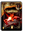 `SKILL_SK163_FIGHTER_COMB01` | 163 | `COMB` |  | ＶラッシュⅠ | [No.065/126/067/136/233/537/140/291/412 · 0-2243 · UC · FLv3] スキル／技：片手剣専用 カード選択後ＡＡＡで発動 — スキル／素早い連係攻撃を繰り 出す。３段目で敵を吹き飛ばす |
| 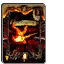 `SKILL_SK164_FIGHTER_COMB01` | 164 | `COMB` |  | ＶラッシュⅡ | [No.066/127/068/137/234/538/141/292/413 · 0-2244 · UC · FLv3] スキル／技：片手剣専用 カード選択後ＡＡＡで発動 — スキル／素早い連係攻撃を繰り 出す。３段目で敵を吹き飛ばす |
| 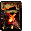 `SKILL_SK165_FIGHTER_COMB01` | 165 | `COMB` |  | ＶラッシュⅢ | [No.128/069/138/235/142/293/414 · 0-2245 · UC · FLv3] スキル／技：片手剣専用 カード選択後ＡＡＡで発動 — スキル／素早い連係攻撃を繰り 出す。３段目で敵を吹き飛ばす |
| 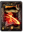 `SKILL_SK166_FIGHTER_COMB02` | 166 | `COMB` |  | スパイラルアサルトⅠ | [No.421 · 0-2672 · UC · FLv3] スキル／技：二刀流専用 カード選択後ＡＡＡＡで発動 — スキル／両手の武器を使用して 強力な多段攻撃を繰り出す |
| 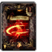 `SKILL_SK167_FIGHTER_COMB02` | 167 | `COMB` |  | スパイラルアサルトⅡ | [No.422 · 0-2673 · UC · FLv3] スキル／技：二刀流専用 カード選択後ＡＡＡＡで発動 — スキル／両手の武器を使用して 強力な多段攻撃を繰り出す |
| 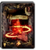 `SKILL_SK168_FIGHTER_COMB02` | 168 | `COMB` |  | スパイラルアサルトⅢ | [No.423 · 0-2674 · UC · FLv3] スキル／技：二刀流専用 カード選択後ＡＡＡＡで発動 — スキル／両手の武器を使用して 強力な多段攻撃を繰り出す |
| 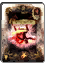 `SKILL_SK169_FIGHTER_COMB03` | 169 | `COMB` |  | ダブルドラゴン | [No.424 · 1-0404 · R · FLv4] スキル／技：二刀流専用 カード選択後Ａ＋Ｇで発動 — スキル／広い範囲の敵に対応で きる優秀な攻撃 |
| 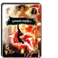 `SKILL_SK170_FIGHTER_COMB04` | 170 | `COMB` |  | ハンドレッドソードⅠ | [No.231 · 1-0316 · R · FLv3] スキル／技：片手剣専用 カード選択後Ａ＋Ｇ＋Ｖで発動 — スキル／剣による多段攻撃で大 ダメージを与える必殺の奥義 |
| 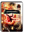 `SKILL_SK171_FIGHTER_COMB04` | 171 | `COMB` |  | ハンドレッドソードⅡ | [No.232 · 1-0317 · R · FLv3] スキル／技：片手剣専用 カード選択後Ａ＋Ｇ＋Ｖで発動 — スキル／剣による多段攻撃で大 ダメージを与える必殺の奥義 |
| 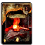 `SKILL_SK172_FIGHTER_COMB05` | 172 | `COMB` |  | バーバリアンラッシュⅠ | [No.136 · 0-2277 · UC · FLv3] スキル／技：片手斧専用 カード選択後ＡＡＡで発動 — スキル／スピードは遅いが、３ 段目は高い威力を誇る |
| 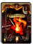 `SKILL_SK173_FIGHTER_COMB05` | 173 | `COMB` |  | バーバリアンラッシュⅡ | [No.137 · 0-2278 · UC · FLv3] スキル／技：片手斧専用 カード選択後ＡＡＡで発動 — スキル／スピードは遅いが、３ 段目は高い威力を誇る |
| 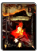 `SKILL_SK174_FIGHTER_COMB05` | 174 | `COMB` |  | バーバリアンラッシュⅢ | [No.138 · 0-2279 · UC · FLv3] スキル／技：片手斧専用 カード選択後ＡＡＡで発動 — スキル／スピードは遅いが、３ 段目は高い威力を誇る |
| 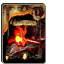 `SKILL_SK175_FIGHTER_COMB06` | 175 | `COMB` |  | バーサーカーラッシュⅠ | [No.233 · 0-2280 · UC · FLv3] スキル／技：片手斧専用 カード選択後ＡＡＡで発動 — スキル／素早い連係攻撃を繰り 出す。３段目で敵を浮かせる |
| 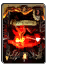 `SKILL_SK176_FIGHTER_COMB06` | 176 | `COMB` |  | バーサーカーラッシュⅡ | [No.234 · 0-2281 · UC · FLv3] スキル／技：片手斧専用 カード選択後ＡＡＡで発動 — スキル／素早い連係攻撃を繰り 出す。３段目で敵を浮かせる |
| 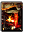 `SKILL_SK177_FIGHTER_COMB06` | 177 | `COMB` |  | バーサーカーラッシュⅢ | [No.235 · 0-2282 · UC · FLv3] スキル／技：片手斧専用 カード選択後ＡＡＡで発動 — スキル／素早い連係攻撃を繰り 出す。３段目で敵を浮かせる |
|  `SKILL_SK178_FIGHTER_COMB07` | 178 | `COMB` |  | ブレイドトルネードⅠ | デフォルト説明文１ — デフォルト説明文２ |
|  `SKILL_SK179_FIGHTER_COMB07` | 179 | `COMB` |  | ブレイドトルネードⅡ | デフォルト説明文１ — デフォルト説明文２ |
|  `SKILL_SK180_FIGHTER_COMB07` | 180 | `COMB` |  | ブレイドトルネードⅢ | デフォルト説明文１ — デフォルト説明文２ |
| 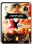 `SKILL_SK181_FIGHTER_COMB08` | 181 | `COMB` |  | ライトニングランサー | [No.073 · 1-0307 · R · FLv3] スキル／技：槍専用 カード選択後Ａ＋ＧＡで発動 — スキル／１発目がヒットした瞬 間にＡを入力すると蹴りが発動 |
| 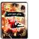 `SKILL_SK182_FIGHTER_COMB08` | 182 | `COMB` |  | ホースライダースラスト | [No.074 · 1-0308 · R · FLv3] スキル／技：槍専用 カード選択後Ａ＋ＧＡで発動 — スキル／１発目がヒットした瞬 間にＡを入力すると蹴りが発動 |
| 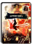 `SKILL_SK183_FIGHTER_COMB09` | 183 | `COMB` |  | ＨスラッシュⅠ | [No.079/236 · 1-0318 · R · FLv3] スキル／技：槍専用 カード選択後Ａ＋Ｇ＋Ｖで発動 — スキル／槍による多段攻撃で大 ダメージを与える必殺の奥義 |
| 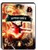 `SKILL_SK184_FIGHTER_COMB09` | 184 | `COMB` |  | ＨスラッシュⅡ | [No.080/237 · 1-0319 · R · FLv3] スキル／技：槍専用 カード選択後Ａ＋Ｇ＋Ｖで発動 — スキル／槍による多段攻撃で大 ダメージを与える必殺の奥義 |
|  `SKILL_SK185_FIGHTER_COMB10` | 185 | `COMB` |  |  |  |
|  `SKILL_SK186_FIGHTER_COMB10` | 186 | `COMB` |  |  |  |
| 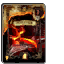 `SKILL_SK187_FIGHTER_COMB11` | 187 | `COMB` |  | ピアシングオールⅠ | [No.299 · 0-2549 · UC · FLv3] スキル／技：槍専用 カード選択後ＡＡＡで発動 — スキル／なぎ払いから２連の突 きへとつなぐ３段攻撃 |
| 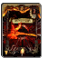 `SKILL_SK188_FIGHTER_COMB11` | 188 | `COMB` |  | ピアシングオールⅡ | [No.300/301 · 0-2550 · UC · FLv3] スキル／技：槍専用 カード選択後ＡＡＡで発動 — スキル／なぎ払いから２連の突 きへとつなぐ３段攻撃 |
| 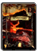 `SKILL_SK189_FIGHTER_COMB11` | 189 | `COMB` |  | ピアシングオールⅢ | [No.299 · 0-2551 · UC · FLv3] スキル／技：槍専用 カード選択後ＡＡＡで発動 — スキル／なぎ払いから２連の突 きへとつなぐ３段攻撃 |
| 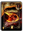 `SKILL_SK190_FIGHTER_COMB12` | 190 | `COMB` |  | ミラージュインパクトⅠ | [No.363 · 0-2601 · UC · FLv3] スキル／技：両手剣専用 カード選択後ＡＡＡで発動 — スキル／威力の高い４段の連係 攻撃を繰り出す |
| 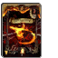 `SKILL_SK191_FIGHTER_COMB12` | 191 | `COMB` |  | ミラージュインパクトⅡ | [No.364 · 0-2602 · UC · FLv3] スキル／技：両手剣専用 カード選択後ＡＡＡで発動 — スキル／威力の高い４段の連係 攻撃を繰り出す |
| 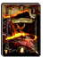 `SKILL_SK192_FIGHTER_COMB12` | 192 | `COMB` |  | ミラージュインパクトⅢ | [No.365 · 0-2603 · UC · FLv3] スキル／技：両手剣専用 カード選択後ＡＡＡで発動 — スキル／威力の高い４段の連係 攻撃を繰り出す |
|  `SKILL_SK193_FIGHTER_COMB13` | 193 | `COMB` |  |  |  |
|  `SKILL_SK194_FIGHTER_COMB13` | 194 | `COMB` |  |  |  |
|  `SKILL_SK195_FIGHTER_COMB13` | 195 | `COMB` |  |  |  |
| 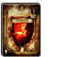 `SKILL_SK196_FIGHTER_COMB14` | 196 | `COMB` |  | ハードスラッシュ | [No.139 · 0-2283 · C · FLv3] スキル／技：両手剣専用 カード選択後Ａ＋Ｇで発動 — スキル／強力な横斬り攻撃。溜 めることで威力がアップする |
| 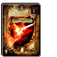 `SKILL_SK197_FIGHTER_COMB15` | 197 | `COMB` |  | グランドブレイカー | [No.194 · 0-2284 · UC · FLv3] スキル／技：両手剣専用 カード選択後Ａ＋Ｇで発動 — スキル／強力な縦斬り攻撃。溜 めることで威力がアップする |
| 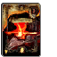 `SKILL_SK198_FIGHTER_COMB16` | 198 | `COMB` |  | アーマーブレイカーⅠ | [No.195 · 0-2359 · UC · FLv3] スキル／技：両手斧専用 カード選択後ＡＡＡで発動 — スキル／流れるような連係から ５段目の広範囲攻撃へとつなぐ |
| 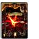 `SKILL_SK199_FIGHTER_COMB16` | 199 | `COMB` |  | アーマーブレイカーⅡ | [No.196 · 0-2360 · UC · FLv3] スキル／技：両手斧専用 カード選択後ＡＡＡで発動 — スキル／流れるような連係から ５段目の広範囲攻撃へとつなぐ |
| 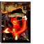 `SKILL_SK200_FIGHTER_COMB16` | 200 | `COMB` |  | アーマーブレイカーⅢ | [No.197 · 0-2361 · UC · FLv3] スキル／技：両手斧専用 カード選択後ＡＡＡで発動 — スキル／流れるような連係から ５段目の広範囲攻撃へとつなぐ |
|  `SKILL_SK201_FIGHTER_COMB17` | 201 | `COMB` |  |  |  |
|  `SKILL_SK202_FIGHTER_COMB17` | 202 | `COMB` |  |  |  |
|  `SKILL_SK203_FIGHTER_COMB17` | 203 | `COMB` |  |  |  |
| 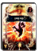 `SKILL_SK204_FIGHTER_COMB18` | 204 | `COMB` |  | デッドエンド | [No.078 · 1-0309 · R · FLv3] スキル／技：両手斧専用 カード選択後Ａ＋Ｇで発動 — スキル／大きく振りかぶり、範 囲の広い強烈な一撃を繰り出す |
| 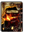 `SKILL_SK281_FIGHTER_COMB21` | 281 | `COMB` |  | ワイルドスマッシュⅠ | [No.297 · 0-2547 · UC · FLv3] スキル／技：片手剣専用 カード選択後Ａ＋Ｇで発動 — スキル／高威力の突きから蹴り へとつなぎ、敵を吹き飛ばす |
| 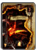 `SKILL_SK282_FIGHTER_COMB21` | 282 | `COMB` |  | ワイルドスマッシュⅡ | [No.298 · 0-2548 · UC · FLv3] スキル／技：片手剣専用 カード選択後Ａ＋Ｇで発動 — スキル／高威力の突きから蹴り へとつなぎ、敵を吹き飛ばす |
| 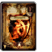 `SKILL_SK284_FIGHTER_COMB22` | 284 | `COMB` |  | ソニックブラスト | [No.482 · 0-2641 · UC · FLv3] スキル／技：両手剣専用 カード選択後Ａ＋Ｇで発動 — スキル／攻撃速度が非常に速く 回転力に優れた一撃 |
| 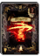 `SKILL_SK285_FIGHTER_COMB23` | 285 | `COMB` |  | ウィンドブレイク | [No.420 · 0-2671 · C · FLv3] スキル／技：両手剣専用 カード選択後Ａ＋Ｇで発動 — スキル／なぎ払い攻撃で、敵を 吹き飛ばす突風を発生させる |
| 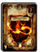 `SKILL_SK299_FIGHTER_COMB19` | 299 | `COMB` |  | ロックブレイカー | [No.366 · 0-2604 · UC · FLv3] スキル／技：片手斧専用 カード選択後Ａ＋Ｇで発動 — スキル／体を１回転させ、攻撃 範囲の広い強力な一撃を放つ |
| 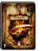 `SKILL_SK300_FIGHTER_COMB20` | 300 | `COMB` |  | ビートダウン | [No.396 · 0-2640 · UC · FLv3] スキル／技：両手斧専用 カード選択後Ａ＋Ｇで発動 — スキル／広い範囲の敵に対応で きる２段攻撃 |
| 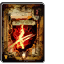 `SKILL_SK318_FIGHTER_COMB24` | 318 | `COMB` |  | Ｂスラッシュ | [No.416/520/139 · 0-2720 · C · FLv3] スキル／技：片手剣専用 カード選択後Ａ＋Ｇで発動 — スキル／素早く敵を斬り付け、 出血状態にさせる |
| 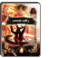 `SKILL_SK319_FIGHTER_COMB25` | 319 | `COMB` |  | カラミティエッジⅠ | [No.521 · 1-0459 · R · FLv3] スキル／技：両手剣専用 カード選択後ＡＡで発動 — スキル／広範囲に攻撃できる強 力な２段攻撃を繰り出す |
| 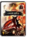 `SKILL_SK320_FIGHTER_COMB25` | 320 | `COMB` |  | カラミティエッジⅡ | [No.522 · 1-0460 · R · FLv3] スキル／技：両手剣専用 カード選択後ＡＡで発動 — スキル／広範囲に攻撃できる強 力な２段攻撃を繰り出す |
| 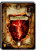 `SKILL_SK321_FIGHTER_SPEC01` | 321 | `SPEC` |  | ストームチェイサー | [No.574 · 0-2722 · UC · FLv2] スキル／技：能力変化 ウィンドウで選択すると発動 — スキル／全能力を低下させ、移 動速度を最大限に高める |
| 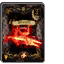 `SKILL_SK341_FIGHTER_COMB28` | 341 | `COMB` |  | ツインスティング | [No.536 · 0-2743 · C · FLv3] スキル／技：二刀流専用 カード選択後ダッシュＡで発動 — スキル／素早く敵に接近し、強 力な突きで敵を吹き飛ばす |
| 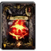 `SKILL_SK342_FIGHTER_COMB29` | 342 | `COMB` |  | レイズラッシュⅠ | [No.537 · 0-2744 · UC · FLv3] スキル／技：二刀流専用 カード選択後ＡＡで発動 — スキル／両手の武器を使用して 強力な連係攻撃を繰り出す |
| 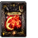 `SKILL_SK343_FIGHTER_COMB29` | 343 | `COMB` |  | レイズラッシュⅡ | [No.538 · 0-2745 · UC · FLv3] スキル／技：二刀流専用 カード選択後ＡＡで発動 — スキル／両手の武器を使用して 強力な連係攻撃を繰り出す |
| 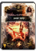 `SKILL_SK345_FIGHTER_COMB32` | 345 | `COMB` |  | ムーンスラッシュ | [No.564 · 1-0472 · R · FLv4] スキル／技：槍専用 カード選択後Ａ＋ＧＡで発動 — スキル／攻撃範囲の広いなぎ払 いから叩き付け攻撃へとつなぐ |
| 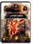 `SKILL_SK346_FIGHTER_COMB32` | 346 | `COMB` |  | クレセントインパクト | [No.565 · 1-0473 · R · FLv4] スキル／技：槍専用 カード選択後Ａ＋ＧＡで発動 — スキル／攻撃範囲の広いなぎ払 いから叩き付け攻撃へとつなぐ |
| 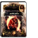 `SKILL_SK347_FIGHTER_COMB30` | 347 | `COMB` |  | ヴァリアントブレイブ | [No.562 · 1-0469 · R · FLv4] スキル／技：二刀流専用 カード選択後Ａ＋ＧＡで発動 — スキル／敵を高く打ち上げ、強 力な叩き付け攻撃へとつなぐ |
| 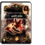 `SKILL_SK348_FIGHTER_COMB30` | 348 | `COMB` |  | メテオストライク | [No.563 · 1-0470 · R · FLv4] スキル／技：二刀流専用 カード選択後Ａ＋ＧＡで発動 — スキル／敵を高く打ち上げ、強 力な叩き付け攻撃へとつなぐ |
| 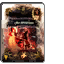 `SKILL_SK349_FIGHTER_COMB31` | 349 | `COMB` |  | オーガデストラクション | [No.539 · 1-0471 · R · FLv4] スキル／技：両手斧専用 カード選択後Ａ＋Ｇで発動 — スキル／敵の頭上に力強く斧を 振り下ろし、出血させる |
| 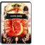 `SKILL_SK350_FIGHTER_COMB27` | 350 | `COMB` |  | アトミックスマッシュ | [No.573 · 1-0461 · R · FLv3] スキル／技：片手斧専用 カード選択後Ａ＋Ｇで発動 — スキル／強力な縦斬り攻撃。溜 めることで威力がアップする |
|  `SKILL_SK365_FIGHTER_COMB26` | 365 | `COMB` |  | ヘルディバイド | [No.572 · 0-2721 · C · FLv3] スキル／技：片手斧専用 カード選択後Ａ＋Ｇで発動 — スキル／素早く敵を斬り付け、 出血状態にさせる |
|  `SKILL_SK376_FIGHTER_COMB01_EX` | 376 | `COMB` | EX | ＶラッシュＥＸ | スキル／技：片手剣専用 カード選択後ＡＡＡで発動 — スキル／素早い連係攻撃を繰り 出す。３段目で敵を吹き飛ばす |
|  `SKILL_SK378_FIGHTER_COMB15_EX` | 378 | `COMB` | EX | グランドブレイカーＥＸ | スキル／技：両手剣専用 カード選択後Ａ＋Ｇで発動 — スキル／強力な縦斬り攻撃。溜 めることで威力がアップする |
|  `SKILL_SK379_FIGHTER_COMB04_EX` | 379 | `COMB` | EX | ハンドレットソードＥＸ | スキル／技：片手剣専用 カード選択後Ａ＋Ｇ＋Ｖで発動 — スキル／剣による多段攻撃で大 ダメージを与える必殺の奥義 |
|  `SKILL_SK380_FIGHTER_COMB06_EX` | 380 | `COMB` | EX | バーサーカーラッシュＥＸ | スキル／技：片手斧専用 カード選択後ＡＡＡで発動 — スキル／素早い連係攻撃を繰り 出す。３段目で敵を浮かせる |
|  `SKILL_SK381_FIGHTER_COMB19_EX` | 381 | `COMB` | EX | ロックブレイカーＥＸ | スキル／技：片手斧専用 カード選択後Ａ＋Ｇで発動 — スキル／体を１回転させ、攻撃 範囲の広い強力な一撃を放つ |
|  `SKILL_SK383_FIGHTER_COMB18_EX` | 383 | `COMB` | EX | デッドエンドＥＸ | スキル／技：両手斧専用 カード選択後Ａ＋Ｇで発動 — スキル／大きく振りかぶり、範 囲の広い強烈な一撃を繰り出す |
|  `SKILL_SK384_FIGHTER_COMB11_EX` | 384 | `COMB` | EX | ピアシングオールＥＸ | スキル／技：槍専用 カード選択後ＡＡＡで発動 — スキル／なぎ払いから２連の突 きへとつなぐ３段攻撃 |
|  `SKILL_SK386_FIGHTER_COMB08_EX` | 386 | `COMB` | EX | ホースライダースラストＥＸ | スキル／技：槍専用 カード選択後Ａ＋ＧＡで発動 — スキル／１発目がヒットした瞬 間にＡを入力すると蹴りが発動 |
|  `SKILL_SK387_FIGHTER_COMB09_EX` | 387 | `COMB` | EX | ＨスラッシュＥＸ | スキル／技：槍専用 カード選択後Ａ＋Ｇ＋Ｖで発動 — スキル／槍による多段攻撃で大 ダメージを与える必殺の奥義 |
|  `SKILL_SK391_FIGHTER_SPEC02_EX` | 391 | `SPEC` | EX | クロノストライフＥＸ | スキル／技：攻撃強化 ウィンドウで選択すると発動 — スキル／攻撃時にＭＰを消費し 攻撃力を高める |
|  `SKILL_SK456_FIGHTER_SPEC02` | 456 | `SPEC` |  | クロノストライフ | [No.394 · 1-0391 · R · FLv3] スキル／技：攻撃強化 ウィンドウで選択すると発動 — スキル／攻撃時にＭＰを消費し 攻撃力を高める |

####  `THIEF` (41)

| id interno | SK# | tipo | EX | nome | ativação e descrição |
|---|---|---|---|---|---|
|  `SKILL_SK248_THIEF_COMB04` | 248 | `COMB` |  | ハンドレッドダガー | スキル／技：ダガー専用 カード選択後ＡＡＡで発動 — スキル／目にも止まらぬ突きを 繰り出す |
|  `SKILL_SK249_THIEF_COMB05` | 249 | `COMB` |  | バックロール | [No.345 · 0-2584 · C · FLv2] スキル／技：回避行動 ユーズボタンなどで発動 — スキル／身をひるがえし、敵の 攻撃を避けることができる |
|  `SKILL_SK250_THIEF_COMB06` | 250 | `COMB` |  | ＬスラッシュⅠ | [No.065/291/412 · 0-2541 · UC · FLv3] スキル／技：ナイフ専用 カード選択後ＡＡＡで発動 — スキル／素早い連係攻撃を繰り 出す。３段目でダウンを奪う |
|  `SKILL_SK251_THIEF_COMB06` | 251 | `COMB` |  | ＬスラッシュⅡ | [No.066/292/413 · 0-2542 · UC · FLv3] スキル／技：ナイフ専用 カード選択後ＡＡＡで発動 — スキル／素早い連係攻撃を繰り 出す。３段目でダウンを奪う |
|  `SKILL_SK252_THIEF_COMB06` | 252 | `COMB` |  | ＬスラッシュⅢ | [No.293/414 · 0-2543 · UC · FLv3] スキル／技：ナイフ専用 カード選択後ＡＡＡで発動 — スキル／素早い連係攻撃を繰り 出す。３段目でダウンを奪う |
|  `SKILL_SK253_THIEF_COMB07` | 253 | `COMB` |  | ＫスラッシュⅠ | [No.065/291/412 · 0-2659 · UC · FLv3] スキル／技：ナイフ専用 カード選択後ＡＡＡで発動 — スキル／２段の突き攻撃から攻 撃範囲の広い横斬りへとつなぐ |
|  `SKILL_SK254_THIEF_COMB07` | 254 | `COMB` |  | ＫスラッシュⅡ | [No.066/292/413 · 0-2660 · UC · FLv3] スキル／技：ナイフ専用 カード選択後ＡＡＡで発動 — スキル／２段の突き攻撃から攻 撃範囲の広い横斬りへとつなぐ |
|  `SKILL_SK255_THIEF_COMB07` | 255 | `COMB` |  | ＫスラッシュⅢ | [No.293/414 · 0-2661 · UC · FLv3] スキル／技：ナイフ専用 カード選択後ＡＡＡで発動 — スキル／２段の突き攻撃から攻 撃範囲の広い横斬りへとつなぐ |
|  `SKILL_SK256_THIEF_COMB08` | 256 | `COMB` |  | 回避行動１＋攻撃(仮)Ⅰ | 回避行動１＋攻撃(仮)１ — 回避行動１＋攻撃(仮)１ |
|  `SKILL_SK257_THIEF_COMB08` | 257 | `COMB` |  | 回避行動１＋攻撃(仮)Ⅱ | 回避行動１＋攻撃(仮)２ — 回避行動１＋攻撃(仮)２ |
|  `SKILL_SK258_THIEF_COMB09` | 258 | `COMB` |  | 回避行動２＋攻撃(仮)Ⅰ | 回避行動２＋攻撃(仮)１ — 回避行動２＋攻撃(仮)１ |
|  `SKILL_SK259_THIEF_COMB09` | 259 | `COMB` |  | 回避行動２＋攻撃(仮)Ⅱ | 回避行動２＋攻撃(仮)２ — 回避行動２＋攻撃(仮)２ |
|  `SKILL_SK260_THIEF_COMB10` | 260 | `COMB` |  | 回避行動３＋攻撃(仮)Ⅰ | 回避行動３＋攻撃(仮)１ — 回避行動３＋攻撃(仮)１ |
|  `SKILL_SK261_THIEF_COMB10` | 261 | `COMB` |  | 回避行動３＋攻撃(仮)Ⅱ | 回避行動３＋攻撃(仮)２ — 回避行動３＋攻撃(仮)２ |
|  `SKILL_SK262_THIEF_COMB11` | 262 | `COMB` |  | ヘビースタッブ | [No.294 · 0-2544 · UC · FLv3] スキル／技：ナイフ専用 カード選択後Ａ＋Ｇで発動 — スキル／力を溜め、敵の急所に 強烈な突きを叩き込む |
|  `SKILL_SK263_THIEF_COMB12` | 263 | `COMB` |  | アサシンネイル | デフォルト説明文１ — デフォルト説明文２ |
|  `SKILL_SK264_THIEF_COMB13` | 264 | `COMB` |  | シャドウキル | デフォルト説明文１ — デフォルト説明文２ |
|  `SKILL_SK265_THIEF_COMB14` | 265 | `COMB` |  | エクステンシブショット | [No.411 · 0-2658 · UC · FLv2] スキル／技：弓矢専用 カード選択後Ａ＋Ｇで発動 — スキル／３本の矢を同時に射出 する。広範囲に攻撃可能 |
|  `SKILL_SK266_THIEF_MEGACRUSH` | 266 | `MEGACRUSH` |  | ブラッディレイン | [No.486 · 1-0403 · R · FLv3] スキル／技：全方位 カード選択後Ａ＋Ｇ＋Ｖで発動 — スキル／複数の爆弾を投げ、大 ダメージを与える必殺の奥義 |
|  `SKILL_SK267_THIEF_COMB16` | 267 | `COMB` |  | イマジナリーアロー | [No.431 · 0-2679 · C · FLv3] スキル／技：弓矢専用 ユーズボタンなどで発動 — スキル／一時的に、矢を消費せ ずに射出できるようになる |
|  `SKILL_SK268_THIEF_COMB17` | 268 | `COMB` |  | 連続貫通攻撃２(仮) | デフォルト説明文１ — デフォルト説明文２ |
|  `SKILL_SK269_THIEF_COMB18` | 269 | `COMB` |  | チャージショット | [No.342 · 0-2581 · C · FLv2] スキル／技：弓矢専用 カード選択後Ａ＋Ｇで発動 — スキル／力を溜め、敵の急所を 狙って高威力の矢を発射する |
|  `SKILL_SK336_THIEF_SPEC03` | 336 | `SPEC` |  | サイレントフラッシュ | [No.583 · 1-0465 · R · FLv3] スキル／技：攻撃強化 ウィンドウで選択すると発動 — スキル／クリティカルヒット時 にＭＰを消費し攻撃力を高める |
|  `SKILL_SK337_THIEF_COMB19` | 337 | `COMB` |  | デッドリーロンドⅠ | [No.585 · 0-2733 · UC · FLv3] スキル／技：ナイフ専用 カード選択後ＡＡＡで発動 — スキル／短剣による連続攻撃か ら爆弾へとつなぐ |
|  `SKILL_SK338_THIEF_COMB19` | 338 | `COMB` |  | デッドリーロンドⅡ | [No.586 · 0-2734 · UC · FLv3] スキル／技：ナイフ専用 カード選択後ＡＡＡで発動 — スキル／短剣による連続攻撃か ら爆弾へとつなぐ |
|  `SKILL_SK339_THIEF_COMB19` | 339 | `COMB` |  | デッドリーロンドⅢ | [No.587 · 0-2735 · UC · FLv3] スキル／技：ナイフ専用 カード選択後ＡＡＡで発動 — スキル／短剣による連続攻撃か ら爆弾へとつなぐ |
|  `SKILL_SK358_THIEF_COMB22` | 358 | `COMB` |  | デュアルスタッブ | [No.570 · 1-0482 · R · FLv4] スキル／技：ナイフ専用 カード選択後Ａ＋Ｇで発動 — スキル／装備した短剣で、素早 い連続突きを繰り出す |
|  `SKILL_SK364_THIEF_COMB21` | 364 | `COMB` |  | シャイニングアロー | [No.547 · 1-0480 · R · FLv4] スキル／技：弓矢専用 カード選択後Ａ＋Ｇで発動 — スキル／発動中にロックオン した敵全てに矢を放つ |
|  `SKILL_SK366_THIEF_SPEC02` | 366 | `SPEC` |  | ハンターズアイ | [No.548 · 0-2751 · UC · FLv3] スキル／技：攻撃強化 ウィンドウで選択すると発動 — スキル／弓矢の飛距離を犠牲に し、威力を最大限に高める |
|  `SKILL_SK368_THIEF_SPEC01` | 368 | `SPEC` |  | ヴァイパーバイト | [No.529 · 0-2737 · UC · FLv3] スキル／技：能力変化 ウィンドウで選択すると発動 — スキル／毒状態の相手にのみ、 致命的な一撃を与える |
|  `SKILL_SK371_THIEF_COMB23` | 371 | `COMB` |  | ライトニングブラスト | [No.531 · 1-0467 · R · FLv3] スキル／技：弓矢専用 カード選択後Ａ＋Ｇで発動 — スキル／天空に向かって矢を放 ち、落雷でダメージを与える |
|  `SKILL_SK372_THIEF_COMB20` | 372 | `COMB` |  | リストレインショット | [No.532 · 0-2739 · C · FLv3] スキル／技：弓矢専用 カード選択後Ａで発動 — スキル／敵をダウンさせる効果 のある弓矢攻撃 |
|  `SKILL_SK525_THIEF_COMB06_EX` | 525 | `COMB` | EX | ＬスラッシュＥＸ | スキル／技：ナイフ専用 カード選択後ＡＡＡで発動 — スキル／素早い連係攻撃を繰り 出す。３段目でダウンを奪う |
|  `SKILL_SK527_THIEF_COMB07_EX` | 527 | `COMB` | EX | ＫスラッシュＥＸ | スキル／技：ナイフ専用 カード選択後ＡＡＡで発動 — スキル／２段の突き攻撃から攻 撃範囲の広い横斬りへとつなぐ |
|  `SKILL_SK528_THIEF_COMB11_EX` | 528 | `COMB` | EX | ヘビースタッブＥＸ | スキル／技：ナイフ専用 カード選択後Ａ＋Ｇで発動 — スキル／力を溜め、敵の急所に 強烈な突きを叩き込む |
|  `SKILL_SK529_THIEF_COMB18_EX` | 529 | `COMB` | EX | チャージショットＥＸ | スキル／技：弓矢専用 カード選択後Ａ＋Ｇで発動 — スキル／攻撃に時間を要するが 強力な一撃が繰り出せる |
|  `SKILL_SK530_THIEF_COMB20_EX` | 530 | `COMB` | EX | リストレインショットＥＸ | スキル／技：弓矢専用 カード選択後Ａで発動 — スキル／敵をダウンさせる効果 のある弓矢攻撃 |
|  `SKILL_SK531_THIEF_COMB14_EX` | 531 | `COMB` | EX | エクステンシブショットＥＸ | スキル／技：弓矢専用 カード選択後Ａ＋Ｇで発動 — スキル／３本の矢を同時に射出 する。広範囲に攻撃可能 |
|  `SKILL_SK532_THIEF_COMB23_EX` | 532 | `COMB` | EX | ライトニングブラストＥＸ | スキル／技：弓矢専用 カード選択後Ａ＋Ｇで発動 — スキル／天空に向かって矢を放 ち、落雷でダメージを与える |
|  `SKILL_SK536_THIEF_MEGACRUSH_EX` | 536 | `MEGACRUSH` | EX | ブラッディレインＥＸ | スキル／技：全方位 カード選択後Ａ＋Ｇ＋Ｖで発動 — スキル／複数の爆弾を投げ、大 ダメージを与える必殺の奥義 |
|  `SKILL_SK542_THIEF_SPEC03_EX` | 542 | `SPEC` | EX | サイレントフラッシュＥＸ | スキル／技：攻撃強化 ウィンドウで選択すると発動 — スキル／クリティカルヒット時 にＭＰを消費し攻撃力を高める |

####  `WIZARD` (14)

| id interno | SK# | tipo | EX | nome | ativação e descrição |
|---|---|---|---|---|---|
|  `SKILL_SK151_WIZARD_COMB01` | 151 | `COMB` |  | ＳＦラッシュⅠ | [No.065/126/067/136/233/537/140/291/412 · 0-2288 · UC · FLv3] スキル／技：杖専用 カード選択後ＡＡＡで発動 — スキル／素早い連係攻撃を繰り 出す。３段目は攻撃範囲が広い |
|  `SKILL_SK152_WIZARD_COMB01` | 152 | `COMB` |  | ＳＦラッシュⅡ | [No.066/127/068/137/234/538/141/292/413 · 0-2289 · UC · FLv3] スキル／技：杖専用 カード選択後ＡＡＡで発動 — スキル／素早い連係攻撃を繰り 出す。３段目は攻撃範囲が広い |
|  `SKILL_SK153_WIZARD_COMB01` | 153 | `COMB` |  | ＳＦラッシュⅢ | [No.128/069/138/235/142/293/414 · 0-2290 · UC · FLv3] スキル／技：杖専用 カード選択後ＡＡＡで発動 — スキル／素早い連係攻撃を繰り 出す。３段目は攻撃範囲が広い |
|  `SKILL_SK154_WIZARD_COMB02` | 154 | `COMB` |  | オールレンジアタックⅠ | スキル／技：杖専用 カード選択後ＡＡで発動 — スキル／広い攻撃範囲を誇る連 係攻撃だが、ダメージは低め |
|  `SKILL_SK155_WIZARD_COMB02` | 155 | `COMB` |  | オールレンジアタックⅡ | スキル／技：杖専用 カード選択後ＡＡで発動 — スキル／広い攻撃範囲を誇る連 係攻撃だが、ダメージは低め |
|  `SKILL_SK270_WIZARD_MEGACRUSH` | 270 | `MEGACRUSH` |  | メテオストーム | [No.484 · 1-0399 · R · FLv3] スキル／魔：全方位 カード選択後Ａ＋Ｇ＋Ｖで発動 — スキル／多数の隕石を降らせ、 大ダメージを与える必殺の奥義 |
|  `SKILL_SK283_WIZARD_COMB03` | 283 | `COMB` |  | ファントムインパルス | [No.403 · 0-2647 · UC · FLv3] スキル／技：杖専用 カード選択後Ａ＋Ｇで発動 — スキル／広い範囲の敵に対応で きる素早い一撃 |
|  `SKILL_SK324_WIZARD_SPEC02` | 324 | `SPEC` |  | エンハンスマジック | [No.576 · 1-0462 · R · FLv3] スキル／技：攻撃強化 ウィンドウで選択すると発動 — スキル／魔法攻撃時にＭＰを消 費し、攻撃力を高める |
|  `SKILL_SK325_WIZARD_COMB04` | 325 | `COMB` |  | ウィルオブユニバースⅠ | [No.577 · 0-2725 · UC · FLv3] スキル／技：杖専用 カード選択後ＡＡＡで発動 — スキル／杖による連続攻撃から 魔法へとつなぐ |
|  `SKILL_SK326_WIZARD_COMB04` | 326 | `COMB` |  | ウィルオブユニバースⅡ | [No.578 · 0-2726 · UC · FLv3] スキル／技：杖専用 カード選択後ＡＡＡで発動 — スキル／杖による連続攻撃から 魔法へとつなぐ |
|  `SKILL_SK327_WIZARD_COMB04` | 327 | `COMB` |  | ウィルオブユニバースⅢ | [No.579 · 0-2727 · UC · FLv3] スキル／技：杖専用 カード選択後ＡＡＡで発動 — スキル／杖による連続攻撃から 魔法へとつなぐ |
|  `SKILL_SK370_WIZARD_SPEC01` | 370 | `SPEC` |  | ワールウィンド | [No.524 · 0-2728 · UC · FLv2] スキル／技：能力変化 ウィンドウで選択すると発動 — スキル／知力を低下させ、腕力 を最大限に高める |
|  `SKILL_SK508_WIZARD_MEGACRUSH_EX` | 508 | `MEGACRUSH` | EX | メテオストームＥＸ | スキル／魔：全方位 カード選択後Ａ＋Ｇ＋Ｖで発動 — スキル／多数の隕石を降らせ、 大ダメージを与える必殺の奥義 |
|  `SKILL_SK541_WIZARD_SPEC02_EX` | 541 | `SPEC` | EX | エンハンスマジックＥＸ | スキル／技：攻撃強化 ウィンドウで選択すると発動 — スキル／魔法攻撃時にＭＰを消 費し、攻撃力を高める |

####  `PRIEST` (22)

| id interno | SK# | tipo | EX | nome | ativação e descrição |
|---|---|---|---|---|---|
|  `SKILL_SK093_PRIEST_SPEC02` | 093 | `SPEC` |  | ロードオブファランクス | [No.395 · 1-0392 · R · FLv3] スキル／技：特殊防御 ウィンドウで選択すると発動 — スキル／受けたダメージをＭＰ で吸収するシールドをまとう |
|  `SKILL_SK156_PRIEST_COMB01` | 156 | `COMB` |  | 粛正Ⅰ | [No.153 · 0-2303 · UC · FLv3] スキル／技：棍棒専用 カード選択後ＡＡＡで発動 — スキル／素早い連係攻撃を繰り 出す。３段目には気絶効果あり |
|  `SKILL_SK157_PRIEST_COMB01` | 157 | `COMB` |  | 粛正Ⅱ | [No.154 · 0-2304 · UC · FLv3] スキル／技：棍棒専用 カード選択後ＡＡＡで発動 — スキル／素早い連係攻撃を繰り 出す。３段目には気絶効果あり |
|  `SKILL_SK158_PRIEST_COMB01` | 158 | `COMB` |  | 粛正Ⅲ | [No.155 · 0-2305 · UC · FLv3] スキル／技：棍棒専用 カード選択後ＡＡＡで発動 — スキル／素早い連係攻撃を繰り 出す。３段目には気絶効果あり |
|  `SKILL_SK159_PRIEST_COMB02` | 159 | `COMB` |  | 神罰Ⅰ | [No.200 · 0-2306 · UC · FLv3] スキル／技：棍棒専用 カード選択後ＡＡＡで発動 — スキル／素早い連係攻撃を繰り 出す。３段目で敵を浮かせる |
|  `SKILL_SK160_PRIEST_COMB02` | 160 | `COMB` |  | 神罰Ⅱ | [No.201 · 0-2307 · UC · FLv3] スキル／技：棍棒専用 カード選択後ＡＡＡで発動 — スキル／素早い連係攻撃を繰り 出す。３段目で敵を浮かせる |
|  `SKILL_SK161_PRIEST_COMB02` | 161 | `COMB` |  | 神罰Ⅲ | [No.202 · 0-2308 · UC · FLv3] スキル／技：棍棒専用 カード選択後ＡＡＡで発動 — スキル／素早い連係攻撃を繰り 出す。３段目で敵を浮かせる |
|  `SKILL_SK162_PRIEST_COMB03` | 162 | `COMB` |  | スパイトブレイカー | [No.410 · 0-2656 · UC · FLv3] スキル／技：棍棒専用 カード選択後Ａ＋Ｇで発動 — スキル／攻撃速度が非常に速く 回転力に優れた一撃 |
|  `SKILL_SK271_PRIEST_MEGACRUSH` | 271 | `MEGACRUSH` |  | エターナルサンライズ | [No.485 · 1-0402 · R · FLv3] スキル／光：全方位 カード選択後Ａ＋Ｇ＋Ｖで発動 — スキル／聖なる波動で大ダメー ジを与える必殺の奥義 |
|  `SKILL_SK275_PRIEST_COMB04` | 275 | `COMB` |  | 神の鉄槌Ⅰ | [No.308 · 0-2558 · UC · FLv3] スキル／技：棍棒専用 カード選択後ＡＡＡで発動 — スキル／棍棒による攻撃から浴 びせ蹴りへとつなぐ４段攻撃 |
|  `SKILL_SK276_PRIEST_COMB04` | 276 | `COMB` |  | 神の鉄槌Ⅱ | [No.309 · 0-2559 · UC · FLv3] スキル／技：棍棒専用 カード選択後ＡＡＡで発動 — スキル／棍棒による攻撃から浴 びせ蹴りへとつなぐ４段攻撃 |
|  `SKILL_SK277_PRIEST_COMB04` | 277 | `COMB` |  | 神の鉄槌Ⅲ | [No.310 · 0-2560 · UC · FLv3] スキル／技：棍棒専用 カード選択後ＡＡＡで発動 — スキル／棍棒による攻撃から浴 びせ蹴りへとつなぐ４段攻撃 |
|  `SKILL_SK334_PRIEST_COMB05` | 334 | `COMB` |  | ブレインシェイカー | [No.527 · 0-2730 · C · FLv3] スキル／技：棍棒専用 カード選択後Ａ＋Ｇで発動 — スキル／素早く敵を殴り付け、 気絶状態にさせる |
|  `SKILL_SK356_PRIEST_COMB06` | 356 | `COMB` |  | ヘブンズドーン | [No.543 · 1-0477 · R · FLv4] スキル／技：杖専用 カード選択後Ａ＋Ｇで発動 — スキル／小さく跳び上がり、範 囲の広い強烈な一撃を繰り出す |
|  `SKILL_SK357_PRIEST_COMB07` | 357 | `COMB` |  | ホーリーガイザー | [No.568 · 1-0478 · R · FLv4] スキル／技：ナックル専用 カード選択後Ａ＋Ｇで発動 — スキル／拳を地面に向かって振 り下ろし、衝撃波を出す |
|  `SKILL_SK361_PRIEST_COMB08` | 361 | `COMB` |  | ジャッジメントブロウ | [No.569 · 1-0479 · R · FLv4] スキル／技：棍棒専用 カード選択後Ａ＋Ｇで発動 — スキル／棍棒を素早く叩き付け 広範囲の敵にダメージを与える |
|  `SKILL_SK375_PRIEST_SPEC01` | 375 | `SPEC` |  | シンセリティー | [No.581 · 0-2732 · UC · FLv2] スキル／技：能力変化 ウィンドウで選択すると発動 — スキル／防御力を低下させ、精 神力を最大限に高める |
|  `SKILL_SK509_PRIEST_COMB01_EX` | 509 | `COMB` | EX | 粛正ＥＸ | スキル／技：棍棒専用 カード選択後ＡＡＡで発動 — スキル／素早い連係攻撃を繰り 出す。３段目には気絶効果あり |
|  `SKILL_SK510_PRIEST_COMB03_EX` | 510 | `COMB` | EX | スパイトブレイカーＥＸ | スキル／技：棍棒専用 カード選択後Ａ＋Ｇで発動 — スキル／攻撃速度が非常に速く 回転力に優れた一撃 |
|  `SKILL_SK511_PRIEST_COMB02_EX` | 511 | `COMB` | EX | 神罰ＥＸ | スキル／技：棍棒専用 カード選択後ＡＡＡで発動 — スキル／素早い連係攻撃を繰り 出す。３段目で敵を浮かせる |
|  `SKILL_SK516_PRIEST_MEGACRUSH_EX` | 516 | `MEGACRUSH` | EX | エターナルサンライズＥＸ | スキル／光：全方位 カード選択後Ａ＋Ｇ＋Ｖで発動 — スキル／聖なる波動で大ダメー ジを与える必殺の奥義 |
|  `SKILL_SK524_PRIEST_SPEC02_EX` | 524 | `SPEC` | EX | ロードオブファランクスＥＸ | スキル／技：特殊防御 ウィンドウで選択すると発動 — スキル／受けたダメージをＭＰ で吸収するシールドをまとう |

####  `KA` (4)

| id interno | SK# | tipo | EX | nome | ativação e descrição |
|---|---|---|---|---|---|
|  `SKILL_SK216_KA_COMB01` | 216 | `COMB` |  | オーガラッシュⅠ | [No.126 · 0-2268 · UC · FLv3] スキル／技：片手斧専用 カード選択後ＡＡＡで発動 — スキル／素早い連係攻撃を繰り 出す。３段目でダウンを奪う |
|  `SKILL_SK217_KA_COMB01` | 217 | `COMB` |  | オーガラッシュⅡ | [No.127 · 0-2269 · UC · FLv3] スキル／技：片手斧専用 カード選択後ＡＡＡで発動 — スキル／素早い連係攻撃を繰り 出す。３段目でダウンを奪う |
|  `SKILL_SK218_KA_COMB01` | 218 | `COMB` |  | オーガラッシュⅢ | [No.128 · 0-2270 · UC · FLv3] スキル／技：片手斧専用 カード選択後ＡＡＡで発動 — スキル／素早い連係攻撃を繰り 出す。３段目でダウンを奪う |
|  `SKILL_SK219_KA_COMB02` | 219 | `COMB` |  | ブロウダウン | [No.473 · 0-2664 · C · FLv3] スキル／技：片手斧専用 カード選択後ダッシュＡで発動 — スキル／素早く敵に接近し、斧 を振り下ろしてダウンを奪う |

####  `KS` (5)

| id interno | SK# | tipo | EX | nome | ativação e descrição |
|---|---|---|---|---|---|
|  `SKILL_SK213_KS_COMB01` | 213 | `COMB` |  | ライジングスラッシュⅠ | [No.065 · 0-2241 · UC · FLv3] スキル／技：片手剣専用 カード選択後ＡＡで発動 — スキル／素早い２段攻撃。戦士 のみ２段目をためることが可能 |
|  `SKILL_SK214_KS_COMB01` | 214 | `COMB` |  | ライジングスラッシュⅡ | [No.066 · 0-2242 · UC · FLv3] スキル／技：片手剣専用 カード選択後ＡＡで発動 — スキル／素早い２段攻撃。戦士 のみ２段目をためることが可能 |
|  `SKILL_SK215_KS_COMB02` | 215 | `COMB` |  | スレッシャーテイル | [No.070 · 0-2246 · UC · FLv3] スキル／技：片手剣専用 カード選択後Ａ＋Ｇで発動 — スキル／広い範囲の敵に対応で きる素早い一撃 |
|  `SKILL_SK278_KS_COMB03` | 278 | `COMB` |  | ヴァルキリーストライク | [No.415 · 0-2666 · C · FLv3] スキル／技：片手剣専用 カード選択後ダッシュＡで発動 — スキル／素早く敵に接近し、高 く打ち上げる攻撃 |
|  `SKILL_SK377_KS_COMB02_EX` | 377 | `COMB` | EX | スレッシャーテイルＥＸ | スキル／技：片手剣専用 カード選択後Ａ＋Ｇで発動 — スキル／広い範囲の敵に対応で きる素早い一撃 |

####  `MA` (6)

| id interno | SK# | tipo | EX | nome | ativação e descrição |
|---|---|---|---|---|---|
|  `SKILL_SK220_MA_COMB01` | 220 | `COMB` |  | ロッククラッシャーⅠ | [No.129 · 0-2271 · UC · FLv3] スキル／技：棍棒専用 カード選択後ＡＡＡＡで発動 — スキル／流れるような４段の連 係攻撃を繰り出す |
|  `SKILL_SK221_MA_COMB01` | 221 | `COMB` |  | ロッククラッシャーⅡ | [No.130 · 0-2272 · UC · FLv3] スキル／技：棍棒専用 カード選択後ＡＡＡＡで発動 — スキル／流れるような４段の連 係攻撃を繰り出す |
|  `SKILL_SK222_MA_COMB01` | 222 | `COMB` |  | ロッククラッシャーⅢ | [No.131 · 0-2273 · UC · FLv3] スキル／技：棍棒専用 カード選択後ＡＡＡＡで発動 — スキル／流れるような４段の連 係攻撃を繰り出す |
|  `SKILL_SK223_MA_COMB02` | 223 | `COMB` |  | ハードブレイカー | [No.071 · 0-2247 · UC · FLv3] スキル／技：棍棒専用 カード選択後Ａ＋Ｇで発動 — スキル／力を溜め、敵の頭上に 強烈な一撃を打ち下ろす |
|  `SKILL_SK279_MA_COMB03` | 279 | `COMB` |  | バニシングブロー | [No.417 · 0-2668 · C · FLv3] スキル／技：棍棒専用 カード選択後ダッシュＡで発動 — スキル／素早く敵に接近し、広 範囲の横斬りでダウンを奪う |
|  `SKILL_SK512_MA_COMB02_EX` | 512 | `COMB` | EX | ハードブレイカーＥＸ | スキル／技：棍棒専用 カード選択後Ａ＋Ｇで発動 — スキル／力を溜め、敵の頭上に 強烈な一撃を打ち下ろす |

####  `NC` (10)

| id interno | SK# | tipo | EX | nome | ativação e descrição |
|---|---|---|---|---|---|
|  `SKILL_SK239_NC_COMB01` | 239 | `COMB` |  | ダンスオブザドラゴンⅠ | [No.360 · 0-2598 · UC · FLv3] スキル／技：ナックル専用 カード選択後ＡＡＡＡで発動 — スキル／素早い４段攻撃を繰り 出す。４段目で敵を浮かせる |
|  `SKILL_SK240_NC_COMB01` | 240 | `COMB` |  | ダンスオブザドラゴンⅡ | [No.361 · 0-2599 · UC · FLv3] スキル／技：ナックル専用 カード選択後ＡＡＡＡで発動 — スキル／素早い４段攻撃を繰り 出す。４段目で敵を浮かせる |
|  `SKILL_SK241_NC_COMB01` | 241 | `COMB` |  | ダンスオブザドラゴンⅢ | [No.362 · 0-2600 · UC · FLv3] スキル／技：ナックル専用 カード選択後ＡＡＡＡで発動 — スキル／素早い４段攻撃を繰り 出す。４段目で敵を浮かせる |
|  `SKILL_SK242_NC_COMB02` | 242 | `COMB` |  | ナックル用連係２(仮)Ⅰ | ナイフ用連係２(仮)１ — ナイフ用連係２(仮)１ |
|  `SKILL_SK243_NC_COMB02` | 243 | `COMB` |  | ナックル用連係２(仮)Ⅱ | ナイフ用連係２(仮)２ — ナイフ用連係２(仮)２ |
|  `SKILL_SK244_NC_COMB02` | 244 | `COMB` |  | ナックル用連係２(仮)Ⅲ | ナイフ用連係２(仮)３ — ナイフ用連係２(仮)３ |
|  `SKILL_SK245_NC_COMB03` | 245 | `COMB` |  | トルネードパンチ | [No.075 · 1-0358 · UC · FLv3] スキル／技：ナックル専用 カード選択後Ａ＋Ｇで発動 — スキル／拳による強烈な一撃。 溜めることで威力がアップする |
|  `SKILL_SK247_NC_COMB05` | 247 | `COMB` |  | 裡門頂肘 | [1-0359 · UC · FLv3] スキル／技：ナックル専用 カード選択後ダッシュＡ — スキル／素早く敵に接近し、強 烈な肘を敵の急所に叩き込む |
|  `SKILL_SK328_NC_COMB07` | 328 | `COMB` |  | ドラゴンスマッシュ | [No.534 · 0-2741 · C · FLv3] スキル／技：ナックル専用 カード選択後ダッシュＡで発動 — スキル／素早く敵に接近し、敵 を打ち上げる |
|  `SKILL_SK344_NC_COMB06` | 344 | `COMB` |  | ファルコンブロウ | [No.533 · 0-2740 · UC · FLv3] スキル／技：ナックル専用 カード選択後Ａ＋Ｇで発動 — スキル／攻撃速度が非常に速く 回転力に優れた一撃 |

####  `NI` (3)

| id interno | SK# | tipo | EX | nome | ativação e descrição |
|---|---|---|---|---|---|
|  `SKILL_SK273_NI_COMB01` | 273 | `COMB` |  | ブロードビート | [No.419 · 0-2670 · UC · FLv3] スキル／技：ナイフ専用 カード選択後Ａ＋Ｇで発動 — スキル／広い範囲の敵に対応で きる素早い一撃 |
|  `SKILL_SK274_NI_COMB02` | 274 | `COMB` |  | Ｓリッパー | [No.471 · 0-2662 · C · FLv3] スキル／技：ナイフ専用 カード選択後ダッシュＡで発動 — スキル／素早く敵に接近し、敵 を打ち上げる |
|  `SKILL_SK526_NI_COMB01_EX` | 526 | `COMB` | EX | ブロードビートＥＸ | スキル／技：ナイフ専用 カード選択後Ａ＋Ｇで発動 — スキル／広い範囲の敵に対応で きる素早い一撃 |

####  `RA` (5)

| id interno | SK# | tipo | EX | nome | ativação e descrição |
|---|---|---|---|---|---|
|  `SKILL_SK234_RA_COMB01` | 234 | `COMB` |  | トルネードスパイクⅠ | [No.075 · 0-2251 · UC · FLv3] スキル／技：両手斧専用 カード選択後ＡＡＡで発動 — スキル／攻撃範囲の広い３段攻 撃。戦士のみ攻撃方法が変化 |
|  `SKILL_SK235_RA_COMB01` | 235 | `COMB` |  | トルネードスパイクⅡ | [No.076 · 0-2252 · UC · FLv3] スキル／技：両手斧専用 カード選択後ＡＡＡで発動 — スキル／攻撃範囲の広い３段攻 撃。戦士のみ攻撃方法が変化 |
|  `SKILL_SK236_RA_COMB01` | 236 | `COMB` |  | トルネードスパイクⅢ | [No.077 · 0-2253 · UC · FLv3] スキル／技：両手斧専用 カード選択後ＡＡＡで発動 — スキル／攻撃範囲の広い３段攻 撃。戦士のみ攻撃方法が変化 |
|  `SKILL_SK237_RA_COMB02` | 237 | `COMB` |  | ビーストアタック | [No.474 · 0-2665 · C · FLv3] スキル／技：両手斧専用 カード選択後ダッシュＡで発動 — スキル／素早く敵に接近し、斧 の柄で敵を吹き飛ばす |
|  `SKILL_SK382_RA_COMB01_EX` | 382 | `COMB` | EX | トルネードスパイクＥＸ | スキル／技：両手斧専用 カード選択後ＡＡＡで発動 — スキル／攻撃範囲の広い３段攻 撃。戦士のみ攻撃方法が変化 |

####  `RS` (3)

| id interno | SK# | tipo | EX | nome | ativação e descrição |
|---|---|---|---|---|---|
|  `SKILL_SK231_RS_COMB01` | 231 | `COMB` |  | バスタースラッシュⅠ | [No.079 · 1-0310 · R · FLv3] スキル／技：両手剣専用 カード選択後ＡＡで発動 — スキル／素早い２段攻撃。戦士 のみＡＡＡで３段目を出せる |
|  `SKILL_SK232_RS_COMB01` | 232 | `COMB` |  | バスタースラッシュⅡ | [No.080 · 1-0311 · R · FLv3] スキル／技：両手剣専用 カード選択後ＡＡで発動 — スキル／素早い２段攻撃。戦士 のみＡＡＡで３段目を出せる |
|  `SKILL_SK233_RS_COMB02` | 233 | `COMB` |  | バイオレントスラッシュ | [No.416 · 0-2667 · C · FLv3] スキル／技：両手剣専用 カード選択後ダッシュＡで発動 — スキル／素早く敵に接近し、広 範囲の横斬りでダウンを奪う |

####  `SP` (6)

| id interno | SK# | tipo | EX | nome | ativação e descrição |
|---|---|---|---|---|---|
|  `SKILL_SK224_SP_COMB01` | 224 | `COMB` |  | スピアージャブⅠ | [No.132 · 0-2274 · UC · FLv3] スキル／技：槍専用 カード選択後ＡＡＡで発動 — スキル／素早い突きを連続で繰 り出す３段の連係攻撃 |
|  `SKILL_SK225_SP_COMB01` | 225 | `COMB` |  | スピアージャブⅡ | [No.133 · 0-2275 · UC · FLv3] スキル／技：槍専用 カード選択後ＡＡＡで発動 — スキル／素早い突きを連続で繰 り出す３段の連係攻撃 |
|  `SKILL_SK226_SP_COMB01` | 226 | `COMB` |  | スピアージャブⅢ | [No.134 · 0-2276 · UC · FLv3] スキル／技：槍専用 カード選択後ＡＡＡで発動 — スキル／素早い突きを連続で繰 り出す３段の連係攻撃 |
|  `SKILL_SK227_SP_COMB02` | 227 | `COMB` |  | クラウドブレイカー | [No.072 · 0-2250 · UC · FLv3] スキル／技：槍専用 カード選択後Ａ＋Ｇで発動 — スキル／リーチが長く、攻撃速 度にも優れた打ち上げ攻撃 |
|  `SKILL_SK280_SP_COMB03` | 280 | `COMB` |  | ブレイジングブラスト | [No.472 · 0-2663 · C · FLv3] スキル／技：槍専用 カード選択後ダッシュＡで発動 — スキル／素早く敵に接近し、広 範囲の横斬りでダウンを奪う |
|  `SKILL_SK385_SP_COMB02_EX` | 385 | `COMB` | EX | クラウドブレイカーＥＸ | スキル／技：槍専用 カード選択後Ａ＋Ｇで発動 — スキル／リーチが長く、攻撃速 度にも優れた打ち上げ攻撃 |

####  `ST` (4)

| id interno | SK# | tipo | EX | nome | ativação e descrição |
|---|---|---|---|---|---|
|  `SKILL_SK228_ST_COMB01` | 228 | `COMB` |  | ＷオブチャリオットⅠ | [No.228 · 1-0312 · UC · FLv3] スキル／技：杖専用 カード選択後ＡＡＡＡで発動 — スキル／前進しながら素早い４ 段の連係攻撃を繰り出す |
|  `SKILL_SK229_ST_COMB01` | 229 | `COMB` |  | ＷオブチャリオットⅡ | [No.229 · 1-0313 · UC · FLv3] スキル／技：杖専用 カード選択後ＡＡＡＡで発動 — スキル／前進しながら素早い４ 段の連係攻撃を繰り出す |
|  `SKILL_SK230_ST_COMB01` | 230 | `COMB` |  | ＷオブチャリオットⅢ | [No.230 · 1-0314 · UC · FLv3] スキル／技：杖専用 カード選択後ＡＡＡＡで発動 — スキル／前進しながら素早い４ 段の連係攻撃を繰り出す |
|  `SKILL_SK272_ST_COMB02` | 272 | `COMB` |  | ヘブンズゲート | [No.418 · 0-2669 · C · FLv3] スキル／技：杖専用 カード選択後ダッシュＡで発動 — スキル／素早く敵に接近し、敵 を打ち上げる |

####  `YZ` (2)

| id interno | SK# | tipo | EX | nome | ativação e descrição |
|---|---|---|---|---|---|
|  `SKILL_SK238_YZ_COMB01` | 238 | `COMB` |  | ダブルショット | ダブルショット — ダブルショット |
|  `SKILL_SK369_YZ_COMB02` | 369 | `COMB` |  | ソニッククレイドル | [No.588 · 0-2742 · C · FLv3] スキル／技：弓矢専用 カード選択後ダッシュＡ — スキル／装備した弓で敵を殴り ダウンを奪う |

####  `BARRIER` (6)

| id interno | SK# | tipo | EX | nome | ativação e descrição |
|---|---|---|---|---|---|
|  `SKILL_SK205_BARRIER01` | 205 | `01` |  | プロテクトアロー | [No.088 · 0-2263 · C · FLv2] スキル／光：物理障壁 ユーズボタンなどで発動 — スキル／自分の目の前に、矢を 遮断する光の壁を作り出す |
|  `SKILL_SK206_BARRIER02` | 206 | `02` |  | リフレクトアロー | [No.244 · 0-2320 · UC · FLv2] スキル／光：物理反射障壁 ユーズボタンなどで発動 — スキル／自分の目の前に、矢を 反射する光の壁を作り出す |
|  `SKILL_SK207_BARRIER03` | 207 | `03` |  | プロテクトマジック | [No.089 · 0-2264 · UC · FLv2] スキル／光：魔法障壁 ユーズボタンなどで発動 — スキル／自分の目の前に、魔法 を遮断する光の壁を作り出す |
|  `SKILL_SK208_BARRIER04` | 208 | `04` |  | リフレクトマジック | [No.245 · 1-0328 · R · FLv2] スキル／光：魔法反射障壁 ユーズボタンなどで発動 — スキル／自分の目の前に、魔法 を反射する光の壁を作り出す |
|  `SKILL_SK209_BARRIER05` | 209 | `05` |  | 絶対障壁１ | スキル／光：物理障壁召喚 ユーズボタンなどで発動 — スキル／矢・魔法を遮る光の壁 を作り出すことができる |
|  `SKILL_SK210_BARRIER06` | 210 | `06` |  | 絶対障壁＞反射１ | スキル／光：物理障壁召喚 ユーズボタンなどで発動 — スキル／矢・魔法を跳ね返す光 の壁を作り出すことができる |

####  `ALL` (2)

| id interno | SK# | tipo | EX | nome | ativação e descrição |
|---|---|---|---|---|---|
|  `SKILL_SK373_ALL_ESCAPE` | 373 | `ESCAPE` |  | アドバンスドシフト | [1-0487 · UC · FLv1] スキル／技：回避 カード選択後Ａ＋Ｖで発動 — スキル／側転で素早く移動し、 敵の攻撃を回避する |
|  `SKILL_SK374_ALL_MEGACRUSH` | 374 | `MEGACRUSH` |  | ラディカルバースト | [1-0488 · UC · FLv1] スキル／技：全方位 カード選択後Ａ＋Ｇ＋Ｖで発動 — スキル／生命力を放出してダメ ージを与える必殺の奥義 |

#### `—` (2)

| id interno | SK# | tipo | EX | nome | ativação e descrição |
|---|---|---|---|---|---|
| `SKILL_SK246` | 246 | `` |  |  |  |
| `SKILL_SK999` | 999 | `` |  |  |  |

## Ícones de habilidade (336)

Emblemas de habilidade extraídos de `spr_skill.xst` (64×64 cada).

           
           
           
           
           
           
           
           
           
           
           
           
           
           
           
           
           
           
           
           
           
           
           
           
           
           
           
           
